# OPEN 1+X AI通识课

> 来源：[https://datawhaler.feishu.cn/docx/OXKidmr0VoCsY0x9MSScPkLanCG](https://datawhaler.feishu.cn/docx/OXKidmr0VoCsY0x9MSScPkLanCG)

> [**OPEN 1+X AI通识课**](https://www.datawhale.cn/open-ai)** 是国内首个面向高**校各个**学科的人****工**智能通识培养方案，由 Datawhale 和 浙大智海 联合发起。

> 更多介绍详见—— OPEN 1+X AI通识课官网：https://www.datawhale.cn/open-ai

> github开源仓库：https://github.com/datawhalechina/open-ai-general-course

>

> 👉🏻点击去飞书【飞行社】收藏 本知识库

# 💡 课程理念：OPEN

> [**OPEN 1+X AI通识课**](https://www.datawhale.cn/open-ai)** **以 Open（开源共创）、Practice（动手实践）、Explore（前沿探索）和 Network（产学协同）为理念，

> 共同构建AI基础知识和实践体系，旨在促进深入交流和知识应用。

> 我们将链接全国 3000 余所高校、企业及组织机构，共同推动 AI 教育和产业的繁荣发展。

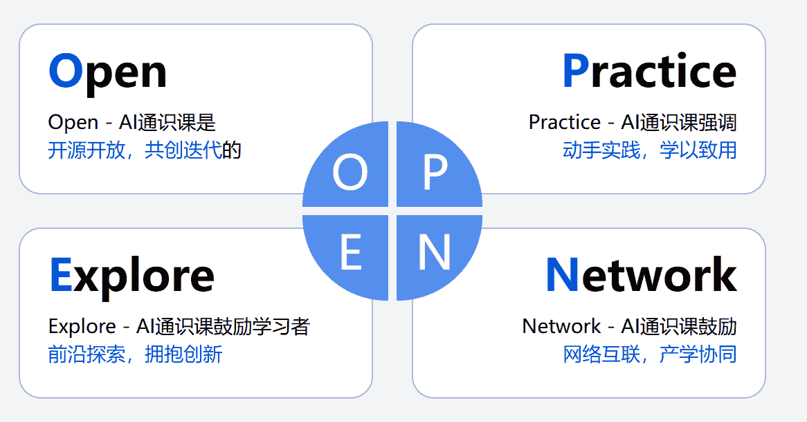

# 📚 OPEN 1+X AI通识课 有什么？

> 除了体系化的知识外、我们认为学习不能仅限于知识理解，

> 更要 **与****知识****连接，与****人****连接，与****场景****连接**，学有所用！

> 我们期待通过[**开源学习模式**](https://datawhaler.feishu.cn/wiki/X9AVwtmvyi87bIkYpi2cNGlIn3v#KeYPdz1z7oXOrpx73VscWYZVnzf)，助力AI学习者实现自我成长！推动全球AI人才培养！

>

> [**Datawh**](https://datawhaler.feishu.cn/wiki/WliuwFiufiwK2qkpfRXcKPianhf)ale从2018年开始，每月都会举办线上开源学习活动，帮助 100w+ AI学习者学用AI

> OPEN 1+X AI通识课是一个融合了Datawhale学习要素的成长体系——

+   助力大家通过 AI通识课 打下对未来核心素养的通识基础，

+   逐步实践、创造，有能力持续面向未来的挑战，实现更多可能性

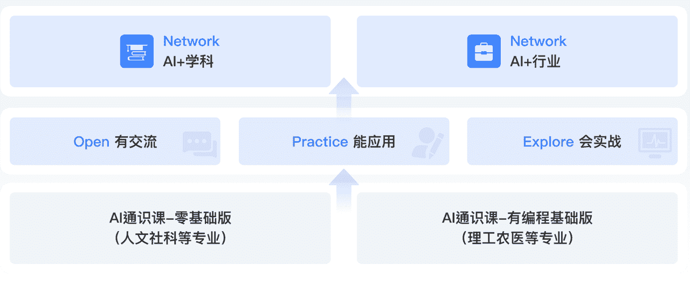

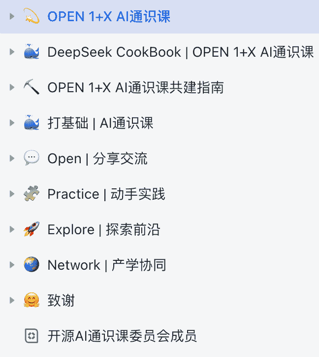

## OPEN 1+X AI 通识课（有编程基础版）大纲

| **章节** | **课程与链接** |
| --- | --- |
| 人工智能导论 | 1. 人工智能的基本概念和发展历史 |
|  | [2. 人工智能的三大学派](https://www.datawhale.cn/learn/content/30/1833) |
|  | 3. 人工智能的主要任务及其应用领域 |
|  | 4. 人工智能对社会发展的影响与未来趋势 |
|  | [5. 人工智能的能与不能](https://www.datawhale.cn/learn/content/30/1833) |
|  | 6. 为什么xx学科也需要学人工智能 |
| 人工智能基础 | [1. 人工智能中的数学基础](https://www.datawhale.cn/learn/content/30/1833) |
|  | 2. 人工智能中的编程基础：Python基础 |
|  | 3. 人工智能中的数据处理基础：NumPy基础 |
|  | 4. 人工智能中的数据处理基础：Pandas基础 |
|  | 5. 人工智能中的数据可视化基础：Matplotlib基础 |
| 人工智能开源工具 | 1. 机器学习框架：scikit-learn |
|  | 2. 深度学习框架：PyTorch |
|  | 3. NLP工具库：transformers |
|  | 4. CV工具库：OpenMMLab |
| 机器学习基础 | [1. 机器学习的基本概念](https://github.com/datawhalechina/pumpkin-book) |
|  | [2. 机器学习的经典模型](https://github.com/datawhalechina/pumpkin-book) |
|  | [3. 机器学习代码实践](https://github.com/datawhalechina/machine-learning-toy-code) |
|  | [4. 机器学习应用案例](https://github.com/datawhalechina/machine-learning-toy-code) |
| 深度学习基础 | 1. 深度学习（神经网络）的基本概念和发展历史 |
|  | [2. 神经网络的优化方法](https://github.com/datawhalechina/leedl-tutorial) |
|  | [3. 经典神经网络：CNN、ResNet、RNN、L](https://github.com/datawhalechina/leedl-tutorial)STM、Transformer、GPT等 |
|  | [4. 深度学习代码实践](https://github.com/datawhalechina/leedl-tutorial) |
|  | [5. 深度学习应用案例](https://github.com/datawhalechina/leedl-tutorial) |
| 大模型理论与实践 | 1. 大模型基础：数据、架构、训练 |
|  | 2. 大模型微调：全参数微调、PEFT微调 |
|  | 3. 大模型应用技术：Prompt工程、RAG、Agent |
|  | 4. 文生图、图生文、图生图、文生视频原理与实践 |
|  | [5. 多模态大模型原理与实践](https://github.com/datawhalechina/hugging-sd) |
| 强化学习基础 | [1. 强化学习原理](https://github.com/datawhalechina/easy-rl) |
|  | [2. 强化学习经典算法](https://github.com/datawhalechina/easy-rl) |
|  | [3. 强化学习的应用](https://github.com/datawhalechina/easy-rl) |
| 人工智能安全与伦理 | 1. 人工智能安全介绍 |
|  | 2. 人工智能伦理介绍 |
| 人工智能综合应用实践 | [人工智能综合应用实践](https://github.com/datawhalechina/llm-universe) |

## OPEN 1+X AI通识课（零基础版）大纲

| 章节 | 课程与链接 |
| --- | --- |
| 人工智能导论 | 1. 人工智能的基本概念和发展历史 |
|  | [2. 人工智能的三大学派](https://www.datawhale.cn/learn/content/30/1833) |
|  | [3](https://www.datawhale.cn/learn/content/30/1833). 人工智能的主要任务及其应用领域：分类、回归、计算机视觉、自然语言处理、推荐系统、语音识别和生成、决策优化、生成式（AIGC）等 |
|  | 4. 人工智能对社会发展的影响与未来趋势 |
|  | [5. 人工智能的能与不能](https://www.datawhale.cn/learn/content/30/1833) |
|  | 6. 为什么xx学科也需要学人工智能 |
| AI常用工具——文本工具篇 | 1. 大模型原理简介 |
|  | 2. 国内文本AI工具介绍与使用 |
|  | 3. 文本提示词工程&amp;优化方法 |
|  | 4. 应用在xx学科领域的具体案例 |
| AI常用工具——图像工具篇 | 1. 文生图/视频模型原理简介 |
|  | 2. 国内文生图/视频AI工具介绍与使用 |
|  | 3. 图像提示词工程&amp;优化方法 |
|  | 4. 应用在xx学科领域的具体案例 |
| AI常用工具——语音工具篇 | 1. 语音识别/合成模型原理简介 |
|  | 2. 国内语音识别/合成AI工具介绍与使用 |
|  | 3. 应用在xx学科领域的具体案例 |
| AI常用工具——智能体篇 | 1. 智能体原理简介 |
|  | 2. 国内智能体工具介绍与使用 |
|  | 3. 智能体设计思路与技巧 |
|  | 4. 智能体应用在xx学科领域的具体案例 |
| 人工智能安全与伦理 | 1. 人工智能安全介绍 |
|  | 2. 人工智能伦理介绍 |
| 人工智能综合应用实践 | [人工智能综合应用实践](https://github.com/datawhalechina/llm-universe) |

## 飞书知识库内容汇总

<https://datawhaler.feishu.cn/share/base/dashboard/shrcnuKrd4bTHBXkviO8JCtbVCc?iframeFrom=docx&ccm_open=iframe>

知识库中收录的所有内容，都可以通过《OPEN 1+X 内容查查看》进行查找——

<https://datawhaler.feishu.cn/share/base/query/shrcnunSSkKPUPRtfOrZ3GMTHvd>

# 如何学习 OPEN 1+X AI通识课？

## 开始 AI微学习

> 选择自己感兴趣的内容、解决自己想处理的问题

> 借助大家的案例帮你理解AI！

<https://datawhaler.feishu.cn/share/base/dashboard/shrcnJ1u9f1vXRkUSLkBYWifKqf?iframeFrom=docx&ccm_open=iframe>

## 线下共学活动

参与Datawhale [线上线下百校共学活动](https://www.datawhale.cn/activity?activityPage=1)，把OPEN AI通识课带到你的高校里：

参加共学：https://www.datawhale.cn/activity?activityPage=1

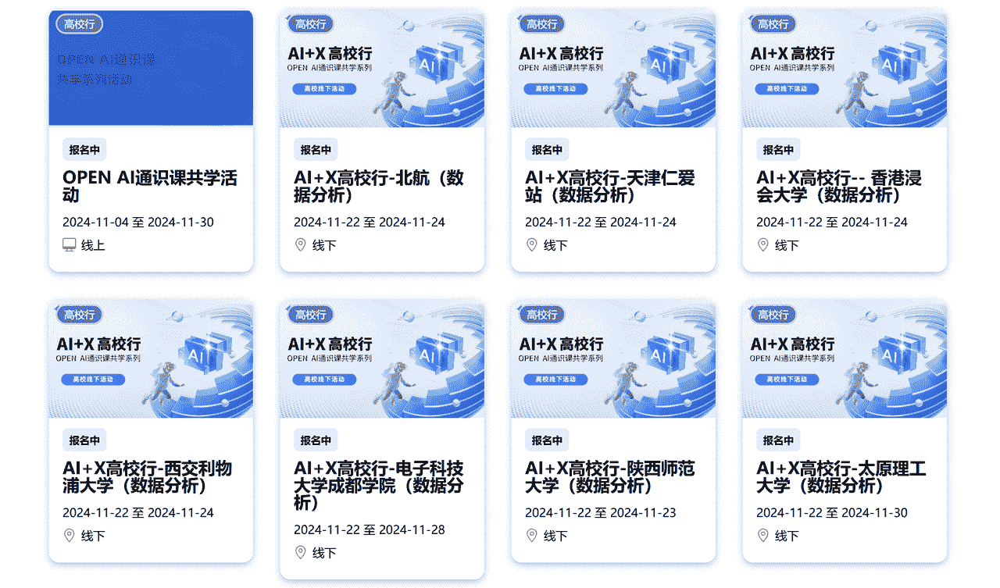

## 学习交流群

**加入🛰️群**

添加**Datawhale鸭**🛰️，回复 “**高校/在职**”

**加入飞书群**

# 🥚 什么是 D[atawhale？](http://datawhale.cn)

---

[**Datawhale**](http://datawhale.cn)** **致力于打造对学习者最有价值的AI开源学习社区，

通过共建、迭代学习内容，搭建 [OPEN 1+X AI通识课](https://datawhaler.feishu.cn/wiki/X9AVwtmvyi87bIkYpi2cNGlIn3v?table=tblUf7zCmZlEFF7N&view=vewMMZ564l)** **体系

每月组织 **Datawhale特色共学活动**，

带领 AI学习者 **动手应用，项目实战，扩展视野**，

助力学习者 **与****知识****连接，与****人****连接，与****场景****连接**

推动 **AI **与各个学科、行业（**X**）结合，

激发 AI+X 的无限**潜力和创造力**，让年轻人找到自己的**更多可能性**

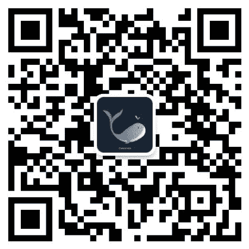

👸号：Datawhale

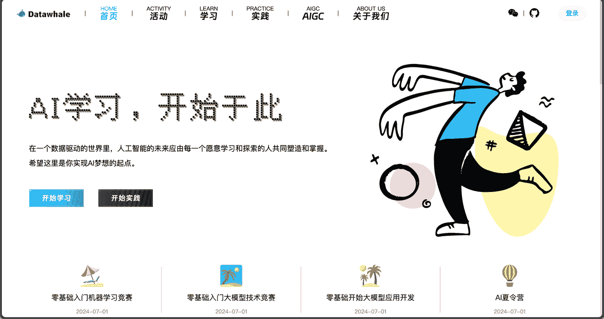

[Datawhale官网](https://datawhale.cn)

开始共同学习

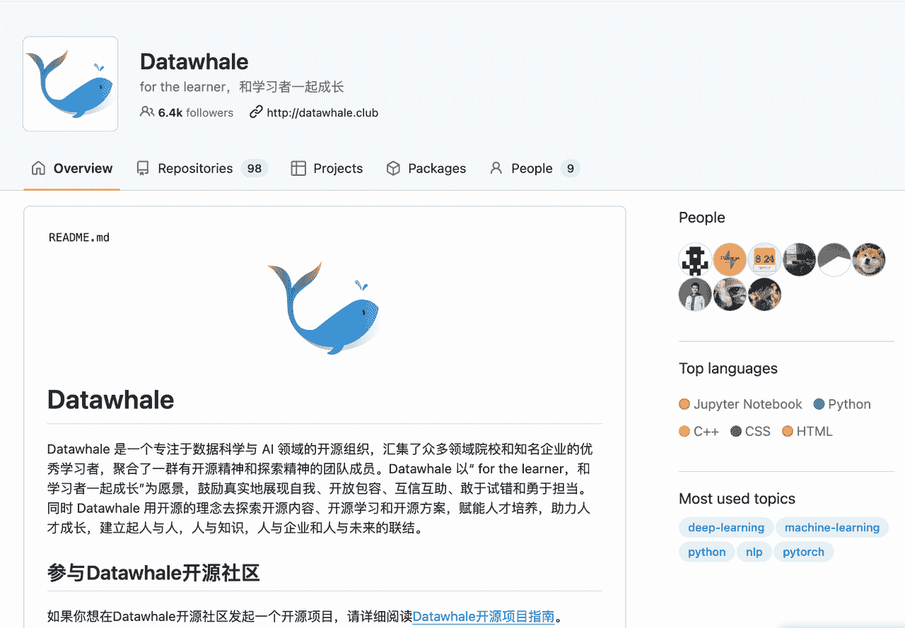

Github: Datawhalechina

动手开发创造

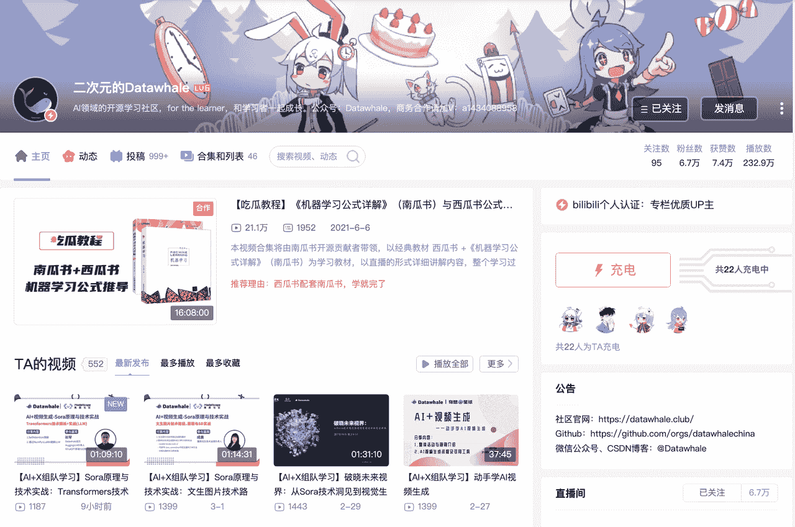

B站：@二次元的Datawhale

视频课程系列

> Datawhale成立于2018年——是国内AI领域最大的开源学习组织，全球github组织排行 TOP70，汇聚了众多有开源精神和探索精神的开源贡献者，致力于构建开源学习社区，和学习者一起成长。

# 🍭 什么是 开源学习模式？

---

> [2023中国人工智能白皮书.pdf](https://datawhaler.feishu.cn/file/QpIIbYm2EoJFQUxGpcmchQArnjb)见《中国人工智能人才学习白皮书》：

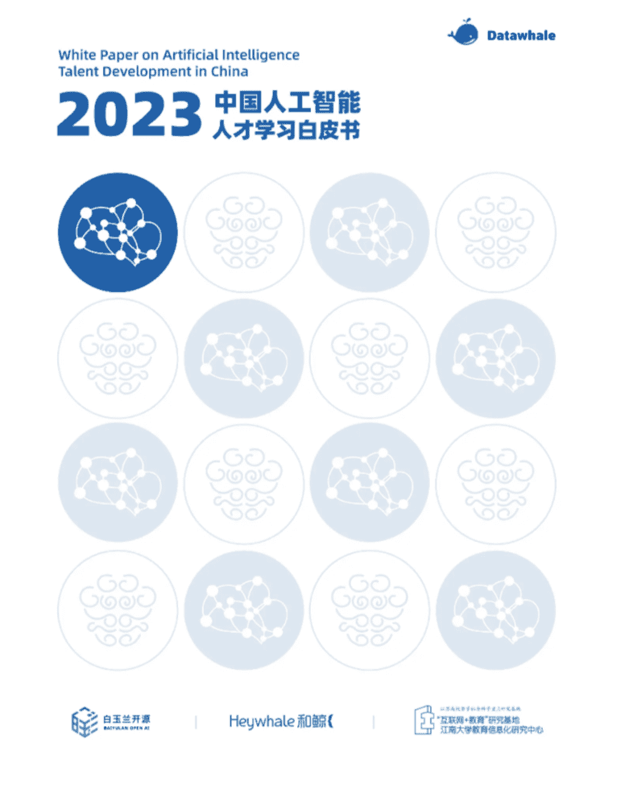

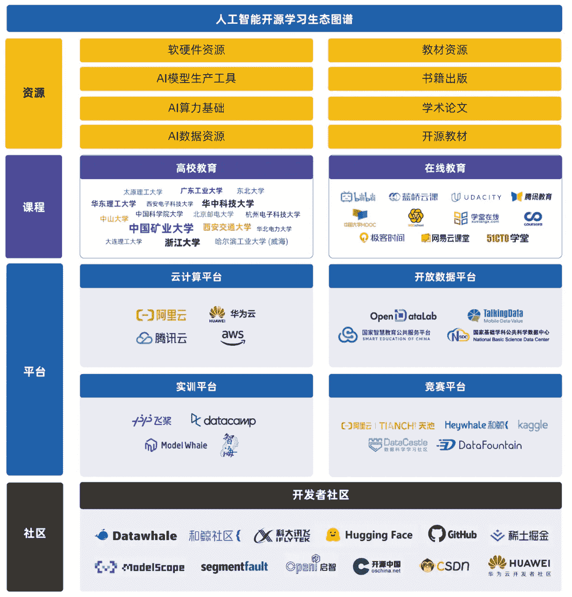

我们坚信开源学习可以不断强化大家的学习自主性，从自身需求出发，激发学习动机和兴趣，从学习者不断成长为创造者

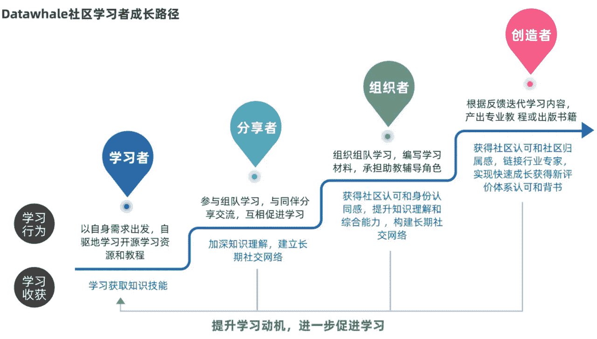

我们鼓励学习者在社区中通过**共学、共创**链接志同道合的同伴，建立**信任和联系**，更鼓励大家成为内容的生产者，网络的连接者，体系的建构者，看见世界，认识自己，参与创造，探索无限可能性。

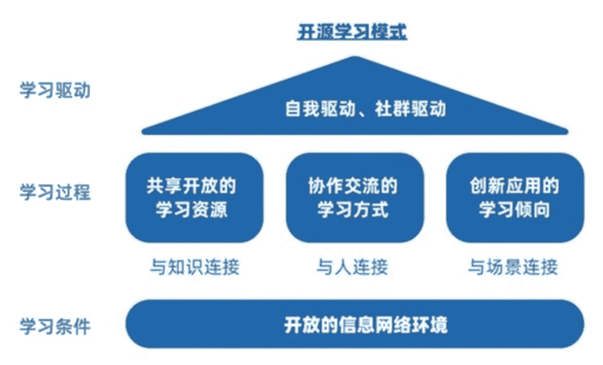

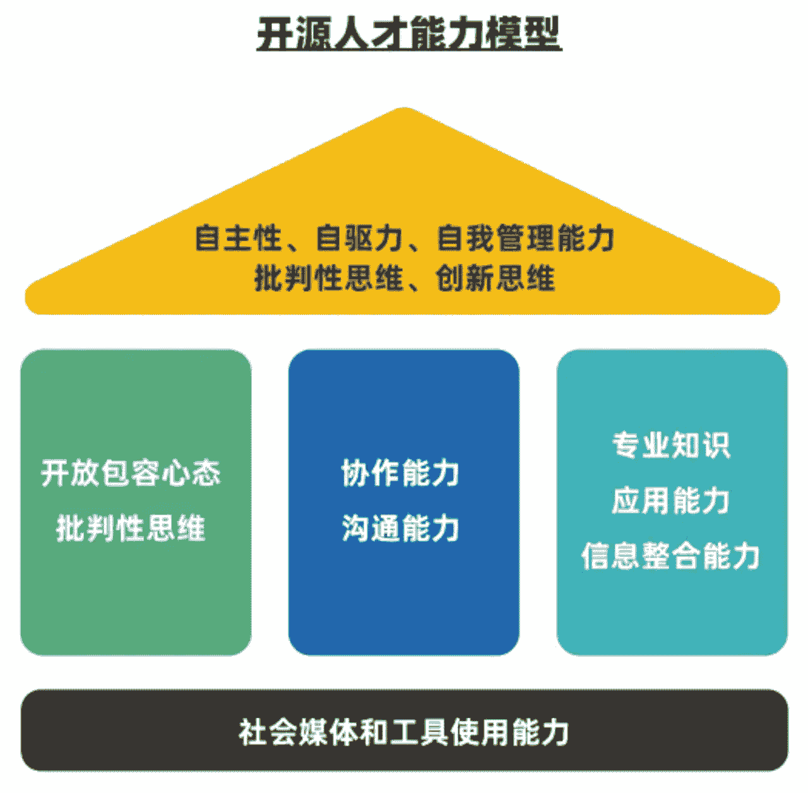

# 如果你也想分享知识！

## 参与学习 & 投稿AI通识课

<https://datawhaler.feishu.cn/sync/AbYkdEkwYs6dHbbNLNEcDaVGnmh>

## 参与Datawhale社区贡献

### [🌏 生态合作伙伴](https://datawhaler.feishu.cn/docx/UAFjdrSBBo9hJDxeIsYc6ilYnvc?from=from_copylink)

---

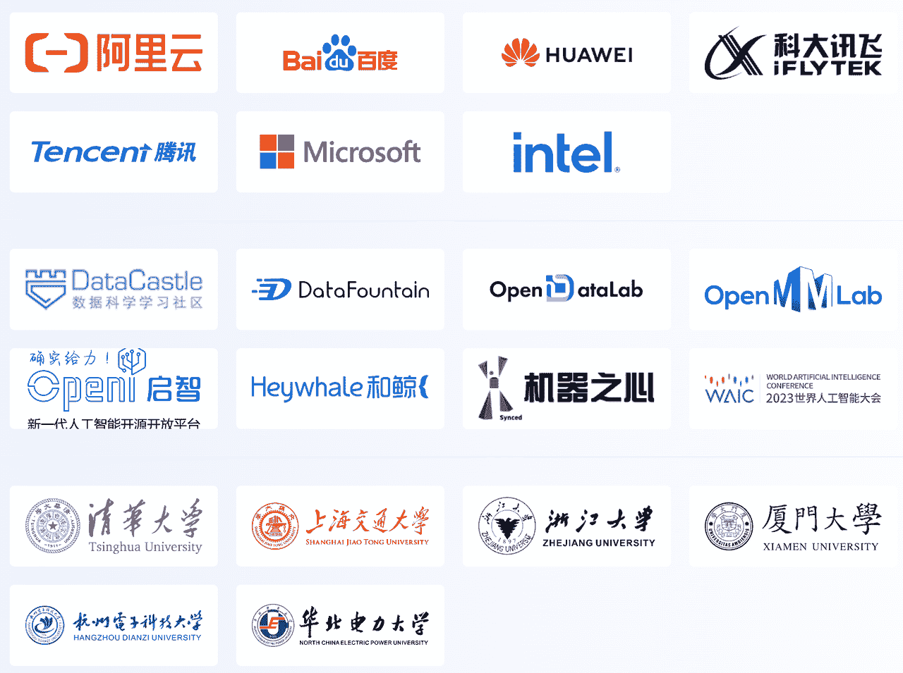

### 🥰 [致谢](https://datawhaler.feishu.cn/wiki/DsqawSqgqiisp3knFNncREEHnje)

💐 致敬Datawhale课程背后可爱的贡献者们

薛传雨、王复振、杨煜、闫钟峰、杨梦迪、苏鹏、徐旺华、张晋、汪健麟、杨佳达、耿远昊、郝少春、谢文睿、秦州、贾彬彬、居凤霞、马晶敏、周天烁、叶梁、胡风范、陈安东、金娟娟、老表、李玲、高立业、张文涛、李祖贤、六一、陈琰钰、杨剑砺、李运佳、皮钱超、詹好、王茂霖、李一飞、杨昱文、刘羽中、王贺、刘洋、王佳旭、金一鸣、李嘉骐、牛志康、罗如意、吴忠强、何世福、徐何军、李万业、陈锴、梁家晖、宁彦吉、田雨、赖敏材、汪志鸿、王辰玥、唐鑫、宋禹成、王琦、杨毅远、江季、陈信达、安晟、闫永强、宋志龙、沈豪、袁明坤、王程伟、张强、游璐颖、樊亮、杨皓博、康兵兵、刘太路、芙蕖、聂平、张帆、张贤、李泺秋、蔡杰、hlzhang、台运鹏、张红旭、陈海顺、聂雄伟、杰少、王鹏、骆秀韬、王洲烽、蒋志政、王嘉鹏、胡锐锋、长琴、黄玉琳、易华挥、邹雨衡、徐虎、刘伟鸿、Joye、魂兮、宋志学、韩颐堃、陈逸涵、仲泰、万礼行、小饭同学、诸世纪、Zhang Yixin、Sarai

#