# 保姆级的注册教程

> 来源：[https://e0lrm2v2v1u.feishu.cn/docx/LNhydvkvCoiMi4xgdnPcwad0n0f](https://e0lrm2v2v1u.feishu.cn/docx/LNhydvkvCoiMi4xgdnPcwad0n0f)

### ** CHATGP****T 注册流**程

流程如下：确认网络环境→ 网页注册→ 邮箱验证→手机号码验证→登录使用

**注册/登录环境要求：**

+   注册和登陆需要安全上网（一定要开全局模式），即网络的IP属于国外（大陆、香港、澳门等地区不能用）。

+   美国、新加坡等区域可以（注册前请确认自己的环境）。

+   需要有一个可以接收验证码的国外手机号，同样地区也是如上述网络环境之外的地区手机号，也可以使用虚拟手机号（注意部分虚拟手机号的厂家无法接受验证码，请注意甄别）。

## **1.进入注册**

打开[ChatGPT](http://mp.weixin.qq.com/s?__biz=MjM5NzYyNDAyMA==&mid=2453527407&idx=1&sn=df598aa8f8e13dc8d8ee1a0282ec301e&chksm=b11e5ad48669d3c2314fb4a3802374c93fe97bdb45bfaf6985699fe63a04b82d458c1423308a&scene=21#wechat_redirect)的官方网站，链接为 https://chat.openai.com，然后点击【Sign Up】进入下一步。

如果页面无法正常显示，需要更换其他的网络节点，或者清理下浏览器cookie再次尝试。

## **2. 邮箱注册**

注册方式为邮箱注册，推荐使用outlook或者Gmail邮箱。Outlook邮箱可以去outlook.com先注册好。

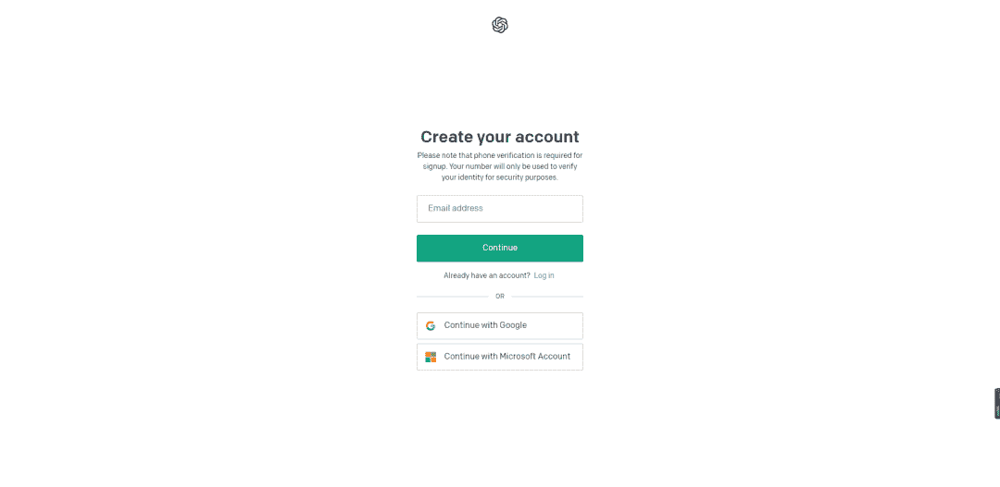

## **3. 填写姓名信息**

邮箱通过后，会提示输入姓名，按照要求进行输入即可。如果显示该IP地址注册数量过多，则需要更换节点（更换节点时，无需对浏览器进行重启，刷新页面即可）。

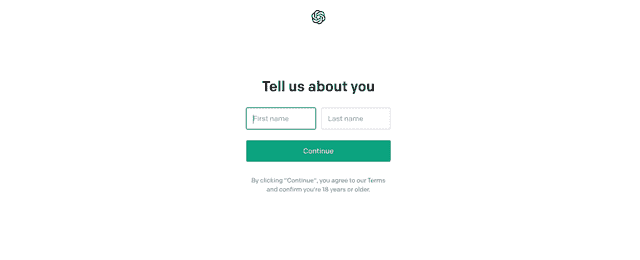

## **4. 验证手机号**

随后将会进入手机验证的环节，记住：这里不能选择国内的手机号，国内的手机号无法进行注册。

有境外手机号码的直接使用。没有境外手机号码的号码接受短信验证码的，请参考以下部分

接码平台推荐使用RU的 https://sms-activate.org，具体操作如下：

1）进入 SMS-Activate是在线接受短信的虚拟号码服务 首页，选择右上角【注册】按钮，在弹出的窗口中继续选择【注册】按钮：

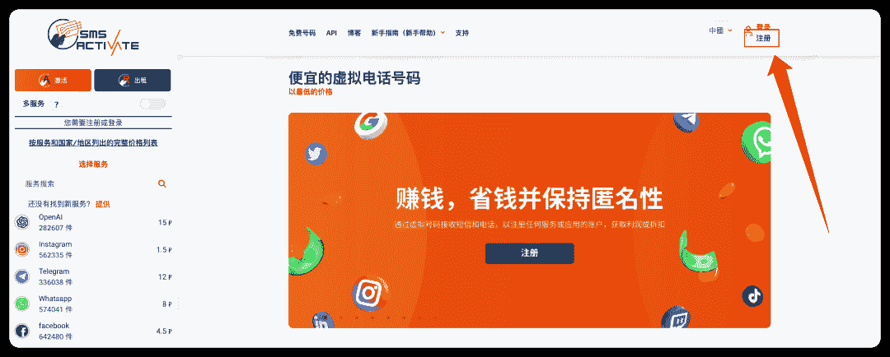

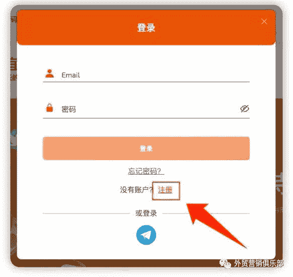

2）使用邮箱注册（不建议用国内的邮箱，避免收不到问题，最好是Gmail之类的），密码长度在8位以上且必须包含拉丁字母和数字，至少一个大写字母。

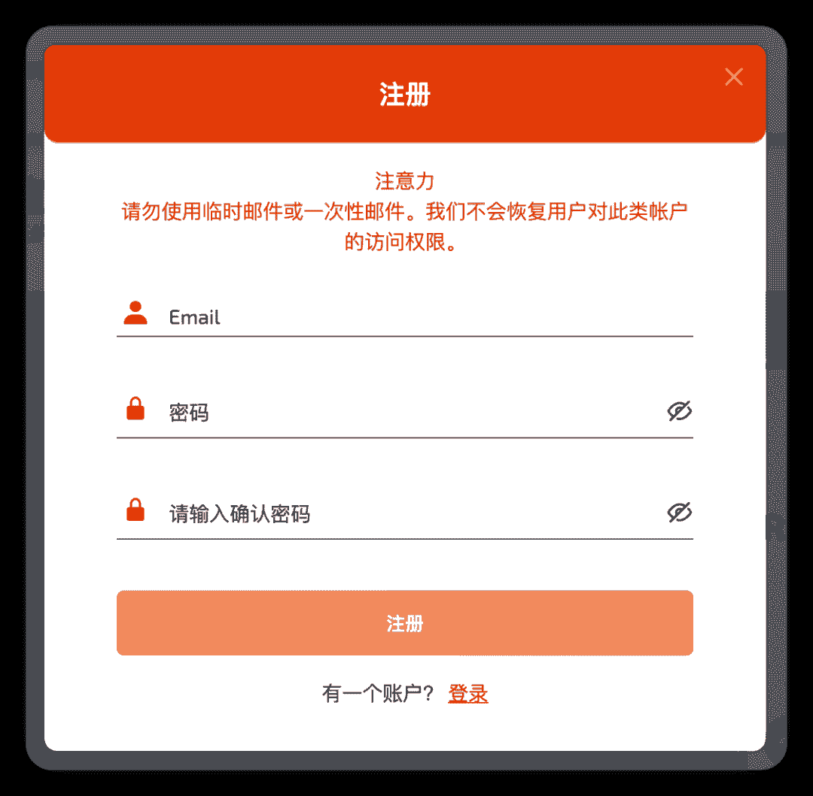

3）输入信息后，点击下方【注册】按钮，顶部会有提示“我们怀疑你是人类。请通过机器人验证”的字样，不用任何操作，稍等一下就好（不超过5秒）。

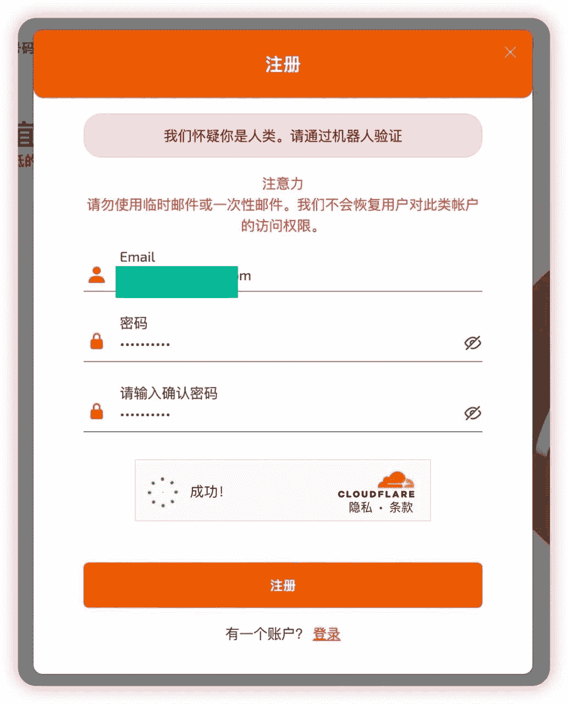

4）验证成功后，看到底部显示绿色钩状的“成功”，再次点击【注册】按钮。

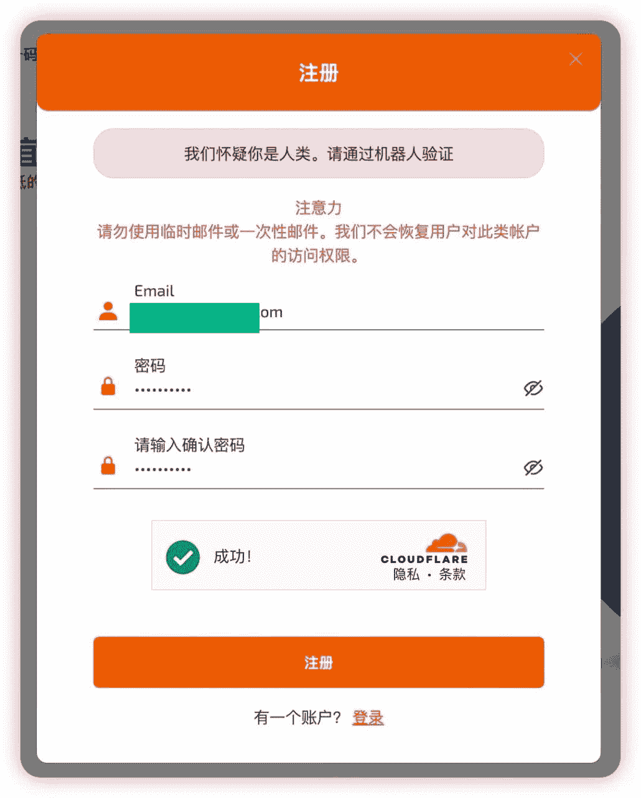

5）点击【注册】后，会自动清空注册的邮箱密码，然后提示你去看邮件。

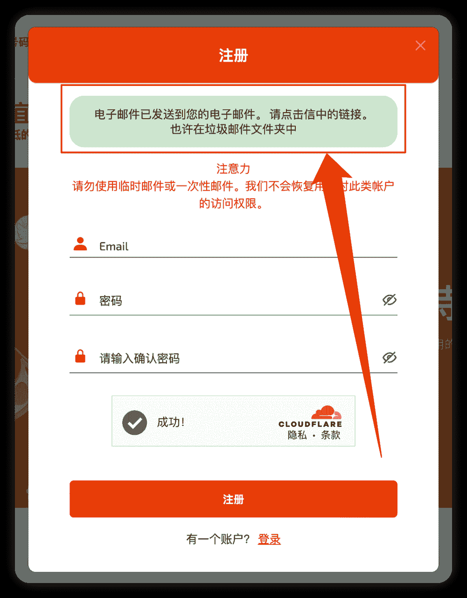

6）登录你的邮箱，然后你会收到一封标题为《确认电子邮件来注册SMS-Activate账户》这样的邮件，点击邮件中的【确认】按钮：

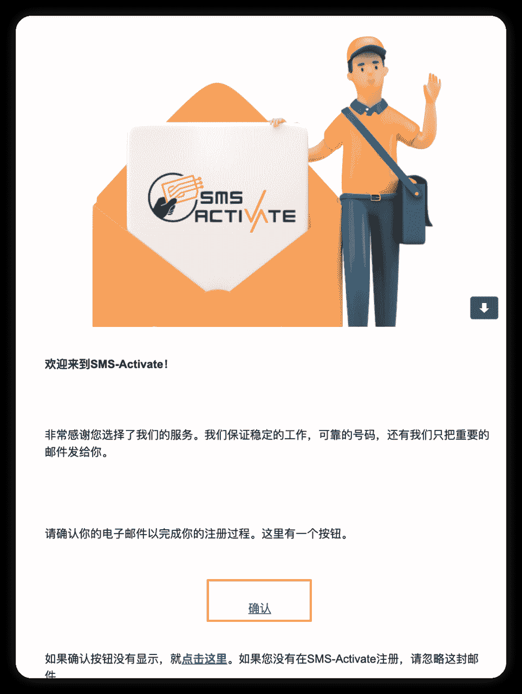

如果收件箱找不到，看一下垃圾箱或者黑名单/规则之类是不是过滤掉了。如果实在没有，建议换一个邮箱试试。

7）确认账号注册成功后，登录平台，不过账号还需要充值才能使用，可以使用支付宝充值。还是右上角，选择【余额】，然后选择【充值】按钮：

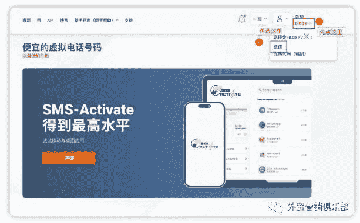

充值是充入美元，使用的是算卢布，具体原因大家自己发散～

8）渠道类型上，有对应银行卡的可以选择银行卡，没有就继续往下滑，选择支付宝：

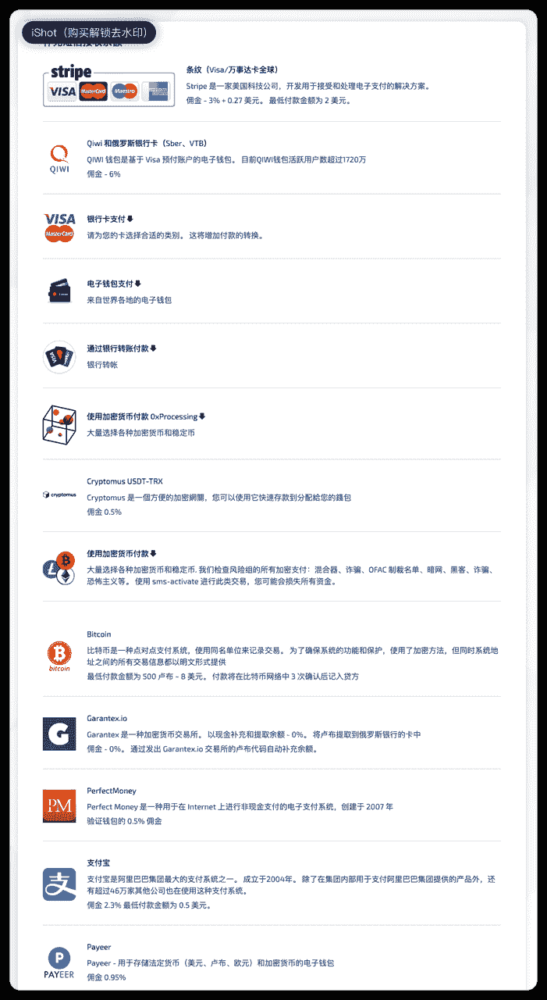

9）在支付页面上，应付金额填入1，充1美元，然后点击【支付】按钮，在弹出的支付宝页面扫码付款：

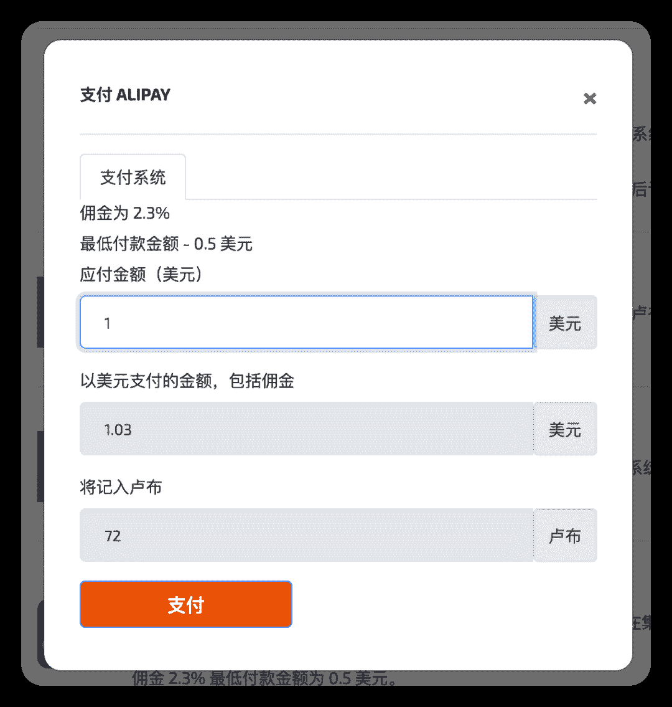

付完款后，按当天的汇率，1美元能换72卢布，一个号码是15卢布，大概可以注册4次。

10）充值完成后，注意看个人页面右上角的余额有没有变化。然后看左侧，找到“openAI”这个，点击展开（如果没有，在选择服务-服务搜索里直接搜索一下）：

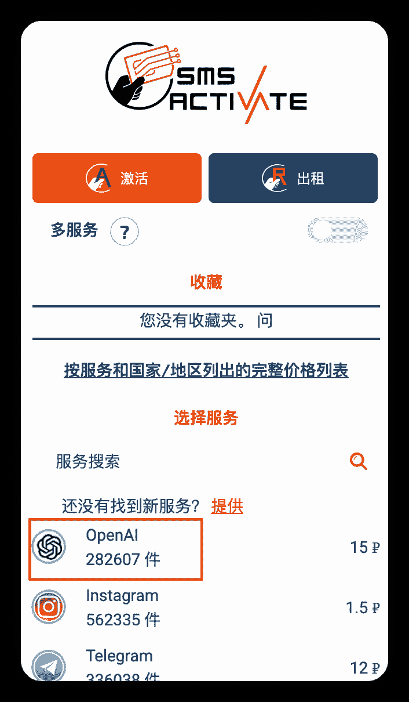

11）在展开的列表里，姓名随便输一个，第二个是加载方式随便选，然后打开【号码验证】的开关：

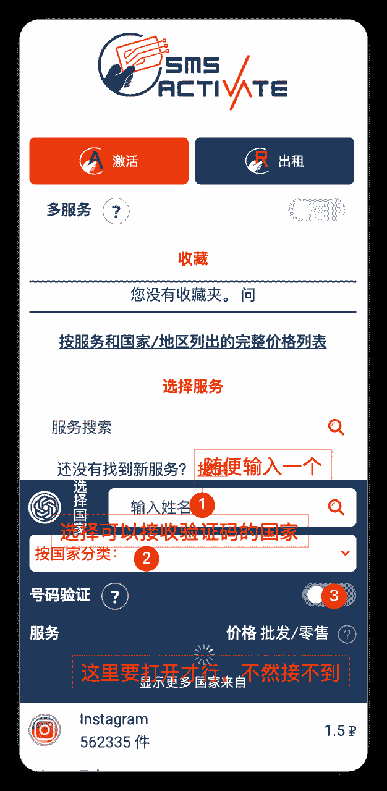

12）接着，选择手机号码的归属地，哪个便宜买哪个。选好后直接点击对应国家后面的购物车图片即可：

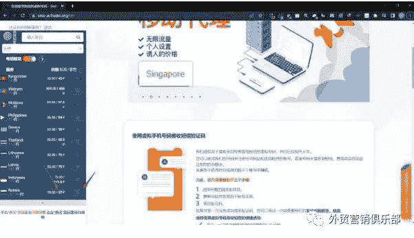

[13）如果确认](http://mp.weixin.qq.com/s?__biz=MjM5NzYyNDAyMA==&mid=2453527407&idx=1&sn=df598aa8f8e13dc8d8ee1a0282ec301e&chksm=b11e5ad48669d3c2314fb4a3802374c93fe97bdb45bfaf6985699fe63a04b82d458c1423308a&scene=21#wechat_redirect)这个手机号可以使用，那么点击激活。激活后返回到ChatGPT的页面，填入对应的手机号码，页面会自动显示出收到的短信。

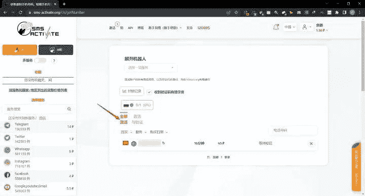

注意，这里显示的号码是包含国家代码的。比如美国手机号+19784348561，这里显示为19784348561，在网站上填写手机号时，需要去掉前面的 1 这个国别代码。另外在接收验证码时，建议使用低价的印尼等手机号，印度经常挤爆收不到；如果长时间没有收到验证码，可更换成其他区域尝试。

重点是：在手机验证页面，一定要注意选择正确的国家（注意国旗）！一定要注意选择正确的国家！一定要注意选择正确的国家！

## **5. 注册完毕**

可以使用[ChatGPT](http://mp.weixin.qq.com/s?__biz=MjM5NzYyNDAyMA==&mid=2453527407&idx=1&sn=df598aa8f8e13dc8d8ee1a0282ec301e&chksm=b11e5ad48669d3c2314fb4a3802374c93fe97bdb45bfaf6985699fe63a04b82d458c1423308a&scene=21#wechat_redirect)了

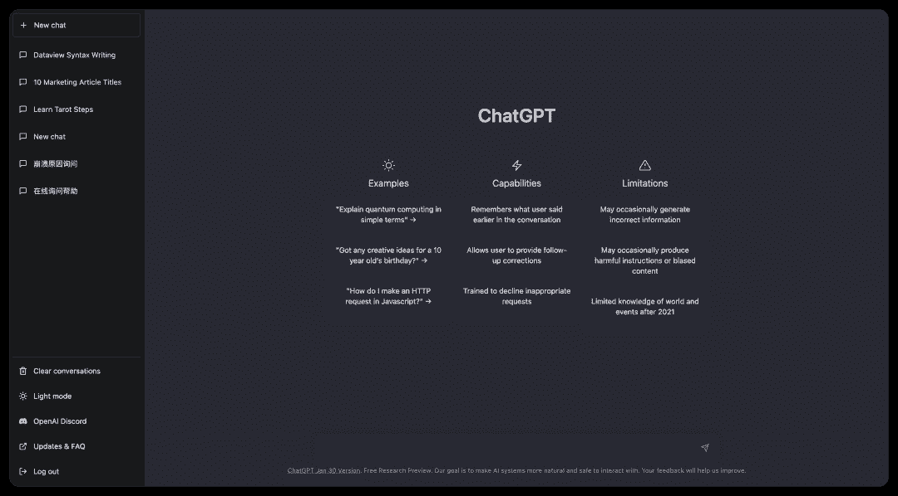

如果在使用过程中出现无法使用的情况，根据个人经验99%都是网络问题，刷新，换节点，或者找你的网络服务商；当然，也有可能是浏览器问题（换个火狐，edge，谷歌浏览器可能就可以了）。