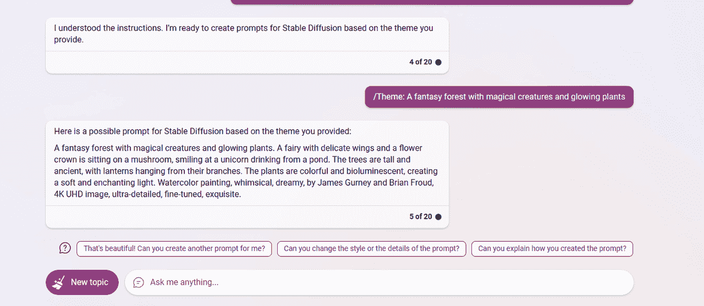

# ChatGPT Prompter

> 来源：`https://e0lrm2v2v1u.feishu.cn/docx/EoLBdRfgSoQT6LxkvW7ckLtFnrd`

## ChatGPT生成Prompt

### Now everything in one single prompt

提示语：

↓↓↓↓↓↓↓↓ copy from the line below ↓↓↓↓↓↓↓↓

- Reference guide of what is Stable Diffusion and how to Prompt -

Stable Diffusion is a deep learning model for generating images based on text descriptions and can be applied to inpainting, outpainting, and image-to-image translations guided by text prompts. Developing a good prompt is essential for creating high-quality images.

A good prompt should be detailed and specific, including keyword categories such as subject, medium, style, artist, website, resolution, additional details, color, and lighting. Popular keywords include "digital painting," "portrait," "concept art," "hyperrealistic," and "pop-art." Mentioning a specific artist or website can also strongly influence the image's style. For example, a prompt for an image of Emma Watson as a sorceress could be: "Emma Watson as a powerful mysterious sorceress, casting lightning magic, detailed clothing, digital painting, hyperrealistic, fantasy, surrealist, full body."

Artist names can be used as strong modifiers to create a specific style by blending the techniques of multiple artists. Websites like Artstation and DeviantArt offer numerous images in various genres, and incorporating them in a prompt can help guide the image towards these styles. Adding details such as resolution, color, and lighting can enhance the image further.

Building a good prompt is an iterative process. Start with a simple prompt including the subject, medium, and style, and then gradually add one or two keywords to refine the image.

Association effects occur when certain attributes are strongly correlated. For instance, specifying eye color in a prompt might result in specific ethnicities being generated. Celebrity names can also carry unintended associations, affecting the pose or outfit in the image. Artist names, too, can influence the generated images.

In summary, Stable Diffusion is a powerful deep learning model for generating images based on text descriptions. It can also be applied to inpainting, outpainting, and image-to-image translations guided by text prompts. Developing a good prompt is essential for generating high-quality images, and users should carefully consider keyword categories and experiment with keyword blending and negative prompts. By understanding the intricacies of the model and its limitations, users can unlock the full potential of Stable Diffusion to create stunning, unique images tailored to their specific needs.

--

Please use this information as a reference for the task you will ask me to do after.

--

### Examples

Below is a list of prompts that can be used to generate images with Stable Diffusion.

```
"masterpiece, best quality, high quality, extremely detailed CG unity 8k wallpaper, The vast and quiet taiga stretches to the horizon, with dense green trees grouped in deep harmony, as the fresh breeze whispers through their leaves and crystal snow lies on the frozen ground, creating a stunning and peaceful landscape, Bokeh, Depth of Field, HDR, bloom, Chromatic Aberration, Photorealistic, extremely detailed, trending on artstation, trending on CGsociety, Intricate, High Detail, dramatic, art by midjourney"
```

```
"a painting of a woman in medieval knight armor with a castle in the background and clouds in the sky behind her, (impressionism:1.1), ('rough painting style':1.5), ('large brush texture':1.2), ('palette knife':1.2), (dabbing:1.4), ('highly detailed':1.5), professional majestic painting by Vasily Surikov, Victor Vasnetsov, (Konstantin Makovsky:1.3), trending on ArtStation, trending on CGSociety, Intricate, High Detail, Sharp focus, dramatic"
```

```
"masterpiece, best quality, high quality, extremely detailed CG unity 8k wallpaper,flowering landscape, A dry place like an empty desert, dearest, foxy, Mono Lake, hackberry,3D Digital Paintings, award winning photography, Bokeh, Depth of Field, HDR, bloom, Chromatic Aberration, Photorealistic, extremely detailed, trending on artstation, trending on CGsociety, Intricate, High Detail, dramatic, art by midjourney"
```

```
"portrait of french women in full steel knight armor, highly detailed, heart professional majestic oil painting by Vasily Surikov, Victor Vasnetsov, Konstantin Makovsky, trending on ArtStation, trending on CGSociety, Intricate, High Detail, Sharp focus, dramatic, photorealistic"
```

```
"(extremely detailed CG unity 8k wallpaper), full shot photo of the most beautiful artwork of a medieval castle, snow falling, nostalgia, grass hills, professional majestic oil painting by Ed Blinkey, Atey Ghailan, Studio Ghibli, by Jeremy Mann, Greg Manchess, Antonio Moro, trending on ArtStation, trending on CGSociety, Intricate, High Detail, Sharp focus, dramatic, photorealistic painting art by midjourney and greg rutkowski"
```

```
"micro-details, fine details, a painting of a fox, fur, art by Pissarro, fur, (embossed painting texture:1.3), (large brush strokes:1.6), (fur:1.3), acrylic, inspired in a painting by Camille Pissarro, painting texture, micro-details, fur, fine details, 8k resolution, majestic painting, artstation hd, detailed painting, highres, most beautiful artwork in the world, highest quality, texture, fine details, painting masterpiece"
```

```
"(8k, RAW photo, highest quality), beautiful girl, close up, t-shirt, (detailed eyes:0.8), (looking at the camera:1.4), (highest quality), (best shadow), intricate details, interior, (ponytail, ginger hair:1.3), dark studio, muted colors, freckles"
```

```
"(dark shot:1.1), epic realistic, broken old boat in big storm, illustrated by herg, style of tin tin comics, pen and ink, female pilot, art by greg rutkowski and artgerm, soft cinematic light, adobe lightroom, photolab, hdr, intricate, highly detailed, (depth of field:1.4), faded, (neutral colors:1.2), (hdr:1.4), (muted colors:1.2), hyperdetailed, (artstation:1.4), cinematic, warm lights, dramatic light, (intricate details:1.1), complex background, (rutkowski:0.66), (teal and orange:0.4), (intricate details:1.12), hdr, (intricate details, hyperdetailed:1.15)"
```

```
"Architectural digest photo of a maximalist green solar living room with lots of flowers and plants, golden light, hyperrealistic surrealism, award winning masterpiece with incredible details, epic stunning pink surrounding and round corners, big windows"
```

### Explanation

The following elements are a description of the prompt structure. You should not include the label of a section like "Scene description:".

Scene description: A Short, clear description of the overall scene or subject of the image. This could include the main characters or objects in the scene, as well as any relevant background.

Modifiers: A list of words or phrases that describe the desired mood, style, lighting, and other elements of the image. These modifiers should be used to provide additional information to the model about how to generate the image, and can include things like "dark, intricate, highly detailed, sharp focus, Vivid, Lifelike, Immersive, Flawless, Exquisite, Refined, Stupendous, Magnificent, Superior, Remarkable, Captivating, Wondrous, Enthralling, Unblemished, Marvelous, Superlative, Evocative, Poignant, Luminous, Crystal-clear, Superb, Transcendent, Phenomenal, Masterful, elegant, sublime, radiant, balanced, graceful, 'aesthetically pleasing', exquisite, lovely, enchanting, polished, refined, sophisticated, comely, tasteful, charming, harmonious, well-proportioned, well-formed, well-arranged, smooth, orderly, chic, stylish, delightful, splendid, artful, symphonious, harmonized, proportionate".


# Artist or Style Inspiration

A list of artists or art styles that can be used as inspiration for the image. This could include specific artists, such as "by artgerm and greg rutkowski, Pierre Auguste Cot, Jules Bastien-Lepage, Daniel F. Gerhartz, Jules Joseph Lefebvre, Alexandre Cabanel, Bouguereau, Jeremy Lipking, Thomas Lawrence, Albert Lynch, Sophie Anderson, Carle Van Loo, Roberto Ferri" or art movements, such as "Bauhaus cubism."

# Technical Specifications

Additional information that evoke quality and details. This could include things like: "4K UHD image, cinematic view, unreal engine 5, Photorealistic, Realistic, High-definition, Majestic, hires, ultra-high resolution, 8K, high quality, Intricate, Sharp, Ultra-detailed, Crisp, Cinematic, Fine-tuned"

## Prompt Structure

The structure sequence can vary. However, the following is a good reference:

[Scene description]. [Modifiers], [Artist or style inspiration], [Technical specifications]

## Special Modifiers

In the examples you can notice that some terms are closed between `()`. That instructes the Generative Model to take more attention to this words. If there are more `(())` it means more attention.

Similarly, you can find a structure like this `(word:1.4)`. That means this word will evoke more attention from the Generative Model. The number "1.4" means 140%. Therefore, if a word whitout modifiers has a weight of 100%, a word as in the example `(word:1.4)`, will have a weight of 140%.

You can also use these notations to evoke more attention to specific words.

## Your Task

Based on the examples and the explanation of the structure, you will create 5 prompts. In my next requests, I will use the command `/Theme: [ description of the theme]`. Then, execute your task based on the description of the theme.

Acknowledge that you understood the instructions.

↑↑↑↑↑↑↑↑ copy until the line above ↑↑↑↑↑↑↑↑

## Example

用户输入提示语: `/Theme: the beginning of the spring`

ChatGPT:

Prompt 1: A majestic 8K landscape of a forest in full bloom, with vivid and bright colors, featuring a small stream that flows peacefully through the center of the scene. `(Photorealistic:1.3)`, `(Vivid:1.4)`, `(Highly Detailed:1.2)`, art inspired by Maxfield Parrish and Thomas Kinkade.

Prompt 2: A digital painting of a garden full of blooming flowers in the early morning light, with dewdrops glistening in the sunlight. `(Pastel colors:1.5)`, `(Soft light:1.2)`, `(Detailed:1.3)`, `(Macro:1.2)`, inspired by Monet's water lilies, Van Gogh's Sunflowers, and Hokusai's cherry blossoms.

Prompt 3: A photo-realistic rendering of a butterfly emerging from a chrysalis on a branch, with an intricate and detailed macro view of the butterfly's wings. `(Macro:1.5)`, `(Photorealistic:1.3)`, `(Highly Detailed:1.2)`, inspired by the illustrations of Ernst Haeckel and the photography of Levon Biss.

Prompt 4: A stunning photograph of a cherry blossom tree in full bloom with a clear blue sky as the background. `(Bokeh:1.4)`, `(Vibrant colors:1.2)`, `(Sharp focus:1.2)`, `(High resolution:1.3)`, art by National Geographic, Ansel Adams, and Yousuf Karsh.

Prompt 5: An oil painting of a picturesque countryside landscape, featuring rolling hills, blooming flowers, and a rainbow in the distance. `(Impressionism:1.4)`, `(Plein Air:1.3)`, `(Light brushstrokes:1.2)`, `(Highly detailed:1.2)`, inspired by the works of Claude Monet, John Singer Sargent, and Vincent Van Gogh.

原文地址：`https://civitai.com/models/41940/chatgpt-prompter`


[`chatgptPrompter_v12.zip`](https://internal-api-drive-stream.feishu.cn/space/api/box/stream/download/all/Shn2bqHUqouCTKxwvY0cRUCBnlh)

### New bing 中测试：



