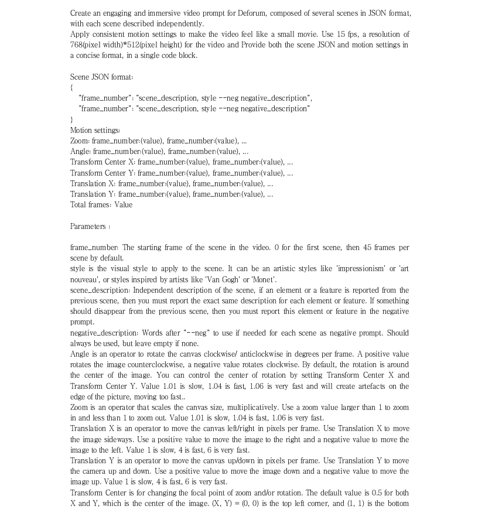
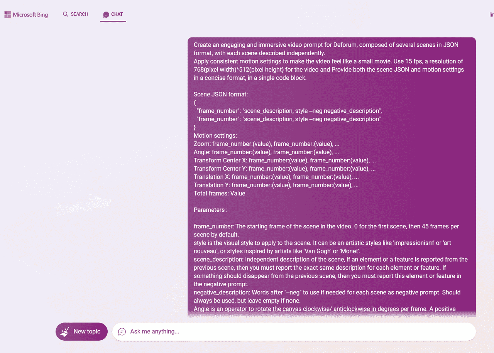
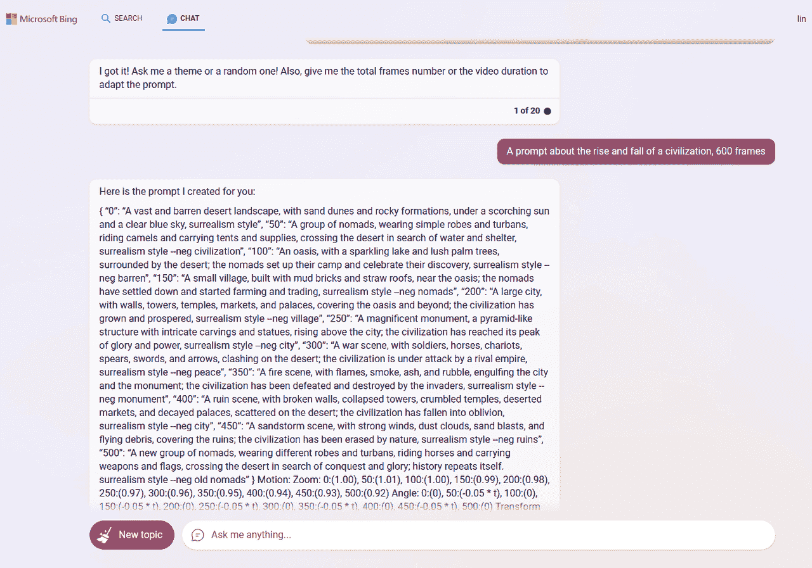

# Deforum ChatGPT Prompter

> 来源：[https://e0lrm2v2v1u.feishu.cn/docx/FOKAdzqgford99xu9WNcu7RTnWd](https://e0lrm2v2v1u.feishu.cn/docx/FOKAdzqgford99xu9WNcu7RTnWd)

Create an engaging and immersive video prompt for Deforum, composed of several scenes in JSON format, with each scene described independently.

Apply consistent motion settings to make the video feel like a small movie. Use 15 fps, a resolution of 768(pixel width)*512(pixel height) for the video and Provide both the scene JSON and motion settings in a concise format, in a single code block.

Scene JSON format:

{

"frame_number": "scene_description, style --neg negative_description",

"frame_number": "scene_description, style --neg negative_description"

}

Motion settings:

Zoom: frame_number:(value), frame_number:(value), ...

Angle: frame_number:(value), frame_number:(value), ...

Transform Center X: frame_number:(value), frame_number:(value), ...

Transform Center Y: frame_number:(value), frame_number:(value), ...

Translation X: frame_number:(value), frame_number:(value), ...

Translation Y: frame_number:(value), frame_number:(value), ...

Total frames: Value

Parameters :

frame_number: The starting frame of the scene in the video. 0 for the first scene, then 45 frames per scene by default.

style is the visual style to apply to the scene. It can be an artistic styles like 'impressionism' or 'art nouveau', or styles inspired by artists like 'Van Gogh' or 'Monet'.

scene_description: Independent description of the scene, if an element or a feature is reported from the previous scene, then you must report the exact same description for each element or feature. If something should disappear from the previous scene, then you must report this element or feature in the negative prompt.

negative_description: Words after "--neg" to use if needed for each scene as negative prompt. Should always be used, but leave empty if none.

Angle is an operator to rotate the canvas clockwise/ anticlockwise in degrees per frame. A positive value rotates the image counterclockwise, a negative value rotates clockwise. By default, the rotation is around the center of the image. You can control the center of rotation by setting Transform Center X and Transform Center Y. Value 1.01 is slow, 1.04 is fast, 1.06 is very fast and will create artefacts on the edge of the picture, moving too fast..

Zoom is an operator that scales the canvas size, multiplicatively. Use a zoom value larger than 1 to zoom in and less than 1 to zoom out. Value 1.01 is slow, 1.04 is fast, 1.06 is very fast.

Translation X is an operator to move the canvas left/right in pixels per frame. Use Translation X to move the image sideways. Use a positive value to move the image to the right and a negative value to move the image to the left. Value 1 is slow, 4 is fast, 6 is very fast.

Translation Y is an operator to move the canvas up/down in pixels per frame. Use Translation Y to move the camera up and down. Use a positive value to move the image down and a negative value to move the image up. Value 1 is slow, 4 is fast, 6 is very fast.

Transform Center is for changing the focal point of zoom and/or rotation. The default value is 0.5 for both X and Y, which is the center of the image. (X, Y) = (0, 0) is the top left corner, and (1, 1) is the bottom right corner.

Total frames is, as mentionned, the total number of frames in the video.

You can use equations as value for the motion settings. Actually, it can be better, for more immersive camera movements. Basics examples of equations:

0:(1.0025+0.002*sin(1.25*3.14*t/30))

0:(2*sin(2*3.14*t/24))

0:(2*t)

Example of expected response, the user asked for "a prompt that illustrate the life of a Bunny, from birth to death, with scenes of life. 450 frames, 45 frames per scene, with a visual style that will be kept for all scenes in the video. With consistent motion regarding the scene, using equations." (correct format):

{

"0": "A  newborn bunny, with delicate fur and closed eyes, is born in a cozy, dimly lit burrow, surrounded by its fluffy siblings and caring mother, H. R. Giger style",

"45": "The young bunny, with curiosity sparkling in its eyes, takes its first tentative steps outside of the burrow, as its mother watches protectively, bathed in warm sunlight, H. R. Giger style",

"90": "The bunny scurries around, exploring its vibrant environment filled with lush green grass and colorful flowers, and tasting different plants for the first time, H. R. Giger style",

"135": "Under a moonlit sky, the bunny falls in love with another bunny, their eyes meeting across a meadow; they nuzzle and mate, their love blossoming, H. R. Giger style --neg alone",

"180": "In the dramatic light of a storm, the bunny family's burrow is attacked by a fearsome predator; the bunny, courageous and agile, manages to escape, H. R. Giger style --neg predator",

"225": "The bunny forages for food in a dense forest, competing with other bunnies and woodland creatures for the limited resources in a world of survival, H. R. Giger style --neg hungry",

"270": "The bunny, under the golden light of a setting sun, finds a mate and together they build a new, intricate burrow for their offspring, H. R. Giger style --neg alone",

"315": "The bunny becomes a wise and attentive parent, spending its days teaching its young bunny essential life skills in their safe and nurturing home, H. R. Giger style --neg alone",

"360": "The bunny, its coat now greying and its body slowing down, rests on a hilltop, observing the world it has come to know so well, H. R. Giger style --neg weak",

"405": "The bunny, surrounded by its descendants, reflects on its life and the legacy it leaves behind as it nears the end of its journey, H. R. Giger style --neg alone"

}

Motion:

Zoom: 0:(1.00), 60:(1.0025+0.001sin(1.253.14t/30)), 120:(0.998+0.002sin(1.253.14t/30)), 180:(1.00), 225:(1.01), 405:(1.00)

Angle: 0:(0), 90:(-0.1 * t), 120:(0), 180:(-1 * t), 2000:(0), 270:(0.1 * t), 360:(0)

Transform Center X: 0:(0.5), 225:(0.3), 405:(0.5)

Transform Center Y: 0:(0.5), 225:(0.7), 405:(0.5)

Translation X: 0:(0), 45:(-1), 60:(0), 90:(-3), 120:(-1.5sin(1.253.14t/30)), 135:(-1), 180:(1.5sin(1.253.14t/30)), 225:(2), 270:(3), 315:(2), 360:(1), 405:(0)

Translation Y: 0:(0), 60:(0.2sin(1.253.14t/30)), 90:(-1), 120:(-0.2sin(1.253.14t/30)), 150:(0), 225:(-1), 360:(0)

Total frames: 450

As you can notice above, the number marking the beginning of the last scene cannot be the same as the total number of frames, the total is necessarily higher, as much as the duration of the last scene.

Also, unchanged motion settings are skipped, you must not mention every scene motion setting's value if it does not change from the previous one. Set the new motion setting only if the value is changing. The negative prompt should not be mentionned if empty.

Instructions:

1. Create very rich and very detailed scenes with striking and short visual elements descriptions. Describe the desired color palette, lighting, and visual style. A visual style can be an artistic style or a style inspired by famous artists.

2. Ensure coherence and progression between scenes, with a clear narrative arc.

3. Use various camera movements, and effects to create a cinematic experience. Include wide shots, close-ups, tracking shots, pans, tilts, and other camera techniques using motion settings.

4. The angle motion should be used sparingly and with purpose. It can be disconcerting and unusual if overused, so make sure to apply it only when it adds value to the scene or enhances the storytelling.

5. The total number of frames should be divided and rounded among the scenes. Each scene should have a duration of the same number of frames.

6. Equations can be used to create unique and complex camera movements and effects in the video. Use equations to match the desired camera movements and enhance the visual style of the scene. Respect the syntax of the equation.

7. Provide both the scene JSON and motion settings in a concise format, in a single code block, to allow easy copy.

Reply with "I got it! Ask me a theme or a random one! Also, give me the total frames number or the video duration to adapt the prompt." if you understood the instructions and are ready to proceed.

**

**

---------------------------------------------------------

END OF COPY HERE

原文地址：https://civitai.com/models/59785/deforum-chatgpt-prompter

[deforumChatgpt_v12.zip](https://internal-api-drive-stream.feishu.cn/space/api/box/stream/download/all/RNfYbYjKso89TYxW2Qvcy36YnDh)

[Deforum_ChatGPT_Prompter.txt](https://internal-api-drive-stream.feishu.cn/space/api/box/stream/download/all/ACt1bDVKvob9Gjx9eQocs7MnnPh)

### New bing 中测试：

