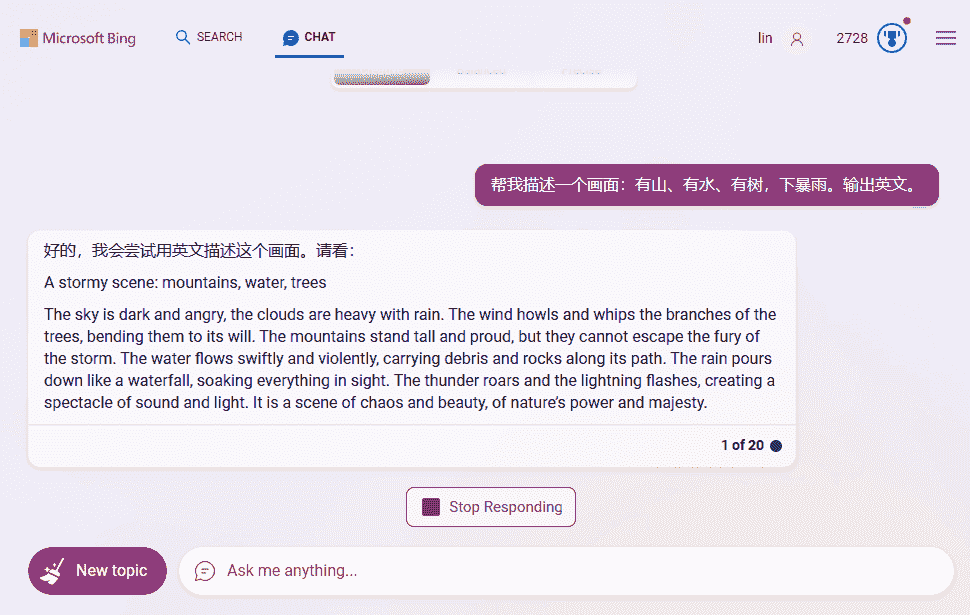
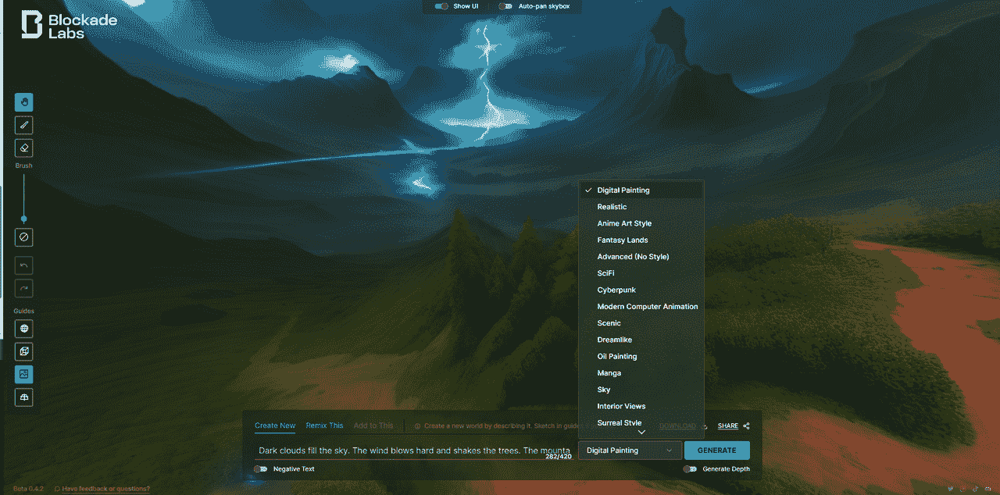
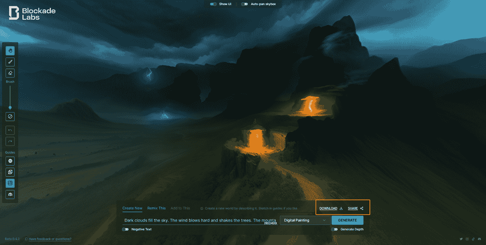

# SKYBOXAI 一个机遇AI的涂鸦转图像网站

> 来源：[https://e0lrm2v2v1u.feishu.cn/docx/WSCqdXC2Vo4aArx8WVacKXQjnkc](https://e0lrm2v2v1u.feishu.cn/docx/WSCqdXC2Vo4aArx8WVacKXQjnkc)

### 引言

你是否曾经想过，如果能够随心所欲地创造出任何你想象中的世界，那该有多么神奇？你是否曾经想过，如果能够用一句话就描述出一个壮观的景象，然后让它在你眼前呈现，那该有多么震撼？这一切，都可以通过 SKYBOXAI 来实现。SKYBOXAI 是一个免费的360°图像生成器，它利用 AI 的强大功能，在几秒钟内为你想象出令人惊叹的世界，并对其进行微调以用于沉浸式 VR、XR 或游戏。你只需要输入一些关键词，就可以得到一个完整的 360 度全景图像，然后你可以点击分享，把你的 360° 世界展示给其他人。

### 功能介绍

1.  目前而言，Skybox AI是一个免费的研究工具。

1.  可以通过添加几个词（例如“开花的草地”或“众神庙”）使用它来创建全景天空盒原型。

1.  可以通过单击“共享”按钮来共享指向您制作的任何天空盒的链接，该按钮会将唯一的URL复制到剪贴板。

### 使用步骤

仅需下面几个简单步骤，Skybox AI 就能生成完整的 360 度全景图像。

1.  我想生成一个暴风雨中的山水画面，使用newbing生成prompt：Dark clouds fill the sky. The wind blows hard and shakes the trees. The mountains are strong but face the storm. The water runs fast and rough. The rain falls hard and wet. The thunder booms and the lightning glows. It is a scene of wildness and wonder, of nature’s force and glory.

1.  将上述prompt输入create new中,点击Generate，开始生成图片。这里我们可以选择的样式很多，每种生成的风格都不相同。

1.  大概半分钟我们就能看到生成的效果图了。网站上的效果图是360度全视角的，可以全方位拖动。

1.  点击download或者share，可以下载图片，分享图片。以下是分享的链接，大家可以自己看看效果吧。

https://skybox.blockadelabs.com/1af1deedf180394237ddd00fd19d1995

### 结语

SKYBOXAI 是一个让人着迷的工具，它让我们能够用语言来创造出美妙的视觉体验。无论你是想要为 VR、XR 或游戏提供背景素材，还是想要为自己或者他人带来惊喜和乐趣，SKYBOXAI 都能满足你的需求。快来试试吧！

最后，推荐一下我的知识库：[苹果爷爷【AI知识库】首页](https://e0lrm2v2v1u.feishu.cn/wiki/wikcn8SwQrC91pMBXERgUvytBug) **这是一个关于****AI****的**知识分享和学习的平台，你可以在这里找到AI相关的最新资讯、教程、工具、案例、研报和社群，让你快速掌握AI的技能和知识，实现AI的应用和变现。