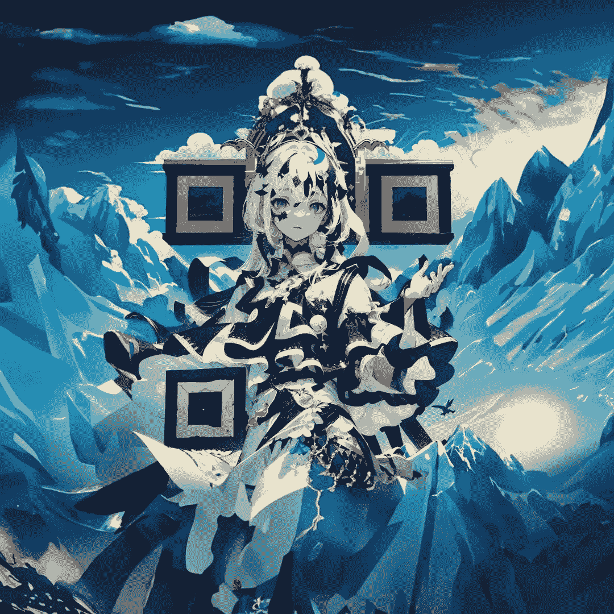
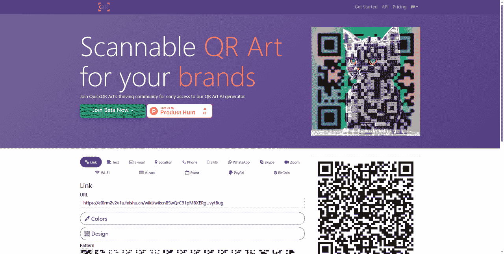
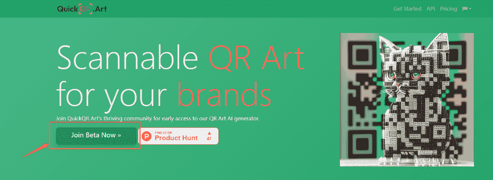
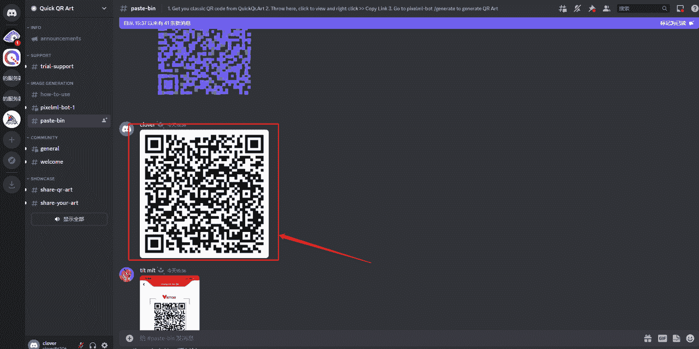
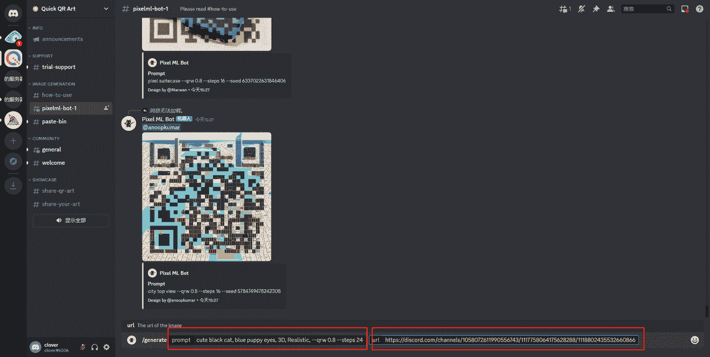
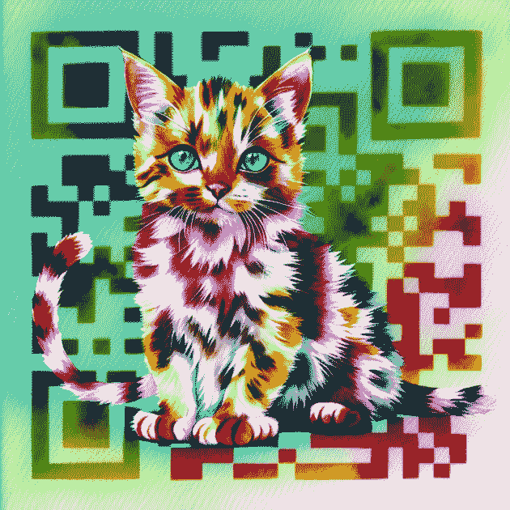

# 用Midjourney创造你自己的艺术二维码，简单又有趣

> 来源：[https://e0lrm2v2v1u.feishu.cn/docx/AaZ8d7gMOoFgHQxkNHLcxdyXnvg](https://e0lrm2v2v1u.feishu.cn/docx/AaZ8d7gMOoFgHQxkNHLcxdyXnvg)

## 引言

你可能已经见过很多普通的二维码，它们通常是黑白的方块，用来存储一些链接或信息。但是，你有没有想过，二维码也可以变成艺术品呢？ 上面这张图看起来很普通，但是当你用手机扫描它时，你会发现它其实是一个链接。它是由Stable Diffusion的插件ControlNet生成的。开发者是国内的一个团队，具体可以看这篇文章https://mp.weixin.qq.com/s/i4WR5ULH1ZZYl8Watf3EPw。这种AI生成的二维码不仅能够传递信息，还能够展示美感和创意。在这篇文章中，我将向你介绍如何使用Midjourney这个神奇的工具，来生成你自己的艺术二维码。只需三个步骤，你就可以拥有一个炫酷的二维码，分享给你的朋友或客户。

## 第一步：创建一个普通的二维码

为此，前往 http://quickqr.art 这个网站，输入你希望二维码指向的链接，并点击“生成”按钮。然后，右键点击二维码图片，选择“另存为”，并将其保存为PNG格式。

## 第二步：加入Midjourney的Discord社区

要加入他们的Discord社区，你只需点击 http://quickqr.art 网站上的“立即加入Beta版”按钮，然后按照提示操作即可。

加入后，你会看到很多不同的频道。其中，“paste-bin”频道是用来上传你的二维码图片的地方。你可以将你刚才保存的PNG文件拖拽到这个频道中，或者点击下方的“+”号图标来选择文件。上传成功后，你会看到一个代表你图片的链接。右键点击这个链接，选择“复制链接地址”，以便下一步使用。

https://media.discordapp.net/attachments/1117758064175628288/1118812744188170260/1686816086575.png

## 第三步：使用Midjourney的机器学习模型来生成艺术化的二维码

这个模型可以根据你输入的文字提示来生成与之匹配的图像，并将其与你的二维码融合在一起。

要使用这个模型，你需要前往“pixelml-bot-1”频道。在这里，你可以输入以下命令：/generate

然后，你会看到两个空白框：prompt和URL。

在prompt框中，你可以输入任何你想要的图像描述。例如：

many 3D Checks --qrw 0.8 --steps 16 --seed 2364034076235037

Hoan Kiem Lake in a sunny morning--qrw 0.8 --steps 16 --seed 2649239020191832

Suzuki car in Dubai --qrw 0.8 --steps 16 --seed 4932759074885710

其中：

"qrw"：决定最终图像对你的二维码的强调程度（取值范围为0到1，越大表示越清晰）

"steps"：图像采样的次数（取值范围为1到32，越大表示越复杂）

"seed"：用于生成初始图像网格的随机数（取值范围为任意整数）

在URL框中，你需要粘贴第二步中复制的链接地址。这样，模型就能识别出你上传的二维码图片，并将其与生成的图像结合起来。

输入完毕后，点击“发送”按钮。稍等片刻，你就会看到你的艺术二维码出现在屏幕上。是不是很惊艳呢？

你可以尝试不同的prompt和参数，来生成不同风格的艺术二维码。你也可以参考其他用户在“showcase”频道中分享的作品，来获取更多的灵感和建议。

下面是一些我觉得很棒的艺术二维码，供你欣赏：

## 结语

希望你喜欢这篇文章，也希望你能用Midjourney来创造出你自己的艺术二维码。如果你有任何问题或反馈，欢迎在评论区留言。