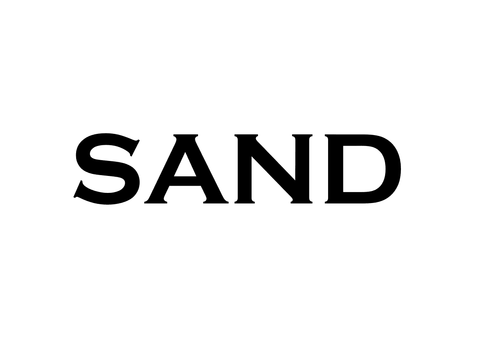
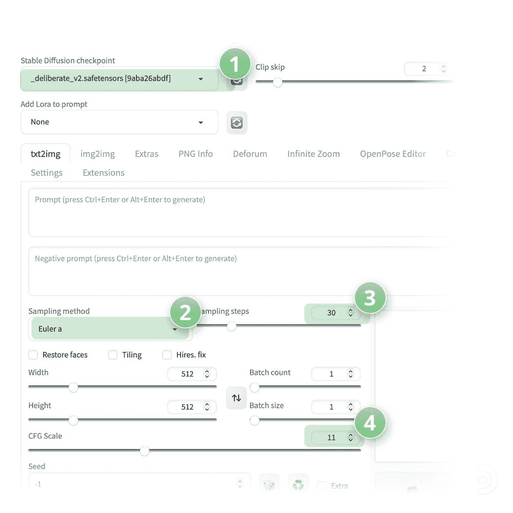
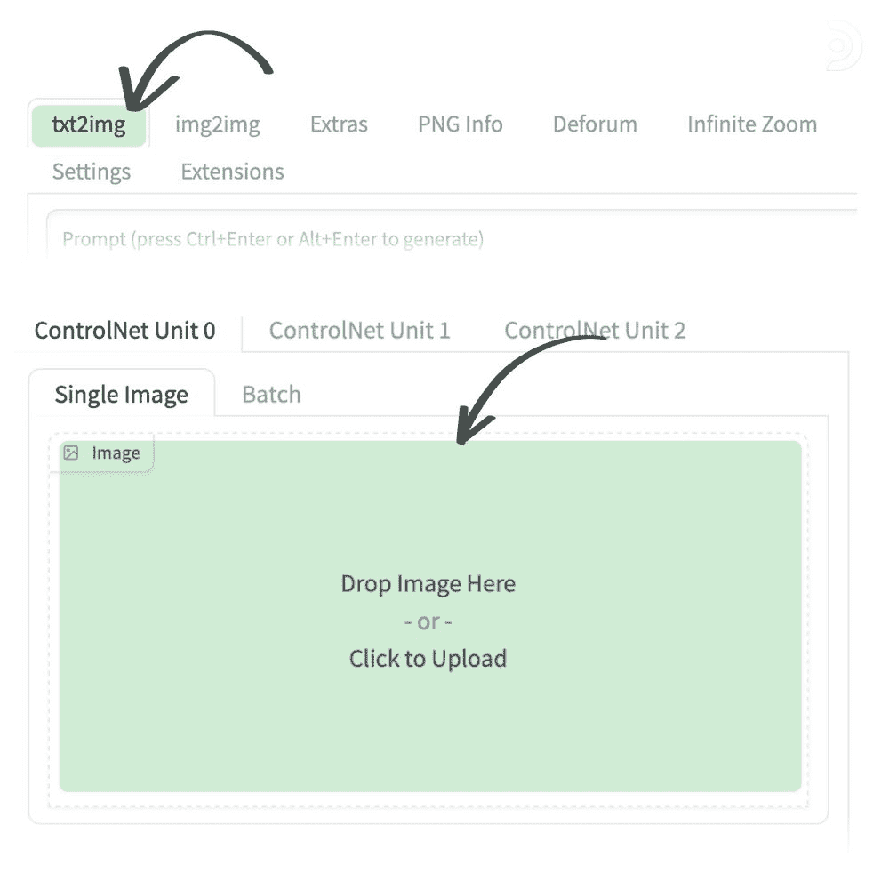
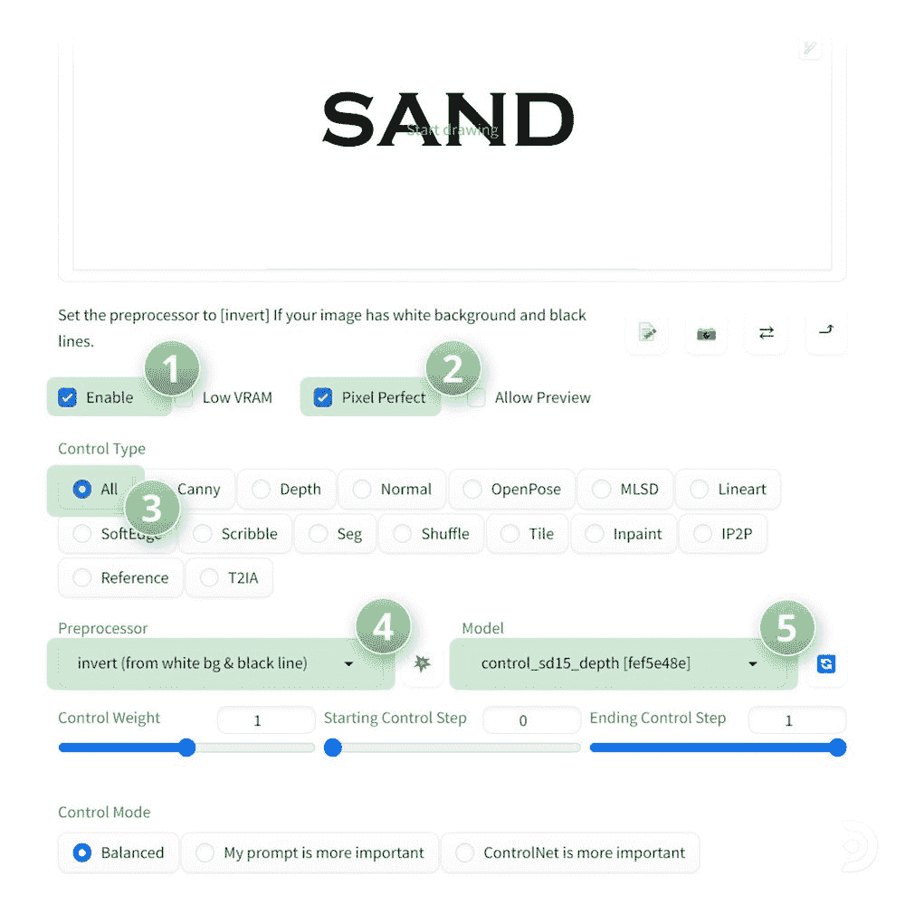
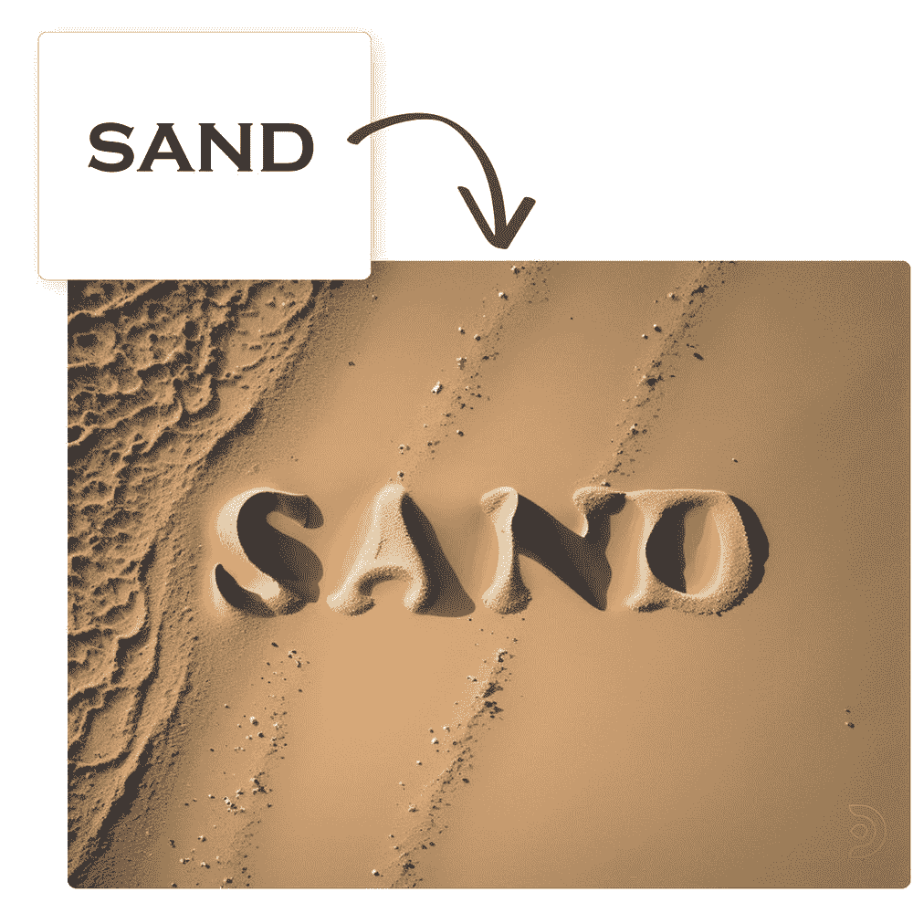
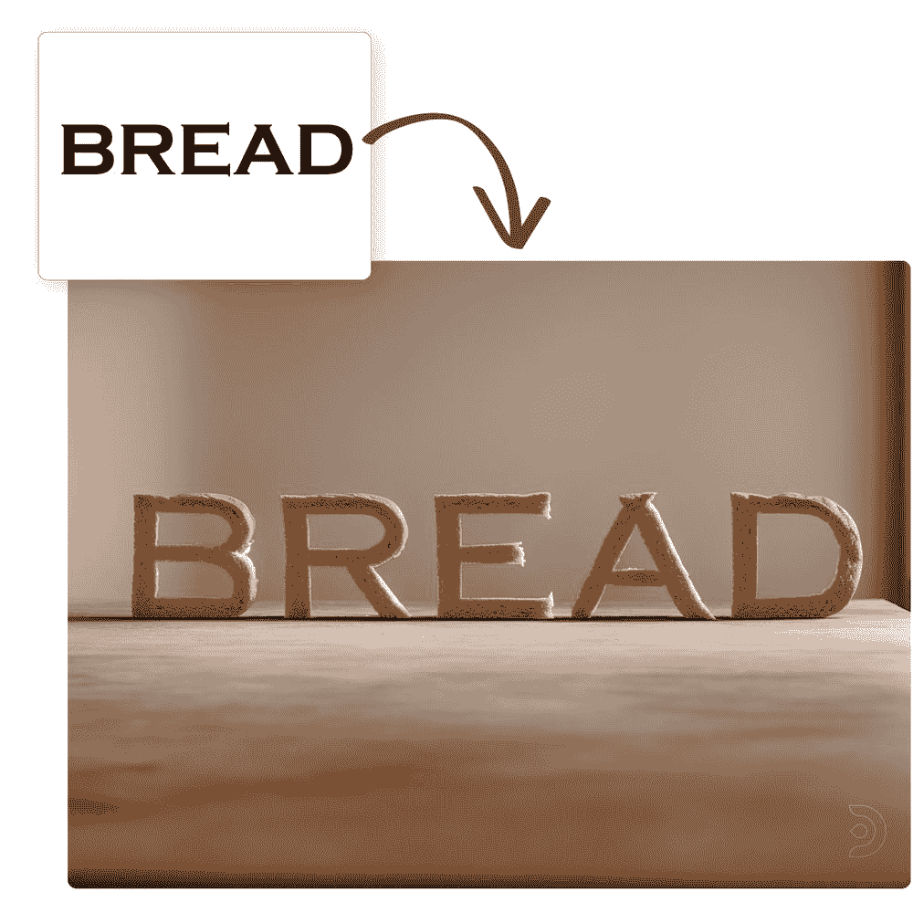
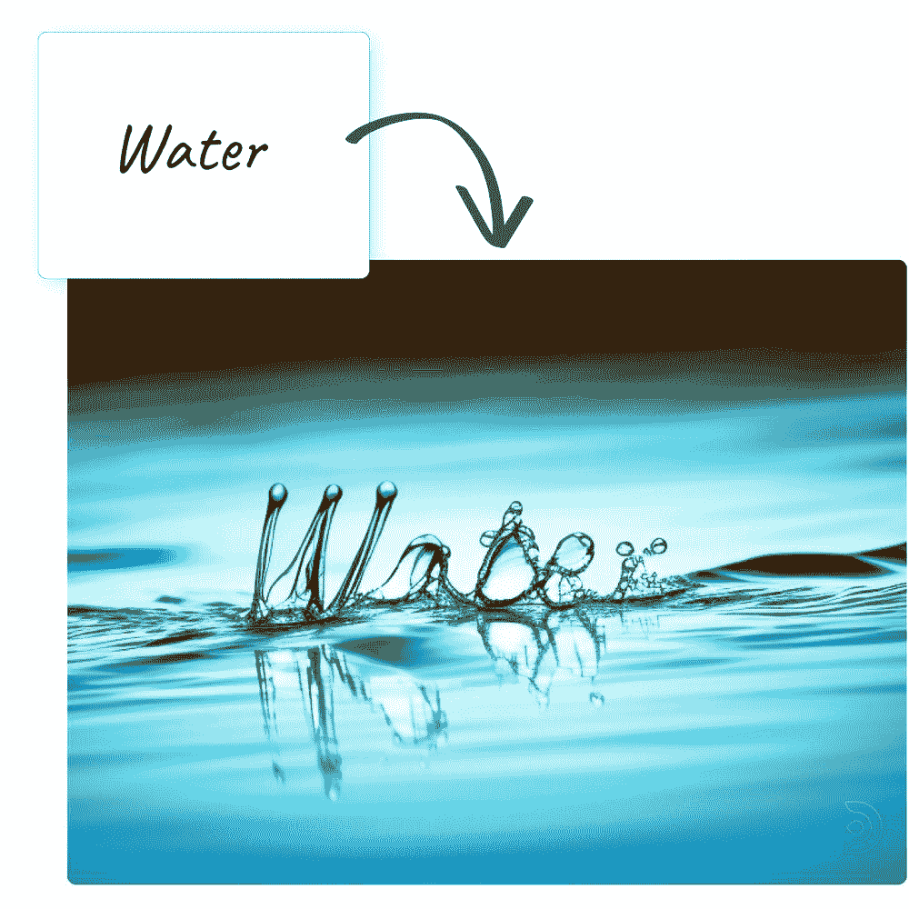
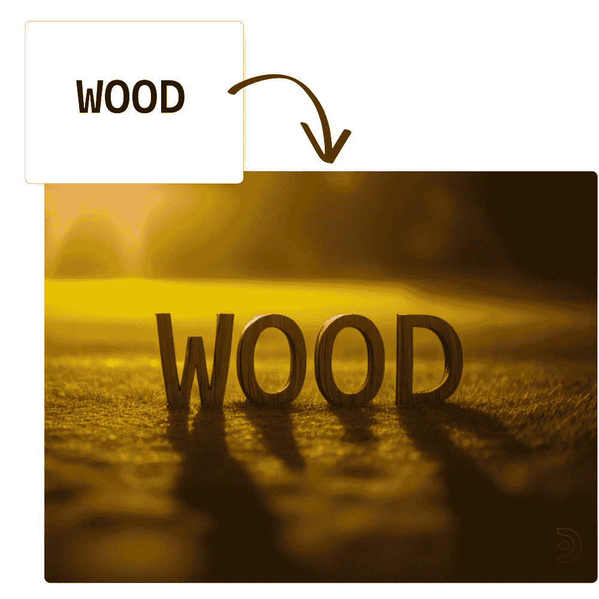
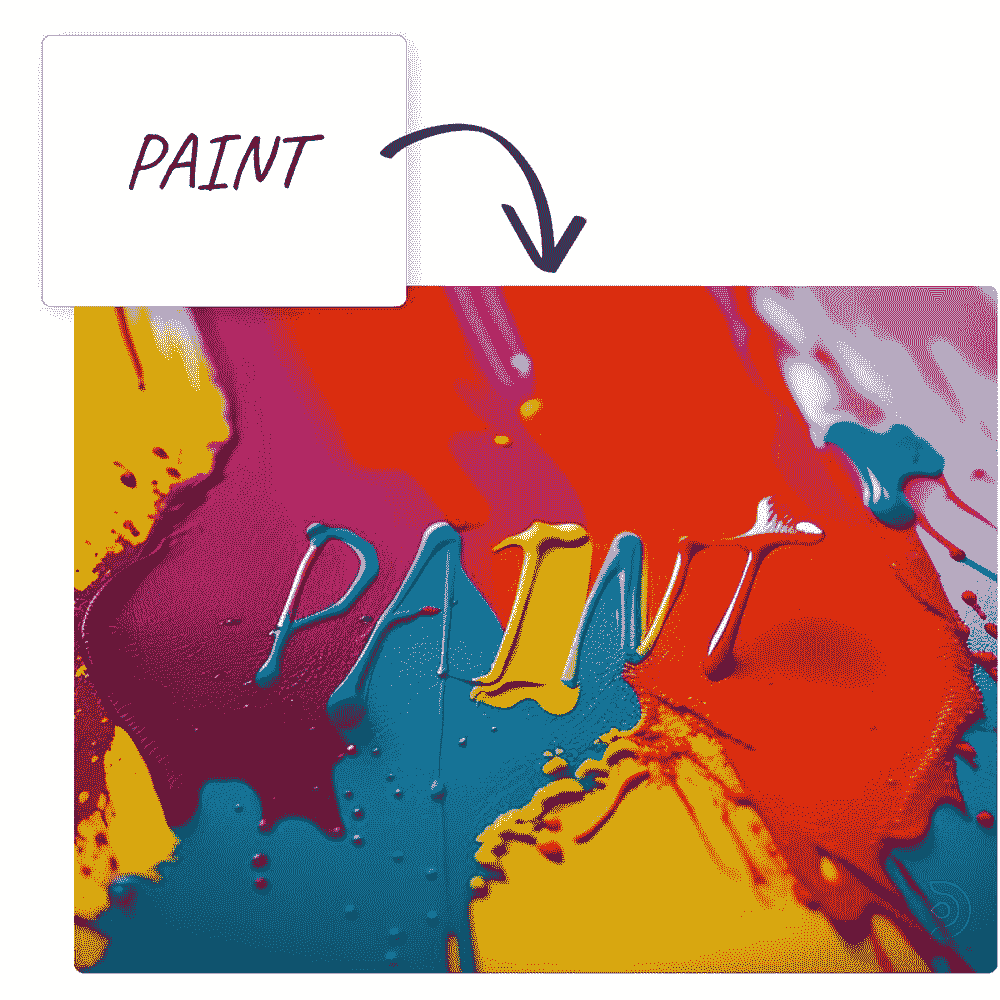
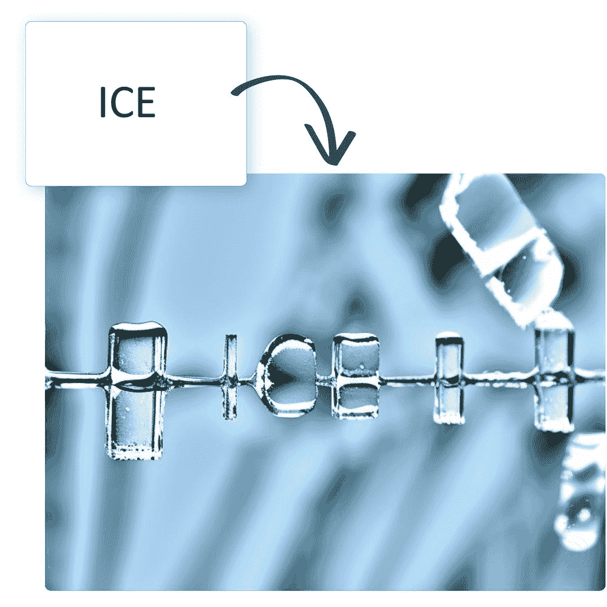

# 使用Stable Diffusion ControlNet插件创建漂亮的排版字体

> 来源：[https://e0lrm2v2v1u.feishu.cn/docx/TiWbdi7fEosafDxLYnZcVTfGnse](https://e0lrm2v2v1u.feishu.cn/docx/TiWbdi7fEosafDxLYnZcVTfGnse)

# **目录**

+   [步骤 1：创建纯文本模板](https://learn.thinkdiffusion.com/creating-text-with-stable-diffusion/#step-1-create-your-plain-text-template)

+   步骤2 [：创建您花哨的风格化文本](https://learn.thinkdiffusion.com/creating-text-with-stable-diffusion/#step-2-create-your-fancy-stylized-text)

众所周知，对于 Stable diffusion来说文本很难输出稳定，因此在本指南中，我们将了解如何实现这一点。

# **步骤 1：创建纯文本模板**

在白色背景上创建带有黑色文本的图像。可以使用PPT\Word等工具在白色背景上以黑色字体添加文本。

# 步骤 2：创建您花哨的风格化文本

（1）大模型选择了deliberate_v2

（2）抽样方法选择Euler a

（3）采样步骤30

（4）CFG等级11

然后，我们可以将图像上传到txt2img选项卡中的ControlNet。

（1） 确保选中启用复选框**以确保Co**ntrolNet **已激活

（2**）选中像素完美复选框 pixel perfect checkbox

（3） 将控件类型设置为“all”

（4）预处理器选择invert（来自白BG和黑线） 反转预处理器很重要，因为它可以帮助我们实现将文本置于前台的效果。它将深度图中的更多白色解释为更接近。

（5） 将控制网模型设置为control_sd15_depth

然后，输入描述所需视觉效果的提示了。下面是一个示例：

Positive Prompt: Sand on a beach, aerial view

# 更多示例

Positive prompt: Bread on a kitchen table

Positive prompt: water, water droplets, ocean, bright colours, reflection

Positive prompt: wood on grass, dramatic lighting, 8k

Positive prompt: paint dripping, vivid colours, colours spilling on the ground, in the style of Alberto Seveso

Positive Prompts: Ice, icicles

请记住，您可以调整设置以进一步自定义效果：

+   **Prompt**：提示对图像的结果有很大影响。随意包含与照明和样式相关的术语，以获得所需的效果。

+   **Model**: 并非所有模型都能产生相同的效果，因此请尝试不同的模型以找到您喜欢的效果。

+   **Control Weight**: 可以减小weight值以查看文本区域中更明显的变化。

+   Ending Control Step: ：降低此权重以允许在文本区域中进行更多更改。