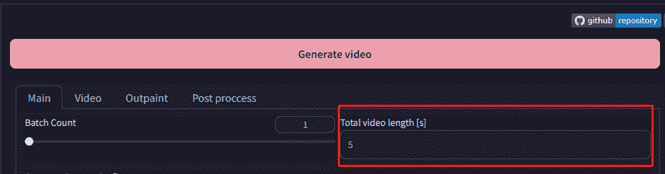
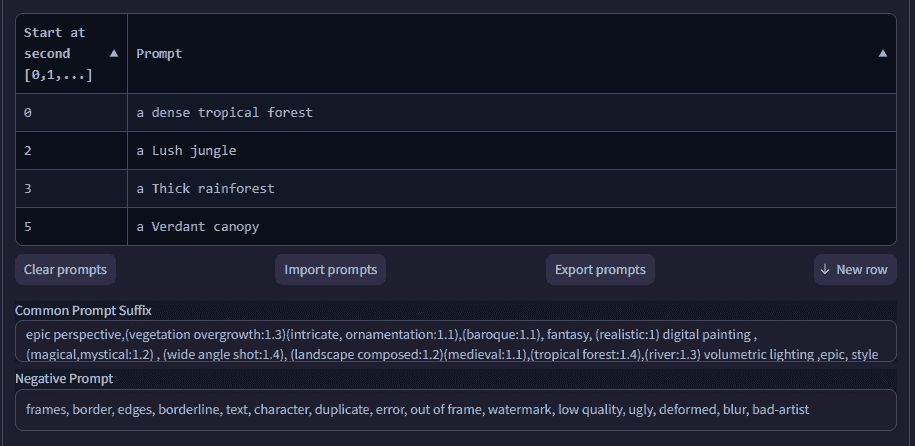
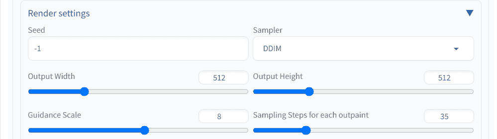
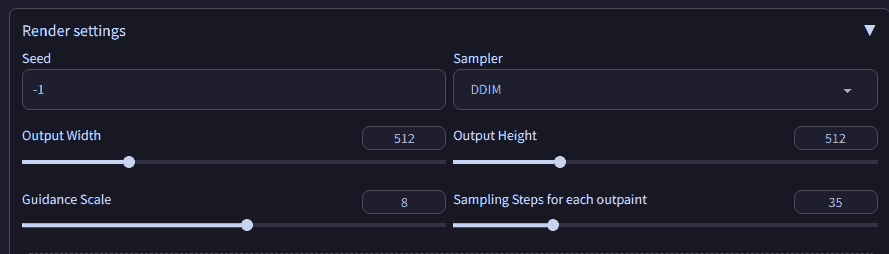
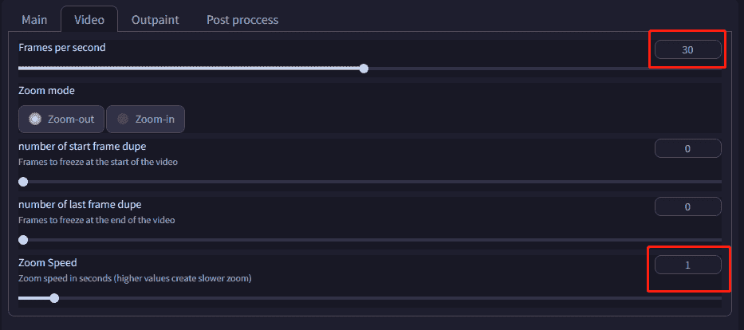
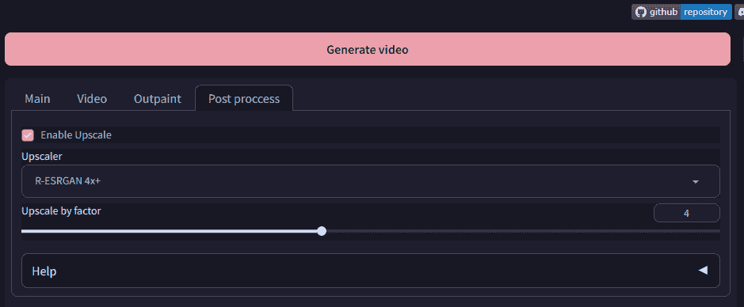
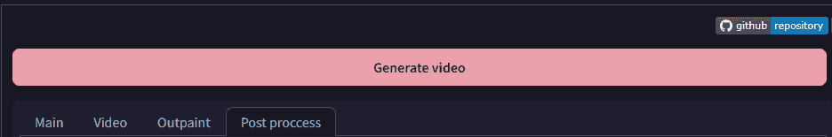

# 使用stable diffusion制作无限缩放功能的酷炫动画

> 来源：[https://e0lrm2v2v1u.feishu.cn/docx/ZViWdN6IToEX83xr2HBcWgAUntf](https://e0lrm2v2v1u.feishu.cn/docx/ZViWdN6IToEX83xr2HBcWgAUntf)

# 引言

**Infinite Zoom**可让您使用stable diffusion创建无限缩放效果视频。我将向您展示如何使用此扩展程序使用它创建很酷的视频。

无限缩放实质上是从一个小图像开始，然后通过使用外画技术填充起始图像周围的区域来扩展该图像。输出绘制步骤不是渲染步骤，而是每个图像将被扩展的次数。

无限缩放最适合修复稳定的扩散模型，以获得更好的效果。我使用的是AnythingV5

# 步骤

+   单击**Infinite Zoom**选项卡并选择main选项卡，您可以调整以下字段：

+   视频总长度是视频的持续时间：

然后，您可以输入提示来创建视频。在我们的示例中，我们可以看到在步骤 0、2、3、5  中输入的提示。

然后，您可以通过为起始图像选择随机种子 -1、您选择的采样方法、生成的图像的分辨率、CFG 指导比例以及每个输出绘制的采样步骤数来设置渲染设置。

您还可以选择使用起始图像，您可以在此处上传：

我们现在可以查看视频选项卡，我们可以将每秒帧数保持在 30，因为这应该为我们提供一致的视频。我发现使用放大比缩小提供更好的一致性。缩放速度也可以在这里设置。缩放速度越高，视频越慢。我发现 1 的变焦速度让我在帧之间平滑过渡。请注意，缩放速度乘以视频长度（以秒为单位）以给出最终视频长度。在我们的示例中，我们的视频长度为 5 秒，缩放速度为 1，这将使我们的最终视频长度为 5秒（5*1）

在后期处理选项卡上，您可以选择放大视频以获得更好的分辨率和更流畅的动画。

然后，您可以单击生成以处理视频:

完成处理后，您可以预览视频或在“stable-diffusion-webui\outputs\infinite-zooms\”文件夹中查看。

[infinite_zoom_1687163408.mp4](https://internal-api-drive-stream.feishu.cn/space/api/box/stream/download/all/YBsJbVZ56o78tZxUlKZc0haensf)