# 使用 ControlNet 让草图栩栩如生 - Scribble

> 来源：[https://e0lrm2v2v1u.feishu.cn/docx/SQlAdOZxro2Gz3xH1D2c8il2nhe](https://e0lrm2v2v1u.feishu.cn/docx/SQlAdOZxro2Gz3xH1D2c8il2nhe)

# **引言**

ControlNet Scribble是一种技术或功能，允许用户在图像上提供手动注释或标记以指导生成过程。使用 ControlNet Scribble，用户可以直接在图像上绘制或涂鸦，以指定他们希望在生成的输出中看到的所需修改、编辑或属性。

通过利用 ControlNet Scribble，用户可以对生成的图像进行更精细的控制。该模型会考虑标记区域或注释，并将它们用作影响生成的输出的附加指导。这允许用户积极参与塑造结果并根据自己的喜好进行定制。

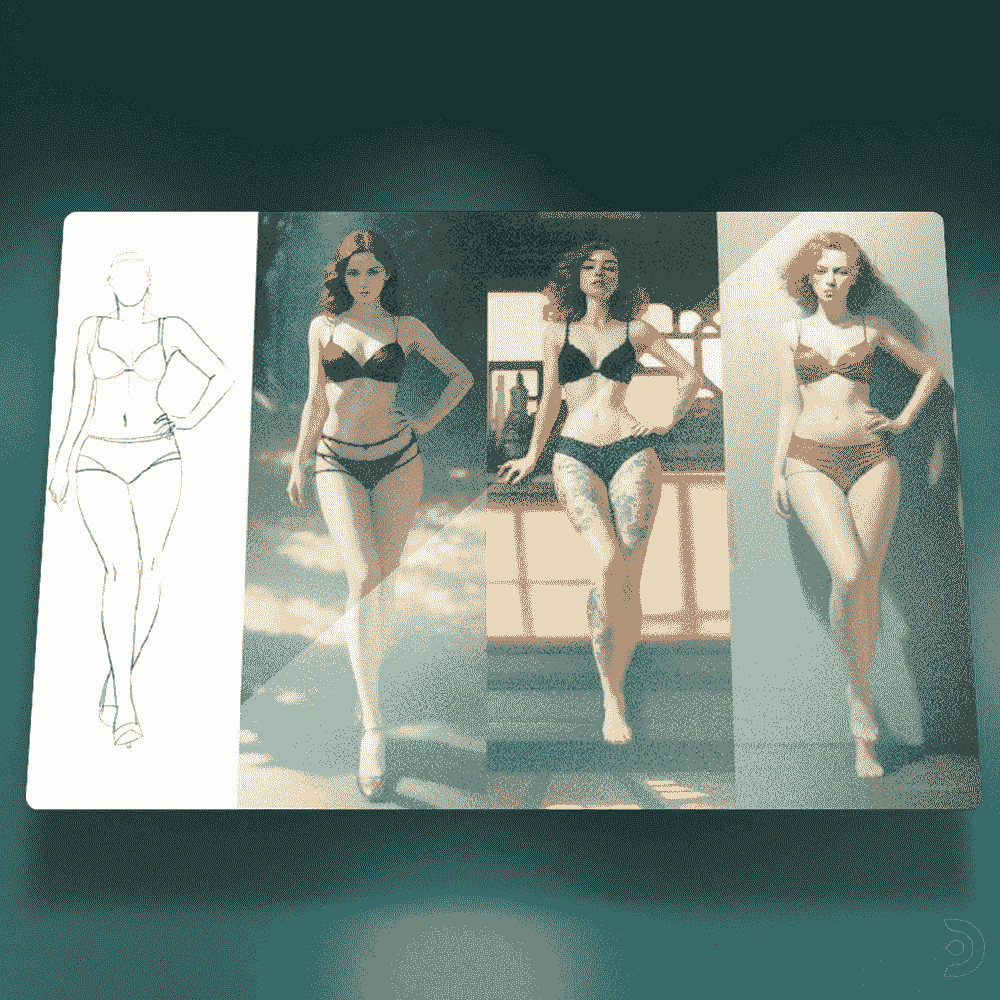

当用户想要对图像的某些部分进行特定更改或调整（如修改对象的外观、更改背景或强调特定元素）时，ControlNet Scribble 特别有用。它为用户提供了一种交互式且直观的方式，可以将他们所需的修改直接传达给稳定扩散模型。在释放您的艺术天赋方面，涂鸦预处理器绝对是游戏规则的改变者。他们毫不费力地将普通图片从手绘涂鸦中转换出来，为您的创作增添真实感。

# **有哪些Scribble****预处理器****可用？**

要查找Scribble 预处理器，请执行以下操作：

+   首先确保您位于 txt2img 选项卡上。

+   向下滚动，然后展开“**ControlNet** ”面板。

+   您会在面板中找到预处理器 **Pre-Processors**。

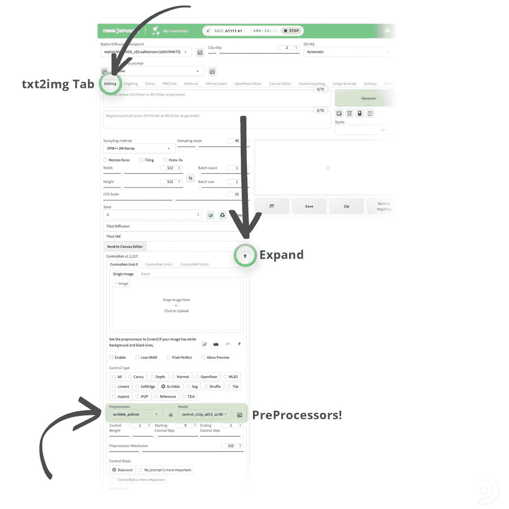

##  选项 1: Scribble HED

利用整体嵌套边缘检测 （HED） 的强大功能，该预处理器擅长生成与熟练艺术家手绘的轮廓非常相似的轮廓。ControlNet 的专家建议 HED 对图像进行重新着色和重新设计，为它们注入独特的艺术风格。

凭借其产生粗糙但富有表现力的涂鸦线条的能力，HED 为您的作品赋予了独特的个性，增加了吸引注意力的有趣视觉元素。

## 选项 2：Scribble Pidinet

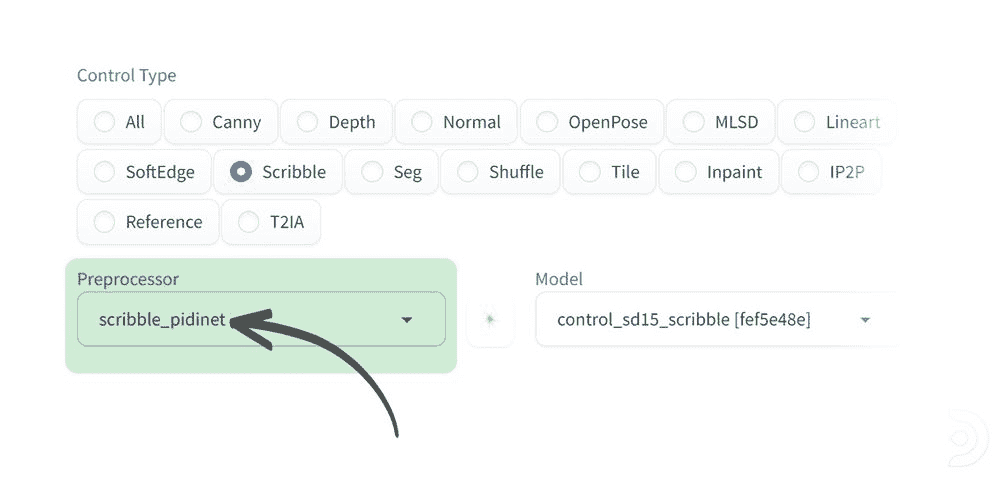

如果您正在寻找清晰的曲线和直边，那么像素差分网络（Pidinet）就是您的最佳选择。凭借其检测和强调干净线条的能力，Pidinet 赋予您的艺术品抛光外观，同时保留基本细节。它非常适合捕获电路板轮廓或任何其他复杂的形状，而不会带来压倒性的复杂性。当您需要一丝优雅时，Pidinet 会介入，以最小的错综复杂提供精致的线条。它是复制电路板轮廓或创建干净、精致设计的理想选择。

## 选项 3: Scribble xDoG

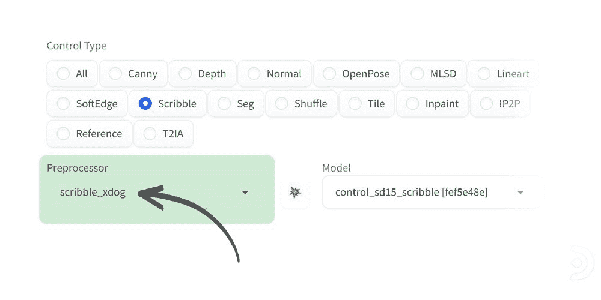

进入高斯扩展差分（xDoG）领域，这是一种非凡的边缘检测技术。通过调整 xDoG 阈值，您可以控制图稿中的细节级别。这款多功能预处理器可让您取得完美的平衡，从而产生迷人的涂鸦，展示恰到好处的复杂性。通过微调 XDoG 阈值找到细节的完美平衡。这款出色的预处理器可让您创建能够引起正确共鸣的涂鸦，捕捉您的艺术愿景的精髓。

# **使用 C****ont**rolNet Scribble 预处理器的示例

## **预处理器**** 1：Scribble HED**

假设我们使用Scribble HED转换大象的手绘，我们可以

+   **(1)**选择要**Scribble**的控件类型，

+   **(2) **将预处理器设置为scribble_hed

+   **(3) **和control_sd15_scribble作为模型，如下所示：

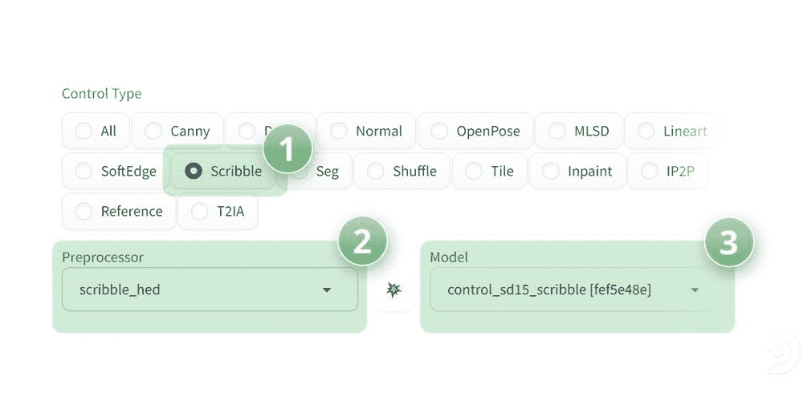

将我们的图像上传到“控制网”部分中的单个图像选项卡

+   **(1)**选择一个大模型

+   **(2)** DPM++2M Karras作为采样方法

+   **(3) **40个采样步骤

+   **(4) **CFG 为 15。

+   **(5) **选中“enable controlnet”复选框

+   **(6) **并选中“**pixel**** perfect**”复选框。

然后，我们可以输入正面和负面提示，如下所示：

> Positive Prompts:

> An elephant with an Indian dressing on his trunk wearing feathers, (Extremely Detailed Oil Painting:1.2), glow effects, godrays, Hand drawn, render, 8k, octane render, cinema 4d, blender, dark, atmospheric 4k ultra detailed, cinematic sensual, Sharp focus, humorous illustration, big depth of field, Masterpiece, colors, 3d octane render, 4k, concept art, trending on artstation, hyperrealistic, Vivid colors, extremely detailed CG unity 8k wallpaper, trending on ArtStation, trending on CGSociety, Intricate, High Detail, dramatic

> Negative Prompts:

> Watermark, Text, censored, deformed, bad anatomy, disfigured, mutated, extra limb, ugly, missing limb, floating limbs, disconnected limbs, disconnected head, malformed hands, cropped, worst quality, low quality, mutation, poorly drawn

看看效果：

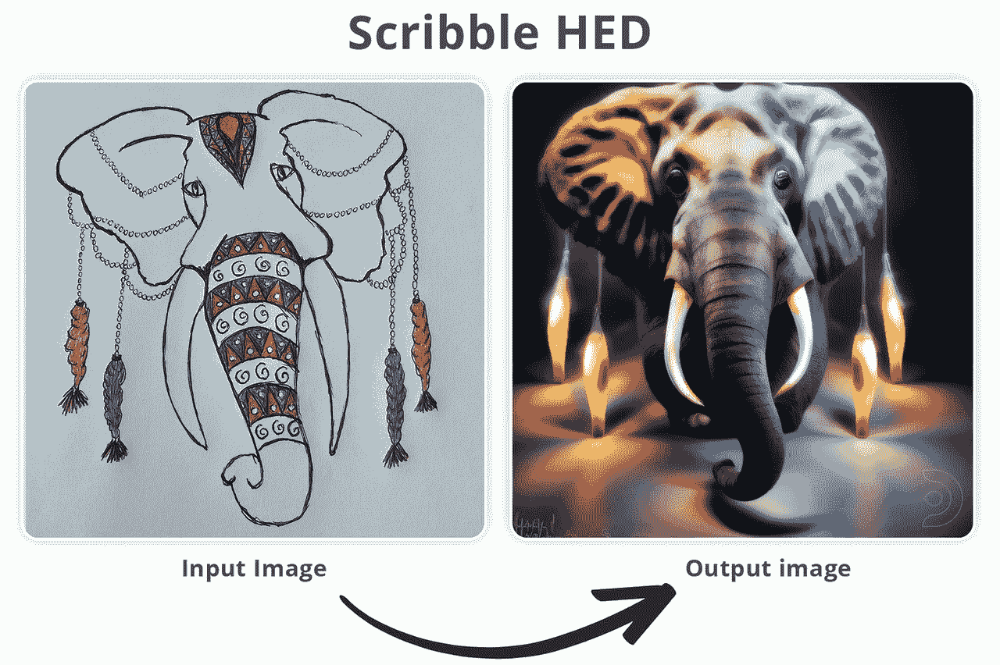

## **预处理器** 2：Scribble Pidinet

让我们尝试用Pidinet手绘兔子，我们可以：

+   **(1) **选择**Scribble**的控件类型

+   **(2) **预处理器scribble_pidinet

+   **(3) **control_sd15_scribble。

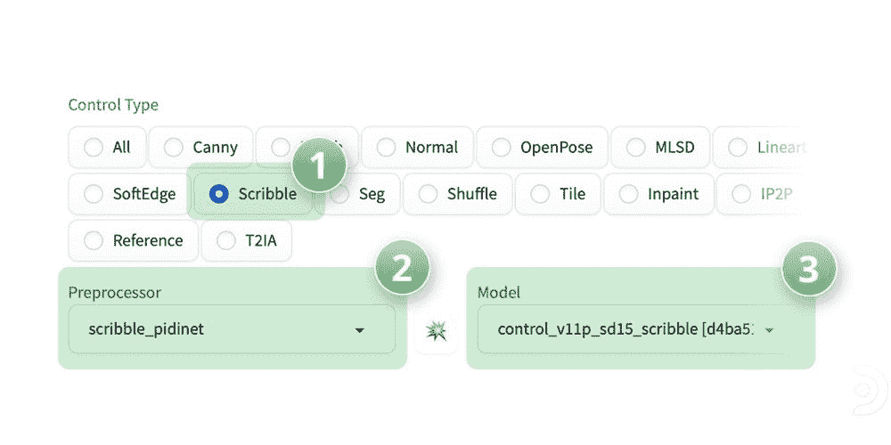

现在，我们可以将图像上传到 ControlNet 部分中的单个图像选项卡

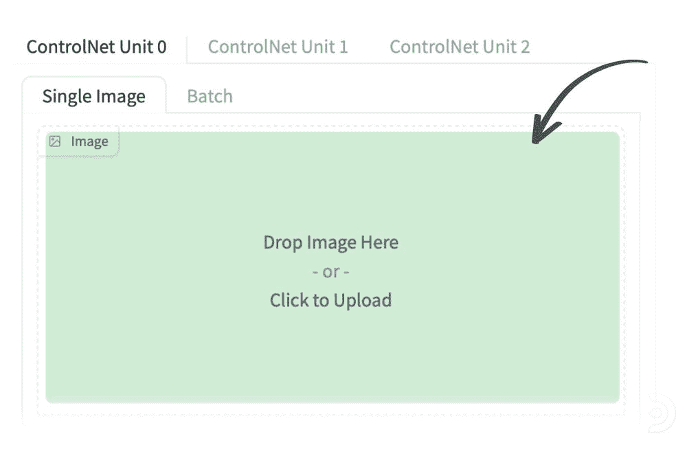

+   **(1)**选择一个大模型

+   **(2)** DPM++2M Karras作为采样方法

+   **(3) **40个采样步骤

+   **(4) **CFG 为 15。

+   **(5) **选中“enable controlnet”复选框

+   **(6) **并选中“**pixel**** perfect**”复选框。

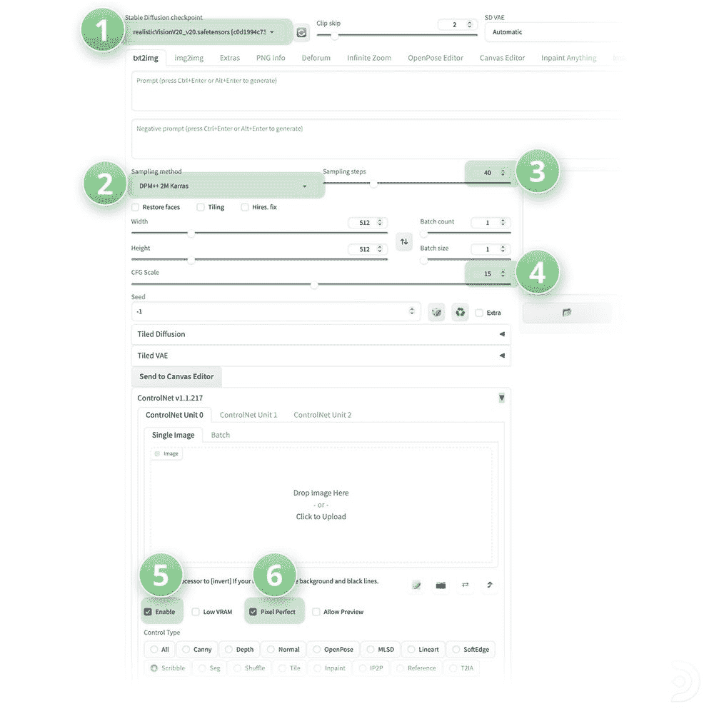

> Positive Prompts: A colourful bunny, (Extremely Detailed Oil Painting:1.2), glow effects, godrays, Hand drawn, render, 8k, octane render, cinema 4d, blender, dark, atmospheric 4k ultra detailed, cinematic sensual, Sharp focus, humorous illustration, big depth of field, Masterpiece, colors, 3d octane render, 4k, concept art, trending on artstation, hyperrealistic, Vivid colors, extremely detailed CG unity 8k wallpaper, trending on ArtStation, trending on CGSociety, Intricate, High Detail, dramatic

> Negative Prompts: Watermark, Text, censored, deformed, bad anatomy, disfigured, mutated, extra limb, ugly, missing limb, floating limbs, disconnected limbs, disconnected head, malformed hands, cropped, worst quality, low quality, mutation, poorly drawn

看看效果：

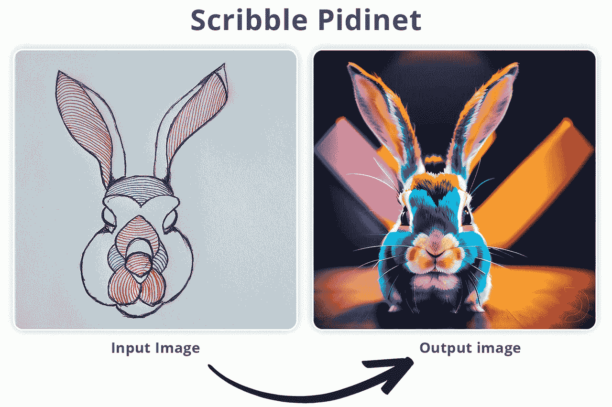

## **预处理器****3：Scribble xDog**

还有一个，让我们看看**Scribble xDog**如何处理蝴蝶的手绘：

+   **(1) **选择**Scribble**的控件类型

+   **(2) **预处理器**scribble_xDog**

+   **(3) **control_sd15_scribble。

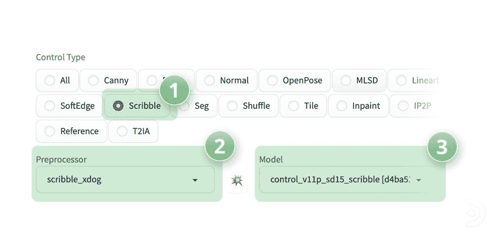

现在，我们可以将图像上传到 ControlNet 部分中的单个图像选项卡：

+   **(1)**选择一个大模型

+   **(2)** DPM++2M Karras作为采样方法

+   **(3) **40个采样步骤

+   **(4) **CFG 为 15。

+   **(5) **选中“enable controlnet”复选框

+   **(6) **并选中“**pixel**** perfect**”复选框。

然后，我们可以输入正面和负面提示，如下所示：

> Positive Prompts: (extremely detailed CG unity 8k wallpaper), a beautiful butterfly, professional majestic oil painting by Ed Blinkley, Atey Ghailan, Studio Ghibly, by Jeremy Mann, Greg Manchess, Antonio Moro, trending on artstation, trending on CGSociety, Intricate, High Detail, Sharp focus, dramatic, photorealistic paniting art by MidJourney and Greg Rutowski

> Negative Prompts: Watermark, Text, censored, deformed, bad anatomy, disfigured, mutated, extra limb, ugly, missing limb, floating limbs, disconnected limbs, disconnected head, malformed hands, cropped, worst quality, low quality, mutation, poorly drawn

看看效果：

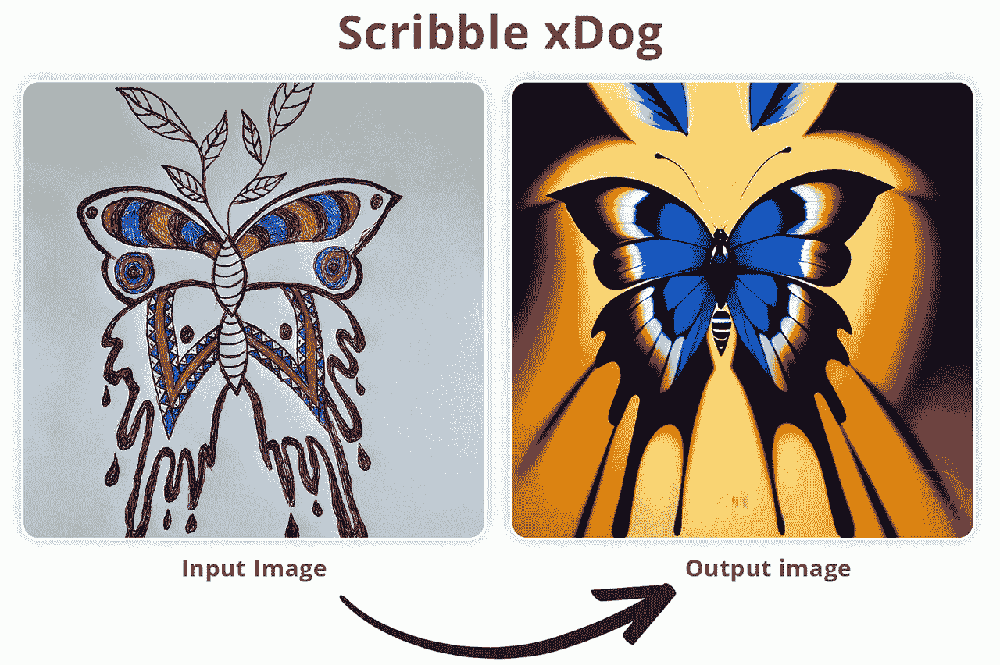

# 结语

请记住，为了获得最佳效果，所有这些预处理器与涂鸦控制模型无缝配合使用，使您能够释放您的艺术潜力，将您的愿景变为现实，并反映您独特的艺术风格。