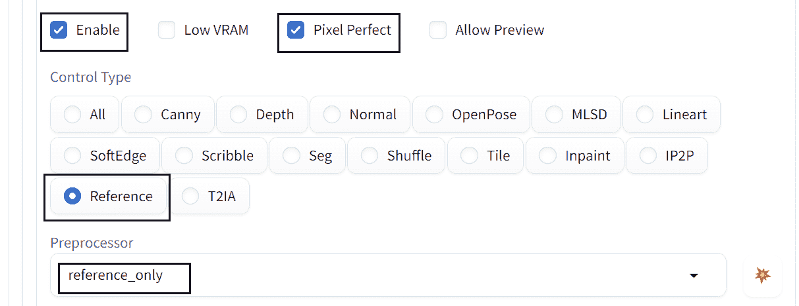
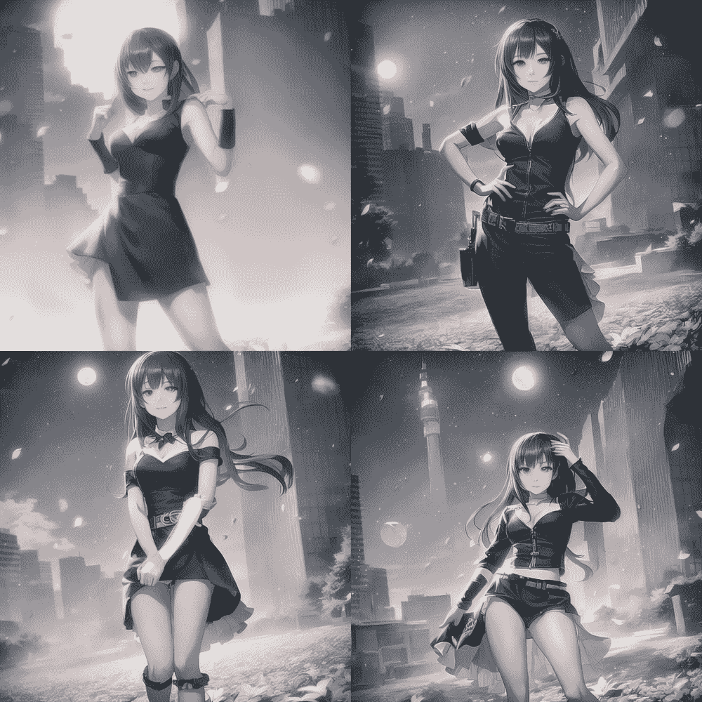
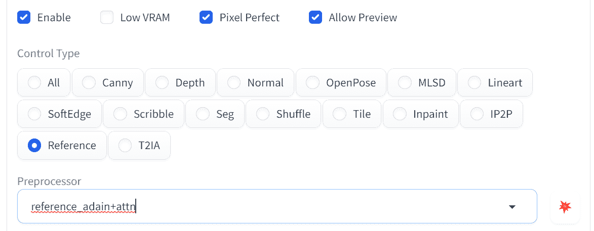
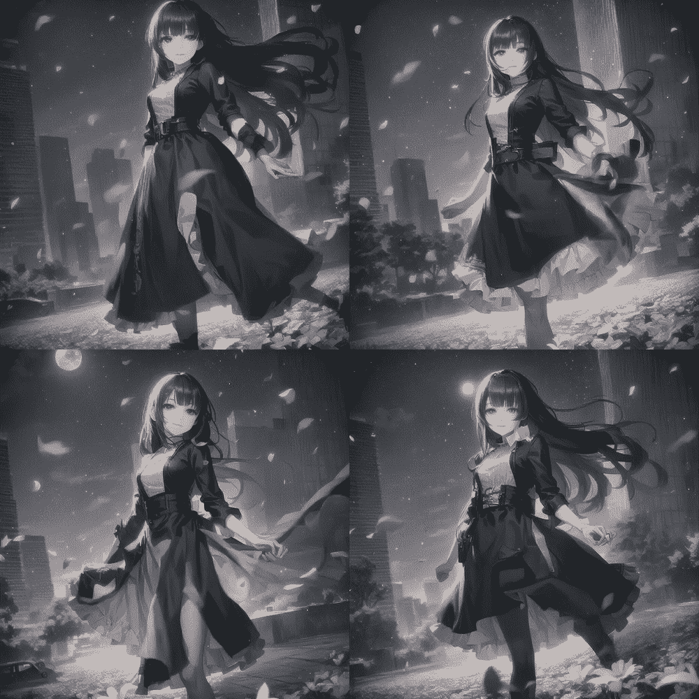
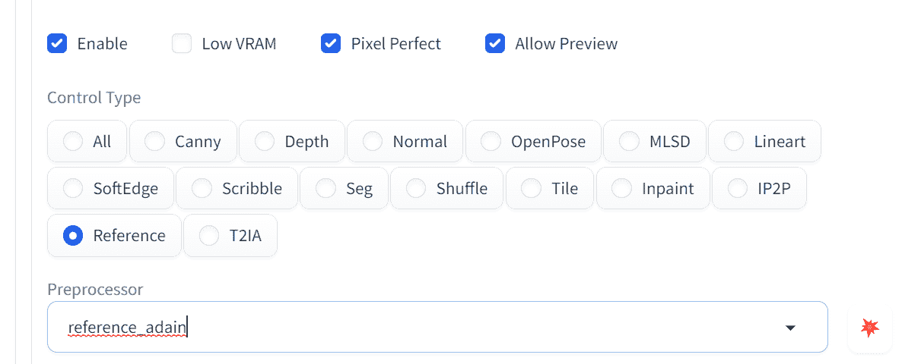
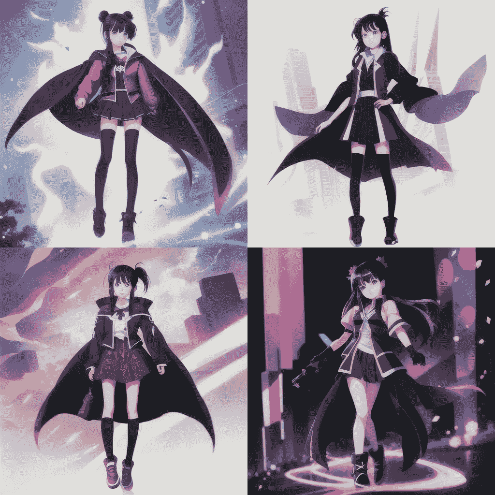

# ControlNet Reference 预处理器

> 来源：[https://e0lrm2v2v1u.feishu.cn/docx/IxwHdNTf7oYmgFxcotdcaIh2nQd](https://e0lrm2v2v1u.feishu.cn/docx/IxwHdNTf7oYmgFxcotdcaIh2nQd)

# **Cont****ro**lNe Reference预处理器简介

ControlNet 参考是一个术语，用于描述利用参考图像来指导和影响新图像生成的过程。ControlNet 参考使用户能够指定参考图像中存在的所需属性、构图或样式，然后将其合并到生成的输出中

通过提供参考图像，用户可以对稳定扩散模型的输出进行更多控制。该模型从参考图像中存在的视觉线索、图案和特征中学习，并使用该信息生成与所需样式或内容一致的图像。

ControlNet Reference帮助用户在生成过程中实现更高程度的控制和定制，使他们能够将输出引导到自己的特定偏好或艺术愿景。它是生成与参考图像非常相似或受参考图像启发的图像的宝贵工具，增强了用户创建所需构图的能力。

# 什么是 ControlNet Reference？

在本教程中，我们将探讨参考预处理器的使用，这是一个功能强大的工具，允许您生成类似于参考图像的图像，同时仍然利用稳定扩散模型和提供的提示。参考预处理器提供三种不同的选项：

+   Reference adain

+   Reference only

+   Reference adain plus attn

让我们深入了解这些预处理器中的每一个，并学习如何有效地使用它们。

Reference adain（通过自适应实例规范化进行样式转换）

参考预处理器采用自适应实例规范化技术进行样式迁移。此方法允许您将参考图像的视觉样式传输到生成的图像。

Reference only（将参考图像直接链接到注意力层）

使用仅参考预处理器，您可以在参考图像和注意力层之间建立直接链接。这种连接使模型能够在图像生成过程中专注于参考图像的特定区域。与其他预处理器不同，仅参考不需要选择控制模型。选择此预处理器后，模型下拉菜单将被隐藏。

**Reference adain+attn**（结合参考 adain 和仅参考的优点）

参考 adain+attn 预处理器结合了参考预处理器和仅参考预处理器的优点。它使您能够传输参考图像的样式，同时还可以建立与注意力层的直接链接。这种组合允许在映像生成过程中进行更多控制和自定义。

# **如何使用引用reference****预处理器**

首先选择一个可用的预处理器： Reference adain, Reference only, or Reference adain+attn。选择最符合所需结果的预处理器。

选择预处理器后，继续输入参考图像。参考图像作为生成图像的样式或注意力焦点的基础，具体取决于所选的预处理器。

如果您选择了“Reference only”预处理器，则生成的图像将受到参考图像注意力焦点的影响。但是，如果您更喜欢其他预处理器，例如“Reference adain”或“Reference adain+attn”，您也会观察到样式传递效果。

通过执行以下步骤，您可以有效地利用引用预处理器来生成与所需样式和视觉引用一致的图像。尝试不同的预处理器和参考图像，探索各种创意可能性。

# **使用re****fer**ence only预处理器的示例

我们可以上传动漫角色的图像，并在控制网中使用控制类型'reference'和 'reference only' 预处理器。我已经选中了像素完美复选框，以确保我们使用输入图像的匹配分辨率。

使用这个，我们可以创建穿着不同服装的一致角色！

我正在使用AyoniMix模型，采样器作为欧拉a，20个采样步骤和7的CFG刻度，并显示以下提示：

Positive Prompts: Solo, 1girl, black hair, Anime Style, full body shot

Negative Prompts: Nudity, nsfw

Input image

Output images

# **使用re****fer**ence adain+attn 预处理器的示例

我们可以上传动漫角色的图像，并在控制网中使用“参考”的控件类型和“reference adain+attn ”预处理器。我已经选中了像素完美复选框，以确保我们使用输入图像的匹配分辨率。

我正在使用AyoniMix模型，采样器作为Euler a，20个采样步骤和7的CFG刻度，并显示以下提示：

Positive Prompts: Solo, 1girl, black hair, Anime Style, full body shot

Negative Prompts: Nudity, nsfw

Input image

Output images

# **使用re****fer**ence adain 预处理器的示例

我们可以上传动漫角色的图像，并在控制网中使用“参考”的控制类型和“参考 adain”预处理器。我已经选中了像素完美复选框，以确保我们使用输入图像的匹配分辨率。

我正在使用AyoniMix模型，采样器作为欧拉a，20个采样步骤和7的CFG刻度，并显示以下提示：-

Positive Prompts: Solo, 1girl, black hair, Anime Style, full body shot

Negative Prompts: Nudity, nsfw

Input image

Output images

就个人而言，我相信仅引用预处理器在这种情况下效果最好。