# 使用Stable Diffusion & ControlNet生成创意AI QR码

> 来源：[https://e0lrm2v2v1u.feishu.cn/docx/Ej6VdNoY6ojYHixkSz1c8c8mneb](https://e0lrm2v2v1u.feishu.cn/docx/Ej6VdNoY6ojYHixkSz1c8c8mneb)

二维码似乎是稳定扩散的最新趋势，所以让我们深入了解如何创建自己的二维码！

# 方法一：图生图

## **第 1 步：创建普通二维码**

首先，我们需要创建一个二维码。您可以在此处免费创建一个

https://keremerkan.net/qr-code-and-2d-code-generator/

输入您的网址，这有助于使用网址缩短。将纠错级别设置为高，因为我们要将图像与我们自己的图像混合。

然后，我们可以生成一个二维码并将其保存到您的本地 PC。

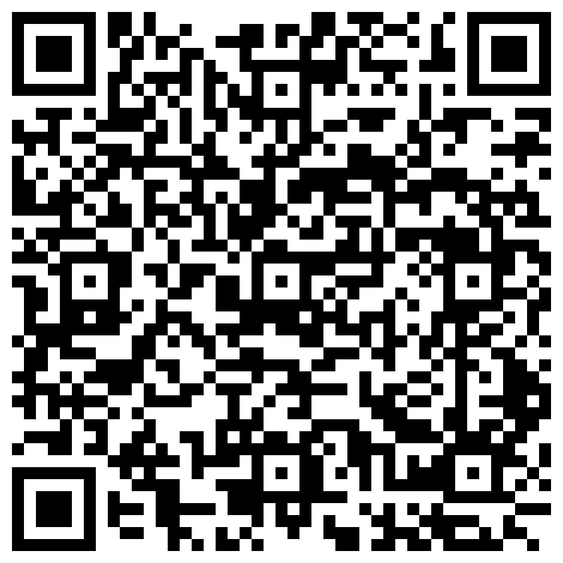

## 第 2 步：创建与二维码结合的艺术

我们现在可以找到我们喜欢的图像，也可以从稳定扩散中的txt2Img选项卡中生成一些图像。我将在txt2Img选项卡中生成一个。

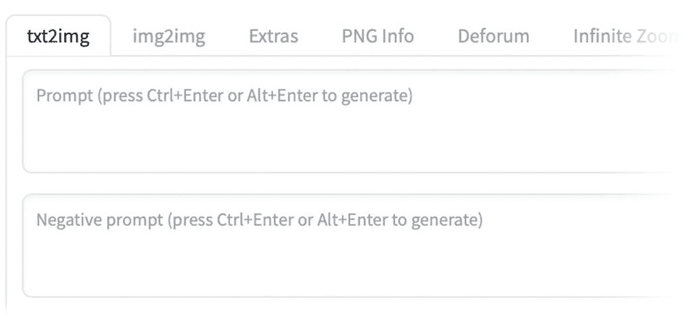

+   **(1)** 模型revAnimated_v122

+   **(2) **抽样方法是DPM++ 2S a Karras。

+   **(3) **采样步骤为20

+   **(4) **分辨率 768 x 768

+   **(5) ** CFG  11

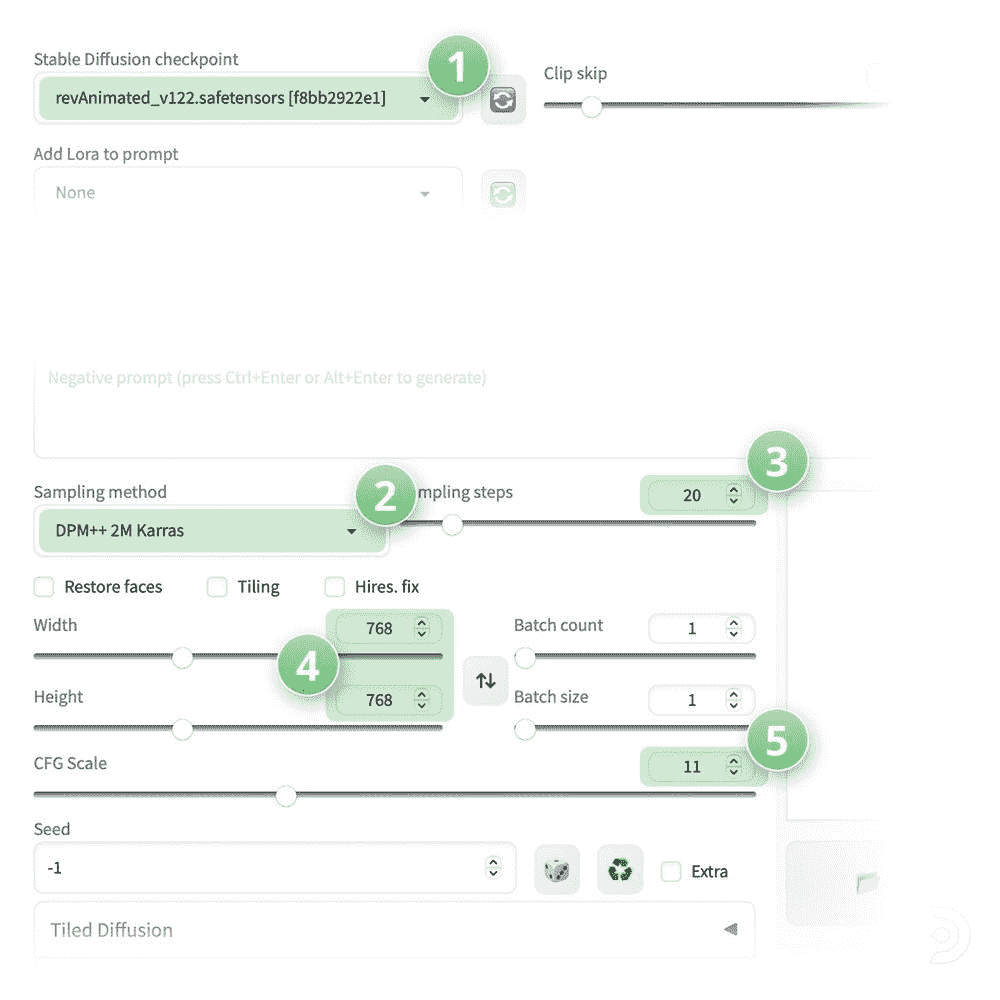

对于正面提示，因为我们使用的是ControlNet_OpenPose_Full，所以最好在正面提示中包含“全身”，因为我们在模仿图像的姿势。您甚至可以将分辨率更改为宽度 512 和高度 768，使其成为肖像，从而减少对我们的二维码的干扰

Positive Prompts:

futobot, cyborg, ((masterpiece),(best quality),(ultra-detailed), (full body:1.2), 1 female, solo, hood up, upper body, mask, 1 girl, female focus, black gloves, cloak, long sleeves

Negative Prompts:

paintings, sketches, (worst quality:2), (low quality:2), (normal quality:2), lowres, normal quality, ((monochrome)), ((grayscale)), skin spots, acnes, skin blemishes, age spot, glans, nsfw, nipples, (((necklace))), (worst quality, low quality:1.2), watermark, username, signature, text, multiple breasts, lowres, bad anatomy, bad hands, text, error, missing fingers, extra digit, fewer digits, cropped, worst quality, low quality, normal quality, jpeg artifacts, signature, watermark, username, blurry, bad feet, single color, ((((ugly)))), (((duplicate))), ((morbid)), ((mutilated)), (((tranny))), (((trans))), (((trannsexual))), (hermaphrodite), extra fingers, mutated hands, ((poorly drawn hands)), ((poorly drawn face)), (((mutation))), (((deformed))), ((ugly)), blurry, ((bad anatomy)), (((bad proportions))), ((extra limbs)), (((disfigured))), (bad anatomy), gross proportions, (malformed limbs), ((missing arms)), (missing legs), (((extra arms))), (((extra legs))), mutated hands,(fused fingers), (too many fingers), (((long neck))), (bad body perspect:1.1)

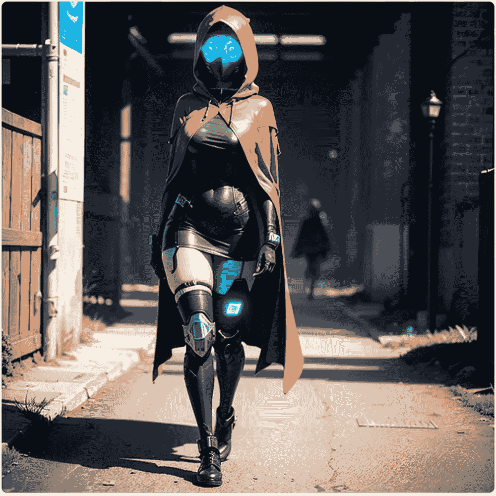

## 第 3 步：将图像与二维码相结合

然后，我们可以将其发送到img2img选项卡，或者如果您已经有要使用的图像，则可以将您的图像上传到img2img选项卡。我们可以输入相同的正面和负面提示。

**重要提示**：您必须在img2img选项卡中输入提示才能正常工作

+   **(1) **然后我们可以选择采样方法作为DPM++ 2S a Karras，

+   **(2) **抽样步骤 60

+   **(3) ** 分辨率为 768 x 768

+   **(4) **CFG为11

+   **(5) **降噪强度为 1.0

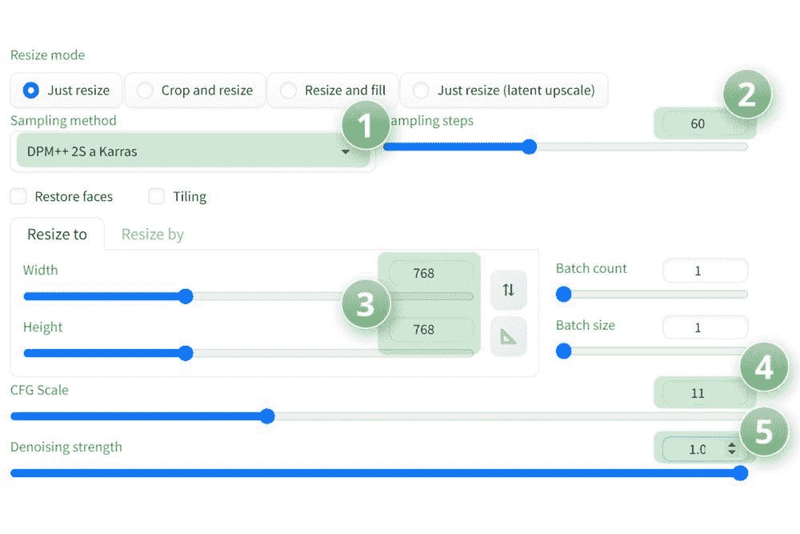

然后我们需要进入控制网，让它发挥它的魔力！对于 ControlNet Unit 0，我们需要再次上传在 txt2img 选项卡中生成的图像或您自己的图像（如果您已经有一个）。

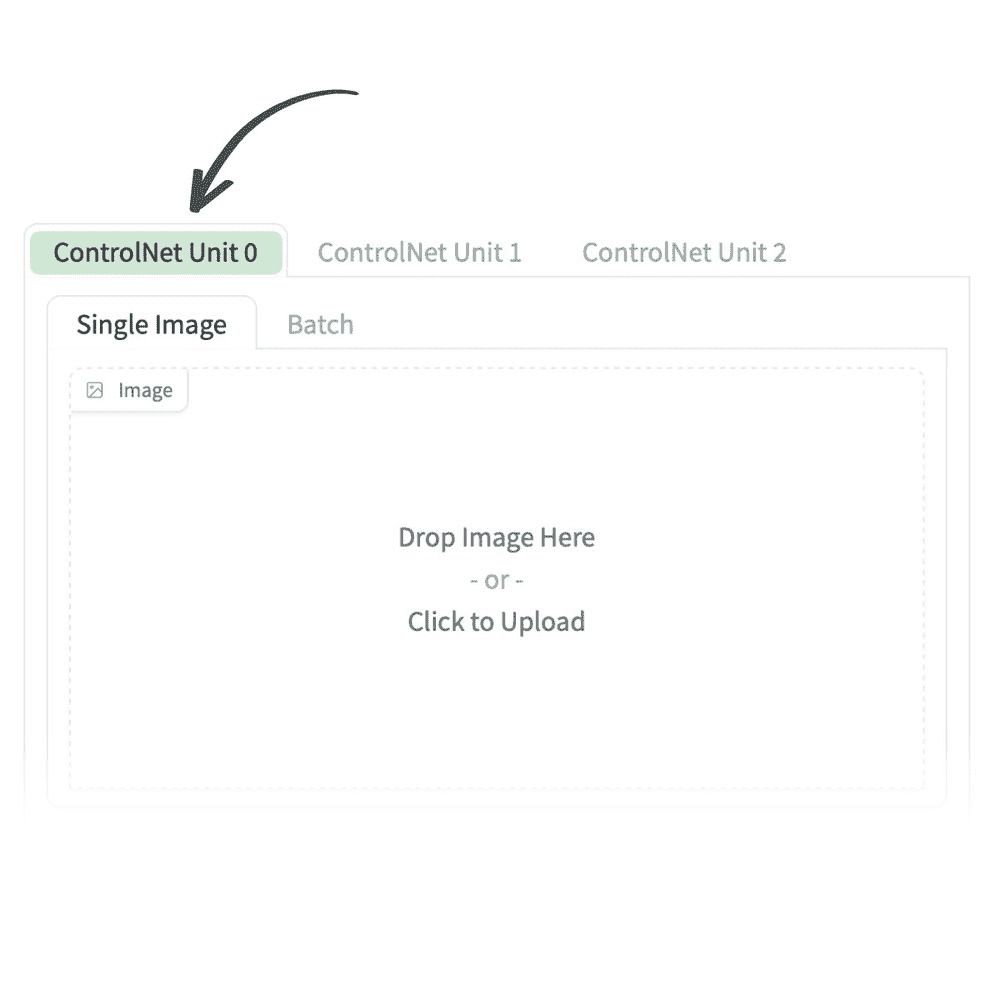

+   **1)  **确保勾选复选框以在控制网络单元 0 中启用控制网络

+   **(2) **选择 OpenPose 作为控制类型，openpose_full作为预处理器，control_sd15_openpose作为控制网络模型

+   **(3) **我们可以将控制权重保留为 1，因为我们将通知控制网我们的二维码应该加权更重

+   **(4) **我们可以将开始控制步骤保留为 0，将结束控制步骤保留为 1，因为我们希望从初始开始生成图像。

+   **(5) **选择平衡作为控制模式

+   **(6) **并调整大小并填充以调整大小模式。

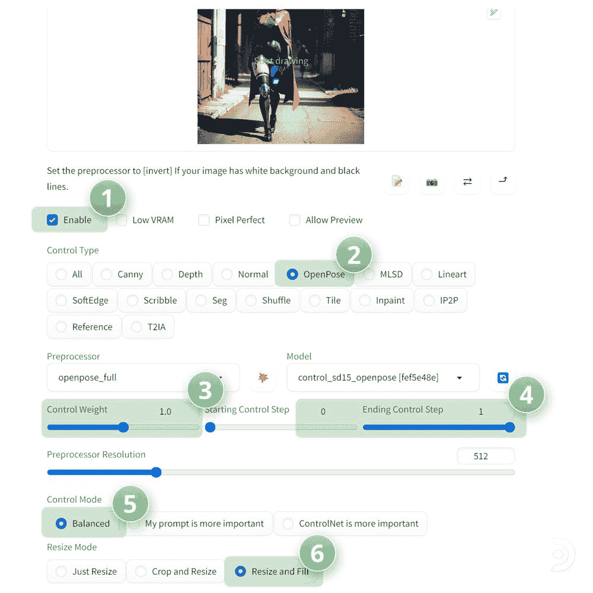

我们现在需要进入 controlNet 单元 1 选项卡（如果您没有看到这个，那么您需要进入 controlNet >设置并更改滑块以显示超过 1 个 controlNet 选项卡

然后我们可以将我们的二维码上传到 controlNet Unit1 选项卡

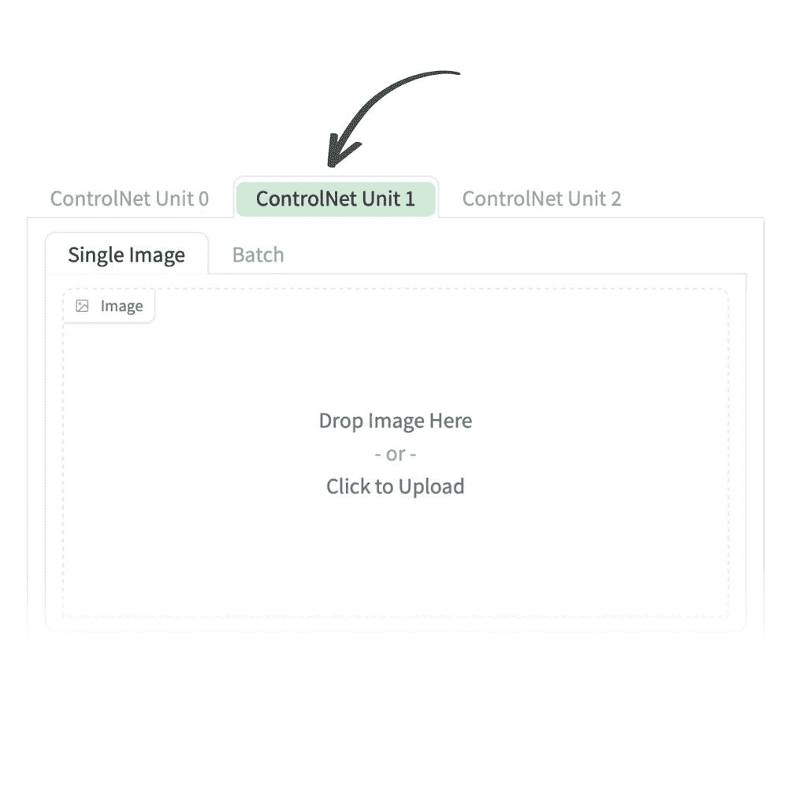

+   **1) ** 确保我们单击启用以确保控制网络已激活

+   **(2) **选择瓷砖作为控件类型，

+   **(3) t**tile_resample作为预处理器

+   **(4) **control_v11f1e_sd15_tile作为控件网络模型（您可能具有不同版本的控件网络磁贴模型）

+   **(5) **将控制权重设置为1.2，以告知控制网我们的二维码比我们的图像稍微重要一些！

+   **(6) **将开始控制步骤设置为0.23，结束控制步骤设置为1。这可确保我们的图像将在渲染 QR 码之前开始渲染。这样更美观！

+   **(7) **将控制模式设置为平衡

+   **(8) **并将调整大小模式设置为调整大小和填充

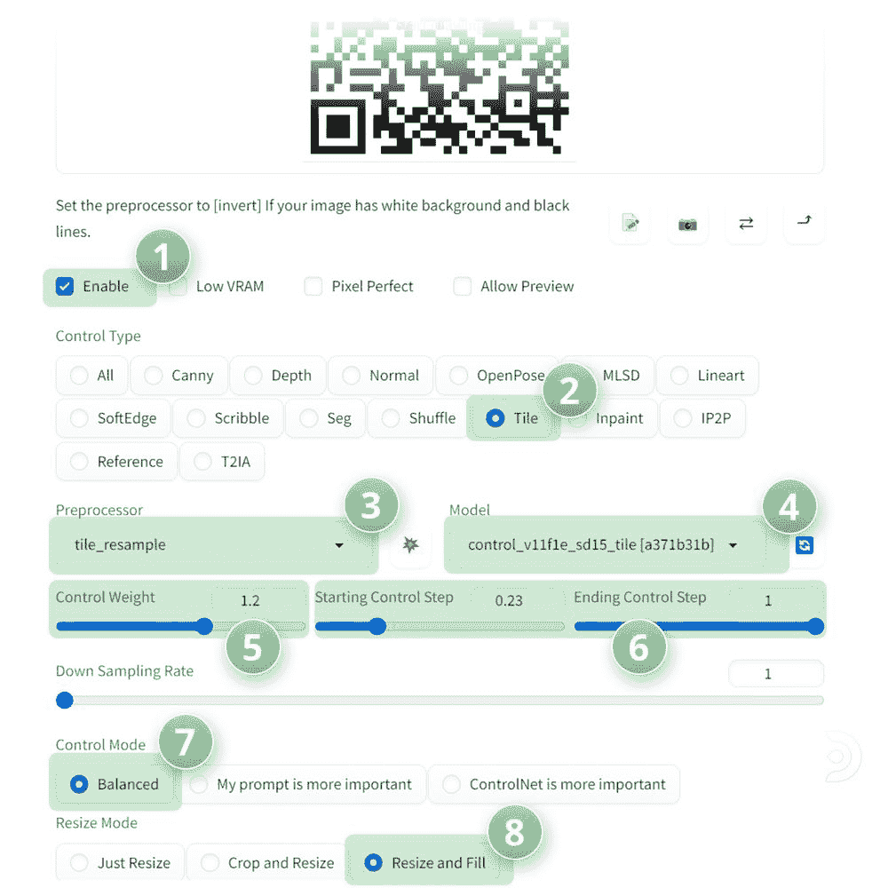

## **第 4 步：生成！**

恭喜，我们现在可以单击生成，我们应该将我们的二维码与我们的图像混合在一起！

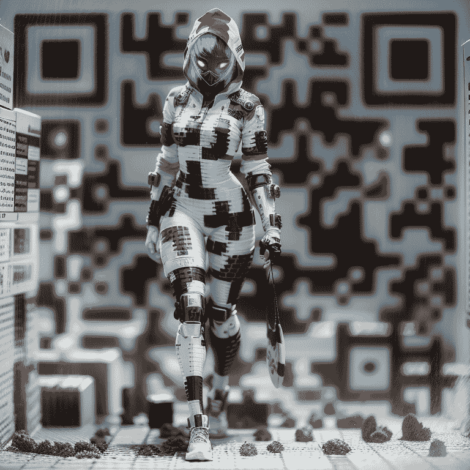

# 方法二：文生图

## **第 1 步：创建我们的提示**

我们可以从输入正面和负面提示开始

> Positive Prompts: Lady gaga in the style of Alberto Seveso, 8k, ultra detailed, (masterpiece:1.5)

> Negative Prompts: blurry, lowres, text, nsfw

+   **(1) **Set the stable** diffusion **checkpoint to revAnimated

+   **(2) ****the**** sampling me**thod as DPM++ 2M Karras

+   **(3) ****sa**mpling steps to 30

+   **(4) **enable restore faces ✅

+   **(5) ****set the r**esolution to 768 x 768

+   **(6) ****an**d a CFG scale of 11

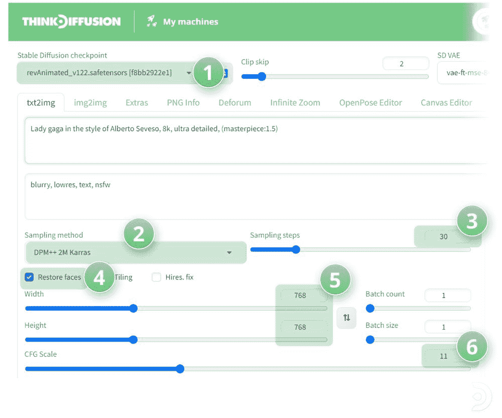

## 第 2 步：ControlNet Unit 0

+   **(1) **Click the ControlNet dropdown

+   **(2) **and **upload** our qr code.

+   **(3) **Click **Enable** to ensure that ControlNet is activated ✅

+   **(4) ****Set** the Control Type to be All

+   **(5) **the Preprocessor to be inpaint_global_harmonious

+   **(6) **and the ControlNet model to be control_v1p_sd15_brightness

+   **(7) ****Set **the Control weight to be 0.35

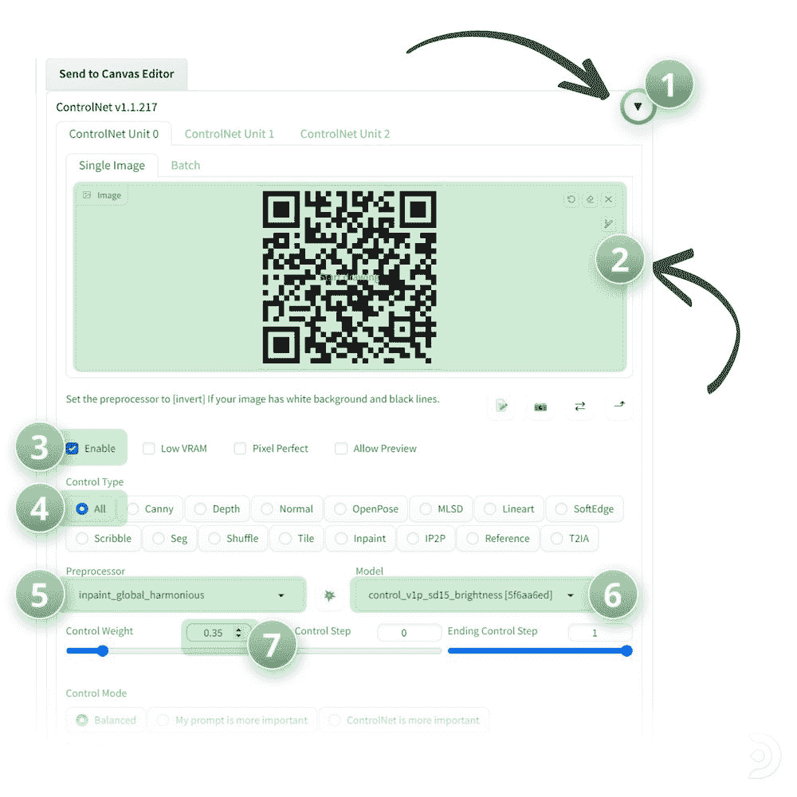

## 第 3 步：ControlNet Unit 1

+   **(1) **Click over to the ControlNet Unit 1 Tab

+   **(2) **Within ControlNet Unit 1 we want to upload our qr code again

+   **(3) **Click **Enable** to ensure that ControlNet is activated ✅

+   **(4) ****Set** the Control Type to All

+   **(5) **the Preprocessor to inpaint_global_harmonious

+   **(6) **and the ControlNet model to control_v11f1e_sd15_tile

+   **(7) ****Set** the Control Weight to 0.5

+   **(8) ****the **starting Control Step to 0.35

+   **(9) ****and **the ending control step to 0.70

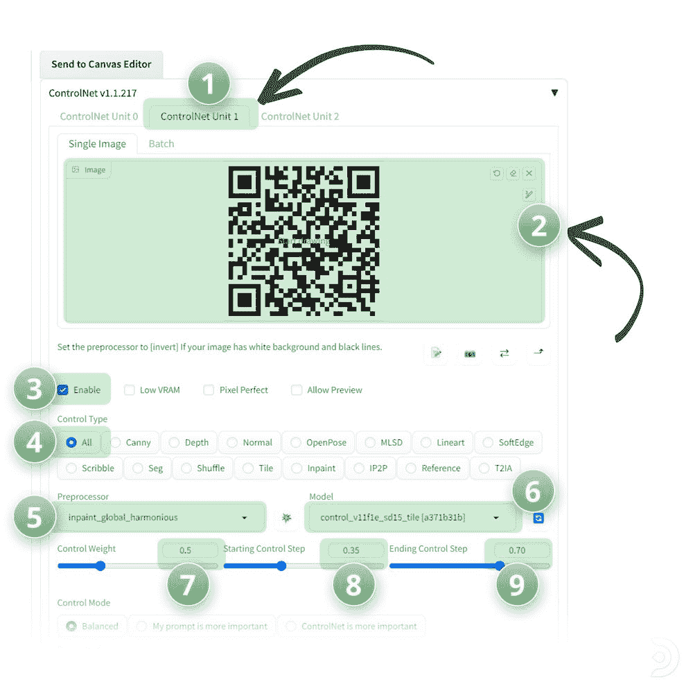

## **第 4 步：生成！**

点击生成...！

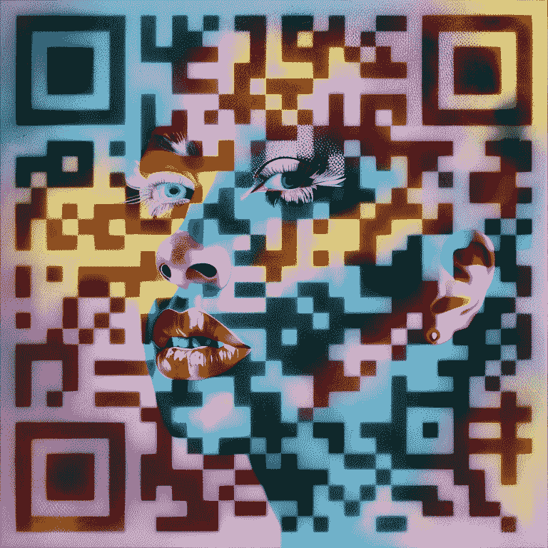

## **使用文生图的其他示例**

Positive Prompts: Full Photo shot of a lion, Yoji Shinkawa style, Jean-baptiste Monge, general plan, central composition, entirely on a sheet, Ink painting, expressive painting, watercolor, bold brushstrokes, Concept art, orange, (purple:1.2), gray and white, stylize, intricate detail, 8k, transparent background, (white background:1.4), 3D vector

Negative Prompts: Watermark, Text, censored, deformed, bad anatomy, disfigured

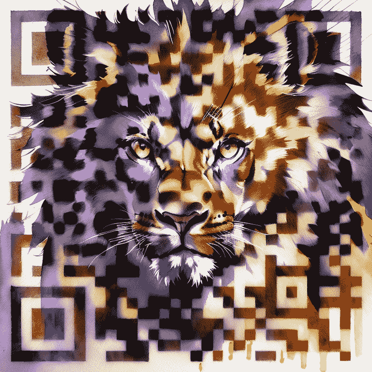

Positive Prompts: 8k, RAW photo, best quality, (masterpiece:1.2), (realistic, photo-realistic:1.37), octane render, ultra high res, ultra-detailed , professional lighting, photon mapping, radiosity, physically-based rendering, ue5, ((island sanctuary)), ((ancient fallen kingdom)), ((drowned city))

Negative Prompts: cartoon, painting, illustration, (worst quality, low quality, normal quality:2), nsfw

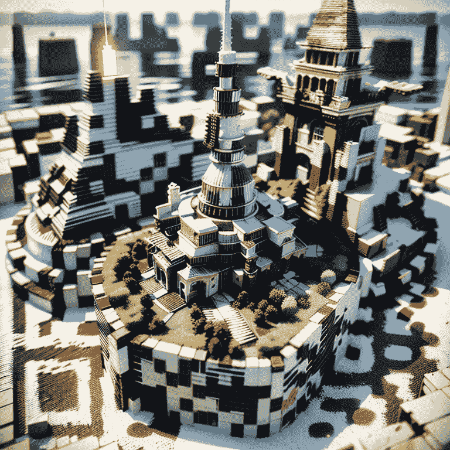

请注意，您可以调整两个图像的控制权重来找到一个稳定的输出！此外，您可以调整 QR 图像的启动控制步骤，只有不断生成和调整才能获得您想要的确切结果！