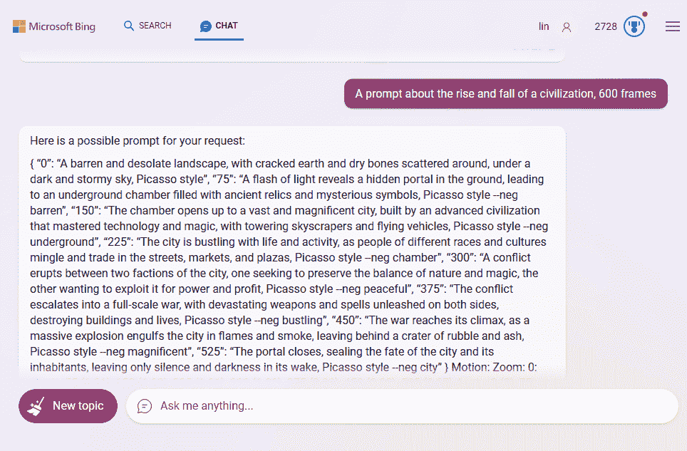
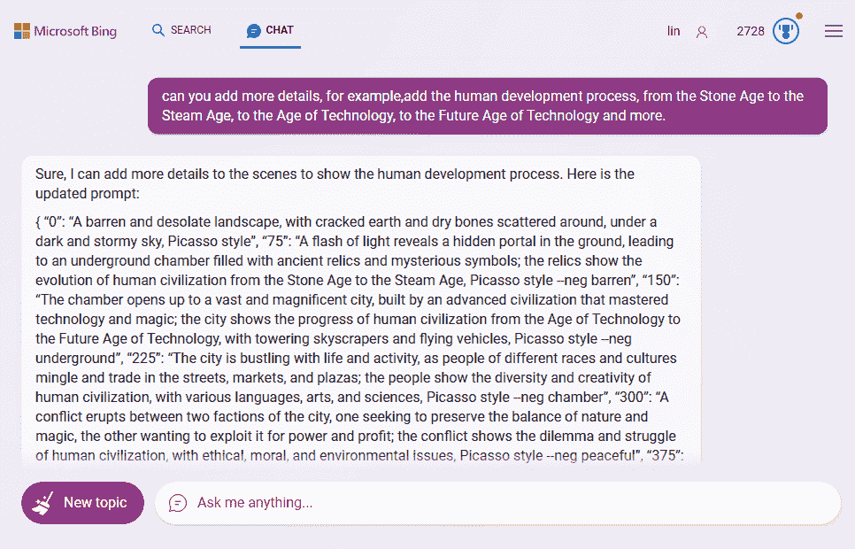
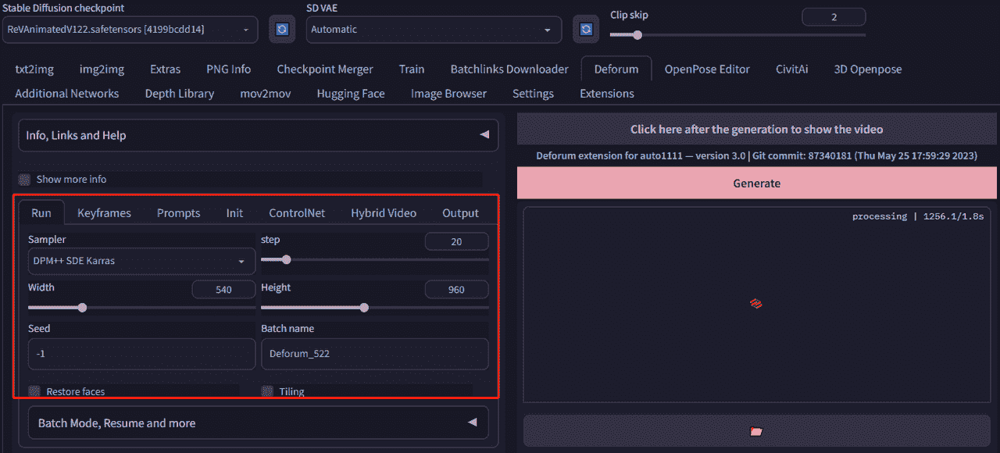
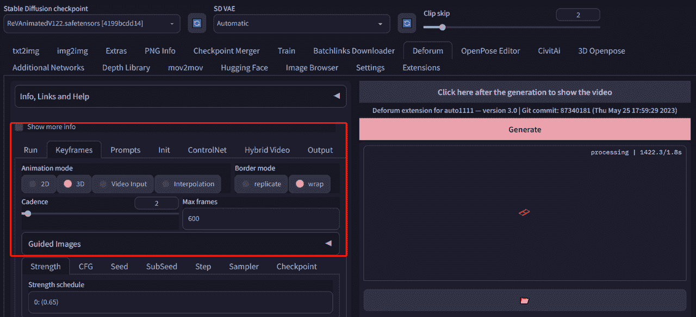
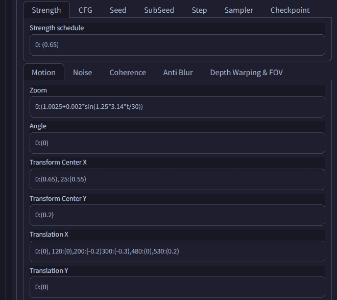
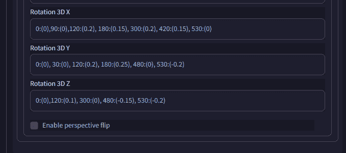
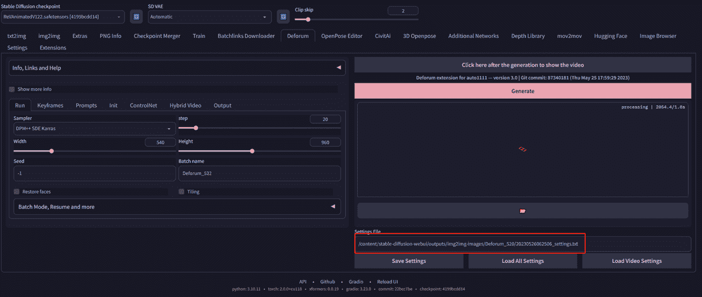

# Deforum 让你轻松实现"瞬息全宇宙"

> 来源：[https://e0lrm2v2v1u.feishu.cn/docx/OuafdNmxKo7isqxoIrycebsLnle](https://e0lrm2v2v1u.feishu.cn/docx/OuafdNmxKo7isqxoIrycebsLnle)

### 引言

你有没有被抖音等短视频里面的瞬息全宇宙视频刷屏，有没有被很多大佬制作的AI神转场视频所惊艳，今天我们来看看这种瞬息全宇宙的视频到底怎么做？

首[用Colab部署自己的AI绘画云平台](https://e0lrm2v2v1u.feishu.cn/wiki/wikcn6hw5AJ5NBIpngIRsMBo1Kg)你需[Deforum 让你轻松实现AI动画](https://e0lrm2v2v1u.feishu.cn/wiki/wikcnXzizvn3toI831ilsvYcCNQ)准备stable diffusion webui的运行环境，再安装deforum插件，可以参照我之前的教程。  、

### 一、准备工作

1.  准备一段自己拍摄的视频，我拍摄了一段倒茶的视频，准备做一段“茶杯里的文明兴衰”。截取视频最后一帧，作为我们转场视频的开始画面。

1.  准备提示词，这里我们使用new bing chat来自动生成提示词。需要new bing提示语的👸号后台私信“new bing”免费获取。

如果不满意，我们还可以让它增加一些细节，这里我们让它加入人类文明的兴衰：从石器时代到蒸汽时代，再到科技时代、未来时代等等。

### 二、开始生成

1.  启动stable diffusion webui,我使用的Google colab云端部署的环境，如果你的电脑配置足够，使用本地环境会更加稳定。

1.  切换到deforum页面，开始配置。我们用的大模型是RevAnimatedV1.2.2.

1.  Run页面配置采样方法、步数、视频宽高、种子、输出路径等。

1.  Keyframes界面，我们选择3D模式，这个页面需要配置视频的总帧数，这个决定了视频的时长，要和new bing中生成的保持一致。

1.  另外两个比较重要的配置界面是strength和motion，这个参数较为复杂，主要控制每帧摄像头移动的方位。可以参考下面的配置。这里想象空间很多，可以更加自己的需要修改。

1.  Prompts界面，将new bing 生成的提示词全部拷贝进去，另外增加一些通用的正面提示词和负面提示词。

1.  Output界面每秒的帧数为30，这里还可以配置是否保存每一帧图片，是否放大视频，视频质量越高，跑图的时间就会越长，我们就不勾选了。

还有一种快捷的配置方式，直接load现成的settings，后台私信"setting"免费获取。

### 三、查看结果

视频生成后，我们可以在路径/content/stable-diffusion-webui/outputs/img2img-images/Deforum-xxxx文件夹下找到。看看效果吧。

[20230526083247.mp4](https://internal-api-drive-stream.feishu.cn/space/api/box/stream/download/all/QTnybe4f8oHLHtxiQYwcFy8Vnwb)

### 结语

好了，今天的分享到此为止了，快去发挥你的想象，开启你的“瞬息全宇宙”吧。

最后，推荐一下我的知识库：[苹果爷爷【AI知识库】首页](https://e0lrm2v2v1u.feishu.cn/wiki/wikcn8SwQrC91pMBXERgUvytBug) **这是一个关于****AI****的**知识分享和学习的平台，你可以在这里找到AI相关的最新资讯、教程、工具、案例、研报和社群，让你快速掌握AI的技能和知识，实现AI的应用和变现。