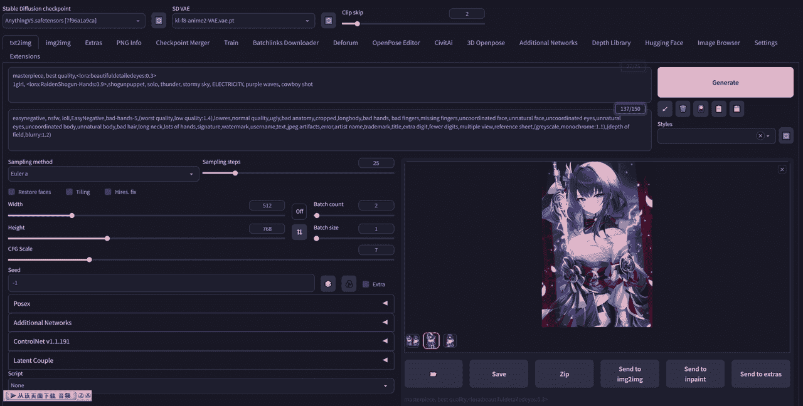
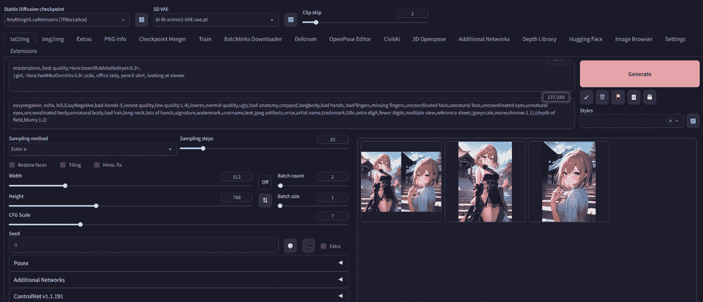
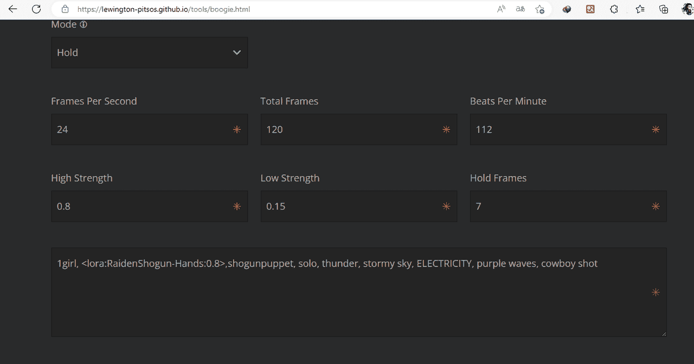
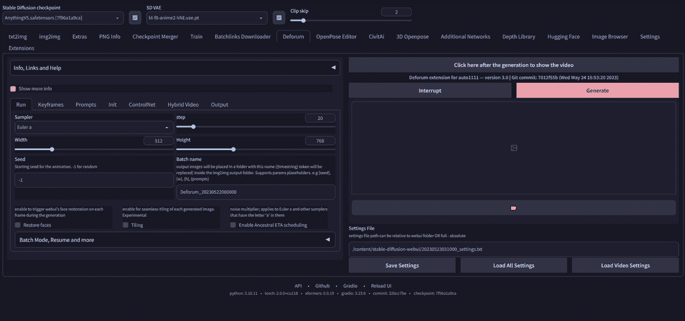
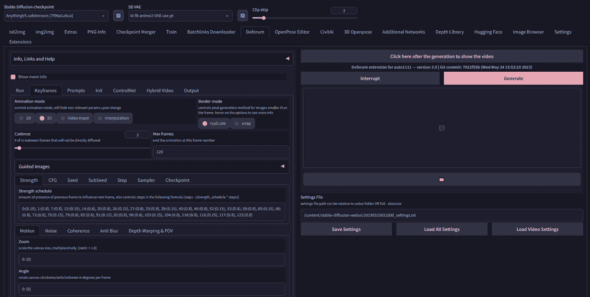
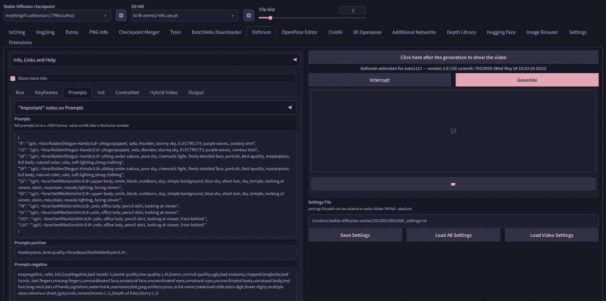
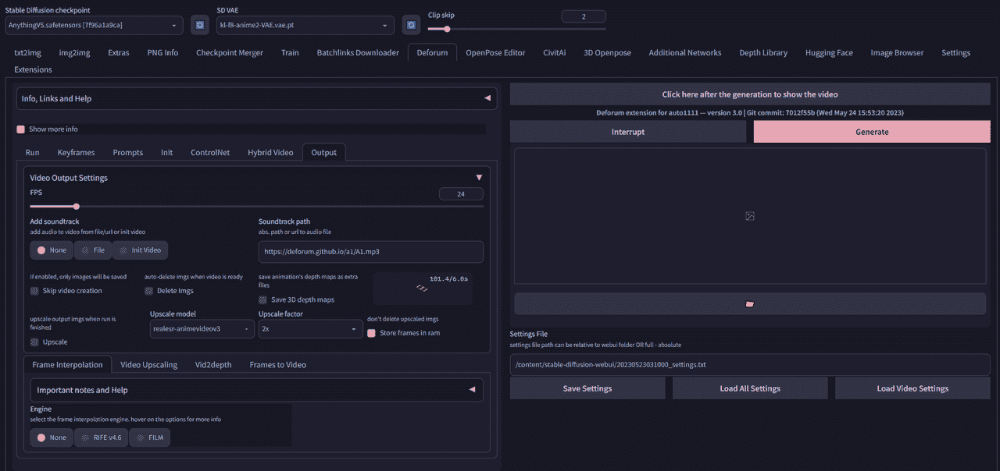
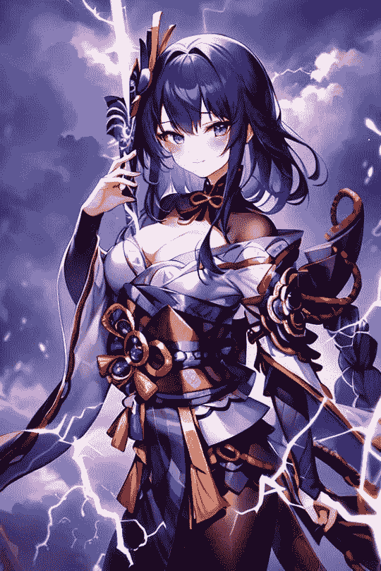

# Deforum 让你轻松实现AI动画

> 来源：[https://e0lrm2v2v1u.feishu.cn/docx/BqBKd21b2oKBPqxRkvicWpdQnCc](https://e0lrm2v2v1u.feishu.cn/docx/BqBKd21b2oKBPqxRkvicWpdQnCc)

### **引言**

stable diffusion是一种基于深度学习的图像生成技术，它可以根据文本描述或参考图像生成高质量的图像。stable diffusion使用了一种叫做diffusion model的神经网络模型，它可以从噪声图像逐渐恢复出目标图像，同时保持图像的细节和多样性。Deforum插件是一种基于stable diffusion的动画生成工具，它可以根据文本描述或参考视频生成连续的图像序列，并将它们拼接成视频。Deforum插件使用了一种叫做image-to-image function的技术，它可以对图像帧进行微小的变换，并用stable diffusion生成下一帧。由于帧之间的变化很小，因此会产生连续视频的感觉。今天我们使用stable diffusion的Deforum插件来做一个原神角色"雷电将军"转场"八重神子"的动画。

（关于如何使用stable diffusion webui参照我们上一篇文章，链接：。。。）

### **一、准备提示词**

首先我们准备雷电将军的提示词（准备两组），用txt2img跑一下，效果还不错。

masterpiece, best quality,<lora:beautifuldetailedeyes:0.3>,1girl, <lora:RaidenShogun-Hands:0.9>,shogunpuppet, solo, thunder, stormy sky, ELECTRICITY, purple waves, cowboy shot

masterpiece, best quality,<lora:beautifuldetailedeyes:0.3>,1girl, <lora:RaidenShogun:0.8>,sitting under sakura, pure sky, cinematic light, finely detailed face, portrait, Best quality, masterpiece, full body, natural color, solo, soft lighting,shrug clothing

然后准备八重神子的提示词（准备了3组），用txt2img跑一下，效果还不错。

1girl, <lora:YaeMikoGenshin:0.8>,upper body, smile, blush, outdoors, day, simple background, blue sky, short hair, sky, temple, looking at viewer, stairs, mountain, moody lighting, facing viewer

1girl, <lora:YaeMikoGenshin:0.8>,solo, office lady, pencil skirt, looking at viewer

1girl, <lora:YaeMikoGenshin:0.8>,solo, office lady, pencil skirt, looking at viewer, from behind

负面提示词可以使用相同的：

easynegative, nsfw, loli,EasyNegative,bad-hands-5,(worst quality,low quality:1.4),lowres,normal quality,ugly,bad anatomy,cropped,longbody,bad hands, bad fingers,missing fingers,uncoordinated face,unnatural face,uncoordinated eyes,unnatural eyes,uncoordinated body,unnatural body,bad hair,long neck,lots of hands,signature,watermark,username,text,jpeg artifacts,error,artist name,trademark,title,extra digit,fewer digits,multiple view,reference sheet,(greyscale,monochrome:1.1),(depth of field,blurry:1.2)

准备好提示词后，使用Boogie（网址：https://lewington-pitsos.github.io/tools/boogie.html）生成deforum参数，其中beats per minute是你使用的背景音乐每分钟的节拍数，可以用这个网址解析（网址：https://getsongbpm.com/tools/audio），我这里就用默认的：

我们把生成的提示词用上面的提示词换掉，得到最终的提示词：

{

"0": "1girl, ,shogunpuppet, solo, thunder, stormy sky, ELECTRICITY, purple waves, cowboy shot",

"13": "1girl, ,shogunpuppet, solo, thunder, stormy sky, ELECTRICITY, purple waves, cowboy shot",

"26": "1girl, <lora:RaidenShogun-Hands:0.8>,sitting under sakura, pure sky, cinematic light, finely detailed face, portrait, Best quality, masterpiece, full body, natural color, solo, soft lighting,shrug clothing",

"39": "1girl, <lora:RaidenShogun-Hands:0.8>,sitting under sakura, pure sky, cinematic light, finely detailed face, portrait, Best quality, masterpiece, full body, natural color, solo, soft lighting,shrug clothing",

"52": "1girl, <lora:YaeMikoGenshin:0.8>,upper body, smile, blush, outdoors, day, simple background, blue sky, short hair, sky, temple, looking at viewer, stairs, mountain, moody lighting, facing viewer",

"65": "1girl, <lora:YaeMikoGenshin:0.8>,upper body, smile, blush, outdoors, day, simple background, blue sky, short hair, sky, temple, looking at viewer, stairs, mountain, moody lighting, facing viewer",

"78": "1girl, <lora:YaeMikoGenshin:0.8>,solo, office lady, pencil skirt, looking at viewer",

"91": "1girl, <lora:YaeMikoGenshin:0.8>,solo, office lady, pencil skirt, looking at viewer",

"103": "1girl, <lora:YaeMikoGenshin:0.8>,solo, office lady, pencil skirt, looking at viewer, from behind ",

"116": "1girl, <lora:YaeMikoGenshin:0.8>,solo, office lady, pencil skirt, looking at viewer, from behind "

}

### 二、**配置deforum**

1.  Run页面配置视频宽高、种子、输出路径等。

1.  Keyframes界面，选择3D,Maxframes、strength要和Boogie中设置的一致。

1.  Prompts界面，将上述提示词全部拷贝进去。

1.  Output界面每秒的帧数要和Boogie中设置保持一致。

### **三、生成动画查看效果**

点击**Generate**开始生成动画，根据画质和视频总帧数不同，跑图的时间不一样。

[20230525090502.mp4](https://internal-api-drive-stream.feishu.cn/space/api/box/stream/download/all/IECLb03Ffok3Zkxn0Y8cRdVznch)

### **结语**

Deforum插件是一种基于stable diffusion的动画生成工具，它可以根据文本描述或参考图像或视频生成连续的图像序列，并将它们拼接成视频。它支持多种动画模式和功能，可以满足不同的创作需求。它也有一些局限性，需要较高的显存和计算资源，并且不保证生成结果的质量和准确性。如果你对AI绘画感兴趣，你可以尝试使用Deforum插件来制作自己的AI转场动画。