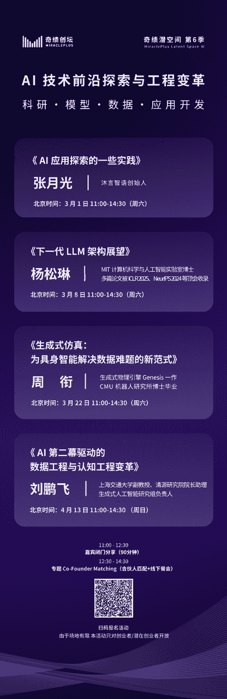

# 大模型空间站

> 来源：[https://miracleplus.feishu.cn/docx/SSy4dZtgSo8FdlxHfjGclKJNn1g](https://miracleplus.feishu.cn/docx/SSy4dZtgSo8FdlxHfjGclKJNn1g)

# 🚀招聘公告

**奇绩创坛****由陆奇博士**于2019年创立，使命是在源头最大化驱动创新。奇绩研究组将研究模型理论、到投研战略分析、市场策划等不同背景的同学聚在一起，搭建GenAI时代独特的跨界人才社群。

## 🚀F**24实习岗位**

##### [行研-学术科研人才交流组实习生](https://miracleplus.feishu.cn/docx/Yn6rdf2iOoY2Rcx8yVNcUBYRnch#part-QkMcdeJmuob9uvxvV3qcLSzHn8g)

##### 行研-GenAI研究岗位-战略分析（偏产品）

##### Web / AI 全栈开发工程师实习生

## **火热开放中🚀**

##### 行研-GenAI研究岗位-前沿学术探索

##### 行研-GenAI研究岗位-战略分析（偏咨询）

##### 创新活动产品运营 （大模型系列活动产品运营）

> **点击**相关岗位可查看对应**岗位需求【JD】；**相关岗位投递请**扫描二维码**

> 欢迎**推荐/自荐**

> 期待在**奇绩创坛**遇见更好的你

---

# 📬快速导航

> **前言导读 - 最左上角点开目录**

> --- **

> 如果对 ****大**模型资讯 感兴趣的朋友，可以

1.  订阅我们每天的大模型日报 [大模型日报合集（分享版）](https://miracleplus.feishu.cn/wiki/KapVwXfkriOBiskB0B2cUHxjnTh)

1.  加入我们的大模型社群

1.  [最新大模型相关活动](https://miracleplus.feishu.cn/wiki/NdgOwFiZki4YInktERacdtsWnid?from=from_copylink)与我们的活动分享（历届活动回放链接都在下面）

> 如果对 **创业**** **感兴趣的朋友，可以查看我们的 [创业百科](https://miracleplus.feishu.cn/wiki/AzdwwDmiUitBIfkThZdcwPI9nCc)

> 对 **出海** 感兴趣的朋友，可以看[关于出海](https://miracleplus.feishu.cn/wiki/YgVdwVKcfiNXf2kLySRcaCpvnCh?from=from_copylink)

> 相关行业大咖的**独家**分享[往期活动分享](https://miracleplus.feishu.cn/wiki/CwALwsK9AiUN98kQqj7chlFTnoj?chunked=false)

> **留言板和建议：**[神秘网页](https://miracleplus.feishu.cn/wiki/OOLTwRsmVinhHQkVXVFcTKwOnuh)

+   欢迎大家来到大模型空间站~如果您有任何的建议欢迎加入我们一起共创空间站！（可以直接留言哦~我们会及时联系）

+   希望和大家一起共创一个学习、交流、分享的社区

+   **往期日报详见：**[大模型日报合集（分享版）](https://miracleplus.feishu.cn/wiki/KapVwXfkriOBiskB0B2cUHxjnTh?fromScene=spaceOverview)

+   我们的日报公众号 **LLM SPACE **，欢迎大家关注！

+   新功能：可以来这里找到心仪的**初创**公司~

<https://miracleplus.feishu.cn/share/base/query/shrcnpECXXZX3ivFlguiRNpt8bg>

> [「奇绩大](https://www.feishu.cn/community/article/wiki?id=7355065047338450972)模型日报」知识库现已登陆飞书官方社区：飞书社区 点击「订阅社区精选」，即可在飞书每日收到《大模型日报》每日最新推送

# 奇绩创坛官网

## https://www.miracleplus.com/

可以报名**创业营**和各种**闭门分享**~

适合早期**创业者的入门课**！！

# 欢迎关注奇绩创坛

## 日报公众号LLM SPACE

---

# 📕大**模型日报 **

+   如果您有任何的建议或想法，欢迎和我们一起共创空间站🛰  lxy964857402（请备注来意）

+   **往期日报详见：**[大模型日报知识库(分享版)](https://miracleplus.feishu.cn/wiki/KapVwXfkriOBiskB0B2cUHxjnTh?fromScene=spaceOverview)

+   我们的日报公众号 **LLM SPACE **，欢迎大家关注！

---

# 📡潜空间活动预告

> **潜空间系列活动第****六****季启动！**

> 第六季第二期将在**3.8上午11:00开始**，嘉宾是MIT计算机科学与人工智能实验室博士Songlin Yang。活动包括嘉宾分享、访谈Q&A、cofounder matching餐会。

>

> **张月光**-沐言智语创始人、产品经理，5年阿里，从0到1创办妙鸭相机

>

> **Songlin Yang**-MIT计算机科学与人工智能实验室二年级博士生，专注线性注意力机制、机器学习与大语言模型交叉领域

>

> **周衔**-先进生成式物理引擎 Genesis 贡献人一作，现卡内基梅隆大学机器人研究所博士毕业生

>

> **刘鹏飞-**上海交通大学副教授、清源研究院院长助理，国家海外优青，生成式人工智能研究组(GAIR: Generative Artificial Intelligence Research Lab)负责人

>

> 本季活动同时开放北京线下、上海线下和线上场次，欢迎校友和外部创业者扫描右方二维码报名！

# 💡嘉宾分享活动回顾

### 2024大模型空间站系列活动

### 2023大模型系列活动

### MPR丨重读Lilian Weng系列活动

---

# **关于我们**

「Founders First - 创始人优先」

<https://player.bilibili.com/player.html?bvid=11F411p7HG&spm_id_from=333.999.0.0>

<https://player.bilibili.com/player.html?bvid=1dv4y147Fq&spm_id_from=333.999.0.0>

<https://player.bilibili.com/player.html?bvid=1784y137mD&spm_id_from=333.999.0.0&vd_source=c6829bb3cfff6e4a0a4cd77b9c1404e6>

---

> 新功能：人才招聘！！初创公司找创始[人，大厂找外包....](https://miracleplus.feishu.cn/share/base/form/shrcnznndDXkK73vT1doyRlhbxd)..都可以来这里~找合伙人点击这里！！！

> [找心仪的公司来这~~](https://miracleplus.feishu.cn/share/base/query/shrcnpECXXZX3ivFlguiRNpt8bg)