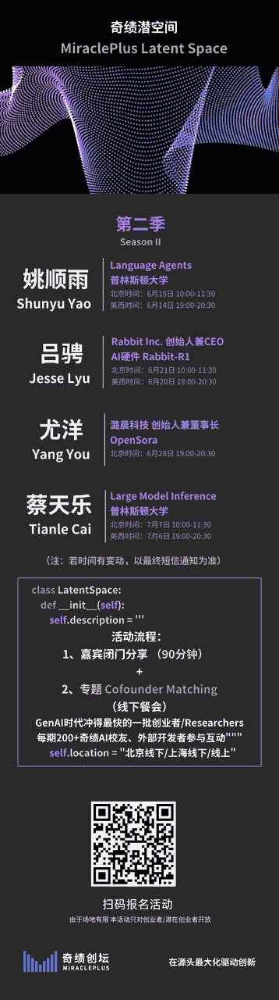

# 最新大模型相关活动

> 来源：[https://miracleplus.feishu.cn/docx/KL5SdrM2koF47TxuBntcRncJnsb](https://miracleplus.feishu.cn/docx/KL5SdrM2koF47TxuBntcRncJnsb)

## **这是我们****新一期的潜空间活动****，欢迎大家报名~**

> 潜空间系列活动第二季启动！

> 第2季第1期将在6.15 10:00开始，嘉宾是姚顺雨。活动包括嘉宾分享、访谈Q&A、cofounder matching餐会。

>

> 姚顺雨-普林斯顿计算机系博士，ReAct、思维树ToT、SWE框架提出者；

>

> Jesse Lyu吕骋-最热🔥🔥🔥AI硬件Rabbit- R1创始人；

>

> 尤洋-新加坡国立大学校长青年教授，曾创造Imagenet、Bert等多项训练速度世界纪录；

>

> 蔡天乐-普林斯顿“小天才”、美杜莎推理优化论文作者。

>

>

> 本季活动同时开放北京线下、上海线下和线上场次，欢迎校友和外部创业者扫描右方二维码报名！

