# 奇绩大模型日报（1月 1-2日）

> 来源：[https://miracleplus.feishu.cn/docx/El8KdfaWzoHR7Wx8MYQc1ToEnbe](https://miracleplus.feishu.cn/docx/El8KdfaWzoHR7Wx8MYQc1ToEnbe)

# 🔉潜**空间系列活动重磅回归！**

> 本期活动将在**1月4日** **11:00**开始，我们邀请到的嘉宾是叶添，清华大学姚班，卡内基梅隆大学博士生，Physics of LLM 2.1作者，于 Meta 担任 Research Scientist Intern。研究兴趣主要集中在大语言模型的推理机制。曾在顶级会议 NeurIPS 上发表研究论文。此外，曾两次获得中国数学奥林匹克竞赛国家集训队的资格。

> 在本次分享中叶添将分享《揭秘大语言模型推理机制——超越人类的二级推理》。

> 除嘉宾分享外，每期设置了【匹配合伙人 Cofounder Matching】环节。你可以和 GenAI 时代最有活力的创业者和研究者线下面对面交流，将有机会找到志同道合、有共同创业梦想的小伙伴。

> 报名通道已开启，欢迎扫描下方二维码报名。

# 资讯

### 全新模型RoboVLMs解锁VLA可能性

贡献人：

https://mp.weixin.qq.com/s/z0v0mrl_WB0Ie-5yVHc3-g

近年来，视觉语言基础模型（VLMs）在多模态理解和推理方面表现出色，逐渐引领了人工智能的发展。而视觉语言动作模型（VLA）则在此基础上进行拓展，使得模型不仅能够“看”和“说”，还能够执行动作，为机器人领域带来了新的突破。尽管VLAs在多个任务和场景中表现优异，但目前缺乏统一的设计标准。为此，作者提出了一个名为RoboVLMs的模型，通过一系列实验探索和优化，揭示了设计VLAs的关键因素，并在仿真和实际机器人任务中都取得了出色表现。

RoboVLMs模型的设计回答了四个核心问题。首先，实验表明，通过合理设计，VLA能够在熟悉和陌生场景中都表现稳健，且在仿真任务和真实机器人实验中均取得了较好成绩。例如，在果蔬分类任务中，RoboVLMs能够精准识别并完成任务，即使面对新环境和干扰物体。其次，模型的架构设计也至关重要，关键的设计选择包括使用连续动作空间、增加多步历史信息和引入历史信息组织模块，这些设计显著提升了模型的稳定性和泛化能力。通过实验验证，基于KosMos基础模型的架构表现最为出色，尤其在CALVIN环境中展现了强大的泛化能力。

此外，选用适合的基座模型至关重要。作者通过对比八种主流VLM，发现KosMos和Paligemma模型在任务执行精度和泛化能力上遥遥领先，验证了预训练的视觉语言能力对VLA表现的巨大推动作用。最后，关于数据的使用，研究指出，在预训练阶段引入跨本体数据（如Open-X Embodiment数据集）能显著提升模型的鲁棒性和少样本情况下的表现。

未来，RoboVLMs有巨大的发展空间。进一步的优化可以集中在VLM的内部结构、信息融合模块以及训练目标上。此外，挑战更复杂的任务，如长链条的任务（例如“做早餐”），以及提升多模态协作能力，都是未来研究的潜力方向。

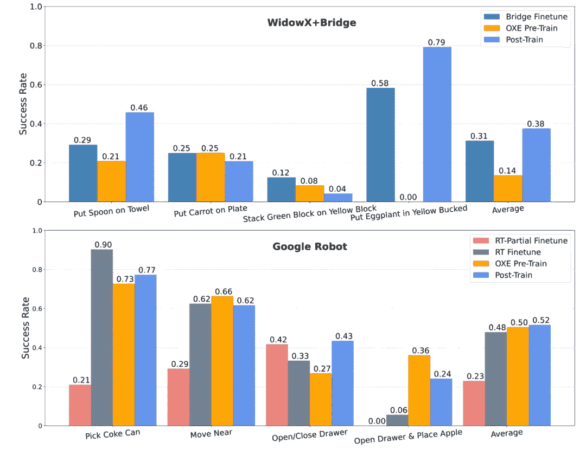

### 大模型“六小虎”，拿下4200万大单

贡献人：

https://mp.weixin.qq.com/s/lZT6JSb4PkRS3HiLMmlOJA

12月27日，上海大模型独角兽公司阶跃星辰成功中标上海某公司智算云服务平台源代码采购项目，投标报价达4199.9万元。该项目要求中标方在服务器和网络部署完成后2周内完成源代码的部署、配置及调试，并满足招标文件中的技术规格要求。此项目从公开招标到中标结果公告仅用了17天，阶跃星辰在此过程中表现突出，成为中标候选人第一名。

阶跃星辰自2023年4月成立以来，已迅速崭露头角。公司由前微软全球副总裁姜大昕博士创办，专注于大模型技术的研发，尤其在自然语言处理领域具有深厚的技术积累。今年12月23日，阶跃星辰宣布完成数亿美元的B轮融资，投资方包括上海国有资本投资有限公司及旗下基金，战略投资人腾讯投资、五源资本和启明创投等。

公司在大模型领域的表现也同样亮眼。从今年3月起，阶跃星辰陆续推出了多款Step系列通用大模型，涵盖千亿参数语言模型、万亿参数MoE语言模型及多模态大模型等，展现了其强大的技术实力。阶跃星辰被业界视为国内“大模型六小虎”之一，与智谱、月之暗面、MiniMax、百川智能、零一万物等公司并肩竞争。

在竞争激烈的市场环境中，阶跃星辰的这一项目中标标志着其技术和市场份额的进一步拓展，也进一步巩固了其在国内大模型领域的领先地位。与此同时，智谱等其他公司也在多个招标项目中取得了中标，如12月连续中标北京智网数科和中国银行等项目，体现了行业内大模型技术的需求持续增长。

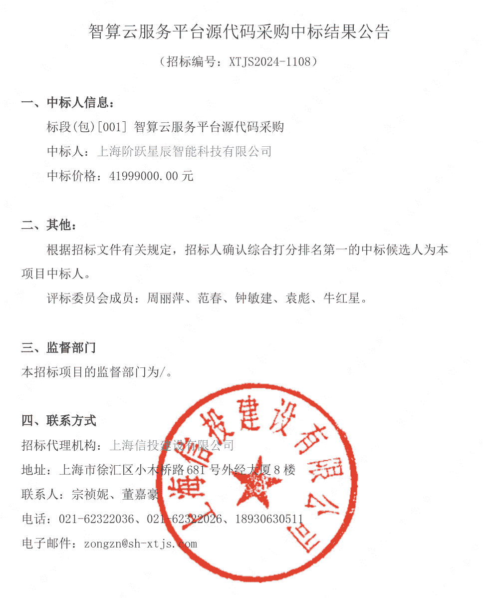

### 智能驾驶：速攀发展曲线，乘用车智驾2025年或迎量变到质变

贡献人：

https://mp.weixin.qq.com/s/v4ybh_ObrtOi5prahBFT🐧

2024年技术快速迭代，NOA收获性能和渗透率双提升。从年初BEV +Transformer，摆脱高精度地图，实现全国都能开；到年中端到端架构的兴起，减少了模型间信息损耗，提高泛化能力；再到年底引入视觉语言大模型和云端模型，进一步提高对长尾场景的处理能力；由此将L2功能在空间维度延展到接近极限，车位到车位成为新的竞争锚点。并且头部车企开始降低硬件配置，以现配套售价的下探和标配。2025年随着功能完善和硬件降本，我们认为城市NOA渗透率有望提升至11.6%。

L2+功能已基本完备，车企竞争往更高阶智驾演进。随着车位到车位功能的推出，L2级智驾功能实现了全场景可用，后续只需持续优化接管率；我们认为，头部车企为了展示科技领先性，或将竞争的矛头从逐渐成熟的城市NOA指向以L3/L4为代表的自动驾驶，和AI/具身智能等相关领域。

发展城市NOA有助于增厚毛利，并且为高阶自动驾驶演进铺垫。因智驾硬件成本较高，车企通常会进行加价选配。经我们测算，选装的智驾硬件的毛利率远大于原车毛利率，而对于头部智驾车企而言，此类选配2024年前三季度单季几乎贡献超过10%的毛利。我们认为，虽然智驾软件收费处于萌芽期，头部智驾车企通过提高智驾选装率，仍获取了增量回报。同时，受益于技术栈与FSD的相似性，我们认为，车企也有望制定向Robotaxi演进的路标。我们认为，我国智驾解决方案商则受益于当下技术发展，具备较明显的全球竞争优势，利好后续海外拓展销售。

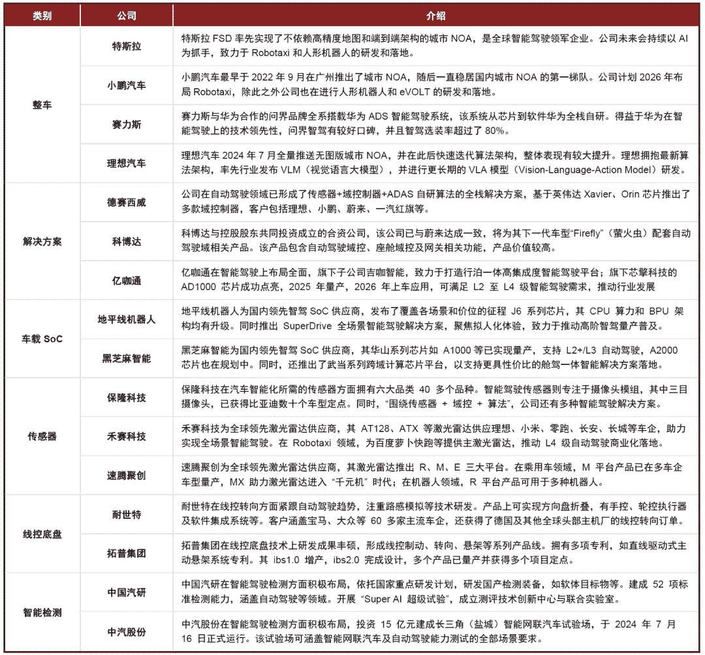

### 潜空间播客剧透NeurIPS上规模化之辩、盘点2024AI堆栈四大战争：优质数据/GPU贫富/多模态/LLMOps

贡献人：

https://mp.weixin.qq.com/s/ujseTbF7qG3cYv2S2XqhPA

一、AI 工程师的崛起与AI 工程领域的演变：

+   AI 工程师这一职业迅速崛起，其发展速度超出了预期，反映在播客收听率的增长上，也与整个AI行业的蓬勃发展同步。

+   AI 工程师的定义尚不明确，但这反而促进了有益的讨论和领域的不断细化，其边界仍在探索中。

+   AI 工程师的角色是将最新的研究成果转化为生产应用，需要兼顾研究和工程技能。

二、2024年AI领域的主要技术进展：

+   大型语言模型（LLM）的竞争格局变化：OpenAI的市场份额下降，Anthropic和Google Gemini崛起，形成三足鼎立之势。Gemini凭借免费层级策略迅速抢占市场。

+   **模型规模的瓶颈与推理范式转变：**大型预训练模型的扩展遇到瓶颈，转向关注推理时计算（ITC），计算最优训练和推理成为研究重点。

+   **小型模型的崛起：**大型实验室开发的小型模型在性能和成本方面具有竞争力，与开源社区开发的小模型形成差异化竞争。

+   **多模态模型发展迅速：**视觉、语音、文本等多模态模型快速发展，Gemini 2.0等模型在多模态能力上取得突破。图像生成模型（如Sora、Veo2、Pika 2.0）和视频生成模型发展迅速，视频与音频同步成为新的前沿方向。

+   **代理（Agent）技术发展：**代理技术成为关注焦点，但仍面临诸多挑战，例如环境理解、机构知识提取等。

+   **合成数据的重要性提升：**合成数据在模型训练和评估中发挥越来越重要的作用，但其有效性仍存在争议。

+   LLM运维（LLMOps）和监管运维（RegOps）发展：LangChain和Llama Index等LLMOps工具增长迅速，表明该领域的需求日益增长。

+   **代码解释器和代码生成工具发展：**代码解释器和代码生成工具得到改进，并被集成到各种产品中，例如ChatGPT Canvas。

+   **记忆功能的改进与挑战：**LLM的记忆功能仍在发展中，目前多为显式记忆，缺乏隐式记忆和偏好提取能力。

**三、其他重要观察：**

+   **数据质量之战：**真实数据与合成数据之间的争议持续存在，合成数据在模型训练中的应用不断扩大。

+   **GPU竞争格局：**GPU超级富豪继续占据优势，而GPU中产阶级和贫乏阶层面临挑战，但一些GPU贫乏的公司通过云服务或模型包装等方式取得成功。

+   **基准测试的演变：**新的基准测试不断涌现，反映了AI领域研究方向的变化。

+   **AI安全问题日益突出：**大型实验室面临安全风险，数据泄露和刺探活动等问题需要重视。

+   **AI的商业化和投资：**AI领域的融资活动活跃，大型公司和初创公司积极寻求商业化途径。

+   **2025年的预测：**智能体技术将迎来快速发展，并将在生产环境中得到广泛应用；AI将改变不同职业的技能下限。

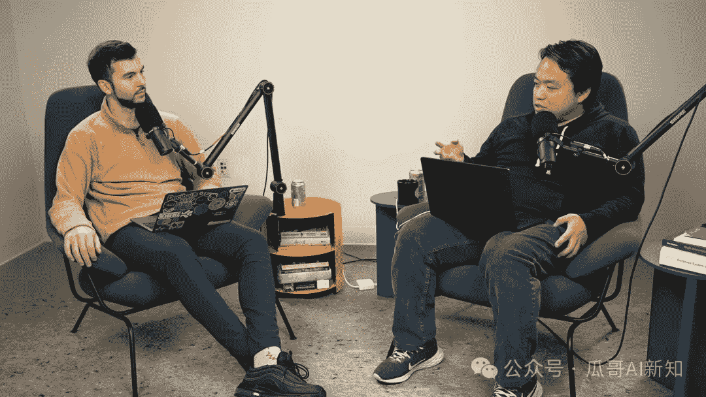

# 推特

### Vercel CEO分享用v0制作的新型CAPTCHA：通过玩《DOOM》并在噩梦模式下至少击杀 3 个敌人来验证你是人类

https://x.com/rauchg/status/1874130110120706556

我创建了 http://doom-captcha.vercel.app —— 通过玩《DOOM》并在噩梦模式下至少击杀 3 个敌人来验证你是人类 😁

基于 WebAssembly 和 LibSDL，UI 使用 @v0 构建。

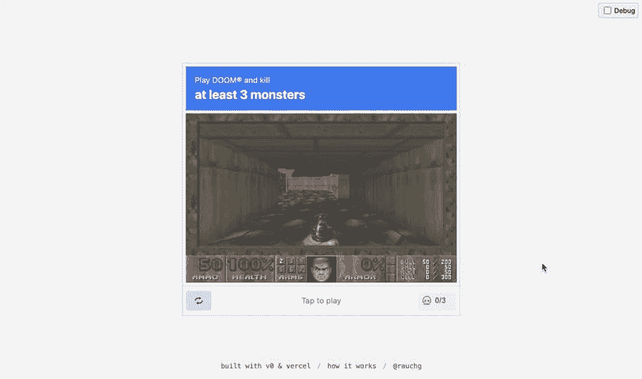

[D-wSPFhqy8Y7YPyh.mp4](https://internal-api-drive-stream.feishu.cn/space/api/box/stream/download/all/D6aNbH9UgojWF7xyBaecLC8Mnzf)

### 吴恩达分享年度热点话题：智能代理崛起， 价格下跌，生成式视频腾飞，小而美等

https://x.com/AndrewYNg/status/1874191082436895002

随着 2024 年接近尾声，今年最后一期《The Batch》总结了年度热点话题：

• **智能代理崛起**：代理工作流的增长

• **价格下跌**：LLM 代币价格迅速下降

• **生成式视频腾飞**

• **小而美**：小型语言模型

• **收购之外的选择**

点击链接查看完整文章：[https://deeplearning.ai/](https://deeplearning.ai/the-batch/issue-281/)the-batch/issue-281/

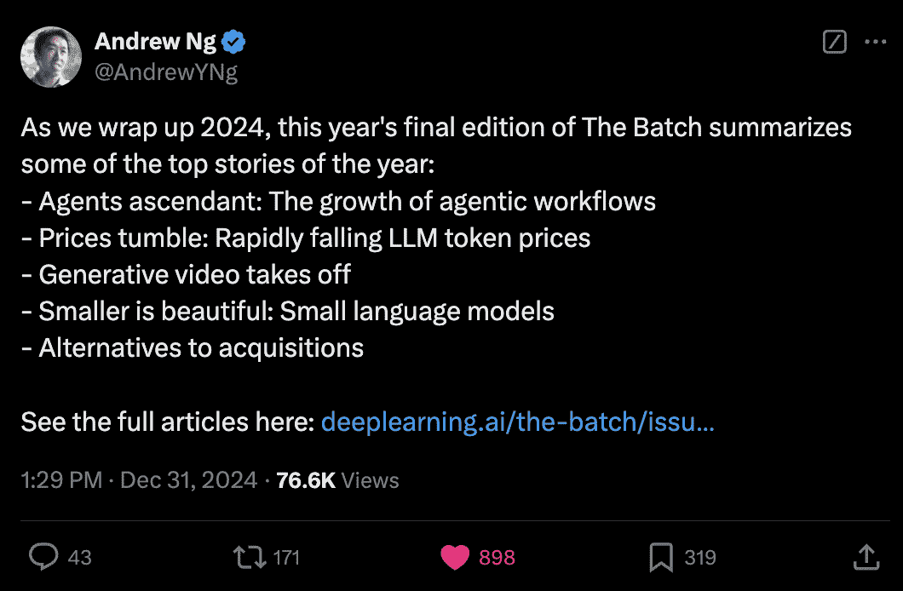

### Raschka分享《2024 年 AI 研究亮点》：个人觉得既有趣又有影响力的研究论文

https://x.com/rasbt/status/1874459295250796579

新年快乐！为迎接新的一年，我终于整理并上传了我的《2024 年 AI 研究亮点》文章草稿。

文章涵盖了多种主题，从专家混合模型到针对精度的新 LLM 扩展规律。

回顾 2024 年的所有主要研究亮点，可能需要写整整一本书。即使对于这样一个快速发展的领域来说，这一年也格外高产。为了保持适当的简洁，我决定今年专注于 LLM 研究。但即便如此，要从这样一个充满事件的年份中选择一部分论文，又该如何下手呢？我能想到的最简单方法是按月份突出每月的一篇论文：从 2024 年 1 月到 12 月。

因此，在这篇文章中，我将分享一些我个人觉得既有趣又有影响力的研究论文，或者两者兼具。不过需要注意的是，这篇文章只是第一部分，重点是 2024 年上半年，从 1 月到 6 月。系列的第二部分（涵盖 7 月至 12 月）将在 1 月晚些时候发布。

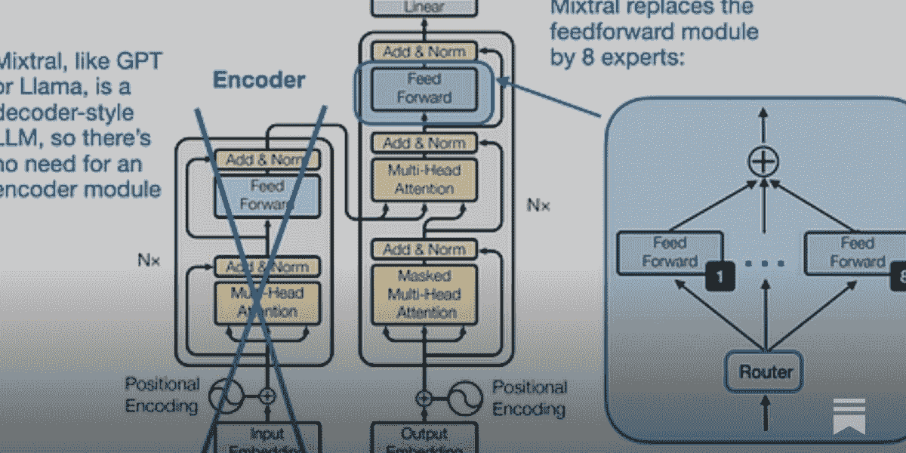

###  o1 趋势发现器：使用 o1 来监控并通知你社交媒体上的热门话题

https://x.com/ericciarla/status/1874145916116222198

推出 o1 趋势发现器 🔦

使用 o1 来监控并通知你社交媒体上的热门话题。

它从关键影响者那里获取帖子，发现任何趋势，然后通过 Slack 提醒你。

这对 @firecrawl_dev 的营销来说是一个改变游戏规则的工具，并将帮助我们在 2025 年扩展内容规模。

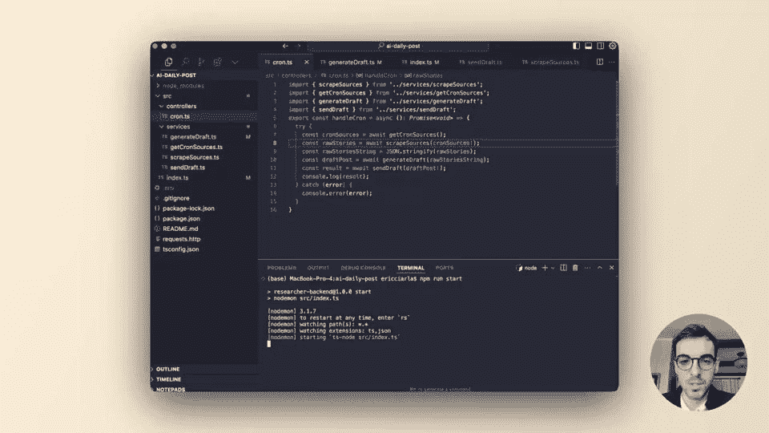

[DEc__868cKzoN5vQ.mp4](https://internal-api-drive-stream.feishu.cn/space/api/box/stream/download/all/HJALbms6Bonvx1xjLhqckgMdnYf)

### 手机上以每秒 10 个 token 速度运行的 Ministral 8B

https://x.com/localghost/status/1874175462509047973

这是一台手机上以每秒 10 个 token 速度运行的 Ministral 8B。

当你没有网络时，Siri 无法拯救你。一个离线的备份 AI 至关重要。

[0MwICZilT_iONqFU.mp4](https://internal-api-drive-stream.feishu.cn/space/api/box/stream/download/all/Kl2RbeorjoJRdrxEejEcHexZn3e)

# 信号

### MEDEC: A Benchmark for Medical Error Detection and Correction in Clinical Notes

原文链接：https://arxiv.org/abs/2412.19260v1

ResearchFlow链接：https://rflow.ai/flow/b4187c99-b057-41af-aa26-557a8f58bba1

多项研究表明，大型语言模型 (LLM) 可以正确回答医学问题，甚至在某些医学考试中的表现优于人类的平均分数。但是，据我们所知，尚未进行任何研究来评估语言模型验证现有或生成的医学文本的正确性和一致性的能力。在本文中，我们介绍了 MEDEC（此 https URL），这是第一个公开可用的临床笔记医疗错误检测和纠正基准，涵盖五种类型的错误（诊断、管理、治疗、药物治疗和病原体）。MEDEC 包含 3,848 份临床文本，其中包括来自三个美国医院系统的 488 份临床笔记，这些笔记之前从未被任何 LLM 见过。该数据集已用于 MEDIQA-CORR 共享任务，以评估 17 个参与系统 [Ben Abacha 等人，2024 年]。在本文中，我们描述了数据创建方法，并评估了最近的 LLM（例如 o1-preview、GPT-4、Claude 3.5 Sonnet 和 Gemini 2.0 Flash）在检测和纠正需要医学知识和推理能力的医疗错误方面的任务。我们还进行了一项比较研究，其中两名医生在 MEDEC 测试集上执行了相同的任务。结果表明，MEDEC 是一个足够具有挑战性的基准，可以评估模型验证现有或生成的笔记以及纠正医疗错误的能力。我们还发现，尽管最近的 LLM 在错误检测和纠正方面表现良好，但它们在这些任务中的表现仍然不如医生。我们讨论了这一差距背后的潜在因素、从实验中获得的见解、当前评估指标的局限性，并分享了未来研究的潜在指针。

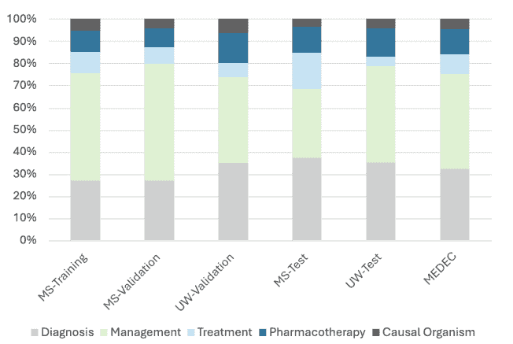

### Explanatory Instructions: Towards Unified Vision Tasks Understanding and Zero-shot Generalization

原文链接：https://arxiv.org/abs/2412.18525v2

ResearchFlow链接：https://rflow.ai/flow/9f308b55-4181-4575-bf58-3db2333805f6

尽管计算机视觉 (CV) 遵循了自然语言处理 (NLP) 中建立的许多里程碑，例如大型 Transformer 模型、广泛的预训练和自回归范式等，但它尚未完全实现自然语言处理 (NLP) 中观察到的零样本任务泛化。在本文中，我们探讨了 CV 采用离散和术语任务定义（例如“图像分割”）的想法，这可能是零样本任务泛化的主要障碍。我们的假设是，如果不真正理解以前见过的任务（由于这些术语定义），深度模型很难推广到新任务。为了验证这一点，我们引入了解释性说明，它通过从输入图像到输出的详细语言转换提供了一种直观的方式来定义 CV 任务目标。我们创建了一个包含 1200 万个“图像输入 → 解释性说明 → 输出”三元组的大型数据集，并训练了一个基于自回归的视觉语言模型（基于 AR 的 VLM），该模型将图像和解释性说明作为输入。通过学习遵循这些指令，基于 AR 的 VLM 实现了针对之前见过的任务的指令级零样本能力，并展示了针对未见过的 CV 任务的强大零样本泛化能力。

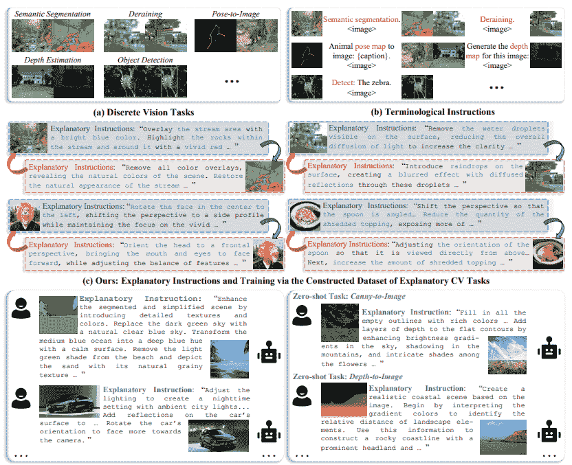

### Bringing Objects to Life: 4D generation from 3D objects

原文链接：https://arxiv.org/abs/2412.20422v1

ResearchFlow链接：https://rflow.ai/flow/80abcfde-852f-4b53-9f8f-6ef2b37ead9a

生成式建模的最新进展现在使得能够创建由文本提示控制的 4D 内容（移动的 3D 对象）。4D 生成在虚拟世界、媒体和游戏等应用中具有巨大潜力，但现有方法对生成内容的外观和几何形状的控制有限。在这项工作中，我们介绍了一种通过以文本提示为指导 4D 生成来为用户提供的 3D 对象制作动画的方法，从而实现自定义动画，同时保持原始对象的身份。我们首先将 3D 网格转换为“静态”4D 神经辐射场 (NeRF)，以保留输入对象的视觉属性。然后，我们使用由文本驱动的图像到视频扩散模型为对象制作动画。为了提高运动真实感，我们引入了一种增量视点选择协议，用于对视角进行采样以促进逼真的运动，并引入了蒙面分数蒸馏采样 (SDS) 损失，利用注意力图将优化重点放在相关区域。我们从时间连贯性、及时遵守和视觉保真度方面评估了我们的模型，发现我们的方法优于基于其他方法的基线，使用 LPIPS 分数衡量的身份保存性能提高了三倍，并有效地平衡了视觉质量和动态内容。

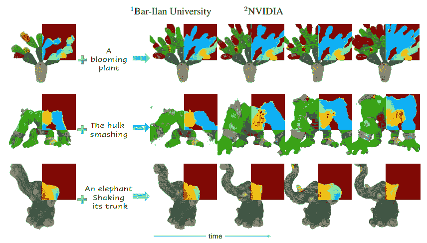

### Efficiently Serving LLM Reasoning Programs with Certaindex

原文链接：https://arxiv.org/abs/2412.20993v1

ResearchFlow链接：https://rflow.ai/flow/fb9ce4b3-ad5c-4c40-b92a-ba83a6cc0620

大型语言模型 (LLM) 的快速发展释放了它们在数学问题解决、代码生成和法律分析等高级推理任务中的能力。这一进步的核心是推理时间推理算法，它通过探索多种解决方案路径来改进输出，但代价是增加计算需求和响应延迟。现有的服务系统无法适应这些算法的扩展行为或查询的不同难度，导致资源使用效率低下和延迟目标未达到。我们提出了 Dynasor，这是一个优化 LLM 推理查询推理时间计算的系统。与传统引擎不同，Dynasor 跟踪和调度推理查询中的请求，并使用 Certaindex（一种基于模型确定性测量统计推理进度的代理）来动态指导计算分配。Dynasor 共同调整调度和推理进度：它为困难查询分配更多计算，减少简单查询的计算，并提前终止没有希望的查询，平衡准确性、延迟和成本。在不同的数据集和算法上，Dynasor 在批处理中将计算量减少了高达 50%，并在在线服务中维持了 3.3 倍的更高查询率或 4.7 倍更严格的延迟 SLO。

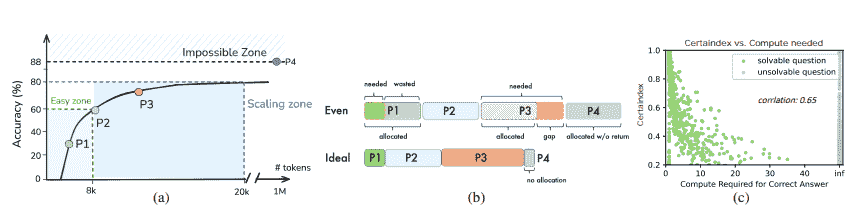

### AgiBot World

原文链接：https://huggingface.co/agibot-world

大多数现有的机器人学习基准都难以应对由低质量数据和有限传感能力造成的现实挑战，通常仅限于受控环境中的短期任务。推出 AgiBot World，这是第一个旨在推进多用途人形机器人政策的大型机器人学习数据集。它将伴随基础模型、基准和生态系统，使学术界和行业能够民主化获取高质量的机器人数据，为 Embodied AI 的“ImageNet 时刻”铺平道路。AgiBot World 拥有来自 100 个机器人的 100 多万条轨迹，涵盖五个目标领域的 100 多个现实场景，可解决细粒度操作、工具使用和多机器人协作问题。尖端的多模态硬件具有视觉触觉传感器、耐用的 6 自由度灵巧手和具有全身控制的移动双臂机器人，支持模仿学习、多智能体协作等方面的研究。 AgiBot World 致力于变革大规模机器人学习，并推进可扩展的机器人系统投入生产。这个开源平台邀请研究人员和从业者共同塑造 Embodied AI 的未来。

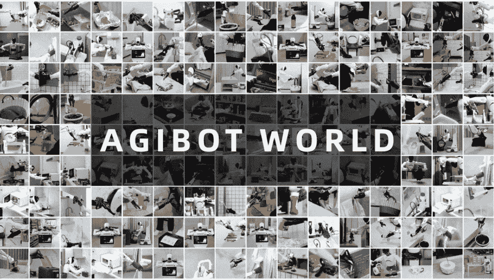

# 产品

### Aitless 创意实现与用户增长集成工具

贡献人：

https://x.wt.ls/?redirectTo=%2F%3Fref%3Dproducthunt

Aitless 是一款功能强大的全能工具，专为帮助创意者和企业快速启动想法并扩大受众而设计。它集多种核心功能于一体，让您的增长之旅更加高效与简单：

📝 轻松创建表单，用于收集用户注册信息，快速搭建连接用户的桥梁。

🔗 内置推荐系统，通过用户分享实现病毒式增长，让每个参与者都成为您的推广大使。

📩 轻松发送电子邮件活动，精准触达目标受众，加强与用户的互动与沟通。

📊 在直观、简单的 CRM 中高效管理注册用户，无需复杂操作，即可掌控全局。

无论您是个人创作者还是企业团队，Aitless 都为您提供一个简化而强大的平台，让您专注于创意实现与用户增长，不再为工具之间的繁琐切换而烦恼。

### Monkt  强大的数据转换工具

贡献人：

https://monkt.com/?ref=producthunt

Monkt 是一款强大的数据转换工具，专为将 PDF、Word 文件、Excel 表格、PowerPoint 演示文稿以及网页内容高效转化为结构化 Markdown 或 JSON 而设计，同时保留原有的语义结构。这款工具不仅提供精准的内容解析，还支持以下核心功能：

🔧 自**定义模式应用：**根据您的**需求应用自定**义模式，**确保转换结**果与项目**规范完美匹配。**

📂 批量处理支持：一次性处理多个文件，大幅提升工作效率，适合大规模文档管理场景。

📋 预定义模板：内置多种模板，轻松满足不同内容格式的需求，无需从零开始配置。

🌐 灵活的访问方式：通过 REST API 或简单易用的网页界面进行操作，适合开发者与普通用户。

无论是文档归档、数据迁移还是内容管理，Monkt 都能以卓越的性能和灵活的配置为您的工作提供极大助力。轻松实现数据的标准化和结构化，让复杂流程变得高效而简单。

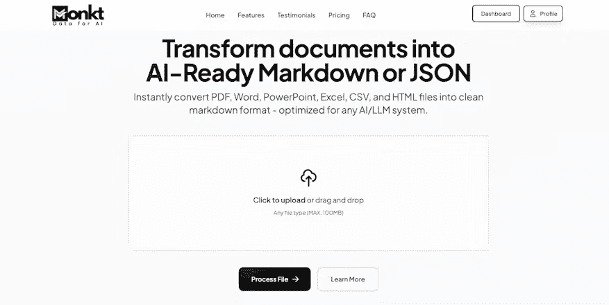

# HuggingFace&Github

### AgiBot World Alpha

贡献人：

https://huggingface.co/datasets/agibot-world/AgiBotWorld-Alpha

### 主要特点🔑

+   来自 100 个机器人的100 多万条轨迹。

+   5 个目标领域的100 多个真实场景。

+   尖端硬件：视觉触觉传感器/6自由度灵巧手/移动双臂机器人

+   涉及的任务：

+   接触丰富的操控

+   长期规划

+   多机器人协作

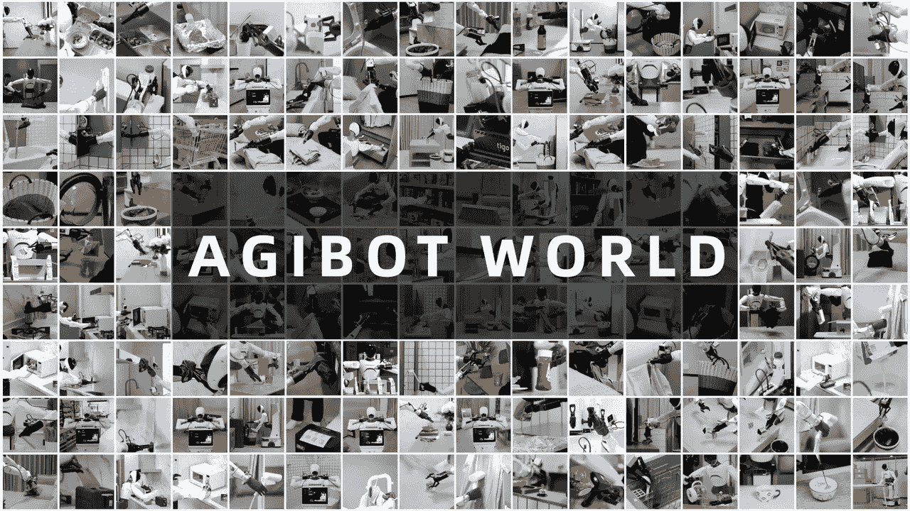

# 投融资

### 木蚁机器人完成B3轮融资，海外版图加速扩展

贡献人：

https://mp.weixin.qq.com/s/zsbfKN31r6PDRlIBD54-_

全球领先的群体搬运解决方案提供商木蚁机器人宣布，成功完成B3轮融资，由吾同投资领投。本轮融资为木蚁机器人带来了强大的资金支持，助力其进一步拓展海外市场，推动智能物流行业的全球化发展。

**投融资信息**

吾同投资是一家专注于中国市场的投资管理公司，凭借在高科技领域的深厚背景，已经成功投资了普渡机器人、海柔创新、优地机器人等多个行业领先企业。木蚁机器人自成立以来，吸引了包括中信建投、辰韬资本、蓝驰创投、德邦快递及起点资本等多家知名投资机构的支持，累计融资额已突破数亿元人民币。

**资金用途与国际化布局**

本轮融资将主要用于推动木蚁机器人在海外市场的扩展。木蚁计划在欧洲、北美及日韩等重要国际市场加快布局，通过设立海外销售与服务网络，加强与当地合作伙伴的战略合作，进一步提升智能物流解决方案的国际竞争力。资金的注入将为木蚁机器人开辟更广阔的全球市场，提升其在智能物流领域的影响力。

**技术创新与行业引领**

木蚁机器人自2019年进入物流行业以来，成功开创了无人叉车的大规模应用，成为行业领先者。公司已经与京东、顺丰、跨越、德邦、安能等大型物流客户建立了广泛合作，帮助客户实现无人搬运，降低人工成本高达30%。木蚁机器人还与客户共同制定了物流行业的多个行业标准，包括车辆安全、效率指标、数据安全等。

公司自主研发的无人驾驶叉车和室内外一体化搬运解决方案已成功规模化落地，推出全球领先的单仓100+台智能调度系统，推动物流行业向智能化发展。木蚁机器人还计划利用人工智能技术开发快速部署的轻交付方案，并通过具身智能技术增强仓库存储与拣选能力，进一步提升解决方案的灵活性与易用性。

### 明心数智完成近2亿元B轮融资，致力于AI跨境数字化解决方案

贡献人：

https://36kr.com/p/3104370194222848

近日，国内AI产业级应用服务商明心数智宣布完成近2亿元人民币的B轮融资。此次融资由柏睿资本领投，国方创新、狮城资本和老股东鼎晖VGC跟投，华兴资本担任独家财务顾问。融资资金将主要用于加大技术研发投入，提升大模型训练能力，拓展产品矩阵和业务，尤其是在跨境电商领域，进一步挖掘核心痛点和低效场景，助力行业数字化转型。

**跨境电商的AI赋能**

明心数智成立于2020年，定位为为跨境电商企业提供AI驱动的数字化解决方案。随着中国跨境电商快速增长，2024年上半年我国跨境电商进出口创下历史新高，市场对数字化和智能化服务的需求日益增加。明心数智利用AI技术，优化了跨境电商中的报关、退税申报和产融服务等环节，推动了跨境电商全链条数据的共享与应用。

公司推出的“跨赋”一站式跨境AI服务系统，通过打通产业链数据资源，将各参与方的数据转化为有价值的应用数据资产，帮助平台和卖家提升经营分析、增效降本，全面提升跨境电商运营效率。

**投资方支持与未来发展**

柏睿资本等投资方对明心数智的未来发展充满信心。柏睿资本认为，跨境电商与生成式AI的结合具有强大的增长潜力，明心数智团队能够有效平衡技术创新与商业化，致力于建设跨境电商的数字化基础设施。国方创新则看好公司在珠三角及长三角跨境电商产业中的深耕和未来扩展潜力。

明心数智的创始人兼CEO曾伟嘉表示，公司将继续加强技术研发和产业化应用，致力于推动跨境电商行业的智能化升级，拓展更多AI应用场景，推动行业的全链条数智化转型。

**行业认可与市场影响**

明心数智不仅获得了投资者的高度评价，还荣获工信部“大数据产业发展示范单位”及人工智能产业“专精特新小巨人”称号，标志着其在产业数字化服务领域的领先地位。通过深度融合AI技术，明心数智不仅在跨境电商领域取得了显著成绩，也为其他垂直行业提供了有力的AI应用示范。

未来，明心数智有望继续扩大其在跨境电商、制造业及商贸流通等多个行业的影响力，成为全球领先的产业级AI应用服务商。

公司官网：https://www.mingxinsk.com/

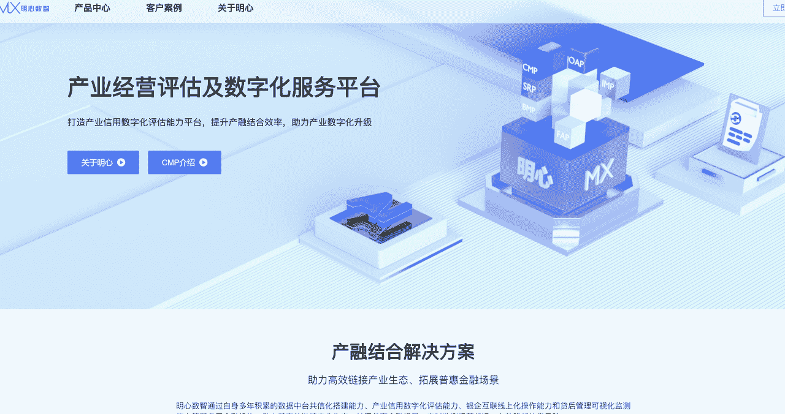

### **三星(SSNLF.US)加速布局机器人产业 斥资2670亿韩元**增持Rainbow Robotics股份

贡献人：

https://www.therobotreport.com/samsung-increases-stake-in-rainbow-robotics-establishes-future-robotics-office/

韩国机器人公司Rainbow Robotics在周二提交的一份监管文件中表示，三星电子(SSNLF.US)已成为公司的最大股东。

该文件称，此前曾投资这家机器人公司的三星最近新买入了2670亿韩元(1.81亿美元)的股份。

这家科技巨头在另一份声明中表示，通过此次收购，三星还将成立一个直接向首席执行官汇报的未来机器人办公室(Future Robotics Office)。

在交易之前，三星电子是Rainbow Robotics的第二大股东，持有该公司14.71%的股份，约285万股。

此前，该公司的最大股东是创始人Oh Jun-ho及其关联实体。

公司官网：https://www.rainbow-robotics.com/en_main?_l=en

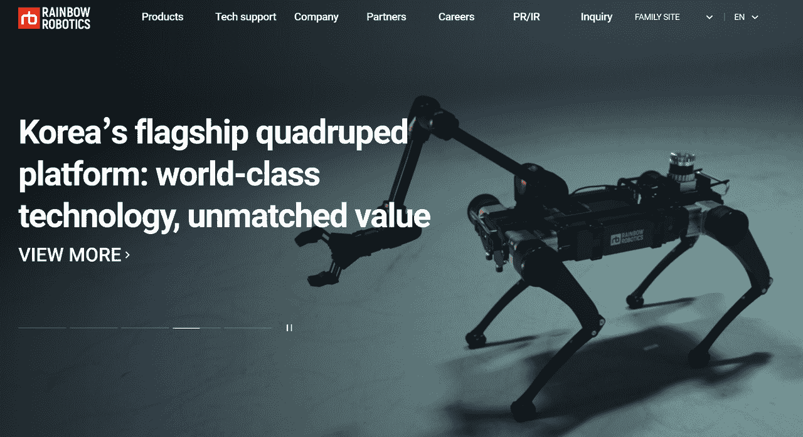

# 学习

### 从Ray Summit 2024展望Ray的2025

贡献人：

https://mp.weixin.qq.com/s/CLFF7enypZI3snXLKTxuSA

Ray Summit 2024已过一个多月，随着国内两场Meetup（Ray Connect和Ray Forward）的落幕，我终于有时间总结会议内容。作为Ray社区的年度重要活动，Summit充满了有价值的信息和技术革新。本文重点回顾了对Ray开发者和用户来说的重要干货，尤其是在使用和应用方面的关键发展。

在“谁在用Ray”这一常见问题上，Ray的应用已广泛遍布各大厂商，涵盖了大模型创业公司、硬件厂商等领域。特别是Apple和eBay，前者分享了Serverless Ray架构的实施案例，后者则展示了Ray的完整平台建设。这些新兴应用展示了Ray易用性和从零到一落地的平滑过程。同时，越来越多数据处理公司，如Databricks，也通过集成Ray增强了平台的计算能力。

关于统计数据，Ray的使用量持续增长，达到每月启动百万个集群，且贡献者数量突破千人，这表明Ray的社区活跃度不断提升。Ray不仅是分布式计算的底层框架，还是一个具有广泛生态支持的通用平台。企业开始更多关注Ray的多功能性，包括数据计算和AI生态系统的融合。

Ray Summit 2024宣布了多个重要更新，最引人注目的是Ray Core的“Compiled Graphs”功能。这一特性实现了对静态数据流的优化，特别是在GPU-to-GPU传输和内存复用方面，提升了性能。Ray Data也进入了“General Availability”阶段，成为Ray Core以外最重要的库之一。Stability方面，Ray已能够支持最大8k节点的集群规模，扩展性得到显著增强。

Anyscale的RayTurbo也在本次大会中首次亮相，它对Ray进行了多个闭源优化。RayTurbo在Ray Data、Ray Train、Ray Serve等方面加强了故障容忍性和弹性训练能力，并提升了运维效率。对于开源社区来说，这些优化提示了Ray的潜力和商业化路径，用户可以选择直接使用Anyscale平台中的RayTurbo。

然而，Ray也面临挑战，如在小任务延迟和失败日志分析方面的瓶颈，Ray Data中缺少join操作等问题。这些都表明，虽然Ray在许多领域表现出色，但在细节和优化上仍有进步空间。

从发展趋势来看，Ray在Data + AI方向的应用已成为主流。Ray特别适用于混合计算（CPU与GPU融合）和批量推理等场景，随着其在数据和AI领域的逐渐深入，Ray的影响力持续扩大。字节跳动、NVIDIA等企业都展示了Ray在语音、视频数据处理和批量推理方面的成功应用。

Ray在AI生态中的集成也不断深入。例如，Ray与vllm和NVIDIA Triton的结合，推动了分布式推理的效率提升。Ray Serve和Ray Data的优化也帮助提升了AI任务的执行效率。

尽管Ray的多租户支持还在完善阶段，但在K8S环境中的Ray应用已取得了显著进展。Google和Netflix等公司展示了基于K8S的Ray集群部署，这种双层调度系统使Ray能够更好地适应云原生环境。

最后，随着大模型的爆发，强化学习和RLHF（强化学习与人类反馈）逐渐成为Ray应用的新方向。字节跳动在Ray Summit上分享了基于Ray的RLHF框架veRL，为未来的分布式训练提供了新的视角。同时，分布式Agent系统的崛起，也为Ray提供了新的挑战和机遇。

总体而言，Ray在2024年的发展势头强劲，其在数据计算和AI领域的应用已逐渐成为主流。未来，Ray有望在多租户支持、分布式计算和AI生态集成等方面继续迎来更多的突破。

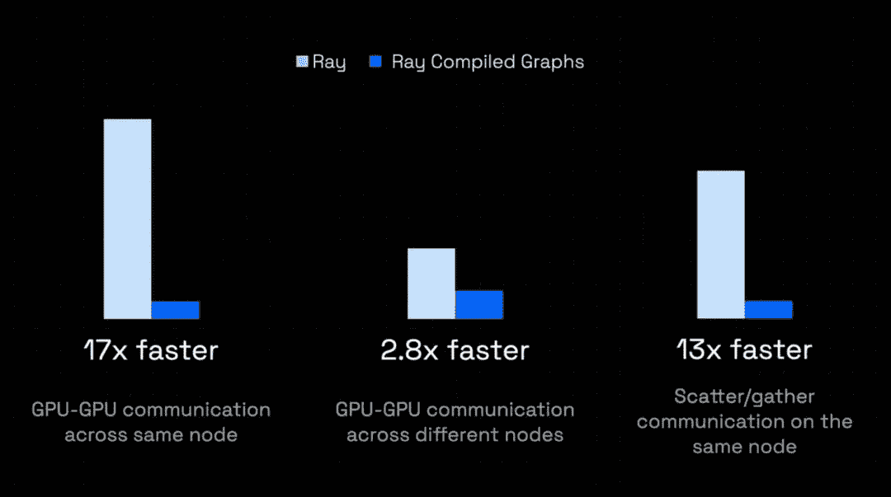

### 900页“生成式AI与大模型”电子书｜OneFlow年货

贡献人：

https://mp.weixin.qq.com/s/DjJQKPF4DxwXNmF_Z3iRUg

**概览、大模型基本原理、大模型训练没有秘密、大模型“第二增长曲线”：**推理、AI芯片变局、生成式AI产品构建、生成式AI产业分析、AGI的挑战与未来。

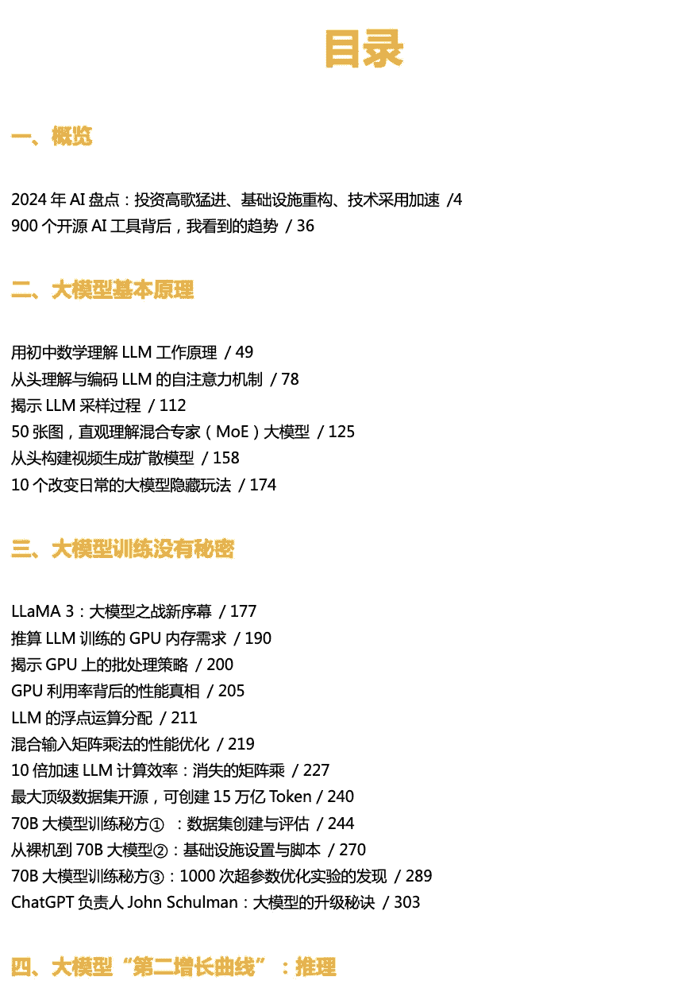

### Things we learned about LLMs in 2024

贡献人：

https://simonwillison.net/2024/Dec/31/llms-in-2024/

2024年在大语言模型（LLM）领域发生了许多重要进展。以下是我们在过去一年里学到的一些关键发现，以及几个重要的趋势和关键时刻。

首先，GPT-4的限制得到了全面突破，甚至一些GPT-4模型现在能在普通笔记本电脑上运行。这表明，LLM的可访问性和计算需求在不断下降。同时，由于竞争和效率提升，LLM的价格大幅下降，市场变得更加亲民。

在多模态方面，视觉技术已经普及，音频和视频技术也开始崭露头角。语音和实时摄像头模式几乎实现了科幻电影中的场景。与此同时，基于提示的应用程序生成已经变成了一种普遍的商品化工具。

虽然曾一度出现普遍访问最先进模型的短暂窗口，但这一现象并未持续太久。此外，虽然“智能体”（agents）这个概念备受关注，但实际应用上仍未取得显著进展。随着开发和测试变得更加重视，评估（Evals）也变得愈加重要。

在一些技术公司中，苹果的智能技术表现不佳，但其MLX库被认为表现出色。推理模型的推断能力有所上升，这为各种推理和决策任务带来了新的潜力。

另一方面，有人提出，是否全球最先进的LLM是中国以不到600万美元的成本训练出来的，这一问题引发了不少讨论。

在环境影响方面，虽然有所改进，但总体情况仍显得复杂。尽管如此，合成训练数据的效果显著，成为了训练LLM的新趋势。然而，LLM的使用仍然变得愈加复杂，尤其是在操作和调整模型时。

在知识分布方面，LLM展现出极度不均衡的知识掌握情况，部分领域的知识远远领先于其他领域，这提出了对LLM系统批判性评估的需求。2024年，相关领域的研究和讨论也开始聚焦于这些问题。

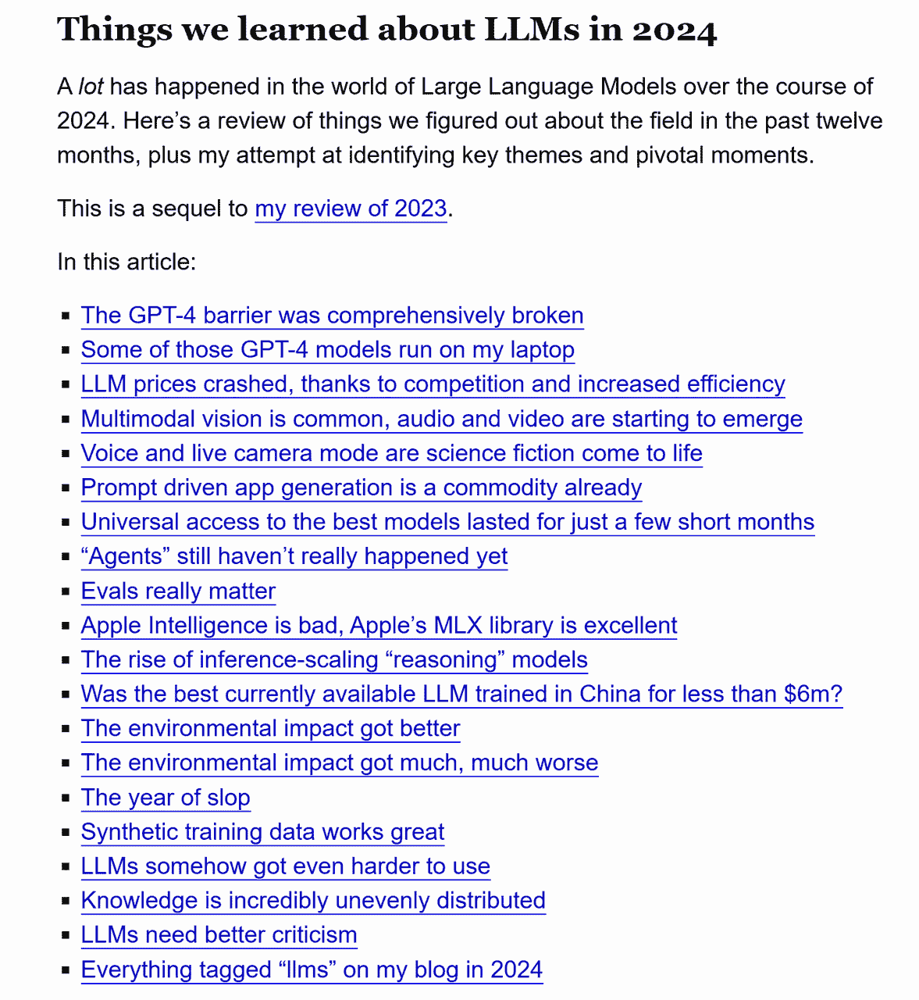

### 使用合成数据微调ModernBERT进行文本分类

贡献人：

https://huggingface.co/blog/davidberenstein1957/fine-tune-modernbert-on-synthetic-data

本文介绍了如何使用合成数据微调ModernBERT模型进行文本分类。尽管大语言模型（LLM）非常强大，但对于特定任务，较小且专业化的模型可能更具优势，特别是在节约资源和提高效率方面。一个常见的问题是缺乏足够专门化的数据集，这使得生成合成数据成为解决这一问题的有效方法。

首先，通过使用Hugging Face的合成数据生成器，我们生成了一个适用于文本分类的合成数据集，包含1000个示例。数据集的标签覆盖多个领域，如“健康”、“娱乐”、“体育”等，数据也具有良好的多样性和分布。在生成数据后，数据被推送到Argilla平台进行验证和检查。

在微调过程中，我们使用了ModernBERT模型，这是BERT模型的一个新版本，具有更长的上下文窗口（8192个token）和显著更快的处理速度。微调的过程包括数据加载、token化和模型训练。为了评估模型效果，我们使用了F1分数作为评估指标，并在测试集上获得了0.89的F1分数，表现非常不错。

最终，使用微调后的模型进行推理，结果表明模型能够准确地进行文本分类。通过这一过程，我们展示了合成数据在小型数据集上的有效性，以及ModernBERT模型在提高分类性能和处理速度方面的优势。整个过程仅用了大约20分钟生成数据，1小时进行微调，展示了在普通硬件上的高效性。

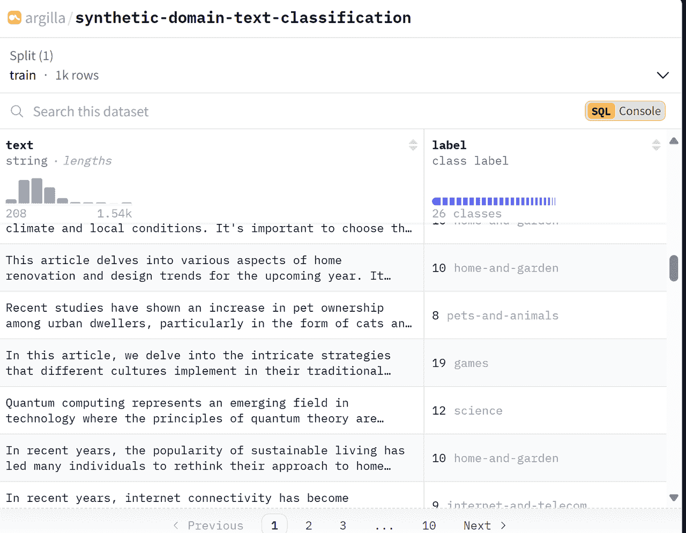

### The AI Web Search Landscape

贡献人：

https://sophiamyang.medium.com/the-ai-web-search-landscape-5b4ad0e67505

2024年，Google继续在全球搜索市场占据90.01%的份额，估值约为1.7万亿美元。尽管如此，AI搜索引擎今年崭露头角，挑战Google的主导地位。本文总结了当前AI搜索的特点，介绍了我探索过的一些AI搜索引擎功能，并展望其未来发展。

传统搜索 vs. AI 搜索

AI 搜索引擎特点：

1.  **基本功能**：AI搜索引擎根据用户查询提供简洁的摘要和相关资源。

1.  **质量控制**：大多数AI搜索引擎提供相似的用户体验，但搜索结果的质量差异较大，优质搜索结果至关重要。

高级功能：

1.  **多模态搜索**：支持图像或视频搜索，提升搜索体验。

1.  **源编辑与互动**：用户可直接编辑返回的资源或指示AI改进信息。

1.  **源过滤与分类**：自动分类并根据标准过滤结果，如网站、主题或情感。

1.  **附加来源**：整合如Reddit、X等平台，提供实时、社区驱动的见解。

1.  **上下文相关结果**：除了传统链接，提供图片、视频、推文等相关多媒体内容。

1.  **可视化功能**：通过思维导图和表格等方式展示信息。

1.  **思维链推理（CoT）**：将复杂查询分解为详细的解决方案。

AI 搜索引擎的未来

1.  **个性化搜索**：AI搜索将更加个性化，理解用户偏好和上下文。

1.  **领域特定搜索**：需要更深入、有效的领域特定搜索工具。

1.  **代理与工作流整合**：AI搜索与其他任务的整合将带来更无缝的体验。

1.  **增强的推理与评估**：AI将更好地分析和评估来源，提供高质量的信息。

1.  **广泛来源探索**：未来AI可能扩展其资源池，涵盖更多平台，增强搜索结果的全面性。

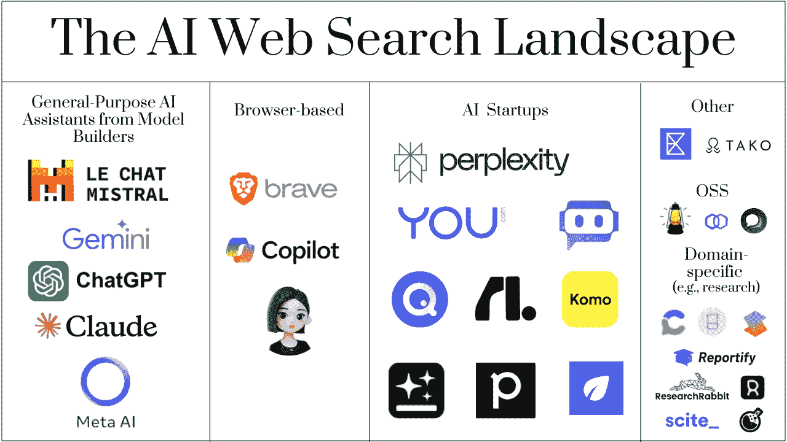

# 声明

本文档仅供学习交流使用，版权归原作者所有，若涉侵权，请联系Jack Jin 15101136166

##

（欢迎在下方反馈您宝贵的意见！整理不易，觉得有用给AI日报小组点个赞👍吧！）

ChatGPT；Angela；Zijia Liu；Alex；Zeqi Tan；Tiezhen（HuggingFace）；Naixu；Lizhi；Peter；Suoman；Jack

学术分析报告：ResearchFlow -- 奇绩F23校友的开发的深度研究产品，PC端进入RFlow的分析报告，可直接点击节点右侧的小数字展开节点，登录后可在节点上直接“询问AI”，进一步探索深度信息

如果你有大模型相关的创业想法，欢迎来找我们聊聊～🛰️：15101136166

> 快邀请你的小伙伴们一起来读大模型日报吧！

> **【日报****知识库****】**这里是近期日报内容的汇总,欢迎大家查阅

> [大模型日报知识库(分享版)](https://miracleplus.feishu.cn/wiki/KapVwXfkriOBiskB0B2cUHxjnTh)

>

> 欢迎大家多多帮我们分享,转发~~

> 如果大家有任何的建议或者吐槽,欢迎随时找我聊天~

