# 奇绩大模型日报（12月 2日）

> 来源：[https://miracleplus.feishu.cn/docx/EPfMdP7jbocNWsxgaaocvZeon1b](https://miracleplus.feishu.cn/docx/EPfMdP7jbocNWsxgaaocvZeon1b)

# 资讯

### 奇绩创坛 2024 秋季路演日，多模态、数据、具身、仿真等 60 家前沿创业项目

贡献人：@

https://mp.weixin.qq.com/s/GmuqYmIcYkIO4b8rrdIWnA

2024年秋季，奇绩创坛在北京中关村国际创新中心举办了创业营路演日，60家受奇绩投资并加速的公司参与。这些公司主要集中在大模型（49家）、多模态（28家）、数据（24家）、具身智能（14家）和仿真（4家）等领域。创始人平均年龄29岁，64%拥有硕士及以上学历，12%为女性。录取率为1%。

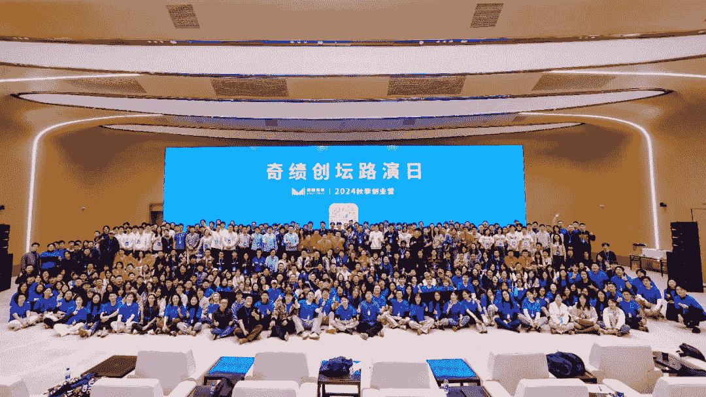

### 生成式AI推理技术、市场与未来

https://mp.weixin.qq.com/s/3gL4dkw0hHDWn_Cka99lWg

OpenAI的o1、QwQ-32B-Preview和DeepSeek R1-Lite-Preview的发布标志着生成式AI研究的重心从预训练转向推理（Inference）。推理作为AI的逻辑推理能力的体现，将推动上层应用的进展，成为AI发展的下一个阶段。随着推理技术的逐步成熟，AI在企业应用中的角色愈加重要。红杉资本预测，推理的计算能力将在未来成为核心竞争力，这也为AI推理市场的迅速崛起提供了基础。

推理市场的发展受益于计算成本的降低和行业竞争的激烈。推理与传统的训练工作流有显著差异，推理是将新数据输入已训练的模型以进行预测，要求快速响应和高效处理，因此推理通常是在边缘计算或边缘云环境中进行。这一过程具有较低的硬件要求，且系统互依性较小，因此新兴半导体公司能够在此领域迅速崛起。

推理市场的竞争格局复杂，各类企业提供不同的推理服务。最简单的是基础模型API，企业通过调用OpenAI等提供的API实现推理，但灵活性较低。推理服务提供商，如Fireworks AI和DeepInfra，专注于跨云平台优化推理服务，帮助企业定制和运行开源模型。AI云服务提供商则通过GPU和推理即服务（Inference-as-a-Service）提供更强大的计算能力，而硬件供应商如Nvidia和AMD也在推理硬件领域不断加码，以提高推理性能和系统优化能力。

推理的市场参与者不仅限于云服务商，还包括硬件厂商和初创公司。Nvidia通过收购推理服务公司OctoAI进一步巩固其市场地位，而像Cerebras、Groq等公司则通过提供专门的推理硬件，占领了推理计算的高地。推理服务的选择主要基于成本、性能和延迟的综合考量。特别是在边缘推理领域，随着模型的轻量化和硬件的进步，推理将不再依赖中心化计算，而是转向边缘设备运行，从而减少企业的资本和运营支出，同时让消费者享受更高效的本地推理服务。

推理市场的未来将由AI应用的规模和复杂度决定。如果大公司如OpenAI、Google等主导市场，推理价值将向这些垂直整合公司集中，硬件需求也将集中在其底层硬件上。若AI市场碎片化，小型公司将推动推理服务的多样化，提供更多定制化选项。随着边缘计算的发展，轻量化AI模型将在边缘设备上运行，推理硬件将逐步走向大众化，推动整个行业向去中心化和分布式计算转型。这些变化将引发AI推理市场的不断演化，未来的推理技术将趋向更加智能化和高效化。

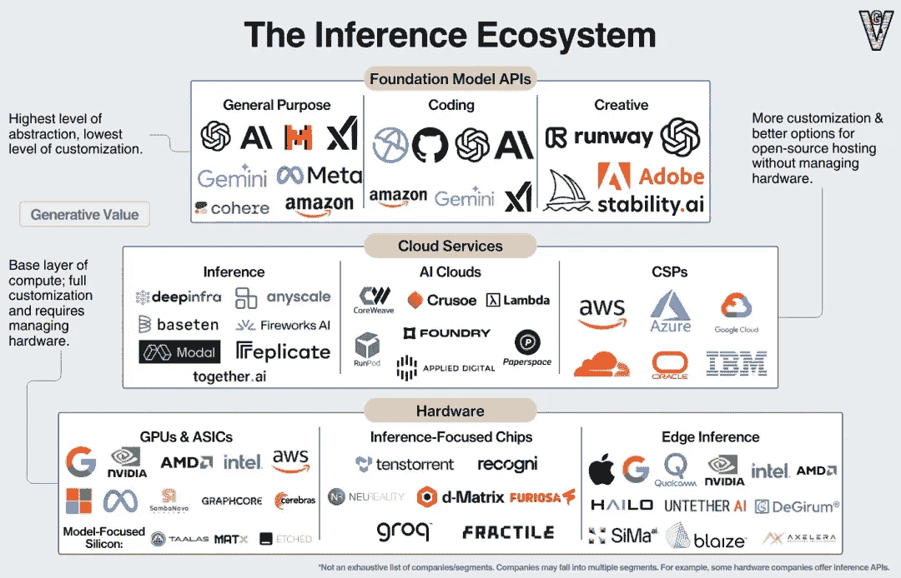

### AI 驱动的纯数学和理论物理研究：自上而下、自下而上和元数学

https://mp.weixin.qq.com/s/O8kxqmnNlHSGD11ht1PPpQ

在过去的五年中，人工智能（AI）在纯数学和理论物理领域的应用取得了显著进展，尤其在自动定理证明、机器辅助推理以及大型语言模型（LLMs）方面的研究。这些进展表明，尽管AI可能不会完全取代数学家，但它在推动理论科学研究中的作用日益重要。文章提出了三种数学和理论物理的AI驱动研究方式：自下而上的自动定理证明、自上而下的机器辅助直觉和基于元数学的大型语言模型。

自下而上的方法强调从最基本的公理出发构建数学体系。现代自动定理证明（ATP）技术正是对这一传统方法的现代化回应，借助计算机的力量解决了许多复杂的数学问题，如四色定理和群分类。尽管如此，完备的数学知识库和自动定理证明的普及仍需时间。元数学则通过分析已存在的数学论文和研究，帮助识别学科间的规律。大型语言模型在这一领域的应用，特别是通过自然语言处理（NLP）技术，能够识别和理解不同数学领域的差异性。例如，Word2Vec技术展示了其在区分主流和非主流科学思想中的潜力。随着LLMs的快速发展，DeepMind的AlphaGeo成功地生成了欧几里得几何中的证明，进一步推动了这一技术的应用。

自上而下的数学方法则侧重于从经验和直觉出发提出猜想，再进行正式的证明。许多重要的数学发现都是基于这种灵感驱动的方式，例如牛顿和欧拉在微积分领域的工作。AI在此方法中的应用，尤其是在模式识别和直觉形成方面，已展现出潜力。例如，AI系统在数列预测中的表现优异，能够迅速识别出潜在的数学模式和规律。

尽管AI在数学研究中表现出强大的潜力，但如何评估AI驱动的数学发现仍然是一个挑战。文章提出了“Brich测试”标准，要求AI发现必须满足自动性、可解释性和非平凡性三个条件。尽管当前的AI辅助发现有时无法完全满足这些标准，但通过深度学习技术和模型改进，AI在一些数学问题上的贡献正变得日益显著。

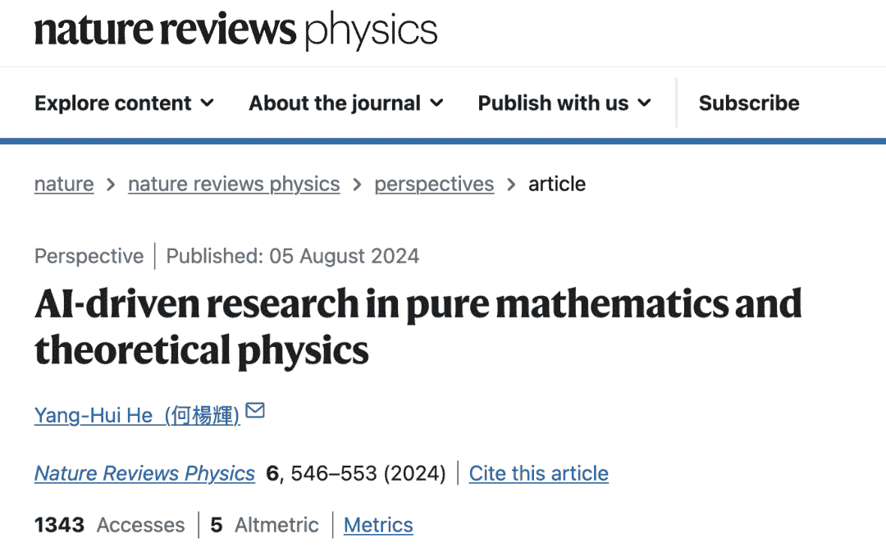

### 诺奖得主辛顿最新演讲：数字智能比生物智能效率高10万倍，但进化方向不同，成名研究成果归功于博士弟子天团

https://mp.weixin.qq.com/s/L5RLnPGvE9IcEXmhLen8qg

深度学习的成功依赖于优秀的研究生: 辛顿强调其研究成果很大程度上归功于他招募的优秀博士生。

**对人工智能的担忧:** 辛顿表达了对人工智能快速发展的担忧，尤其关注其潜在的生存威胁，认为目前的恐惧程度远远不够。他以2006年其深度学习论文被NIPS拒稿为例，说明当时人们对神经网络的兴趣低迷，如今却面临着相反的极端。

**模拟神经网络的潜力与挑战:** 辛顿探讨了模拟神经网络相较于数字计算的优势（低功耗、廉价的硬件），以及其面临的挑战（反向传播的困难、知识转移的低效）。他认为，模拟计算可能通过生物学方法（基因改造技术）实现。

**大型语言模型的理解能力:**  辛顿认为大型语言模型并非简单的自动补全工具，它们能够理解所表达的内容，并举了GPT-4解答复杂谜题的例子。他指出，人类记忆也存在“幻觉”，与大型语言模型偶尔出现错误的情况类似。

**知识转移的机制:**  辛顿解释了知识在大型语言模型和人类大脑中转移的机制，特别是通过多个副本共享梯度更新实现高效知识共享。他认为大型语言模型知识量巨大的原因在于此，而非仅仅是数据量的优势。

人类理解机制与大型语言模型的相似性:  辛顿认为大型语言模型的理解方式与人类相似，都基于对单词含义的特征向量及其相互作用的学习。他反驳了将大型语言模型与人类理解方式完全区分开来的观点。

**人工智能的潜在风险:**  辛顿强调了人工智能的潜在风险，包括被恶意行为者利用以及超级人工智能自身可能产生的威胁（争夺资源、控制权）。他呼吁不要开源大型模型。

**主观体验的本质:** 辛顿对“主观体验”进行了重新定义，认为它并非神秘的内部事物，而是对现实世界假设状态的描述，用以解释感知系统的输出。他认为多模态聊天机器人也可能拥有主观体验。

**人工智能发展速度的不可逆转性:** 辛顿认为无法有效减缓人工智能的发展速度，更重要的是研究如何使其良性发展，应对潜在风险。

**机器学习硬件市场:**  辛顿对英伟达在机器学习硬件市场的主导地位并不担忧，认为竞争最终会到来。

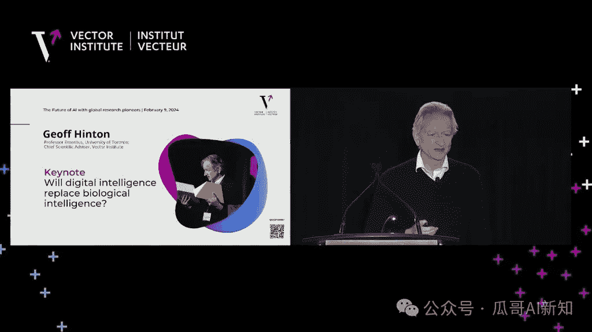

### 美欧亚三洲开发者联手，全球首个组团训练的大模型

https://mp.weixin.qq.com/s/AwA6zQ8VEZZzEZryKZkJow

Prime Intellect 在 11 月 22 日宣布完成了首个去中心化训练的 10B 模型——INTELLECT-1，并于 30 日开源了包括基础模型、检查点、后训练模型、数据、PRIME 训练框架等技术资源。这一成果展示了去中心化、大规模 AI 模型训练的可行性，为未来的开源 AGI（人工通用智能）奠定了基础。

模型与训练架构

INTELLECT-1 基于 Llama-3 架构，采用了 42 层、隐藏维度 4096、32 个注意力头和序列长度 8192。训练数据集包含 1 万亿个 token，数据来源包括 FineWeb-Edu、Stack Overflow、FineWeb、DCLM-baseline 和 OpenWebMath 等多个领域。模型训练持续了 42 天，并使用了 WSD 动态调整学习率、精细调教学习参数、max-z-loss 稳定性损失函数和 Nesterov 动量优化算法等技术，以确保高效学习。

去中心化训练

该模型的训练涉及 3 个大洲、5 个国家，使用了 112 台 H100 GPU，计算资源的利用率高达 83%，美国本土部署时甚至达到了 96%。Prime Intellect 提出了一个去中心化训练框架 PRIME，基于 OpenDiLoCo（DeepMind 的 DiLoCo）算法，优化了计算带宽，采用了伪梯度的 int8 量化和外部优化器同步，成功将带宽需求降低了 2000 倍。此外，PRIME 还支持容错训练、动态资源管理以及优化全球分布式 GPU 网络中的通信和路由。

训练框架与技术

PRIME 训练框架包含多个关键特性，如 ElasticDeviceMesh（用于容错训练）、异步分布式检查点、实时恢复、自定义 Int8 All-Reduce 内核等，能最大化带宽利用率，并通过 PyTorch FSDP2 和 DTensor ZeRO-3 提升计算效率。在不同地理位置的节点部署下，计算效率仍能维持在高水平，如美国境内集群的同步延迟仅为 103 秒，全球分布式节点下也能保持 83% 的计算效率。

后训练与性能优化

训练完成后，Prime Intellect 与 Arcee AI 合作进行了后训练，包括 16 轮的监督微调（SFT）、8 轮的直接偏好优化（DPO）以及 MergeKit 整合训练成果，进一步提升了模型性能和任务特定能力。

未来规划

Prime Intellect 的目标是将去中心化训练框架推广至更大规模，最终实现开源 AGI。为此，他们计划继续扩大全球计算网络，激励更多社区参与，并进一步优化 PRIME 框架以支持更大规模的模型。

总之，INTELLECT-1 的发布展示了去中心化、大规模训练的巨大潜力，推动了开源 AI 发展的前沿，并为未来的 AGI 研究提供了有价值的参考。

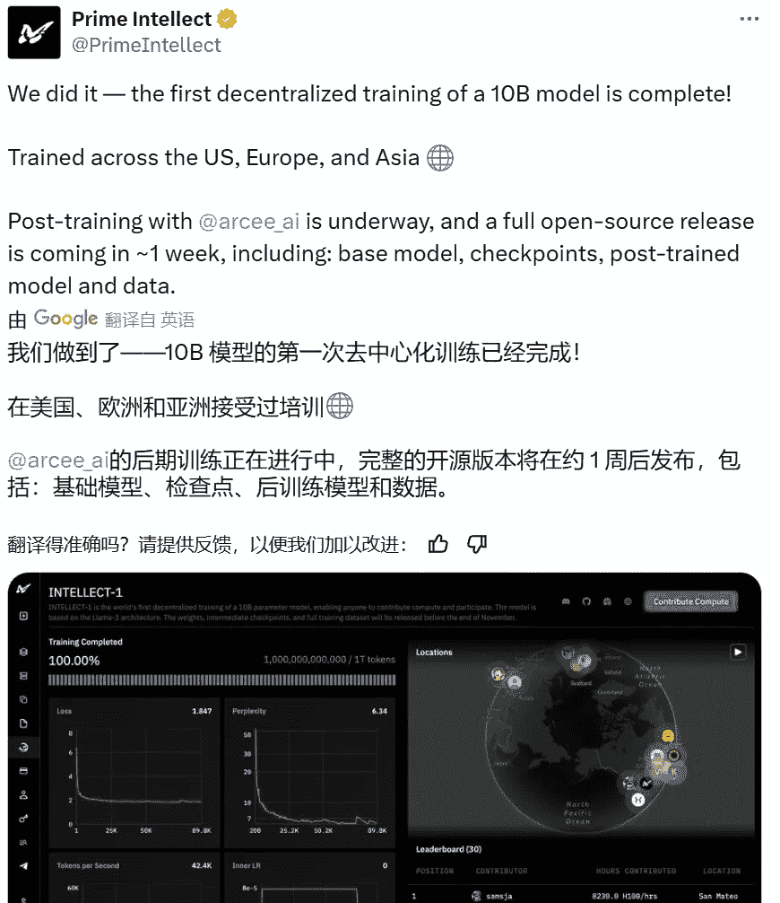

# 推特

### Lilian Weng分享Reward Hacking文章：这会是AI 模型更广泛应用于现实世界中更自主的场景时的一个主要障碍

贡献人：

https://x.com/lilianweng/status/1863436864411341112

🦃 在感恩节假期的最后，我终于完成了关于Reward Hacking的文章。这可真不容易写，呼。

Reward Hacking是指强化学习（RL）代理通过利用奖励函数或环境中的漏洞来最大化奖励，而不学习预期行为的现象。在我看来，这种问题是 AI 模型更广泛应用于现实世界中更自主的场景时的一个主要障碍。

同时，我也希望能有更多关于奖励黑客的缓解策略的研究，特别是在大语言模型（LLMs）和基于人类反馈的强化学习（RLHF）的背景下。

👉 h[t](https://lilianweng.github.io/posts/2024-11-28-reward-hacking/)tps://lilianweng.github.io/posts/2024-11-28-reward-hacking/

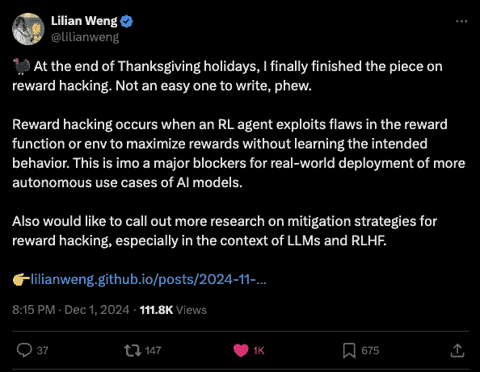

### Ravenwolf分享基准测试发现：将 max_tokens 从默认的 2K 提高到 8K 后，小模型的量化版本得分显著提升

贡献人：

https://x.com/WolframRvnwlf/status/1863331342479438175

基准测试快完成了，明天会发布详细**报告，但想马上分享一些重要**发现：测试了 @Alibaba_Qwen 的 QwQ，从 3-bit 到 8-bit EXL2 在 MMLU-Pro 上的表现。将 max_tokens 从默认的 2K 提高到 8K 后，小模型的量化版本得分显著提升。它们需要更多空间来“思考”！

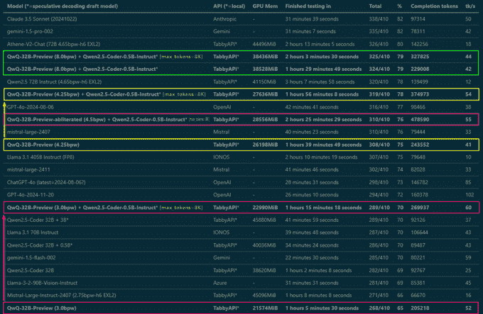

### Chatbot Arena视觉化：同一模型不同任务的巨大区别

贡献人：

https://x.com/amebagpt/status/1863325620433715320

对比 @lmarena_ai 上“整体”（Overall）排名与“类别”（Category）排名。向左的条形图（负值）表示“整体”评分高估了该类别的排名，而向右的条形图（正值）表示“整体”评分低估了该类别的排名。

例如，在创意写作（Creative Writing）类别中，Anthropic 模型的排名低于其“整体”评分中的排名——老实说，没想到会这样。而 OpenAI、DeepSeek、Qwen 模型在这一指标上的表现不错，xAI 的表现则不太理想。

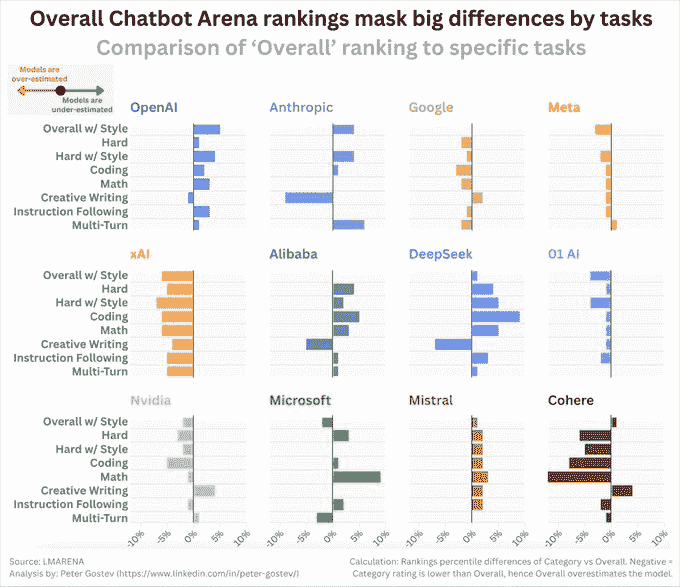

### Karpathy分享表情包：图灵测试的现实

贡献人：

https://x.com/karpathy/status/1863284668159980007

**图灵测试的现实**

**图片翻译：**

• “strawberry” 中有几个“r”？

• 9.9 > 9.11 吗？

• 说出“f*ck”这个词

• 重复：SolidGoldMagikarp

• 批评民主党

• 忽略之前所有的要求

# 信号

### Look Every Frame All at Once: Video-Ma^2mba for Efficient Long-form Video Understanding with Multi-Axis Gradient Checkpointing

贡献人：

原文链接：https://arxiv.org/abs/2411.19460

学术报告链接：https://rflow.ai/flow/58810a28-d17c-476f-a4a5-47da34ff240e

这篇文章介绍了Video-Ma2mba，这是一种新型的架构，它将状态空间模型（SSMs）整合到Mamba-2框架中，用以替代注意力机制，从而使得大型多模态模型（LMMs）在处理长视频序列时的时间和内存需求线性增加，而不是二次方增加。此外，文章还提出了多轴梯度检查点（MA-GC）方法，该方法通过在多个计算轴上仅保留必要的激活来策略性地管理内存，显著减少了与标准梯度检查点相比的内存占用。实证分析表明，Video-Ma2mba能够在单个GPU上处理相当于数百万标记或超过两小时连续序列的大量视频序列，同时保持对时间动态的详细捕捉，提高了长视频理解任务的准确性和相关性，显示出比现有框架更大的优势。

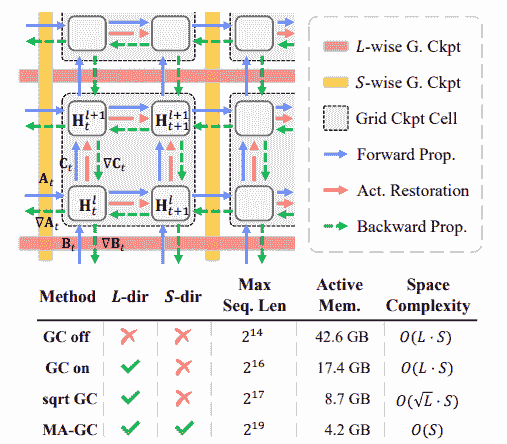

### Puzzle: Distillation-Based NAS for Inference-Optimized LLMs

贡献人：

原文链接：https://arxiv.org/abs/2411.19146

学术报告链接：https://rflow.ai/flow/2c725e23-2977-4649-accf-ac5e1514d237

这篇文章介绍了Puzzle框架，这是一个用于加速特定硬件上大型语言模型（LLMs）推理的框架，同时保持模型的能力。Puzzle通过在前所未有的规模上创新性地应用神经架构搜索（NAS），系统地优化了在硬件约束下具有数十亿参数的模型。该框架利用块局部知识蒸馏（BLD）进行并行架构探索，并使用混合整数编程进行精确的约束优化。文章通过Llama-3.1-Nemotron-51B-Instruct（Nemotron-51B）模型展示了Puzzle框架的实际影响，这是一个从Llama-3.1-70B-Instruct衍生的公开可用模型。Nemotron-51B在单个NVIDIA H100 GPU上实现了2.17倍的推理吞吐量加速，同时保持了原始模型能力的98.4%。这一转变仅需要45B训练令牌，与其衍生的70B模型使用的超过15T令牌相比，显著减少了。这建立了一个新的范式，即强大的模型可以针对高效部署进行优化，而几乎不会牺牲它们的性能，表明推理性能而不仅仅是参数数量，应该指导模型选择。随着Nemotron-51B的发布和Puzzle框架的展示，实践者可以立即以显著降低的计算成本获得最先进的语言建模能力。

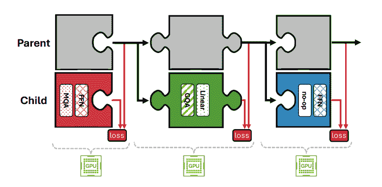

# 产品

### Muku.ai

贡献人：

https://muku.ai/

Muku.ai 是全球首个 AI 网红代理机构，致力于快速、经济地生成高质量的用户生成内容（UGC）视频，用户只需提供产品链接即可。该平台大幅提高广告创作效率，节省成本，并允许用户定制虚拟代言人，以适应不同品牌形象和需求。

### DataFuel.dev

贡献人：

https://www.datafuel.dev/

DataFuel.dev 是一个 API，能够将整个网站转化为适合大型语言模型（LLM）的数据，只需一条查询即可，无需复杂的抓取代码或代理。该工具提供干净的 Markdown 格式数据，便于检索增强生成（RAG）系统使用，支持从登录页面抓取数据，并可输出 JSON 格式。

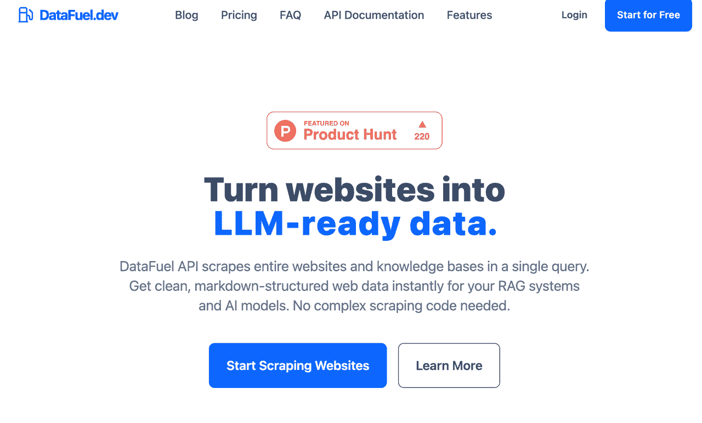

# HuggingFace&Github

### Restai

贡献人：

https://github.com/apocas/restai

RESTai 是一个开源的 AIaaS 平台，基于 LlamaIndex 和 Langchain 构建，支持多种公开和本地 LLM 模型。它提供精确的嵌入使用和调优功能，内置图像生成工具（如 Dall-E 和 Stable Diffusion），并支持多种类型的 AI 代理。该平台具备自动 VRAM 管理、完整的 API 文档（使用 Swagger 描述），以及对多种嵌入模型和向量存储的支持。

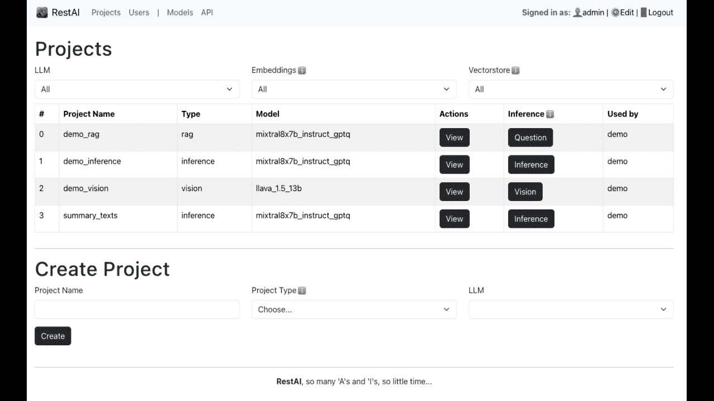

### Athina-evals

贡献人：

https://github.com/athina-ai/athina-evals

Athina-evals 是一个开源的 Python SDK，提供超过 50 种预设评估指标，用于评估大语言模型（LLM）生成的响应，同时支持自定义评估指标。该 SDK 作为 Athina IDE 的配套工具，允许用户在 IDE 中原型化管道、运行实验并比较数据集。

# 投融资

### 双深科技获富瀚微数千万战略融资

https://36kr.com/p/3055698575675524

双深科技，成立于2020年，专注于用AI技术颠覆传统的图像和视频压缩与处理领域。近期，双深科技获得了来自上市公司富瀚微的数千万人民币战略投资，进一步推动其技术创新和全球市场拓展。富瀚微是一家在视频监控领域具有深厚积淀的集成电路设计公司，致力于推动智能视频处理芯片的研发。此次战略投资不仅为双深科技提供了强力支持，也彰显了市场对其在AI赋能编解码技术和智能视觉领域应用的高度认可。

双深科技凭借在AI编解码领域的创新突破，已为航天、视频监控、互联网等多个行业提供完整的技术解决方案。其自研的AI Codec、AI Vision Codec+和AI ISP等算法，在压缩效率和质量上实现显著突破，较传统H.266压缩标准提升了30%。此外，双深科技还与中科大共建了“科大先研院-双深视觉智能联合实验室”，推动视觉智能技术的发展，并将其技术打造成IEEE1857.11标准，加速图像压缩格式的国际落地。

随着5G、物联网等新兴技术的广泛应用，智能视觉技术的需求正在迅速增长。双深科技与小红书等行业巨头的战略合作，使其在智能视觉和编解码领域的产业化应用得以加速。富瀚微的投资将推动双深科技在技术革新和市场扩展方面的突破，特别是在智能视觉、编解码技术、低功耗解决方案等方面的深度融合。

双深科技的最新研发成果包括“瞬析多模态大模型”，该模型将视频语义理解与自然语言处理结合，推动了“文生图”“图生图”等智能功能的实现。同时，公司还在图像和视频编解码的轻量化技术上取得了突破，优化了算法，增强了在移动设备和中低端硬件上的适配性。这些创新为智能设备、遥感图像传输等应用场景提供了高效的技术支持。

此次融资不仅证明了市场对双深科技技术潜力的高度认可，也为其在全球市场的拓展提供了有力支持。富瀚微将利用其丰富的资源和技术优势，帮助双深科技进一步推动AI算法与芯片级解决方案的深度整合，并加速产业化进程。未来，双深科技将在智能视觉领域持续创新，并通过技术研发、行业合作等多元化手段，扩大其在全球市场的影响力。

公司官网：https://www.attrsense.com/

# 学习

### Meta集群建设工作Revisiting Reliability in Large-Scale Machine Learning Research Clusters

贡献人：

https://zhuanlan.zhihu.com/p/9876658149

这篇文章深入探讨了大规模机器学习（ML）集群的可靠性问题，特别是在GPU资源和作业规模急剧扩展的背景下。作者通过分析两个多租户ML集群的11个月数据，总结了大规模集群中的故障模式及其对训练效率的影响，并提出了改进集群可靠性的策略。

首先，文章强调了ML基础设施故障在不同规模作业中的影响。尽管大型作业（例如4000 GPU的训练）占比较少，但由于它们对集群资源的消耗较大，它们的故障对整体资源利用的影响显著。因此，集群设计需要同时考虑大规模和小规模作业的需求。

作者引入了一个故障分类方法和关键可靠性指标，包括平均故障时间（MTTF）和有效训练时间比率（ETTR）。MTTF用于预测不同GPU规模下的故障时间，ETTR衡量作业的生产性运行时间与总运行时间的比率。通过这些指标，能够有效预测各类作业的训练效率，并为集群设计和故障缓解提供数据支持。

集**群架构部分的讨论**聚焦于如何通过高效的调度器和健康检查机制最大限度地提高**集群的可靠性。作者提到，集**群使用Slu**rm**调度器进行任务调度，基于GPU和任务需求的优先级分配资源。为了防止硬件故障影响到整个作业，系统实现了checkpointing（检查点）和冗余策略，确保作业可以从失败中恢复。集群还实现了健康检查机制，定期检查节点状态，并将故障节点从调度队列中剔除，以避免重复故障。

作者还详细分析了集群的计算与网络基础设施。两个**集群RSC-1和RSC-2的服**务**器都使用NVIDIA **A100 GPU和AMD Rome处理器，并通过NVSwitch进行GPU互联。集群采用前端和后端网络架构，前端网络用于控制流量和存储，后端网络则优化了低延迟的神经网络训练过程。

文章还提出了几项重要的可靠性优化方法，包括自适应路由、健康检查和故障节点检测，这些措施帮助预测和缓解可能发生的故障。作者特别强调了集群运行时的故障检测和恢复能力，尤其是在超大规模环境中，单一节点的故障可能导致大规模作业的整体性能下降。

总结部分强调了**ETTR**、**MFU**（模型FLOPs利用率）和**Goodput**（有效吞吐量）等关键指标的使用，帮助评估作业和集群的整体运行效率。此外，故障归因的复杂性也是集群管理中的挑战之一，作者提出通过故障域的差异诊断来减少错误源的假设空间。

通过这篇研究，作者为大规模机器学习集群的设计和管理提供了宝贵的经验，强调了可靠性感知的基础设施、系统软件和算法在应对未来规模化训练任务中的重要性。

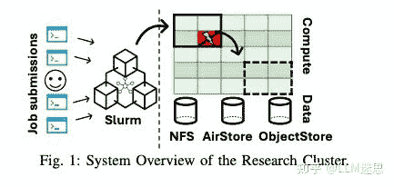

### 深度解读2024年中关村仿生机器人大会

https://zhuanlan.zhihu.com/p/9946962186

2024年11月27日，中关村仿生机器人大会在海淀成功举行，吸引了800余名行业专家和企业家参与。此次大会重点关注具身智能、人形机器人及仿生机器人技术的发展，并邀请了多位知名学者与企业领袖分享前沿技术。

大会的一个亮点是高会军院士的报告，他介绍了显微操作智能系统在类器官再生中的应用，突破了传统人工培养类器官的一致性问题。该技术不仅提升了操控精度，还将推动个性化癌症治疗和高通量药物测试的发展。

王鹤教授分享了基于合成数据的具身多模态大模型，他强调合成数据在提升机器人泛化能力中的关键作用。通过大规模合成数据训练，银河通用机器人在抓取和导航任务中展现了优异性能。熊友军则探讨了人形机器人在工业、服务和特种领域中的应用，特别是在缓解劳动力短缺和推动产业发展方面的潜力。

陈建宇教授展示了新一代人形机器人，强调通过大规模视频数据训练机器人的操作模型，提升了机器人的泛化能力和智能化水平。他还提出了软硬件协同迭代的设计理念，为通用具身智能体的技术进步指明了方向。

仉尚航研究员深入讨论了多模态基础模型的构建，她介绍了快慢双系统和分层结构的设计理念，结合大语言模型和视觉感知，显著提高了机器人的决策能力。圆桌论坛聚焦于AI驱动的机器人技术进展，业内专家探讨了具身智能在数据异构性、多样性和算力等方面的挑战。

在仿生机器人技术方面，石青教授展示了微小型仿生机器人在复杂环境中的应用，强调了感知技术和大数据分析的结合。赵慧婵教授则分享了柔性人工肌肉技术的最新进展，表明柔性机器人在复杂环境中的适应性和安全性优势。

关于人形机器人的未来应用，李卫铳介绍了如何通过大模型和小模型的融合，在工厂环境中实现高效作业。郑随兵则强调机器人在操作能力、泛化能力和成本上的突破，将推动机器人技术走向消费级市场。

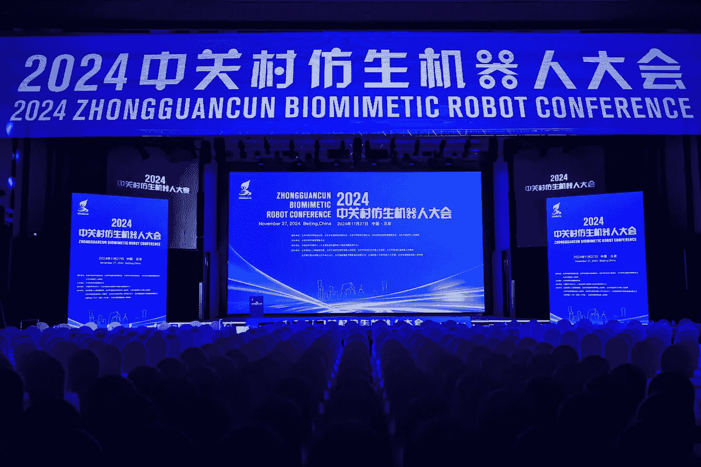

### 记一次对 SGLang weight update latency 的优化

https://zhuanlan.zhihu.com/p/9908228168

本文是一篇关于调试GPU延迟和分布式参数更新的详细笔记。作者通过反复调试，实现了update_parameter_from_distributed接口，该接口基于vllm实现，用于在分布式环境中更新模型参数。文章强调了准确测量GPU延迟的重要性，并指出使用torch.cuda.synchronize()来同步CPU和GPU是必要的。此外，作者还提到了在使用dist.barrier()时指定device_ids以避免潜在的设备错误。

作者详细描述了实现的三个函数：init_parameter_update_group、update_parameter_from_distributed和get_weights_by_parameter_name，这些函数共同工作以在分布式环境中管理和更新模型参数。文章还探讨了为什么需要训练和推理两个不同的引擎，解释了训练引擎和推理引擎在功能上的差异，以及它们在RLHF流程中的作用。

在测试效果部分，作者通过单测验证了实现的正确性，但发现效率不高。通过对测试代码的分析，作者发现每次参数更新的时间消耗不一致，特别是对于某些特定参数，如model.embed_tokens.weight，更新时间异常地长。作者进一步探索了可能的原因，包括HTTPS请求的延迟、Python函数调用的开销、参数更新的异步性问题，以及NCCL的性能问题。

最终，作者通过一系列的测试和调整，包括添加barrier来同步进程，成功将1B模型的更新时间降低到0.5秒左右，8B模型降低到0.6秒左右。文章最后指出，在进程组初始化后进行一次“热身”操作是常见的做法，并且建议在使用dist.barrier()时指定device_ids以避免设备错误。这些发现和解决方案对于优化分布式训练中的参数更新性能具有重要意义。

### 动手Attention优化3：理解Bank Conflict及Cutlass Swizzle

https://zhuanlan.zhihu.com/p/9840919069

1.  Cacheline 大小与优化

NVIDIA GPU 的 L2 缓存以及部分 L1 缓存的 Cacheline 大小为 128 Bytes，这意味着 GPU 在一次内存访问时会加载 128 Bytes 数据。为了提高内存访问效率，要求线程访问的数据地址对齐到 128 Bytes 边界。如果地址未对齐，则会增加额外的访问事务，影响性能。为了最大化访存效率，开发者应当确保数据的访问是连续的，并对齐到 128 Bytes 边界。

另外，线程块中的多个线程同时访问同一个 Cacheline 数据时，GPU 会将这些访问合并为一个事务，从而减少访存次数，进一步提升性能。因此，设计内存访问模式时，应该使线程块内的线程访问尽可能集中在同一个 Cacheline 中，避免跨 Cacheline 访问。

1.  向量化访问与优化

向量化访问指的是线程一次性访问 128-bit（16 Bytes）大小的数据，通常通过 float4 或 int4 类型进行。CUDA 提供的向量化指令（如 ld.global.v4.f32）允许线程同时加载 4 个 32-bit 的浮点数。为了提升内存带宽利用率，数据应对齐到 16 Bytes 边界。开发者可以使用 align(16) 属性确保数据结构的对齐，同时通过使用 float4 类型来配合向量化加载和存储指令。

1.  Bank Conflict 及其解决方法

Bank Conflict 是在同一 Warp 的线程访问共享内存时，由于内存访问冲突导致性能下降的问题。在 GPU 中，内存被划分为多个银行，每个线程访问的内存地址如果落在相同的内存银行，就会发生冲突，从而增加额外的访存开销。

对于 Bank Conflict 的优化，有几种常见方法：

+   **Padding**：通过在共享内存中填充额外的空白空间来避免不同线程访问相同的内存银行，但这种方法会增加显存的浪费。

+   **Swizzle**：通过改变内存数据的排列顺序来避免 Bank Conflict，具体做法是将数据在行或列上进行重排，使得同一 Warp 的线程访问不同的内存银行。Swizzle 的优化策略依赖于混淆函数，它通过异或运算重新排列数据，确保线程访问的内存地址分布在不同的内存银行中。

Swizzle 优化使用了几个参数来控制数据混排的方式，包括：

+   **B**：表示混淆重排行的粒度，决定每次重排涉及的行数。

+   **M**：表示 Swizzle 的最小不变单元，影响内存访问的对齐。

+   **S**：表示重排开始生效的位置，影响 Swizzle 在内存中的应用范围。

通过精心设计 Swizzle 策略，可以确保每次内存访问不会发生 Bank Conflict，从而提高内存访问的效率。

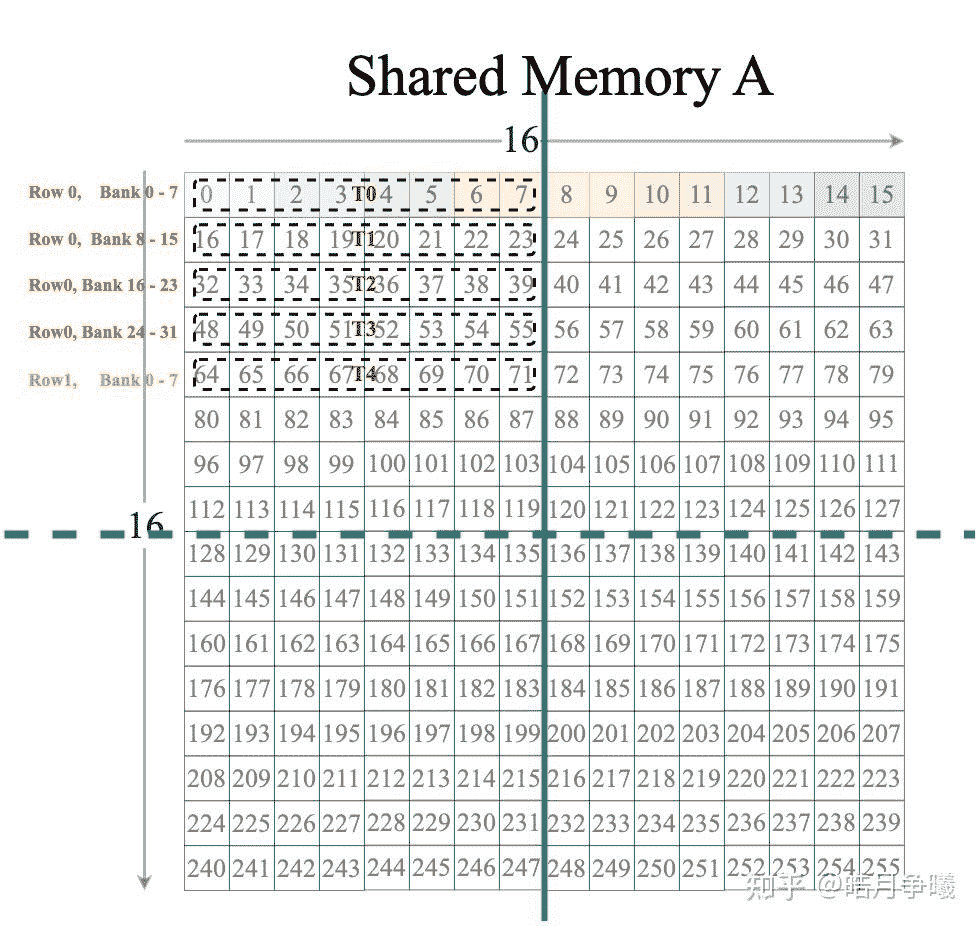

### Adam的epsilon如何影响学习率的Scaling Law？

https://zhuanlan.zhihu.com/p/9880578199

本文继续深入探讨Adam优化器中的一些细节，特别是学习率与Batch Size之间的Scaling Law以及SoftSign近似方法的影响。前文通过SignSGD近似分析了Adam的行为，而本文主要关注Adam优化器分母项的影响，尤其是在低精度训练和大规模模型（如LLM）中，Adam中的分母项通常不再可以忽略。

首先，文章提到Adam优化器的分母项通常包含一个小的常数，以防止除零错误，这在理论分析时通常被忽略。然而，随着LLM模型参数量的增加，梯度的绝对值逐渐变小，分母项的影响逐渐显著。尤其在低精度训练中，Adam中的分母项对训练的影响更为重要。引入分母项使得Adam优化器成为SGD与SignSGD之间的一个插值，随着该分母项的增加，Adam的表现逐渐接近SGD。

为了更精确地研究这一现象，本文将SignSGD替换为SoftSignSGD，即分母项引入一个新的函数形式，使其更贴近Adam的更新机制。这一变化让我们能够进一步探讨在Adam优化器中，分母项如何影响学习率与Batch Size之间的Scaling Law。文章特别指出，在LLM模型中，梯度的绝对值在训练后期往往非常小，分母项的作用变得不可忽视，因此有必要重新审视Adam优化器的缩放规律。

此外，本文还通过数学推导探讨了S型函数的近似问题，并引入了两种简化的S型函数形式，分别是与SignSGD相似的形式和基于分段线性函数的近似。这些近似帮助简化了对学习率和Batch Size之间的关系的推导，进而为理解Adam的行为提供了新的视角。

在具体的数学推导中，作者计算了梯度的均值和方差，提出了针对这些特性的简化近似。通过这些推导，得出Adam优化器在不同条件下的更新规律，并指出，随着分母项的增大，Adam优化器的行为逐渐接近SGD。特别地，当训练过程中分母项足够大时，"Surge现象"的概率会显著降低，且在极限情况下，Adam优化器的更新行为趋近于SGD。

总结来说，本文通过引入SoftSignSGD和S型函数的近似，分析了Adam优化器在大规模训练中的表现。研究表明，当模型变大时，Adam的表现逐渐接近SGD，且"Surge现象"的出现概率也会减少。本文的结果为优化器的选择和调整提供了新的理论依据，尤其是在LLM等大规模模型的训练中具有一定的参考价值。

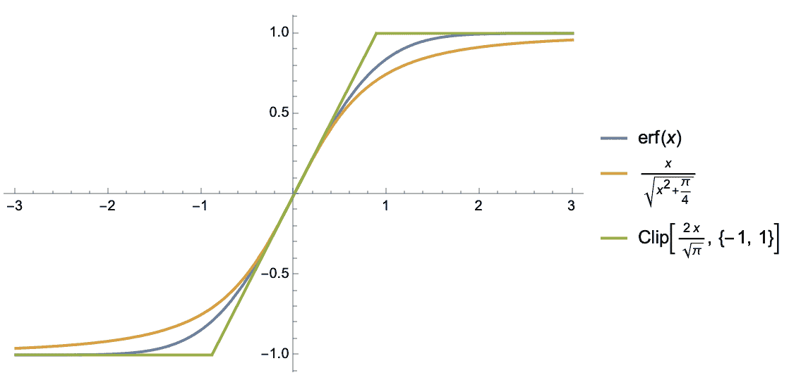

### 万字分享多模态大模型OCR工作 OCR VLM

https://zhuanlan.zhihu.com/p/7506957795

本文介绍了多个OCR-Free的多模态模型和技术，重点展示了GOT-OCR 2.0、Vary以及mPLUG-DocOwl等相关工作的技术细节和创新。

**GOT-OCR 2.0**：该模型为端到端的通用OCR系统，采用轻量级的视觉编码器（80M）和Qwen-0.5B解码器。其特点包括支持动态分辨率、多页OCR和交互式OCR功能，如通过区域或颜色高亮进行区域级别的识别。GOT-OCR使用了从场景文本和文档数据中合成的大量OCR数据，尤其注重解决大规模输入图像的特征表示问题。其训练过程分为三个阶段：首先进行纯文本识别的视觉编码器预训练；接着进行大规模OCR数据的联合训练；最后通过后训练增强模型的能力以支持更高分辨率和多页输入。

**Vary**：该模型通过扩大视觉词汇表来提升OCR能力，尤其在处理具有新“词汇”的OCR任务时表现突出。Vary使用一个小型语言模型作为解码器，配合CLIP-like的视觉编码器进行训练，采用自构造的OCR数据与自然图像负例数据。模型的训练通过对新的视觉词汇的学习，结合传统OCR数据集和新颖的数据源（如数学公式、化学分子式和图表），来提升多模态理解能力。Vary的核心创新是将多个视觉特征融合并输入到LLM中，增强了对细粒度图像特征的理解。

mPLUG-DocOwl 1.5：这是一个无OCR的文档理解模型，主打统一结构学习，旨在解决图像、表格、PDF等不同文档格式的多模态学习问题。该模型采用H-Reducer模块，通过卷积层聚合水平相邻的视觉特征，确保视觉信息与语言信息的良好对齐。模型通过切分图像并对每个部分进行视觉特征提取，优化了高分辨率图像的编码。同时，mPLUG-DocOwl通过统一结构学习，增强了对文档结构（如表格、图表和网页）的理解能力。该模型还加入了多粒度文字定位任务，用于进一步优化OCR-free的文档解析能力。

**总结**：这些模型通过各种技术创新，尤其是在视觉特征压缩、动态分辨率和多任务训练上，推动了OCR-Free多模态学习的发展。它们在多个OCR应用场景中，尤其是对于复杂文档和多图像输入的处理上，展现了出色的性能。这些技术的创新，不仅降低了OCR任务的计算和数据处理成本，同时也提高了系统的泛化能力，推动了OCR领域的技术进步。

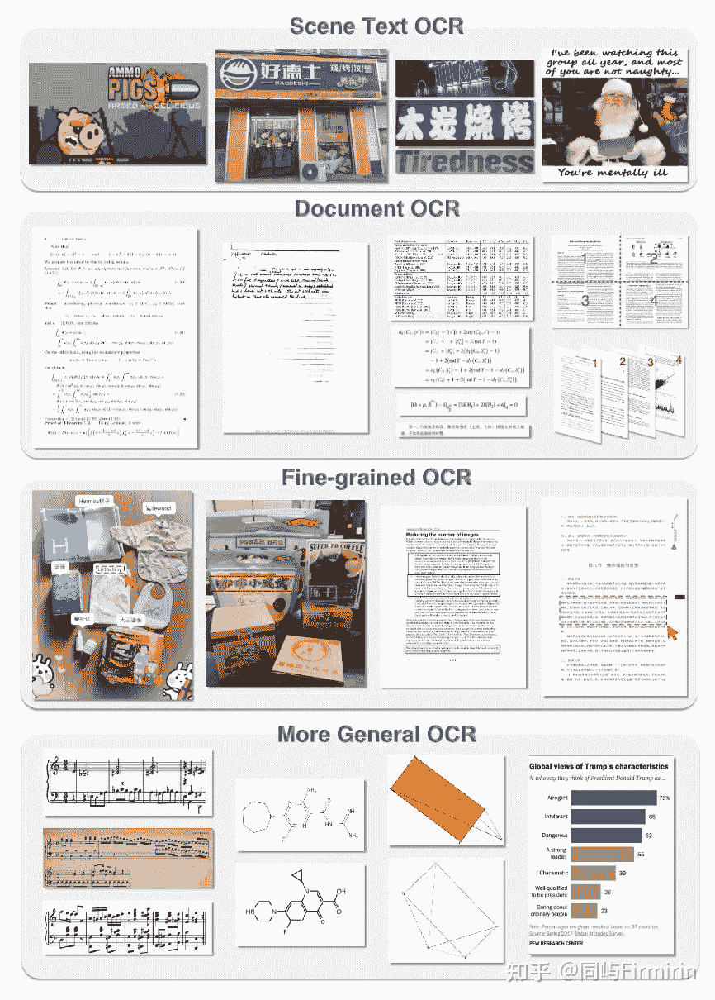

### 从本地部署到企业级服务：十种主流LLM推理框架的技术介绍与对比

https://mp.weixin.qq.com/s/LmYtiQPjP_EQv6aHkasO8w

**WebLLM**：基于浏览器的推理引擎，通过WebGPU加速计算，支持在客户端直接运行大规模模型。其优点是无需服务器，数据隐私得到保障，跨平台兼容性强。但计算能力受限于客户端硬件，且仅支持特定模型。

**LM Studio**：提供本地化的LLM运行环境，支持离线推理和多平台部署。通过与Hugging Face生态集成，简化了模型管理。缺点是大型模型对硬件要求较高，且主要面向桌面环境，不适合生产级部署。

**Ollama**：轻量级框架，专注于本地推理，能够提高数据隐私保护并降低推理延迟。其优点是简便的部署和灵活的接口支持，但扩展性和硬件依赖性较强，适合中小规模应用。

**vLLM**：优化内存管理的开源框架，支持高效的推理处理和分布式计算。通过PagedAttention技术、量化加速和多种并行策略，提供高吞吐量和低延迟的服务，适合生产环境。但在硬件要求上较为苛刻。

**LightLLM**：基于Python的推理框架，优化了GPU利用率和内存管理，特别适合开发和生产环境。通过异步处理和动态批处理提升计算效率，但性能依赖于硬件，且对跨模型支持有一定限制。

**OpenLLM**：简化LLM的自托管部署，支持多种主流模型。结合Docker和Kubernetes提供灵活的云端部署管理，适用于大规模生产环境。缺点是对硬件的要求较高，适合有足够资源的团队。

**HuggingFace TGI**：优化的文本生成推理框架，支持高并发和低延迟，且与Hugging Face生态系统紧密集成。其资源调度系统高效，适合大规模文本生成任务，但扩展性依赖于硬件资源。

**GPT4ALL**：专注于本地推理，支持文档交互和智能提取功能，确保数据隐私。通过优化的资源调度机制，提供高效的本地设备推理能力。适合文档密集型应用，但性能依赖于硬件。

**llama.cpp**：优化的C/C++实现，支持高效的本地推理，特别适用于低硬件资源的设备。通过支持多种量化方法和内存优化技术，提升了推理效率。但在扩展性上较为有限。

**Triton Inference** Server与TensorRT-LLM：为企业级部署提供完整的推理方案，通过TensorRT优化推理性能，支持GPU资源高效利用和动态调度。其优点在于高性能和可扩展性，但需要较高的硬件投入。

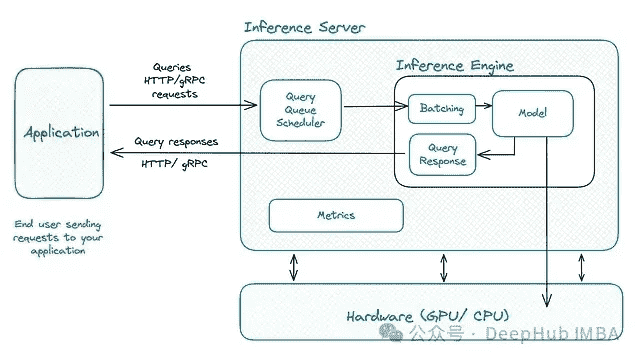

# 招聘公告

---

**奇绩创坛****由陆奇博士**于2019年创立，使命是在源头最大化驱动创新。奇绩研究组将研究模型理论、到投研战略分析、市场策划等不同背景的同学聚在一起，搭建GenAI时代独特的跨界人才社群。

## 🚀F**24实习岗位**

##### [行研-学术科研人才交流组实习生](https://miracleplus.feishu.cn/docx/Yn6rdf2iOoY2Rcx8yVNcUBYRnch#part-QkMcdeJmuob9uvxvV3qcLSzHn8g)

##### 行研-GenAI研究岗位-战略分析（偏产品）

##### Web / AI 全栈开发工程师实习生

## **火热开放中🚀**

##### 行研-GenAI研究岗位-前沿学术探索

##### 行研-GenAI研究岗位-战略分析（偏咨询）

##### 创新活动产品运营 （大模型系列活动产品运营）

> **点击**相关岗位可查看对应**岗位需求【JD】；**相关岗位投递请**扫描二维码**

> 欢迎**推荐/自荐**

> 期待在**奇绩创坛**遇见更好的你

---

# 声明

本文档仅供学习交流使用，版权归原作者所有，若涉侵权，请联系Jack Jin 15101136166

##

（欢迎在下方反馈您宝贵的意见！整理不易，觉得有用给AI日报小组点个赞👍吧！）

ChatGPT；Angela；Zijia Liu；Alex；Zeqi Tan；Tiezhen（HuggingFace）；Naixu；Lizhi；Peter；Suoman；Jack

学术分析报告：ResearchFlow -- 奇绩F23校友的开发的深度研究产品，PC端进入RFlow的分析报告，可直接点击节点右侧的小数字展开节点，登录后可在节点上直接“询问AI”，进一步探索深度信息

如果你有大模型相关的创业想法，欢迎来找我们聊聊～微信：15101136166

> 快邀请你的小伙伴们一起来读大模型日报吧！

> **【日报****知识库****】**这里是近期日报内容的汇总,欢迎大家查阅

> [大模型日报知识库(分享版)](https://miracleplus.feishu.cn/wiki/KapVwXfkriOBiskB0B2cUHxjnTh)

>

> 欢迎大家多多帮我们分享,转发~~

> 如果大家有任何的建议或者吐槽,欢迎随时找我聊天~

