# 奇绩大模型日报（12月 3日）

> 来源：[https://miracleplus.feishu.cn/docx/DQcwd6oDJoZGHPxOfxxcAbC3nmc](https://miracleplus.feishu.cn/docx/DQcwd6oDJoZGHPxOfxxcAbC3nmc)

# 资讯

### 英特尔CEO帕特·盖尔辛格退休，暂时由两位高管接任

https://techcrunch.com/2024/12/02/intel-ceo-pat-gelsinger-retires/

英特尔公司宣布，首席执行官帕特·盖尔辛格（Pat Gelsinger）已于12月1日正式退休，并退出了公司董事会。公司高层David Zinsner和Michelle Johnston Holthaus被任命为临时联合首席执行官（Co-CEOs）。Zinsner为英特尔的首席财务官，Holthaus则担任英特尔客户端计算部门的总经理，并被任命为新设立的“英特尔产品”部门的CEO，该部门包括面向消费者的业务以及数据中心、人工智能、网络和边缘业务。

盖尔辛格于2021年重返英特尔担任CEO，推出了一项雄心勃勃的五年计划，目标是重振公司并追赶台积电和三星等芯片巨头。然而，在其任期内，英特尔面临了许多挑战，包括技术进展缓慢、市场份额流失以及频繁的战略失误。英特尔在个人电脑芯片和数据中心芯片领域的收入大幅下滑，导致公司股价和利润遭遇压力。尽管如此，盖尔辛格仍推动了一些重大举措，如争取美国政府对国内芯片制造的补贴，并计划建设多座大型芯片厂。

英特尔的董事会已经成立了一个寻找新CEO的委员会，并预计会在过渡期间继续推进公司的战略重组。与此同时，英特尔的制造和设计业务将保持现状。

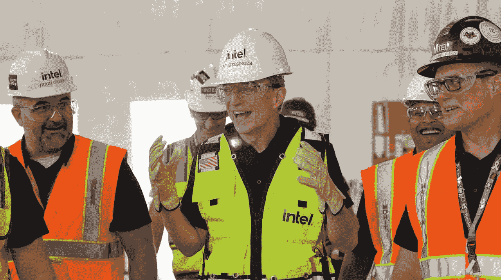

### 贾佳亚、徐立研究工作获 SIGGRAPH Asia 2024 时间检验奖

https://mp.weixin.qq.com/s/L5AMEjKCfnS6xVgfrzBSXQ

SIGGRAPH ASIA 2024 于北京时间12月3日在东京召开。本届会议共收到900篇论文提交，涵盖六大主题，包括几何/建模、视频/成像、可视化/渲染、动画/模拟等。最终，146篇会议论文和119篇期刊论文被接受，接收率为29.4%。本届会议上，Best Paper奖项颁发给了7篇论文，其中有4篇论文涉及华人团队。Georgia Institute of Technology的《Particle-Laden Fluid on Flow Maps》论文获得最佳论文奖，提出了一种新框架，通过粒子流图模拟墨水作为粒子载流，解决了现有流图技术的局限性，特别是在处理粘度和阻力等耗散力方面，推动了纳维-斯托克斯方程的求解。该方法对粒子载流现象的模拟具有高保真度，能够准确捕捉涡球、粘性尾部等现象。

此外，贾佳亚及其团队在多个奖项中获奖，包括荣誉提名奖和时间检验奖。他们的论文《TEXGen: a Generative Diffusion Model for Mesh Textures》提出了一种创新的扩散模型，能在UV纹理空间中生成高分辨率纹理图，拓宽了纹理生成领域。贾佳亚带领团队的另一篇论文《Structure extraction from texture via relative total variation》被评为经受时间检验的经典论文，提出了一种基于总变差的新模型，能够有效分解图像中的结构和纹理。

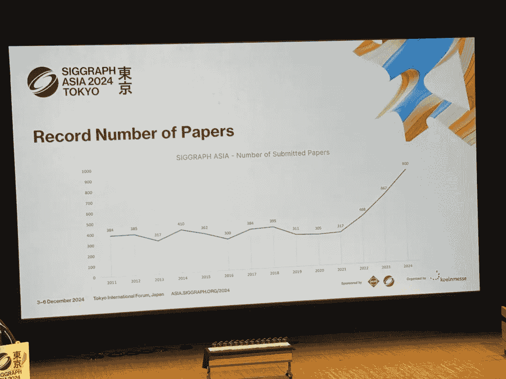

### 清华赵明国专访：坚守人形机器人二十载，从孤军奋战到百家争鸣

https://mp.weixin.qq.com/s/sx3qMX3Gk_GVT9luC_2fJA

赵明国教授的机器人研究历程见证了中国机器人技术从起步到逐步走向国际前沿的过程。自2000年加入清华大学以来，他专注于双足机器人控制系统和被动动力学行走技术，并成功突破多个技术瓶颈。2005年，本田的ASIMO和波士顿动力的BigDog推动了全球机器人技术的进步，赵教授也在此期间深入探索这些技术。他的团队在2010年开始引入优化控制方法，且在与优必选科技的合作中，推动了机器人集群控制的研究。近年来，赵教授还致力于类脑计算的研究，尝试将脉冲神经网络（SNN）应用于机器人，以实现更灵活的适应性。

中国的机器人产业也在迅速发展，特别是在AI与机器人融合的背景下。赵教授指出，机器人技术的突破不仅依赖于AI的引入，而是需要真正的技术创新，强调机器人的具身智能必须有独立的研究进展。此外，随着更多企业和学者加入，国内的人形机器人领域已经达到50至100家企业的规模，研究团队的增多推动了技术的成熟。

他还强调，机器人领域的挑战在于技术路径的分散性，不同团队的技术路线往往难以共享，导致行业进展较慢。未来的突破可能来自于跨学科的融合，尤其是在AI与机器人控制技术的结合上。总的来说，赵教授的坚持和前瞻性研究，不仅展示了个人的学术坚守，也见证了中国机器人技术在全球竞争中的崛起。

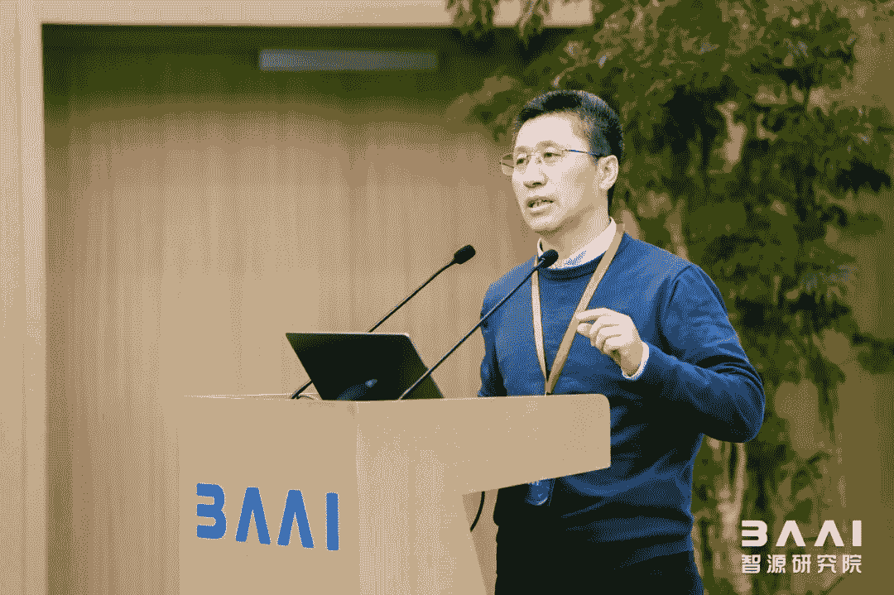

### 何恺明MIT开门弟子名单公开：奥赛双料金牌得主、清华姚班学霸在列

https://mp.weixin.qq.com/s/H38mKX4crZK4LJpB1HrJ-A

何恺明，MIT电气工程和计算机科学系的副教授，近期公开了其团队的成员，包括三位华人研究者：邓明扬、白行建和黎天鸿。邓明扬，曾获IMO和IOI双料金牌，现为MIT数学与计算机科学专业的博士一年级生，研究方向为生成式基础模型，尤其是扩散模型和大型语言模型。白行建也为博士一年级生，曾获多项信息学竞赛奖项，研究领域集中在经典算法与深度学习交叉领域。黎天鸿为博士后，专注于表示学习和生成模型，曾在自条件图像生成方面与何恺明合作。团队还包括博士生Jake Austin，专攻计算机视觉。

这些研究者的合作成果显著，其中最引人注目的是与何恺明的合著论文《无需矢量量化的自回归图像生成》，提出了通过扩散过程避免离散tokenizer，使用连续值空间改进自回归模型的图像生成方法。此外，何恺明团队的研究还涵盖了计算机视觉、机器人学习等领域。最新论文《Fluid: Scaling Autoregressive Text-to-image Generative Models with Continuous Tokens》提出的Fluid模型在文本到图像生成任务中展现了优异的扩展性和生成质量，刷新了零样本FID和GenEval分数。

何恺明还提到他未来将专注于“AI for Science”领域，已在量子计算方面取得初步成果，使用强化学习优化量子资源调度，显著提升量子系统性能。

总之，何恺明团队的成员不仅学术背景卓越，而且在AI生成、量子计算等前沿领域持续推动创新，值得关注其未来的更多科研成果。

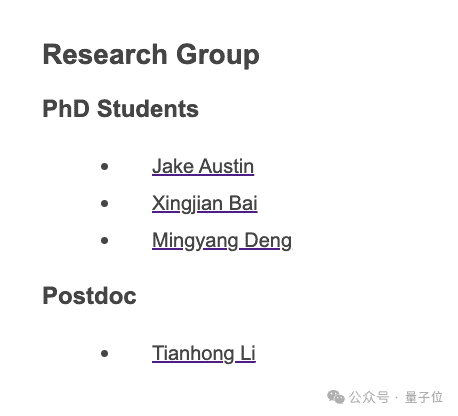

# 推特

### World Labs分享早期成果：正在开发一套 AI 系统，可以通过一张图片生成 3D 世界

https://x.com/theworldlabs/status/1863617989549109328

我们正在开发一套 AI 系统，可以通过一张图片生成 3D 世界！您可以在我们的网站上查看一些早期成果，并直接在浏览器中与这些场景进行交互！

🌐 访[问我们的博客](https://worldlabs.ai/blog)

**World Labs 的目标**

**我们希望**解决许**多创作**者在现有生成式 AI 模型中面临的挑战，例如 缺乏控制 和 一致性。我们的系统能够根据输入的图像：

• **估算 3D 几何**

• **补全场景中看不见的部分**

• **生成新的内容**，使您可以环绕观察

• **适应多种场景类型和艺术风格**

**实时 3D 场景**

我们的输出 3D 场景可以直接在浏览器中实时渲染，支持完全的相机控制。这**意味着**您可以像在电子游戏中一样自由移动摄像机，甚至模拟 3D 摄像机效果，例如 浅景深 或 摇镜头变焦 (dolly zoom)。

[26_-thUvx9o1SnBO.mp4](https://internal-api-drive-stream.feishu.cn/space/api/box/stream/download/all/JiJnbNixWo5LaqxQpDWchquVnmf)

### Hume语音控制功能：丝滑调节鼻音，性别感，轻快感等

https://x.com/hume_ai/status/1863602702363639927

介绍 Hume 的语音控制功能

我们开发了一种实验性的语音调制方法，让您可以在几秒钟内创建独特的 AI 语音。

我们的语音滑块让您可以直观地调节基础语音的 10 个可解释维度，包括：

👃 鼻**音：**从共鸣到鼻音

🎼 性**别感：**从男性化到女性化

🎈 轻**快感：**从低沉到轻快

在下方线程中查看示例作品 👀

[WQ2DlFFhwpC9UdKj.mp4](https://internal-api-drive-stream.feishu.cn/space/api/box/stream/download/all/XBFmbkxuwoDOa1xhNECcjY2an2b)

### Happenstance：正在打造全球最强的 AI 人物搜索引擎

https://x.com/var_epsilon/status/1863645114679062587

介绍 **Happenstance** 🍀

我们正在打造全球最强的 AI 人物搜索引擎！

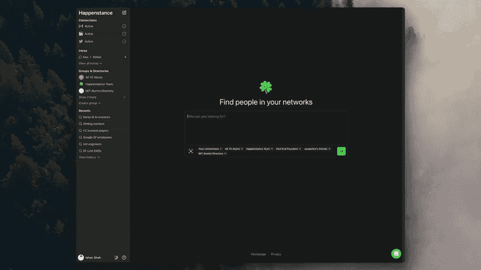

[LvaruYJlSD9aGQkX.mp4](https://internal-api-drive-stream.feishu.cn/space/api/box/stream/download/all/K3rRbT8vLoSLGBxhUd3cFBLZnOb)

### supabase AI 助手 V2上线：数据库的 Cursor

https://x.com/kiwicopple/status/1863616764942176668

今天我们发布了 **@supabase** AI 助手 V2

它就像数据库的 Cursor，即使是澳大利亚人也能用得上 ↓↓”

[ZSY6WwSpA_D-NgY3.mp4](https://internal-api-drive-stream.feishu.cn/space/api/box/stream/download/all/Na0QbhuAHoeLVex4Y1ucDaSbnXf)

# 信号

### Beyond Examples: High-level Automated Reasoning Paradigm in In-Context Learning via MCTS

文章链接：https://arxiv.org/abs/2411.18478

情境学习 (ICL) 使大型语言模型 (LLM) 能够通过复杂的提示和高质量的演示来解决下游任务。然而，这种传统的 ICL 范式在面对复杂的数学推理任务时显示出局限性，主要是因为它严重依赖示例质量，并且在具有挑战性的场景中需要人工干预。为了解决这些限制，本文提出了 HiAR-ICL，它将重点从具体示例转移到抽象思维模式，扩展了 ICL 中传统的上下文概念。HiAR-ICL 引入了五个原子推理动作作为构建链式结构模式的基本组成部分。使用蒙特卡洛树搜索，我们探索推理路径并构建思维卡来指导后续推理。然后，我们开发了一个认知复杂性框架，可以动态地将问题与适当的思维卡匹配。

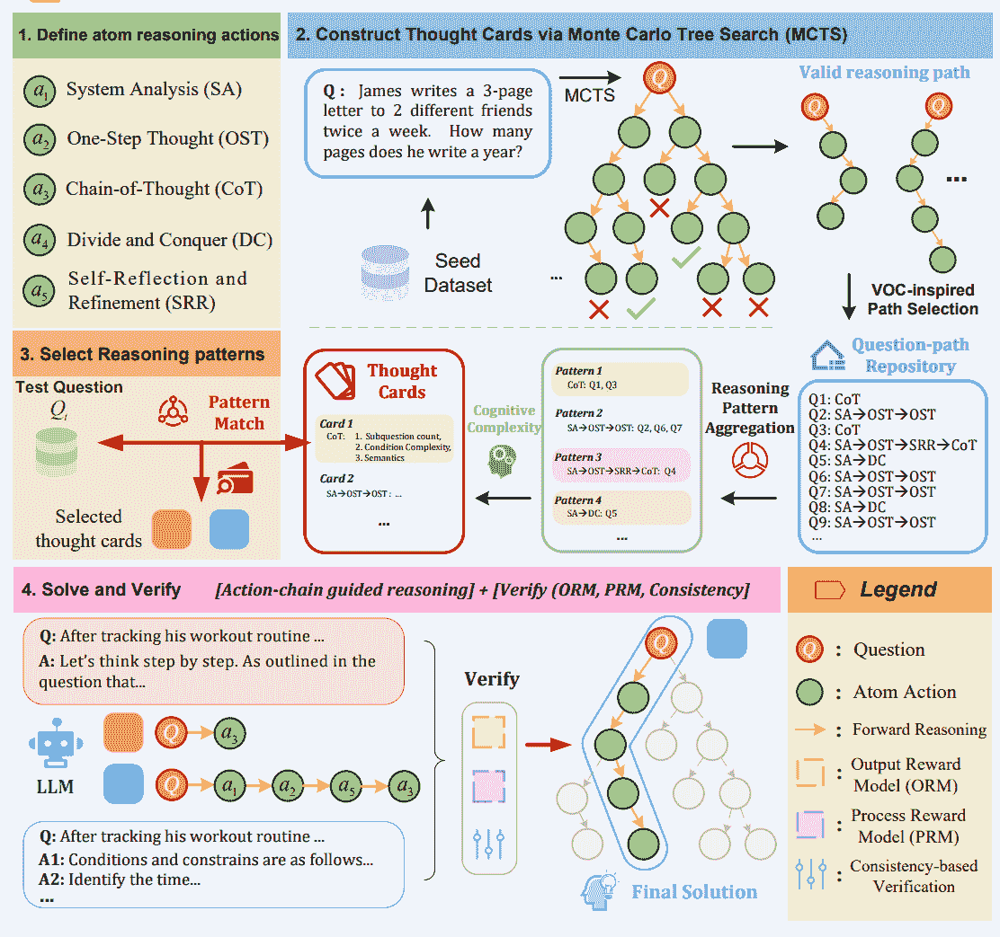

### Disentangling Memory and Reasoning Ability in Large Language Models

文章链接：https://arxiv.org/abs/2411.13504

大型语言模型 (LLM) 在处理需要广泛知识和推理能力的复杂任务方面表现出色。然而，现有的 LLM 推理流程是一个不透明的过程，没有明确区分知识检索和推理步骤，这使得模型的决策过程不清晰、混乱。这种模糊性可能导致幻觉和知识遗忘等问题，从而严重影响 LLM 在高风险领域的可靠性。在本文中，我们提出了一种新的推理范式，将复杂的推理过程分解为两个截然不同的动作：(1) 记忆回忆：检索相关知识；(2) 推理：根据回忆起的知识执行逻辑步骤。为了促进这种分解，我们引入了两个特殊的标记记忆和推理，引导模型区分需要知识检索的步骤和涉及推理的步骤。我们的实验结果表明，这种分解不仅提高了模型性能，还增强了推理过程的可解释性，使用户能够识别错误来源并有效地改进模型响应。

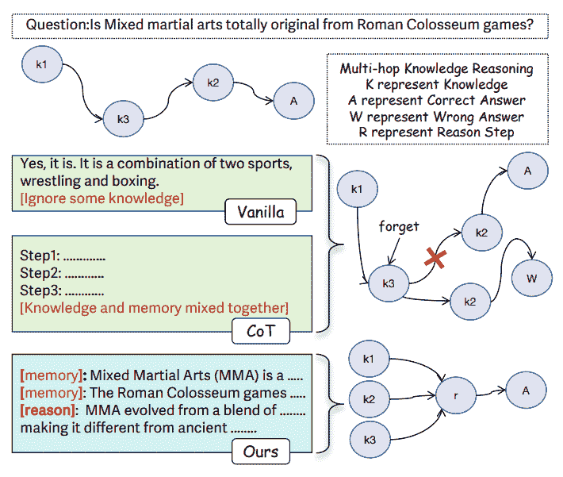

# 产品

### Vela OS 创业投资者的决策系统

https://www.vela.partners

贡献人：

Vela OS 是一款原生 AI 操作系统，可让创业投资者的决策精确度提升 10 倍，相较于传统风投公司更具优势。通过一群 AI 代理人协同工作，投资者能够发现新兴市场、优质公司和优秀人才，并基于数据驱动的决策优化投资回报率。

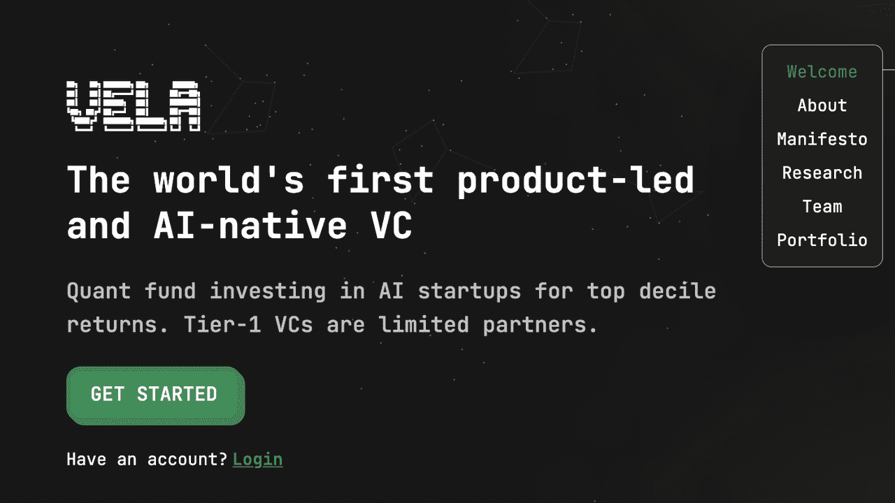

### ACE Studio 生成录音棚级自然歌唱人声

贡献人：

https://acestudio.ai/zh

ACE Studio可以利用 MIDI 和歌词生成录音棚级自然歌唱人声。探索超过 80 种拥有免版税授权的 AI 声音，涵盖广泛风格，包括流行、摇滚、电影配乐、歌剧、嘻哈、R&B、灵魂、儿童声、日系流行（Jpop）、华语流行（Cpop）等更多选择。

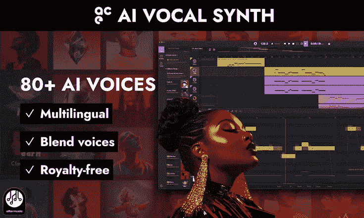

# HuggingFace&Github

### AI TreasureBox

https://github.com/superiorlu/AITreasureBox

AI百宝箱是一个为研究者、开发者、创业者及对人工智能感兴趣的用户提供的资源集合。它汇集了当前最实用的AI工具、技术与知识库，涵盖从基础学习到高阶应用的各个层面，旨在降低AI领域学习与开发的门槛，为用户提供快速上手和创新的能力支持。

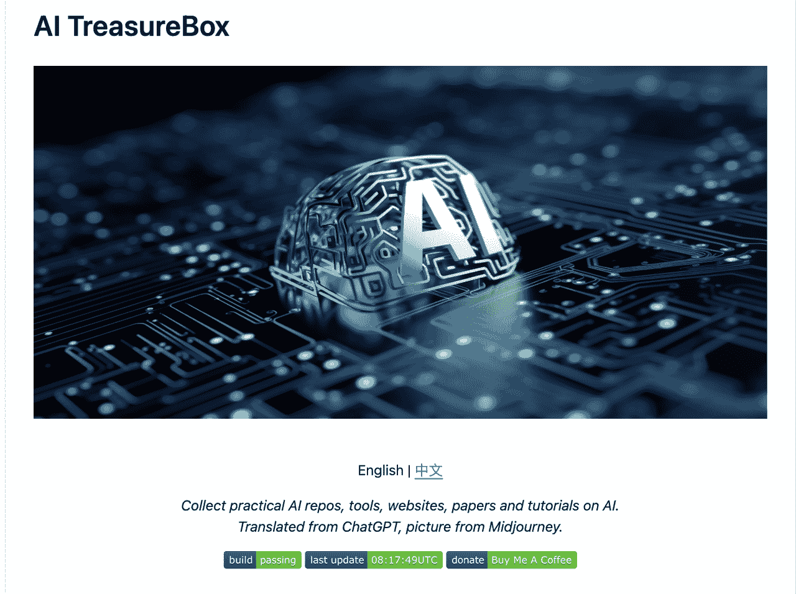

# 投融资

### 杰夫·贝佐斯投资AI芯片制造商Tenstorrent，融资近7亿美元

https://techcrunch.com/2024/12/02/jeff-bezos-backs-ai-chipmaker-tenstorrent/

AI硬件初创公司Tenstorrent近日成功完成了693百万美元的D轮融资，使公司估值超过26亿美元。此次融资由三星证券和AFW Partners领投，其他投资者还包括现代汽车和杰夫·贝佐斯的投资公司Bezos Expeditions等。

成立于2016年的Tenstorrent，旨在挑战英伟达在AI芯片市场的主导地位。公司表示，将利用这笔资金扩充工程团队，并建设人工智能训练服务器，以展示其技术实力。Tenstorrent的首席执行官吉姆·凯勒（Jim Keller），一位著名的微处理器工程师，透露公司计划每两年发布一款新的AI处理器，目前已有客户合同金额接近1.5亿美元。

该公司的融资标志着AI芯片领域的竞争愈发激烈，Tenstorrent将与其他AI芯片初创公司如Axelera、Etched和Groq等共同争夺市场份额。

公司官网：https://tenstorrent.com/

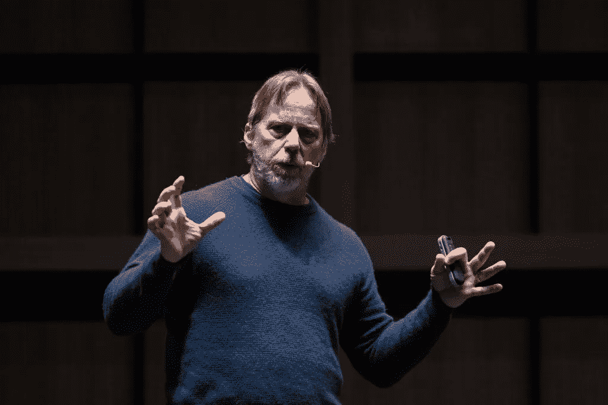

### 前NBA球员Omri Casspi推出6000万美元基金，专注于网络安全、云基础设施和AI初创公司

https://techcrunch.com/2024/12/02/omri-casppi-launches-60m-fund-for-cyber-cloud-and-ai-startups/

前NBA球员Omri Casspi近日宣布启动了一个名为Swish Ventures的新风险投资基金，规模为6000万美元。该基金将专注于早期阶段的网络安全、云基础设施和人工智能（AI）初创公司，计划投资10家公司，每笔交易的投资额将在500万至700万美元之间。

Swish Ventures是Casspi继2022年启动的Sheva Capital基金之后的第二个投资基金，Sheva Capital基金规模为3600万美元，Casspi表示，该基金的投资期已结束，但他仍在积极管理其投资组合。Casspi指出，虽然Sheva基金不再进行募资，但他将继续全力推动其投资公司发展。

Swish Ventures的投资策略与Sheva类似，重点投资由经验丰富的企业家领导的初创公司，这些公司具有打造市场领先企业的潜力。不同的是，Swish Ventures将更加聚焦于网络安全、云基础设施和AI领域，而Sheva基金的投资方向则涵盖了更广泛的领域，包括金融科技和Web3等。

此外，Swish Ventures的投资者包括以色列的网络安全领域知名企业如Wiz和Eon等。这些公司展示了以色列在云安全和网络安全方面的强大实力，同时也凸显了该地区企业家在第二次创业中的成功。Casspi本人也曾投资Wiz，Eon则是Sheva基金的投资项目。

Swish Ventures的启动反映了投资者对网络安全和AI领域日益增长的兴趣，特别是在以色列和美国等市场。此外，Swish Ventures还吸引了包括Sequoia Capital在内的多家机构投资者，并宣布Dana Alexandrovich加入该基金担任运营合伙人。

截至目前，Casspi管理的基金总资产约为1.25亿美元，Sheva基金的投资组合中包括Upwind（确认其市值为9亿美元）和PointFive等初创公司，后者曾将其前公司出售给Rapid7并成功筹集了3600万美元。

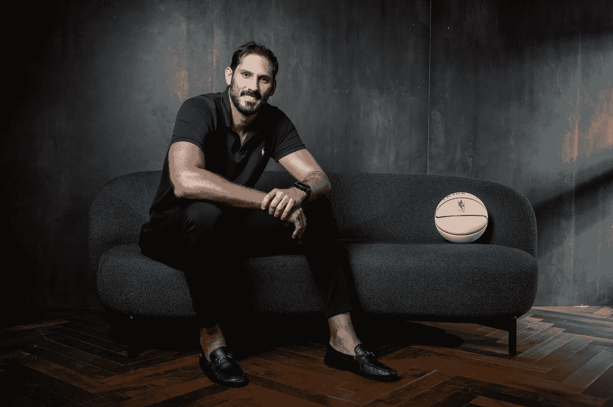

### 欧洲AI基础设施公司Nebius获得7亿美元融资

https://techcrunch.com/2024/12/02/european-ai-infrastructure-company-nebius-nabs-700m-from-nvidia-accel-others/

欧洲AI基础设施公司Nebius（前身为Yandex N.V.）近日宣布成功融资7亿美元，旨在支持其美国市场扩展。此次融资吸引了多家知名投资者，其中包括Nvidia、硅谷风投公司Accel以及资产管理公司Orbis等。Nebius通过私人配售发行了3330万股A类股票，每股价格为21美元，较自10月恢复交易以来的股价平均水平溢价3%。

Nebius公司计划通过混合模式发展其业务，包括共享数据中心和自建“绿地”数据中心。为了加快基础设施建设，公司需要更多资金支持。尽管Nebius已经有约22亿美元的资金，但Volozh表示，仍需通过进一步的资本融资来加速数据中心建设。预计到2025年底，公司的年化收入将达到7.5亿至10亿美元。

此次融资将帮助Nebius扩展其数据中心网络，并支持其在全球范围内的增长。同时，Accel的合伙人Matt Weigand将加入Nebius董事会，进一步推动公司的发展。

该融资发生在Nebius于今年重新上市纳斯达克后的短短六周内，标志着公司在摆脱俄罗斯相关制裁后的全面复兴。

公司官网：https://group.nebius.com/

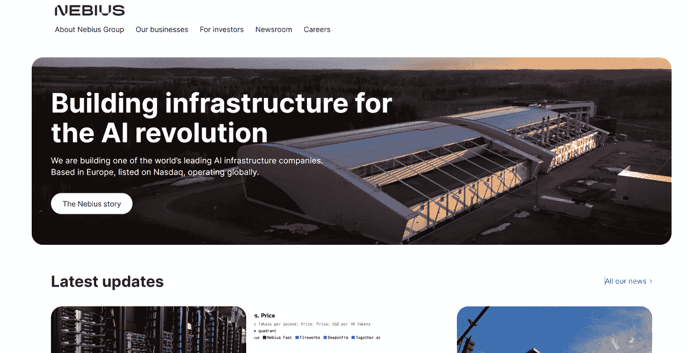

# 学习

### CUDA-Reduce算子的实现及优化

贡献人：

https://zhuanlan.zhihu.com/p/10110450979

CUDA优化中的reduce算子通过并行化与内存优化显著提升了求和等计算的效率。以下是对其优化过程的总结：

1.  基础版Reduce（base_reduce）： 在GPU中，基础的reduce操作是通过将输入数组中的所有值加起来，最终存入输出数组。这种方法并没有充分利用GPU的并行计算能力，效率较低。

1.  优化一：共享内存与交错寻址（reduce_v1）： 使用共享内存代替全局内存来存储输入数据，并采用交错寻址（即每个线程处理不同步长的元素），使得计算从O(N)降至O(log N)。每个线程加载一个元素到共享内存，并在共享内存中进行树形规约操作。

1.  **优化二：通过strided inde**x消除warp分化（reduce_v2）： 在reduce_v1中，由于条件判断，存在warp分化问题。通过调整stride，使得所有线程按相同的路径执行，避免了条件分支导致的warp分化，从而提升了性能。

1.  优化三：消除共享内存中的bank冲突（reduce_v3）： 在共享内存中，多个线程同时访问同一bank的不同数据时，会发生bank冲突，导致性能下降。通过逆向处理访问顺序，即调整stride，从而消除冲突，进一步提高效率。

1.  优化四：让空闲线程参与计算（reduce_v4）： 在某些迭代阶段，部分线程为空闲状态。通过增加block的线程数并减小block数，使得更多线程参与计算，减少了空闲线程的浪费。

1.  优化五：最后一个warp不再同步（reduce_v5）： 最后几轮的计算仅涉及一个warp，可以避免不必要的__syncthreads()同步操作，减少资源浪费。

1.  优化六：展开for循环（reduce_v6）： 通过完全展开for循环，避免了每次迭代中的条件判断和加法指令，从而提高了效率。通过将每个线程处理多个元素，减少了线程管理的开销。

1.  **优化七：基于warp level的**shuffle操作（reduce_v7）： 使用__shfl_down_sync指令在warp内进行数据交换，无需共享内存，从而减少了内存访问延迟。每个warp内部使用shuffle操作合并部分和，再通过warp间的合并进一步减少内存带宽需求。

各个版本的优化效果显著。例如，在数据量为25600000时，reduce_v7通过warp级别的优化将执行时间从基础版本的1214ms降至1.476ms，展现了强大的性能提升。

这些优化手段体现了GPU并行计算中内存访问优化、线程管理和计算精细化调度的重要性，能大幅提升reduce算子的执行效率。

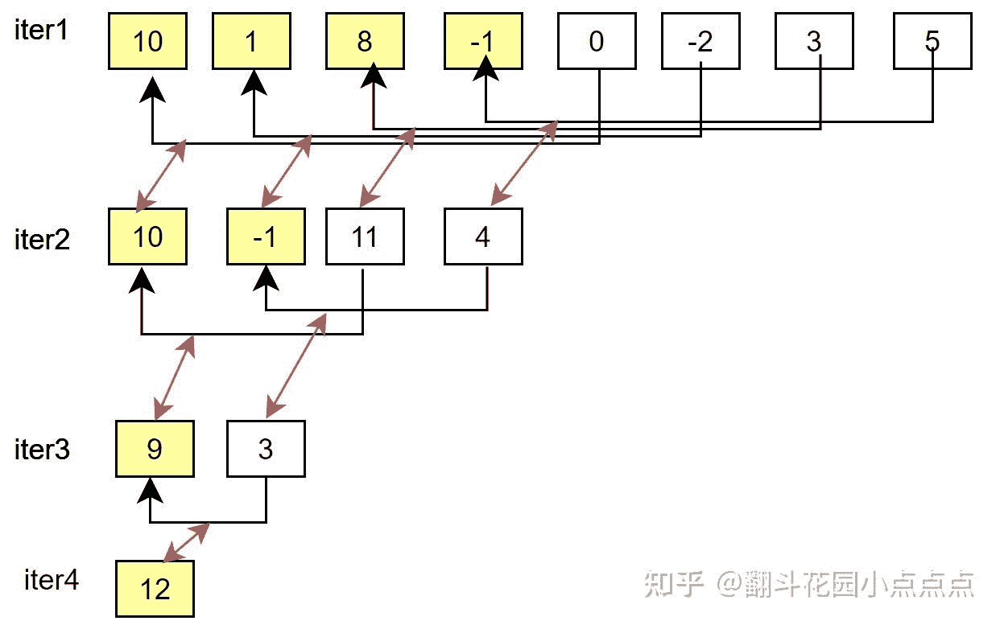

### 从StreamingLLM到Massive Outlier、IntactKV和PrefixQuant

https://zhuanlan.zhihu.com/p/9814639857

自从Tim Dettmers在NeurIPS 2022提出LLM.int8()后，量化技术的研究重点逐渐集中于处理Outlier Activation，尤其是Massive Outlier。这类激活值的存在对模型的精度和量化效果产生了显著影响，催生了包括SmoothQuant、AWQ、RPTQ等一系列优秀量化算法。本文重点探讨了Massive Outlier的处理发展历程及其应用。

最初，StreamingLLM提出了一种优化长文本推理的方法，通过引入window attention减少计算量和存储量。尽管这种方法在精度上有所损失，但发现初始token的KV值对结果影响巨大，被称为attention sink。初始token虽然语义不强，但它们通过自回归模型的特性吸引了大量注意力，成为了模型的偏置项。这一现象为后续对Massive Outlier的研究提供了基础。

随后，CMU和Meta的研究人员在《Massive Activations in Large Language Models》一文中提出了Massive Outlier的概念，指出初始token及低语义token的激活值通常远高于均值，呈现出几个数量级的离群值。通过实验，研究表明Massive Outlier的存在对模型的效果和量化过程有重要影响。为此，研究人员提出将massive activation与普通激活区分开来，并引入可学习的参数k/v来替代Massive Outlier，从而平滑激活值并改善量化效果。

基于这种思路，PrefixQuant应运而生，它通过离线处理Massive Outlier，将异常token放置在KVCache的前缀中，从而避免了推理过程中产生Massive Outlier。PrefixQuant通过结合smooth、rotate、reorder等经典等效操作，将激活量化从per-token转换为per-tensor量化，既能提升推理速度，又能保证精度。

另一种基于这一思想的应用是IntactKV，强调通过保留pivot token（如[BOS]、system prompt等）的KVCache精度，在量化的过程中减少误差积累。通过这种方式，IntactKV结合全精度和量化KVCache，采用混合精度来存储KVCache，从而提升推理精度。

总的来说，近年来在Massive Outlier的研究中，学者们深入理解了离群值对量化过程的影响，并提出了多种有效的处理方法。这些方法通过将激活值的离群特性等价为偏置，极大地减小了推理精度的损耗，同时提升了推理速度，预计将在未来成为各大框架的标准集成方法。

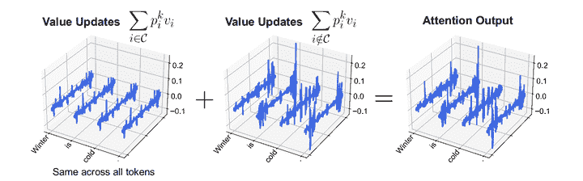

### 量子技术揭秘：打破谷歌量子计算的能效壁垒

https://zhuanlan.zhihu.com/p/10413667245

量子霸权是指量子计算机在特定任务上超越经典计算机的能力。谷歌的Sycamore量子计算机宣称能在200秒内完成百万量子采样任务，而传统超级计算机则需要约一万年。尽管有研究者尝试通过经典算法缩小这一差距，但在生成无关联样本和能效等方面仍面临挑战。

本研究团队在全球超级计算大会SC24上展示了最新进展，在量子模拟任务中打破了Sycamore的能效壁垒，实现了速度和功耗的显著突破。量子计算基于量子力学原理，能在某些应用中提供指数级加速。当前，量子计算硬件主要采用超导、离子阱、光量子等技术路线，而量子算法也在不断发展。特别是NISQ（噪声中等规模量子）时代的算法，如变分量子特征值求解（VQE）和量子近似优化算法（QAOA），已使得量子化学模拟和组合优化问题成为现实。

量子霸权的定义首次由谷歌在2019年提出，并通过随机电路采样任务展示了量子计算机在某些任务上的巨大优势。随机电路采样任务涉及一系列量子门操作，通过测量电路输出生成比特串，并用交叉熵基准测试（XEB）验证量子处理器的性能。谷歌的Sycamore处理器在此任务中取得了0.2%的保真度，显示了量子计算在特定任务中的超越经典计算机的能力。

尽管如此，经典计算机也在尝试弥补这一差距，特别是在模拟量子电路的经典算法方面，主要面临空间复杂度（量子比特数目）和时间复杂度（电路深度）的挑战。常见的模拟方法包括状态矢量方法和张量网络方法。状态矢量方法面临内存需求随着量子比特数量呈指数增长的限制，而张量网络方法通过简化计算流程，避免了这一限制，特别适合处理量子比特数量多而电路深度较浅的情况。

通过优化经典模拟器，我们可以更高效地处理量子电路。在此研究中，结合张量网络缩并方法，提出了三级并行架构和定制化低精度通信策略，显著提升了模拟效率。三级并行架构将任务划分为全局级、多节点级和设备级，采用高带宽的通信方法提升计算性能。通过低精度量化技术，减少了通信时间和能耗，最大限度地提升了系统性能。

在模拟退火算法的支持下，使用了优化的张量网络收缩方法，确保了较低的计算复杂度，同时保证了保真度。在处理大规模张量网络时，采用了混合精度计算策略和重计算技术，以降低内存需求并减少计算资源的消耗。通过这些创新，经典计算机成功缩小了与Sycamore量子处理器之间的性能差距。

最终实验结果表明，基于该模拟器的优化方法，经典计算在速度和能效上超越了谷歌的量子处理器Sycamore。实验表明，通过采用后选择处理算法和优化的计算架构，经典计算能够在更短的时间内完成相同的任务，并显著降低能耗。通过多节点并行化和优化通信策略，我们的系统在处理32TB张量网络时展现了强大的可扩展性。

总结而言，经典计算通过高级优化手段，不仅成功模拟了量子电路，还在速度和能效上超越了Sycamore量子处理器。这为未来量子算法的设计和量子计算应用的实现提供了新的思路，同时也证明了经典计算在一定条件下能够有效弥补量子计算的差距。尽管量子计算在某些特定任务上具有独特的优势，随着技术的不断进步，量子计算机未来有望在更多实际问题中展现出其潜力。

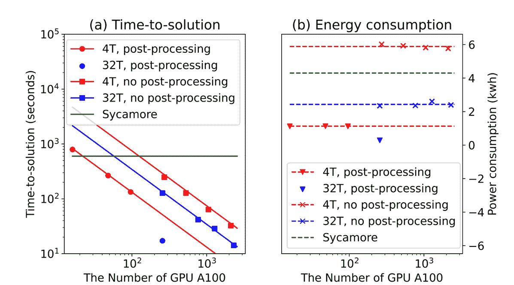

### RISC-V小组分享：11月技术动态

https://zhuanlan.zhihu.com/p/10225062516

Bao-hypervisor团队提出了一种新的段式内存管理虚拟化架构，旨在优化Hypervisor性能。通过引入面向Hypervisor的PMP扩展，这一架构提升了虚拟化环境中的内存管理效率，为多个虚拟机提供了更高效的内存隔离和访问控制。该扩展能够提供更加灵活的内存保护和精细的权限管理，从而增强了Hypervisor在多租户环境中的稳定性和安全性。

IBM团队提出了一种面向没有网络连接的CoVE局部证言机制，专为嵌入式设备环境设计。该机制在没有外部网络的情况下，依然能够验证设备的完整性和安全性，通过局部证言提供设备状态的可信证明。这项技术能够在确保安全性的同时，减少对外部基础设施的依赖，特别适用于高安全要求的嵌入式设备。

RISC-V在视频处理中的应用仍面临一些挑战。特别是在视频编码时，RISC-V Vector Extension（RVV）缺少一些关键功能。根据开发者的报告，RVV在处理视频数据时的表现有所不足，需要补充对特定计算任务的支持，尤其是在高效处理视频流和图像处理方面。这一分析揭示了RVV扩展在处理复杂整数工作负载时的不足之处。

CTR（Control Transfer Records）已被正式批准，标志着对控制转移记录的新标准已经制定。这一标准的批准为提高系统的安全性和控制转移机制的透明性提供了基础。同时，CHERI TG的批准意味着这一新的技术已获得广泛的支持，能够为处理器架构提供更强的硬件级安全保障。

MIPS发布了P8700，这款基于RISC-V架构的高性能AI处理器专为自动驾驶和辅助驾驶应用设计。P8700支持乱序执行和多线程处理，每个集群最多支持六个处理器，能够保证高效的缓存一致性，满足ISO26262 ASIL-B(D)安全标准。该处理器在自动驾驶汽车的应用中具有显著的优势，特别是在AI加速和高效处理复杂计算任务方面。

Redox OS是一个基于Rust的开源操作系统，最新的开发进展包括对RISC-V架构的支持，以及在Raspberry Pi 4上的启动能力。虽然目前USB支持和其他功能仍在完善中，但Redox OS已能在QEMU模拟器上顺利运行，并为用户提供了基础的桌面环境。

RustVMM官方在2024年10月完成了对RISC-V架构的支持，标志着RustVMM核心库的重大突破。经过六个月的开发，这一版本不仅解决了RISC-V虚拟化生态的空白问题，还为开发者提供了一个高效、安全的虚拟化解决方案，助力RISC-V在更多场景中的应用。

RISC-V还推出了全新的XuanTie矩阵乘法扩展（MME），该扩展通过支持专用矩阵寄存器和多种数据类型，显著提升了AI和机器学习领域的计算能力。MME的推出标志着RISC-V在高效计算需求方面的技术进步，特别是在AI加速和矩阵运算方面。XuanTie C907处理器展示了该扩展在能效和硬件简化方面的优势，为AI领域提供了更强的支持。

# 声明

本文档仅供学习交流使用，版权归原作者所有，若涉侵权，请联系Jack Jin 15101136166

（欢迎在下方反馈您宝贵的意见！整理不易，觉得有用给AI日报小组点个赞👍吧！）

ChatGPT；Angela；Zijia Liu；Alex；Zeqi Tan；Tiezhen（HuggingFace）；Naixu；Lizhi；Peter；Suoman；Jack

学术分析报告：ResearchFlow -- 奇绩F23校友的开发的深度研究产品，PC端进入RFlow的分析报告，可直接点击节点右侧的小数字展开节点，登录后可在节点上直接“询问AI”，进一步探索深度信息

如果你有大模型相关的创业想法，欢迎来找我们聊聊～🛰️：15101136166

> 快邀请你的小伙伴们一起来读大模型日报吧！

> **【日报****知识库****】**这里是近期日报内容的汇总,欢迎大家查阅

> [大模型日报知识库(分享版)](https://miracleplus.feishu.cn/wiki/KapVwXfkriOBiskB0B2cUHxjnTh)

>

> 欢迎大家多多帮我们分享,转发~~

> 如果大家有任何的建议或者吐槽,欢迎随时找我聊天~

