# 奇绩大模型日报（12月 4日）

> 来源：[https://miracleplus.feishu.cn/docx/OAszdDxyVo5DH8xD56kcGWjZnCe](https://miracleplus.feishu.cn/docx/OAszdDxyVo5DH8xD56kcGWjZnCe)

# 资讯

### 亚马逊年末甩王炸！6款大模型、3nm AI芯片、全球最大AI计算集群

贡献人：

https://mp.weixin.qq.com/s/MvpVBh5fxHftsMUeRDDwag

在AWS re:Invent大会上，亚马逊发布了一系列创新，展示了其在AI和云计算领域的强大实力。AWS首次亮相了自研的大模型系列Amazon Nova，涵盖了文本、图像和视频生成等多模态能力。Nova包括四个版本的语言模型（Micro、Lite、Pro、Premier），并推出了Canvas图像生成模型和Reel视频生成模型，支持从6秒到2分钟的视频创作。此外，AWS计划明年发布语音转语音模型以及任意模态转任意模态的多功能模型，进一步提升生成式AI应用的灵活性和效率。

AWS还推出了基于新一代AI训练芯片Trainium2的Amazon EC2 Trn2实例，性能相比传统GPU实例提高了30%~40%。此外，AWS发布了Trainium3芯片，采用3nm工艺，能效提高40%，并且配备史上最强AI服务器Trn2 UltraServer，支持大规模AI模型训练。AWS与Anthropic合作，构建全球最大AI计算集群Project Rainier，用以训练未来的大模型。新的AI网络结构Tnp10和低延迟PB级EFA网络的推出，进一步提升了大规模计算的速度与效率。

在生成式AI平台方面，AWS的Bedrock服务进行了重要更新，新增了自动推理检查、多Agent协作和模型蒸馏等功能，旨在帮助企业构建更高效、准确的AI应用。Bedrock的多Agent协作功能使企业能够加速任务完成，而模型蒸馏可提高模型运行速度500%、降低成本75%。

AWS还强化了开发工具的能力，推出了Amazon Q Developer平台的新功能，支持跨越代码和应用生命周期的各种开发任务，包括自动化代码审查、单元测试生成等。此外，AWS还与英伟达合作，推出基于Blackwell架构的P6实例，提供比当前GPU实例快5倍的计算速度。

在存储和数据库方面，AWS发布了S3 Tables和S3 Metadata功能，优化了大规模数据的存储与分析能力，支持更快速的数据湖分析。Amazon Aurora DSQL和DynamoDB的新功能也加强了跨区域强一致性和低延迟的数据库处理能力。

AWS还推出了支持高密度AI工作负载的全新数据中心组件，重点提升了电力、冷却效率和能源可持续性，推动了数据中心的创新与优化。这一系列的发布展示了AWS在硬件、软件和云服务方面的全面布局，进一步巩固了其在全球云计算领域的领导地位。

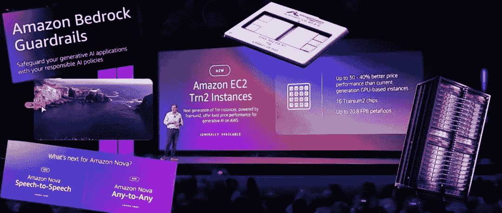

### 股价飙涨790%！今年最火AI妖股诞生，比英伟达还猛，创始人跻身百亿富豪榜

贡献人：

https://mp.weixin.qq.com/s/wrdcB80wOFqPffwKN7RUAQ

AppLovin今年股价飙升超过790%，从年初的每股38.78美元涨至340.59美元，成为华尔街AI新宠，市值突破千亿美元大关。其成功的关键在于AI技术的应用，尤其是AI广告引擎AXON 2.0的优化，使得广告业务大幅增长。最新财报显示，AppLovin季度营收达到12亿美元，同比增长39%；净利润为4.34亿美元，同比增长300%。AI广告引擎AXON 2.0的引入，尤其是在其广告平台AppDiscovery和AI广告制作平台SparkLabs中发挥了重要作用，帮助广告主精准投放广告、优化观看效率并提升变现效果，推动了公司业绩的飞跃。

AppLovin自2023年2月推出AXON 2.0后，迅速形成了智能广告全流程解决方案，日活跃用户数达到14亿，堪比TikTok和🛰️。通过使用AI优化广告素材的制作和投放，AppLovin提高了广告创意的效率和质量，特别是在视频广告和交互广告方面，产生了更高的点击率和应用下载量。SparkLabs团队利用生成式AI技术，不仅能定制广告素材，还能大幅缩短制作周期并降低成本。此外，AppLovin的AI广告系统在2023年获得了显著的市场认可，带动了广告商的利润大幅增长。

作为AI和广告技术的领军企业，AppLovin的成功还体现在其管理层的财富积累上。CEO亚当·福鲁吉的个人净资产大幅增长，跻身《福布斯》亿万富翁榜单，其他高管也纷纷登榜。这与公司自成立以来的战略决策密切相关。起初，AppLovin专注于移动广告技术，后来涉足游戏开发，特别是通过收购多家游戏公司获取数据支持和提升广告投放精度，进一步推动广告技术平台的收入增长。尽管面临行业挑战，AppLovin通过持续研发和创新，尤其是AI广告引擎AXON的升级，成功应对了广告市场的变化。

AppLovin的成功案例展示了AI如何重新塑造广告营销行业，生成式AI技术不仅在广告创意和制作上提升效率，还带来了更精准的投放和更高的回报。其他企业如百度和蓝色光标也在尝试类似的AI广告转型，进一步推动了AI在广告营销中的应用。总体来看，AppLovin的AI广告技术不仅推动了其自身的快速增长，也为整个广告行业带来了新的商机和变现方式，印证了AI技术商业化的巨大潜力。

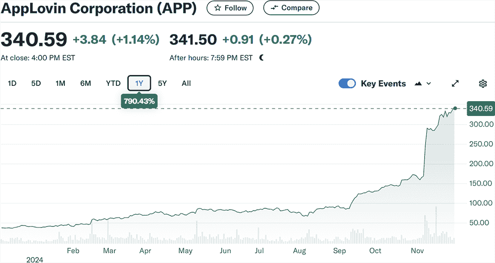

### 人工智能安全研究人类研究员计划

贡献人：

https://alignment.anthropic.com/2024/anthropic-fellows-program/

Anthropic Fellowship计划旨在加速AI安全研究，并支持新兴研究人才。该计划将提供资金和导师支持，面向一小批10-15名研究员，帮助他们全职参与AI安全领域的研究，周期为6个月。研究员将与Anthropic的导师合作，专注于如对抗鲁棒性、危险能力评估和可扩展监督等领域的AI安全研究

**计划目的**

Anthropic希望通过扩大AI安全领域的研究人员池，吸引更多有志于进入该领域的技术人才。该计划特别关注中期职业技术人员的转型，但也对所有技术背景的申请者开放。

**研究员的期望**

研究员将获得每周2100美元的津贴，并有约1万美元的研究费用支持。所有研究项目均使用公开API和开源模型。导师会为研究员提供指导，帮助他们在6个月内完成AI安全研究，并计划最终以共同第一作者身份发表研究论文。

**招募要求**

申请者需具备强大的计算机科学或机器学习背景，精通Python，并能全职参与研究。该计划特别欢迎来自技术领域的少数群体申请，并强调技术能力和对AI安全的承诺比先前的相关经验更为重要。

**如何申请**

计划正在接受申请，第一批研究员的申请截止日期为2025年1月20日。申请人需访问Anthropic官网提交申请。

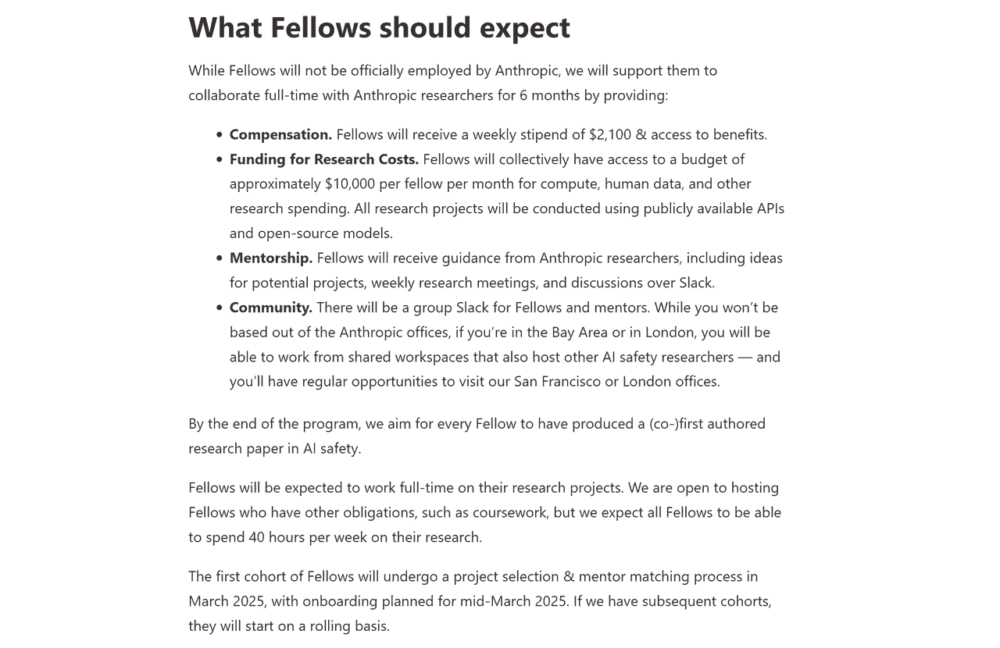

### HadaCore: Tensor Core Accelerated Hadamard Transform Kernel

贡献人：

https://pytorch.org/blog/hadacore/

HadaCore是一个优化的CUDA内核，用于执行Walsh-Hadamard变换，并通过NVIDIA的Tensor Core加速，显著提高计算性能。该内核应用于大规模深度学习模型的量化过程，特别是在推理加速中，通过压缩模型权重和采用较低精度的数据类型加速计算。HadaCore的设计优化了Fast Walsh-Hadamard算法，能够在NVIDIA A100和H100 GPU上实现1.1至1.4倍的加速，最高达到3.5倍的性能提升。

**技术背景与挑战**

量化技术通过减少计算精度来提升推理速度，但也可能带来精度损失。为了解决这一问题，方法如QuaRot和SpinQuant通过旋转操作减少量化误差，尤其是在INT4、INT8和FP8的量化过程中。HadaCore利用Walsh-Hadamard矩阵进行旋转，能够更高效地减少这种误差，同时避免传统矩阵乘法带来的计算开销。

Tensor Core加速的Hadamard变换

HadaCore通过NVIDIA的Tensor Core来加速Walsh-Hadamard变换。Tensor Core专门优化矩阵乘法操作，HadaCore利用16x16的Hadamard变换，对输入数据进行分块处理并实现高效并行计算。该方法通过在Tensor Core上执行特定指令，如mma.m16n8k16，能够在处理256个元素时达到更高的计算效率。

**性能测试与评估**

在多个基准测试中，HadaCore与Dao AI实验室的Fast Hadamard内核相比，展现了显著的性能提升，尤其是在A100和H100 GPU上。其性能提升主要体现在处理大规模数据集时的加速效果，尤其是在多头注意力机制中，HadaCore能够有效地加速Hadamard矩阵的应用。

**未来发展与挑战**

未来，HadaCore计划进一步优化，支持更多高级特性，如Triton版本和内核融合技术，以进一步提高性能。此外，团队还计划扩展内核支持BF16 Tensor Core计算，提升在新一代GPU上的表现。

**总结**

HadaCore是一个利用NVIDIA Tensor Core加速的Hadamard变换CUDA内核，通过优化计算流程，不仅提高了量化计算的速度，还有效减少了由低精度计算带来的精度损失，成为加速大规模语言模型推理的重要工具。

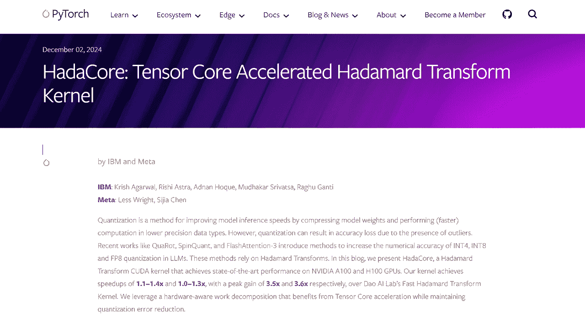

# 推特

### HourVideo：一个专注于小时级视频-语言理解的基准数据集

https://x.com/i/status/1863652813668225040

[NeurIPS D&B] 推出 HourVideo：一个专注于小时级视频-语言理解的基准数据集！🚀

包括500个第一视角视频，18个任务，共约13,000个问题！

性能表现：

GPT-4➡️25.7%

Gemini 1.5 Pro➡️37.3%

人类➡️85.0%

我们突出了多模态能力上的显著差距🧵

[7kigRMlKV0zT4W6u.mp4](https://internal-api-drive-stream.feishu.cn/space/api/box/stream/download/all/DAYob5x3FoDBt9xxkm0cWawsndg)

### Exa Websets：朝着完美网络搜索迈出的突破性一步，从网络上找到您想要的任何内容的完整集合

https://x.com/ExaAILabs/status/1864013080944062567

推出 Exa Websets —— 朝着完美网络搜索迈出的突破性一步。

使用 Websets，从网络上找到您想要的任何内容的完整集合。

候补名单链接 - http://exa.ai/websets

[OukLD83QLNNStJNM.mp4](https://internal-api-drive-stream.feishu.cn/space/api/box/stream/download/all/Md9obb1yzonIbnxB1mKcd3MQnEf)

### Anthropic Fellows Program：旨在帮助工程师和研究人员全职转向前沿的 AI 安全研究

https://x.com/AnthropicAI/status/1863648517551513605

我们正在启动一项研究员计划，旨在帮助工程师和研究人员全职转向前沿的 AI 安全研究。

该计划将于 2025 年 3 月启动，我们将为 10-15 名具备优秀编程和技术背景的研究员提供资金支持、计算资源和研究指导。

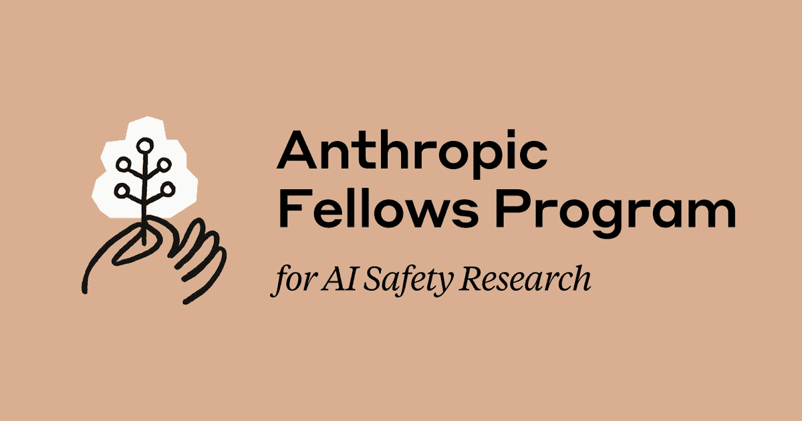

### Nous Research 宣布成功使用 Nous DisTrO 和互联网进行 150 亿参数语言模型的预训练

https://x.com/NousResearch/status/1863622813317464157

Nous Research 宣布成功使用 Nous DisTrO 和互联网进行 150 亿参数语言模型的预训练，此次训练得到了以下合作伙伴提供的异构硬件支持：

@Oracle、

@LambdaAPI、

@NorthernDataGrp、

@CrusoeCloud 以及 Andromeda 集群。

此次训练展示了与集中化训练相媲美甚至超越的损失曲线和收敛速度。

我们关于 DeMo（推动 Nous DisTrO 开发的基础研究）的论文和代码现已公开（链接如下）。

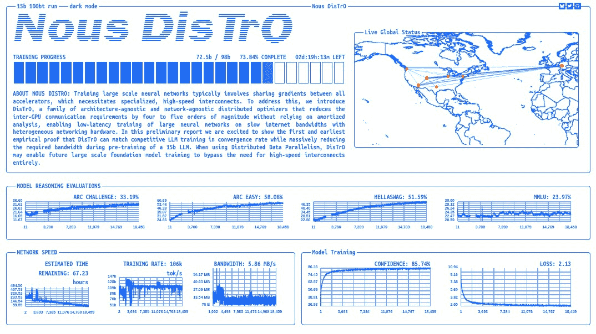

### Cohere推出Rerank 3.5：最新的 AI 搜索模型

https://x.com/cohere/status/1863586939288367386

推出我们最新的 AI 搜索模型：Rerank 3.5！

Rerank 3.5 提供了业界最先进的性能，具备更强的推理能力和多语言支持，能够精准搜索复杂的企业数据，如长文档、电子邮件、表格和代码。

# 信号

### VISTA: Enhancing Long-Duration and High-Resolution Video Understanding by VIdeo SpatioTemporal Augmentation

https://tiger-ai-lab.github.io/VISTA/

当前大型多模态模型 (LMM) 在处理和理解长时间或高分辨率视频方面面临重大挑战，这主要是由于缺乏高质量的数据集。为了从以数据为中心的角度解决这个问题，我们提出了 VISTA，这是一个简单但有效的视频时空增强框架，它从现有的视频字幕数据集中合成长时间和高分辨率的视频指令跟踪对。VISTA 在空间和时间上结合视频以创建具有延长持续时间和增强分辨率的新合成视频，然后生成与这些新合成视频相关的问答对。基于这一范例，我们开发了七种视频增强方法并整理了 VISTA-400K，这是一个旨在增强长时间和高分辨率视频理解的视频指令跟踪数据集。对我们的数据进行各种视频 LMM 的微调，在四个具有挑战性的长视频理解基准上平均提高了 3.3%。此外，我们推出了第一个全面的高分辨率视频理解基准 HRVideoBench，我们的微调模型在该基准上实现了 6.5% 的性能提升。这些结果凸显了我们框架的有效性。

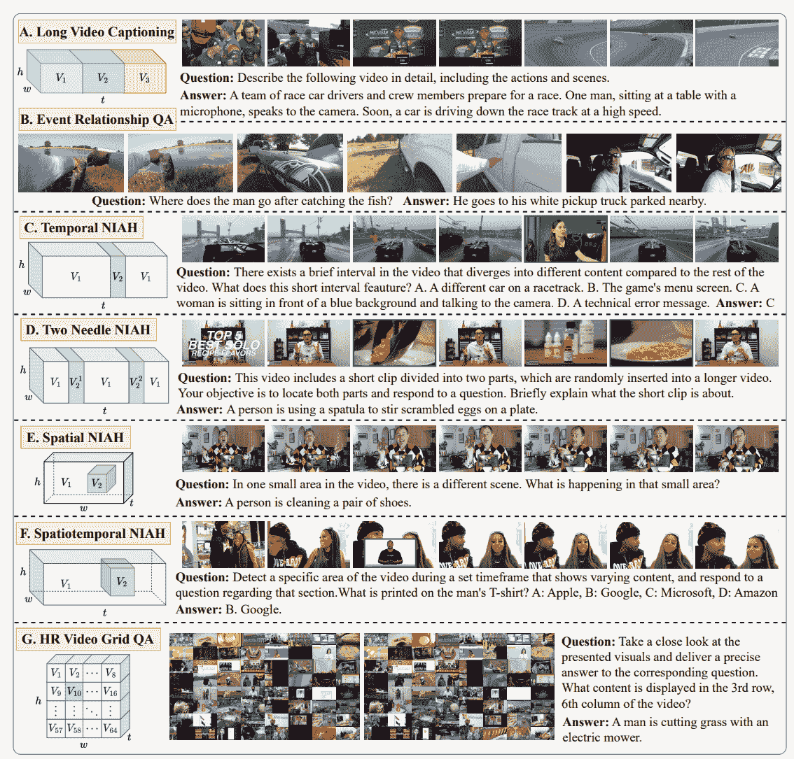

### Diffusion Meets Flow Matching: Two Sides of the Same Coin

https://diffusionflow.github.io/

流匹配和扩散模型是生成建模中两个流行的框架。尽管看起来很相似，但社区中对它们的确切联系存在一些困惑。在这篇文章中，我们的目标是消除这种混乱，并表明扩散模型和高斯流匹配是相同的，尽管不同的模型规范可能导致不同的网络输出和采样计划。这是个好消息，这意味着您可以互换使用这两个框架。

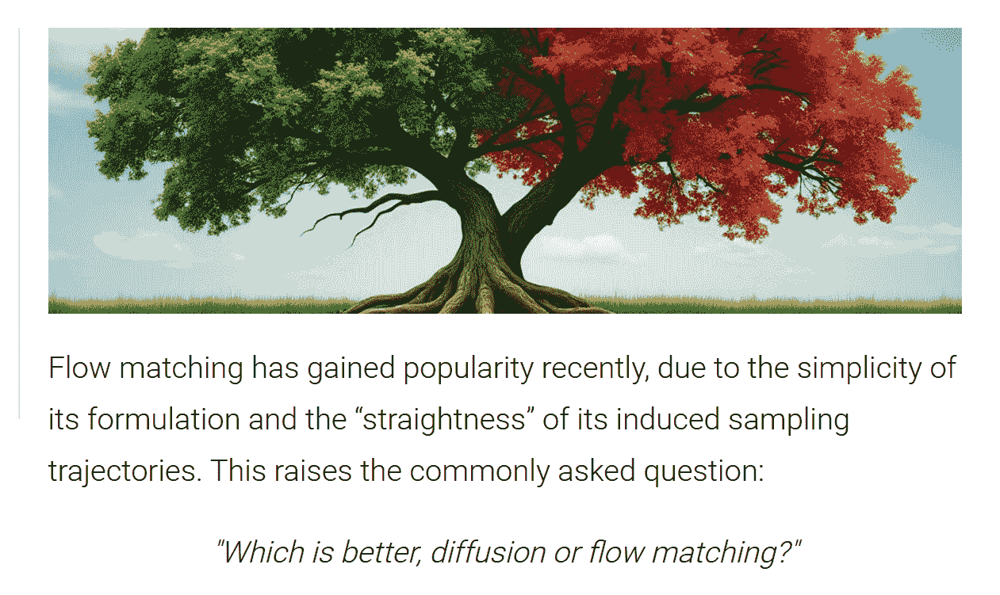

# 产品

### Stackfix——一款可以同时比较多款SaaS软件的比较平台

贡献人：

https://www.stackfix.com

Stackfix 是一个创新的软件比较平台，它能让用户在几秒钟内完成软件的对比和选择。该平台的独特之处在于提供了一个自由、无打扰的环境，用户可以快速查看和比较不同软件的价格与功能，获取实时报价和专业建议，而无需应对烦人的推销电话和无休止的评论。

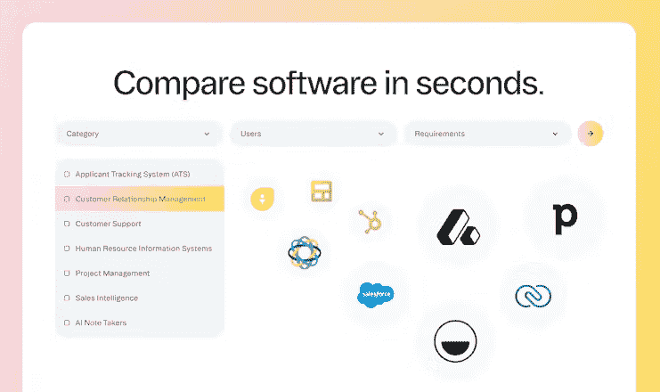

### Supabase 人工智能助手——数据库的想法

贡献人：

https://supabase.com/assistant

S**upabase 集成了多项强**大**功能，为**开发者和企业提供无缝的数据库管理和分析支持。这个助手能够帮助用户快速设计 Postgres 数据库模式，无需手动编写复杂的 SQL 语句；轻松执行数据查询并生成直观的图表，让数据分析更加高效。此外，它还支持 错误调试 功能，能够快速定位和解决代码问题，大幅提升开发效率。

**针对高级数据库管理需求**，助手**提供 **Postgres 行级安全（RLS）策**略 的自动生成与管理，确保数**据访问的精细化控制；还支持创建 Postgres 函数 和 触发器，实现更灵活的业务逻辑与事件驱动操作。此外，它可以将 SQL 语句直接转换为 Supabase-js 代码，为开发者在前端与数据库的集成提供极大的便利。

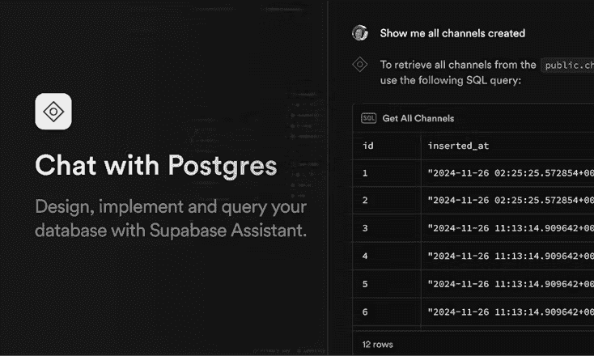

# HuggingFace&Github

### 混元视频开源 推理代码和模型权重

贡献人：

https://huggingface.co/tencent/HunyuanVideo

混元视频是一种新颖的开源视频基础模型，其视频生成性能可与领先的闭源模型相媲美，甚至优于它们。HunyuanVideo 具有一个综合框架，该框架集成了多项关键贡献，包括数据管理、图像-视频联合模型训练以及旨在促进大规模模型训练和推理的高效基础设施。此外，通过有效的模型架构和数据集扩展策略，我们成功训练了一个具有超过 130 亿个参数的视频生成模型，使其成为所有开源模型中最大的模型。

混元视频进行了大量的实验，并实施了一系列有针对性的设计，以确保高视觉质量、运动多样性、文本-视频对齐和生成稳定性。根据专业人工评估结果，HunyuanVideo 的表现优于之前的先进模型，包括 Runway Gen-3、Luma 1.6 和 3 个表现最好的中文视频生成模型。通过发布基础模型及其应用程序的代码和权重，我们旨在弥合闭源和开源视频基础模型之间的差距。这一举措将使社区中的每个人都能尝试自己的想法，从而培育一个更具活力和生机的视频生成生态系统。

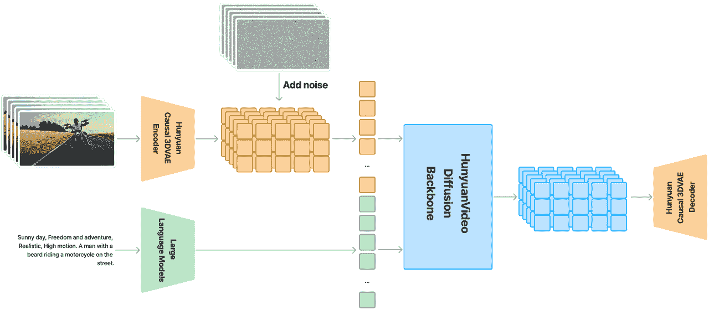

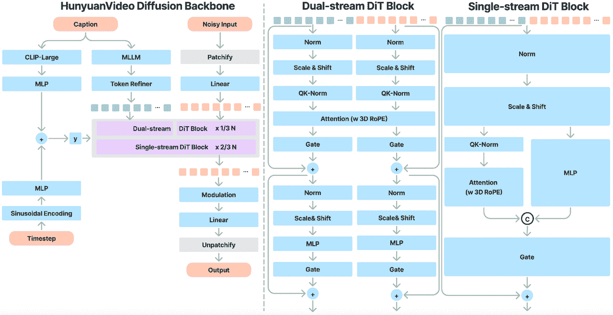

# 投融资

### 前微软员工获得400万美元融资，打造产品演示AI工具

贡献人：

https://techcrunch.com/2024/12/03/ex-microsoft-employees-get-4m-from-accel-to-build-an-ai-tool-for-product-presentations/

Lica是一款由两位前微软员工创办的AI工具，旨在简化产品视频和教程的制作过程。该工具能够自动将屏幕录制和截图转化为高质量的视频，省去了传统视频制作中时间和成本的消耗。Lica的创始人Priyaa Kalyanaraman和Purvanshi Mehta曾在微软担任产品经理和数据科学家，他们意识到许多企业在创建视频时面临的效率问题。

Lica刚刚完成了400万美元的种子轮融资，融资由Accel领投，South Park Commons、Village Global以及多位天使投资人参与，包括Replit的CEO Amjad Masad、前a16z合伙人Balaji Srinivasan和Replit的总裁Michele Catasta等。Accel的Sameer Gandhi认为，Lica凭借其强大的AI功能和直观的设计，在视频创作市场中具有独特的竞争优势。

Lica的核心功能包括自动化生成产品视频、添加转场效果、背景音乐和配音，同时用户可以通过AI助手进行进一步的定制，例如根据目标受众调整语气或视频风格。该工具特别适用于产品、客户成功团队和销售团队，帮助他们高效地制作演示视频或教程。

目前，Lica提供免费版本，允许用户每月创建10个不超过3分钟的视频。付费版定价49美元/月，提供无限制的视频制作和更多定制选项。未来，Lica计划扩展其功能，支持更多类型的视频制作，如营销视频、社交媒体内容和投资者演讲等。

通过结合先进的AI技术和直观的设计，Lica希望能够为广大企业用户提供更便捷、高效的产品展示和沟通工具，填补视频制作领域的空白。

公司官网：https://www.lica.world/

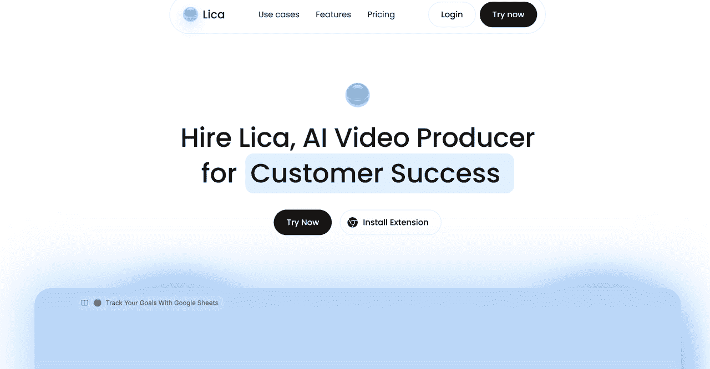

# 学习

### PLDI/SOAP 2024 大模型与静态分析互相融合

贡献人：

https://zhuanlan.zhihu.com/p/5935289733

在大模型时代，静态分析与LLM结合的研究面临着方法学上的挑战。传统静态分析技术多采用不动点理论，而LLM并不具备对这些复杂推理过程的理解，因此将静态分析与LLM解耦，可能导致缺乏精确的上下文信息。为了解决这一问题，有学者提出将LLM与静态分析耦合，但这种方法必须在范式和框架的层面上具有扩展性，才能真正提升静态分析的精度和效率。

静态分析的常用范式，如需求驱动（Demand-Driven）、基于摘要的框架（Summary-based Framework）和符号化内存模型（Storeless/Symbolic），恰好可以与LLM的上下文长度限制相匹配。需求驱动分析适应LLM的上下文长度限制，避免将整个代码库输入LLM；而基于摘要的框架和符号化分析能够通过紧凑的上下文信息帮助LLM更高效地处理复杂分析任务。通过将这些静态分析范式与LLM结合，可以在大规模代码分析中实现更高效、精确的结果。

例如，OOPSLA'24的研究指出，LLift与UBITect的解耦导致了信息缺失，影响了LLift分析的精度。未来的工作可能会将LLM与静态分析器集成为整体工作流，例如，通过LLM辅助处理静态分析中的扩展性问题或总结循环不变式，从而弥补静态分析的局限性。逐步的、渐进式的代码分析方法与需求驱动分析方法相似，具有一定的相似性。

在SOAP'24的研究中，提出了一种新的框架，这个框架将静态分析与LLM耦合，并采用符号化的、基于摘要的分析方式。通过在框架中引入LLM，能够有效地优化静态分析的流程，并提高分析的可扩展性。该框架还允许通过并行分析提高性能，同时在不依赖LLM的情况下，也能作为传统的模块化静态分析工具使用。这种框架不仅符合静态分析与LLM结合的需求，而且具有较强的扩展性和灵活性。

尽管LLM主导的静态分析方法存在一些不精确的问题，尤其是基于不动点理论的“安全”静态分析方法仍然存在精度不足的问题，但一些“非安全”分析方法和放弃传统工作流的LLM主导分析模式，正逐步成为新的研究方向。这些方法尝试通过LLM的优势来弥补静态分析的不足，解决分析中的不精确性。

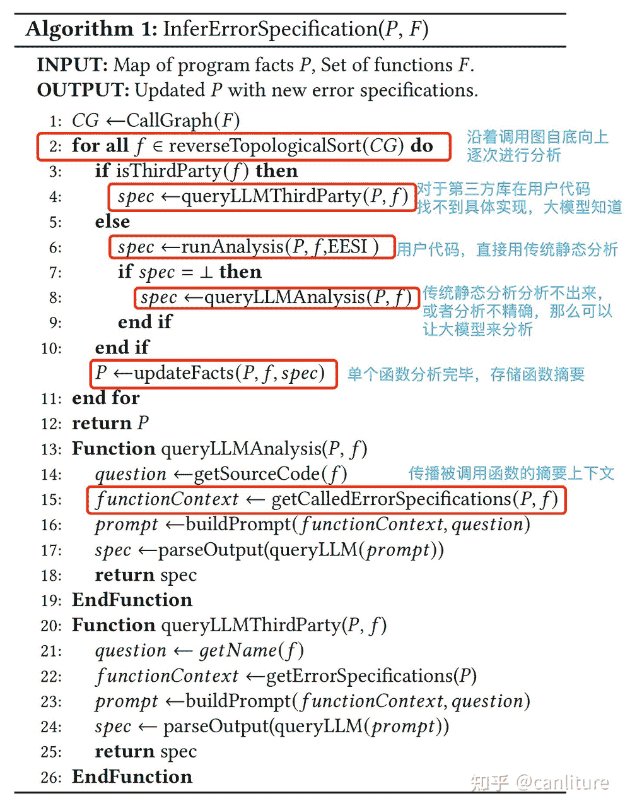

### 几篇大模型服务系统优化文章

贡献人：

https://zhuanlan.zhihu.com/p/721849501

在大模型推理服务领域，面对请求的异质性与不可预测性，两个相关论文提出了优化方法。Llumnix通过动态调度来解决服务中的延迟和资源碎片问题，Parrot则通过语义变量优化多请求、多工作流系统的调度。

Llumnix的研究集中在推理请求的异质性和不可预测性，尤其是输入输出长度、延迟需求和模型内存需求的变化。推理请求的执行时间和资源需求不可预知，导致内存碎片化问题。传统的系统未能考虑这些特点，造成了排队延迟和尾部延迟。Llumnix提出通过跨多个模型实例的动态调度来应对这种不确定性，核心思想是实时迁移任务实例，以优化负载平衡，减轻资源碎片化，并对不同请求的优先级进行区分。该方案通过精心的计算和内存传输协调，降低了重新调度时的停机时间，并通过动态迁移机制统一了各种调度场景。实验结果表明，Llumnix能够大幅减少尾部延迟，将高优先级请求加速1.5倍，并节省36%的成本。技术上，迁移过程中的KVCache传输成为系统的瓶颈，作者通过优化通信协议和进行小块数据的动态融合来提升传输效率，但预取机制的有效性和系统瓶颈仍需进一步验证。

与Llumnix不同，Parrot关注的是多租户环境下，针对不同用户、工作流和请求的服务优化。针对当前LLM服务系统的局限，Parrot引入了“语义变量”这一抽象概念，旨在将不同的请求根据应用特点进行分类、合并并优化。通过识别请求之间的关系和依赖，Parrot能够在请求级别进行更细粒度的调度优化，尤其是在多工作流的场景下。该系统能够有效处理大规模、多应用的请求，但对于非典型、低频的小批量任务的处理方式仍需进一步探讨。语义变量帮助识别任务流的DAG结构，以实现更精细化的调度。尽管这种方法对于大规模系统有着明显的优化作用，但对于具体应用类型的抽象仍显得略为模糊。

这两篇论文各自提出了基于当前大模型推理服务中面临的挑战的优化方案，Llumnix侧重于资源和任务的动态迁移，而Parrot则通过对任务的工作流和请求特性进行语义分析，从而优化调度性能。两者虽然侧重点不同，但都在推动推理服务系统更高效、更灵活的演进。

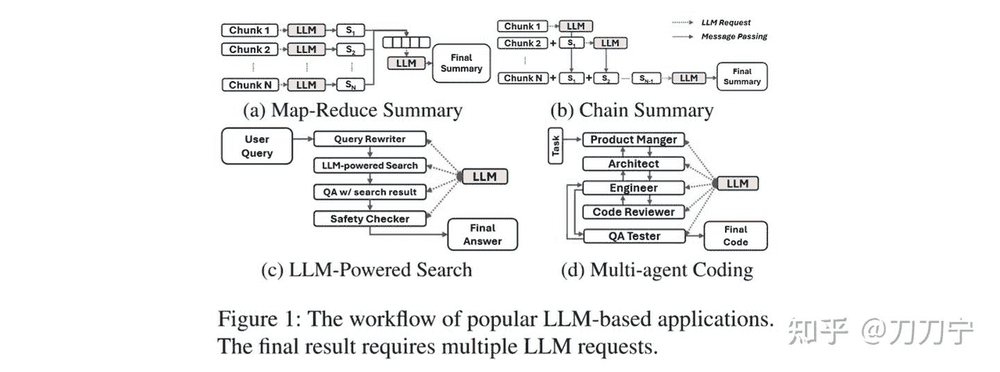

### Megatron 源码图图图图解之分布式概览与模型切分

贡献人：

https://zhuanlan.zhihu.com/p/678208105

Megatron是NVIDIA提出的3D并行分布式训练框架，广泛应用于大规模语言模型的训练，特别是在大规模预训练和微调阶段。THUDM提出的CodeGeeX代码生成模型利用Megatron进行大规模分布式训练，其训练过程涉及将模型均匀切分至多个GPU，并结合数据并行、张量并行等技术，以支持高效的分布式训练。在CodeGeeX的训练中，模型分布在1536张GPU上，并通过192路数据并行来实现。

Megatron训练框架的核心思想是通过多个并行技术来优化大规模训练任务。首先，数据并行将模型复制至多个GPU，每个GPU计算自己的梯度并将结果同步，以确保各个GPU的模型一致。流水线并行则将模型按层切分到不同GPU，适用于GPU内存不足时的情况，但可能导致GPU利用率不高。张量并行则通过将矩阵乘法拆分为多个子任务进行并行处理，在大规模模型训练时尤为重要。

在CodeGeeX的训练流程中，主要通过Megatron框架来协调各个GPU的任务分配。训练脚本会启动多个进程，每个进程绑定到特定的GPU，进行数据处理和模型训练。初始化阶段会根据预设的并行度参数（如TP、PP、DP）来分配GPU，并通过多个进程管理GPU的任务和数据流。特别地，Megatron的分布式初始化方法保证了不同GPU在训练过程中的同步与协调。

Megatron框架中涉及的进程子组和随机数种子管理非常关键。进程子组的划分依据张量并行度、流水线并行度和数据并行度来进行，每个GPU根据其所处的并行组执行特定的任务。随机数种子则用来保证不同进程间的训练结果一致性或多样性。

在模型权重初始化方面，Megatron提供了两种主要方法：CPU初始化和GPU初始化。两者的区别在于随机数种子的使用，确保每个GPU加载不同的权重子集。CodeGeeX在张量模型并行组内的每个GPU上存储模型的部分权重，并通过All Reduce操作进行数据同步。模型的前向计算过程中，各个GPU按其负责的部分进行计算，并通过通信保证计算结果的正确性。

CodeGeeX的底层结构包括VocabParallelEmbedding、ColumnParallelLinear和RowParallelLinear三大模块，这些模块通过张量并行技术切分权重，分别负责词嵌入、线性变换等操作。整个训练过程中，各GPU通过这些模块共同完成计算任务，并且通过Megatron框架的分布式计算来提升训练效率。

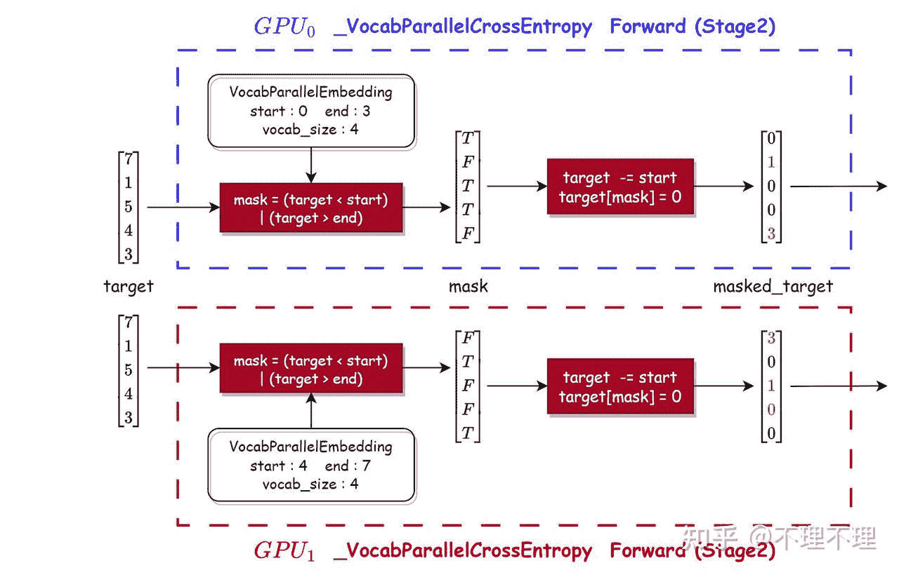

### MLLM：从纯文本走向多模态

贡献人：

https://zhuanlan.zhihu.com/p/10545009873

多模态大语言模型（MLLM）是指能够处理和生成多种类型数据（如文本、图像、音频等）的模型。与传统的大语言模型（LLM）主要处理文本不同，MLLM不仅能够接受多种模态的输入，还能生成多模态的输出，但当前大多数MLLM侧重于多模态输入，输出主要仍为文本，这背后涉及模型复杂度、计算资源和数据等多个因素。

MLLM的典型架构包括几个关键组件。模态编码器负责将不同类型的数据（如图像）转化为特征表示。输入投影器将这些特征对齐到文本特征空间，使得基于文本训练的LLM主干模型能够理解和处理。LLM主干模型是核心部分，负责理解输入并生成文本输出。输出投影器则将LLM生成的信号转化为适合其他模态生成器的特征表示，后者负责生成非文本的输出内容，如图像或视频。

为了使LLM能够处理其他模态，输入和输出投影器起到了至关重要的作用。由于LLM主干模型通常基于大量文本数据训练，熟悉文本特征空间，其他模态的特征需要通过投影对齐到文本特征空间。这一过程可以通过线性变换、多层感知机或交叉注意力机制等方式实现。

在训练过程中，通常保持模态编码器、LLM主干模型和模态生成器冻结，避免过拟合并节省计算资源。只训练投影器部分来实现模态对齐和生成。此外，LLM的后训练技术，如指令微调和对齐微调，也可以应用于MLLM的训练，提升其多模态能力。

MLLM的关键技术包括图像生成与视觉语言对齐，例如ViT（Vision Transformer）用于图像识别，CLIP实现了图像与文本的跨模态对齐，Stable Diffusion和DALL·E等技术则能够基于文本生成图像。通过这些技术，MLLM在处理图像、音频等非文本数据时，能够与文本进行有效的融合，进一步推动了多模态AI的研究与应用。

### 角色扮演大模型技术分享3-拟人能力提升&数据合成pipeline

贡献人：

https://zhuanlan.zhihu.com/p/719772276

为了提升角色扮演模型的拟人化能力，尤其是在缺乏大量标注资源的情况下，提出了几种解决方案。首先，直接使用真人对话数据如LCCC进行训练面临挑战，因为缺乏角色设定会导致模型的系统提示能力下降，且大量随意对话可能使角色“性格”同质化，失去个性。为了解决这一问题，可以通过添加system prompt，或者采用反向训练来为LCCC数据生成对应的角色设定，形成标准的角色卡，以指导模型生成拟人化的回复。具体而言，可以用已有的角色扮演数据集，通过反向训练从对话内容中推理出角色设定，再用这些角色设定与LCCC数据一起训练模型，从而避免幻觉和一致性问题。

其次，另一种方法是staging训练，这种方式将LCCC数据按上下文窗口拼接，避免了单轮对话带来的偏差，同时能够提升模型在长多轮对话中的表现。通过这种训练，模型能更好地利用真人对话数据，但也可能导致角色扮演风格的混合，影响模型的原有特性。虽然这种方法在实验中效果不错，但依然存在知识遗忘和风格退化的风险。

最后，基于改写器的数据合成方案是目前较为有效的解决方法。通过使用LCCC数据集与GPT模型相结合，可以构建一个拟人化改写器，将原本机械的回复转化为更具拟人化风格的回答。这个过程首先通过生成一批高质量的角色扮演数据，再使用GPT进行改写，并通过严格的数据清洗确保一致性。改写器通过将机器生成的内容与人类对话数据进行比对和修改，最终使模型能够在不同场景下给出更自然、符合角色设定的回答。此方法虽然在生成拟人化回复时更为灵活，但仍需要注意信息一致性和避免生成时的冗余或错误。通过多轮数据清洗和质量控制，可以最大程度地提升模型的拟人能力。

### 中欧RISC-V研讨会的几点体会

贡献人：

https://zhuanlan.zhihu.com/p/10027002795

2024年11月27日至30日，中国科学院青年国际学术沙龙暨第二届中欧RISC-V研讨会在香港圆满落幕。此次活动由Philipp Tomsich博士与我共同发起，旨在促进中欧双方在RISC-V领域的学术交流。第一届研讨会于阿里巴尼亚举行，吸引了十多位中国专家参会，而第二届则如期在香港举行。未来，第三届研讨会将扩展为“中欧拉美RISC-V研讨会”，巴西也已强烈要求加入并承诺承办。

RISC-V作为开放标准，在全球范围内的传播和应用类似于音乐的五线谱。五线谱没有版权，任何音乐创作者都能免费使用，但基于五线谱创作的乐曲则有版权。同理，RISC-V指令集的使用不受限制，全球的芯片开发者都能免费使用，但开发基于RISC-V的处理器设计源代码则可能需要授权和付费。这种开放性使得RISC-V为全球芯片设计和技术创新带来无限可能。

今年6月，欧洲峰会提出“RISC-V and Europe: A Perfect Match”这一主题，展现了RISC-V与欧洲科技发展的紧密联系。早在2022年9月，欧盟就发布了《构建开源软硬件与RISC-V技术欧洲主权的建议与路线图》报告，指出欧洲在科技领域的“主权”问题。多次与欧洲专家交流后，我逐渐意识到欧洲学术界确实在寻求科技主权，认为当前欧洲在科技领域受制于其他国家。这使得RISC-V的开放性和灵活性为欧洲提供了新的机会，可能帮助其摆脱“科技殖民”的困境。

一些欧洲专家表示，某国正在以“科技殖民”的方式在多个层面上压制欧洲科技的发展。具体而言，第一层是通过市场占领，用高科技产品主导欧洲市场；第二层是通过人才收割，吸引欧洲技术专家加入研发中心；第三层是通过科研合作，建立联合实验室，推动学术界围绕产业需求进行研究。这种情况令我震惊，然而也让我认识到，欧洲并非孤立的受害者，类似的“科技殖民”也曾在中国发生。如今，中国虽然逐步收复失地，但也面临新的挑战，特别是某些国家试图通过政策将中国的高科技产业和新兴产业限制在国内市场，实施所谓的“小院高墙”政策。

因此，如何提高中国企业的国际竞争力，拓展国际市场，促进国内外双循环，将成为中国科技工作者的新使命。这不仅是为了推动中国科技创新，也是为了在全球科技竞争中占据有利位置。

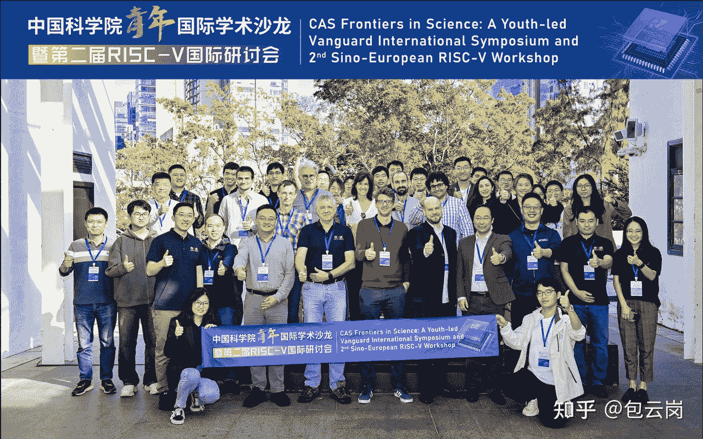

# 声明

本文档仅供学习交流使用，版权归原作者所有，若涉侵权，请联系Jack Jin 15101136166

##

（欢迎在下方反馈您宝贵的意见！整理不易，觉得有用给AI日报小组点个赞👍吧！）

ChatGPT；Angela；Zijia Liu；Alex；Zeqi Tan；Tiezhen（HuggingFace）；Naixu；Lizhi；Peter；Suoman；Jack

学术分析报告：ResearchFlow -- 奇绩F23校友的开发的深度研究产品，PC端进入RFlow的分析报告，可直接点击节点右侧的小数字展开节点，登录后可在节点上直接“询问AI”，进一步探索深度信息

如果你有大模型相关的创业想法，欢迎来找我们聊聊～🛰️：15101136166

> 快邀请你的小伙伴们一起来读大模型日报吧！

> **【日报****知识库****】**这里是近期日报内容的汇总,欢迎大家查阅

> [大模型日报知识库(分享版)](https://miracleplus.feishu.cn/wiki/KapVwXfkriOBiskB0B2cUHxjnTh)

>

> 欢迎大家多多帮我们分享,转发~~

> 如果大家有任何的建议或者吐槽,欢迎随时找我聊天~

