# 奇绩大模型日报（12月 5日）

> 来源：[https://miracleplus.feishu.cn/docx/SmHEdiQAuoFNRCxla35cH5Zonyw](https://miracleplus.feishu.cn/docx/SmHEdiQAuoFNRCxla35cH5Zonyw)

# 资讯

### Genie 2发布

贡献人：

https://mp.weixin.qq.com/s/PaUScHrclUwYABwT8LL5zg

Google DeepMind 最近发布了震撼人心的新一代世界模型——Genie 2。这个基础世界模型能够根据一张图像生成可供人类或AI智能体游玩的无限3D环境。该模型标志着AI在虚拟世界构建领域的重大突破，能够模拟复杂的物理效果、角色动画、物体互动等，并且为AI的训练和评估提供了更为丰富、动态的场景。与早期的Genie 1相比，Genie 2不再局限于2D环境，而是能够生成具有多种可能性和高度交互性的3D世界。

深度学习专家哈萨比斯在发布后，立即邀请马斯克参与AI游戏制作，这一举动也突显了DeepMind对该技术的自信。Genie 2的关键特点在于，它能够通过单张图像生成动态交互的3D环境，同时支持AI智能体在这些环境中进行训练和测试。其创新之处在于可以通过视频扩散技术逐帧生成世界，模拟多种动作反应，如物体交互、复杂角色动作等。

与李飞飞的World Labs相似，Genie 2也能基于图像生成交互式3D场景，但二者的技术路线不同。Genie 2更侧重于基于视频扩散的像素预测，通过用户输入来调整生成的场景，而World Labs则更多关注物理世界的建模，强调从图像估算深度与物体关系，创建更为“真实”的3D环境。

Genie 2不仅可以生成长达一分钟的一致视频世界，还能模拟各种物理效果，如水面、重力、光照等。它支持不同视角（第一人称、第三人称等），并能创建复杂的NPC交互和物理效果。此外，它对于AI智能体的训练提供了快速原型设计，允许研究人员高效测试智能体的能力。

通过Genie 2，DeepMind为AI智能体创建了丰富多样的训练任务，支持AI在未见过的环境中进行评估。未来，随着技术的进一步发展，Genie 2预计将为具身智能体的训练提供重要支持，并推动向更通用AI系统的迈进。

总的来说，Genie 2不仅是AI世界建模的一大进步，还可能在虚拟游戏、AI训练等多个领域引发新的革命。

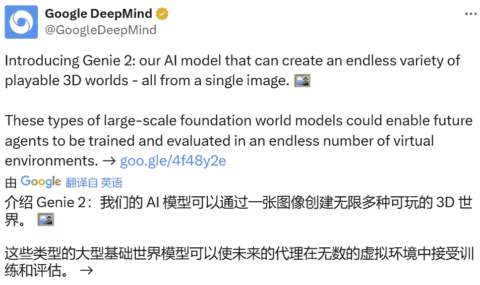

### 智峪生科落成百吨级生物合成天然香料新工厂

贡献人：

https://mp.weixin.qq.com/s/ucfWi8J-E3w0FBoDtz6WgQ

12月5日，智峪生科在江苏常州正式启用其百吨级生物合成天然香料生产中心。该中心不仅涵盖天然香料、化妆品原料、功能食品添加剂等多个领域，还成功实现了AI计算与合成生物学的深度融合，从反应路线设计到生物元件的挖掘、设计和改造，再到自动化智能化的研发与生产，推动了产业化落地。

智峪生科的突破性成就之一是，经过仅一年半的研发，成功实现了低成本、稳定大规模生产的香兰素（天然阿魏酸香兰素）。该项目凸显了AI在产品开发中的核心作用，尤其是通过AI技术反向推导市场需求，确定技术目标，提高生产效率并降低成本。创始人王晟博士表示，公司不仅注重技术突破，更强调市场和产品的实际落地。

王晟的团队长期从事蛋白质结构预测，尤其在深度学习与蛋白质折叠方面的创新成果为AlphaFold的诞生提供了重要灵感。智峪生科基于AI技术，显著提升了蛋白质结构预测的速度和精度，使得他们能够在短时间内筛选和设计酶，推动生物制造的效率提升。

与传统研发方式不同，智峪生科通过AI与实验深度融合，优化设计-构建-验证-学习（DBTL）循环，加速了研发周期。以香兰素为例，AI帮助快速开发出酶并解决了热稳定性问题，使其生产工艺比传统方法更简便、环保且成本低。智峪生科的香兰素产品已获得FDA认证，满足全球市场需求。

此外，智峪生科还在化妆品原料和功能性食品添加剂领域积极拓展，开发了维生素E衍生物、花香味天然香料及低血糖添加剂等产品，展示了AI在多个领域的应用潜力。未来，智峪生科计划通过AI的进一步渗透，推动生物制造向无人化、智能化、环保化转型，推动产业革命，并为全球绿色生活新时代贡献力量。

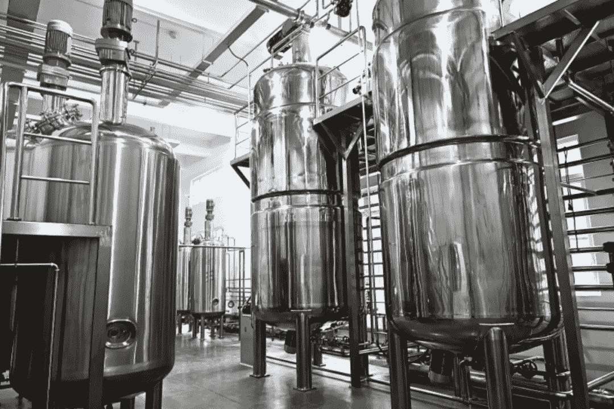

### GAN作者追忆往事

贡献人：

https://mp.weixin.qq.com/s/dIR_RwhQ6U7ucMnZ8riAqw

2024年，NeurIPS公布了时间检验奖，并且首次将该奖项同时授予两篇论文：Ilya Sutskever的Seq2Seq和Ian Goodfellow的生成对抗网络（GAN）。该奖项表彰那些经得起时间考验的开创性研究。

GAN的论文《Generative Adversarial Nets》，由Ian Goodfellow及其团队（包括Yoshua Bengio等）于2014年提出，至今已被引用超过85,000次。该论文不仅在学术界产生了广泛影响，也推动了生成模型在视觉、音频等领域的应用。

Sherjil Ozair，GAN的作者之一，回顾了这项技术的诞生过程。2012年，他在印度理工学院德里分校的本科期间，通过Geoffrey Hinton的深度学习课程接触到深度学习，激发了他进一步的探索。2014年，他进入Yoshua Bengio的实验室，开始与Ian Goodfellow和Aaron Courville等人共同工作。Yoshua提出了一种基于噪声生成器的网络，但如何训练这个网络仍是个未解之题。就在一次实验室晚宴上，Ian提出了让另一个神经网络充当判别器的创意，进而推动了生成对抗网络的诞生。

GAN的基本思路是通过生成器和判别器的博弈进行训练，生成器努力生成与真实数据无差别的样本，判别器则努力区分真假样本。Ian在短短一夜之间编写了第一个GAN模型，并成功在MNIST数据集上生成样本。经过一周的努力，团队提交了这篇论文到NeurIPS，尽管起初反响平淡，但随后的卷积GAN（DCGAN）发布引起了广泛关注，标志着GAN技术的爆发。

Ozair也提到，尽管GAN一度被认为是自己最伟大的成就，但他认识到，技术的进步永无止境。从CNN、LSTM到ResNet、AlphaGo等，人工智能领域的突破总是层出不穷。今天，Transformer和大型语言模型的兴起又证明了这一点。

总的来说，GAN的提出不仅是深度学习的里程碑，也改变了生成模型的研究方向，并在多个领域产生了深远影响。Ozair感谢团队成员，特别是Goodfellow和Bengio的支持，期待在未来继续推动人工智能的发展。

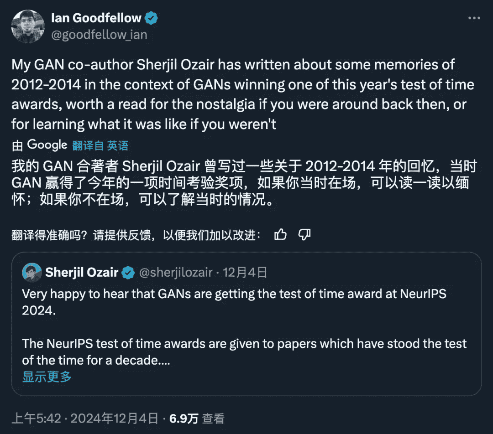

### 半导体产业链2025年投资展望

贡献人：

https://mp.weixin.qq.com/s/w9carskDhvNwlJIsyFsoEg

外部制裁虽然边际收紧，国内也加紧半导体产业攻关，大基金三期出台，将重点支持先进制程突破，拉动设备需求并加快卡脖子设备的攻关进度，预计设备国产化率将持续提升。国内下游扩产持续向上+国产化设备验证持续推进，国产设备公司订单增长维持较好趋势，板块整体基本面向好。

**风险提示：**①宏观经济和制造业景气度下滑风险：机器人产业链公司受宏观经济波动影响较大，行业与宏观经济波动的相关性明显，尤其是和工业制造的需求、基础设施投资等宏观经济重要影响因素强相关。若未来国内外宏观经济环境发生变化，下游行业投资放缓，将可能影响机器人产业链的发展环境和市场需求。②供应链波动风险：受全球宏观经济、贸易战、自然灾害等影响，若原材料紧缺，芯片等关键物料供应持续出现失衡，将引起机器人零部件制造业厂商生产成本增加甚至无法正常生产，经营业绩可能会受影响。③研发进展不及预期风险：目前，机器人领域，尤其是人形机器人领域，研发仍然面临较多的困难和不确定性。

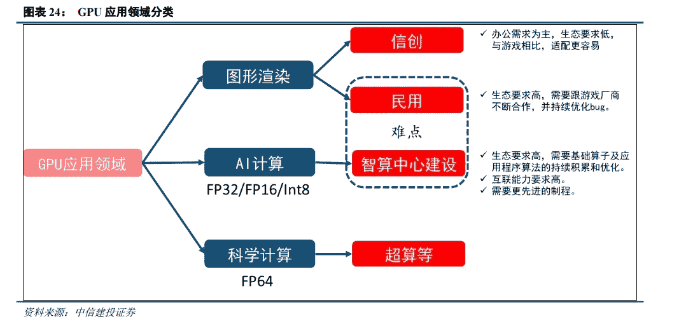

### 起底 OpenAI 核心班底，600 多人和他们塑造的 AI 格局

贡献人：

https://mp.weixin.qq.com/s/YuC57YdvBr74ZXF4OYJktw

在 ChatGPT 发布两周年之际，OpenAI 的成就令人瞩目，但背后隐藏的商业挑战与人才流失则揭示了其发展的复杂性。自 2022 年推出以来，ChatGPT 每周吸引 2.5 亿用户，为 OpenAI 带来了 37 亿美元收入，估值达 1570 亿美元，打破了历史纪录。然而，OpenAI 面临的最大难题是激进的支出模式，花费近 90 亿美元才能获得如此的收入，迫切需要更高的增长来解决盈利问题。

为了实现这一目标，OpenAI 已经从一个非营利研究机构转变为一家营利公司，这一转变也引发了内部人才流失。创始人之一的 Sam Altman 依靠野心和增长战略推动公司发展，但随之而来的却是与创始团队成员和研究人员之间的矛盾。2019 年至 2020 年间，多位创始成员离职，创办了竞争对手 Anthropic。随着 OpenAI 吸引大量资金和人才，内部的安全和伦理问题变得愈发突出，特别是在人工智能对齐与安全的长期问题上。

OpenAI 的增长模式依赖于高薪吸引顶级人才，许多人来自 Google 和 Meta 等大公司。然而，这种人才流动不仅让 OpenAI 快速扩张，也催生了大量竞争对手，部分前员工成立了新的 AI 公司，甚至挑战 OpenAI 的技术和市场地位。像 Anthropic、Cohere 和 Safe Superintelligence 等新兴公司正逐步占据市场份额，尤其是在大模型技术的研发上，与 OpenAI 形成了激烈的竞争。

Altman 的战略以追求商业化和扩展为核心，这一方向已明确塑造了 OpenAI 的未来，但也带来了公司的动荡和高管流失。尽管如此，OpenAI 依旧是全球最具竞争力的 AI 创业公司之一，其技术进展和市场反应仍让业界瞩目。随着 OpenAI 在未来几年内持续发展，其对人才的争夺以及与竞争对手的博弈将决定其是否能够巩固行业领导地位。

总的来说，OpenAI 走过了从创业初期的激进理想到如今的商业化转型的艰难历程，其未来能否维持增长，将取决于它如何平衡创新、增长与人才管理。

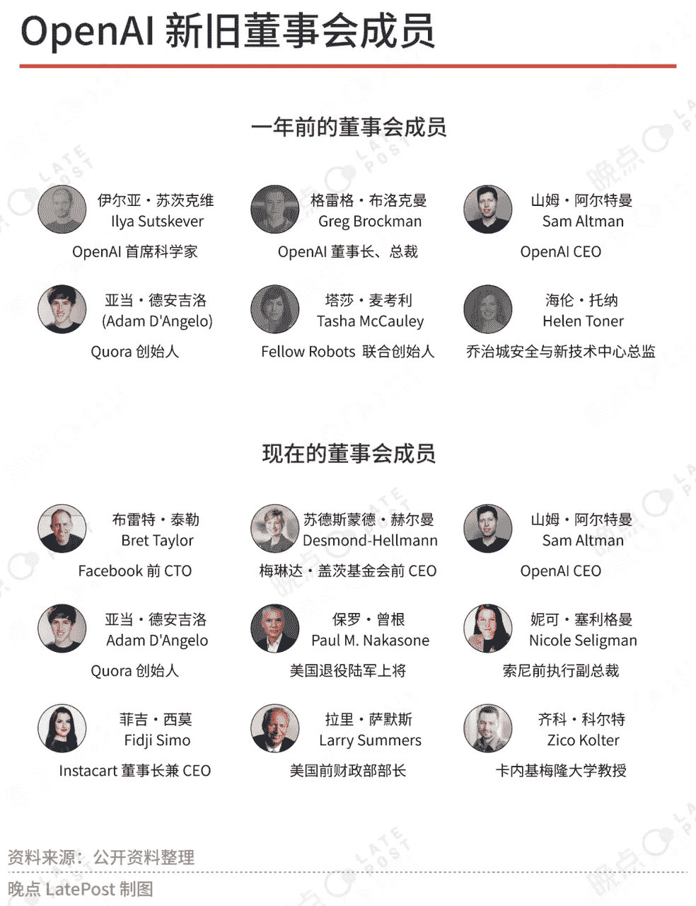

### 开源开发者指南：欧盟《人工智能法案》解读

贡献人：

https://mp.weixin.qq.com/s/M-zLHBSsk0vfjJvkUeUhrw

欧盟《人工智能法案》（EU AI Act）是全球首部全面的人工智能立法，旨在促进负责任的AI发展，并根据AI系统的风险级别设定不同的监管要求。该法案于2024年正式生效，并对开源开发者的实践产生了影响，尤其是在开源AI系统和模型的开发、使用和部署方面。

法案适用范围

《人工智能法案》适用于AI系统的不同层级，包括开发者、部署者和分发者。开源AI模型（例如大型语言模型LLM）可能会受到法案监管，特别是如果它们在欧盟内提供或影响欧盟用户。法案规定了根据模型的风险级别（从不可接受到最小风险）采取不同的合规措施。

关键义务

1.  **风险分类**：AI系统按风险分为四类：

+   **不可接受风险**：如侵犯人权的系统（例如利用面部识别监控）。这类系统被禁止。

+   **高风险**：如涉及关键基础设施或执法的系统，需遵循严格合规步骤。

+   **有限风险**：直接与用户互动的系统（如生成文本的聊天机器人），需满足透明性要求。

+   **最小风险**：不构成上述风险的系统，仅需遵守现有法律。

1.  **开源AI的义务**：开源开发者需要采取一系列措施，以确保合规：

+   **文档要求**：为开源AI模型提供详细的训练内容摘要。

+   **选择退出机制**：确保尊重版权并允许数据提供者选择退出AI训练。

+   **生成内容标记**：AI生成的内容必须明确标记为生成或操控内容。

1.  **合规工具**：Hugging Face等平台提供了多个工具来帮助开源开发者实现合规，包括支持退出流程、数据删除、文档和许可管理等工具。这些工具有助于开源项目满足透明性和隐私要求。

1.  **选择退出机制**：开发者需确保其使用的训练数据符合欧盟版权法，尊重版权持有人的选择退出请求。Hugging Face提供的工具，如Spawning API，允许创作者表达他们的内容不希望用于AI训练。

开源开发者的准备工

+   **文档和许可管理**：确保为开源AI模型提供完整的训练内容和许可信息，符合《人工智能法案》对开源的定义。

+   **合规工具使用**：利用Hugging Face等平台的水印、文档生成和数据删除工具，帮助合规并确保透明性。

+   **参与法案的制定过程**：《人工智能法案》的一些实践准则仍在开发中，开源社区可以通过参与公开咨询，帮助塑造这些准则，确保法案在实践中便于中小企业和研究人员遵守。

# 推特

### Karpathy分享：Attention is All You Need 作者描述论文灵感来源

https://x.com/karpathy/status/1864023344435380613

关于 “Attention” 算子的开发和灵感背后（即“Attention is All You Need”论文中引入 Transformer 的 Attention 算子）的真实故事，来自大约两年前我与作者 @DBahdanau 的私人邮件交流，现已获其许可公开发布。这是针对过去几天内在网上传播的一些关于其开发过程的虚假信息而进行的澄清。

Attention 是一种极其聪明的数据相关加权平均操作。这是一种全局池化的形式，也是一种降维与通信机制。它能够从多个节点（如 token、图像 patch 等）中聚合相关信息。Attention 具有很强的表现力、强大的能力，能够很好地并行化，并且易于优化。实际上，甚至多层感知机（MLP）都可以近似重写为一种基于数据无关权重的 Attention（第一层权重作为查询，第二层权重作为值，键则是输入，Softmax 转化为逐元素操作，同时去掉归一化）。简而言之，Attention 非常优秀，是神经网络架构设计中的一个重大突破。

一直让我感到有些意外的是，“Attention is All You Need”这篇论文获得的关注度（约高出 100 倍）远远超过了真正首次引入 Attention 的那篇论文，也就是 Dzmitry Bahdanau、Kyunghyun Cho 和 Yoshua Bengio 在大约三年前发表的《通过联合学习对齐和翻译实现神经机器翻译》。顾名思义，“Attention is All You Need”这篇论文的核心贡献是删除了除 Attention 以外的所有内容，并基本上将其堆叠成了一个带有 MLP 的 ResNet（根据前述内容，MLP 也可以被视为一种 Attention）。尽管如此，我确实认为 Transformer 这篇论文能够独立成章，因为它在一次性提出了许多惊人的新想法——位置编码（positional encoding）、缩放 Attention、多头 Attention、各向同性的简单设计等等。而且，Transformer 自 2017 年问世至今，基本上保持了其原始形式，经过的修改相对较少，除了在位置编码方案（如 RoPE 等）上的一些改进。

无论如何，我将在此粘贴完整邮件，其中还提到了为什么这种操作最初被称为“Attention”——这一名称来源于在翻译时，模型依次生成目标句子单词的过程中会对源句子中的单词进行“关注”（attending）。这个术语是在后期由 Yoshua Bengio 提出的，用以替代“RNNSearch”（感谢他！ :D）。有趣的是，这一设计的灵感来自于一种人类认知过程/策略，即在一些数据上前后反复关注的顺序操作。此外，从进步的本质来看，这个故事也很有趣，因为当时类似的想法和公式可以说已经“弥漫在空气中”，尤其是 Alex Graves（NMT）和 Jason Weston（Memory Networks）在同一时期的工作值得特别提及。

最后，感谢 @DBahdanau 分享这个故事！

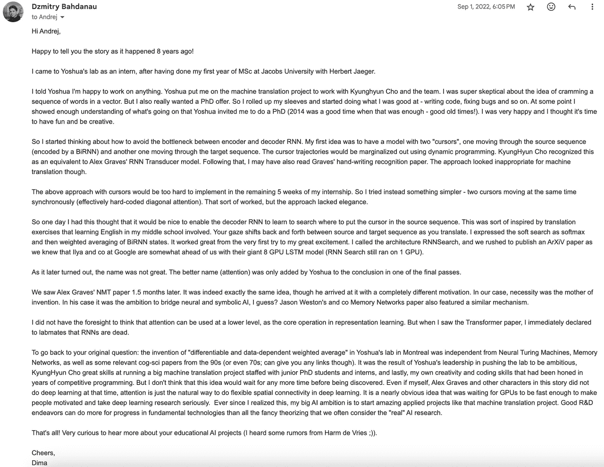

### FishSpeech v1.5 来了！多语言、零样本即时语音克隆、低延迟、开源文本转语音模型

https://x.com/reach_vb/status/1864382548685492339

冲啊！FishSpeech v1.5 来了！多语言、零样本即时语音克隆、低延迟、开源文本转语音模型 🔥

仅 5 亿参数

训练数据：100 万小时音频

支持 13 种语言

低延迟（<150 毫秒）

开源模型——检查点已上线 🤗

最棒的是：在 TTS Arena 中排名第二（初步结果）

向 @FishAudio 致敬——真的是开源文本转语音研究的引领者！⚡

[KDZhqPvDe96Xag9_.mp4](https://internal-api-drive-stream.feishu.cn/space/api/box/stream/download/all/TX6vbZBdRoxi5ZxERKgcXsl5nXf)

### Chip Huyen著《人工智能工程：基于基础模型构建应用程序》即将发布

https://x.com/chipro/status/1864384749911065035

终于完成了！15 万字、200 多幅插图、250 个脚注，以及超过 1200 个参考链接。

我的编辑刚刚告诉我，手稿已经送去印刷了。

• 电子书将在本周晚些时候发布。

• 平装版应该会在几周后上市（希望能在年底前）。预购链接：https://amzn.to/49j1cGS

[ • 完整手稿也可以在 O’Reilly 平台上访问：http](https://oreillymedia.pxf.io/c/5719111/2146021/15173)s://oreillymedia.pxf.io/c/5719111/2146021/15173

如果没有那么多人帮助我，这一切都不可能实现。感谢那些审阅早期草稿的人、耐心回答我成千上万问题的人、向我介绍精彩案例的人，以及帮助我发现被忽略技术之美的人。

感谢大家让这一切成为可能！

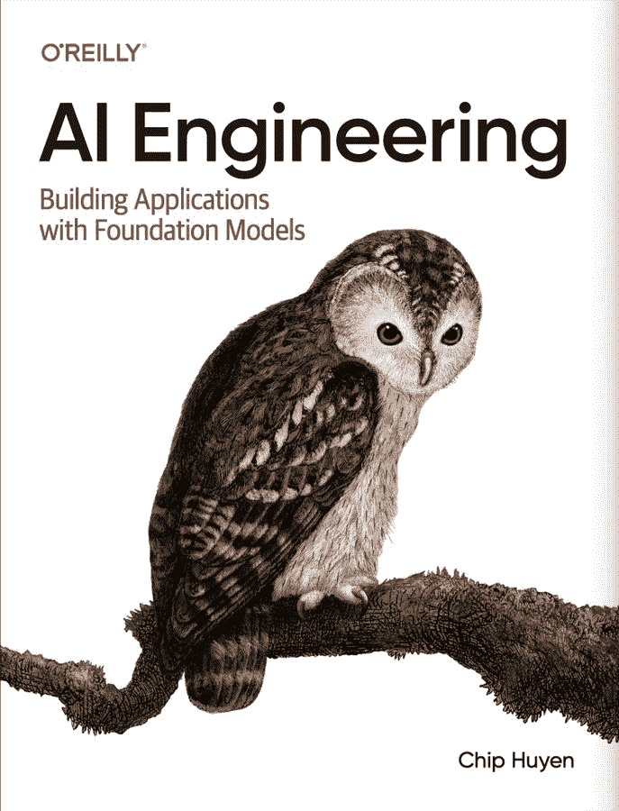

### Unsloth Dynamic 4-bit Quantization：通过动态选择不量化某些参数的方法，大幅提升精度

https://x.com/unslothai/status/1864384960666456535

我们很高兴推出 Unsloth 动态 4-bit 量化！

传统的简单量化方法往往会严重影响模型精度，导致模型无法使用，而我们通过动态选择不量化某些参数的方法，大幅提升精度，同时 VRAM 使用量仅比 BitsandBytes 的 4-bit 方法多 <10%。

我们的测试显示，标准的 4-bit 量化模型性能远逊于原始 16-bit 模型，而 Unsloth 动态 4-bit 量化 提供了非常高的精度和可靠性。

阅读我们的博客：[https://unsloth.](https://unsloth.ai/blog/dynamic-4bit)ai/blog/dynamic-4bit

[在 ](https://huggingface.co/collections/unsloth/unsloth-4-bit-dynamic-quants-67503bb873f89e15276c44e7)HuggingFace 上查看动态 4-bit 量化：https://huggingface.co/collections/unsloth/unsloth-4-bit-dynamic-quants-67503bb873f89e15276c44e7

Colab Notebook：[https://colab.research.google.com/drive/1j0N4](https://colab.research.google.com/drive/1j0N4XTY1zXXy7mPAhOC1_gMYZ2F2EBlk?usp=sharing)XTY1zXXy7mPAhOC1_gMYZ2F2EBlk?usp=sharing

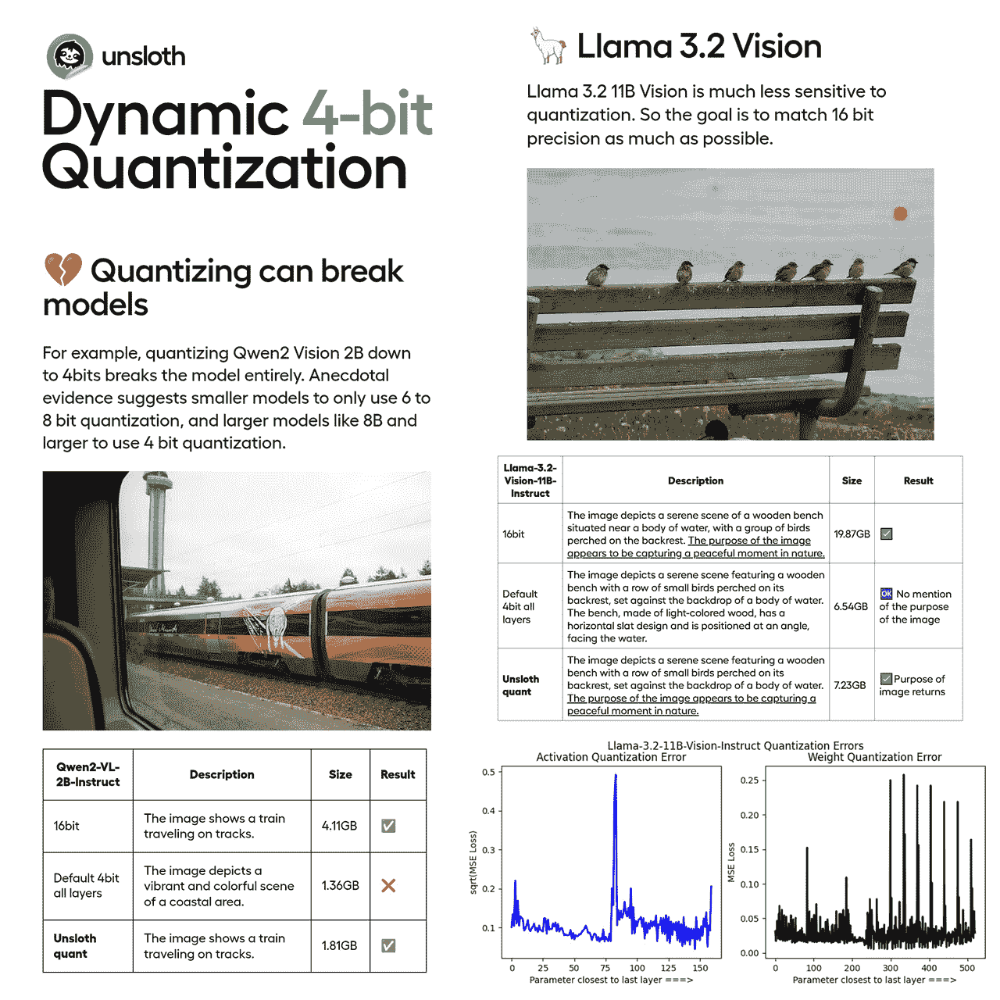

### ElevenLabs 取消所有头衔：层级结构只会成为障碍

https://x.com/lukeharries_/status/1864245258646700351

ElevenLabs 已经取消了所有头衔。

现在没有什么“X 部门副总裁”、“Y 部门主管”或“Z 部门总监”。取而代之的是，我们只是 “ElevenLabs 的增长团队”、“ElevenLabs 的工程团队”等。

为什么？因为我们团队规模还很小，增长速度非常快，而层级结构只会成为障碍。

在这里，最好的想法获胜，无论它来自哪里。而责任归属取决于你所取得的成果。

如果你热衷于追求影响力和快速行动，而不是头衔和地位，我们正在几乎所有岗位招人。

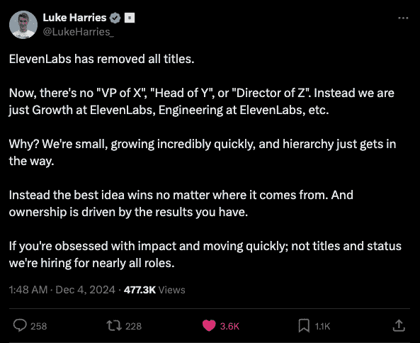

### Bourke分享：使用 Google Gemini 通过视频追踪我家里的每一件物品

https://x.com/mrdbourke/status/1863870479167279486

新视频：使用 Google Gemini 通过视频追踪我家里的每一件物品 🎥 -> 🛋️

我称它为 “KeepTrack” 😎

输入：10 分钟的随意走动视频。

输出：包含 70 多个物品的结构化数据库。

成本：约 $0.07（启用缓存），约 $0.10（未启用缓存）。

完整细节详见… 🧵

[fJV2DN7e9wKpdZdB.mp4](https://internal-api-drive-stream.feishu.cn/space/api/box/stream/download/all/LY3wbO8VvozQbIxTwTBcsEpCnCd)

# 信号

### Nemotron-CC: Transforming Common Crawl into a Refined Long-Horizon Pretraining Dataset

https://arxiv.org/abs/2412.02595

最近的 English Common Crawl 数据集（例如 FineWeb-Edu 和 DCLM）通过积极的基于模型的过滤取得了显着的基准收益，但代价是删除了 90% 的数据。这限制了它们对长token范围训练的适用性，例如 Llama 3.1 的 15T token。在本文中，我们展示了如何通过结合分类器集成、合成数据重写和减少对启发式过滤器的依赖，在准确性和数据量之间实现更好的权衡。当为 1T token训练 8B 参数模型时，使用我们数据的高质量子集将 MMLU 比 DCLM 提高了 5.6，这证明了我们的方法在相对较短的token范围内提高准确性的有效性。此外，我们完整的 6.3T token数据集与 MMLU 上的 DCLM 相匹配，但包含的独特真实token数量是 DCLM 的四倍。

### Motion Prompting: Controlling Video Generation with Motion Trajectories

https://motion-prompting.github.io/

运动控制对于生成富有表现力和引人注目的视频内容至关重要；然而，大多数现有的视频生成模型主要依靠文本提示进行控制，很难捕捉动态动作和时间合成的细微差别。为此，我们训练了一个以时空稀疏或密集运动轨迹为条件的视频生成模型。与之前的运动调节工作相比，这种灵活的表示可以编码任意数量的轨迹、特定对象或全局场景运动以及时间稀疏运动；由于其灵活性，我们将这种调节称为运动提示。虽然用户可以直接指定稀疏轨迹，但我们还展示了如何将高级用户请求转换为详细的半密集运动提示，我们将这个过程称为运动提示扩展。我们通过各种应用展示了我们方法的多功能性，包括相机和对象运动控制、与图像“交互”、运动传输和图像编辑。我们的结果展示了新兴行为，例如现实物理，表明运动提示在探索视频模型以及与未来生成世界模型交互方面的潜力。最后，我们进行定量评估，进行人体研究，并展示强大的性能。

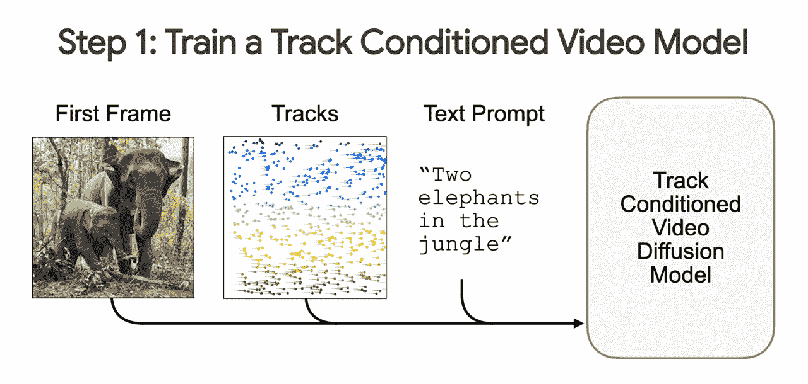

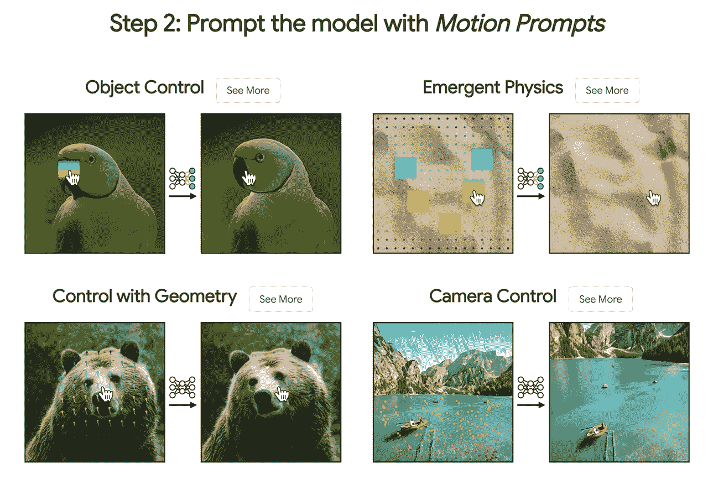

### World-consistent Video Diffusion with Explicit 3D Modeling

https://arxiv.org/abs/2412.01821

扩散模型的最新进展为图像和视频生成树立了新的基准，实现了跨单帧和多帧上下文的逼真视觉合成。然而，这些模型仍然难以高效、明确地生成 3D 一致的内容。为了解决这个问题，我们提出了世界一致视频扩散（WVD），这是一种新颖的框架，它结合了使用 XYZ 图像的显式 3D 监督，对每个图像像素的全局 3D 坐标进行编码。更具体地说，我们训练一个扩散变换器来学习 RGB 和 XYZ 帧的联合分布。这种方法通过灵活的修复策略支持多任务适应性。例如，WVD 可以根据真实 RGB 估计 XYZ 帧，或者使用沿指定相机轨迹的 XYZ 投影生成新的 RGB 帧。为此，WVD 统一了单图像到 3D 生成、多视图立体和摄像机控制视频生成等任务。我们的方法在多个基准测试中展示了具有竞争力的性能，为使用单个预训练模型生成 3D 一致的视频和图像提供了可扩展的解决方案。

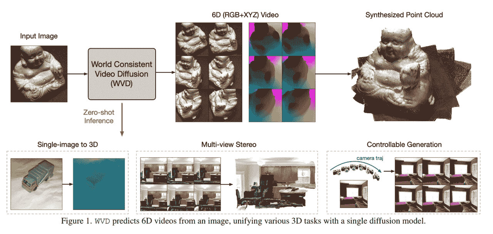

# 产品

### Plot致力于让社交视频更加智能的创新工具

贡献人：

https://www.plot.so

Plot是一款致力于让社交视频更加智能的创新工具，通过人工智能技术为品牌提供视频分析、简化工作流程的全面支持。借助先进的 AI 算法，Plot 能快速从社交视频中提取深刻洞察，帮助品牌精准了解目标受众的兴趣、行为和偏好。这款工具不仅可以提供直观的分析结果，还支持从内容创意到发布的一站式管理，让品牌能够在繁忙的社交媒体生态中游刃有余。

Plot 的功能涵盖从智能日历规划到 AI 驱动的社交聆听，无缝整合了内容管理的各个环节。通过对受众互动的实时监控和数据驱动的洞察，品牌可以快速优化策略并增强影响力。此外，Plot 极大地降低了复杂的操作门槛，将繁琐的数据分析和内容管理转化为可操作的清晰步骤，让用户专注于创意表达和策略执行。无论是营销团队、内容创作者，还是小型品牌，都可以借助 Plot 实现效率提升、精准触达和更高的 ROI。

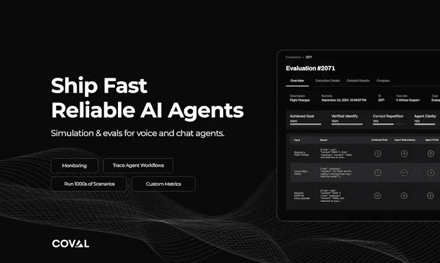

### **Oopsie——**革命性的基于 AI 的移动调试工具

贡献人：

https://www.zipy.ai

**Oopsie** 是**一款革命****性的基于**** AI 的**移动调试工具，专为 Flutter 和 React Native 开发者设计，旨在让调试更加智能、高效。Oopsie 提供了一整套功能强大的工具，包括 ▶️ 会话重播，让您能够回顾用户的操作并轻松重现问题；🤖 错误监控，帮助您实时追踪并识别应用中的关键问题；💡 AI 摘要，自动生成问题的智能分析，让复杂的调试过程变得清晰易懂；以及 🔥 Firebase Crashlytics 集成，将崩溃报告无缝整合到您的调试流程中。开发者可以深入了解用户体验中的每一个细节，从而快速定位问题根源，并以更短的时间修复错误。这款工具通过减少反复测试和冗长分析所耗费的时间，让团队将更多精力集中在产品改进和用户体验优化上。无论是初创团队还是大型开发团队，Oopsie 都是提升调试效率和开发速度的必备利器，为打造高质量的移动应用提供了坚实保障。

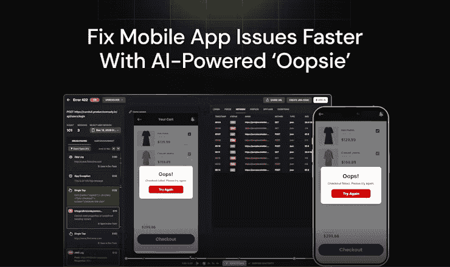

# HuggingFace&Github

### Digma 无需离开 IDE 即可持续识别性能问题工具

贡献人：

https://github.com/digma-ai/digma

Digma 是一款在运行时分析应用程序执行情况并识别关键性能问题的工具。Digma 由一个分析后端（在容器上本地运行）和一个作为主要前端的 IDE 插件组成（目前仅限 Jetbrains）。该插件提供与性能、查询问题、瓶颈扩展问题等相关的代码级洞察。

Digma 的工作原理

Digma 的后端从您的应用程序接收 OTEL 数据（在本地运行应用程序时自动收集），对其进行分析，并识别代码执行中的特定问题。所有数据都在本地处理，以支持合规性要求，无需更改代码。Digma 摄像头配置文件数据来自多个环境，包括开发、测试、准备、生产等。

Digma 背后的故事

**Di**g**ma认**为，除非应用程序分析是连续且自动的（就像测试一样），否则它不会有效。目前有许多可观察性工具，但它们都需要积极和手动地花费时间、注意力和专业知识才能获得结果。当发生可怕的事情时，它们只会被动使用，这并不奇怪。可观察性的最终目标不应该是创建仪表板，而应该是改进我们的应用程序和代码。

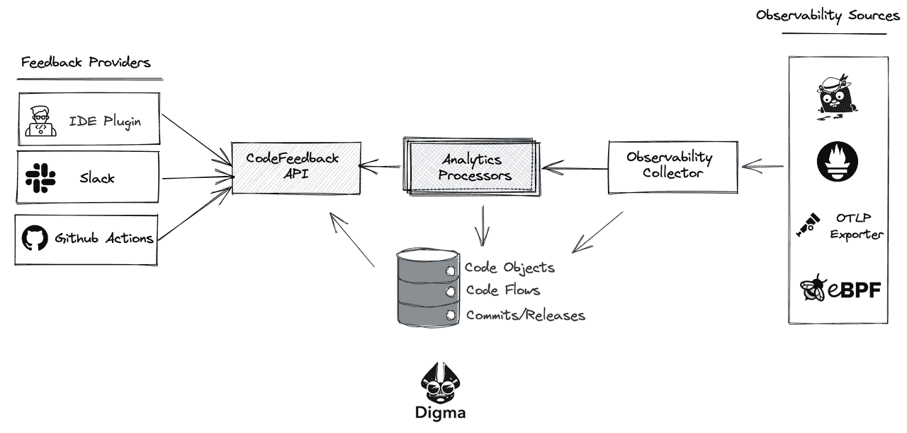

# 投融资

### 拉美初创公司Vambe转型为对话式AI后，年经常性收入大幅增长

贡献人：

https://techcrunch.com/2024/12/04/latam-startup-vambe-sees-arr-skyrocket-after-pivot-to-conversational-ai/

Vambe是一家总部位于智利的初创公司，最初专注于为催收行业提供CRM解决方案。然而，在看到客户对其开发的WhatsApp AI代理更感兴趣后，公司决定转型。在2024年3月，Vambe将业务重心转向帮助中小型企业通过AI自动化与客户的沟通，特别是在WhatsApp等平台上推动销售。自从转型以来，Vambe的年经常性收入（ARR）从原先的2万美元激增至100万美元，增长了五倍。

为了进一步扩大业务，Vambe最近完成了由巴西风险投资公司Monashees领投、墨西哥投资方Nazca和美国M13参与的385万美元种子轮融资。Vambe计划通过这笔资金进一步拓展墨西哥市场，并开发更多技术。值得一提的是，这也是M13首次投资拉美地区的初创公司，M13合伙人Brent Murri表示，Vambe的技术给他们留下了深刻的印象，尤其是在拉美地区，企业对AI产品的接受度远高于美国。

投融资信息

Vambe于2024年12月完成了385万美元的种子轮融资，由Monashees领投，Nazca和M13参与。Vambe的年经常性收入自2024年3月转型以来，已达100万美元。M13的Brent Murri指出，这轮融资是M13首次投资拉美地区，预计Vambe将在墨西哥及美国西班牙语市场继续扩展。

公司官网：https://vambe.ai/

### Veeam：以 20 亿美元次级股权交易，估值达 150 亿美元

贡献人：

https://techcrunch.com/2024/12/04/data-resilience-company-veeam-valued-at-15bn-after-2bn-secondary-sale/

Veeam 是一家专注于数据弹性和恢复的公司，近期通过一项 20 亿美元的次级股权交易，达到了 150 亿美元的估值。该交易由 TPG 主导，其他参与者包括 Temasek、Neuberger Berman Capital Solutions 等。此交易预计将在 2025 年第一季度完成。自 2020 年由 Insight Partners 收购以来，Veeam 的估值已经从 50 亿美元增长到当前的 150 亿美元，显示出其强劲的增长势头。

根据 9 月底的财报，Veeam 的年化经常性收入（ARR）已达 17 亿美元，年增长率为 18%。Veeam 的首席执行官 Anand Eswaran 表示，这次次级股权交易不仅为早期投资者和员工提供了流动性，也为公司的 IPO 打下了基础，吸引了多个战略投资者的加入。这些投资者包括私募股权和风险资本公司，以确保在未来 IPO 时有一批稳定且多样化的投资人。

投融资信息

Veeam 最近成功完成了 20 亿美元的次级股权销售，此次交易将公司估值提升至 150 亿美元。TPG 领投，Temasek、Neuberger Berman Capital Solutions 等机构也参与了此轮融资。Veeam 计划将这些资金用于扩充研发团队，并在未来寻找合适的并购机会。至今，Veeam 已经完成了 5 亿美元的收购，并计划继续在 AI 和数据弹性领域进行战略性扩展。

公司官网：https://www.veeam.com/

### Enterpret：自动提取客户反馈中的洞察力

贡献人：

https://techcrunch.com/2024/12/04/enterpret-automatically-extracts-insights-from-customer-feedback/

Enterpret 是一款能够自动化分析客户反馈的工具平台，旨在帮助企业从大量的客户互动中提取有价值的见解，帮助产品和客户体验团队作出更好的决策。该平台由前 Scale AI 的领导 Varun Sharma 和其兄弟 Arnav Sharma 于 2020 年共同创建。Enterpret 能够连接多个反馈来源，如销售电话、支持票、调查回应、社交媒体等，并通过算法提取反馈中的关键信息，帮助企业识别客户流失的迹象、验证产品假设以及了解产品开发的需求。

Enterpret 的平台能够实时处理客户互动数据，提供量化的结构，并与公司内部的产品使用和收入数据相结合，从而优化决策过程。平台支持用户定义规则来清理客户数据，确保符合 GDPR 法规，保护用户隐私。

目前，Enterpret 的客户包括 Canva 和 Monday.com 等知名公司，平台已经分析了数百万条客户反馈数据。尽管市场上有竞争对手，如 ScopeAI 和 Zendesk 所拥有的 Klaus，但 Enterpret 在过去一年中实现了其年化经常性收入（ARR）翻倍的增长。

投融资信息

Enterpret 最近完成了由 Canaan Partners 主导的 2080 万美元的 A 轮融资，Kleiner Perkins、Peak XV Partners、Wing Ventures 和 Recall Capital 也参与了此次融资。融资将主要用于加速团队招聘和产品研发。至今，Enterpret 总共已融资 2500 万美元。Varun Sharma 表示，公司的年度合同金额在过去一年中翻倍，增长势头强劲。

公司官网：https://www.enterpret.com/

# 学习

### 程序性能优化方法分享

贡献人：

https://zhuanlan.zhihu.com/p/10596277450

当前大型语言模型（LLM）通常包含数十亿到数千亿个参数，模型的初始化性能成为了端侧推理的瓶颈之一。尤其是在将这些模型从磁盘加载到内存时，要求充足的内存和更高的数据传输速度，特别是在移动端，数据的拷贝和重排操作显著影响初始化时间。本文通过对MNN推理引擎在天玑9000+平台上对不同规模qwen模型的性能测试，提出了优化LLM初始化性能的方法。

测试表明，qwen2-1.5b-int4模型的初始化时间达到8267毫秒，虽然经过int4量化减少了模型大小，但数据重排和拷贝依然是瓶颈。MNN引擎的初始化流程包括创建运行时环境、读取模型文件、重排权重数据等步骤，而最耗时的部分是权重的预重排。预重排过程涉及从磁盘读取数据、重建算子、调整权重格式等多个环节，这些操作在LLM模型中占用了大量时间。针对这一瓶颈，优化工作重点集中在算子重建、权重解析与重排上。

在算子重建阶段，原本需要将模型权重从文件加载到内存并与算子合并，为了减少这部分开销，优化方案提出直接跳过权重合并，改为仅保留文件路径信息，在后续的权重解析阶段再从文件读取数据。这一优化大大减少了不必要的内存拷贝。

权重解析部分，原本的流程将4bit量化权重转换为8bit，再进行其他转换操作。对于LLM场景而言，这种重复转换是冗余的，因此优化方案简化了权重解析过程，避免了多次内存拷贝和格式转换，直接通过文件加载数据并进行必要的处理，避免了中间的格式转换步骤。

对于权重重排的优化，传统方法在CPU上串行执行重排操作，效率较低。针对这一问题，优化通过GPU加速重排过程，利用OpenCL并行化处理权重重排任务。新的流程直接将解析后的权重数据拷贝到OpenCL内存中，并利用GPU的并行计算能力对数据进行重排，而不再进行不必要的数据格式转换。这样不仅大幅减少了计算复杂度，也大大提升了性能。

经过这些优化后，MNN推理引擎的初始化时间显著减少。测试结果表明，OpenCL后端的初始化性能提升了3.27到7倍，qwen2-1.5b-int4模型的初始化时间从8267毫秒降至1930毫秒，达到了2秒以内。这一优化使得LLM能够在移动端实现高效的初始化，为端侧推理提供了可行的技术支持。

总的来说，通过精细化的性能分析与优化，减少冗余操作、利用并行计算和异构硬件加速，成功提升了LLM初始化性能，为将来大规模LLM模型在端侧推理中的应用奠定了基础。

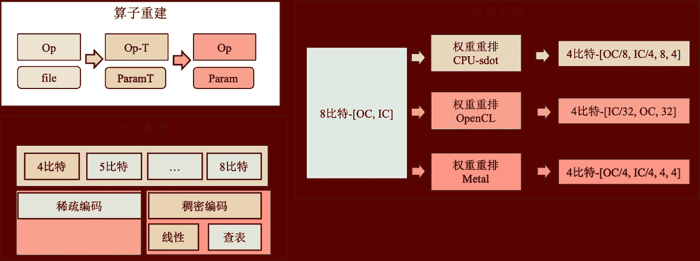

### DeltaNet Explained (Part I)

贡献人：

https://sustcsonglin.github.io/blog/2024/deltanet-1/

DeltaNet是通过将经典的Delta规则应用于线性注意力机制来改进序列建模的方法，旨在解决线性注意力在长序列建模中的局限性。传统的softmax注意力机制在处理长序列时会面临计算复杂度为平方级别的问题，而线性注意力通过移除softmax操作并利用其线性特性，实现了较低的计算复杂度。通过将注意力机制视为一个线性RNN，线性注意力将关键-值对的外积累积成一个状态矩阵，进而提高了模型效率。然而，线性注意力在信息检索和记忆更新方面存在局限，因为它无法精确地保存所有历史信息，尤其是当需要准确检索或复制信息时。

为了解决这一问题，DeltaNet引入了Delta规则——一种基于误差修正的学习方法，旨在动态调整模型的状态。Delta规则通过调整模型预测和目标之间的差异（即delta），使得模型能够根据预测误差更新状态。在DeltaNet中，每次更新不仅仅是简单地累积关键-值的外积，而是通过引入预测误差来更新当前状态，从而避免了直接覆盖旧的记忆，而是通过平衡旧值与新值进行有控制的更新。这种更新机制使得DeltaNet能够更有效地进行上下文检索，特别是在处理具有长序列依赖关系的任务时。

DeltaNet在多查询关联记忆任务（MQAR）中表现出色，展示了其在上下文记忆检索中的强大能力。与传统的线性注意力模型相比，DeltaNet能够更精确地在上下文中检索信息，减少了大误差，从而提高了检索准确性。此外，DeltaNet在其他基准测试如MAD中也表现突出，尤其是在噪声记忆和选择性复制任务中，它的表现比其他模型更为出色。

DeltaNet的优越性来自于其基于梯度下降的最小化均方误差（MSE）损失的更新规则，这使得它能够在每一步减少大误差，从而提升了在上下文任务中的性能。相比之下，传统的线性注意力模型采用的是简单的线性损失函数，缺乏这种精细的误差调整机制。因此，DeltaNet能够更好地处理长序列中的信息，并在需要精确记忆和检索的任务中取得更优的表现。

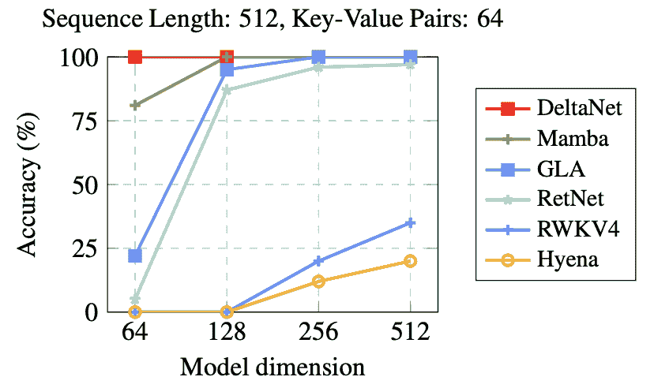

### Meta新作: 如何训练更好的reward model

贡献人：

https://zhuanlan.zhihu.com/p/701065244

在强化学习中，奖励建模是对齐大型语言模型（LLMs）与人类偏好的关键，但当前奖励模型往往仅提供难以解释的标量分数，难以有效融合自然语言批评意见。为解决这一问题，本文提出了Critic-RM框架，通过自生成的批评意见增强奖励建模，旨在提高偏好排序的准确性。Critic-RM结合了批评生成和奖励建模两项任务，采用自优化技术筛选高质量批评，并通过权重调度平衡这两项任务的学习目标。批评生成使用LLM作为基础，通过生成多个候选批评并进行过滤，保留最符合人类偏好的批评。这些批评被用来增强奖励建模，最终通过联合训练优化模型。实验表明，Critic-RM在多个任务上表现优越，尤其在生成质量和奖励建模精度方面。推理过程中，通过生成多个批评并平均其奖励预测，进一步提高了准确性。Critic-RM相较于其他模型在数据效率和推理任务中表现更好，但也存在推理时间增加和需要大语言模型支持的限制。

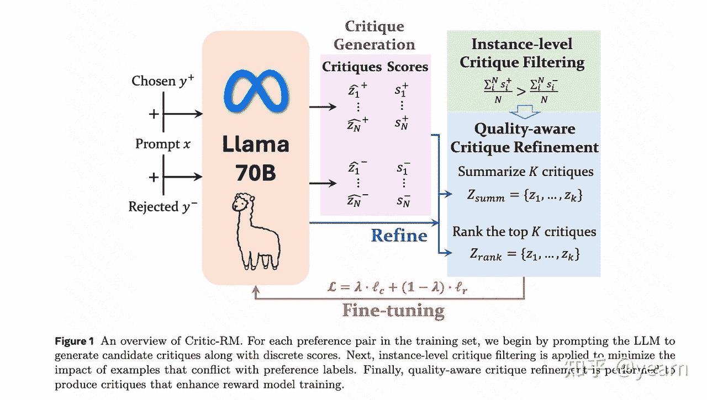

### 浅谈GPU通信和PCIe P2P DMA

贡献人：

https://zhuanlan.zhihu.com/p/430101220

本文讨论了GPU通信和PCIe P2P DMA技术的演进，重点探讨了GPU内存管理的演变及GPUDirect技术的实现和性能评估。网络通信已成为分布式机器学习的性能瓶颈，因此优化GPU间通信至关重要。

GPU内存管理经历了多个阶段：最初的分离内存管理要求显式的数据拷贝，接着引入了半分离内存管理，允许GPU和CPU直接访问各自的内存区域；最终通过统一虚拟地址（UVA）和统一内存（UM），进一步简化了内存管理，使GPU和CPU共享同一虚拟地址空间，并能够无缝访问系统内存。尤其是Pascal架构及后续架构进一步支持按需页迁移，解决了内存超额配置和Cache一致性等问题。

GPUDirect技术的演进从最早的1.0版本开始，解决了GPU与网卡之间内存共享的问题，避免了冗余的数据拷贝。第二代GPUDirect P2P支持了节点内GPU间的直接通信，而第三代GPUDirect RDMA则使得GPU和网卡能够通过PCIe直接交换数据，完全绕过了CPU的干预。

实现这些技术的关键问题之一是如何使网卡能够直接读写GPU显存。通过修改网卡的内存注册流程，可以将GPU的虚拟地址注册到网卡，从而允许网卡直接访问GPU显存。在GPU控制的通信中，GPU需要访问网络资源并与网卡同步，这通过移植libibverbs库到GPU上实现，从而使GPU能够主动发起并控制通信。

GPUDirect技术的性能评测结果表明，不同拓扑结构下的GPU通信表现出显著的差异。CPU控制的通信性能优于GPU控制的通信，尤其是在数据P2P传输中，队列位于CPU内存中的情况性能最好。延迟和带宽的实验结果也证实了这一点。此外，GPU控制通信的主要瓶颈在于执行通信控制的开销，尤其是对于大型通信任务。

随着对GPUDirect的理解加深，针对不同互连架构的性能评测进一步揭示了GPU间通信的特性。在节点内的通信中，PCIe和NVLink的延迟和带宽表现因硬件架构的不同而异。特别是，NVLink在多GPU系统中的表现优于传统的PCIe互连。节点间通信的评测则重点比较了不同的内存管理策略，发现GPUDirect RDMA在特定硬件条件下具有较好的带宽和延迟性能。

最后，文章展望了未来IO设备互连的发展方向，特别是在加速器、存储和网络之间的对等通信需求日益增加的背景下，通用P2P技术的发展将成为提升大规模分布式系统性能的关键。

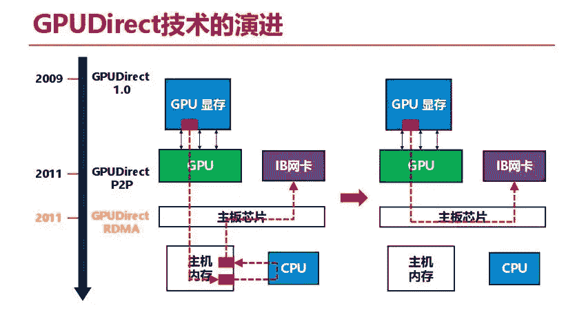

### RMSNorm的精度陷阱：记一次LLM推理精度调查

贡献人：

https://zhuanlan.zhihu.com/p/10692559975

在使用 SGLang 部署微调后的 LLama3 8B 模型时，采用 TP2 并行化和 BF16 数据类型时出现了一个奇怪的现象，即偶尔会出现不符合预期的输出。这些输出虽然不是乱码，但明显不同于正常的推理结果。经过调试，发现问题是由于 RMSNorm 层的精度陷阱，导致推理中的精度丢失。

最初怀疑是采样过程的问题，因此准备了两个复现脚本：一个使用 HuggingFace 实现，另一个通过 SGLang 的 API 进行请求。通过对比发现，使用 SGLang 时即使切换到 PyTorch 的 naive 采样方法，结果仍然与默认的 flashinfer 采样方法相似，且问题依旧存在。这表明问题不在采样，而是模型推理本身。

进一步分析发现，问题出现在每次推理的隐藏状态（hidden_states）上，特别是在推理过程中，SGLang 和 HuggingFace 输出的 hidden_states 差异较大，精度差距达到了 1e-1。追踪至 RMSNorm 层后，发现该层在 Transformer 块中逐渐放大了这种精度差距。为了定位问题，尝试替换 RMSNorm 的实现并比较结果，最终通过替换为 HuggingFace 的 naive 实现，成功地显著提升了精度，从而解决了问题。

在追踪问题的过程中，发现 flashinfer 的 FusedAddRMSNormKernel 算子在 v0.1.6 版本中存在精度问题，导致精度只有 1e-2。通过安装 flashinfer 的 nightly 版本，精度问题得到了显著改进，最终推理结果恢复了正常。FusedAddRMSNormKernel 算子的精度提升原理在于对输入和残差的浮点数进行高低位分离，从而优化了后续的计算过程，成功将精度从 1e-2 提升到了 1e-3。

尽管 flashinfer nightly 解决了大部分精度问题，仍然存在一些限制。首先，当使用 bfloat16 数据类型时，flashinfer 无法维持 1e-3 的精度，导致问题没有完全解决。其次，使用 torch.float16 时，精度能够稳定在 1e-3 级别，因此推荐使用该数据类型。

总结来说，当前 SGLang 可以通过以下两种方式正确部署模型：使用 flashinfer nightly + fused_rms_norm + torch.float16，或者使用 rms_norm_naive + torch.bfloat16 或 torch.float16。虽然 bfloat16 存在精度问题，但采用上述方法能够有效避免精度陷阱。大模型推理中的精度问题往往难以排查，需要仔细分析每个细节。在使用 SGLang 时，框架的高性能和创新性也值得关注，尤其是在推理框架中引入了如 Expert Parallel、Fused MoE、SDPA/Flashinfer 后端等先进技术。

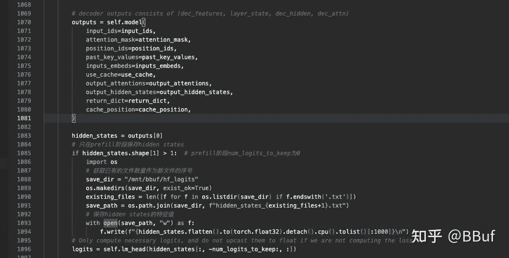

### LLM：使用LLM进行主观性NLP任务的自动评估

贡献人：

https://zhuanlan.zhihu.com/p/10824739374

传统的序列生成类任务评测，特别是对于如文本摘要和机器翻译等seq2seq类型的NLP任务，通常采用基于文本相似度的自动评测指标，如BLEU、ROUGE和METEOR等。这些指标侧重于生成序列与参考序列在ngram级别上的一致性，但它们缺乏对语义的深入理解，尤其在处理偏主观性强的任务时显得过于机械。例如，在评估新闻摘要时，人工评估能更好地模拟用户的真实感受，然而人工评测成本高且不适合频繁使用。因此，许多任务转向了基于大语言模型（LLM）的方法，以提高评测的效率和灵活性，但这一方法仍需要在某些关键环节进行干预，以避免评测结果的失真。

在采用LLM改造评测方案时，首先需要设计适合特定业务需求的评估维度。以新闻摘要为例，关键的评估维度包括事实性（faithfulness）、完整性（completeness）和简洁性（conciseness）。对于LLM生成的摘要，特别是考虑到大模型可能产生幻觉（hallucination），事实性需要成为评估的重点。其次，在每个评估维度上，需要进行细粒度的客观评价，而非简单地使用Likert量表等模糊的打分方式。例如，在评估事实性时，摘要的每个句子可以逐一进行评估，判断是否存在事实性错误。通过预先设定错误类型，LLM只需判断每个句子的错误类型，外部代码再根据这些判断来计算整体摘要的准确度。

对于简洁性和完整性等维度，细粒度的客观评估同样关键。例如，对于完整性的评估，可以通过检查摘要是否覆盖了原文中的所有关键信息点（key fact）。LLM将逐一评估每个key fact是否在摘要中得到体现，并以此为依据给出评估结果。每条key fact的覆盖情况可以通过给定的提示语（prompt）来指导LLM完成评估任务，最终由外部代码来计算整体覆盖度。

此外，评估的准确性和召回性也需要分别设计。准确性侧重于检查摘要是否存在事实性错误，而召回性则关注摘要覆盖了多少原文的要点。在这两个维度上，分别使用细粒度的判断来转化为可量化的客观指标，避免了过于主观的评估过程，从而提升了评测的精度和可操作性。

通过这种方式，LLM评测不仅能提高效率，还能在保证评估质量的同时，更加灵活地适应不同类型的主观性任务。然而，评测过程中的人工干预和控制步骤至关重要，特别是在设置细粒度评价标准和引导LLM评估时，确保评估过程尽可能客观和精准。

# 声明

本文档仅供学习交流使用，版权归原作者所有，若涉侵权，请联系Jack Jin 15101136166

##

（欢迎在下方反馈您宝贵的意见！整理不易，觉得有用给AI日报小组点个赞👍吧！）

ChatGPT；Angela；Zijia Liu；Alex；Zeqi Tan；Tiezhen（HuggingFace）；Naixu；Lizhi；Peter；Suoman；Jack

学术分析报告：ResearchFlow -- 奇绩F23校友的开发的深度研究产品，PC端进入RFlow的分析报告，可直接点击节点右侧的小数字展开节点，登录后可在节点上直接“询问AI”，进一步探索深度信息

如果你有大模型相关的创业想法，欢迎来找我们聊聊～🛰️：15101136166

> 快邀请你的小伙伴们一起来读大模型日报吧！

> **【日报****知识库****】**这里是近期日报内容的汇总,欢迎大家查阅

> [大模型日报知识库(分享版)](https://miracleplus.feishu.cn/wiki/KapVwXfkriOBiskB0B2cUHxjnTh)

>

> 欢迎大家多多帮我们分享,转发~~

> 如果大家有任何的建议或者吐槽,欢迎随时找我聊天~

