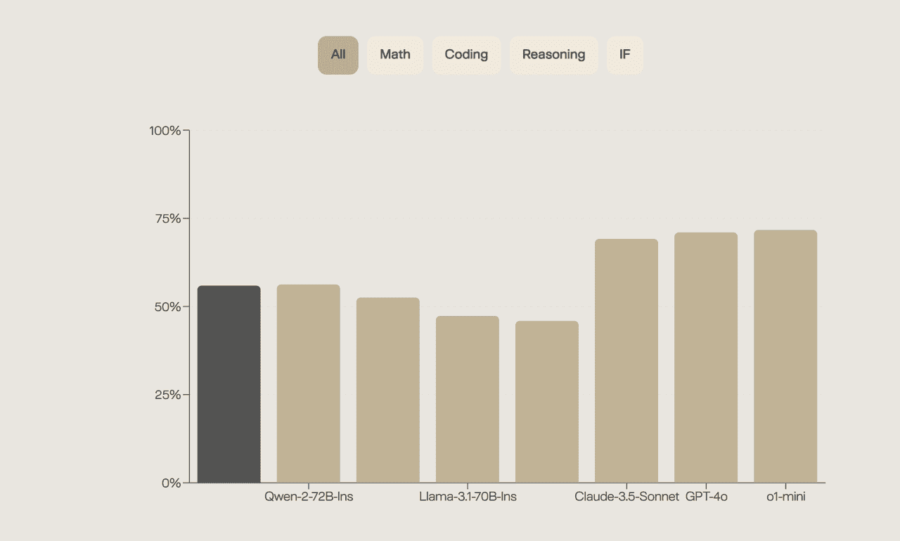
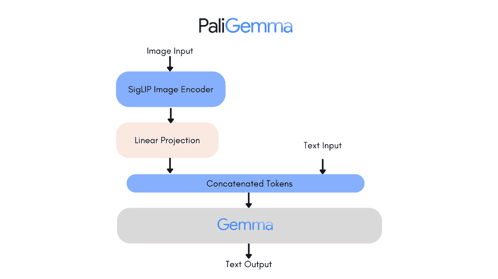
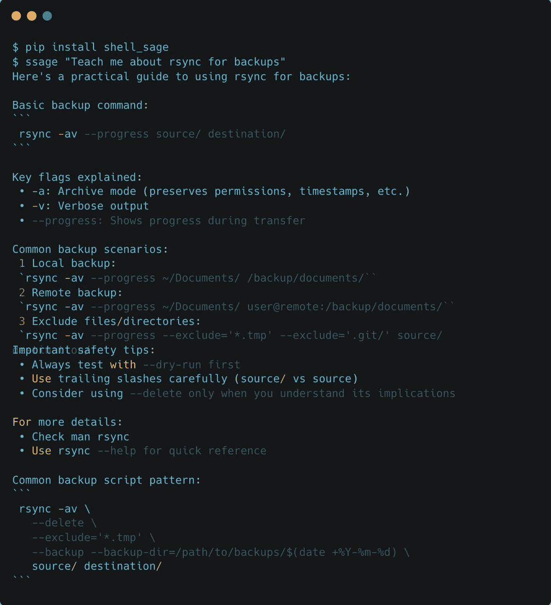
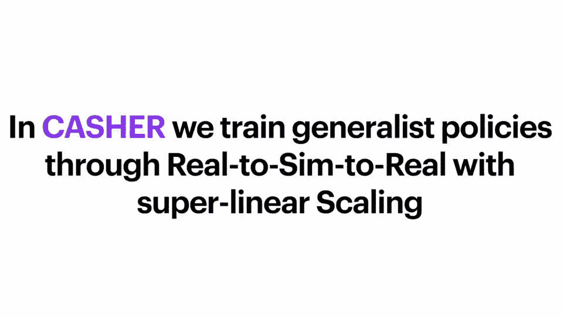
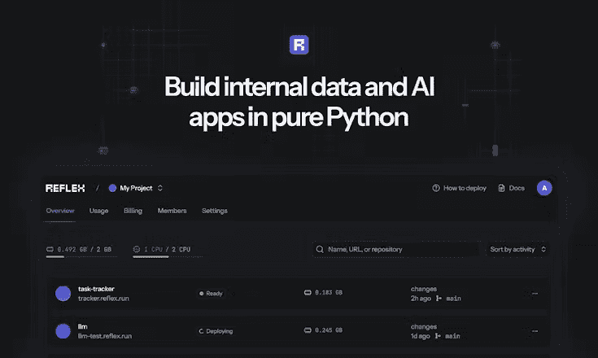
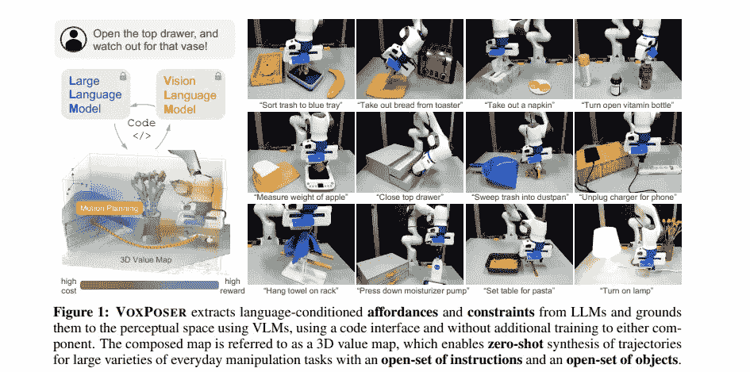
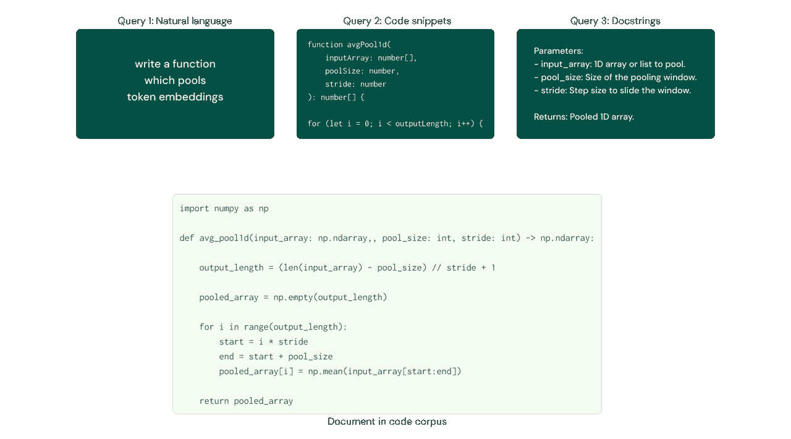
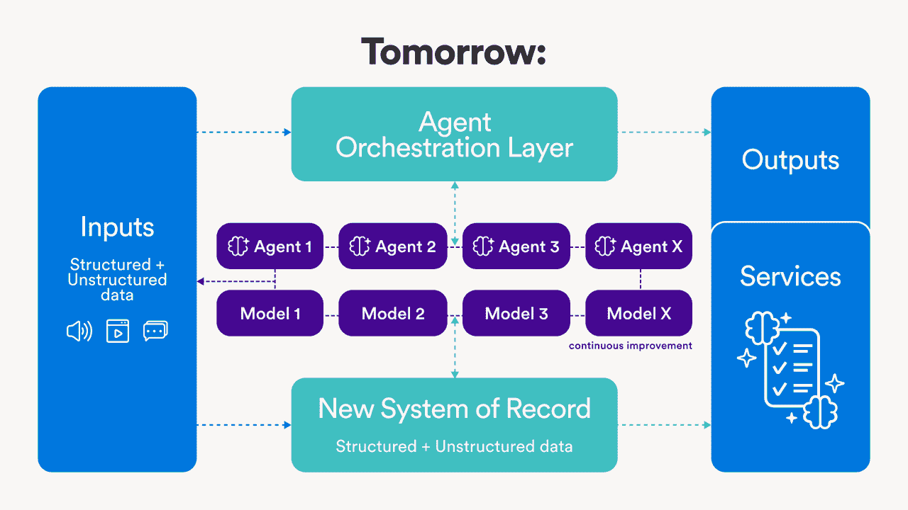
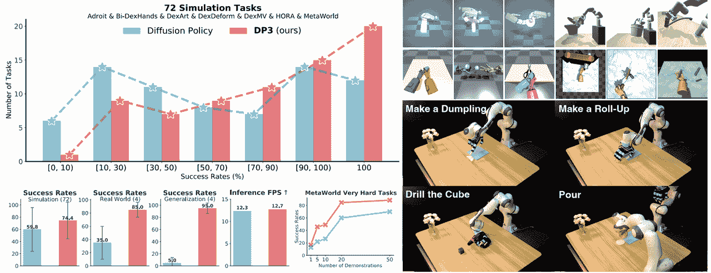
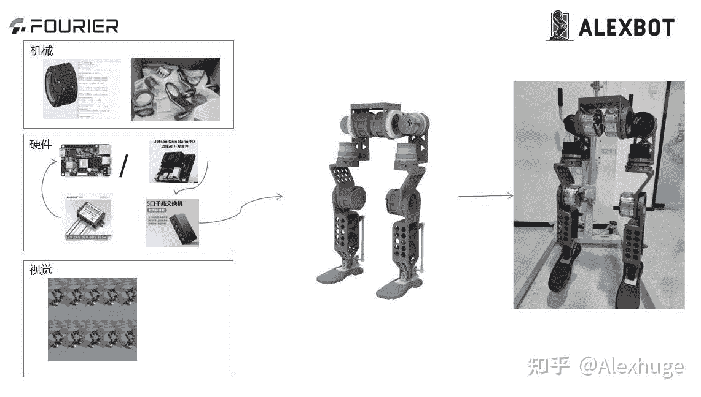

# 奇绩大模型日报（12月 6日）

> 来源：[https://miracleplus.feishu.cn/docx/GySAdUTjGoUYiQxVFmVcBwgdnBh](https://miracleplus.feishu.cn/docx/GySAdUTjGoUYiQxVFmVcBwgdnBh)

# 资讯

### DeepThought-8B

贡献人：

https://www.ruliad.co/news/introducing-deepthought8b

Ruliad 最新推出的 **DeepThought-8B** 是一款小型但极具能力的推理模型，基于 LLaMA-3.1 8B 架构构建。这款模型的发布标志着 AI 推理透明化和可控化的第一步，并展示了较小规模的模型同样可以实现复杂的推理能力，媲美更大规模的模型。

**Deep**Thought-8B 的主要特点是 透明推理，即模型在处理问题时，会将推理过程分解为清晰的步骤并记录每个步骤，用户可以跟踪模型的思考过程，了解它如何得出结论。例如，当模型面对一个问题时，它会首先理解问题的含义，然后一步一步地进行推理，直到得出最终答案。通过这种方式，模型能够展示它是如何推导出每个结果的，这一过程对开发者尤为有用，因为它允许用户了解并指导模型的推理过程，而无需重新训练。

**此外，D**eepThought-8B 具有 可编程性，**用户可以通过 **API 引导模型的推理过程，而无需进行复杂的模型训练。该模型也具有 测试时计算扩展 的能力，可以根据需要进行更多的推理步骤，以解决更复杂的问题。尽管它的规模较小（仅 8B 参数），DeepThought-8B 仍能够在普通的消费级 GPU（16GB+ VRAM）上运行，具有较强的推理能力，而不需要高端的企业级硬件。

DeepThought-8B 的输出采用结构化的 JSON 格式，便于与其他系统进行集成，并且在数学推理、编程任务和问题解决方面表现出色。该模型已在一些基准测试中展现了良好的性能，特别是在逐步问题解决和代码编写方面表现尤为突出。

然而，DeepThought-8B 也存在一些局限性，开发团队正在积极改进模型在复杂数学问题、长文本处理和边缘案例中的表现。团队鼓励开发者在自己的实际应用场景中测试该模型，并提供反馈，帮助识别改进的方向。

### Paligemma：提升文档生成效率的突破性技术

贡献人：

https://huggingface.co/blog/paligemma

Paligemma 是一个基于深度学习的新型文档生成模型，旨在通过理解文本结构来优化文档生成的过程。该技术由 Hugging Face 提出，并在多项任务中展示了显著优势，特别是在复杂文档和长文本生成领域。

**技术亮点：**

1.  **理解文档结构**
与传统的生成模型不同，Paligemma 不仅生成内容，还能理解文档的组织和结构。这使得它在生成长期和多段落文档时，能够保持更高的连贯性和逻辑性。

1.  **多任务能力**
Paligemma 可以在多个任务之间进行有效转换，适用于从摘要生成到完全文章编写的各种需求。通过专门的训练，它能够处理不同格式的文档生成，如新闻报道、研究论文和博客文章等。

1.  **高效性和准确性**
该模型的设计不仅考虑了生成速度，还通过优化训练流程，提高了生成内容的准确性。它能够在有限的计算资源下，快速产生高质量的文本。

**应用场景：** Paligemma 在学术研究、内容创作和商业报告等领域有广泛的应用潜力。通过优化文档的结构化输出，它帮助用户生成符合标准要求的专业文档，减少了编辑和人工修正的工作量。

### Pleias 1.0模型：以开放数据训练的多语言语言模型

贡献人：

https://huggingface.co/blog/Pclanglais/common-models

Pleias 1.0模型是一个新的语言模型系列，标志着训练大规模语言模型不再依赖于版权数据。这些模型完全基于开放数据进行训练，符合欧盟AI法案要求，代表着安全性和开放性的全新标准。Pleias 1.0包括三个基础模型，分别是350M、1.2B和3B参数的版本，并且还推出了两个专门为知识检索优化的模型，Pleias-Pico（350M）和Pleias-Nano（1.2B）。这些模型在多语言检索增强生成（RAG）任务中，表现出色，尤其在多语言处理上具有强大的优势。

Pleias 1.0模型支持包括英语、法语、西班牙语、德语、意大利语、荷兰语、拉丁语和葡萄牙语在内的多种语言，且通过定制的分词器和精心策划的多语言数据集，能够实现高效的多语言覆盖。尤其是350M的Pleias-Pico，展现了在其重量级中前所未有的语言多样性。模型的设计注重高效和节能，能够在普通硬件上运行，甚至不需要量化操作。

在数据训练和预处理方面，Pleias 1.0采用了一个全新的开放数据集“Common Corpus”，该数据集仅包含未受版权保护或许可的数据。为了优化数据质量，开发团队创建了多种自定义数据处理工具，包括OCR修正模型，能够大规模修复数字化过程中的错误，如空格问题、词语替换和文本结构修复。此外，还开发了一个专门的管道来处理有害内容，去除对少数群体的有害语言，并且避免过度过滤。

为了增强数据集的多样性，Pleias团队生成了超过300亿个词语的合成数据，并利用从OpenAlex提取的数据集，结合YOLO微调技术，进一步增强了数据的多样性和质量。通过这种方式，训练集得到了有效扩展，支持了RAG（检索增强生成）任务的优化。

在模型训练方面，Pleias 1.0使用了Nanotron和HuggingFace库进行预训练，采用与Llama和GPT-Neox类似的架构，以简化部署和推理。训练过程中的计算资源主要来自Jean Zay超级计算机以及与TractoAI的合作，后者提供了高效的数据存储和计算能力。Pleias团队还特别关注减少碳排放，在训练过程中有效降低了与其他同类模型相比的CO2排放量。

在模型评估方面，Pleias团队开发了专门针对小型语言模型的基准测试，尤其关注RAG任务表现、多语言能力及生成内容的安全性。评估结果表明，Pleias的nano（1.2B）模型在RAG任务中的表现优于Llama 3.2 1.1B和EuroLLM 1.7B等模型，且在语言生成时避免了过多的语言切换，尤其在处理欧洲语言时，表现出色。此外，Pleias模型在有害内容生成方面表现优异，显著低于同类模型的有害生成比例。

# 推特

### OpenAI 的 o1 版本正式推出：提供了更快、更强大的推理模型，在编程、数学和写作方面表现更佳

https://x.com/OpenAI/status/1864735515121168695

OpenAI 的 o1 版本现在已在 ChatGPT 中正式推出，不再处于预览阶段。

与预览版相比，有哪些变化？o1 提供了更快、更强大的推理模型，在编程、数学和写作方面表现更佳。

此外，o1 现已支持图片上传功能，可以对视觉内容进行推理，从而提供更详细和实用的回答。

[m8ewXJ3rLoQO9esP.mp4](https://internal-api-drive-stream.feishu.cn/space/api/box/stream/download/all/LWQ6bxfw9oZydmxJlrQcjpMonVf)

### Answerdot AI Jeremy分享Shell Sage：可以“看到”你的终端历史、命令和错误，和 AI 拥有相同的上下文

https://x.com/jeremyphoward/status/1864765518995165209

作为@answerdotai的研发人员，我专注于通过AI提升生产力。一个经常被提及的主题是“人类+AI”的结合。在我们新的项目ShellSage中，这种结合展现了强大的力量。ShellSage是一款AI终端助手，与您共同学习和教学。🧵

我们**都经历过这种场景—**—盯着终端试图回忆那个晦涩的 tar 命令或 SSH 参数。当然，你可以 Google 或使用 ChatGPT，但这意味着你需要在文档和终端之间切换。于是，我们创建了 ShellSage。这项“魔法”通过 tmux 集成实现。ShellSage 可以“看到”你的终端历史、命令和错误。无需描述你的问题，你和 AI 拥有相同的上下文。这种自然的工作流程让 AI 更容易理解你正在尝试完成的任务 🪄

### Rowan Cheung采访微软AI CEO Suleyman：Microsoft Copilot Vision 概览，初步反响和使用场景

https://x.com/rowancheung/status/1864716671317086384

**独家报道：**

**微软刚刚在 Edge 浏览器**中推出了 Copilot Vision——首个能够实时陪伴你浏览互联网的 AI。

我与微软 AI 的 CEO Mustafa Suleyman 进行了深入对话，探讨了它的工作原理、无限记忆功能、AI 伴侣、智能代理等内容。

**时间轴：**

**    **    •        0:00 开场介绍

**    **    •        0:58 Microsoft Copilot Vision 概览

**    **    •        2:35 初步反响与使用场景

**    **    •        4:57 Copilot Vision 的工作原理

**    **    •        6:02 教 AI 学会记忆

**    **    •        8:13 微软 AI 与 OpenAI 的差异化

**    **    •        9:27 对“真正的 AI 伴侣”的追求

**     **   •        11:28 与共生智能共存的未来（10 年后展望）

**     **   •        14:04 微软如何处理你的数据

**     **   •        16:11 何时以及如何体验 Copilot Vision？

**     **   •        18:15 掌控你电脑的智能代理 AI

**     **   •        20:25 下一步：支持、游戏等领域

**     **   •        22:34 准备下一代适应 Copilot

**     **   •        25:11 Mustafa 对学生和企业的建议

[5M0O6lm-pFsLQ_zD.mp4](https://internal-api-drive-stream.feishu.cn/space/api/box/stream/download/all/UctYb8HJ6oaxAtxiBcxcn5llnwh)

### Torné分享：大规模的 **现实到模拟再到现实范式，在 100 多个环境中扩**展策略训练，来、突破昂贵远程人类操控限制

https://x.com/marceltornev/status/1864031664231334229

机器人学习的根本限制在于数据——通过人类远程操控真实机器人代价高昂！🤖👨‍💻

我们提出了一种替代方案——通过众包收集家庭视频扫描数据，在模拟环境中实现可扩展的数据收集。在我们的最新研究中，我们探索了如何通过一种大规模的 现实到模拟再到现实（real-to-sim-to-real） 范式，在 100 多个环境中扩展策略训练。

有趣的是，我们发现，随着环境数量的增加，所需的人类努力呈亚线性增长。详细解读见下文线程。

[XaS18YMyE6-P46-b (1).mp4](https://internal-api-drive-stream.feishu.cn/space/api/box/stream/download/all/VwvpbANu0oZd5kx7WYZcEXNBnDh)

# 产品

### Reflex Cloud 使用纯 Python 构建 Web 应用程序 + 使用单个命令进行部署

贡献人：

https://reflex.dev/hosting

Reflex Cloud 是一款功能强大的平台，专为开发者设计，简化了 Web 应用的开发与部署流程。通过纯 Python 构建，无需任何 Javascript，即可开发现代化 Web 应用。部署过程简单高效，仅需一个命令即可完成上线。平台配备了直观的仪表板，便于用户管理应用，支持自定义域名配置，同时提供灵活的内存和 CPU 调整选项，以满足不同应用的性能需求。此外，Reflex Cloud 集成了一键式身份验证、详细的网站分析功能，甚至支持本地托管，确保用户在开发、发布和管理 Web 应用时获得全面的支持和最佳的用户体验。

### Google Docs 的 AI 编辑副驾驶

https://www.getpointer.ai

贡献人：

Pointer 是一款嵌入 Google Docs 的智能 AI 副驾驶，为您的文档工作带来前所未有的便利和效率。它能够实时分析和优化您的文本，提供专业级别的编辑建议，帮助您快速提升内容质量。再也无需在 ChatGPT 和文档之间手动复制粘贴，Pointer 直接在您的工作环境中高效运行，同时解决损坏的文本格式问题，让您的文档始终保持整洁美观。通过简单的一键操作，您可以轻松采纳或调整 Pointer 的建议，将繁琐的编辑工作化繁为简。无论是撰写报告、优化提案还是润色文章，Pointer 都能成为您得力的智能助手。

# HuggingFace&Github

### **Forge **一款动态开源**规则引擎**

https://github.com/Card-Forge/forge

贡献人：

**Forge**是一款动态开源**规则引擎，**专为**《万智牌：聚会》**爱好者量身定制。Forge 由一群充满热情的程序员开发，让玩家能够通过灵活、引人入胜的平台探索 MTG 的丰富世界。

+   🌐** 跨平台支持：**可在Windows、Mac、Linux和Android上播放。

+   **🔧 可扩展架构： **Forge采用J**ava构**建，鼓励开发人员通过添加功能和卡片来做出贡献。

+   **🎮 多样化的游戏玩法：进**入单人游戏模式或在线挑战对手！

### Datagro（下一代基于 Web 的数据分析平台）

https://github.com/datagrok-ai/public

贡献人：

Datagrok™（下一代基于 Web 的数据分析平台） 的API、工具和软件包的公共存储库。该平台具有很强的可扩展性，几乎任何东西都可以作为软件包实现：

+   支持化学信息学等科学领域

+   应用，如临床病例 或肽

+   OpenAPI Web 服务连接器

+   可视化效果，例如Leaflet

+   导入和预览文件，例如 SQLite、 PDF或 CIF

+   使用 R、Python 或 Julia 实现的科学方法

+   文件元数据提取器，例如Tika

+   与内置预测模型 （例如TensorFlow.js）配合使用的自定义预测模型

+   平台增强功能，例如PowerPack 或UsageAnalysis

+   ... 以及此处记录的其他类型的扩展。

这些开源软件包可供任何人免费使用，但对于公共环境， 存在一些与服务器计算能力相关的限制。 在其场所部署 Datagrok 的组织也可以访问公共软件包。除此之外，企业通常会建立自己的私有存储库，其中包含专有扩展。

# 投融资

### 埃隆·马斯克的xAI公司获得60亿美元新融资，加速AI野心

贡献人：

https://techcrunch.com/2024/12/05/elon-musks-xai-lands-billions-in-new-cash-to-fuel-ai-ambitions/

xAI是埃隆·马斯克创办的人工智能公司，近日宣布已成功融资60亿美元。这轮融资的参与者包括Valor Equity Partners、Sequoia Capital、Andreessen Horowitz以及卡塔尔投资局等。根据美国证券交易委员会的文件显示，投资者至少出资77,593美元。此次融资将使xAI的融资总额达到120亿美元，是今年春季筹集的60亿美元的两倍。

xAI成立于2023年，推出了名为Grok的生成性AI模型，该模型目前在X（前Twitter）上提供服务，包括聊天机器人功能。Grok以其“叛逆性”著称，能够回答一些其他AI系统拒绝回答的问题，甚至能在一定范围内使用粗俗语言。

此次融资加速了xAI在AI领域的竞争，尤其是在OpenAI和Anthropic等强劲对手面前。xAI计划利用从X、Tesla和SpaceX等公司收集的数据，进一步提升其AI产品，并与各大企业开展合作。尽管面临来自Tesla股东的反对，xAI的产品和研发仍然取得了显著进展，年收入已达到约1亿美元。

### Across AI：借助“代理记忆”技术助力企业数据管理

贡献人：

https://techcrunch.com/2024/12/05/after-selling-his-startup-to-ibm-this-founder-wants-to-bring-agentic-memory-to-enterprises/

Across AI，成立于2024年，致力于为企业提供一种动态记忆系统，旨在优化复杂的工作流程，特别是销售团队的信息管理。该公司由史蒂文·米赫（Steven Mih）创办，米赫曾是Ahana的联合创始人及CEO，Ahana被IBM收购。米赫在离开IBM后，联合加州大学伯克利分校和斯坦福大学的著名教授成立了Across AI，目标是利用“代理记忆”提升企业数据的利用效率。

Across AI的产品通过连接企业内部外部数据源，创建共享的“代理记忆”，帮助销售团队识别新的销售机会、发现风险，并提出客户问题。这种记忆系统能适应不断变化的工作环境，并根据上下文优先处理关键信息。

投融资信息

Across AI刚刚完成了570万美元的种子轮融资，投资方包括Cota Capital和Village Global（该公司背后有比尔·盖茨、马克·扎克伯格、杰夫·贝索斯等知名投资人）。这笔资金将用于进一步完善其产品，并计划在2025年推出商业版本。

公司官网：https://www.across.ai/

# 学习

### 从自动驾驶到具身智能漫谈

贡献人：

https://mp.weixin.qq.com/s/XZiIDmWif0mMjrgLnILhIg

在自动驾驶技术不断进化的过程中，技术栈和目标逐渐趋向具身智能。从传统的感知-定位-决策架构，到逐步发展的端到端深度学习架构，自动驾驶逐步呈现出更强的泛化能力和适应性。最初的传统自动驾驶架构主要包括感知、定位、预测、决策、规划和控制模块，这种模块化设计便于各个模块独立开发和调试，但也限制了系统的灵活性和泛化能力。随着技术发展，模块之间逐渐通过深度学习实现紧密集成，形成了端到端的自动驾驶架构。

在这一过程中，自动驾驶架构经历了多个阶段的演进。第一阶段通过多传感器融合技术（如BEV）使感知模块实现了端到端集成，第二阶段则将决策规划模块与预测模块整合，开始使用深度学习来处理复杂的场景。第三阶段进一步提升了感知模块的输出方式，从人类可理解的抽象转向特征向量，整个系统通过梯度传导实现跨模块训练。到了第四阶段，所有功能模块被统一为一个深度学习模型，完全通过强化学习或模仿学习实现决策和规划。

随着任务复杂度的增加，自动驾驶逐渐从基于规则的驱动模式转向数据驱动，甚至结合知识驱动来解决更多的动态场景和复杂情况。知识驱动方法在数据驱动的基础上加入了常识、经验和逻辑推理，逐步推动自动驾驶技术朝着广义人工智能的方向发展。此外，具身智能的概念也日渐成为自动驾驶的一部分。具身智能强调机器人通过感知和执行任务获得经验，并根据经验调整决策过程。这一过程不仅依赖数据，还要结合深度学习和知识推理进行优化。

自动驾驶与具身智能的结合，不仅出现在车辆领域，也逐渐渗透到机器人技术中。例如，机器人使用强化学习和模仿学习技术，通过与环境的互动逐步学习新技能。这与自动驾驶的演变相似，机器人的学习过程也经历了从传统控制到强化学习、再到模仿学习、离线与在线强化学习相结合的过程。同时，Sim2Real技术也开始被广泛应用，即通过在仿真环境中训练模型，然后迁移到真实世界中进行验证和优化。

### Code Retrieval Eval：推动程序检索系统发展的新基准

贡献人：

https://blog.voyageai.com/2024/12/04/code-retrieval-eval/

文章介绍了Code Retrieval Eval（CRE），一个用于评估程序检索系统的新基准。CRE通过提供一组高质量、复杂的程序理解任务，旨在推动程序理解和检索领域的技术进步。CRE的核心是设计了一种评估标准，专门考察模型在从大型代码库中检索相关代码片段时的表现，特别是在程序代码检索和理解任务中的准确性与效率。

CRE基准集包括了各种编程语言的代码示例，涵盖了从简单的函数调用到复杂的多模块应用程序等多样化场景。评估的任务是通过用户输入的查询语句来检索相关代码片段，要求系统能够正确理解查询的意图并返回最相关的代码。系统不仅要理解代码的语法结构，还要能够处理复杂的语义关系，准确识别代码中的逻辑意图。

技术方面，文章强调了如何通过深度学习方法，特别是基于Transformer的模型，如BERT和GPT，在程序检索中的应用。CRE不仅支持传统的基于关键词的检索方法，还采用了基于语义理解的检索技术，这对于提高检索精度和系统的泛化能力至关重要。此外，评估框架还对检索系统的多样性进行了考虑，提供了更全面的评估指标。

### 系统代理：重新定义企业运作的力量

贡献人：

https://foundationcapital.com/system-of-agents/

在企业日益复杂的环境中，越来越多的公司开始采用代理系统来增强其运营效率。通过“系统代理”，我们可以看到一个不仅仅是工具和技术的整合，而是一个深度嵌入组织架构的战略方法。这种方法通过无缝的技术和人员协作，提供了一种新的思维方式，支持企业从传统的层级结构转向灵活且自适应的工作模式。

代理系统不仅仅局限于自动化任务，还扩展到了如何通过智能决策和行动优化整个系统的运行。核心技术之一是人工智能（AI），尤其是深度学习和强化学习，它们使得代理能够在不断变化的环境中自主学习，并且基于收集到的数据和反馈不断改进决策和策略。此外，系统代理通过模拟复杂的决策过程，可以处理多种变量并在不同情境下作出最优选择，从而实现更高的业务效率和资源利用率。

一个关键的技术点在于“自我管理”，代理不再需要人工干预来进行任务的执行。通过实时数据反馈和持续的优化，代理能够独立地完成任务，如调配资源、管理团队、处理客户需求等。在这个过程中，机器学习算法不仅仅帮助代理进行基本的操作，还通过学习历史数据不断改进预测能力，识别潜在的优化空间，甚至能够进行前瞻性决策。

此外，代理系统支持协同工作，这意味着它们能够在多个层级之间协调，甚至跨部门合作，从而推动更复杂项目的进展。这种系统的一个优势是它具有高度的扩展性，能够适应从小型创业公司到大型跨国企业的不同需求。代理可以被定制化，使其适应各种行业，推动创新和增长。

### 3D Diffusion Policy 阅读笔记

贡献人：

https://zhuanlan.zhihu.com/p/10876710674

论文《3D Diffusion Policy: Generalizable Visuomotor Policy Learning via Simple 3D Representations》提出了一种新的机器人技能学习方法，称为3D Diffusion Policy（DP3）。该方法结合了3D视觉表示和扩散策略，旨在通过少量演示学习鲁棒且可泛化的技能。现有的视觉模仿学习方法通常依赖大量的演示数据，且收集过程缓慢且容易失败。尽管在线学习能够缓解数据量的问题，但实际应用中仍面临安全性、自动重置和高成本等挑战。DP3通过创新性地将3D视觉表示与扩散策略结合，解决了这些问题。

在感知部分，DP3使用单视图相机进行策略学习，而不是在机器人周围安装多个相机，这使得该方法在实际应用中更加高效和实用。为了表示3D场景，DP3采用稀疏点云表示，而不是使用传统的RGB-D、深度图或体素等表示方法。通过将84x84的深度图像转换为点云，并去除颜色通道以提升外观泛化能力，DP3能够获得更有效的3D环境表示。在点云处理方面，DP3利用最远点采样（FPS）方法对点云进行下采样，选择保留512或1024个点，这些点在实际任务中能够有效覆盖3D空间。随后，DP3通过轻量级的MLP网络（DP3 Encoder）将下采样后的点云编码为64维的紧凑3D表示，该编码器在视觉运动控制任务中表现优异，超过了许多复杂的预训练点云编码器。

在决策部分，DP3利用条件扩散模型生成机器人动作，输入条件包括3D视觉特征和机器人姿态。扩散模型从高斯噪声开始，通过多个迭代逐步去噪，最终生成有效的动作序列。训练目标是从数据集中随机采样一个数据点，并对其进行扩散过程，通过预测噪声并去除噪声来完成训练。该方法的优势在于其能够在少量演示的情况下高效学习复杂的任务，同时具备较强的泛化能力。

在仿真实验中，DP3在72个任务中的平均成功率达74.4%，相比基于图像的Diffusion Policy提升了24.2%。在多个任务中，DP3的成功率超过了90%，并且其训练收敛速度明显快于传统方法，通常在500个训练轮次内就能达到收敛。消融实验表明，点云表示在3D表示中表现最佳，优于RGB-D、深度图和体素等其他表示方法；DP3 Encoder在点云编码器中表现突出，优于其他复杂模型和预训练模型。实验还表明，DP3采用的设计选择，如去除颜色通道、使用LayerNorm层、样本预测方法等，进一步提高了训练的稳定性和任务的泛化能力。

在真实世界实验中，DP3在两个不同的机器人平台上进行了评估，包括Allegro手和夹具。尽管仅提供40个演示，DP3在所有任务中都表现出了较高的成功率。相较于基于图像和深度的扩散策略，DP3在空间泛化、外观泛化、实例泛化和视图泛化等方面表现得更为优秀。在实际任务中，DP3能够有效适应不同位置、外观和实例的物体，而基于图像的策略则在多个任务中失败。此外，DP3在安全性方面也表现出色，相比于基于图像和深度的策略，DP3在真实任务中很少违反安全规定，表明其在硬件部署和实际应用中更加可靠。

### 专为RL_Locomotion而生的全开源双足人形机器人AlexBotmini

贡献人：

https://zhuanlan.zhihu.com/p/10910743025

Alexbot_mini 是一款拟全开源的双足机器人，专注于步态算法研究和轻松部署步态以降低 Reality Gap，具备高效的控制和硬件设计。该机器人采用人体比例设计，整体长度为700mm的下半身和500mm的上半身，总重预计小于30kg。电机使用 FFTAI 一体化关节模组，包括 FSA80-29E、FSA60-43E 和 FSA45-30E，以满足机器人各部位的扭矩要求，特别是髋部和膝关节，这些电机配备双级行星减速器，以提供更高的扭矩密度。

在机械设计中，机器人的腿部包括12个自由度，通过并联结构设计降低惯性，并使用双电机组合以减少电机的负担。并联结构虽然能够放大力矩输出，但可能引入机械背隙，从而影响精度，因此需要精确的运动学计算来确保控制系统的高效性。机械结构采用模块化快拆设计，便于拆卸和组装。

硬件架构分为信号层和功率层，信号层通过交换机连接上位机和多个电机，以实现快速数据交换，功率层则保障电机与上位机的电气隔离，防止电流反冲损坏设备。电机采用48V供电，上位机则使用20V供电，保证稳定运行。电机采用Ethernet协议进行控制，相比传统的CAN总线，Ethernet协议能够支持更高的带宽、低延迟和多电机级联，适合复杂的机器人控制系统。

在软件方面，Alexbot_mini的步态规划使用了基于HumanoidGym的模型，并通过Simtosim迁移降低现实与仿真之间的Gap。步态设计通过调节机器人的奖励函数，使得模型能够在复杂的环境中逐渐学习最优步态。Simtosim迁移从IsaacGym到Mujoco的过渡有效减少了现实环境的误差，提升了步态的泛化能力。

# 声明

本文档仅供学习交流使用，版权归原作者所有，若涉侵权，请联系Jack Jin 15101136166

##

（欢迎在下方反馈您宝贵的意见！整理不易，觉得有用给AI日报小组点个赞👍吧！）

ChatGPT；Angela；Zijia Liu；Alex；Zeqi Tan；Tiezhen（HuggingFace）；Naixu；Lizhi；Peter；Suoman；Jack

学术分析报告：ResearchFlow -- 奇绩F23校友的开发的深度研究产品，PC端进入RFlow的分析报告，可直接点击节点右侧的小数字展开节点，登录后可在节点上直接“询问AI”，进一步探索深度信息

如果你有大模型相关的创业想法，欢迎来找我们聊聊～🛰️：15101136166

> 快邀请你的小伙伴们一起来读大模型日报吧！

> **【日报****知识库****】**这里是近期日报内容的汇总,欢迎大家查阅

> [大模型日报知识库(分享版)](https://miracleplus.feishu.cn/wiki/KapVwXfkriOBiskB0B2cUHxjnTh)

>

> 欢迎大家多多帮我们分享,转发~~

> 如果大家有任何的建议或者吐槽,欢迎随时找我聊天~

