# 奇绩大模型日报（12月 7-8日）

> 来源：[https://miracleplus.feishu.cn/docx/Ms0ldgWiWoj8gHxOnuYchND9nMc](https://miracleplus.feishu.cn/docx/Ms0ldgWiWoj8gHxOnuYchND9nMc)

# 资讯

### 2025 IEEE Fellow名单出炉：戴琼海、姜大昕、尹首一、翟广涛、褚晓文等人入选

贡献人：

https://mp.weixin.qq.com/s/NVLks0QMN8X1b5cu_cM3-A

IEEE近日发布新一届Fellow名单，授予约300位学者此项最高荣誉，表彰其在工程科学与技术领域的卓越贡献。IEEE成立于1963年，现有全球超过40万会员，Fellow当选者不超过会员总数的0.1%，体现了其学术与职业成就的权威性。

本届名单中，多位华人学者上榜，包括清华大学戴琼海院士（因对3D内容理解与计算成像的贡献）、苹果公司的曹亮亮（对计算机视觉和语音识别的贡献）、阶跃星辰创始人姜大昕（因上下文感知搜索与语言扩展方法的贡献）等。其他代表性成果涵盖射频系统、云计算、统计机器学习、分布式机器学习、图像与视频处理等领域，展现了学术界和工业界的多样性。

值得一提的是，香港中文大学陈苑茵因在特殊教育技术领域的贡献入选，清华大学李懋坤因对地下成像非线性反演算法的突破获认可，影像与通信、节能电力设备等方向也有显著成果上榜。此外，部分研究者的成果已在智能工厂、医疗诊断、无人机通信等实际应用中发挥关键作用。

本届当选者的研究范围不仅涵盖前沿学术理论，还注重实际应用，彰显IEEE推动全球工程技术进步的重要使命。

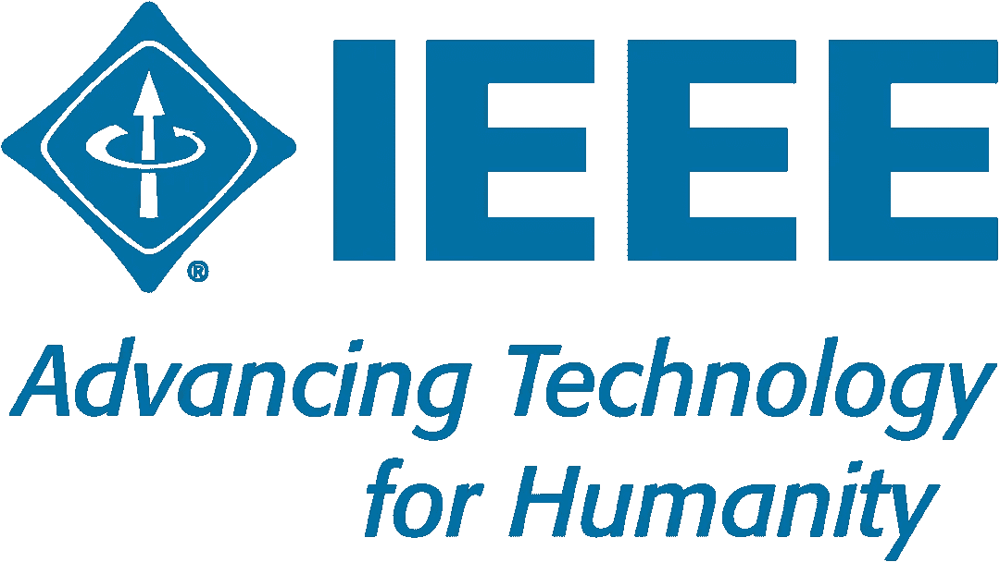

### SIGGRAPH Asia 2024：传统与创新并存，3D 生成与具身智能热度上升

贡献人：

https://mp.weixin.qq.com/s/cstNgredsFrMq9r-J7EIqA

第十七届SIGGRAPH Asia大会以「Curious Minds」为主题在东京圆满落幕，本届大会注册人数和论文投稿数均创新高。华人学者表现突出，大量论文和研究成果背后都有华人团队的身影。计算机视觉领域的新兴派与传统派研究方向各有侧重，新兴派聚焦具身智能和3D生成，传统派则关注几何建模和细节处理，AI浪潮下，传统研究依然占据一席之地。

大会技术亮点包括影眸科技荣誉提名的3D生成大模型CLAY和进阶版本Rodin Gen-1，以及VAST团队以高质量3D私有数据集支撑的生成技术。此外，港大团队提出的TEXGen模型首次实现基于原生3D数据训练的生成式扩散模型，突破了2D升3D路径的局限性。

产业应用方面，3D生成技术在游戏、美术设计、电商等领域初步落地，但尚处于早期阶段，技术迭代与数据质量是关键挑战。VAST和影眸等团队致力于打造高质量内容生成工具，为未来UGC场景奠定基础。Animation技术在骨骼建模和动态表现上的突破仍待提升，MotionGen等模型逐步完善，但数据和算法优化仍是瓶颈。

大会同时展现了动作捕捉、实时生成等技术的进展，3D内容生成正从工具开发向平台化演进，应用场景不断扩展。专家普遍认为，3D生成赛道的技术和产业化发展尚需时间，但未来潜力巨大，尤其是在空间智能等新兴方向的融合应用上值得期待。

SIGGRAPH Asia作为SIGGRAPH在亚洲的延伸，吸引力逐年提升。明年的大会将在香港举行，学术与产业的未来发展方向将在人工智能的推动下继续展开。

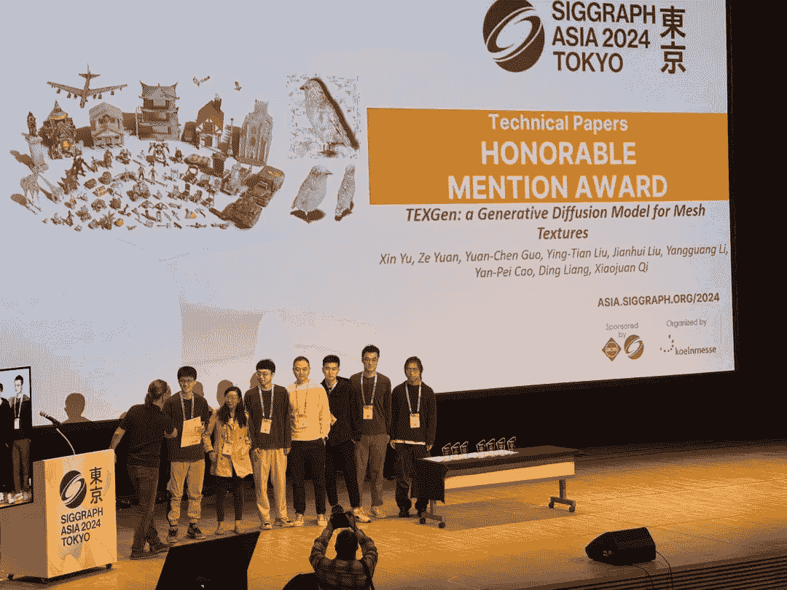

### ROSCon China 2024

贡献人：

https://mp.weixin.qq.com/s/c_eGE5ctOAzfcByTsgS_mA

12月7日，ROSCon China 2024大会在上海宝山伊敦康得思酒店开幕，这是全球机器人操作系统（ROS）领域的顶级盛会首次在中国内地举办。大会吸引了全球的机器人技术精英、开发者和爱好者，共同探讨ROS的最新发展与应用。张新宇主席在开幕仪式上表示，ROSCon China的召开是中国机器人产业发展的重要里程碑，将推动全球机器人技术与产业升级。

本次大会持续两天，围绕四大主题展开：AI与机器人技术的深度融合与应用、ROS技术前沿、基于ROS的产业化生态构建，以及全球与国产自研ROS系统的对比。众多国内外专家、学者与企业代表（如NVIDIA、光轮智能、百度Apollo等）分享了ROS技术的最新进展和应用案例，激发了热烈的讨论。

大会主会场的演讲精彩纷呈，多位行业大佬发表了令人印象深刻的言论。张新宇表示，ROS不仅是技术平台，更是全球机器人开发者的生态系统，推动着机器人技术的全球进步。赖晓铮教授谈到程序员在未来技术发展中的重要性，丁琰研究员则强调了数据质量对机器人学习的关键性。英伟达的Lia Liang展示了生成式AI对机器人训练数据的赋能潜力，谢晨光则分享了特斯拉在自动驾驶领域的创新如何影响传统汽车制造商。

此外，分会场研讨气氛热烈，香港大学和松灵机器人主办的Workshop专注于具身智能技能学习和机器人技术的实际应用，现场交流非常愉快。展位体验区成为大会的热门打卡点，展示了诸如宇树科技的G1机器人和Go2机器狗、松灵机器人的Piper等前沿机器人技术，参会者可以与这些创新产品近距离互动，感受科技的震撼与魅力。

总体而言，ROSCon China 2024不仅是机器人技术的盛会，也为全球开发者提供了一个交流与合作的平台，推动了ROS在中国乃至全球的应用与发展。

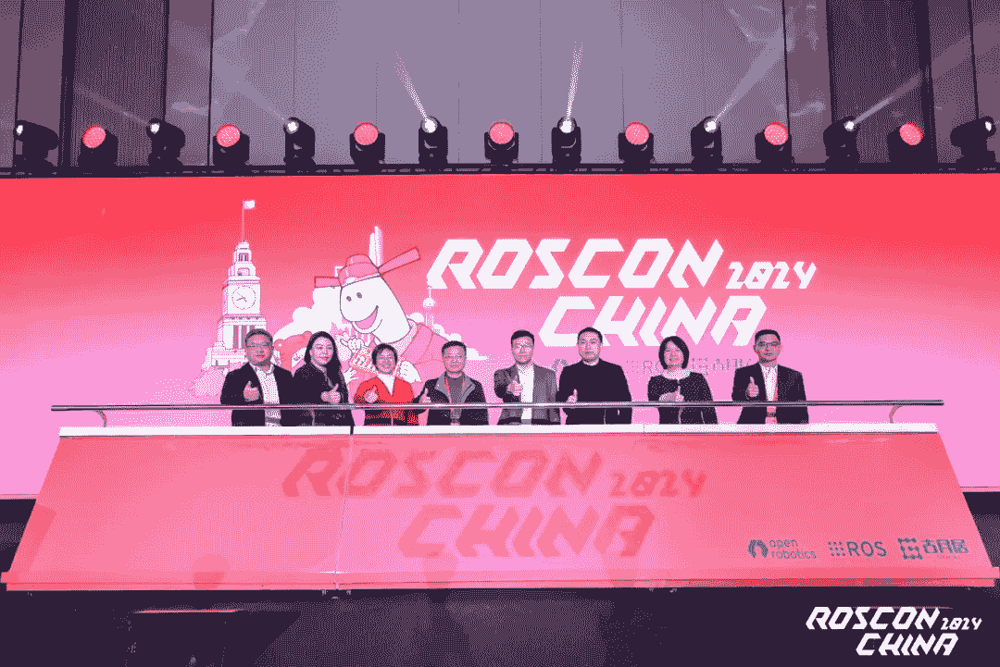

### 电子2025年度策略：聚焦AI终端及自主可控

贡献人：

https://mp.weixin.qq.com/s/rVDPUB3nXFFLSg2QwfcAhw

**看好果链及智能眼镜为代表的AI终端**长期趋势，补贴有望刺激手机需求全面回暖：1）果链AI创新：6月苹果发布AppleIntelligence，Canalys预测2024年全球AI智能手机市场份额为16%，2023至2028年间，AI手机市场CAGR预计为63%，AI手机中SoC及存储是算力提升关键，散热配套升级，果链AI创新有望带动新一轮换机周期。2)智能眼镜终端：Ray-BanMeta的成功证明了智能眼镜类产品成为AI终端落地场景的可行性，光学方案与显示器件占AR设备成本约50%，是产业链降本增效的核心环节，未来随着产业巨头加速布局与供应链降本增效的推进，AI+AR眼镜有望快速发展。3）补贴刺激：自今年10月多地推出纳入手机等3C产品的消费券后，国内手机消费需求得到显著刺激。随着11月乃至未来各地持续推出针对手机等3C产品的消费券和将手机纳入以旧换新的扩容政策，有望刺激手机需求全面回暖。

半导体自主可控势在必行，看好四大国产化方向。1）国产算力及配套：美国对中国半导体限制逐步收紧，国产算力芯片供不应求，国内OSAT封装厂积极布局先进封装，国产化加速推进。2）晶圆厂：国内高端芯片厂商寒武纪、华为等流片受限，中芯国际作为国内大陆半导体代工厂龙头，凭借先进制程的研发与扩产将成为国产算力芯片生产的重要依托。3）半导体设备及光刻机配套：先进制程需求攀升推动晶圆厂在高精度工艺、良率提升和产能扩张方面投入，对设备自主可控的要求，拉动国产半导体设备以及光刻机配套景气度提升。4）国产化EDA：当前中美摩擦倒逼国产EDA工具快速发展，2022年我国EDA行业市场规模达到116亿元（同比+12%），超过全球行业发展速率，景气度持续向上。

政策+技术+龙头多元发力，智驾车型加速放量上游硬件厂商进入业绩兑现期：比亚迪为代表的传统车企开始发力智驾车型在10-20万价格带车型渗透，有望推动智驾车型于2025年进入出货量高速增长期，相较辅助驾驶方案，支持高速/城区NOA的智驾方案在车载摄像头、激光雷达、智驾芯片、高速连接器等产品上均有产品技术、装载量及价值量提升，叠加国内车企加速推进更具产品性价比的国产供应链替代，有望带动国内智驾产业链相关公司迎来业绩高增机遇。

**相关标的梳理：1）消费电子：**果链AI创新有望带动新一轮换机周期，利好以果链为代表的订单需求复苏预期，注重业绩确定性和估值性价比（歌尔股份、东山精密、蓝思科技、立讯精密、中石科技、统联精密、鹏**鼎控股、信维**通信、领益制造等），同时安卓链有望迎边际改善（电连技术、飞荣达、龙旗科技等），AI眼镜产品发布不断，注重明年产业确定性趋势和潜在弹性（歌尔股份、宇瞳光学、福立旺、**亿道信息、康耐**特光学**等）；2）半导体：**AI算力(寒武纪，沪电股份、深南电路、兴森科技、源杰科技、长光华芯等)，封测（通富微电、长电科技、甬矽电子、佰维存储等），服务器配套（鸿日达、泰嘉股份、兴森科技等）、晶圆厂（中芯国际），光刻机配套（茂莱光学、晶方科技等）、EDA（华大九天、概伦电子等），周期复苏（圣邦股份、纳芯微、思瑞浦、卓胜微、唯捷创芯、康希通信、东芯股份、兆易创新、普冉股份、聚辰股份等）；3）汽车电子：车载摄像头及激光雷达(联创电子、舜宇光学科技、欧菲光、宇瞳光学、蓝特光学、韦尔股份、思特威，速腾聚创、禾赛科技，永新光学、长光华芯、高伟电子);车载高频高速连接器(电连技术、瑞可达、维峰电子)，智驾芯片及解决方案（地平线、黑芝麻智能等），嵌塑集成件（兴瑞科技）；4）新兴产业领域：高温超导（联创光电等）。

**风险提示：**下游需求复苏不及预期、晶圆厂扩产不及预期、国产替代进度不及预期、新产品、应用发布或销售不及预期。

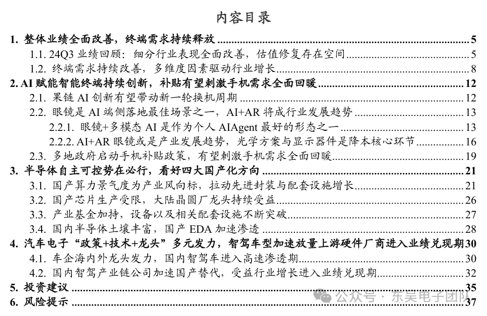

### Meta Llama 3.3 发布

https://huggingface.co/meta-llama/Llama-3.3-70B-Instruct

贡献人：

Meta Llama 3.3 多语言大型语言模型 (LLM) 是一个经过预训练和指令调整的生成模型，大小为 70B（文本输入/文本输出）。Llama 3.3 指令调整纯文本模型针对多语言对话用例进行了优化，在常见行业基准上的表现优于许多可用的开源和封闭聊天模型。

模型开发者：Meta

模型架构： Llama 3.3 是一种自回归语言模型，采用优化的 Transformer 架构。调整后的版本使用监督式微调 (SFT) 和带人工反馈的强化学习 (RLHF)，以符合人类对有用性和安全性的偏好。

# 推特

### ElewenLabs：现支持网页版、手机收听播客

https://x.com/elevenlabsio/status/1865085918543028434

现在你可以在网页版的 GenFM 上创建和编辑播客，并在 Android 和 iOS 上的 ElevenReader 收听 AI 播客。

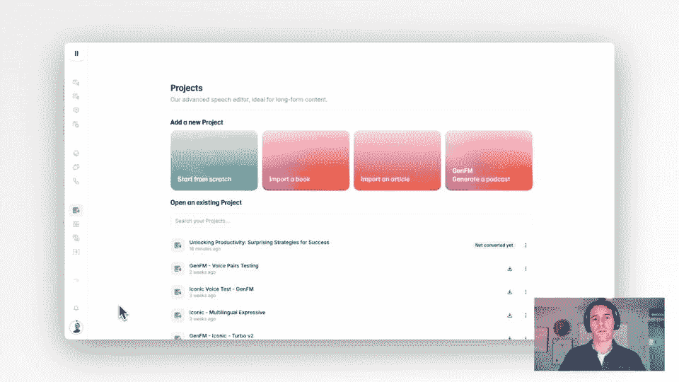

[Ix-H76_DoUKtlwff.mp4](https://internal-api-drive-stream.feishu.cn/space/api/box/stream/download/all/ZHJUbjff2o82QWxzIGSc0Vlsnuc)

### Ollama0.5发布，带来结构化输出功能

https://x.com/ollama/status/1865113729437962384

Ollama 0.5 发布了，带来了结构化输出功能！

这使得可以将模型的输出限制为由 JSON 模式定义的特定格式。

一些示例包括：

•        从文档中解析数据

•        从图像中提取数据

•        对所有语言模型的响应进行结构化

•        提供比 JSON 模式更高的可靠性和一致性

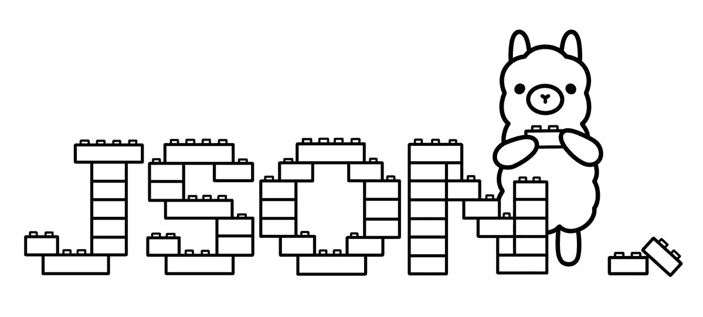

### Act-One 现已支持将您的表演直接转移到现有视频中的角色上

https://x.com/runwayml/status/1865062457418371080

Act-One 现已支持将您的表演直接转移到现有视频中的角色上。此更新为专业视频制作流程中的真人和动画内容带来了新的表现力和控制力，解锁了新的应用场景。

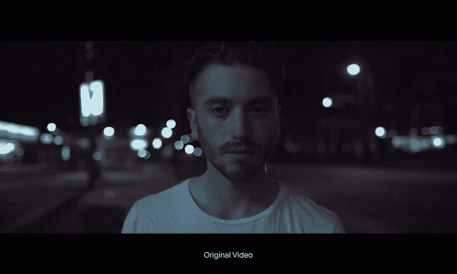

[UMJ_ykzA_RUqwWP6.mp4](https://internal-api-drive-stream.feishu.cn/space/api/box/stream/download/all/TtwQbfcfXoAp38x6wKyc83Rrnld)

### Qwen2-VL 的基础模型发布

https://x.com/JustinLin610/status/1865101457109995657

😓 差点忘了我们今晚发布了点东西……嗯，其实就是 Qwen2-VL 的基础模型啦，没啥大不了的。

🔗 链接如下：

https://huggingface.co/Qwen/Qwen2-VL-2B

https://huggingface.co/Qwen/Qwen2-VL-7B

https://huggingface.co/Qwen/Qwen2-VL-72B

所有的基础模型都已经分享给你了。我觉得这些模型会对你构建更好的视觉语言模型有帮助，因为它们在微调方面表现更好。

干杯！🍺

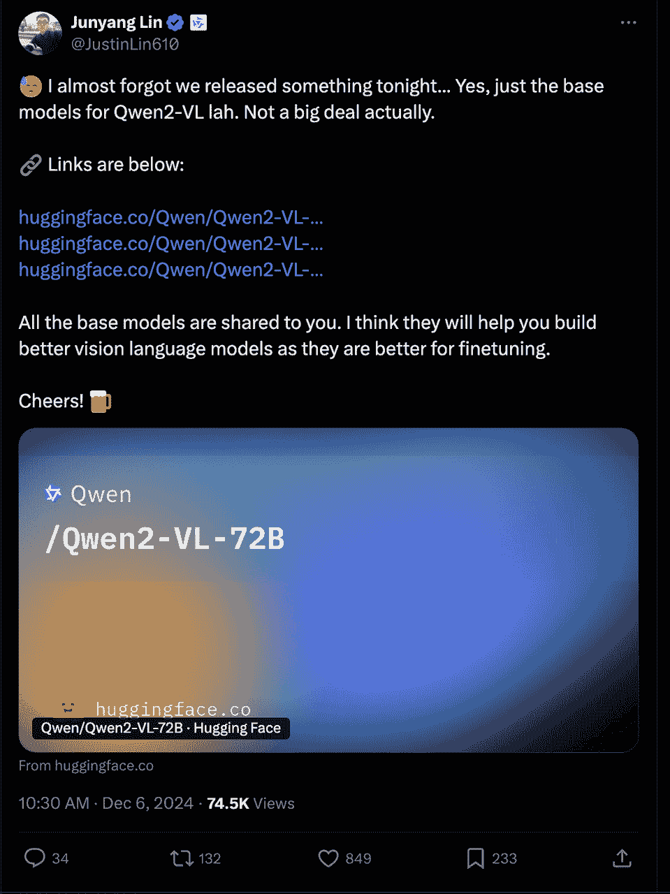

# 信号

### From Slow Bidirectional to Fast Causal Video Generators

https://causvid.github.io/

当前的视频扩散模型实现了令人印象深刻的生成质量，但由于双向注意力依赖性，在交互式应用中遇到了困难。生成单个帧需要模型处理整个序列，包括未来。我们通过将预训练的双向扩散变压器调整为即时生成帧的因果变压器来解决这一限制。为了进一步减少延迟，我们将分布匹配蒸馏 (DMD) 扩展到视频，将 50 步扩散模型蒸馏为 4 步生成器。为了实现稳定和高质量的蒸馏，我们引入了基于教师 ODE 轨迹的学生初始化方案，以及监督具有双向教师的因果学生模型的非对称蒸馏策略。这种方法有效地减轻了自回归生成中的错误积累，尽管在短片段上进行训练，但仍允许长时间的视频合成。得益于 KV 缓存，我们的模型支持在单个 GPU 上以 9.4 FPS 的速度快速流式生成高质量视频。我们的方法还可以实现零样本流式视频到视频的翻译、图像到视频和动态提示。

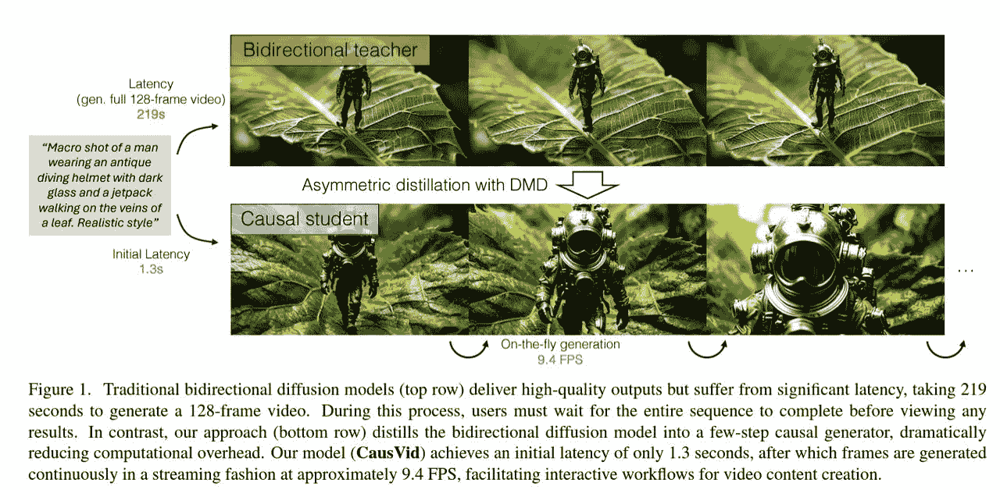

### NaVILA: Legged Robot Vision-Language-Action Model for Navigation

https://arxiv.org/abs/2412.04453

本文提出用腿式机器人解决视觉和语言导航问题，这不仅为人类提供了灵活的指挥方式，还允许机器人在更具挑战性和混乱的场景中导航。然而，将人类语言指令一直翻译成低级腿部关节动作并非易事。我们提出了 NaVILA，这是一个两层框架，将视觉-语言-动作模型 (VLA) 与运动技能统一起来。NaVILA 不是直接从 VLA 预测低级动作，而是首先以语言的形式生成具有空间信息的中级动作（例如，“向前移动 75 厘米”），作为视觉运动 RL 策略的输入以供执行。NaVILA 大大改进了现有基准上的先前方法。我们新开发的 IsaacLab 基准测试也展示了同样的优势，具有更逼真的场景、低级控制和真实世界的机器人实验。

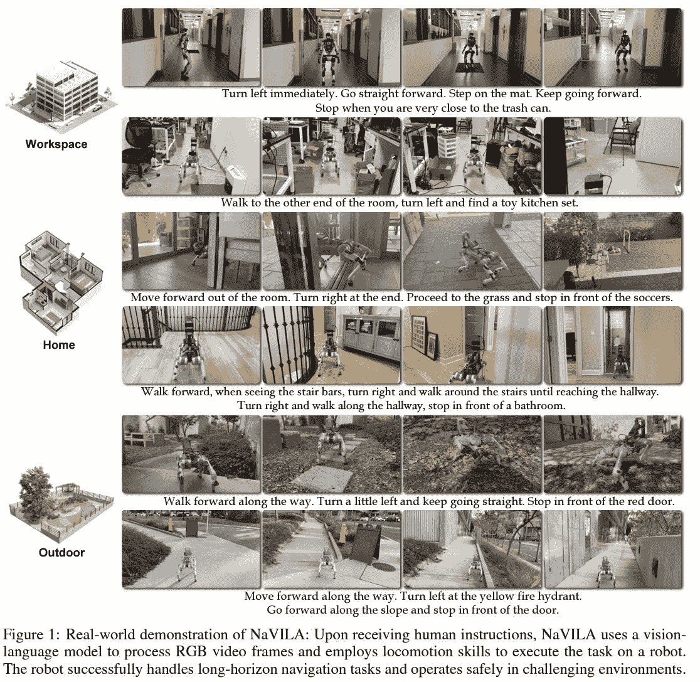

### MegaSaM: Accurate, Fast, and Robust Structure and Motion from Casual Dynamic Videos

https://arxiv.org/abs/2412.04463

我们提出了一个系统，该系统可以从动态场景的随意单目视频中准确、快速、稳健地估计相机参数和深度图。大多数传统的运动结构和单目 SLAM 技术都假设输入视频以具有大量视差的静态场景为主。在没有这些条件的情况下，这种方法往往会产生错误的估计。最近的基于神经网络的方法试图克服这些挑战；然而，当在具有不受控制的相机运动或未知视野的动态视频上运行时，这种方法要么计算成本高，要么很脆弱。我们展示了深度视觉 SLAM 框架的惊人有效性：通过对其训练和推理方案进行仔细修改，该系统可以扩展到具有不受约束的相机路径的复杂动态场景的真实世界视频，包括具有很小相机视差的视频。对合成视频和真实视频进行的大量实验表明，与之前和并发工作相比，我们的系统在相机姿势和深度估计方面明显更准确、更稳健，运行时间更快或相当。

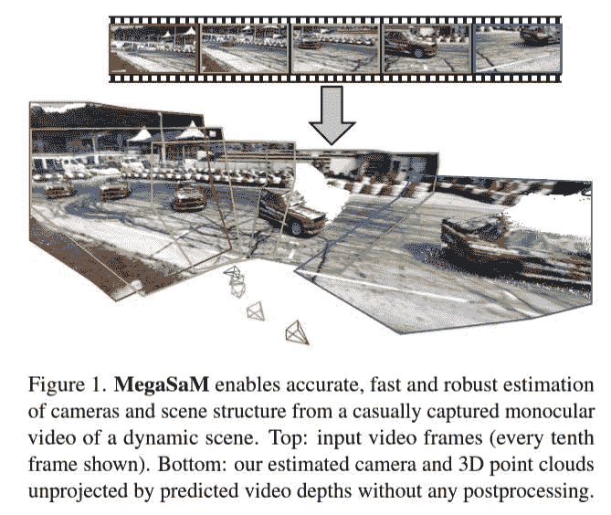

# 产品

### Reforged Labs 为移动游戏工作室提供轻松的 AI 广告

https://reforgedlabs.com

贡献人：

Reforged Labs 正在推出业内首创的 AI 视频创作服务，为广告行业带来革命性的变革。我们致力于颠覆传统的视频制作流程，将过去昂贵且耗时的创作过程全面自动化，用高效、快速、且经济实惠的解决方案取而代之。通过我们的服务，每个视频广告都将根据工作室的品牌需求量身定制，确保不仅传递精准的信息，还能以更高的成本效益触达目标受众。从概念到成品交付，AI 驱动平台能够大幅缩短制作周期，同时保持卓越的创意品质，让用户在市场竞争中始终快人一步。无论是初创品牌还是大型企业，Reforged Labs 都是实现视频广告创意突破的理想合作伙伴。


### Countless.dev

https://countless.dev

贡献人：

Countless.dev 是一个专为开发者和决策者打造的创新平台，旨在让您轻松探索、比较和计算每个 AI 模型的成本，无论是LLM、视觉模型还是其他类型的人工智能模型。通过 Countless.dev，您可以按照价格、代币限额、功能特点等关键指标对模型进行排序，从而快速筛选出最适合您特定用例的解决方案。无论是需要支持复杂文本生成的高性能模型，还是满足图像处理需求的视觉算法，该平台都能在几秒钟内为您呈现清晰的对比结果，大幅提升您的选择效率。借助 Countless.dev，您可以轻松掌控模型选择的全流程，从而最大化投资回报率，专注于实现您的技术和业务目标。

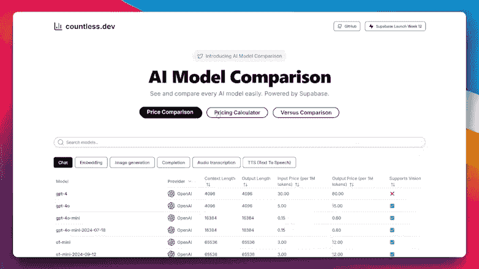

# 投融资

### YC秋季批次的四家值得关注的初创企业

贡献人：

https://techcrunch.com/2024/12/07/the-four-startups-from-ycs-fall-batch-that-enterprises-should-pay-attention-to/

在最新的YC（Y Combinator）秋季批次中，95家初创企业亮相，其中87%为AI相关公司，重点集中在客户服务和AI代理领域。然而，四家初创企业因其致力于为企业提供AI监控和防护工具而引人关注。以下是这些企业及其融资亮点：

1.  **HumanLayer**

+   **业务描述**：提供API使AI代理能够在需要时联系人工进行帮助和审批。

+   **特点**：通过精确引入人工反馈，平衡AI效率与可靠性，吸引企业关注。

1.  **Raycaster**

+   **业务描述**：面向企业销售的研究型AI代理。

+   **亮点**：通过深入挖掘目标客户的详细信息（如实验室设备使用情况等），在合适的时间以精准方式进行推销，与传统的线索生成工具形成鲜明对比。

1.  **Galini**

+   **业务描述**：为AI应用程序提供合规防护。

+   **优势**：帮助企业根据公司政策和法规为AI建立防护机制，增强企业对AI控制的自由度和评估能力。

1.  **CTGT**

+   **业务描述**：提供工具集帮助企业管理AI模型的“幻觉”问题。

+   **融资动向**：正在与多家财富10强企业测试其技术，表明市场对这种工具的强烈需求。

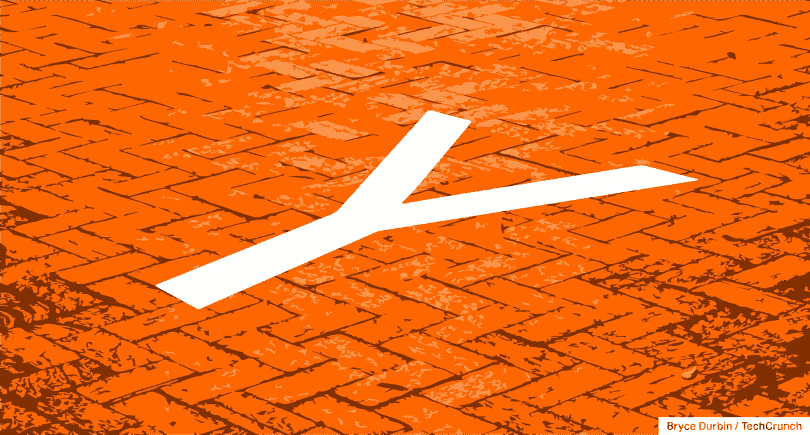

### AMP Robotics融资9100万美元，加速部署AI回收系统

贡献人：

https://www.therobotreport.com/amp-robotics-raises-91m-accelerate-deployment-recycling-systems/

AMP Robotics宣布完成9100万美元的D轮融资，此轮融资由Congruent Ventures领投，Sequoia Capital、Blue Earth Capital、Liberty Mutual Investments等多家现有和新晋投资者参与。公司计划利用本轮资金加速其AMP ONE系统的部署，该系统结合人工智能和机器人技术，用于高效分类市政固体废弃物（MSW）。

AMP Robotics自2014年成立以来，其AI平台已识别1500亿件物品，指导完成超过250万吨可回收物的分类，拥有三个全规模设施及400多个AI系统，遍布北美、亚洲和欧洲。AMP ONE系统通过深度学习技术实时识别废弃物中的可回收物和污染物，大幅提高资源回收的经济性和效率。

近期，AMP Robotics与Waste Connections Inc.达成合作，将在科罗拉多州的单流回收设施中安装并运营系统。同时，公司宣布新CEO Tim Stuart上任，创始人Matanya Horowitz转任首席技术官，以进一步推动技术和市场拓展。

**投融资亮点：**

+   **融资规模**：9100万美元D轮融资。

+   **投资方**：领投方为Congruent Ventures，其它投资者包括Sequoia Capital、CalSTRS等。

+   **用途**：推动AMP ONE系统的部署和技术优化。

+   **行业影响**：此次融资巩固了AMP Robotics在可持续材料管理和资源效率提升领域的领导地位。

公司官网：https://ampsortation.com/

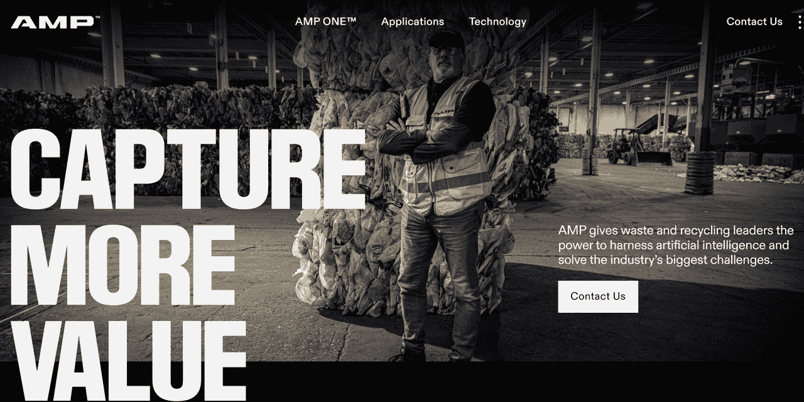

# 学习

### 关于 Bank Conflict 与 Swizzle

贡献人：

https://zhuanlan.zhihu.com/p/11132414477

Bank Conflict 和 Swizzle 是 GPU 内存访问优化中的两个关键概念，特别是在高效执行矩阵乘法时。通过理解这两者的关系，可以有效减少内存访问冲突，提升性能。

在 NVIDIA GPU 中，内存是分为多个 Bank 的，每个 Bank 具有固定的大小（如128字节）。当多个线程访问同一内存区域时，如果它们访问的内存位置属于同一个 Bank，就会发生 Bank Conflict。此时，尽管多个线程的内存访问是并行的，GPU 会将这些访问转为串行操作，从而大幅度降低性能。

Bank Conflict 主要发生在共享内存与寄存器之间的数据拷贝过程中。例如，在矩阵乘法中，如果每个线程按16字节（128位）向量化访问共享内存，那么每个 Warp（由32个线程组成）的访问总宽度为512字节。这个访问会被GPU分解成多个事务，每个事务最大为128字节。当多个线程访问共享内存时，访问的地址如果落在同一Bank内，就会发生Bank Conflict。

为了避免这种冲突，一种常见的方法是Padding，即在内存中插入空白数据，使得内存访问地址错开，从而避免多个线程访问同一Bank。尽管Padding能有效避免Bank Conflict，但它的缺点是会浪费内存并导致地址不对齐，影响内存利用率。

Swizzle（重映射）是另一种更高效的避免Bank Conflict的方式。Swizzle通过改变内存地址的物理映射，使得虽然线程访问的逻辑地址不变，但它们对应的物理地址被重新排列，从而避免了对同一Bank的并发访问。Swizzle的关键在于如何设计合适的重映射规则，使得每个线程访问不同的Bank。

在CUTLASS（NVIDIA的CUDA模板库）中，Swizzle通过定义B、M、S三个符号来实现内存重映射。B代表重映射的二维空间的行数，M表示每个块的最小单元（128位数据），S则代表内存重映射的元素个数。通过这些规则，Swizzle将共享内存中的数据重排，使得多个线程不再访问同一个Bank。例如，Swizzle通过对行列坐标进行异或操作，重新排列内存块，从而确保每个线程访问不同的Bank，避免了Bank Conflict。

总之，Swizzle相较于Padding的优势在于更高效地利用内存，且不需要额外的内存空间。通过Swizzle，虽然内存访问的物理地址发生了变化，但对于程序员来说，逻辑地址依然保持不变，这使得编程模型更加简洁。

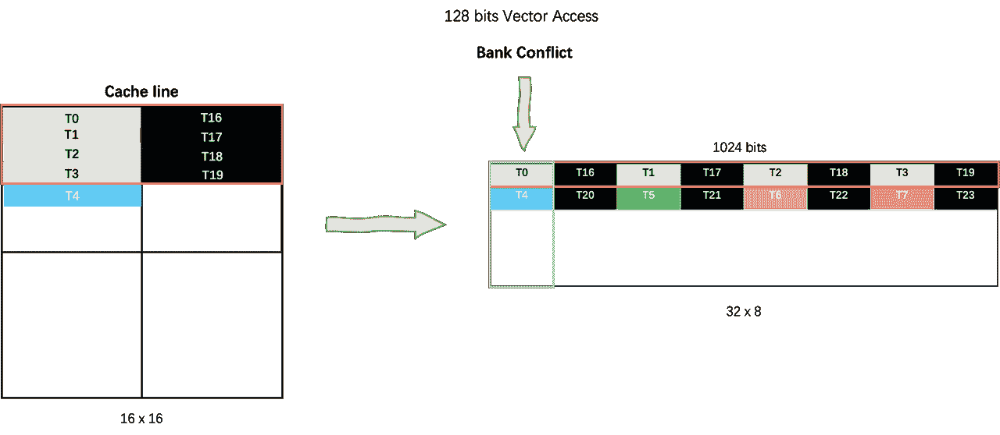

### 360智算中心万卡GPU集群架构分析

贡献人：

https://zhuanlan.zhihu.com/p/11380025343

360智算中心的万卡GPU集群建设项目通过深度融合AI、大数据、异构计算和高性能网络技术，致力于提供高效且智能化的算力支持。其核心目标是提升AI计算任务的性能与稳定性，特别是在大规模模型训练和推理任务中的表现。

**基础设施建设方面**，该中心选用了NVIDIA A100和A800 GPU，并优化了硬件配置以应对大规模计算需求。每台服务器配备两片CPU、存储网卡、PCIe Gen4 Switch和多个GPU，并通过优化网卡带宽和存储机制，提升了数据流通能力。例如，采用25Gb/s网卡并通过软硬件结合提升带宽，结合分布式存储和多阶段异步保存策略，使得模型checkpoint的保存时间大幅减少，优化后保存时间从383秒减少到5秒，性能提升约70倍。GPU间使用NVSwitch进行全互联，确保大规模并行训练时的高效数据交换。此外，通过选择200Gb/s Mellanox CX6网卡并优化配置，集群在高效通信和成本控制上取得了平衡。

**网络架构设计**借鉴了NVIDIA DGX-SuperPod-A100结构，采用了全互联的Leaf-Spine架构，强化了东西向流量的传输能力。每个网络单元包含多个A800主机和Leaf交换机，确保即使在故障情况下，集群依旧能维持稳定通信。通过智能网络调度，将高通信需求的任务部署到低延迟区域，有效减少网络瓶颈，提高数据传输效率。

**Kubernetes集群优化**方面，360智算中心采用了Volcano调度框架，解决了在大模型训练中常见的资源调度问题。集群支持多种调度策略，如Gang调度确保任务协调执行，BinPack调度优化资源利用率。此外，系统通过网络拓扑感知调度、延迟调度和异构算力调度等手段，提升了集群的资源使用效率，避免了训练任务资源需求不匹配导致的性能瓶颈。

**推理加速技术**方面，360自主研发的Gaia Large Language Model (GLLM)推理引擎，实现了跨平台兼容性和高效推理加速。通过动态批量处理和创新的内存访问机制PageAttention，提升了长文本推理的效率和内存利用率。此外，GLLM采用PrefixCache技术减少重复计算，显著降低了首字返回延迟，在多种NLP场景中表现出色。

**AI开发平台**支持模型的开发、训练到部署全生命周期。平台具备强大的资源管理能力，支持分布式训练、交互式建模和在线部署等关键功能，显著提升了模型开发与部署的效率。通过可视化工具，平台可以实时监控系统运行状态和训练进程，帮助用户快速识别并解决潜在问题。此外，故障容错机制确保了训练过程的稳定性，特别是在大规模训练任务中，能够快速定位并修复硬件或网络故障。

总的来说，360智算中心在万卡GPU集群建设中，通过硬件优化、网络设计、调度框架及AI平台的高度集成，解决了大规模AI任务中的多重挑战，提供了强大的算力支持。未来，该中心将继续扩展集群规模，提升异构计算能力，并持续优化AI平台的可视化与监控功能，推动AI基础设施技术的创新发展。

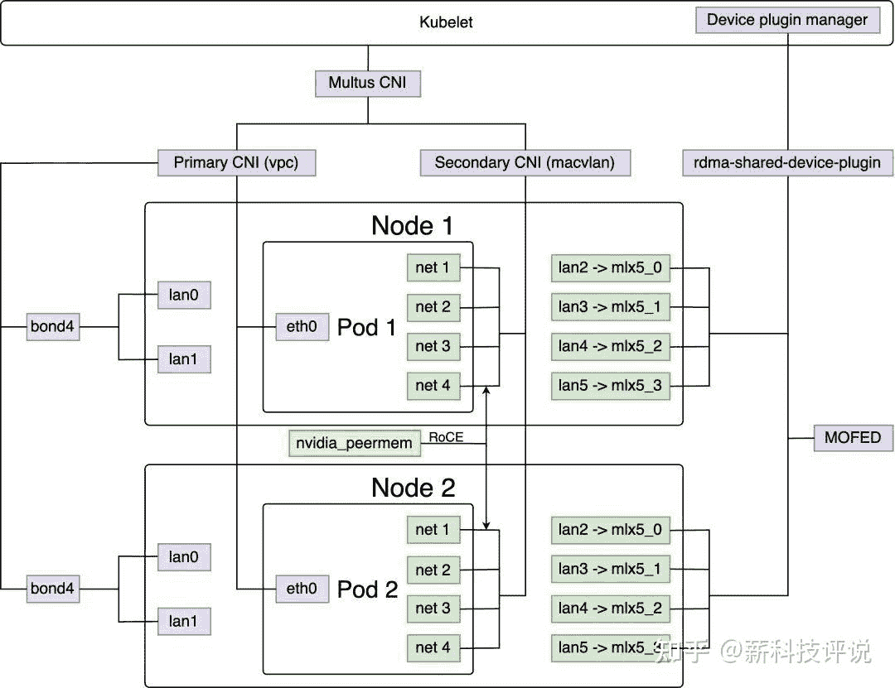

### 如何正确理解NVIDIA GPU利用率的概念

贡献人：

https://zhuanlan.zhihu.com/p/11200440291

在分析 NVIDIA GPU 的利用率问题时，一个常见且令人困惑的现象是，即使 GPU 只运行了一个小任务，nvidia-smi 或其他基于 NVML 的工具报告的 "GPU Util" 可能显示设备已完全占用。举例来说，下面的代码会启动一个只在单个流式多处理器(SM)上执行的内核，但却可能导致 nvidia-smi 显示 "GPU Util" 为 100%。

```

global
 void simple_kernel() {
    while (true) {}
}
int main() {
    simple_kernel&lt;&lt;&lt;1, 1&gt;&gt;&gt;();
    cudaDeviceSynchronize();
}
```

这个现象似乎与传统理解的 GPU 利用率定义不符。在这种情况下，如果 GPU 有 10 个 SM，那么传统上我们会认为 GPU 利用率应该为 10%。然而，实际情况是，nvidia-smi 会显示 100%，即使只有一个 SM 被占用。这表明，"GPU 利用率" 的定义并非单纯指 SM 的使用比例。

根据 NVIDIA 官方文档和 NVML 结构体定义，"GPU Util" 是在一个采样周期内，GPU 上执行内核的时间百分比。这意味着，"利用率"不仅仅与处理器核心数量相关，还涉及到内核执行的时间比例。NVML 定义的“利用率”实际表示 GPU 或内存在特定时间段内被利用的频率，而非资源的使用容量。因此，"GPU Util" 并不代表 GPU 被多少个 SM 占用，也不考虑 SM 的处理能力饱和度。

这一点与 Brendan Gregg 提出的“USE”方法论相关，该方法论将“利用率”定义为资源忙于工作的时间比例，而不是资源的使用容量。使用该方法论，“利用率”并不关心是否有更多任务排队等待执行，而仅仅是设备在过去的采样周期内实际参与工作的时间比例。

另外，nvidia-smi 工具提供的是基于 NVML 的高层次指标，虽然它简单易用，但它并不提供关于 GPU 设备性能饱和度的详细信息。为了获得更准确的性能评估，建议使用如 dcgm-exporter 这样的工具，它能够提供基于 DCGM 的更为深入的分析，特别是关于 GPU 设备的饱和度指标，如 SM 占用率、浮点运算和张量核心的激活百分比等。

因此，尽管 nvidia-smi 提供的 "GPU Util" 指标广泛使用，但它可能容易误导，特别是在任务负载较低的情况下。更为准确的分析应该依赖于对 GPU 饱和度和详细性能数据的关注，而不仅仅是“利用率”的表面值。

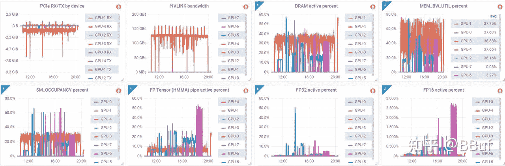

### VAR 团队新作：Infinity∞: 高分辨率图像合成的按位自回归建模的扩展

贡献人:

https://zhuanlan.zhihu.com/p/11145240604

这篇论文通过创新的位级别预测框架，为高分辨率图像生成任务提供了新的解决方案。其核心技术包括无限词汇分类器、位级别自校正（BSC）机制以及动态长宽比和分辨率感知的位置编码。

论文的第一个关键技术是引入无限词汇分类器，突破了传统分词器在连续特征量化时的限制。传统方法将连续特征直接映射为十进制索引，这种量化可能导致相近特征被映射到远离的索引值，从而增加预测误差。论文通过二进制量化技术，将词汇空间扩展到 2n2^n，有效减少了量化误差，并通过位级别的索引预测构建了一个无限大的词汇表。这种方法与 Magvit-v2 的 Lookup-Free 思路一致，为自回归框架提供了更加灵活的词表。

在生成阶段，论文采用了多尺度残差图方法，结合自回归框架的逐步预测，从粗到细生成特征图。与 VAR 不同，Infinity 通过位级别的标签来预测下一尺度特征，替代了传统的向量量化（VQ）。同时，论文引入了位级别自校正（BSC）机制，通过模拟随机扰动生成错误预测的样本，在训练阶段加入增广以提升模型的鲁棒性。这种机制通过重新量化标签和更新 Transformer 的输入，使模型能够逐步纠正错误，从而减少预测误差的累积放大。

为了支持多样化的图像生成，论文还设计了动态长宽比的训练方法和分辨率感知的位置编码。它通过定义不同长宽比下的残差图调度表，保持特征图面积一致性，并结合可学习的尺度嵌入和二维旋转位置编码（RoPE2d），提升了模型在不同分辨率和长宽比下的适应性。这些技术突破了传统 VAR 模型只能生成正方形图像的限制，使得 Infinity 能够生成各种长宽比的高分辨率图像。

在实验中，论文展示了该方法的强大生成能力，特别是在指令跟随和美学特性上的优异表现。通过渐进式训练策略，模型在不同分辨率下均实现了高质量的生成效果。此外，推理速度相较其他开源模型有明显优势。消融实验表明，无限词汇分类器和 BSC 增广对于生成质量的提升至关重要，而扩展 Transformer 的规模进一步改善了生成效果。

从技术创新角度看，该方法通过将词汇空间扩展到无限大，并基于二进制索引和增广机制构建预测框架，有效解决了传统方法在量化和预测上的误差问题。这种方法等价于通过二进制结构模拟浮点数，从而兼容自回归生成框架，并能灵活适应多分辨率与多长宽比场景。

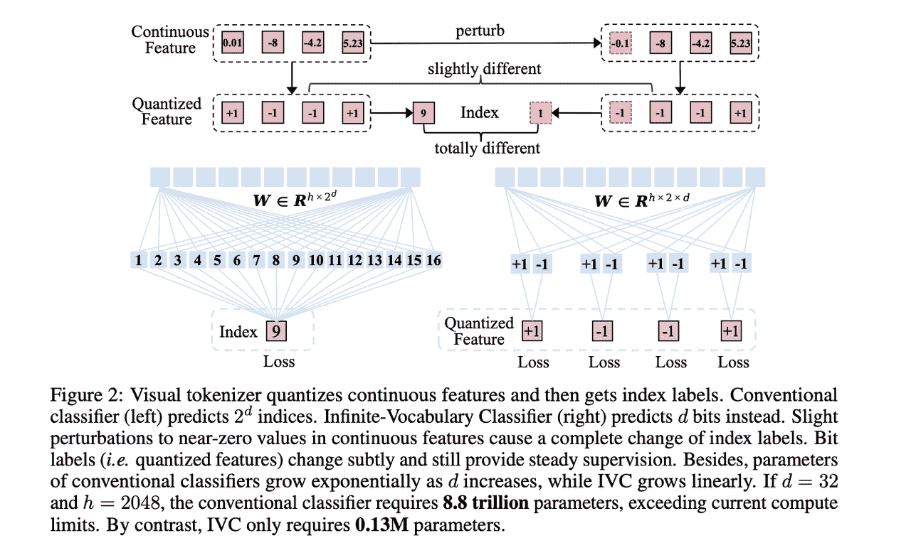

# 声明

本文档仅供学习交流使用，版权归原作者所有，若涉侵权，请联系Jack Jin 15101136166

##

（欢迎在下方反馈您宝贵的意见！整理不易，觉得有用给AI日报小组点个赞👍吧！）

ChatGPT；Angela；Zijia Liu；Alex；Zeqi Tan；Tiezhen（HuggingFace）；Naixu；Lizhi；Peter；Suoman；Jack

学术分析报告：ResearchFlow -- 奇绩F23校友的开发的深度研究产品，PC端进入RFlow的分析报告，可直接点击节点右侧的小数字展开节点，登录后可在节点上直接“询问AI”，进一步探索深度信息

如果你有大模型相关的创业想法，欢迎来找我们聊聊～微信：15101136166

> 快邀请你的小伙伴们一起来读大模型日报吧！

> **【日报****知识库****】**这里是近期日报内容的汇总,欢迎大家查阅

> [大模型日报知识库(分享版)](https://miracleplus.feishu.cn/wiki/KapVwXfkriOBiskB0B2cUHxjnTh)

>

> 欢迎大家多多帮我们分享,转发~~

> 如果大家有任何的建议或者吐槽,欢迎随时找我聊天~

