# 奇绩大模型日报（12月 9日）

> 来源：[https://miracleplus.feishu.cn/docx/Aohdd5IdmoQXeHxGQNPcF1zAnqc](https://miracleplus.feishu.cn/docx/Aohdd5IdmoQXeHxGQNPcF1zAnqc)

# 资讯

### 扩散模型的动态机制

贡献人：

https://www.nature.com/articles/s41467-024-54281-3

本文研究了在数据维度和样本量都很大的情况下，以及得分函数被最优训练时，生成性扩散模型（DMs）的动态机制。通过统计物理方法，我们识别了生成性扩散过程中的三个不同的动态机制。从纯噪声开始的生成动态，首先遇到物种形成转变，数据的广泛结构在此阶段显现，类似于相变中的对称性破缺。随后是崩塌阶段，动态被吸引到特定的训练点，类似于玻璃相中的凝聚机制。物种形成时间可以从数据相关矩阵的谱分析中获得，而崩塌时间与过剩熵度量相关，并揭示了扩散模型存在维度的诅咒。这些理论发现得到了高斯混合的解析解的支持，并通过对真实数据集的数值实验得到证实。

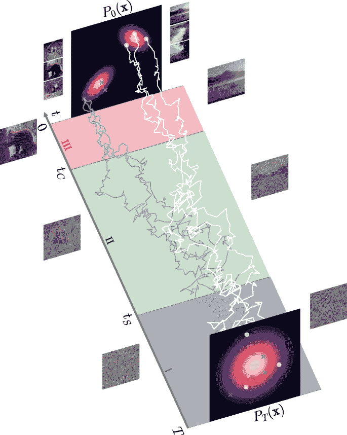

### a16z:2025年科技发展趋势

贡献人：

https://a16z.com/big-ideas-in-tech-2025/

1. **能源革命与核能回归**

+   核能需求增加，得益于监管改革、公众支持、资本注入，以及人工智能数据中心对清洁能源的巨大需求。

+   过去关闭的核电站，例如宾夕法尼亚的三里岛，将重新启用，推动能源供应可靠性。

2. **硬件与软件跨界的新兴职业**

+   随着人工智能应用于复杂硬件，电气工程、机械工程和机器人等学科将迎来需求激增。

+   2025年，制造业、自动化领域的高技能技术人员需求可能超过传统软件工程师。

3. **太空探索与快速运输**

+   SpaceX的Starship快速可重复使用技术将推动人类登月和火星探索，甚至实现40分钟内完成地球范围的人员与货物运输。

4. **国防去中心化**

+   自主无人机和战场AI将实现实时战术调整，减少对中心化控制的依赖，加强边缘设备的作战能力。

5. **XR设备与物理世界的连接**

+   XR（扩展现实）设备将推动机器人与模拟技术的发展，并在需要大量物理数据的领域发挥关键作用。

6. **健康与生物科技突破**

+   新型AI健康工具将实现个性化预防和疾病早期检测。

+   生物科技领域针对重大疾病（如糖尿病、肥胖症）的创新治疗方法正在兴起。

7. **实时AI与交互技术**

+   AI实时响应能力将催生新的应用场景，如教育中的动态反馈系统和实时视频生成。

8. **AI和区块链结合**

+   AI将更加自主，拥有自己的加密钱包和节点，参与市场交易，推动去中心化的经济活动。

9. **企业技术堆栈重塑**

+   企业逐步抛弃传统系统（如Salesforce），转向基于AI的动态系统以提升效率。

10. 去中心化自治组织（DAO）与新型治理模式

+   区块链技术将推动“液态民主”等新型治理方式的试点，应用于地方政府与社区治理。

### 北交开源o1代码版

贡献人：

https://mp.weixin.qq.com/s/Y7qZDFtBklmoTeRUxjV_fw

北京交通大学的研究团队推出了一款名为O1-CODER的编码任务模型，并且开源了所有源代码、精选数据集以及衍生模型。该模型结合了强化学习（RL）与蒙特卡洛树搜索（MCTS），旨在提高系统-2思维能力，特别是在编码任务中的推理能力。团队的关键发现之一是，通过伪代码推理显著提高了代码生成的质量，此外将监督微调（SFT）与直接偏好优化（DPO）结合，能够提升测试用例的生成效果，并通过自我对弈强化学习实现了推理与代码生成的持续改进。

O1-CODER采用了六步框架，其中包括训练测试用例生成器（TCG），利用MCTS生成包含推理过程的代码数据，通过强化学习更新策略模型，以及通过伪代码生成完整的可执行代码。在解决自我对弈强化学习面临的挑战时，团队首先提出了训练测试用例生成器，以提供标准化的代码测试环境和结果奖励，确保生成的代码能够得到有效评估。其次，团队选择“先思考后行动”的策略，即通过伪代码进行详细的思考，再生成代码，提升了推理过程的控制能力和适应性。

具体来说，测试用例生成器经历了两个阶段的训练：监督微调（SFT）和直接偏好优化（DPO）。SFT阶段旨在确保生成器输出符合预定义格式，从而生成有效的测试用例，DPO阶段则通过构建偏好数据集进一步提升生成器的性能。在实验中，经过DPO阶段，测试用例的通过率从80.8%提升到89.2%，展现了显著的改进。

伪代码的引入则帮助模型进行更深层次的推理。团队将伪代码视为引导模型推理的工具，首先用伪代码定义算法的结构，再逐步细化每个函数的具体步骤，最后生成完整代码。基于这一方法，模型在MBPP数据集上的表现有所提升，尽管通过率有所下降，但平均采样通过率（ASPR）大幅提高，表明伪代码推理显著优化了推理过程。

在强化学习部分，团队结合了MCTS来生成推理路径，并为每个推理步骤分配奖励。通过伪代码引导的路径探索，团队能够将终端节点的奖励（如编译成功率和测试用例通过率）反向传播到推理路径的每个步骤，从而为策略模型的训练提供了有效的过程奖励。通过这种方式，O1-CODER在强化学习的帮助下不断优化推理过程，形成了数据生成、奖励建模和策略优化的闭环，确保了推理能力的持续提升。

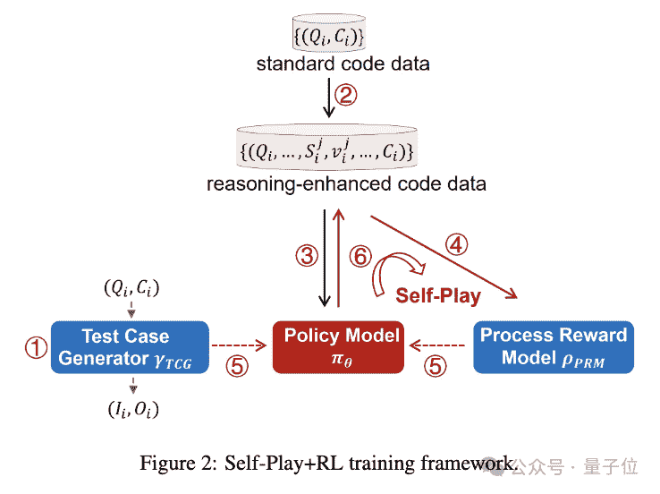

### 美国旧金山草根调研与海外AI应用进展

贡献人：

https://mp.weixin.qq.com/s/0nZx5mXQEne3K818D06vRw

海外AI应用关注缘何而起——AI渗透率明显提升、三季度业绩支撑

今年11月份以来，海外AI应用的关注度得到大幅的提升，起因是11月9日美国CRM公司Salesforce宣布将招聘1000名销售人员推广其AI助手产品Agent force，并且很多客户对Agent force的使用反馈佳。此后美股进入财报季，一批AI应用公司第三季度财报超预期，包括AI广告的Applovin，AI数据的Palantir和Snowflake，AI电商的Shopify，以及Salesforce自身财报的超预期，闭环验证了AI助手的可行性。

**哪些细分领域看到变化——集中在To** B场景，广告/Agent/数据方向先行

**AI广告：**AI明显提升广告投放的精准度，程序化广告公司Applovin连续4个季度收入增速35%以上，AI投放系统Axon 2.0开始显现飞轮效应，除游戏之外，电商广告的投放转化率也有望得到普遍提升。

**AI助手：**企业所有内部管理流程与业务环节，都具备AI化的潜力，如Salesforce的客户管理助手Agent force首周就得到200个订单，2美元/单轮对话的定价也得到普遍认可。AI也赋能SAP、ServiceNow、Workday等公司，提升企业内部的财务、人力、供应链管理等环节的效率。

**AI数据分析：**不论是大型跨国企业的数据仓库，还是中小公司的内部数据库，AI都能辅助更好地数据管理、分析与可视化，包括Palantir、Snowflake、Elastic等公司三季度业绩都展现良好趋势。

AI应用长期怎么看——B端先出业绩，但长期C端弹性更大

B端AI应用更容易在短期兑现业绩，因为对于企业而言采用AI产品本质是一道计算题：AI带来的长期回报大于购买成本，则购买意愿就大（如Agent force的2美金/单次对话，比对应的人力成本划算）

而C端应用的核心则是“大幅提升”需求端的感受，这个过程是相对缓慢、需要迭代的，但一旦爆发则长期空间和弹性都更大。C端应用，我们则坚定看好AI视频、陪伴&游戏、搜索等方向的发展。

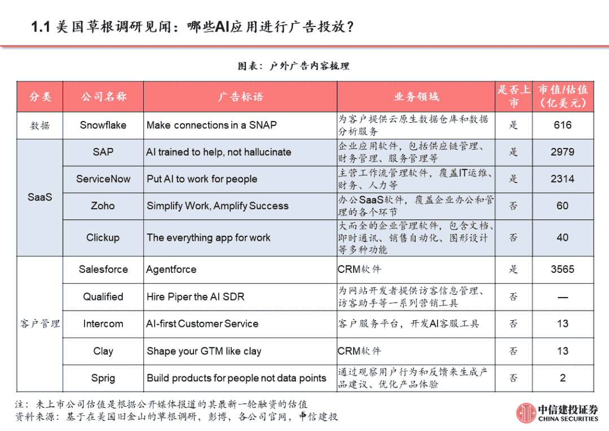

# 信号

### Boundless Socratic Learning with Language Games

原文链接：https://arxiv.org/abs/2411.16905

这篇文章是一篇立场论文，讨论了在封闭系统中训练的代理（agent）如何掌握任何期望的能力，只要满足三个条件：(a)  接收到足够信息丰富且一致的反馈，(b) 经验/数据的覆盖范围足够广泛，以及 (c) 有足够的容量和资源。文章论证了这些条件，并考虑了在假设  (c) 不是瓶颈的情况下，(a) 和 (b)  在封闭系统中可能产生的限制。特别地，文章讨论了输入和输出空间相匹配的代理（即语言），认为这种纯粹的递归自我改进，被称为“苏格拉底学习”，可以极大地提升性能，超越初始数据或知识，并且只受时间和逐渐增加的不一致问题的限制。此外，文章提出了一个基于语言游戏概念的建设性框架来实现这种学习。

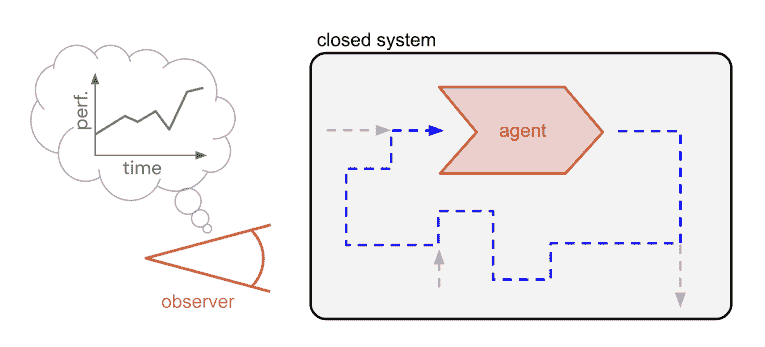

### Mind Your Step (by Step): Chain-of-Thought can Reduce Performance on Tasks where Thinking Makes Humans Worse

原文链接：https://arxiv.org/abs/2410.21333

这篇文章探讨了链式思考（Chain-of-Thought，CoT）提示在大型语言和多模态模型中的应用及其效果。文章指出，尽管CoT在许多任务中提高了性能，但在某些情况下它可能会降低模型的性能，这仍然是一个开放的问题。文章通过借鉴认知心理学，研究了在人类中言语思考或深思熟虑会损害表现的情况，以及这些限制是否适用于语言模型。研究发现，在隐式统计学习、视觉识别和包含例外模式的分类等三种情况下，使用CoT会导致最先进的模型性能显著下降。文章还识别了满足条件（i）但不满足条件（ii）的三个任务，并发现尽管言语思考减少了人类在这些任务中的表现，但CoT却保持或提高了模型的性能。总体而言，研究结果表明，尽管模型的认知过程与人类并不完全相同，但考虑思考对人类表现产生负面影响的情况可以帮助我们识别对模型产生负面影响的设置。通过将关于人类深思熟虑的文献与CoT的评估联系起来，文章提供了一个新工具，用于理解提示选择和推理时推理的影响。

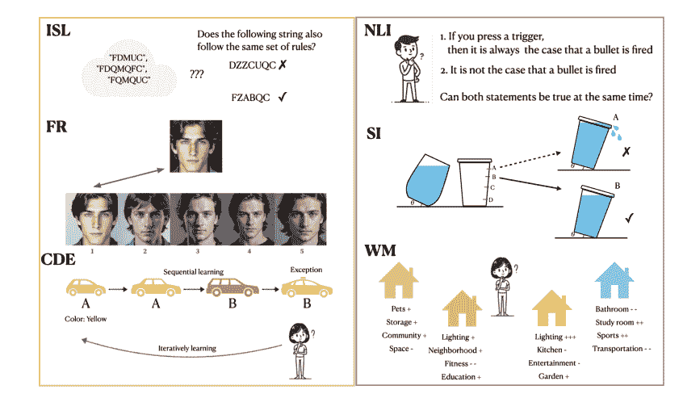

# 推特

### Sora v2 即将发布：1 分钟视频输出，文本生成视频，文本 + 图片生成视频，文本 + 视频生成视频

https://x.com/RuudNL/status/1865425438991945938

Sora v2 即将发布：

• 1 分钟视频输出

• 文本生成视频（text-to-video）

• 文本 + 图片生成视频（text+image-to-video）

• 文本 + 视频生成视频（text+video-to-video）

OpenAI 的 Chad Nelson 在伦敦的 C21Media 主旨演讲中展示了这一点。他表示正如 @sama 之前暗示的那样，这些功能将非常快地与大家见面。

[o2CgvaQxW-BwzuLv.mp4](https://internal-api-drive-stream.feishu.cn/space/api/box/stream/download/all/Qw4obZC2Xoym5exmEupcuC14nEf)

### Llama 3.3 70B 在 M1 Pro 上以 7.8 个 token/秒的速度流式传输到我的手机

https://x.com/localghost/status/1865497302670164469

Llama 3.3 70B 在 M1 Pro 上以 7.8 个 token/秒的速度流式传输到我的手机。

虽然不是最快的，但令人惊叹的是，你可以在没有互联网的情况下将如此强大的模型服务于整个家庭。

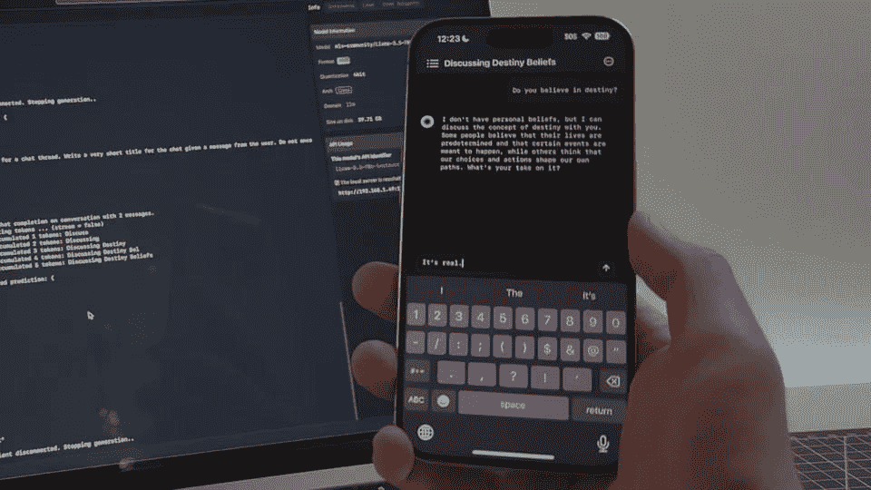

[lte5Xko1DJhTAsnn.mp4](https://internal-api-drive-stream.feishu.cn/space/api/box/stream/download/all/NiJIbFUJ4o5mA0x39qscqbDyn3d)

### Kalouche分享EyeSight Hand 的触觉体验：将眼部手部一体化技术发挥到了极致

https://x.com/simonkalouche/status/1865580747991712004

EyeSight Hand 的触觉体验是我见过最好的。它将眼部手部一体化技术（eye-in-hand）发挥到了极致，并将触觉感知编码为密集的视觉信息。

**由于仿人**手的设计容易受到高遮挡的影响，它们确实需要触觉感知才能良好运行。

仅靠视觉是不够的。

[wGLWEoRd78TDTNcQ.mp4](https://internal-api-drive-stream.feishu.cn/space/api/box/stream/download/all/EmNNboFuko9vywxkwpRc2nyPnrb)

### Timbo分享：可探索的待办事项列表

https://x.com/io_sammt/status/1865573038236025236

**可探索的待办事项列表**

待办事项列表本身是一个单元（代码），每个待办事项也是一个单元。在 Unit 中，动态添加子项不会自动改变代码。不过，“将待办事项保存在代码本身”的过程仍然在数据层面通过一个元模式完成（这个模式与 Git 一起工作）。

你可以在这里体验一下：

[h](https://unit.tools/u/9473d045-1389-4514-b2b4-bdb4c8843d9e)ttps://unit.tools/u/9473d045-1389-4514-b2b4-bdb4c8843d9e

[pZgmiePVW6cTl6KX.mp4](https://internal-api-drive-stream.feishu.cn/space/api/box/stream/download/all/DzV0b6RXvo0EKYxQsEFc1As1nRc)

### 谷歌Murphy分享：强化学习教程的第一版草稿现已发布

https://x.com/sirbayes/status/1865987143669334480

我很高兴宣布，我的强化学习（RL）教程的第一版草稿现已发布：

https://arxiv.org/abs/2412.05265

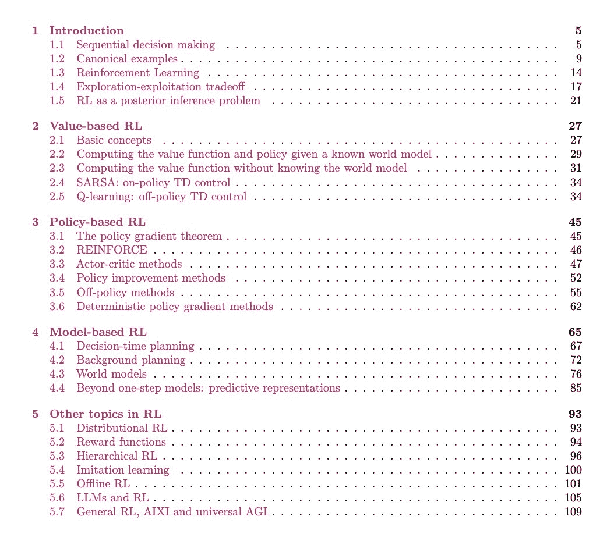

# 产品

### Jenium 是一款面向初创企业的全能型工作套

### https://jenium-modern-business-suite.webflow.io

贡献人：

Jenium 是一款面向初创企业的全能型工作套件，它将任务管理、销售线索

进、财务核算、时间提醒和团队协同等关键功能整合在同一平台上，从而帮助团队高效而有序地处理日常运营事务。通过统一的界面和数据集成，用户不再需要在多个软件与工具之间频繁切换，而是可以一站式掌握公司进度与决策信息。此外，Jenium 的下一版本将引入生成式人工智能（GenAI）技术与针对初创企业场景定制的 AI 智能代理，进一步推动工作流程的自动化与智慧化，让团队以更低的成本、更高的效率掌控项目全局。

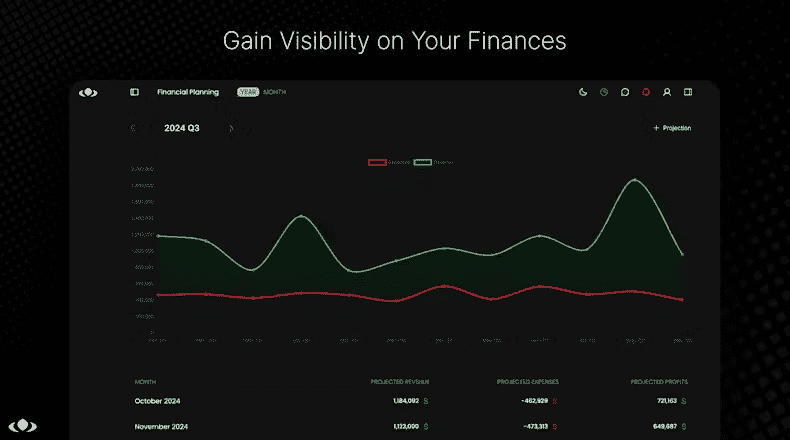

### Sharbo 01  全方位竞争情报 AI 解决方案

https://www.sharbo.io

贡献人：

Sharbo 01 是一款面向企业的全方位竞争情报 AI 解决方案。借助整合的多源信息和智能洞察，用户可以一站式获取竞争对手的最新动态与战略趋势，从而快速识别市场机会与潜在威胁

通过自动化的报告生成和功能特性对比追踪，团队可轻松监控关键指标与差异化优势，无需在繁杂的信息源之间来回切换。Sharbo 01 以高效、简便的方式让企业轻松掌控竞争格局，进而优化决策过程，提升市场应变能力与整体竞争实力。

# HuggingFace&Github

### FineWeb 数据集的第二次迭代，覆盖数千种语言

https://huggingface.co/datasets/HuggingFaceFW/fineweb-2

贡献人：

FineWeb这是什么？

这是广受欢迎的FineWeb 数据集的第二次迭代，为超过 1000 种 语言带来了高质量的预训练数据。

FineWeb2 数据集完全可复现，并在宽松的 ODC-By 1.0 许可下提供使用。在经过数百次消融实验的严谨验证后，该公司对其品质充满信心。尤其值得关注的是，在我们用来指导处理决策的 9 种多元化语言测试集中，

FineWeb2 在多个衡量指标上优于其他同样覆盖多语言的主流预训练数据集（如 CC-100、mC4、CulturaX 或 HPLT），而且规模更大。在某些情况下，甚至在这些精心挑选的多元化评价任务（FineTasks）中，表现胜过专门为单一特定语言定制的数据集。

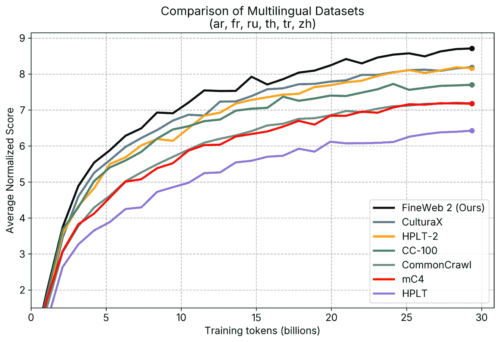

# 学习

### CS 8803LLM课程

贡献人：

https://cocoxu.github.io/CS8803-LLM-fall2024/calendar/

基础要求：要求良好的机器学习（CS 4641/7641）、深度学习（CS 4644/7643）和NLP（CS 4650/7650）知识。

适合对象：如果你想要听讲座并学习NLP，建议选修CS 7650。如果你有足够的背景，建议在研究生第一年选修本课程。

示例论文：

《直接偏好优化 - 你的语言模型实际上是一个奖励模型》

《BPE分词器揭示了什么关于其训练数据的信息？》

课程安排

8月26日: 训练语言模型以通过人类反馈遵循指令 (PPO/InstructGPT)

8月28日: 直接偏好优化：你的语言模型实际上是一个奖励模型 (DPO, 解读DPO/PPO)

9月4日: Simpo：一种无参考奖励的简单偏好优化 (SimPO)

9月9日: 使用MT-Bench和Chatbot Arena评估LLM作为判断者 (MT-Bench和Chatbot Arena)

9月11日: 对比偏好优化：推动LLM在机器翻译中的性能极限 (CPO)

9月23日: RRHF：排名响应以对齐语言模型与人类反馈 (RRHF)

9月25日: ORPO：无参考模型的单体偏好优化 (ORPO)

9月30日: Llama 3系列模型（第1部分） (Llama3，第1部分)

10月2日: Llama 3系列模型（第2部分） (Llama3，第2部分)

10月7日: VisualWebArena：在现实视觉网络任务上评估多模态智能体 (VisualWebArena, WebArena)

10月21日: Aya模型：一个指令微调的开放访问多语言模型 (Aya Model, Aya Dataset)

10月23日: 人类意识的损失对齐 (Kawin Ethayarajh 客座讲座) (KTO)

10月28日: MoMa：混合模态专家的高效早期融合预训练 (MoMa, Switch Transformers)

10月30日: Branch-Train-Merge：专家语言模型的尴尬并行训练 (Branch-Train-Merge)

11月4日: LoRA：大规模语言模型的低秩适配 (LoRA)

11月6日: LESS：选择有影响力的数据以进行目标指令调优 (LESS)

11月25日: QLoRA：高效的量化LLM微调 (QLoRA)

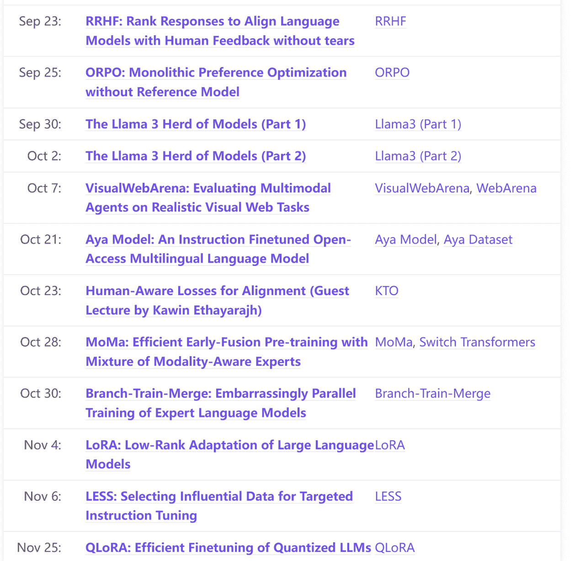

### Hot Chips 2024资料公开下载：聚焦AI芯片&散热

贡献人：

https://zhuanlan.zhihu.com/p/11279090225

Hot Chips 2024会议的相关资料目前已经公开，虽然之前可以通过注册付费获得，但惯例上在会后3个月，演讲资料会免费开放。微软和Meta分别分享了他们在AI芯片领域的最新进展。

微软介绍了他们的AI芯片Maia 100，尽管该芯片在《OCP峰会Keynote：Intel和AMD都在谈UALink和Ultra Ethernet》中已有提及，但其性能和TDP功耗依然值得关注。另一方面，Meta发布了下一代推荐推理加速器（MTIA）。这款芯片功耗较低、性能和内存速率配置也不高，显然是注重能效和性价比。每张PCIe Gen5 x16板卡上配置了两颗芯片，总功耗仅为220W。

进一步的技术细节展示了每颗MTIA ASIC芯片搭载四颗内存芯片，这四颗芯片分别位于芯片的四个方向。此外，在10月的OCP峰会上，Meta还详细介绍了它们的硬件架构：其使用AMD EPYC 9004系列（代号Genoa）CPU，Broadcom的PEX89144 PCIe Gen5 Switch，以及CXL内存扩展。每个CPU能够支持连接四块PCIe x8的CXL卡。

此外，会议中还提到，未来的AI芯片和GPU在2025至2026年可能会达到更高的功耗密度。例如，芯片功耗可能会达到2KW，GPU模块标准功耗为5KW，而整机架功耗可能达到500KW。这些预测虽然有些超前，但也为未来服务器和机架的功率密度提升提供了参考。作者也提到，当前市场上普及的服务器和机架的功率密度应与这些预期目标进行对比。

### 第三代半导体（九）- SiC – 概述与特性

贡献人：

https://zhuanlan.zhihu.com/p/11593172956

SiC（碳化硅）是一种由硅（Si）和碳（C）元素组成的半导体材料，通常呈现为陶瓷状的晶体结构。它主要有4H-SiC和6H-SiC两种形式，前者由于更高的载流子迁移率，成为电力电子器件的首选材料。SiC的晶体结构是由硅和碳通过强共价键结合，具备优异的热导率和高电压承受能力，因此在高温和高功率环境中具有独特的优势。相较于GaN（氮化镓），SiC在热导率和稳定性方面表现更为突出，尤其适用于需要高效热管理和高温工作的设备。

从化学成分和晶体结构来看，GaN和SiC均由强共价键结合，GaN的禁带宽度略大，更适合高频、高电压应用，而SiC则因其离子成分和晶体对称性在高温、辐射及恶劣环境中更为稳定。GaN的电子迁移率较高，适合高频功率电子应用，而SiC的高热导率使其在高功率应用中更能有效散热，避免热积累。

SiC的历史可以追溯到1905年首次在陨石中发现，随后发展历程包括多个重要技术突破，尤其是在1987年之后，SiC在半导体产业中逐渐成熟。随着电动车和光伏产业的推动，SiC材料的商业化进程加速，多个企业如Wolfspeed、英飞凌和Rohm等在这一过程中发挥了重要作用。

在工艺方面，SiC的生产流程与硅基器件相似，但其成本主要集中在衬底和外延的生产上，这也是SiC产业链的关键部分。为了提高市场竞争力，许多企业已开始自建SiC晶圆厂，以便掌握这一核心技术。

总之，SiC作为第三代半导体材料，在性能上与GaN有显著差异，适用于高功率、高电压和高温环境下的应用，其在电动车和光伏领域的快速发展，以及生产工艺的逐渐成熟，为未来的半导体市场带来了新的机遇。

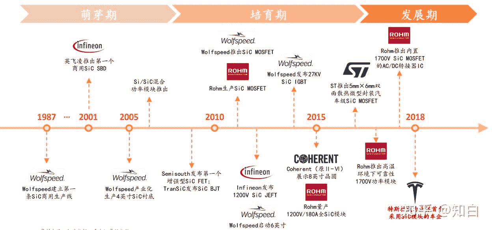

### 自回归图像生成中的Visual Tokenizers第二谈

贡献人：

https://zhuanlan.zhihu.com/p/11391083709

近期关于Visual Tokenizer的研究聚焦于提高图像生成和多模态任务中的效果。多个新的工作提出了创新的视觉Token化方法，扩展了现有技术的应用范围。

**FQ-GAN**提出了一种分形的Visual Tokenizer，该方法通过使用多个并行的Tokenizer对图像进行Tokenizing，从而扩展了Codebook的表征空间。为了增强不同Tokenizer的特征表达，研究引入了正则化，使得每个Tokenizer的Codebook嵌入尽可能正交，同时结合CLIP和DINO网络来提高Codebook的语义特征表达。该方法通过多个Codebook的嵌入学习，使得生成的图像在语义表达上更加准确，优化了图像生成模型的性能。

**LG-VQ**提出了语言引导的Codebook学习框架，旨在解决传统VQ方法在多模态任务中的局限性，尤其是文本到图像生成和图像标题生成等任务。通过利用CLIP预训练文本特征和视觉特征对齐，LG-VQ可以将语言和视觉语义信息注入Codebook，从而增强视觉生成模型在跨模态任务中的表现。该方法还提出了Masked Text Prediction的方式来进一步加强文本和图像的语义对齐，提升在视觉推理任务中的准确性。

**VQ-KD**则提出了一种新的Visual Quantizer训练方法。该方法将传统的图像重建损失替换为图像特征重建损失，从而提高了图像特征的保真度，并提升了生成图像的质量。这一变化使得图像生成模型能够更好地捕捉图像的深层特征，提高了模型的生成能力。

**V2L-Tokenizer**探索了直接利用大语言模型（LLM）理解视觉信号的潜力，提出了一种Vision-to-Language Tokenizer（V2L Tokenizer），通过将图像转换为LLM词汇中的离散词，使得冻结的LLM可以处理视觉任务。实验表明，该方法在图像理解和去噪任务中表现出色，展示了无需微调的大语言模型在视觉任务中的有效性。

这些研究推动了Visual Tokenizer技术的创新，进一步优化了图像生成和多模态任务中的表现，尤其是在语义对齐和跨模态信息融合方面，展现了强大的应用潜力。

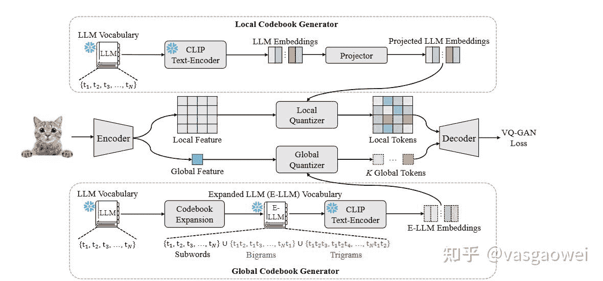

### KV Cache量化技术详解：深入理解LLM推理性能优化

贡献人：

https://zhuanlan.zhihu.com/p/11409756662

KV Cache在Transformer模型中扮演着重要角色。它通过缓存计算过的Key和Value矩阵，避免在每次自回归生成时重复计算，从而提升推理效率。这一机制不仅提升了计算速度，还增强了长序列上下文的处理能力，确保语义连贯性。具体来说，KV Cache通过缓存历史信息，加速了推理过程，减少了计算浪费。尽管KV Cache带来了显存节省和效率提升，但随着上下文的增加，显存的线性增长仍然是一个挑战，尤其是在处理超长文本时。

量化技术通过压缩模型数据的表示格式，减小了显存占用。在LLM部署中，KV Cache的显存占用通常是资源瓶颈之一。量化技术能在可接受的精度损失范围内，将浮点数格式的KV Cache压缩为低精度格式（如INT8或INT4），显著减少内存占用并加速计算。例如，采用Q8_0量化后，显存需求降低了50%，Q4_0量化则能将显存压缩至原来的33%，适用于资源极为受限的场景。

量化过程通过将浮点数映射为整数来减少内存占用。例如，将一个浮点数数组通过量化转换成INT8格式，虽然会引入一定的精度损失，但这种损失往往小于1%，且可以在大多数应用中忽略不计。通过这种优化，LLM在处理长文本时显存的占用得到了有效控制，尤其在资源受限的设备上，量化技术为大模型的部署提供了可能。

量化技术不仅仅是单纯的精度压缩，还包括多种策略，如静态量化、动态量化和混合精度量化等。静态量化通过在推理前预先量化模型的权重和激活值，适用于稳定的应用场景；动态量化则在运行时动态调整量化参数，适应数据的变化；混合精度量化则在不同模型层使用不同的量化精度，以在性能和资源效率之间找到最佳平衡。

实验数据表明，KV Cache的量化在大模型部署中的应用能显著提升资源利用率。在多个GPU平台上，采用INT8量化后，推理速度提升30-40%，而INT4量化的性能提升更为显著，达到50-60%。通过精心设计的量化方案，LLM能够在显存和计算资源有限的情况下，维持较高的推理速度和质量，从而支持更大规模的模型和更长上下文的处理需求。

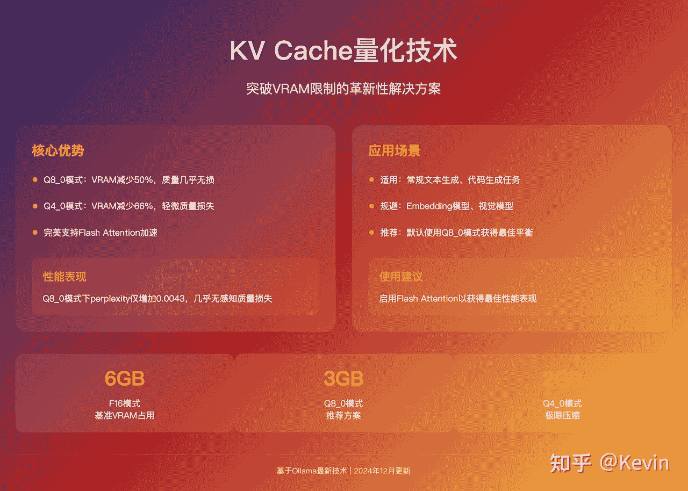

### SVDQuant：吸收异常值量化 4-bit 扩散模型

贡献人：

https://zhuanlan.zhihu.com/p/8487841492

本文提出了一种激进的4-bit量化方案——SVDQuant，用于加速扩散模型，特别是在减少内存使用和提高推理速度方面。扩散模型因其庞大的计算需求和内存消耗而面临部署难题，尤其在生成模型参数规模不断增加的背景下。与传统的大模型量化方法相比，SVDQuant通过量化权重和激活为4-bit，同时引入低秩分支来吸收异常值，从而有效保持模型的性能。

传统的量化方法，如平滑（smoothing），通常通过调整激活和权重的异常值分布来减轻量化误差。然而，这种方法在处理大规模扩散模型时效果有限，尤其是当异常值迁移至权重时，权重的量化误差反而加剧。SVDQuant解决了这一问题，它通过奇异值分解（SVD）将权重分解为低秩和残差部分，其中低秩部分以16-bit精度处理，而残差部分则以4-bit量化。此举大幅降低了量化误差，使得4-bit量化能够有效进行。

尽管低秩分支的引入本质上不会显著增加计算负担，但它会导致显著的内存访问延迟，特别是在GPU缓存无法容纳激活值时。为了解决这个问题，本文还设计了一个推理引擎——Nunchaku。该引擎通过内核融合技术，将低秩分支的计算和4-bit量化的计算合并，从而消除了冗余的内存访问，大幅度提升了推理速度。

在实验中，SVDQuant在多个扩散模型上取得了显著的内存节省和加速效果。例如，在12B参数的FLUX.1模型中，SVDQuant减少了3.6倍的内存使用，并在16GB的笔记本电脑RTX 4090 GPU上实现了3.0倍的加速。此外，SVDQuant的4-bit模型还显著优于传统的8-bit量化方法，如NF4 W4A16基线，且在生成图像质量（通过Image Reward和FID评估）方面表现优异。

值得注意的是，SVDQuant不需要重新量化已集成LoRA（低秩适配器）的模型，这使得LoRA可以无缝地与低位精度模型结合，进一步提高了推理效率。在PixArt-Σ等小型模型上，SVDQuant的4-bit量化表现出较小的质量退化，并优于ViDiT-Q和其他现有量化方法。通过对比其他量化技术，SVDQuant不仅在内存节省和加速方面表现优异，同时在视觉质量上也保持了接近16-bit模型的效果。

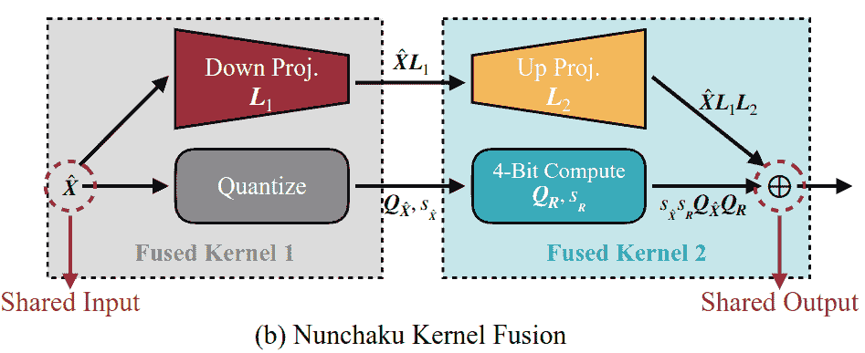

### 时间序列与 transformer: 理论、实践与思考

贡献人：

https://zhuanlan.zhihu.com/p/9602961547

时序数据分析涉及处理随时间变化的观测数据，具有特定的时间依赖性、季节性、趋势性等特点，广泛应用于金融、气候、交通、能源等领域。时间序列问题通常包括预测、分类、异常检测、插补等任务，各种传统与现代的分析方法被提出以应对这些问题。

时间序列数据的特征首先体现在时间依赖性、空间依赖性和语义多样性等方面。时间依赖性表现为序列数据的非平稳性和季节性；空间依赖性则反映了多个序列间的关系，通常需要在多变量时间序列分析中捕捉这些依赖；而语义多样性使得相似的时间序列在不同上下文下可能表示不同的意义，因此建模时需要考虑数据的上下文信息。

在具体问题上，时间序列预测可分为长周期预测与短周期预测。长周期预测适用于具有长期季节性波动的数据，如电力、天气等，评估指标通常使用MSE或MAE；短周期预测则针对没有季节性变化的时间序列，评估常用SMAPE或MASE等；分类问题则侧重从时间序列的波形中提取特征进行分类，常见应用包括手势识别或健康监测；异常检测用于识别时间序列中的不规则事件，如服务器故障等，评估通常基于Precision、Recall、F1等指标；插补问题则针对时间序列中的缺失值进行填充，通常依赖上下文来预测缺失的数据点。

处理这些问题的传统方法包括对时间序列进行平稳化、分解和傅里叶分析。平稳化是指通过差分或对数变换将非平稳时间序列转化为平稳序列；分解方法则将时间序列分解为趋势、季节性、周期性和不规则分量，常用于提取数据中的关键特征。傅里叶分析则通过将时域信号转化为频域信号，帮助识别时间序列中的周期性特征。

随着深度学习的发展，时间序列分析方法逐渐转向使用更复杂的模型，如MLP、RNN、CNN、GNN和Transformer等。MLP模型如N-BEATS等通过多层感知机直接对时间序列进行建模，简洁高效；RNN模型，如LSTM和DA-RNN，能够较好地捕捉时间序列中的长期依赖关系，特别适用于处理长时间序列数据；CNN则通过卷积操作在不同尺度上提取时序特征，方法如TimesNet和Wavenet专门设计用于捕获时间序列中的局部和全局依赖；GNN通过图结构建模多变量时间序列数据的空间依赖性，STGCN和Graph WaveNet等模型能够自动捕捉节点间的复杂时空关系；基于Transformer的方法，如Autoformer和Fedformer，利用自注意力机制捕获时间序列中的全局依赖，特别适合复杂的非线性时间序列建模。

深度学习方法相较于传统统计模型，能够更有效地处理复杂的非线性时间依赖和大规模数据，但也存在一定的局限性，如对数据量的需求较大、模型的可解释性较低等。因此，在大模型时代，如何设计高效、可解释的时序模型，成为了一个重要的研究方向。模型的选择需要根据具体应用场景的需求来权衡，如预测精度、计算效率和模型的可解释性等。

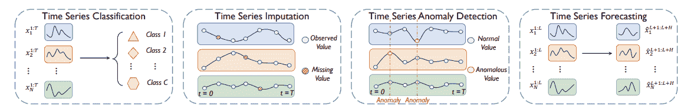

# 声明

本文档仅供学习交流使用，版权归原作者所有，若涉侵权，请联系Jack Jin 15101136166

##

（欢迎在下方反馈您宝贵的意见！整理不易，觉得有用给AI日报小组点个赞👍吧！）

ChatGPT；Angela；Zijia Liu；Alex；Zeqi Tan；Tiezhen（HuggingFace）；Naixu；Lizhi；Peter；Suoman；Jack

学术分析报告：ResearchFlow -- 奇绩F23校友的开发的深度研究产品，PC端进入RFlow的分析报告，可直接点击节点右侧的小数字展开节点，登录后可在节点上直接“询问AI”，进一步探索深度信息

如果你有大模型相关的创业想法，欢迎来找我们聊聊～微信：15101136166

> 快邀请你的小伙伴们一起来读大模型日报吧！

> **【日报****知识库****】**这里是近期日报内容的汇总,欢迎大家查阅

> [大模型日报知识库(分享版)](https://miracleplus.feishu.cn/wiki/KapVwXfkriOBiskB0B2cUHxjnTh)

>

> 欢迎大家多多帮我们分享,转发~~

> 如果大家有任何的建议或者吐槽,欢迎随时找我聊天~

