# 奇绩大模型日报（12月 10日）

> 来源：[https://miracleplus.feishu.cn/docx/YuKtdgSY7o0aq7xSD9XcIiSBnCe](https://miracleplus.feishu.cn/docx/YuKtdgSY7o0aq7xSD9XcIiSBnCe)

# 资讯

### 亚马逊成立AI智能体研究实验室，致力于开发新型智能体技术

贡献人：

https://techcrunch.com/2024/12/09/amazon-forms-a-new-ai-agent-focused-lab-led-by-adept-co-founder/

亚马逊近日宣布在旧金山成立一个新的研发实验室——亚马逊AGI SF实验室，专注于构建“基础性”的AI智能体技术。该实验室由AI初创公司Adept的联合创始人David Luan领导，目标是开发能够在数字和物理世界中执行任务的AI智能体，尤其是能够通过计算机、网页浏览器和代码解释器处理复杂工作流的智能体。

+   **实验室目标**：AGI SF实验室的研究重点是实现AI智能体的“真实世界行动”，使其能够通过人类反馈学习、自我修正，并推测人类的目标。Luan和机器人研究负责人Pieter Abbeel联合表示，实验室的工作将建立在亚马逊更广泛的AGI团队基础上。

+   **团队与资源**：该实验室将由Adept的员工作为基础，亚马逊计划招聘数十名来自量化金融、物理学和数学等领域的研究人员。Adept于今年6月与亚马逊达成技术授权协议，Luan及Adept部分团队成员加入了亚马逊。

+   **背景与发展**：Adept成立于两年前，致力于开发能够使用自然语言完成软件任务的AI模型，目的是打造一个“AI队友”，可以使用多种软件工具和API。随着“代理型”AI市场的增长，这一领域预计到2024年将达到310亿美元。

+   **竞争与前景**：除亚马逊外，OpenAI、Anthropic、Google等科技巨头也在开发智能体技术，致力于使AI执行如购买机票、预定酒店等任务。亚马逊此前已在其Bedrock AI开发平台和Q商业助手平台中推出了会话型智能体，表明其在这一领域的逐步布局。

### ROSCon China 2024 | 12月8日大会回顾

贡献人：

https://mp.weixin.qq.com/s/j9LoFA1x1puEf61mcJ1U6g

**大会主题：** 2024年12月8日，ROSCon China 2024大会圆满落幕，主题围绕“构建基于ROS的产业化生态”和“机器人操作系统新纪元”展开。会议强调了跨界合作带来的创新思维，为机器人技术的未来发展和ROS技术的广泛应用指明了方向。

**精彩金句回顾：**

+   邢伯阳（国家地方共建人形机器人研发负责人）：指出人形机器人已成为元宇宙和智能制造的重要组成部分，国内人形机器人企业增速迅猛。

+   Rebecca Zhang（英伟达机器人解决方案架构师）：谈到技术发展为机器人行业带来的挑战，特别是在与人类协作方面，强调了AI为机器人领域的应用提供了广阔空间。

+   **包文涛（PNP机器人创始人）**：讨论了人工智能在机器人操作领域的普及，并提出机器人面临的数据短缺问题，强调了数据收集的重要性。

+   潘庆（TIER IV 大中华区总经理）：谈到自动驾驶技术的未来，特别是软件定义汽车的量产新时代，提到了与ARM、Autoware Foundation等伙伴共同提出的SOAFEE架构。

+   **赵虚左（锐言科技研发负责人）**：讨论了ROS框架的易用性及生态优势，但也提到其复杂性和安全性问题，强调了根据项目需求进行定制的必要性。

**分会场亮点：** 分会场的Workshop由赵虚左主讲，介绍了JRoF机器人开发框架，这一基于Java并结合ROS的开发平台，推动了智能机器人新纪元。此外，现场还展示了如何使用ROS进行多机编队的实际案例。

**闭幕致辞：** 在大会的闭幕式上，主办方总结了两天的活动并对所有参与者表示感谢，同时宣布了ROSCon China 2025的初步计划，令与会者对下一届大会充满期待。

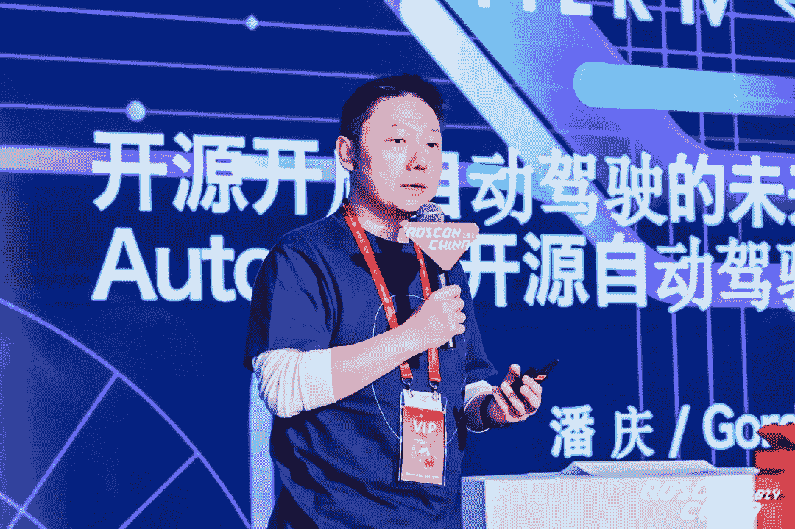

### Grok祭出首款生图模型Aurora

贡献人：

https://mp.weixin.qq.com/s/-J0UdHp-h9QZ23ijNAwWgg

xAI最近发布了其首款完全自研的图像生成模型Aurora，并成功集成到了Grok平台中，耗时六个月完成研发。Aurora是一个自回归模型，采用了混合专家架构（MoE），通过混合文本和图像数据训练，具备生成高质量图像的强大能力。用户现在可以通过Grok无缝体验这一新模型，特别是在人物肖像、艺术字体、表情包和实物生成方面，Aurora表现出极高的生成一致性。它还支持多模态输入，允许用户在图像生成和编辑过程中更加灵活和自由。

Aurora的强大功能体现在多个方面，包括精确的图像渲染和复杂文本指令的执行。它能够生成真实的图像细节，如精确的人物肖像、艺术字和梗图等，解决了其他AI生图模型在这些领域的困难。此外，Grok还将图像编辑功能与生成结合，用户可以直接在生成的图像上进行修改，进一步提升创作自由度。

在推向市场之前，Grok的图像生成功能已在𝕏平台部分地区上线，预计将在一周内全面开放。网友们对Aurora的生图能力给予了高度评价，尤其是在生成真实人像方面，Grok的表现超过了其他图像生成模型。

此次Aurora的研发由xAI的小团队完成，其中包括Gabriel Ilharco、Eric Zelikman、Haotian Liu和Lianmin Zheng等核心研究人员。他们在计算机视觉、多模态学习以及大规模模型的研究方面具有深厚背景。马斯克和团队成员对xAI团队的高效执行力给予了高度评价，Aurora的发布标志着Grok图像生成能力的重大突破，也预示着AI图像生成技术的未来发展方向。

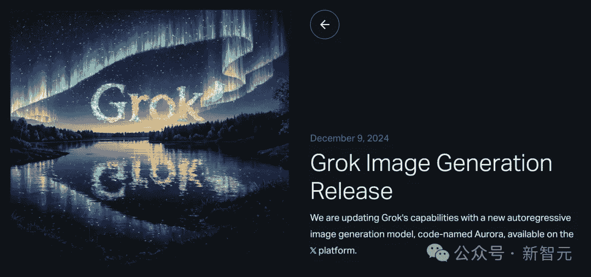

### 谷歌最强量子芯片登场

贡献人：

https://mp.weixin.qq.com/s/PFnde6a7HCjOd_tbmbNRKw

谷歌近日公布了量子芯片Willow的重大突破，该芯片在基准测试中取得惊人成绩，能够在不到5分钟内完成一项标准计算，而最快的超级计算机需要耗时10^25年才能完成相同任务，这一时间远超过宇宙的年龄。Willow的成功标志着量子计算在纠错技术上的重大进展，能够以越来越高的准确度执行计算，破解了量子纠错这一困扰研究人员近30年的难题。

Willow芯片采用105个量子比特，并成功实现了量子误差校正，使得随着量子比特数量的增加，系统的错误率指数级降低。这一突破使得量子计算机在执行复杂任务时的表现大大超越了传统计算机。谷歌的研究团队使用随机电路采样（RCS）基准测试验证了Willow的能力，这一测试被认为是量子计算机最困难的传统基准。Willow在这项测试中的表现远远超过了现有超级计算机，显示出量子计算机在特定任务上的强大优势。

Willow的突破意味着量子计算技术的实用化进程加速，未来有望在药物发现、电池设计、聚变能等领域取得应用，甚至在某些任务上超越传统计算机的极限。谷歌表示，随着量子计算规模的扩大，量子芯片的性能将持续提升，逐步向商业应用迈进。

这项突破得到了业界的广泛关注，谷歌CEO皮查伊、马斯克以及OpenAI CEO萨姆·阿尔特曼纷纷为此点赞。谷歌团队希望通过Willow的成果，推动量子计算在科学发现和实际应用中发挥重要作用，为解决社会重大挑战提供新的解决方案。

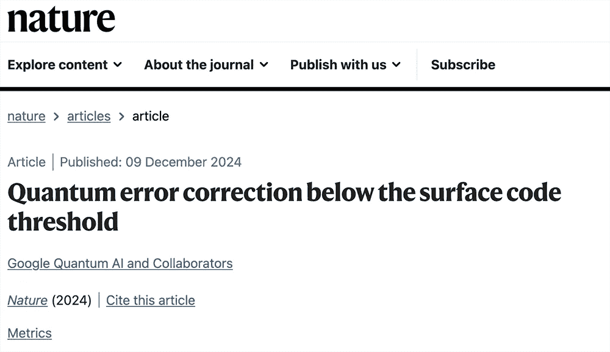

# 推特

### OpenAI Sora 已上线：可以通过文本生成全新的视频、让图片动起来，或对已有的视频进行扩展、重混或融合

https://x.com/OpenAI/status/1866194857636868283

我们的假日礼物送给你：Sora 已上线！http://sora.com

现在，你可以通过文本生成全新的视频、让图片动起来，或对已有的视频进行扩展、重混或融合。我们开发了全新的界面，让提示更简便，同时提供创意控制和社区分享功能：https://openai.com/sora/

自从今年2月预览 Sora 以来，我们一直在研发 Sora Turbo——一个显著更快的版本，现在我们将它作为独立产品发布给 Plus 和 Pro 用户。

我们希望 Sora 的早期版本能帮助大家探索全新的创意形式。我们迫不及待地想看到你们的创作！”

[QcsTwkRwoRzS2HIN.mp4](https://internal-api-drive-stream.feishu.cn/space/api/box/stream/download/all/VK8wbZ3MwoHIKCx1Dg8cMEsmn4g)

### TTS WebGPU：首款基于 WebGPU 加速的文本转语音网页应用

https://x.com/xenovacom/status/1865841995802882132

推出 TTS WebGPU：首款基于 WebGPU 加速的文本转语音（TTS）网页应用！🔥

实现高质量、自然的语音生成，100% 在你的浏览器本地运行，由 OuteTTS 和 Transformers.js 提供技术支持。🤗 快来试试吧！

演示和源码如下 👇

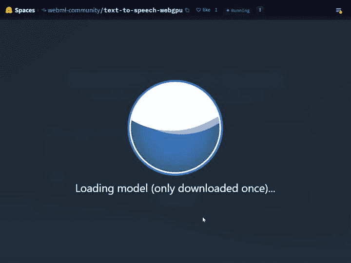

[kCMEZpsySyNaFIxd.mp4](https://internal-api-drive-stream.feishu.cn/space/api/box/stream/download/all/KOqzbdji1oLdIcxs7n0cZjzCnGd)

### 让Whisper 比 OpenAI 快20 倍：只需4 秒即可转录 1 小时的音频

https://x.com/FireworksAI_HQ/status/1866218532738109891

我**们让 **Whispe**r 比 **OpenAI 快了 20 倍！* 今天，我们推出了速度最快、功能最全的音频 API 测试版——只需 4 秒 即可转录 1 小时 的音频（900:1 的转录速度！）

为庆祝上线，我们提供 **2 周免费试用** ——立即在我们的 UI playground 尝试！https://fireworks.ai/blog/audio-transcription-launch

*（Whisper-large，无量化！）

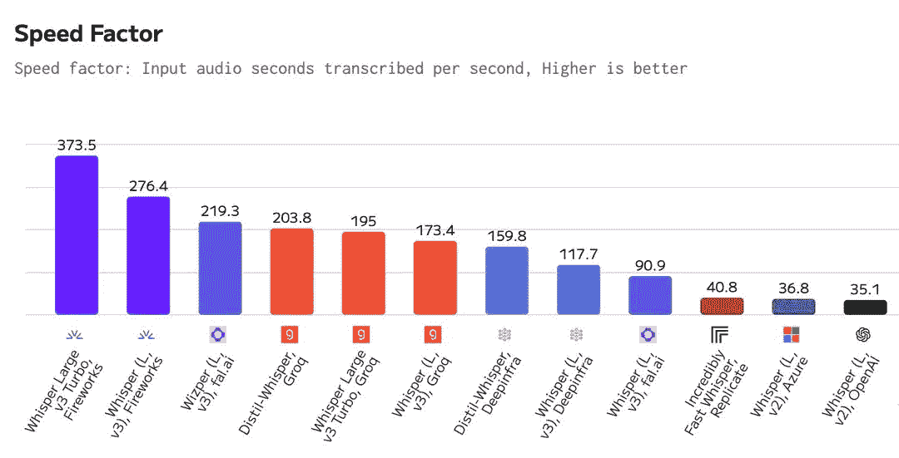

### Lindy Phone Calls ——强大的 AI 语音助手，支持超过 1,000 种集成

https://x.com/i/status/18661983         41803249685

宣布推出 Lindy Phone Calls ——全球最强大的 AI 语音助手，支持超过 1,000 种集成。

看看这个“埃隆·Lindy”如何给我的整个团队打电话，询问“你们本周完成了什么？”——然后汇总成一份报告，让我可以进行互动式的问答！

[GyhXwCDRkOu6T8G8.mp4](https://internal-api-drive-stream.feishu.cn/space/api/box/stream/download/all/Q4gYb2eQkoZaGrxXZIucNEojnUd)

# 产品

### Affiliat

e+高佣金收益产品市场

https://apps.apple.com/us/app/remy-ai-sleep-health-coach/id6443803441

贡献人：

Affiliate+ 是一个专注于高佣金收益的独家联盟产品市场，其独特之处在于与 Lasso 的智能化功能深度整合。通过 Lasso 内置的 AI 引擎，您不仅能够快速寻找并锁定更高佣金、更优质的盟商品替代方案，从而全面提升您的收入潜力，还可实现对既有推荐内容的自动化升级与优化。这意味着您无需花费大量时间在产品比对与链接替换上，AI 将为您智能筛选更合适的产品，并自动替换相关链接，让您的网站在不知不觉间实现收益的持续增长与更新迭代。总之，Affiliate+ 搭配 Lasso 的 AI 功能，让您的联盟策略更加高效灵活，轻松把握市场脉搏，为您的长期盈利保驾护航。

### Remy 您的独家AI睡眠教练

https://getlasso.co/features/affiliate-plus

贡献人：

Remy 以独特的魅力与专业水准，从多个维度全方位优化您的睡眠质量。作为一名 AI 睡眠教练，Remy 不仅关注传统意义入睡与起床时间，更通过精密的算法和先进的传感器数据分析，对您的生物钟与昼夜节律进行精确捕捉和调整。其背后的科学依据来源于现代睡眠医学与行为心理学领域的权威研究成果，从而确保每项建议都具有坚实的学术基础。

在此基础上，Remy 会根据您的生活习惯、环境因素以及当下身体与心理状态，提出可行的改善策略。例如，它能指导您逐步优化卧室光照与温湿度条件，建议合适的就寝仪式与放松练习，或帮助您制定晚间电子产品使用规则，确保大脑在恰当时刻分泌褪黑激素，以促进优质睡眠的自然到来。Remy 的目标不仅在于让您安然入睡，更在于帮助您建立健康、可持续的睡眠生态系统，让您在每日清晨苏醒时都能精神饱满、神清气爽。

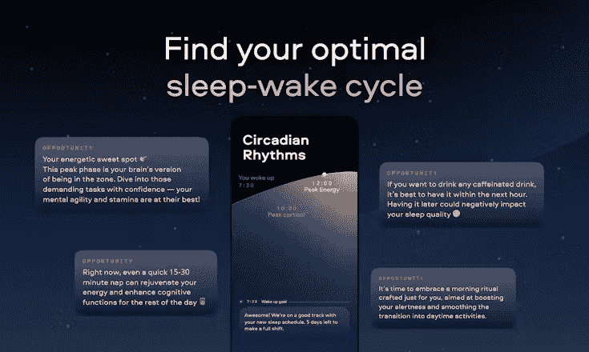

# HuggingFace&Github

### AgentStack 低代码解决方案

https://github.com/AgentOps-AI/AgentStack

贡献人：

+   **代理应该很简单：**市面上有很多框架，但从头开始却很麻烦。与 类似create-react-app，AgentStack 旨在通过为您提供一个简单的代理样板来简化“从头开始”的过程。它使用流行的代理框架和 LLM 提供程序，但在此基础上提供有凝聚力的策划体验。

+   **无需配置：**您无需配置任何东西。开发和生产版本的合理配置已为您处理，因此您可以专注于编写代码。

+   **无锁定：**您可以随时自定义设置。AgentStack 旨在让您轻松立即运行所需的组件；接下来要做什么由您决定。

AgentStack 并非旨在成为构建代理的低代码解决方案。相反，它是从头开始启动代理项目的良好开端。

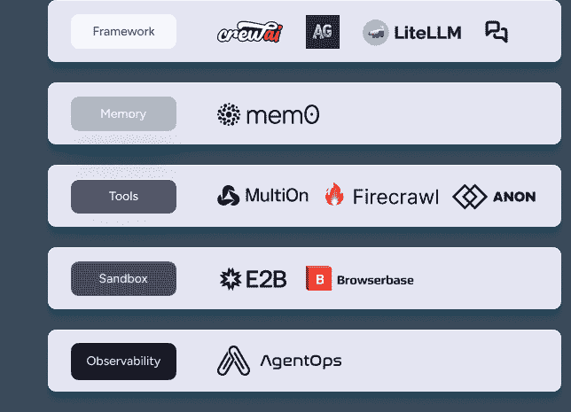

### World ID 零知识验证代币

https://github.com/worldcoin/world-id-example-airdrop

贡献人：

该存储库使用[Semaphore 库](http://semaphore.appliedzkp.org/)允许集合中的成员声明 ERC-20 代币，通过零知识证明保护他们的隐私并消除组与声明者地址之间的链接。

World ID 是一种协议，它可让您证明人类只执行了一次操作，而无需透露任何个人数据。阻止机器人，阻止滥用。

World ID 使用一种名为[Orb](https://worldcoin.org/how-the-launch-works)的[设备，该设备](https://id.worldcoin.org/zkp)会拍摄一个人的虹膜 align="center" 的照片，以验证他们是否是独一无二的活着的人。该协议使用零知识证明，因此任何可追踪的信息都不会公开。

World ID 适用于链上 web3 应用程序、传统云应用程序甚至 IRL 验证。

# 投融资

### 小米系首家具身大模型公司「小雨智造」获北京市投资，已在工业化场景落地

贡献人：

https://36kr.com/p/3070939049603972

北京小雨智造科技有限公司（以下简称「小雨智造」）近日完成亿元A轮融资。本轮融资由北京信息产业发展投资基金独家投资，继2023年获得小米集团、王田苗教授和北京智源研究院的亿元天使轮投资后，再次获得亿元级别的资金支持。

小雨智造由小米核心创始团队于2023年创立，专注于开发适用于工业领域的大模型机器人技术，目标是为机器人打造通用的“智能大脑”，使其能够适应各类工业任务。公司的技术重点包括高精度、高鲁棒性和高泛化性，致力于为机器人提供强大的感知、决策和控制能力。

**团队背景与核心技术：**

小雨智造的创始人乔忠良曾是小米的初创团队成员，担任MIUI研发负责人；联合创始人王文林曾负责小米的软件系统平台部，主导“小米大脑”的开发。核心团队成员均来自小米、微软、华为、字节跳动等知名企业，具备深厚的技术背景和行业经验。

**产品与技术亮点：**

小雨智造的主打产品是“Xiaoyu Brain”通用机器人大脑，主要特点包括：

+   **智能感知与决策引擎**：具备动态分辨率的视觉任务模型和多模态决策模型，能够精确到5厘米导航和毫米级操作，支持复杂环境中的高效任务执行。

+   **高精度运控技术**：基于仿真和深度强化学习的机器人控制模型，实现毫米级精度控制，保证机器人在精细操作中的稳定性和准确性。

+   **动态实时闭环控制**：优化感知、决策、控制的全链路闭环系统，使机器人在动态环境中保持高效稳定工作。

+   **模块化智能架构**：支持快速集成与扩展，灵活应对不同工业场景的需求。

+   **自学习与自优化能力**：机器人通过操作经验积累，自主优化性能，提升任务执行效率，特别适用于变化多端的工业环境。

**产业合作与应用落地：**

在落地应用方面，小雨智造已经与松下展开全方位战略合作，推动智能焊接机器人市场的发展。此外，还与多家建筑、工程机械龙头企业建立了战略合作，并积极布局航空航天、船舶制造等领域。

公司官网：https://www.xiaoyubot.com/

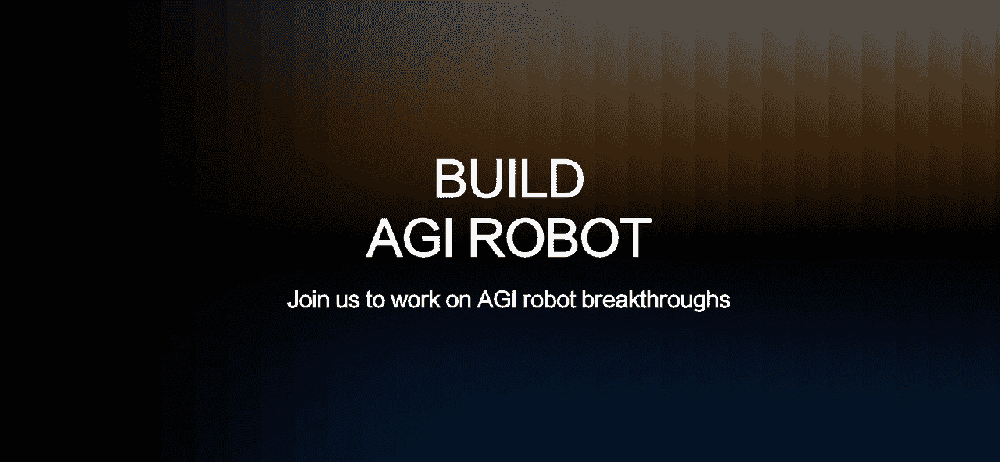

### Dimension资本完成5亿美元第二基金融资，聚焦科技与生命科学交汇点

贡献人：

https://techcrunch.com/2024/12/09/dimension-raises-500m-second-fund-for-investing-at-the-intersection-tech-and-life-sciences/

Dimension资本是一家成立仅两年的风险投资公司，近日宣布完成其第二只基金的募集，规模达5亿美元，超过了原定目标4亿美元。这一基金主要专注于生命科学与技术交汇的投资领域，特别是在人工智能驱动的药物研发和临床应用等方向。

+   **投资者热情高涨**：Dimension的第一批投资者几乎全数回归，同时吸引了一部分新投资者，但因超额认购拒绝了多数感兴趣的有限合伙人（LP）。

+   **基金背景**：Dimension的首只基金募集于2022年，规模为3.5亿美元。与其不同的是，第二只基金将不局限于早期投资，而是涵盖从创业到上市的各个阶段。

+   **投资布局**：Dimension目前投资了约20家公司，其中约一半仍处于隐秘阶段。已知项目包括：

+   **Chai Discovery**：开发开源AI基础模型用于药物研发，9月获3000万美元种子轮融资。

+   Enveda Biosciences：利用AI从自然化合物中开发药物，近期完成1.3亿美元C轮融资。

+   **Monte Rosa**：一家公开交易的生物技术公司，利用AI工具进行药物开发。

+   **投资策略**：基金采取阶段灵活的投资方式，可投入100万到3000万美元不等，目标仍是约20个投资组合。投资领域分为药物研发与生物制药支持软件和基础设施两类。

+   **独特要求**：在生物技术项目中，团队需至少25%-40%成员为计算生物学家、AI工程师或硬件机器人专家，与化学家和生物学家协同合作。

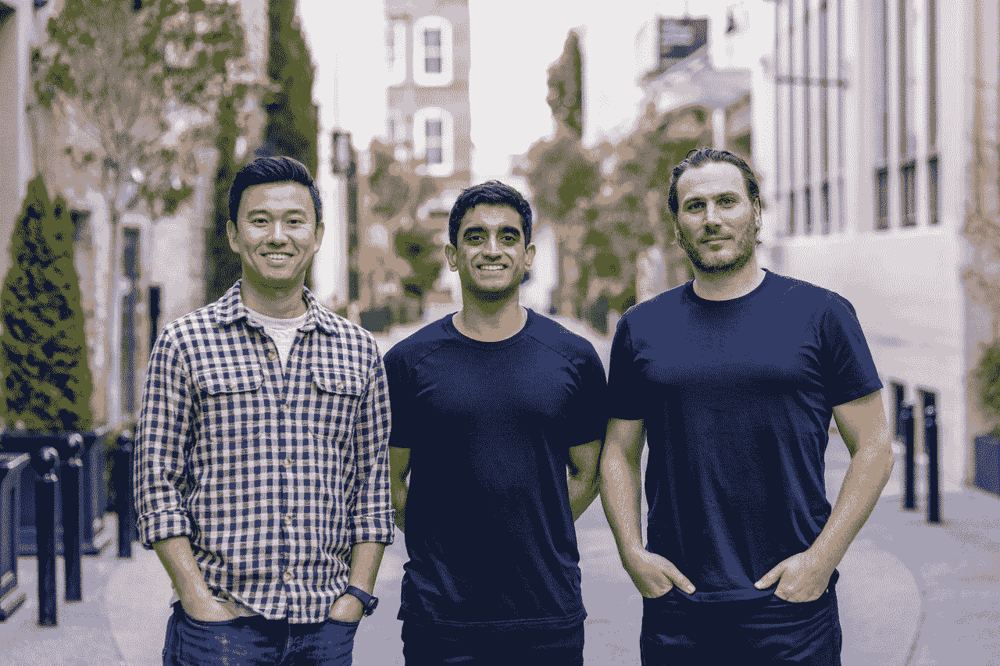

# 学习

### 两秒视频表示为 32 个 Diffusion-Compressed Deep Token

贡献人：

https://zhuanlan.zhihu.com/p/11586141743

这篇论文提出了一种新的视频生成方法，旨在解决传统自回归模型在处理视频时面临的“token数量过多”的问题。自回归模型在生成视频时，需要大量的token表示每帧图像，例如，对于256x256分辨率的视频，单秒钟的视频就需要约6,000个token，这对于长时间的视频生成显然不适用。为了解决这个问题，论文提出使用16个token来表示两秒的视频，并利用扩散模型进行有效的token压缩。

首先，论文明确了其目标：通过在自回归模型和扩散模型之间架设中介，来压缩视频的token表示，同时保持视频的时序信息，并且确保其能与图像数据兼容。具体而言，时间因果性要求模型保留视频的时间顺序，而高效的token压缩则通过引入扩散模型的先验知识，显著降低了需要处理的token数量。此外，设计的tokenizer能够有效地处理图像数据，从而缓解了高质量视频-文本数据稀缺的问题。

技术上，论文采用了一种基于ViT的连续token而非离散token的表示方式，这使得视频的每一帧都可以通过一个1024维的特征向量来表示。相比于传统的图像token，这种方式不仅大幅减少了所需token的数量，同时也提高了图像和视频生成的质量。通过这种方法，16个token就足以有效压缩两秒钟的视频，显著提高了自回归生成的效率。

在方法实现上，DiCoDe模型首先通过视频的首尾两帧来进行token压缩，而中间帧则交由扩散模型生成。自回归模型DiCoDe在预测过程中，通过变分模型来估计下一个token的分布。训练时，损失函数为目标token在预测分布下的负对数似然；推理时，从该分布中采样生成下一个token。所采用的变分模型包括高斯模型和高斯混合模型，后者能够有效地捕捉视频生成中的不确定性。

此外，DiCoDe还利用了预训练的语言模型（如GPT2和Llama3.2）来进一步提高生成效果。使用这些强大的预训练模型，DiCoDe能够有效地进行自回归建模。具体来说，模型的自回归部分只需要修改最后一个投影层，以适应16个1024维的token输出，这样便能够大幅降低生成过程中的计算复杂度。

在实现细节上，作者使用了现成的视频扩散模型DynamiCrafter。这个模型基于256x256分辨率的图像，能够一次生成2秒的视频片段，并且采用了8fps的帧率。在训练过程中，模型通过WebVid-10M数据集进行训练，并且结合了来自不同数据集的图像和视频数据，以获得更丰富的生成知识。训练时，采用了固定学习率和AdamW优化器，且在多轮训练中逐步调整数据来源和模型参数。

最后，论文通过一系列的消融实验，展示了DiCoDe在不同token数量和损失函数设置下的性能变化，进一步验证了该方法在视频生成任务中的优势，尤其是在长时间视频生成中的扩展性和效率。

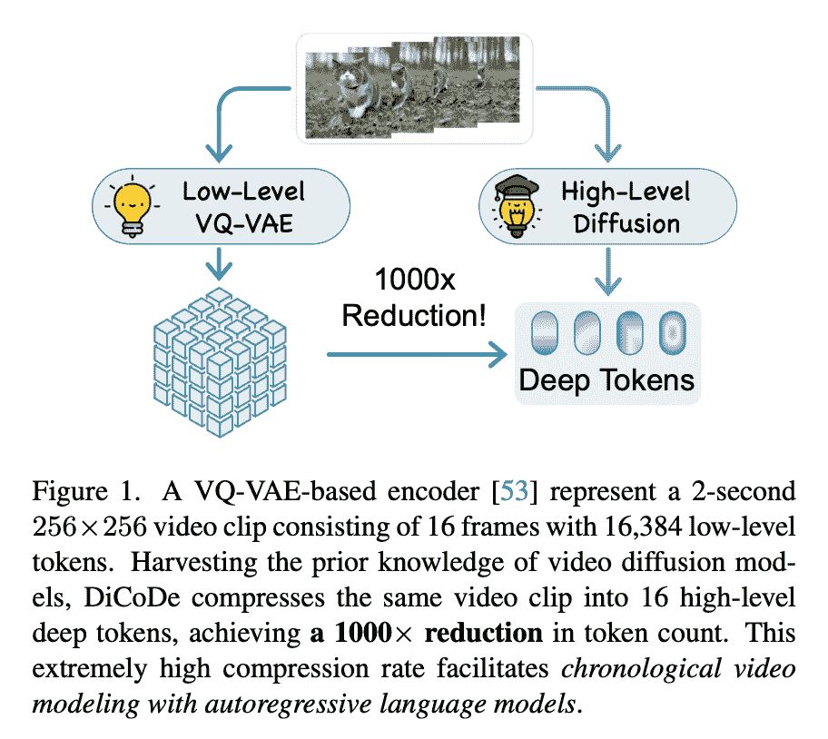

### ROSCon中国站——探索具身智能新高度——机器人在数据收集与学习策略中的优势和机会

贡献人：

https://zhuanlan.zhihu.com/p/11669752908

在2024年ROS Conference中国站上，集智联机器人创始人包文涛介绍了机器人在数据收集和学习策略中的优势，尤其是在具身智能和机器人操作的深度融合方面。演讲探讨了Diffusion Policy、UMI数据收集框架及遥操作技术的潜力，并展示了Franka机器人在多模态融合、力控技术和学习策略中的卓越表现。

首先，包文涛强调了协作机器人对人形机器人硬件发展的贡献。协作机器人在力控技术、多模态感知和精准运动控制上的突破为人形机器人的设计提供了支持。同时，协作机器人积累的大量人机交互数据和应用经验，也优化了控制算法和运动规划能力。

ROS强化学习机器人数字孪生通用平台通过集成机器人控制、仿真和强化学习算法，为研发提供了高效的实验环境。该平台以Franka机器人（FR3）为核心，结合深度视觉设备Azure Kinect DK，支持实时计算和强化学习模型运行，且基于ROS框架进行运动规划和消息传递。

Franka机器人在多模态智能控制中发挥了重要作用。凭借其精准的力控能力（0.05N的力敏感度）和开放的开发生态（兼容C++、ROS、MATLAB），Franka能高效完成复杂任务。其多模态数据融合技术通过视觉、触觉和力感知的结合，实现了对复杂操作的精确执行。

包文涛还重点讨论了Diffusion Policy算法对机器人操作学习的影响。这种算法通过条件去噪扩散建模，将复杂任务的动作空间映射为多模态概率分布，从而生成稳定而鲁棒的行为。该策略不依赖于大量超参数调整，适用于多样化制造场景，展现了强大的适应性。

UMI数据收集框架在多模态数据采集中的应用也成为关注焦点。UMI整合RGB图像、末端执行器姿态和夹持器宽度，为策略学习提供高质量数据。尽管UMI在计算成本和数据同步性上存在挑战，但其在精密制造中的实时反馈能力和低成本高精度感知具有明显优势。FAST UMI框架优化了硬件配置和数据处理流程，显著提升了机器人学习效率，尤其是在未知场景中的应用。

丰田研究院展示了遥操作与力控技术结合的最新进展，通过力反馈遥操作设备，允许操作员直接控制机器人，并通过示例数据优化策略。这种结合加速了机器人学习，增强了人机协作能力，推动了具身智能技术的发展。

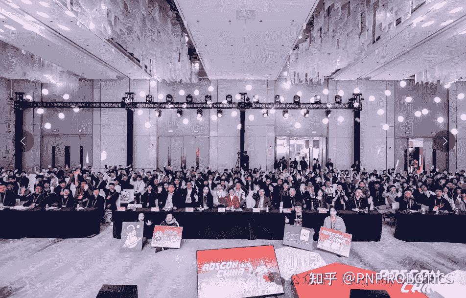

### 浅析移动端 CPU 调度策略

贡献人：

https://zhuanlan.zhihu.com/p/11634613935

在性能测试中，尤其是在移动设备上，测试环境与应用环境之间常常存在显著的性能差距。例如，虽然在测试工具中，某个模型的执行时间可能为1ms，但在实际应用中，这一时间可能会增加至4ms或10ms以上，原因主要是CPU调度策略和节能机制的影响。

CPU调度策略在调节计算负载、频率以及任务调度中起着核心作用。在移动设备中，CPU的计算频率是动态调整的，目的是在性能和功耗之间找到平衡。例如，当设备执行一个1x3x32x32大小的Mobilenet V1模型时，连续运行与间歇性运行（例如每次执行后休息1秒）会导致耗时的显著差异。连续运行时，平均耗时为0.9ms，而间歇性运行时，平均耗时则上升至11ms，这主要是因为任务在休息期间被降频，导致频率无法及时恢复到较高水平。

CPU负载计算通过PELT（Per Entity Load Tracking）和WALT（Window Assisted Load Tracking）两种方案来实现。PELT基于任务的历史执行时间来估计负载，但存在较高的延迟，尤其是在高负载任务的识别上。相比之下，WALT使用滑动窗口来实时计算任务负载，具有更快的响应速度，能够更有效地调整频率，虽然这可能会引发频率的快速波动。

动态频率调节（DVFS）通过选择合适的电压和频率对，旨在降低动态功耗。CPU频率和状态的切换会影响到功耗的优化。移动设备的CPU通常根据负载选择适当的频率状态，这样可以避免过度功耗。例如，当CPU负载较低时，系统会自动降低频率，以节省电能；而当负载增加时，频率会相应提高，以确保性能。

为了优化功耗，Linux内核中也采用了几种调度策略。CFS（Completely Fair Scheduler）适用于高负载情况下的公平调度，而EAS（Energy Aware Scheduling）则更加注重功耗优化，特别是在使用大小核架构时，它会根据任务的负载动态地将任务分配到合适的CPU核上，从而最大限度地减少能耗。EAS利用能量模型（EM）来计算每个CPU核心的功耗，并基于这些计算结果进行任务迁移，以降低整体能耗。

测试中的频率变化和任务调度导致的性能波动，尤其是在间歇性执行时，通常与设备的调度策略和节能机制密切相关。因此，在设计性能测试时，应考虑设备的功耗特性并模拟实际的应用环境，以更准确地评估系统性能。通过合理的任务调度和频率调整，可以在保证性能的同时，最大限度地降低功耗。

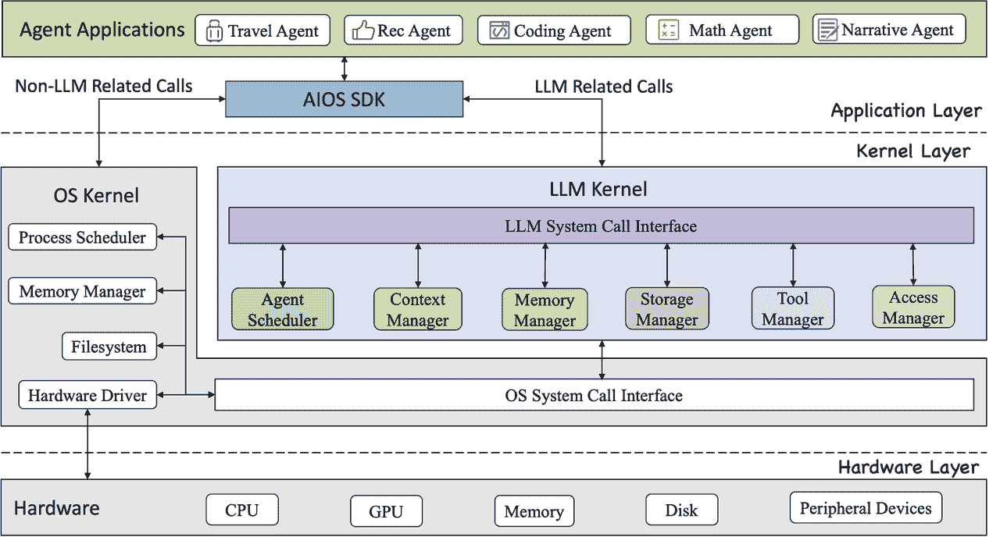

### 扩散模型 vs. 最优传输

贡献人：

https://zhuanlan.zhihu.com/p/11439249557

最优传输（OT）和扩散（Diffusion）是近年来机器学习和优化领域中的重要工具，它们在分布偏移、领域适应和表示学习中扮演着关键角色。最优传输研究如何以最小代价将一个分布转换为另一个分布，关键概念包括Wasserstein距离和最优传输映射。扩散模型则是一类生成模型，通过逐步向数据添加噪声，生成样本的反向去噪过程。虽然这两者有一定的交集，但它们之间的理论联系仍然不完全明确，尤其是在扩散模型是否能够产生最优传输映射这一问题上。

最优传输通过两种主要形式定义：Monge问题和Kantorovich问题。Monge问题寻求一个确定性的映射，将一个分布推送到另一个；Kantorovich问题则寻找一个联合分布，通过最小化成本函数达到最优传输。在实际应用中，OT广泛应用于机器学习、生成模型和数据对齐等领域。Wasserstein距离作为OT的一种特殊形式，常用来衡量不同概率分布之间的距离。

扩散模型是一种生成模型，核心思想是在一个正向扩散过程中向数据添加噪声，然后学习一个反向去噪过程。通过这个反向过程，模型从噪声中恢复出样本数据。扩散模型通常通过训练神经网络来近似后验分布，使用变分下界或去噪得分匹配作为训练目标。

尽管在一些实验中，扩散模型的映射看起来与最优传输产生的映射相似，但它们之间并没有严格的等价关系。尤其是扩散模型的流映射（flow map）在理论上并不总是能够提供最优传输映射。在一些研究中，扩散过程被理解为最优传输中Wasserstein流的近似，但实际上，扩散模型的逆向流映射并不满足最优传输映射的要求。

具体来说，扩散模型的逆向流映射在多维情况下不能满足最优传输所要求的凸性和梯度性质。例如，扩散模型的逆向过程通过向量场定义，但该过程中的流映射并不总是来自于一个凸函数的梯度，这违反了Brenier定理中的凸性要求。此外，扩散模型的目标是生成数据，而非优化从数据分布到参考分布的运输成本，因此其生成过程并不严格遵循最优传输的几何结构。

一些研究进一步表明，扩散模型的逆向流映射在某些情况下，尤其是在多维空间中，并不符合最优传输所需要的梯度流性质。例如，在近似高斯分布的情况下，逆向流映射可能会失去对称性，违反了最优传输映射的几何约束。具体来说，Lavenant和Santambrogio通过反证法构造了一个反例，证明了在某些情况下，扩散模型的流映射并不满足最优传输的要求。

因此，尽管扩散模型在生成过程中具有强大的能力，它无法提供最优传输映射。这揭示了扩散模型在理论上的局限性，并为未来在生成模型和最优传输关系上的研究提供了新的思路。

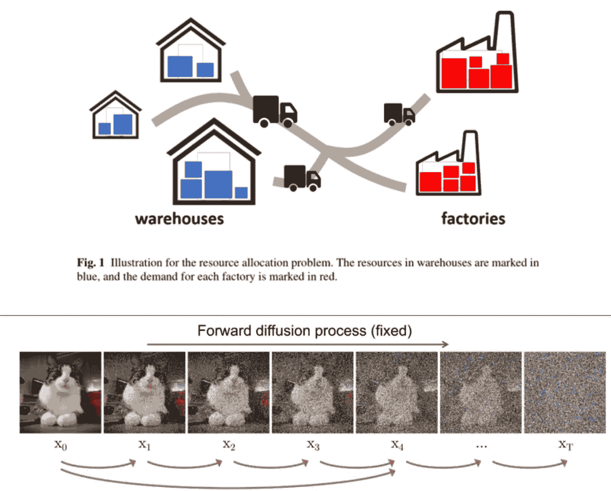

# 声明

本文档仅供学习交流使用，版权归原作者所有，若涉侵权，请联系Jack Jin 15101136166

##

（欢迎在下方反馈您宝贵的意见！整理不易，觉得有用给AI日报小组点个赞👍吧！）

ChatGPT；Angela；Zijia Liu；Alex；Zeqi Tan；Tiezhen（HuggingFace）；Naixu；Lizhi；Peter；Suoman；Jack

学术分析报告：ResearchFlow -- 奇绩F23校友的开发的深度研究产品，PC端进入RFlow的分析报告，可直接点击节点右侧的小数字展开节点，登录后可在节点上直接“询问AI”，进一步探索深度信息

如果你有大模型相关的创业想法，欢迎来找我们聊聊～微信：15101136166

> 快邀请你的小伙伴们一起来读大模型日报吧！

> **【日报****知识库****】**这里是近期日报内容的汇总,欢迎大家查阅

> [大模型日报知识库(分享版)](https://miracleplus.feishu.cn/wiki/KapVwXfkriOBiskB0B2cUHxjnTh)

>

> 欢迎大家多多帮我们分享,转发~~

> 如果大家有任何的建议或者吐槽,欢迎随时找我聊天~

