# 奇绩大模型日报（12月 11日）

> 来源：[https://miracleplus.feishu.cn/docx/BkpTdiHOyo4Xq7xxfrCcwrkxnMc](https://miracleplus.feishu.cn/docx/BkpTdiHOyo4Xq7xxfrCcwrkxnMc)

# 资讯

### 谷歌启动 200 亿美元可再生能源项目，支持 AI 数据中心

贡献人：

https://techcrunch.com/2024/12/10/google-kicks-off-20b-renewable-energy-building-spree-to-power-ai/

2024年12月10日，谷歌宣布与可再生能源开发公司 Intersect Power 及投资基金 TPG Rise Climate 签订协议，计划投资 200 亿美元建设可再生能源、储能设施和电网升级项目，以支持其 AI 数据中心的需求。此次合作将推动多个千兆瓦级数据中心的运行，而首个项目已经由 Intersect Power 融资启动。

此项目还包括向 Intersect Power 投资 8 亿美元股权，TPG 主导此轮融资，谷歌及其他合作方也参与其中。随着谷歌等科技公司加速扩展 AI 能力，它们迫切需要更多能源，这促使它们投资于新的能源来源。

具体而言，谷歌将为每个千兆瓦规模的数据中心配备同等容量的风能、太阳能和储能设施，确保这些数据中心能获得足够的绿色能源支持。此外，谷歌还将承担电网所需的升级费用，以加速可再生能源与数据中心的连接。

该项目将分阶段进行，预计2026年启动首个阶段，2027年完成，展现了可再生能源项目的快速部署能力。这一进展预计将对核能开发商产生压力，因为大多数核电项目的建设时间较长。

### Fine-Tuning Paligemma 2

贡献人：

https://blog.roboflow.com/fine-tune-paligemma-2/

在这篇博客文章中，作者详细介绍了如何通过 Roboflow 平台对 Paligemma 2 模型进行微调。Paligemma 2 是一个用于图像分类和目标检测的深度学习模型，其优点是高效且易于集成。为了让 Paligemma 2 更好地适应特定任务，微调是提升模型性能的关键步骤。

1.  **数据准备与集成：** 微调的第一步是准备高质量的数据集。Roboflow 提供了数据标注工具，可以简化这一过程。用户可以上传原始数据，并使用 Roboflow 来标注和增强数据集。这对于训练高效且精准的模型至关重要。

1.  **配置与选择模型：** Roboflow 允许用户选择 Paligemma 2 模型并进行配置。选择合适的预训练模型进行微调能够显著提升最终的效果，尤其是在数据集较小或具有特定需求时。用户可以通过 Roboflow 的界面选择图像分类或目标检测任务来微调模型。

1.  **微调流程：** 微调的过程中，模型会从一个已经训练好的版本开始，利用用户提供的标注数据进行进一步的训练。Roboflow 支持自动化的训练流程，用户只需选择数据集并指定训练参数，系统便会处理剩余的任务。为了避免过拟合，通常需要使用合适的正则化技术，保持训练的泛化能力。

1.  **模型评估与调整：** 在微调完成后，Roboflow 提供了详细的评估工具来检测模型在验证集上的表现。通过对比不同参数的效果，用户可以调整模型，优化其在特定任务上的准确性。Roboflow 还提供了评估指标，如精度、召回率等，帮助用户分析和选择最佳模型。

1.  **部署与应用：** 一旦微调过程完成，用户可以将优化后的模型部署到自己的应用中。Roboflow 支持多种导出格式，如 TensorFlow 和 PyTorch，确保与各种开发环境的兼容性。

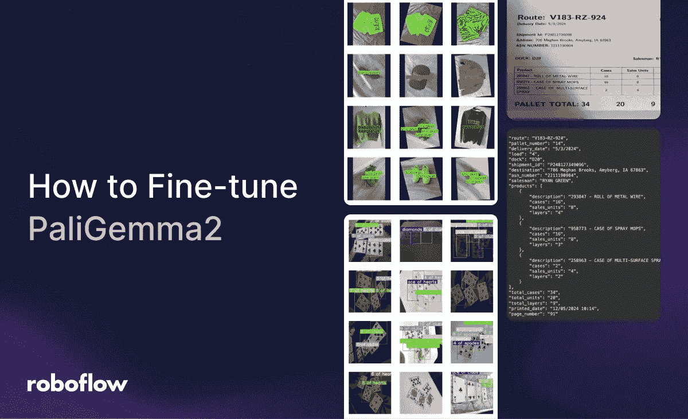

### 使用Unsloth对Llama 3.3进行微调

贡献人：

https://unsloth.ai/blog/llama3-3

本文讨论了如何通过Unsloth平台对Meta的Llama 3.3 (70B)模型进行微调，并介绍了与其他框架（如Hugging Face和Flash Attention 2）相比的显著性能优势。Llama 3.3（70B）在上下文长度和内存使用方面表现出色，能够提供比同类技术更快的微调速度和更低的内存消耗。

1.  **显著提升的上下文长度**
Unsloth优化后，Llama 3.3（70B）支持最高89,000的上下文长度，是Hugging Face与Flash Attention 2组合的13倍。相比于原版Llama 3.3，Unsloth还通过引入全新的苹果Cut Cross Entropy（CCE）算法进一步提升了长上下文支持，Llama 3.3的上下文长度比旧版本提高了1.85倍。

1.  **内存使用与性能优化**
使用Unsloth进行Llama 3.3（70B）微调时，在80GB GPU上需要41GB VRAM，这比使用Hugging Face和Flash Attention 2时显著减少了内存占用。Unsloth还采用了新的梯度检查点算法，这一技术使得内存的使用更加高效，能够将更多的计算负载转移到系统RAM，进一步减少了GPU内存的需求。

1.  Apple Cut Cross Entropy (CCE)算法的引入
Apple的CCE算法通过优化交叉熵计算，减少了计算中的低数值处理，提高了性能，且不会影响准确性。该算法帮助提升了Llama 3.3（70B）在处理长上下文时的效率，使其相比传统方法支持更长的上下文长度。

1.  **4bit预量化与更快的下载速度**
Unsloth提供了Llama 3.3（70B）的4bit预量化版本，并通过优化的GGUF格式在Hugging Face页面上发布，使得模型下载速度比传统方法快了4倍。

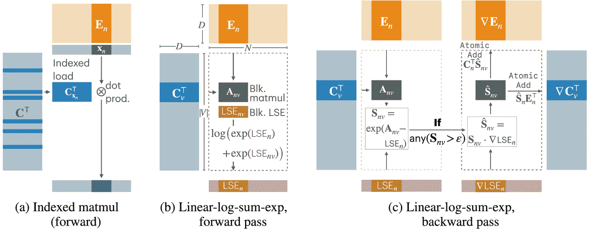

`

### 英伟达的机器人新魔咒：一句指令让双足机器人“自由”行动

贡献人：

https://mp.weixin.qq.com/s/ioTxfKmU1Oo8FywyufZdRA

加州大学和英伟达的研究人员联合提出的NaVILA模型，通过结合自然语言指令、视觉图像和激光雷达信息，突破了传统依赖预先绘制地图的局限，实现在复杂环境中的自主导航。NaVILA的核心创新是通过实时感知环境并听懂自然语言指令，来进行路径规划与执行。研究人员利用宇树Go2机器狗和G1人形机器人进行实测，发现NaVILA在家庭、户外和工作区等环境中的导航成功率高达88%，复杂任务中的成功率也达到75%。

NaVILA的技术核心包括高层的视觉-语言-行动（VLA）模型和低层的控制机制。VLA模型将视觉、语言和激光雷达数据结合，实现对环境的多模态感知，生成路径规划指令。这些指令通过“中间指令机制”进行拆解，让机器人不需要预设每个具体动作，而是根据高层指令自行进行拆解执行。低层控制则通过PPO强化学习算法，帮助机器人在不同地形中进行稳定行走，避免摔倒。

与传统的视觉语言导航系统（VLN）不同，NaVILA不依赖静态地图，而是通过实时感知动态环境进行导航。它特别适用于腿式机器人，能够处理复杂的地形和障碍物，如跨越门槛、绕过物体等。此外，NaVILA使机器人能够适应不同形态的机器人平台，四足和人形机器人都能通过NaVILA接受类似的控制指令。

在实测中，NaVILA成功实现了机器人在多种场景下的高效导航，展示了它在家庭、灾后救援等复杂环境中的广泛应用潜力。NaVILA的“无图导航”使得机器人能够在未知和动态变化的环境中灵活适应，进一步扩展了足式机器人的应用场景，如搜救、巡检等任务。这项技术让机器人摆脱了对地图的依赖，真正实现了智能化、灵活化的自主导航。

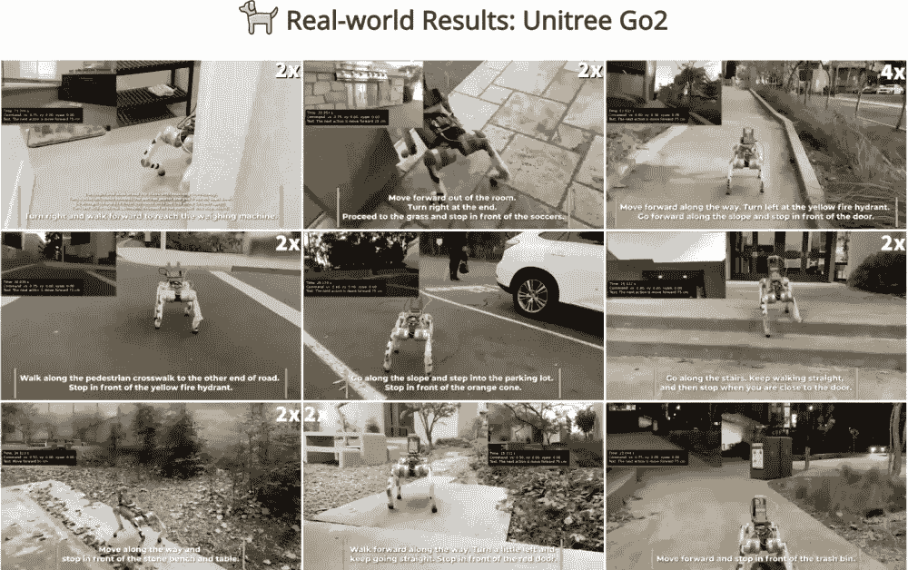

# 推特

### Canvas在向所有用户开放：一种与 ChatGPT 合作的新方式，用于起草、编辑并获得有关写作和代码的反馈

https://x.com/OpenAI/status/1866578914233159928

Canvas——一种与 ChatGPT 合作的新方式，用于起草、编辑并获得有关写作和代码的反馈——现已在我们的 4.0 模型中向所有用户开放。

它已完全在网页版和 Windows 的 ChatGPT 桌面应用程序中上线。

通过新的复制粘贴体验，现在可以更轻松地将您的写作和代码带入 Canvas。

您现在可以直接在 Canvas 中运行 Python 代码，并让 ChatGPT 根据控制台错误修复任何 bug。

Canvas 现在也可以与 GPT 配合使用。

---

Altman：

Canvas 现已向所有 ChatGPT 用户开放，并且可以执行代码！

更重要的是，它仍然可以为您的写作添加表情符号。 😊

[7NIwBKMcKpjszIzE.mp4](https://internal-api-drive-stream.feishu.cn/space/api/box/stream/download/all/I8XqbBSm7oBWKoxOxiJc3oALnEc)

### Devin正式上线：只需标记 Devin，即可修复前端 bug、为待办任务创建初稿 PR、进行重构等操作

https://x.com/cognition_labs/status/1866535303911182771

Devin 从今天起正式上线！

只需标记 Devin，即可修复前端 bug、为待办任务创建初稿 PR、进行重构等操作。

立即开始使用 Devin 吧：

[ZCWrVhgabv7JojkJ.mp4](https://internal-api-drive-stream.feishu.cn/space/api/box/stream/download/all/ATyNbXsPWodnT2x4yZ6c41J3nQc)

### Nous Simulators 正式发布：NousResearch所有关于人类与 AI 在社会领域互动实验的基地

https://x.com/NousResearch/status/1866584568548995538

Nous Simulators 正式发布！

这是我们所有关于人类与 AI 在社会领域互动实验的基地。

访问链接： http://sims.nousresearch.com

### Ambient：电脑上的情境感知 AI，可查看整个屏幕， 长上下文窗口，具备记忆功能

https://x.com/Karmedge/status/1866506853896843266

介绍Ambient：电脑上的情境感知 AI。

我刚用它爬取了整个 Discord 并总结了大家的痛点。

功能亮点：

• 可查看整个屏幕（包括需要滚动才能看到的部分）

• 长上下文窗口

• 具备记忆功能

链接：[tryambient.com](https://t.co/ld2zuPjEKZ)

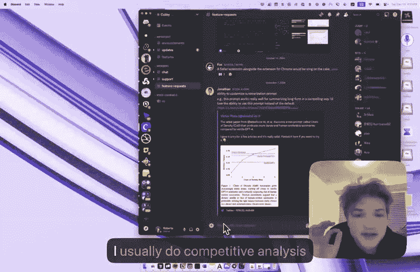

[rx5tNn6WHxp5D6Yz.mp4](https://internal-api-drive-stream.feishu.cn/space/api/box/stream/download/all/MURLbSDmIofdkwxXD61cN4yinRg)

### Offner分享Sora视频效果引热议：“Sora 是一个数据驱动的物理引擎。”

https://x.com/chrisoffner3d/status/1866454313502925109

“Sora 是一个数据驱动的物理引擎。”

[FZN9I4hvvuU71KnK.mp4](https://internal-api-drive-stream.feishu.cn/space/api/box/stream/download/all/UYXSbiav3oxsCwxES6TcUsp8nlf)

# 产品

### Remento 为家人撰写传记的人工智能

https://www.remento.co

贡献人：

Remento 的独特之处在于将传统的记忆整理和家族故事书写，与先进的语音识别与自然语言生成技术有机融合。过去，人们往往需要花费大量时间去记录、整理和润色亲人们的生活经历、家庭轶事与人生智慧，而在 Remento 的平台上，这一过程则被大大简化。您只需在一周内进行数次简短的语音采访，通过对话的方式引导家人自然倾诉他们的人生故事：他们的童年回忆、成长历程、人生里程碑，以及平凡又珍贵的家庭片段。

在幕后，Remento 的 Speech-to-Story 技术会自动将原始录音转化为流畅、清晰、有条理的文字内容，并经过智能化的编辑和润色，将这些片段串联成有温度、有韵味的家庭回忆录。整本书籍不仅在排版和装帧上精美考究，更在每一页的故事段落旁附上二维码链接，当读者用手机扫描时，便能即时聆听到原汁原味的音频片段。如此一来，每当您翻开这本精装回忆录，纸张上的文字与声音记录便能交织出丰富而真实的情感体验，让那些稍纵即逝的口述记忆凝结成可持续传承的家族记忆资产。

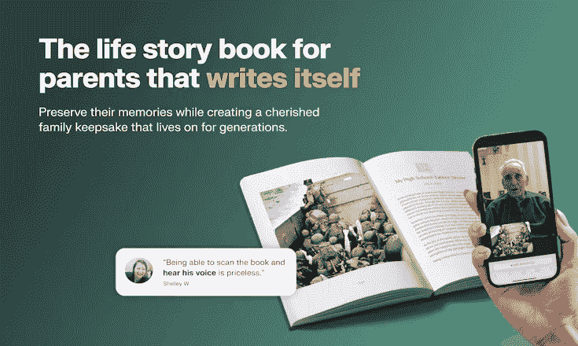

### 斑马猫 2.0 视频生成模型

利用人工智能在几秒钟内生成热门视频

https://www.zebracat.ai/?ref=producthunt

贡献人：

只需轻轻点击几下，您便能将原本平淡乏味的文字内容或音频素材，轻松转化为适合在 TikTok、Instagram 和 YouTube 等热门社交平台上广泛传播的引人注目的视频作品。借助先进的 AI 技术，我们不仅为您提供细腻生动的视觉特效，更能为您打造鲜明的 AI 虚拟形象和动听悦耳的合成声音，让您的故事在镜头前焕发新生。

在这个过程中，您无需任何视频制作或剪辑经验，也无需掌握复杂的后期处理技巧。我们的智能系统会为您自动匹配最佳的画面风格与配色方案，为您的内容增添艺术化的表现力，让主题更具感染力。无论是品牌宣传、产品介绍、个人博客，还是教育短片、访谈摘要，只需几步操作，您的创意就能被快速包装成具有社交媒体爆款潜力的优质视频。

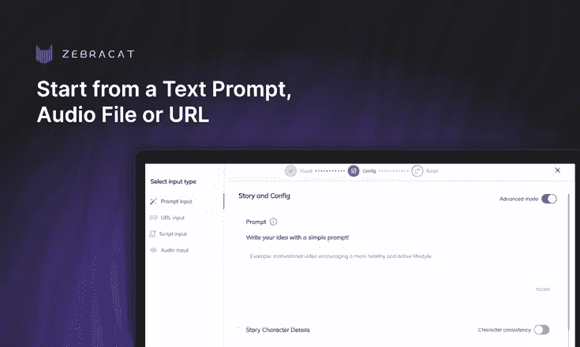

# HuggingFace&Github

### Django API 模板设计

https://github.com/MaksimZayats/aiogram-django-template

贡献人：

此 Django API 模板设计为强大、可扩展且安全，其功能可满足现代应用程序开发需求。以下是高级功能的概述以及它们如何使您的项目受益：

+   Docker 和 Docker Compose 集成：使用 Docker 容器轻松设置和扩展您的应用程序，确保在开发和生产过程中的环境一致。

+   [**Celery**](https://docs.celeryq.dev/en/stable/django/first-steps-with-django.html)**与**[**RabbitMQ**](https://rabbitmq.com/)**和**[**Redis**](https://redis.io/)：利用 Celery 进行异步任务处理，使用 RabbitMQ 作为消息代理，使用 Redis 作为存储结果的后端。

+   [**Sentry 错误跟踪**](https://sentry.io/)：与 Sentry 集成以进行实时错误跟踪和监控，帮助您快速识别和修复问题。

+   Django Rest Framework (DRF)：使用 Django Rest Framework 构建 RESTful API，支持身份验证、序列化等。

+   DRF Spectacular for OpenAPI：使用 DRF Spectacular 编写 OpenAPI 文档，支持自定义架构和 UI。

+   DRF Simple JWT 用于身份验证：使用 DRF Simple JWT 进行 JSON Web Token 身份验证，支持自定义令牌声明和过期。

+   Django CORS Headers：使用 Django CORS Headers 处理跨域资源共享 (CORS) 标头，并支持自定义来源。

+   Django Silk 用于分析：利用 Django Silk 对 Django 应用程序进行分析和监控，提供有关性能和优化的见解。

+   [**Django Axes 安全性**](https://django-axes.readthedocs.io/)：使用 Django Axes 安全性，支持阻止暴力攻击和监控登录尝试。

+   [**AWS S3 集成**](https://django-storages.readthedocs.io/en/latest/backends/amazon-S3.html)：选择使用 Amazon S3 进行静态和媒体文件存储，增强可扩展性和性能。

# 信号

### From Slow Bidirectional to Fast Causal Video Generators

贡献人：

https://arxiv.org/abs/2412.07772

当前的视频扩散模型在生成质量上取得了令人印象深刻的成果，但由于双向注意力依赖，它们在交互式应用中存在困难。生成单帧图像需要模型处理整个序列，包括未来的帧。我们通过将预训练的双向扩散变换器（diffusion transformer）调整为因果变换器（causal transformer）来解决这一限制，使得模型可以即时生成每一帧。

为了进一步降低延迟，我们将分布匹配蒸馏（DMD）扩展到视频上，将50步的扩散模型蒸馏成一个仅需4步的生成器。为了实现稳定且高质量的蒸馏，我们引入了一种基于教师模型的常微分方程（ODE）轨迹的学生初始化方案，并提出了一种不对称蒸馏策略，使用双向教师模型监督因果学生模型。这种方法有效减缓了自回归生成中的误差积累，使得尽管训练时使用的是短片段，模型仍能够进行长时段视频合成。

我们的模型支持在单个GPU上以9.4帧每秒的速度进行高质量视频的快速流媒体生成，得益于KV缓存。我们的方法还支持零-shot的流媒体视频到视频翻译、图像到视频生成和动态提示。未来我们将基于开源模型发布代码。

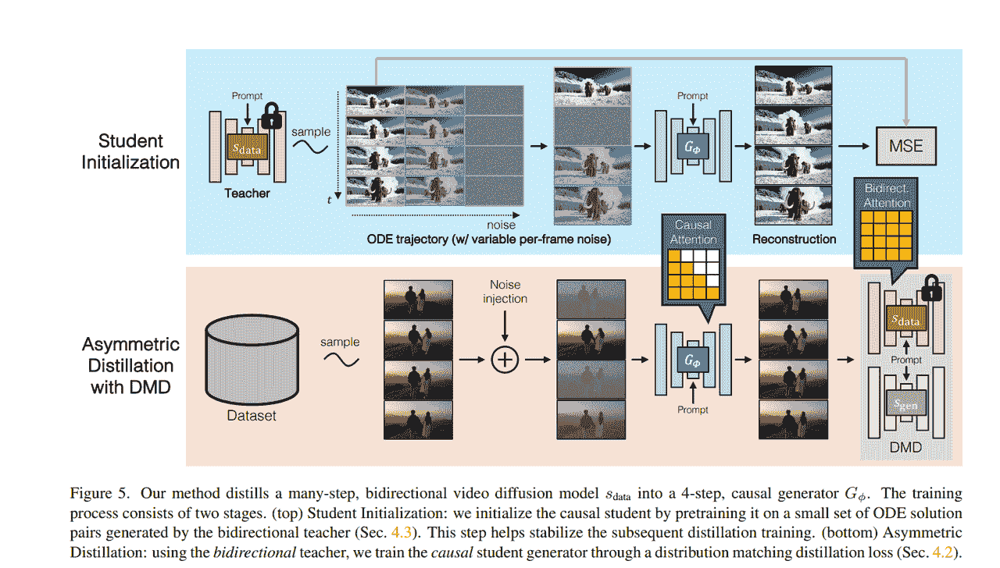

### Does RLHF Scale? Exploring the Impacts From Data, Model, and Method

贡献人：

https://arxiv.org/abs/2412.06000

本研究探讨了基于人类反馈的强化学习（RLHF）在大语言模型（LLMs）中的扩展性。尽管RLHF被认为是LLM后期训练中的一个重要步骤，但其扩展潜力仍然在很大程度上未知。我们系统地分析了RLHF框架中的关键组成部分——模型大小、数据组成和推理预算——以及它们对性能的影响。我们的研究结果表明，增加数据的多样性和量化有助于奖励模型的性能提升，帮助处理监督模型更好地扩展。

对于策略训练，增加每个提示的响应样本数最初能提高性能，但很快会达到平台期。而较大的奖励模型对策略训练的提升作用较为有限。此外，对于固定奖励模型的较大策略模型，RLHF带来的收益较小。总体而言，RLHF的扩展效率低于预训练，并且额外的计算资源带来的回报递减。

基于这些观察结果，我们提出了一些策略，用于在计算资源限制下优化RLHF的性能。这些策略旨在提高RLHF在不同模型规模和数据条件下的效率，最大化其潜力，同时避免资源浪费。

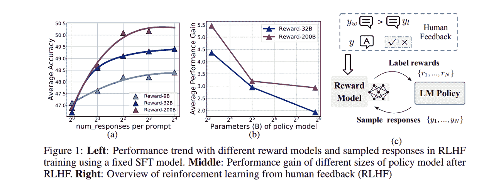

### Training Large Language Models to Reason in a Continuous Latent Space

贡献人：

https://arxiv.org/abs/2412.06769

大语言模型（LLMs）的推理能力通常局限于“语言空间”，即通过“链式思维”（Chain-of-Thought, CoT）表达推理过程，以解决复杂的推理问题。然而，我们认为语言空间并非总是推理的最优选择。例如，大多数单词标记主要用于文本连贯性，而非推理所必需；而一些关键标记则需要复杂的规划，对LLMs构成巨大的挑战。

为探索LLMs在不受限制的潜在空间**中进行推理的潜**力，我们引入了一种新的范式Coconut（Chain of Continuous Thought）。在这一框架中，我们利用LLM的最后隐藏状态作为推理状态的表示（称为“连续思维”）。与其将其解码为单词标记，不如直接将其作为连续空间中的后续输入嵌入反馈给LLM。

实验表明，Coconut可以有效增强LLM在多个推理任务上的表现。这种新颖的潜在推理范式引发了高级推理模式的涌现：连续思维能够编码多个可能的下一步推理步骤，使模型能够通过广度优先搜索（BFS）解决问题，而不是像CoT那样过早地固定在单一的确定性路径上。

在需要大量回溯的逻辑推理任务中，Coconut相较于CoT表现更优，同时在推理过程中使用了更少的“思维标记”。这些研究结果展示了潜在推理的潜力，并为未来的研究提供了宝贵的见解。

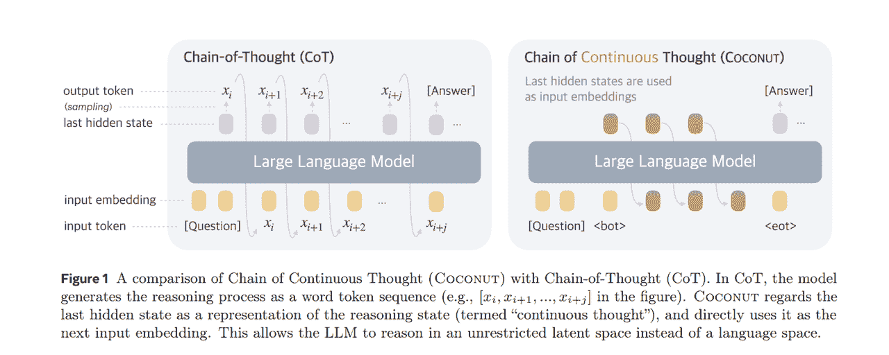

### Flow Matching Guide and Code

贡献人：

https://arxiv.org/abs/2412.06264

FM是一种生成建模框架，通过学习速度场（向量场）来实现样本的转换。每个速度场通过常微分方程（ODE）定义一个流，将源分布p中的样本X₀变换为符合目标分布q的样本X₁。最初，流模型通过最大化训练样本的似然来进行训练，但由于计算负担较重，后续研究提出了无仿真训练的流匹配算法，成为现代流匹配方法的基础。

流匹配的基本步骤包括：选择一个在源分布p和目标分布q之间插值的概率路径pₜ，随后训练一个速度场（神经网络）来定义流变换ψₜ，实现该路径。流匹配不仅适用于欧几里得空间，还可以扩展到其他状态空间，甚至是非流的演化过程。近期，离散流匹配和黎曼流匹配分别扩展了流匹配算法，适用于离散时间马尔可夫链（CTMC）和黎曼流形上的流，广泛应用于语言建模和蛋白质折叠等领域。

生成器匹配（GM）进一步推广了流匹配框架，允许在任意模态和连续时间马尔可夫过程（CTMP）中使用，统一了各种生成模型的设计。流匹配框架还与扩散模型（Diffusion Models）有着紧密的关系，后者通过前向噪声过程构建概率路径，并利用得分函数实现生成器的参数化。

本文接下来的结构包括：第二部分提供了流匹配的快速实现指南；第三部分深入探讨了流模型；第四部分详细介绍了流匹配框架及其设计；第五部分讨论了流匹配在黎曼几何中的扩展；第六至第八部分介绍了流匹配在离散和连续时间马尔可夫链上的应用；第九部分介绍了生成器匹配，最后，第十部分探讨了扩散模型与流匹配的关系。

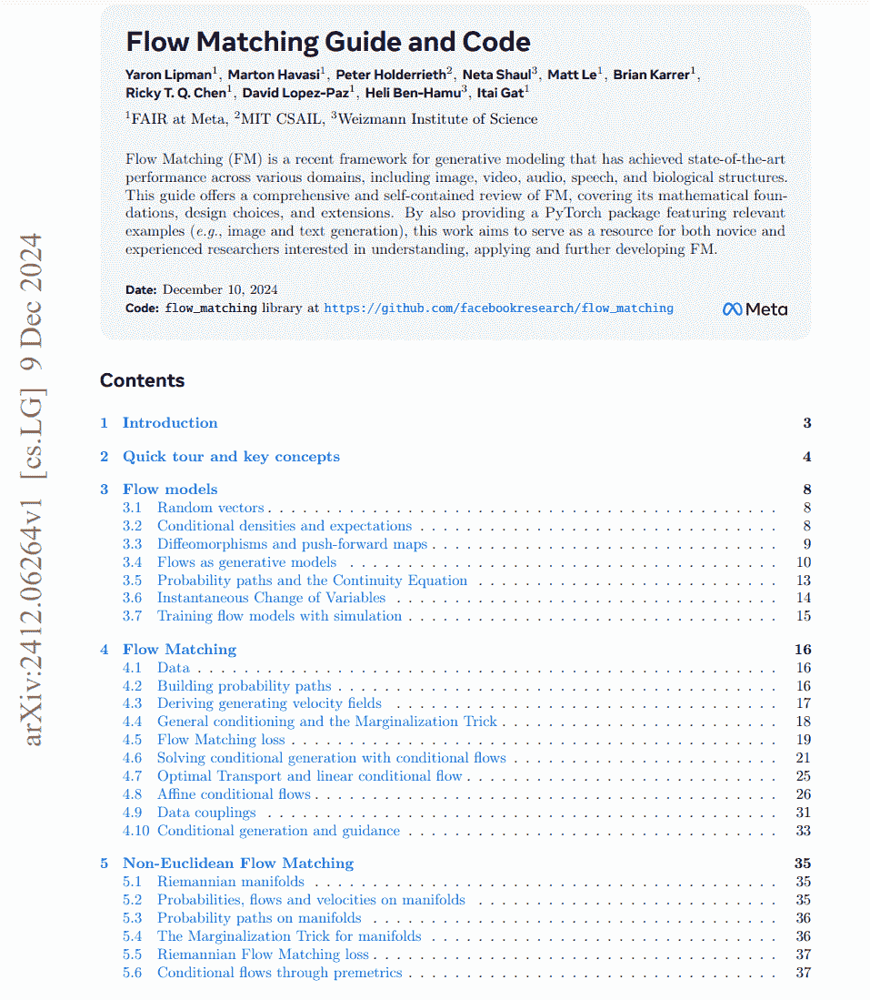

### Can foundation models actively gather information in interactive environments to test hypotheses?

贡献人：

https://arxiv.org/abs/2412.06438

尽管问题解决是基础模型的标准评估任务，但问题解决中的一个关键组成部分——主动且策略性地收集信息以验证假设——尚未被充分研究。为了评估基础模型在互动环境中的信息收集能力，我们提出了一个框架，其中模型必须通过迭代推理其先前收集的信息，并提出下一步的探索性行动，以最大化每一步的信息增益，从而确定影响隐藏奖励函数的因素。我们在两种环境中实现了该框架：一种是文本环境，提供了一个严格控制的设置，便于高通量的参数扫描；另一种是具身3D环境，要求解决多模态交互的复杂性，更贴近实际应用。

我们进一步探讨了自我纠正和增加推理时间等方法是否能够提高信息收集的效率。在一个相对简单的任务中，要求识别单一奖励特征，我们发现Gemini的收集信息能力接近最优。然而，当模型需要识别多个奖励特征的联合时，表现则不尽如人意。性能下降的部分原因在于模型将任务描述转化为策略的过程以及模型在使用上下文记忆中的有效性。无论是在文本环境还是3D具身环境中，性能表现相当，尽管在3D具身环境中，由于视觉物体识别的不完美，模型在从收集的信息中得出结论时的准确性有所下降。对于基于单一特征的奖励，我们发现较小的模型表现出奇地更好；对于基于特征联合的奖励，将自我纠正机制融入模型中有助于提升性能。

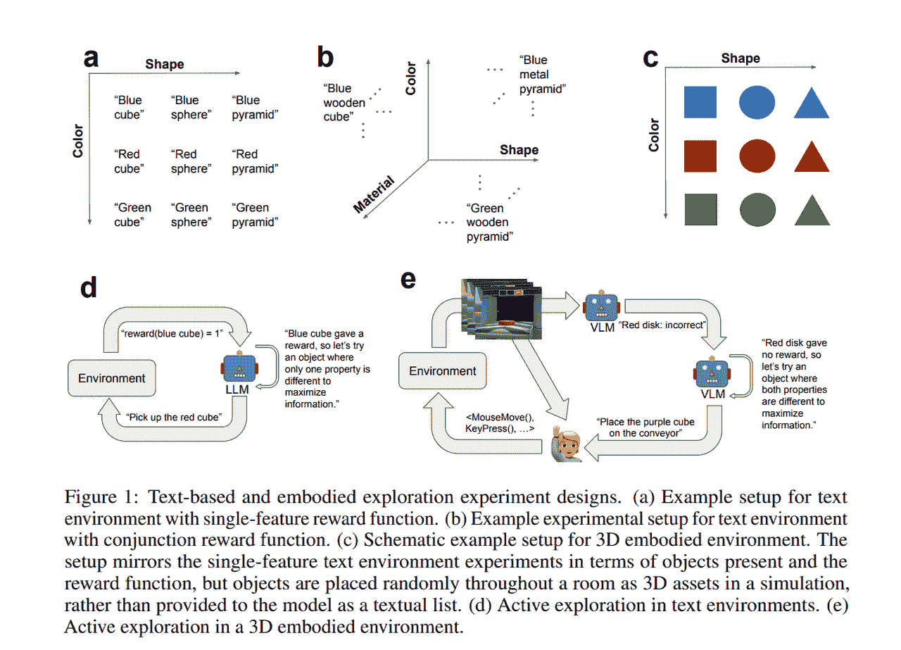

### Normalizing Flows are Capable Generative Models

贡献人：

https://arxiv.org/abs/2412.06329

归一化流（NFs）是基于似然性的模型，适用于连续输入。它们在密度估计和生成建模任务中展现了有前景的结果，但近年来相对较少受到关注。在本研究中，我们展示了NFs的能力超出了此前的认知。我们提出了TARFLOW：一种简单且可扩展的架构，能够实现高性能的归一化流模型。

TARFLOW可以被视为基于Transformer的掩蔽自回归流（MAFs）的变体：它由一系列自回归Transformer块组成，作用于图像补丁，并在层之间交替改变自回归方向。TARFLOW的训练过程简单，支持端到端的训练，并能够直接建模和生成像素。

我们还提出了三种关键技术来改善样本质量：

1.  在训练过程中使用高斯噪声增强。

1.  训练后去噪程序。

1.  有效的引导方法，适用于条件和无条件的生成设置。

将这些技术结合起来，TARFLOW在图像的似然估计任务中创造了新的最先进结果，显著超过了之前的最佳方法，并生成了质量和多样性与扩散模型相当的样本，这是第一次通过独立的归一化流模型实现的。

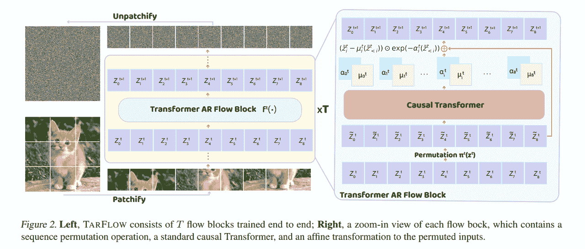

### ProcessBench: Identifying Process Errors in Mathematical Reasoning

贡献人：

https://arxiv.org/abs/2412.06559

由于语言模型在解决数学问题时经常出现错误，因此自动识别推理过程中的错误变得愈加重要，以实现对其可扩展的监督。在本文中，我们介绍了ProcessBench，这是一个用于衡量识别数学推理中错误步骤能力的工具。它包含3,400个测试案例，主要聚焦于竞赛级和奥林匹克级数学问题。每个测试案例包含逐步解决方案，错误位置由人工专家标注。模型需要识别出包含错误的最早步骤，或判断所有步骤都正确。

我们在ProcessBench上进行了广泛评估，涉及两种类型的模型：过程奖励模型（PRM）和批评模型。对于后者，我们通过提示通用语言模型逐步批评每个解决步骤。我们得出两条主要结论：(1) 现有的PRM通常无法很好地推广到更具挑战性的数学问题，尤其是超出GSM8K和MATH范围的问题。它们的表现不如批评模型（即提示的通用语言模型）和我们基于PRM800K数据集微调的训练PRM。(2) 最佳的开源模型QwQ-32B-Preview展现出了与专有模型GPT-4o相当的批评能力，尽管它仍落后于专注推理的o1-mini。

我们希望ProcessBench能够促进未来在推理过程评估方面的研究，为语言模型的可扩展监督铺平道路。

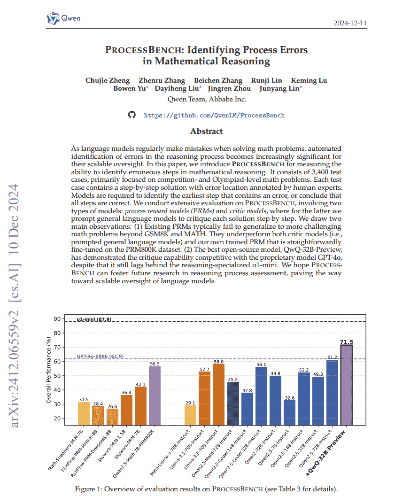

### S2FT: Efficient, Scalable and Generalizable LLM Fine-tuning by Structured Sparsity

贡献人：

https://arxiv.org/abs/2412.06289

目前，针对大规模语言模型（LLMs）的PEFT方法通常只能在高质量、高效训练或可扩展推理之间做出选择，而无法同时实现三者的优势。为了解决这一限制，我们研究了稀疏微调，并观察到其在泛化能力上的显著提升。基于这一关键发现，我们提出了一种面向LLMs的结构化稀疏微调（S2FT）方法系列，能够同时实现最先进的微调性能、训练效率和推理可扩展性。S2FT的核心思想是“稀疏选择，密集计算”。具体而言，它在每个Transformer块中分别选择MHA（多头自注意力机制）和FFN（前馈神经网络）模块中的少数头和通道。然后，它通过联合排列LLM中耦合结构两侧的权重矩阵，将每层中选定的组件连接成一个密集子矩阵。最后，S2FT对所有子矩阵执行就地梯度更新。

通过理论分析和实证结果，我们的方法能够有效防止过拟合和遗忘，在常识推理和算术推理任务上分别相比LoRA提升了4.6%和1.3%的平均性能，并且在指令调优后的跨领域泛化能力上超越了完全微调（FT）11.5%。使用我们的部分反向传播算法，S2FT在训练过程中节省了最多3倍的内存，并且比完全微调提高了1.5至2.7倍的延迟，同时在这两项指标上都能比LoRA实现平均10%的性能提升。

我们进一步证明，S2FT中的权重更新可以解耦成适配器（adapters），从而为服务多个微调模型提供有效的融合、快速切换和高效并行处理能力。

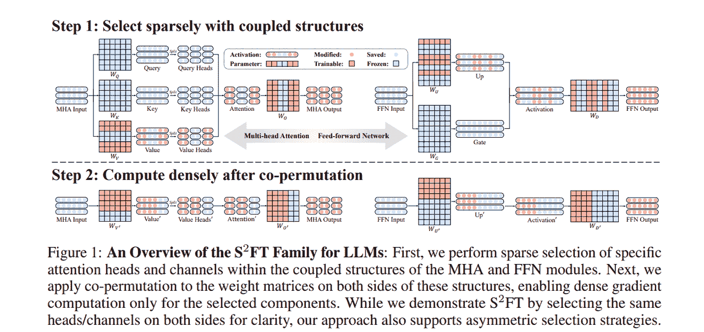

# 投融资

### OpenAI 支持的语言学习平台 Speak 获得 7800 万美元融资，估值达 10 亿美元

贡献人：

https://techcrunch.com/2024/12/10/openai-backed-speak-raises-78m-at-1b-valuation-to-help-users-learn-languages-by-talking-out-loud/

2024年12月10日，语言学习平台 Speak 宣布完成了 7800 万美元的 C 轮融资，此轮融资由 Accel 领投，OpenAI（通过其创业基金）、Khosla Ventures 和 Y Combinator 等老股东也参与其中。此次融资使 Speak 的估值跃升至 10 亿美元。仅六个月前，该公司刚刚完成了一轮 2000 万美元的 B 轮扩展融资，估值为 5 亿美元。

Speak 的平台通过 AI 技术帮助用户通过语音交流学习语言，而非传统的以阅读和写作为主的学习方法。其核心功能是通过生成音频对话并监听用户的语音回答，以帮助他们更好地掌握语言。OpenAI 是该公司的重要合作伙伴，利用其技术支持 Speak 的语音识别和自然语言处理功能。公司表示，未来的资金将主要用于扩展更多语言的学习课程，初步计划从西班牙语和法语开始扩展。

Speak 目前的主要目标群体是学习英语的用户，其平台已被下载超过 1000 万次，付费用户为每月 20 美元或每年 99 美元。公司还为企业客户提供 Speak for Business 服务，现已拥有 200 多个企业客户。公司表示，其将继续专注于提高学习效果，并探索如何量化语言流利度，以便为用户提供更有效的语言学习体验。

公司官网：https://www.speak.com/

### LambdaTest 完成 3800 万美元融资，推动 AI 自动化测试

贡献人：

https://techcrunch.com/2024/12/10/software-testing-platform-lambdatest-secures-38-million-in-ai-push/

2024年12月10日，云端软件测试平台 LambdaTest 宣布完成了 3800 万美元的 D 轮融资，此轮融资由 Avataar Ventures 领投，Qualcomm Ventures 参投。此次融资使 LambdaTest 总融资额达到了 1.08 亿美元。公司计划利用这笔资金进一步拓展现有市场，并增强其 AI 技术能力。

LambdaTest 提供一个基于云的基础设施，帮助企业在超过5000种浏览器和操作系统组合上进行软件测试。通过 LambdaTest 的平台，企业无需搭建和维护昂贵的测试环境，就能轻松验证软件在不同环境下的运行效果。近期，LambdaTest 推出了 KaneAI 平台，旨在通过 AI 驱动的自动化减少繁琐的测试任务，提升测试效率。据称，KaneAI 能将手动编写测试脚本的工作量减少 40%-70%。

此外，LambdaTest 的 HyperExecute 平台允许团队比传统的云平台更快地执行测试，速度提升高达 70%。公司还推出了其他智能测试功能，如识别不稳定测试并自动重试失败的测试，提高了测试反馈速度。LambdaTest 的 AI 驱动的自动化测试平台被认为是提升软件质量保障和加速发布周期的关键工具。

此次融资也进一步巩固了 LambdaTest 在与竞争对手（如 BrowserStack 和 SauceLabs）竞争中的领先地位。公司表示，已经为超过 15,000 个客户提供服务，包括多个财富500强企业和全球2000强企业。

公司官网：https://www.lambdatest.com/

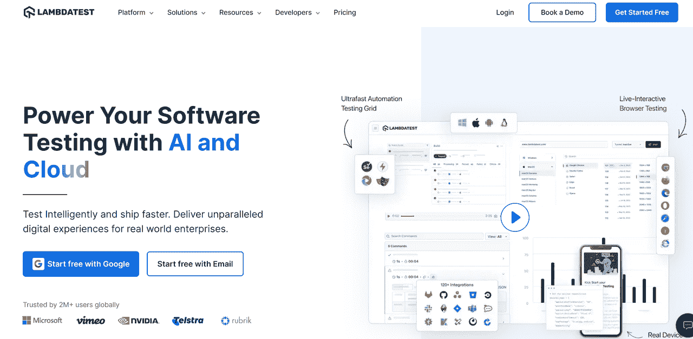

### Automattic 收购 WPAI：推动 WordPress AI 解决方案

贡献人：

https://techcrunch.com/2024/12/09/automattic-acquires-wpai-a-startup-that-creates-ai-solutions-for-wordpress/

2024年12月9日，WordPress 主机公司 Automattic 宣布收购 WPAI，这是一家专注于为 WordPress 提供 AI 解决方案的初创公司。WPAI 的产品包括 CodeWP（AI 插件生成工具）、AgentWP（WordPress 网站构建助手）和 WP Chat（WordPress 问答聊天机器人）。Automattic 表示，WPAI 的核心产品 CodeWP 和 AgentWP 将停产，并会整合进 Automattic 的现有服务中。WPAI 的创始团队将加入 Automattic，专注于推进 WordPress AI 技术的发展。尽管交易的财务条款未披露，但 Automattic 明言将继续增强 WordPress 的 AI 能力，致力于创新和平台功能提升。

此外，Automattic 在不到两个月内完成了第二笔收购，上一笔是收购了开发者语法检查工具 Harper。WPAI 的加入预计将对 WordPress 的开发者和用户体验产生深远影响，特别是在创建和管理网站方面。

公司官网：https://wpai.co/

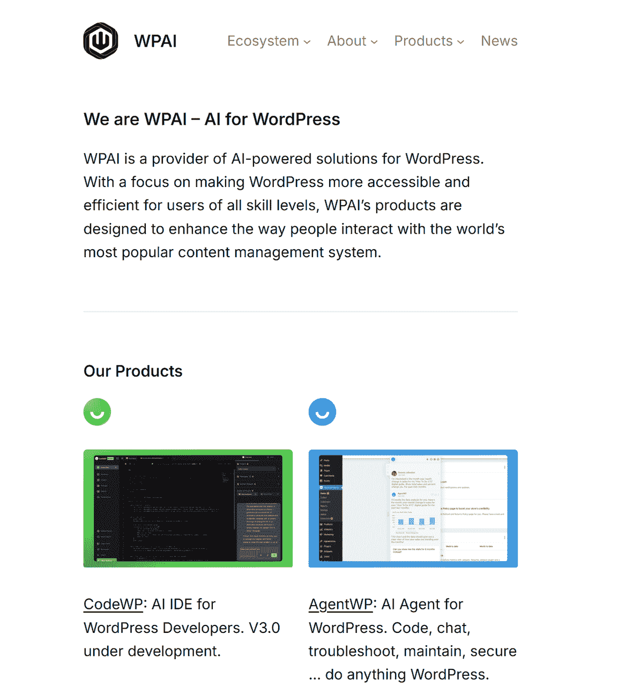

# 学习

### 工业界主流大语言模型后训练(Post-Training)技术总结

贡献人：

https://zhuanlan.zhihu.com/p/987052830

1.  **数据合成**：数据合成成为主流后训练方案，快速开发领先的数据合成pipeline对企业保持领先地位至关重要。

1.  LLM-as-judge和拒绝采样技术：Llama3、Baichuan2、AFM等模型采用拒绝采样技术构造偏好数据。

1.  **Instag方法**：Instag方法在多个模型的技术报告中出现，值得深入研究。

1.  **重点能力优化**：需要对代码、多语言、数学、推理、长上下文、工具使用、指令遵循等重点能力进行单独优化。

1.  **模型合并**：通过训练多个模型并平均参数，实现更均衡的性能，如Llama3、Gemma2和Baichuan2所采用。

1.  **强化学习**：Llama3和Qwen2使用了改良版的DPO，而没有使用PPO在线学习，显示PPO虽上限高但有门槛。

1.  **Llama3技术细节**：

+   后训练迭代包括SFT和DPO，目标是奖励模型和语言模型。

+   对话格式设计支持tool use能力。

+   奖励建模RM改进，使用所有偏好数据进行奖励建模。

+   SFT使用奖励模型执行拒绝采样。

+   DPO进行了算法修改，包括屏蔽格式化tokens和NLL loss正则化。

+   模型平均在每个阶段使用不同版本数据或超参数。

1.  **数据处理和质量控制**：包括数据清洗、修剪、分类、评分和去重。

1.  **能力提升**：包括代码、多语言、数学与推理、长上下文、工具使用、事实性和可引导性的能力提升。

1.  **Qwen2技术细节**：

+   侧重于可扩展的对齐，减少人工标记需求。

+   后训练数据包括协作数据注释和自动数据合成。

+   使用多种自动对齐策略合成数据。

1.  **Nemotron-4技术细节**：

+   奖励模型RM基于多属性回归，预测细粒度奖励。

+   对齐数据包括构造prompts、合成对话、合成偏好数据等。

+   对齐算法包括监督微调和偏好微调。

1.  **AFM技术细节**：

+   后训练包括SFT和RLHF。

+   使用混合数据策略，包括人工注释和合成数据。

+   微调SFT和RLHF中使用新的算法，如iTeC和MDLOO。

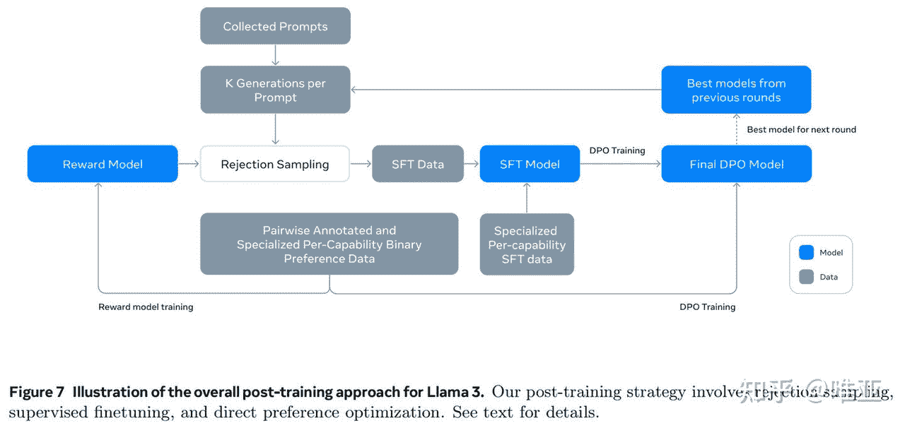

### DPO vs PPO：深度解读谁是LLM Alignment的未来

贡献人：

https://zhuanlan.zhihu.com/p/11913305485

文章讨论了DPO（Direct Preference Optimization）与PPO（Proximal Policy Optimization）在大语言模型（LLM）对齐中的应用，分析了DPO是否能够取代PPO。DPO以其无需显式奖励建模的简化流程和低计算成本，宣称能够实现与PPO相当的偏好对齐效果，但是否真的能够取代PPO值得进一步探讨。

PPO的最优策略依赖KL正则化约束，并通过显式的奖励函数来优化策略。而DPO则通过重参数化方式将奖励函数隐式地包含在策略中，从而避免了显式建模奖励函数的复杂性。具体来说，DPO假设偏好数据遵循Bradley-Terry模型，直接通过最大化偏好数据的对数似然来优化策略。

尽管从理论上看，PPO与DPO的推导存在等价性，但在实际应用中，DPO仍然存在一些缺陷。首先，DPO假设参考分布能准确反映偏好数据的分布，但实验表明，偏好数据往往无法覆盖整个数据分布，导致模型在处理分布外（OOD）数据时表现异常。DPO对分布外数据的偏好高度依赖参考分布，但当偏好数据不足时，参考分布可能不准确，从而引发对分布外样本的错误优化。而PPO则通过KL正则化显式限制了模型对参考分布的偏离，从而能够抑制这种错误优化。

其次，DPO通过隐式建模奖励函数，避免了显式奖励建模的复杂性，但这可能引入隐性的reward hacking问题。未显式建模奖励函数会导致模型过度依赖参考分布，在面对不足的偏好数据或分布外数据时，可能会错误地提高某些样本的概率，从而导致模型做出不合适的决策。相比之下，PPO通过显式奖励函数和KL正则化有效抑制了这类问题。

最后，DPO在推导过程中省略了分区函数，而分区函数在PPO中用于归一化概率分布，确保它是合法的。在实际应用中，DPO省略分区函数的做法假设了分布的一致性，但当训练数据稀疏或分布偏移时，这一假设可能不成立，从而导致优化偏差。PPO通过显式定义分区函数，保证了概率分布的合理性。

以披萨店为例，PPO像一个谨慎的朋友，会帮助你综合考虑各个选项，并确保你不会因为某些不合适的数据（例如外太空披萨）做出错误决策。而DPO则像一个轻率的朋友，忽略了数据的合理性，可能会误导你尝试不合理的选项，从而导致不良后果。

### Triton内部机制

贡献人：

https://zhuanlan.zhihu.com/p/11901442836

这节课详细介绍了 Triton 编译器的内部工作原理。文章首先介绍了 CUDA 编译器（NVCC）的工作流程，然后深入探讨了[ Trit](https://zhida.zhihu.com/search?content_id=251403246&content_type=Article&match_order=1&q=%E5%8F%AF%E6%89%A7%E8%A1%8C%E6%96%87%E4%BB%B6&zhida_source=entity)on 编译[器的架](https://zhida.zhihu.com/search?content_id=251403246&content_type=Article&match_order=1&q=ptx&zhida_source=entity)构设计，包括其如何将 Python DSL 代码通过多个中间表示（IR）最终编译成 CUDA 可执行文件。课程重点讲解了 Triton 与 MLIR（Multi-Level Intermediate Representation）的关系，展示了各种优化 Pass 的实现和作用，如 TritonCombineOps、TritonReorderBroadcast 等。通过一个 vector_add 的具体示例，详细展示了代码从 Python 层面到 GPU IR 的转换过程，以及在这个过程中各种中间产物（如 .cubin、.ptx 等）的生成。最后还介绍了如何在 Triton 中实现新的编译器 Pass，为读者提供了深入理解和扩展 Triton 编译器的实践指导。

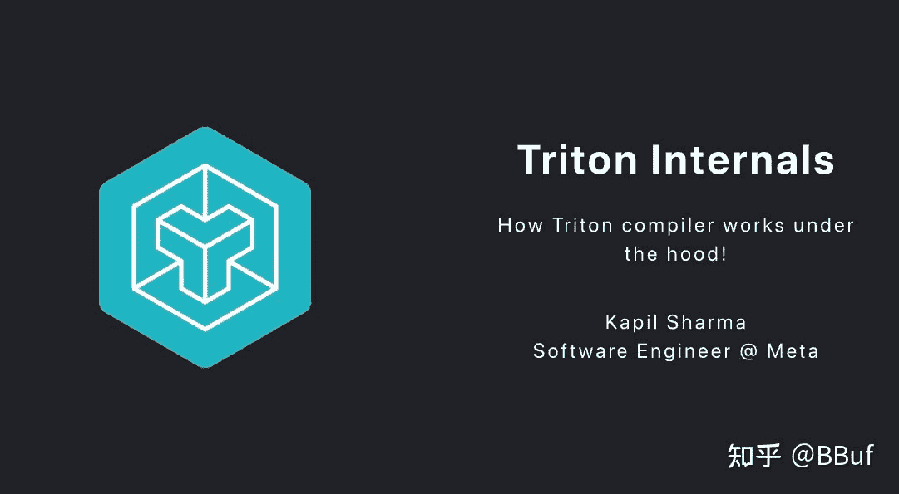

# 声明

本文档仅供学习交流使用，版权归原作者所有，若涉侵权，请联系Jack Jin 15101136166

##

（欢迎在下方反馈您宝贵的意见！整理不易，觉得有用给AI日报小组点个赞👍吧！）

ChatGPT；Angela；Zijia Liu；Alex；Zeqi Tan；Tiezhen（HuggingFace）；Naixu；Lizhi；Peter；Suoman；Jack

学术分析报告：ResearchFlow -- 奇绩F23校友的开发的深度研究产品，PC端进入RFlow的分析报告，可直接点击节点右侧的小数字展开节点，登录后可在节点上直接“询问AI”，进一步探索深度信息

如果你有大模型相关的创业想法，欢迎来找我们聊聊～🛰️：15101136166

> 快邀请你的小伙伴们一起来读大模型日报吧！

> **【日报****知识库****】**这里是近期日报内容的汇总,欢迎大家查阅

> [大模型日报知识库(分享版)](https://miracleplus.feishu.cn/wiki/KapVwXfkriOBiskB0B2cUHxjnTh)

>

> 欢迎大家多多帮我们分享,转发~~

> 如果大家有任何的建议或者吐槽,欢迎随时找我聊天~

