# 奇绩大模型日报（12月 12日）

> 来源：[https://miracleplus.feishu.cn/docx/E5ocdZ72kosDTAx250GcFgShnab](https://miracleplus.feishu.cn/docx/E5ocdZ72kosDTAx250GcFgShnab)

# 资讯

### 谷歌发布新一代大模型

贡献人：

https://mp.weixin.qq.com/s/c39MbjULBW5M_8vdO-VUXQ

谷歌发布了新一代大模型Gemini 2.0，由CEO皮猜宣布，专为AI Agent设计，已提供给开发者内测，并将在Gemini和搜索产品线中集成。Gemini 2.0 Flash实验版模型网页端已开放，支持多模态输入输出，包括图像、视频、音频，以及可控的多语种文本到语音输出。它还能调用谷歌搜索、代码工具等。谷歌还推出了深度研究功能，基于高级推理和长上下文能力，能生成复杂主题的研究报告。Gemini 2.0在多模态图片、视频能力以及编码、数学等方面表现超越前代，速度是1.5 Pro的两倍。明年，Gemini 2.0将扩展到更多产品中，如Project Astra，提升对话、使用新工具、记忆力和改进延迟。Project Astra将移植到眼镜等移动终端，并与游戏开发商合作，测试基于Gemini 2.0的游戏智能体。Gemini 2.0 Flash实验模型通过Google AI Studio和Vertex AI的Gemini API向开发者提供，展示视频理解、工具使用、空间理解的应用。

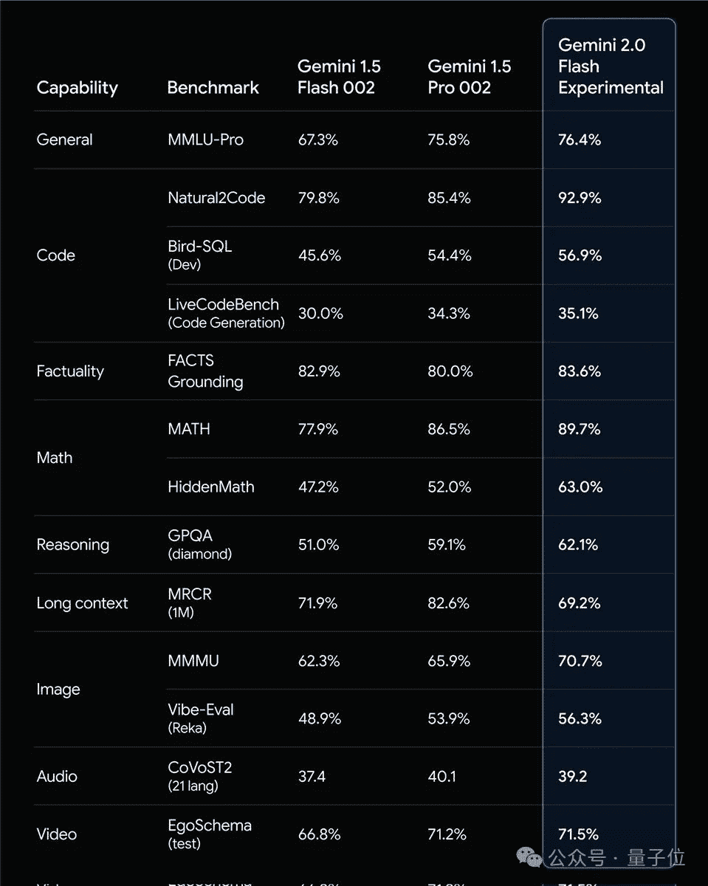

### RL+Control 如何将机器人可靠性逼进 99.9%？

贡献人：

https://mp.weixin.qq.com/s/DeB6t9304gxQmkAI82CrrA

本文是关于“RL+Control：将机器人可靠性逼近99.9%”的线上圆桌沙龙的总结。讨论的核心是如何利用强化学习（RL）和基于模型的控制（MBC）提高机器人的稳定性和可靠性。专家们认为，机器人的可靠性不仅涉及硬件稳定性，还包括恢复能力，且需结合场景需求。强化学习与控制的结合是提高稳定性的可行路径，如将控制的安全性融入RL或借助控制结构使RL更稳健。

在机器人移动（Locomotion）方面，仿真到现实强化学习（Sim2Real RL）是流行的方法，它利用仿真环境中训练的策略并部署到现实世界。Sim2Real RL的优势在于其离线计算能力和绕开状态估计问题，但与基于模型的控制（MBC）相比，它在算力运用和状态估计上有所不同。石冠亚提出，RL和Control应视为问题而非方法，强调了RL在真实世界学习的重要性，并分享了结合RL和Control的工作，如人形机器人控制和基于MPC的内容。

朱秋国讨论了从传统MPC、ZMP方法到现在使用RL的转变，认为RL能更好地展现机器人全身运动能力。他提到，尽管传统方法稳定可靠，但RL提供了更高的灵活性和协调性。卢宗青则从强化学习算法研究的角度出发，强调了与物理世界的交互和视觉信息的重要性，并提出了基于视觉信息的姿态生成模型。

罗剑岚强调了机器人操作（Manipulation）的挑战，指出其与Locomotion的不同，认为Manipulation需要应对外部世界的无限复杂性，而RL通过与外界交互能更好地适应这种不确定性。他提出，要实现高性能操作并达到高可靠性，最通用、最具扩展性的方法就是强化学习。

专家们还讨论了机器人可靠性的衡量问题，认为人形机器人要达到99%以上的可靠性极具挑战，且对于不同的应用场景，对可靠性的要求也不同。他们认为，机器人的可靠性需要结合硬件、软件算法以及场景需求来综合评估，并期待通过不断的技术迭代和创新来提高机器人的稳定性和可靠性。

### Scaling Laws, O1 Pro Architecture, Reasoning, Training Infrastructure, Orion, and Claude 3.5 Opus Failures

贡献人：

https://semianalysis.com/2024/12/11/scaling-laws-o1-pro-architecture-reasoning-training-infrastructure-orion-and-claude-3-5-opus-failures/#scaling-inference-compute-through-search

文章深入探讨了多项技术进展及其挑战，特别是针对AI推理计算的优化和硬件架构方面的细节。文章首先分析了"Scaling Laws"的最新发展，指出随着模型规模的增加，推理计算需求呈指数级增长，这使得计算基础设施的需求也变得更加庞大。为了应对这种情况，提出了O1 Pro架构，这一架构通过提升计算单元的并行度和增强数据处理能力，在推理任务中取得了显著的性能提升。

在推理计算的过程中，文章详细讨论了模型推理的技术瓶颈。随着AI模型参数的不断增加，推理计算的效率成为影响模型性能的关键因素。推理计算的瓶颈主要集中在存储带宽和计算单元的并行能力上，而这些瓶颈的存在限制了模型规模的进一步扩大。为此，新的硬件架构尝试通过优化内存访问和计算调度来提升推理速度，从而满足大规模AI模型的计算需求。

同时，文章还探讨了"Reasoning"技术的最新进展。通过对推理算法和优化方法的调整，AI系统能够更好地理解和处理复杂的任务，尤其是在自然语言处理领域。在推理过程中，O1 Pro架构通过改进的流水线调度和算力优化，使得在更复杂的推理任务中，AI能够提供更准确和高效的回答。

文章还强调了训练基础设施的挑战，特别是在应对大规模AI模型时，训练所需的计算资源呈现出指数级增长，这导致传统计算架构已经无法满足需求。为了解决这个问题，O1 Pro架构不仅在推理阶段进行了优化，还在训练阶段实现了更高效的计算和资源调度。训练过程中的并行性和调度策略变得尤为重要，尤其是在大规模数据集和复杂模型的情况下，O1 Pro架构能够提供更强的计算能力和资源管理。

在分析了推理计算和训练基础设施的最新进展后，文章进一步讨论了Orion和Claude 3.5 Opus的技术问题。Orion在推理计算中遇到了性能瓶颈，尽管硬件架构进行了优化，但由于模型复杂性增加，仍未能达到预期的性能目标。而Claude 3.5 Opus在推理计算中的失败主要源于其架构未能充分利用新型硬件的优势，导致推理计算无法高效执行，进一步证明了硬件和软件优化需要更加紧密的配合。

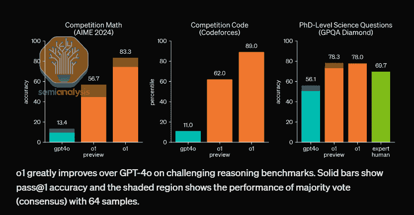

### Generative Video WorldSim, Diffusion, Vision, Reinforcement Learning and Robotics — ICML 2024 Part 1

贡献人：

https://www.latent.space/p/icml-2024-video-robots

内容涵盖了2024年ICML大会的一些重要技术讨论，重点涉及生成性视频模型、扩散模型、计算机视觉、强化学习以及机器人技术等前沿话题。文章中首先介绍了OpenAI的Sora模型，该模型结合了Diffusion Transformers技术，展示了如何通过特定的归纳偏差在生成视频领域取得显著的进展。Bill Peebles在ICML上的报告详细讲解了Sora的架构和应用，并提出了该模型在引入这些偏差时所面临的挑战。

Google DeepMind在视频生成领域也表现突出，带来了两篇获奖论文：“Genie: Generative Interactive Environments”和“VideoPoet: A Large Language Model for Zero-Shot Video Generation”，展示了通过大型语言模型生成视频的零样本能力，这标志着视频生成技术迈向了新的高度。文章进一步探讨了扩散模型在生成任务中的应用，Sander Dieleman的报告强调了扩散模型在频域中的回归应用，这为图像和视频生成提供了新的思路。

另外，文章提到了一些流匹配（Flow Matching）技术的进展，特别是在高分辨率图像合成中的应用，Stable Diffusion 3便是其中的一个重要实例。Ben Poole介绍了如何通过2D先验推断3D结构，结合NeRFs和DreamFusion技术，推动了计算机视觉的边界。

在机器人领域，Chelsea Finn的四场报告则聚焦于如何利用视频数据训练机器人，并发展出了具有自主适应能力的机器人通用智能。她提出，机器人领域的进展可以为机器学习带来新的见解，特别是在如何将视频和视觉语言模型结合起来进行行为生成和任务执行方面。

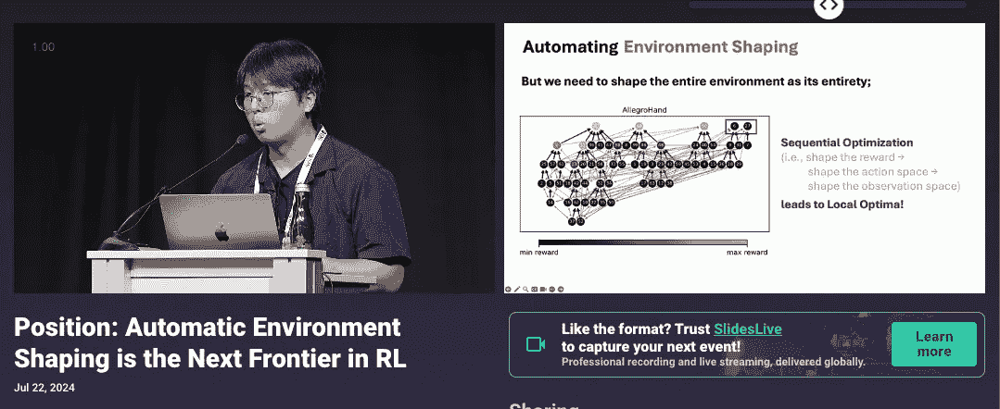

# 推特

### ChatGPT 现已集成到 iOS、iPadOS 和 macOS 的 Apple 体验中

https://x.com/OpenAI/status/1866943282795938013

ChatGPT 现已集成到 iOS、iPadOS 和 macOS 的 Apple 体验中，用户可以直接在操作系统中使用 ChatGPT 的功能。

[BQFVFYHf3FZ_K8Pd.mp4](https://internal-api-drive-stream.feishu.cn/space/api/box/stream/download/all/EPBXb6YkuovTAlx4e77cDnoYnxg)

### 使用 OpenAI Canvas 协作写作与编程

https://x.com/AndrewYNg/status/1866880693588070440

新短期课程：使用 OpenAI Canvas 协作写作与编程！

探索使用 OpenAI Canvas 的新方法，通过这一用户友好的界面，与 ChatGPT 协作进行头脑风暴、草稿撰写和文本与代码的精细化修改。

在这门短期课程中，由@OpenAI与 OpenAI 研究负责人@karinanguyen_共同开发并教授，你将学会如何利用 Canvas 提升工作流程效率。

Canvas 超越了简单的聊天交互，提供了一个并排的工作空间，便于你与 ChatGPT 协作编辑和优化文本或代码。这使得在写作或编码时的头脑风暴、草稿撰写与迭代更加自然高效。作为自 2022 年 ChatGPT 发布以来视觉界面的首次重大更新，Canvas 提供了与 AI 协作的全新创新方式。

例如，在编写代码的初版后，Canvas 可以审查并提供改进建议。它还可以通过添加日志记录、定位问题、编写注释等帮助调试。此外，你还将学习如何为 Canvas 这样的界面训练模型的相关知识。

在这个仅包含视频的短期课程中，你将：

• 学习如何请求逐行反馈，并通过直接编辑模型输出中的选定区域来控制工作的迭代。

• 学习如何使用快捷菜单中的快速自动化工具，调整文本语气和长度、优化代码，并恢复工作内容的历史版本。

• 学习如何将 Canvas 用作研究助手工具，例如请求模型推理关于截图图表的内容，并根据生成的报告继续提问。

• 学习如何让模型编写 Python 代码以复现截图中的图表。

• 了解如何从零开始创建一个视频游戏（如《太空战舰》），并对其进行编辑和以独立 HTML 文件形式展示。

• 获得创建 SQL 数据库（基于架构图片）的实际应用示例。

• 理解支持 Canvas 的模型训练和设计过程！

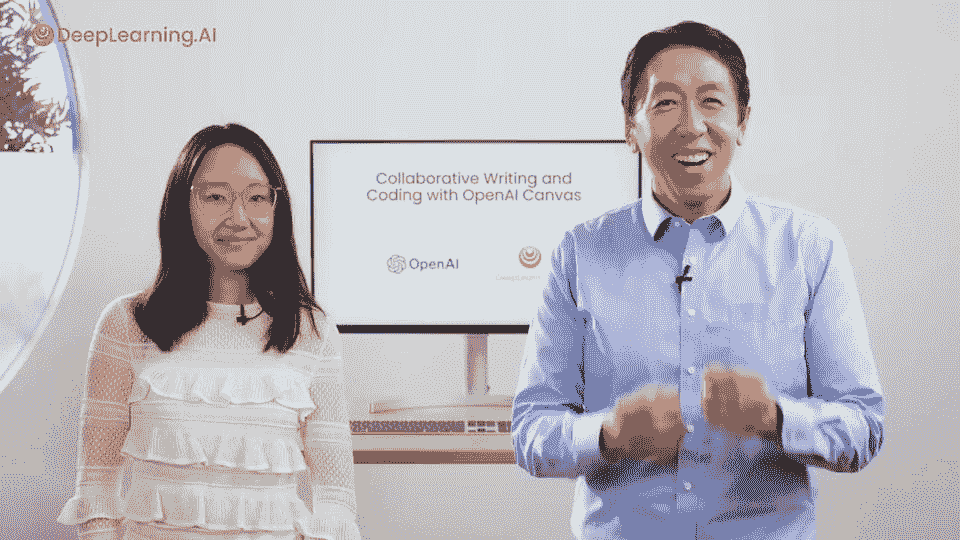

[UghrQ7RQwULaMh0O.mp4](https://internal-api-drive-stream.feishu.cn/space/api/box/stream/download/all/K4NjbClsDomabmx2ZnlcD1B9nAh)

### Midjourney推出Patchwork：实验性多人世界构建工具，用于搭建故事的基础框架

https://x.com/midjourney/status/1866964271948763553

今天，我们推出了一款全新的实验性多人世界构建工具——“Patchwork”。它结合了语言模型、图像模型以及基于画布的界面，用于搭建故事的基础框架。查看下面的 🧵 获取链接和更多文档信息。玩得开心！

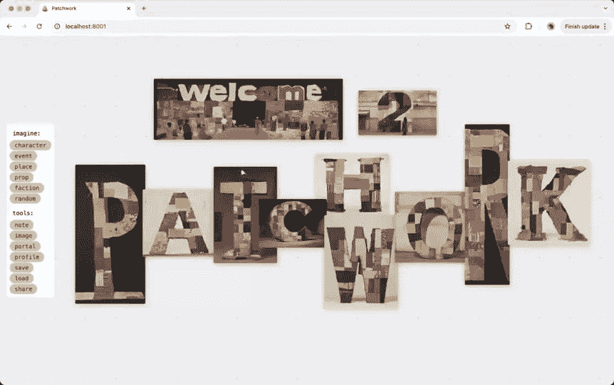

[XdD7DC7258D6grv7.mp4](https://internal-api-drive-stream.feishu.cn/space/api/box/stream/download/all/P5J0be5EEojPlzxIk4ncaaq3nOc)

### BLENDERGPT 全面上线，快捷生成 3D 资产

https://x.com/gd3kr/status/1866910744601825666

BLENDERGPT 现已全面上线，无需等待名单。

生成 3D 资产从未如此简单。以下是我在短短一分钟内完成整个 3D 场景的展示。

立即免费试用，访问：**blendergpt.org**

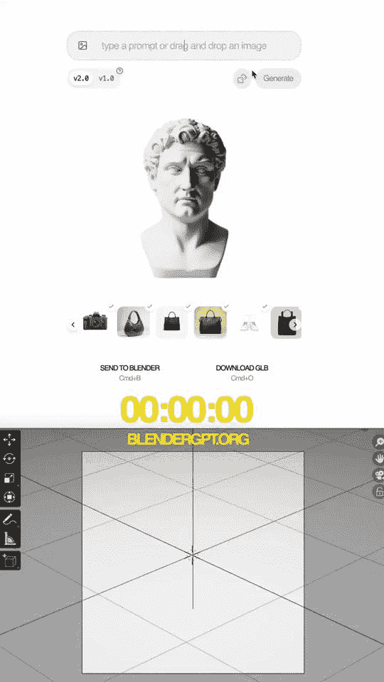

[1PPL36FMeOS7VkWh.mp4](https://internal-api-drive-stream.feishu.cn/space/api/box/stream/download/all/NHw9bXpUdofyLNxjd6tcdJF3nRd)

# 信号

### AMAGO-2: Breaking the Multi-Task Barrier in Meta-Reinforcement Learning with Transformers

贡献人：

原文链接：[h](https://x.com/__jakegrigsby__/status/1866987546355601875)ttps://x.com/__jakegrigsby__/status/1866987546355601875

学术报告链接：https://arxiv.org/abs/2411.11188

这篇文章探讨了“多任务障碍”，并说明诸如值分类等抗规模损失函数有助于修复它，而无需任何新的假设。强化学习可以通过借用序列建模的细节来改进，而不需要将强化学习变成监督学习。有一种RL 技巧可以将 Q 学习转化为分类，还可以快速解决多任务强化学习最不必要的问题：每个任务的训练损失的规模随着时间的推移而变化不均匀。这种情况发生在监督学习中会很奇怪，而损失函数的改变可以在强化学习中修补它。多任务强化学习有更好的解决方案，但上下文适应需要修正，因为它最适合解决的问题涉及太多任务。我们会训练一个序列模型，以适应之前的尝试的记忆。这里的实验陷入了狭窄的领域。我们需要更多任务来泛化。

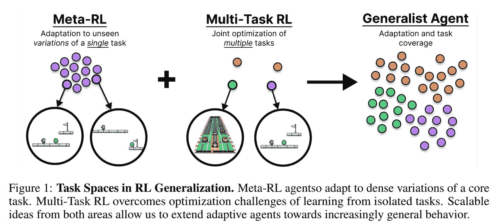

### Efficient Online Reinforcement Learning Fine-Tuning Need Not Retain Offline Data

贡献人：

学术报告链接：https://arxiv.org/abs/2412.07762v1

本篇论文研究没有离线数据保留的 RL 在线微调，称之为无保留微调的范式。论文对现有的离线到在线 RL 进行了详细分析方法并发现在微调过程中经常需要离线数据来减轻 Q 值发散以及由于分布偏移而导致的遗忘，而且也会逐渐减慢微调速度。论文演示一种结合预热阶段来初始化重放缓冲区的简单方法从预训练的离线强化学习策略进行少量转换，然后运行简单的在线强化学习该算法可以有效地进行样本高效的微调，而不会忘记预先训练的初始化。

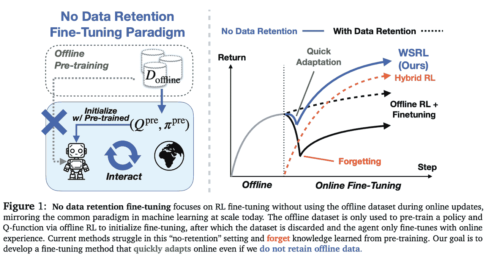

### Mobile-TeleVision: Predictive Motion Priors for Humanoid Whole-Body Control

贡献人：

学术报告链接：https://arxiv.org/abs/2412.07773v1

论文引入了 PMP（预测运动先验），使用条件变分自动编码器 (CVAE) 进行训练，以有效地表示上半身运动。运动策略是根据这种上半身运动表示进行训练的，确保系统在操作和运动方面都保持稳健。CVAE 特征对于稳定性和稳健性至关重要，并且在精确操作方面明显优于基于 RL 的全身控制。通过精确的上半身运动和强大的下半身运动控制，操作员可以远程控制人形机器人四处走动并探索不同的环境，同时执行各种操作任务。

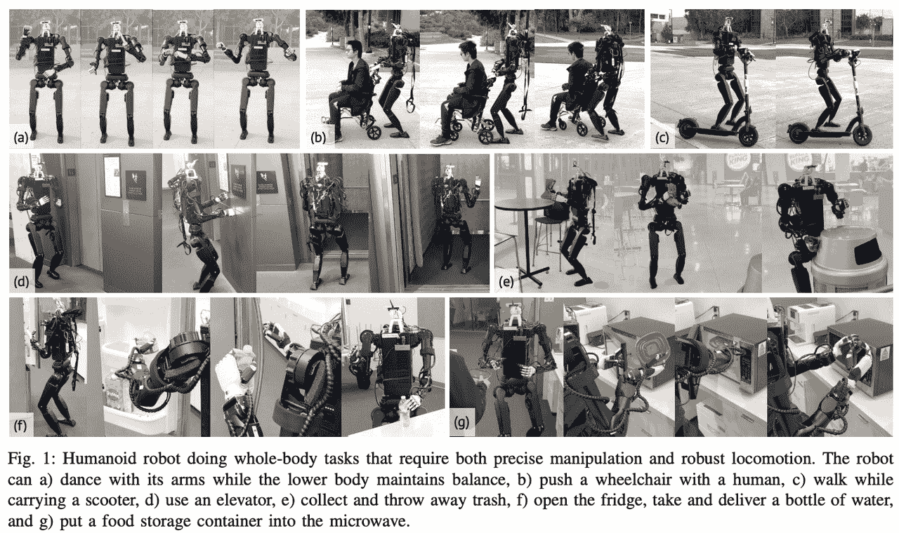

### FiVA: Fine-grained Visual Attribute Dataset for Text-to-Image Diffusion Models

贡献人：

学术报告链接：https://arxiv.org/abs/2412.07674v1

论文提出了一个全面的细粒度视觉属性数据集，其特征精心描绘各种视觉属性的图像。在注释现实世界图像时，论文建议利用先进的 2D 生成模型用于数据收集的自动数据生成管道。论文开发了一种系统方法，包括属性和主题定义、提示创建、基于 LLM 的过滤和人工验证构建一个数据集，在大约 1 M 幅图像中标注有不同的视觉属性。每张图片可以进一步分为由不同种子生成的 2x2 子图像，可用于采样期间训练。在此数据集的基础上，论文引入了细粒度的视觉属性适应框架旨在控制生成过程中的细粒度视觉属性。具体来说，论文建议将多模态编码器 Q-former 集成到图像特征编码器中在插入交叉注意模块之前。这种集成有助于理解标签或提取图像信息的简要说明。

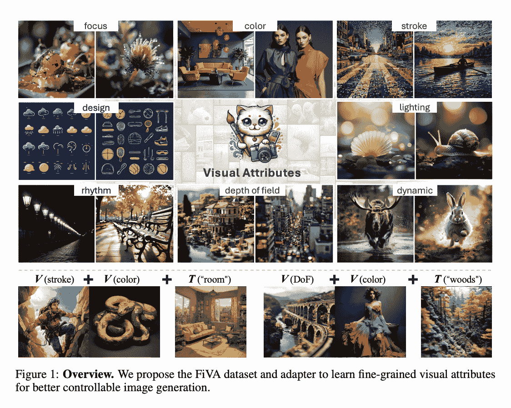

### RLDG: Robotic Generalist Policy Distillation via Reinforcement Learning

贡献人：

学术报告链接：https://generalist-distillation.github.io/

RLDG 是一个将专业 RL 策略提炼为通用机器人策略的框架。通过这种方式训练的通用机器人比使用人类演示的传统微调方法表现出更高的性能，并且比提炼出来的 RL 策略具有更强的泛化能力。

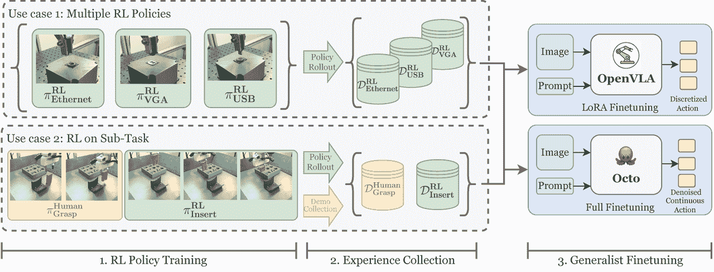

# 产品

### AISmartCube 低代码平台开发

贡献人：

https://aismartcube.com/?ref=producthunt

AISmartCube 是您的低代码平台，致力于构建、自动化和优化 AI 工具与助手。通过访问丰富的预制解决方案库，您可以轻松地选择适合的模块来满足不同需求，无需从零开始开发，显著降低技术门槛。平台还支持流畅的工作流程自动化，将繁琐的任务一键简化，让您的日常操作更加高效。此外，AISmartCube 提供公共知识库的无缝集成功能，使您的 AI 工具和助手拥有更强大的知识支持和推理能力，从而更智能地完成复杂任务。不论您是初创企业、企业团队，还是个人开发者，AISmartCube 都是您创新与效率提升的最佳助手，让 AI 工具的创建变得前所未有的简单！

### Remention 在线监控工具

贡献人：

https://www.remention.ai/?ref=producthunt

Remention 是一款强大的在线监控工具，可以实时追踪数十亿次在线对话。它通过精准的数据分析和智能算法，帮助用户发现与其产品相关的最佳提及位置。不论是在社交媒体、论坛、评论区，还是其他在线平台，Remention 都能迅速识别潜在商机，为用户提供清晰的互动路径。

通过这款工具，企业不仅能够快速吸引潜在客户，还可以与目标用户建立更深层次的联系，提升品牌知名度。同时，Remention 的精准洞察能力还能帮助优化营销策略，从而推动用户增长和收入提升。这是一款让企业真正了解市场动态、抓住每一个商机的创新解决方案。

# HuggingFace&Github

### GPUStack 开源 GPU 集群管理器

贡献人：

https://github.com/gpustack/gpustack

GPUStack 是一个用于运行 AI 模型的开源 GPU 集群管理器。

**主要特点：**

广泛的硬件兼容性：可在 Apple MacBook、Windows PC 和 Linux 服务器中运行不同品牌的 GPU。

广泛的模型支持：从 LLM 和扩散模型到音频、嵌入和重新排序模型。

随着您的 GPU 库存进行扩展：轻松添加更多 GPU 或节点来扩大您的操作。

分布式推理：支持单节点多 GPU 和多节点推理和服务。

多推理后端：支持 llama-box（llama.cpp）和 vLLM 作为推理后端。

轻量级 Python 包：最小的依赖性和操作开销。

与 OpenAI 兼容的 API：提供与 OpenAI 标准兼容的 API。

用户和 API 密钥管理：简化用户和 API 密钥的管理。

GPU 指标监控：实时监控 GPU 性能和利用率。

令牌使用情况和速率指标：跟踪令牌使用情况并有效管理速率限制。

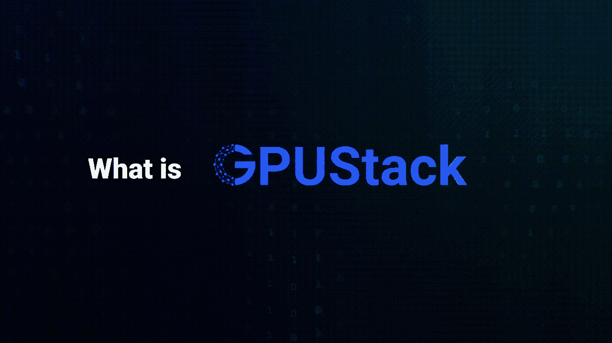

# 投融资

### Albert Invent 利用人工智能平台有望颠覆化学行业

贡献人：

https://techcrunch.com/2024/12/11/albert-invent-hopes-to-revolutionize-the-chemicals-sector-with-its-ai-platform/

Albert Invent，致力于通过人工智能平台变革化学行业，最近成功完成了由 Coatue 主导的 2250 万美元 A 轮融资。该公司提供的 AI 平台，名为 Albert Breakthrough，能够基于过去化学实验的数据帮助化学家们在制定化学品时进行分子级的数据分析。平台结合了结构化数据和公司专有的 AI 模型，旨在加速化学产品的开发，提升产品质量。其核心能力包括实时生成毒理学预测，并且在许多标准行业模型中表现优异。

Albert Invent 的客户包括 Chemours、Solenis、Keystone Industries、Applied Molecules、Henkel 和 Nouryon 等知名化学公司。公司 CEO 兼联合创始人 Nick Talken 表示，Albert Breakthrough 是一种 SaaS 产品，已经被全球最大的化学公司用于重新定义化学科学，并为可持续性问题和个性化医疗设备等提供解决方案。该平台的成功不仅得益于其 1500 万化学分子数据的训练基础模型，还依赖于从公共化学数据中构建的深度学习模型。

在此前的融资中，Albert Invent 已获得了来自 Index Ventures 的种子轮投资（2022 年底）。此次 A 轮融资的其他参与者还包括 TCV、Index Ventures、F-Prime 和 Homebrew。David Schneider，Coatue 的普通合伙人表示，支持 Albert Invent 是因为它通过最新的 AI 技术带来化学研究的高效性和商业效益。Nouryon 的首席技术官 Johan Landfors 也表示，Albert Breakthrough 已成为其产品开发的关键工具。

公司官网：https://www.albertinvent.com/

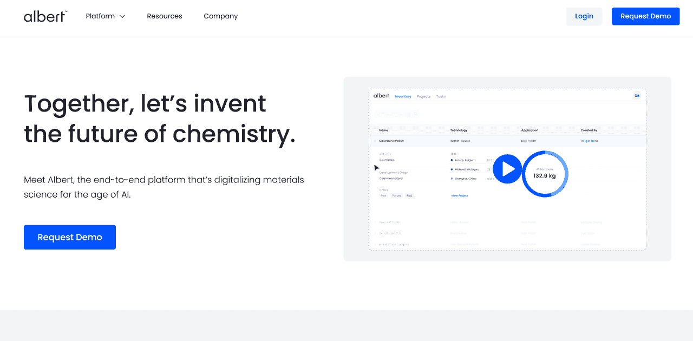

### Finny通过AI帮助财务顾问精准找到潜在客户

贡献人：

https://techcrunch.com/2024/12/11/yc-backed-finny-helps-financial-advisors-find-new-clients/

Finny是一家由Y Combinator支持的初创公司，致力于利用人工智能帮助财务顾问更高效地找到潜在客户。该平台通过AI分析帮助财务顾问筛选符合他们目标客户特征的潜在客户，并根据客户转换的可能性提供优先级评分。通过这一方式，Finny帮助顾问减少了对不合格客户的时间浪费，并且优化了客户获取过程，提供类似“热”客户的潜在机会。

Finny成立于2023年底，并于2024年夏季加入了Y Combinator。公司于2024年5月推出了最小可行产品（MVP），并在近期完成了420万美元的种子轮融资，融资由Maple VC和HNVR共同主导，Crossbeam Ventures、Liquid 2和Y Combinator等也参与了此次融资。此次种子轮还吸引了多个天使投资者的支持，包括Morningstar的CEO Kunal Kapoor、Gusto的CPO Tomer London以及Deel的COO Dan Westgarth。

自推出以来，Finny的收入每月增长150%，目前已有超过40家客户，且近250家经过筛选的公司在等待名单上。Finny通过订阅和成功费用实现盈利，自Y Combinator展示日以来，收入已翻倍。虽然最初主要针对独立财务顾问，但Finny最近注意到市场向银行方向转移，预示着这一领域也有巨大的机会。

未来，Finny计划利用新的资金扩大工程团队，并进一步提升产品能力。目前，Finny的竞争对手包括ZoomInfo、LinkedIn Sales Navigator、Crunchbase和Pitchbook等平台。此外，还有一些市场平台也在匹配客户与顾问，像Farther、Savvy Wealth和Robinhood等。

公司官网：https://www.finnyai.com/

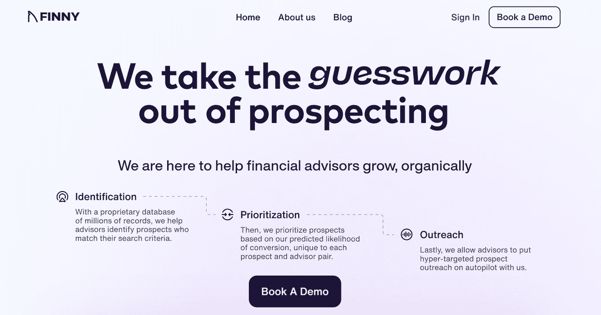

### **Lumen Orbit成功筹集1100**万美元种子轮资金，吸引200多家风投关注

贡献人：

https://techcrunch.com/2024/12/11/200-vcs-wanted-to-get-into-lumen-orbits-11m-seed-round/

Lumen Orbit是一家致力于在太空中建立数据中心的初创公司，近期完成了1100万美元的种子轮融资，估值达到4000万美元。该公司位于华盛顿州的雷德蒙德市，凭借其创新的太空数据中心概念，迅速吸引了包括NFX、Fuse.VC、Soma Capital等多家风投的兴趣，并获得了Andreessen Horowitz、Sequoia等知名风投的支持。NFX的合伙人Morgan Beller将加入Lumen Orbit的董事会。Lumen Orbit的融资成功突显了其作为Y Combinator 2024年夏季批次最受关注的初创公司之一的潜力。

Lumen Orbit的创始人兼CEO Philip Johnston表示，由于投资者需求过于旺盛——超过200家风险投资公司表示有兴趣投资该公司——Lumen Orbit在完成种子轮后，又启动了一个更高估值的SAFE轮融资，以允许更多投资者参与。这家公司成立于2024年1月，仅用几个月时间便获得如此热烈的关注。

Lumen Orbit的核心目标是通过构建太空数据中心，解决地球上数据中心的空间和能源限制。公司的数据中心将通过激光光缆将信息传输回地球，预计将帮助AI公司在不受传统数据中心规模和能源成本限制的情况下扩展。该公司计划在2025年推出一颗演示卫星，包含Nvidia的地面GPU，并在随后的几年内计划每年发射一颗卫星，逐步提升数据中心的能力。

Lumen Orbit的技术不仅能够降低数据中心的运行成本，还能借助太空中的冷环境解决冷却问题，这对于AI公司来说具有巨大的吸引力。创始人Philip Johnston和CTO Ezra Feilden的太空行业经验为这项技术奠定了坚实的基础。通过不断降低卫星发射成本，Lumen Orbit的太空数据中心计划有望在未来十年内实现多吉瓦级计算集群的建设。

公司官网：https://www.lumenorbit.com/

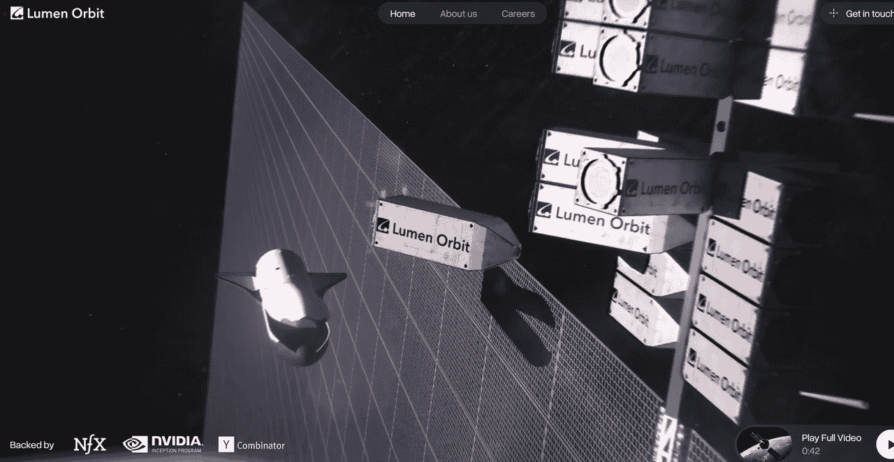

### **Microsoft的M12再投资2250万美**元支持NeuBird，延续其高速增长势头

贡献人：

https://techcrunch.com/2024/12/11/microsofts-m12-invests-another-22-5m-into-nuebird-months-after-its-22m-seed-round/

NeuBird是一家由Gou Rao和Vinod Jayaraman于2023年底创立的初创公司，致力于利用生成式AI自动化IT站点可靠性工程(SRE)任务。该公司通过其AI工具“Hawkeye”帮助企业迅速识别、诊断并解决问题，从而减少了对人工工程师的依赖，提升了效率。此前，创始人曾将他们的云存储初创公司Portworx以3.7亿美元售出，因此对IT行业有着深刻理解。

NeuBird于2024年4月完成了2200万美元的种子轮融资，估值达到1亿美元。然而，在种子轮融资几个月后，微软的风投基金M12主动联系公司，提出进一步投资。最终，NeuBird成功筹集了2250万美元的种子轮扩展资金，由M12领投，Mayfield、Stepstone Group和Prosperity7 Ventures也参与了此次融资。

此次扩展融资并不寻常，通常扩展轮融资是为了解决增长放缓的问题，但NeuBird的高增长势头令投资者异常看好。NeuBird的CEO Rao表示，公司选择将这轮融资称为“Seed-1”，以便在未来筹集更大的A轮资金。此外，本轮融资的估值较之前的种子轮大幅上升。

NeuBird的AI系统Hawkeye已被包括大型汽车制造公司、金融机构和制药公司等在内的多个客户采用，甚至一些员工仅为30人的小型初创公司也正在使用其服务。Hawkeye通过读取系统日志，检查是否有异常或错误，从而帮助客户解决潜在的IT问题。公司特别注重数据安全，Hawkeye以只读模式访问系统，避免存储任何客户的敏感数据。

尽管市场上已有其他公司如SRE.ai、Opslane等在尝试解决相似问题，但NeuBird凭借其AI驱动的高效解决方案和持续获得的投资，已成为业内备受瞩目的新兴力量。

公司官网：https://neubird.ai/

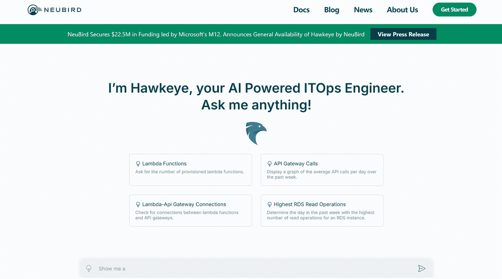

# 学习

### RAG七十二式：2024年度RAG清单

贡献人：

https://mp.weixin.qq.com/s/Sy1dSx5RUtD6rjMY7_efkw

节选：

1.  **GraphReader**：将长文本转化为知识网络，帮助AI像人类一样探索信息。

1.  **MM-RAG**：多模态机器学习，理解不同形式信息并在它们之间建立联系。

1.  **CRAG**：自我校正检索结果，提升生成文本的准确性和可靠性。

1.  **RAPTOR**：递归嵌入、聚类和总结文本块，构建树状结构以检索信息。

1.  **T-RAG**：结合RAG与LLM，使用树结构表示组织内实体层次结构。

1.  **RAT**：检索增强思维，修订每个思维步骤以提高长时生成任务性能。

1.  **RAFT**：提高模型在特定领域内回答问题的能力。

1.  **Adaptive-RAG**：根据问题复杂度动态选择检索增强策略。

1.  **HippoRAG**：模仿海马体索引理论，实现新旧知识整合。

1.  **RAE**：检索增强模型编辑框架，优化语言模型。

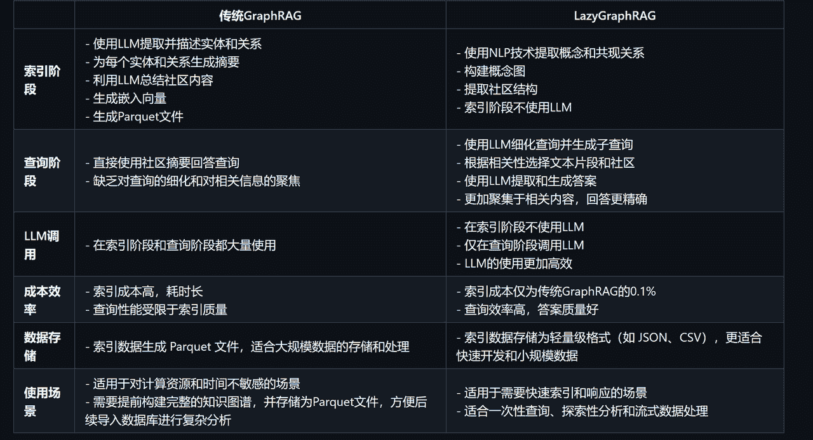

### 用QA问答详解端到端 [工程落地：UniAD/PARA-Drive/SpareDrive/VADv2]

贡献人：

https://zhuanlan.zhihu.com/p/12088531309

端到端自动驾驶模型通常分为两类：一种是完全黑盒的OneNet，它直接优化Planner模型；另一种是模块化的端到端模型，通过感知、预测和规划模块的协作，减少分段模型中的误差累积。UniAD是典型的模块化端到端架构，分为四个模块：输入多视角相机图像，Backbone提取BEV特征，Perception模块进行场景级感知，Prediction模块基于时序和交互预测轨迹，Planner模块则完成路径规划。所有模块均使用Query+Transformer结构，以便在模块间进行高效的信息交互。

TrackFormer模型通过分离检测、跟踪和自车Query的方式，采用DETR检测模型来识别新目标，并通过合并历史帧的Track Query进行持续跟踪，利用QIM和MHA来获取时序信息并更新目标的状态。MapFormer使用Panoptic SegFormer进行全景分割，区分可数的things和不可数的stuff，支持不同类型的实例管理。MotionFormer模型处理代理的目标位置和轨迹，通过交互式的Query设计，使得动态代理、静态地图以及目标轨迹等信息有效融合。

OccFormer模块采用类似RNN的结构，顺序处理不同时间点的环境信息，并使用掩膜交叉注意力机制来聚焦当前时刻的相关信息，优化代理实例的占用预测。SpareDrive是另一个模块化端到端架构，强化了图像编码器和稀疏感知模块，通过并行处理图像和环境信息来进行代理检测和轨迹规划，进一步增强系统的实时性能。其运动规划模块通过时空交互和层级规划选择，预测自车和周围代理的运动轨迹，并依据碰撞风险进行选择。

VADv2使用规划Transformer结构，通过交互和概率学习进行动作预测，结合真实驾驶数据对动作概率进行约束，从而减少轨迹冲突代价。它的规划Token、场景Token和导航Token分别处理动作决策、环境信息和自车状态，最终通过概率选出最佳驾驶行动。

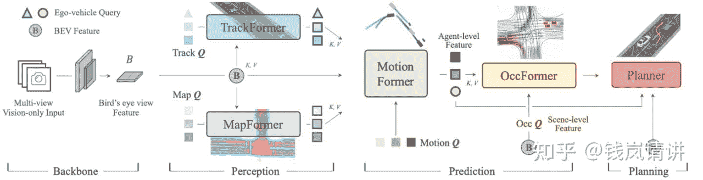

### 大模型时代是否还需要AI编译技术

贡献人：

https://zhuanlan.zhihu.com/p/12041352548

随着LLM（大规模语言模型）的兴起，其在结构和算子上的高度收敛性推动了专门推理框架（如llama.cpp）的流行，许多人开始思考是否不再需要深度学习编译器。由于算子的收敛性和结构的高度优化，部分开发者认为只需对特定算子进行加速（如Flash Attention）和优化（如FP8/FP16量化），无需再依赖传统的编译路径。这使得推理流程的重心转向了系统级的优化，例如KV缓存、Prefill/Decode的分离以及内存方案优化（如PageAttention）等，这些策略显著提升了推理吞吐量和效率，尤其是在大模型推理场景下。

然而，这种思路也引发了反思。在CNN时代，模型从云端逐步推广到端设备，小型化和优化成为关键，尤其是在复杂的业务逻辑中，算子不再规整，甚至出现了碎算子问题，推动了自定义算子和大Kernel融合的流行。LLM作为强大工具，尽管能在许多领域展现威力，但无法解决所有问题。随着业务逻辑的复杂化，依然需要多种模型的拼接，甚至CNN模型可能继续发挥作用，尤其是在一些特定场景中。

LLM并非万能，它将会演变为一个“决策大脑”，但在这个过程中，仍然需要与多模态模型的结合，Universal Token是一个重要的趋势。尽管云端推理强依赖NV硬件，但异构硬件（如AMD、国产芯片等）也会在成本和性能上发挥重要作用。而在设备端，硬件碎片化使得编译技术依然至关重要。

手写优化和编译并非互斥关系。历史上，传统编译器和数学库的结合提供了高效的性能；在CNN时代，AI编译器与供应商库的搭配同样是常见的优化方案。而在LLM时代，虽然部分场景可能依赖完全手写优化，但编译技术仍在多样化硬件环境下发挥着重要作用，尤其是在优化服务化和推理的融合时，AI编译器的作用不可忽视。未来可能出现从操作系统层面对LLM优化的趋势，进一步加深服务化与推理的深度融合，推动LLM应用场景的全面扩展。

### 如何评价知乎刚刚宣布开源的大模型推理框架 ZhiLight？

贡献人：

https://www.zhihu.com/question/6401144682

ZhiLight是知乎开源的一款大模型推理框架，旨在提供高效的LLaMa-like模型推理支持，并兼容OpenAI的接口。其技术架构采用C++/CUDA实现，支持多种性能优化措施，如Flash-Attention、Marlin Kernel、vLLM异步OpenAI Server等开源组件。ZhiLight还自研了Prefill & All-Reduce Overlap、All-Reduce量化、基于TensorCore的批量解码和多卡TP等功能，在PCIe显卡上的测试性能优于一些主流开源框架，但在A800类NVLink显卡上稍逊。框架的代码结构清晰，适合用于推理引擎的研发或学习，且提供了Docker镜像，方便用户上手。

ZhiLight的技术细节优化方面，特别突出的包括PCIe卡间通信优化、内存管理和并发请求管理等。这些措施有效降低了AI幻觉问题，提高了推理结果的准确性。此外，框架集成了多个流行的开源项目，并通过计算与通信重叠、低精度通信等技术，将单层Transformer的计算时间降低了40%以上。框架的设计目标是优化快速部署和应用，尤其适用于大规模用户产品的推理需求。团队在选择模型方案时，倾向于检索增强生成（RAG），相较于传统的pretrain+posttrain，RAG方案在成本、时效性、准确性和可扩展性方面更具优势。

在知乎的实际应用中，ZhiLight支撑了知乎直答和专业搜索功能。知乎直答功能通过AI搜索提供快速、精准的答案，帮助用户避免传统搜索引擎需要逐个链接筛选的痛点。此外，专业搜索支持多种能力，如信息查询、内容分析和数学计算，特别在文献检索中表现出色，能够精确匹配并翻译相关文献。

ZhiLight推理框架的优势在于其高效的性能和良好的扩展性，使得知乎能够优化AI搜索和内容检索体验。虽然在国内市场中已有多款AI搜索产品，但ZhiLight凭借其技术优势在特定场景中具有较强的竞争力，尤其是在文献检索和深度搜索方面。总体来说，ZhiLight是一个实用且易于部署的推理框架，适用于大规模的推理应用，尤其适合需要快速高效部署的企业和开发者。

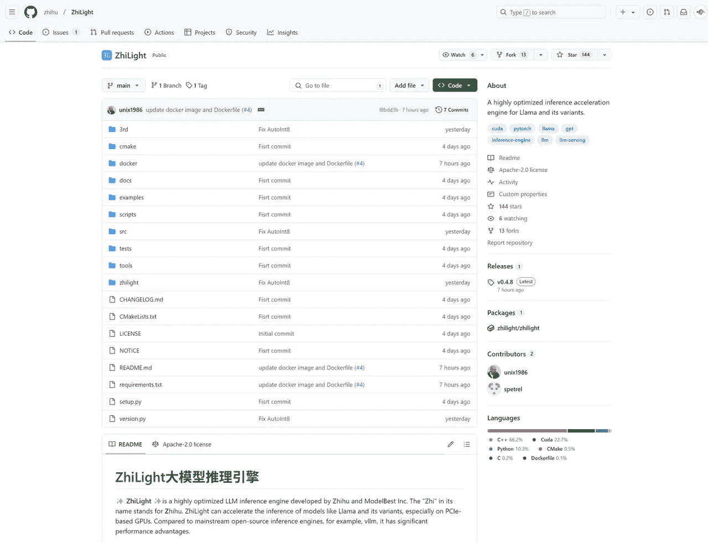

### 生成扩散模型漫谈（二十六）：基于恒等式的蒸馏（下）

贡献人：

https://zhuanlan.zhihu.com/p/11823133445

本文介绍了SiD（Score identity Distillation）的后续理论进展，主要内容是从梯度视角解释了SiD中的λ参数设置，核心部分是由FGM（Flow Generator Matching）发现的准确估计SiD梯度的巧妙思路，这肯定了λ=0.5的选择，在此基础上，作者拓展了Fisher散度的概念，从而解释了λ=1的取值。

### SGLang代码快速上手（with openRLHF)

贡献人：

https://zhuanlan.zhihu.com/p/11536619756

在选择推理引擎时，团队最终决定从vllm切换到SGLang，主要考虑到封装的复杂性与技术优化的需求。虽然vllm提供了清晰的代码封装，适合新手和小规模改动，但过度封装导致的复杂逻辑使得深度修改变得困难。SGLang则提供了更直观、可控的实现，尤其是在训练加速上有显著的优化。

SGLang的推理引擎基于一个多进程架构，其中HTTP服务器与SRT引擎共同协作。SRT引擎包括Tokenizer Manager、Scheduler与Detokenizer Manager。与vllm不同，SGLang的Scheduler模块通过多进程通信与显存管理来调度和执行请求。Scheduler的核心是如何处理输入的batch，决定哪些请求应先执行，以及如何优化模型的推理过程。Scheduler模块使用了两个主要的缓存策略：Chunked Cache和Radix Cache。Chunked Cache通过分块处理长文本来优化效率，而Radix Cache则通过高效的前缀树结构，减少重复计算，提升性能，尤其是在长文本生成时能显著降低成本。

SGLang的Scheduler通过分配任务到各个工作进程来执行推理，而每个进程通过管道与其他进程进行同步。工作进程中的TpWorker会根据预设策略加载和执行模型任务。通过灵活配置的内存池和缓存机制，SGLang能够高效地管理内存并减少内存瓶颈。调度策略由SchedulePolicy类定义，它决定了在任务队列中优先执行哪些请求，这些策略可以根据不同的应用需求进行定制。

模型的推理分为decode和extend两大模式，SGLang在模型执行时依据任务类型分别处理。Decoder和Extender在SGLang中被显式分离，尽管两者在实现上有些重叠，但这种分离使得后续优化和定制变得更加高效。在具体的模型执行过程中，SGLang利用Flash Attention模块加速了特定操作的执行，减少了推理时间。

在与OpenRLHF的合作中，SGLang还针对PPO训练优化了推理引擎，强调了推理引擎在RLHF训练中的加速作用。通过针对推理引擎的细节优化，SGLang能够有效降低推理成本，同时保证训练过程中的稳定性与一致性。尤其是在不同大小的batch下，推理引擎和训练引擎之间的精度差异仍然是一个难题，但这种差异已被识别并正在修复中。

# 声明

本文档仅供学习交流使用，版权归原作者所有，若涉侵权，请联系Jack Jin 15101136166

##

（欢迎在下方反馈您宝贵的意见！整理不易，觉得有用给AI日报小组点个赞👍吧！）

ChatGPT；Angela；Zijia Liu；Alex；Zeqi Tan；Tiezhen（HuggingFace）；Naixu；Lizhi；Peter；Suoman；Jack

学术分析报告：ResearchFlow -- 奇绩F23校友的开发的深度研究产品，PC端进入RFlow的分析报告，可直接点击节点右侧的小数字展开节点，登录后可在节点上直接“询问AI”，进一步探索深度信息

如果你有大模型相关的创业想法，欢迎来找我们聊聊～微信：15101136166

> 快邀请你的小伙伴们一起来读大模型日报吧！

> **【日报****知识库****】**这里是近期日报内容的汇总,欢迎大家查阅

> [大模型日报知识库(分享版)](https://miracleplus.feishu.cn/wiki/KapVwXfkriOBiskB0B2cUHxjnTh)

>

> 欢迎大家多多帮我们分享,转发~~

> 如果大家有任何的建议或者吐槽,欢迎随时找我聊天~

