# 奇绩大模型日报（12月 13日）

> 来源：[https://miracleplus.feishu.cn/docx/YPhLdtAL6oErbixqVvycLTtMnrd](https://miracleplus.feishu.cn/docx/YPhLdtAL6oErbixqVvycLTtMnrd)

# 🔉潜**空间系列活动重磅回归！**

> 本期活动将在**12月15日** **11:00**开始，我们邀请到的嘉宾是**宋亚宸。**他是VAST创始人兼首席执行官，本科毕业于约翰斯·霍普金斯大学，曾在商汤科技落地多个从零到一的人工智能项目，实现AIGC技术在动画及游戏行业的商业化落地，也曾参与创立人工智能独角兽MiniMax。在本次分享中宋亚宸将带来《我们从700万全球用户生成的3D模型中看到了3D生成的哪些可能》的分享。

> 除嘉宾分享外，每期设置了【匹配合伙人 Cofounder Matching】环节。你可以和 GenAI 时代最有活力的创业者和研究者线下面对面交流，将有机会找到志同道合、有共同创业梦想的小伙伴。

> 报名通道已开启，欢迎扫描下方二维码报名。

# 推特

### ChatGPT 移动应用中的高级语音功能现已开始推出视频和屏幕共享功能

https://x.com/OpenAI/status/1867292997660160061

正值假期来临之际，ChatGPT 移动应用中的高级语音功能现已开始推出视频和屏幕共享功能。

[rZrbK3q1XMvY2R8Q.mp4](https://internal-api-drive-stream.feishu.cn/space/api/box/stream/download/all/SzJ4b3oPzop35txnvCZcG1OqnBc)

### Deep Research在 Gemini Advanced 中正式推出：您的个人 AI 研究助手

https://x.com/GeminiApp/status/1866873306818977945

介绍 Deep Research——您的个人 AI 研究助手。从今天起，在 Gemini Advanced 中正式推出。

通过 Deep Research，您可以生成关于复杂主题的深度研究报告，报告附带来源链接，仅需几分钟即可完成数小时的研究工作。

访问 http://gemini.google.com，从 Gemini Advanced 模型下拉菜单中选择 Deep Research 开始体验吧！

[DWZr_DT1NPdskeze.mp4](https://internal-api-drive-stream.feishu.cn/space/api/box/stream/download/all/VMP6bdoj2oxVFPxK7jbcsSl1nvh)

### 吴恩达分享：AI 对产品管理的帮助

https://x.com/AndrewYNg/status/1867269937397670082

**AI 产品管理**

AI 产品管理正在快速发展。生成式 AI 和基于 AI 的开发工具的增长为构建 AI 应用带来了大量机会。这使得构建新类型的产品成为可能，同时推动了产品管理最佳实践的转变。产品管理的核心是定义要构建什么以服务用户，而由于技术的变化，产品构建的可能性也随之改变。在这篇文章中，我将分享一些我观察到的最佳实践。

**使用具体示例来定义 AI 产品**

从具体的想法入手有助于团队快速推进。如果产品经理 (PM) 提议构建“一个可以回答与用户账户相关的银行查询的聊天机器人”，这是一种模糊的描述，容易引发各种想象。例如，聊天机器人是仅回答账户余额相关的问题，还是也包括利率、汇款流程等问题？但是，如果 PM 提供 10 到 50 个具体的对话示例，描述希望聊天机器人执行的任务，其提案的范围就会变得清晰得多。就像机器学习算法需要训练数据一样，AI 产品开发团队也需要明确的示例来说明我们希望 AI 系统完成什么任务。换句话说，数据就是你的 PRD（产品需求文档）！

类似地，如果有人提出“一个用于检测我们商店外行人的视觉系统”，开发者可能难以理解系统的边界条件。例如，系统是否需要在夜间工作？允许的摄像机角度范围是什么？是否需要检测出现在图像中但距离 100 米远的行人？但如果 PM 收集了一些图片并标注了期望的输出，“检测行人”这一要求就变得具体起来。工程师可以评估这个规范是否技术上可行，并在可行的情况下向目标推进。最初，这些数据可能是通过一次性的临时过程获得的，比如 PM 自己四处拍照并进行标注。最终，数据的来源将转向系统在实际运行中收集的真实数据。

使用示例（如输入和期望输出）来定义产品多年来一直很有帮助，但 AI 应用的爆炸式增长使得更多产品经理需要学习这种实践。

通过提示评估基于 LLM 的应用的技术可行性

当 PM 评估一个潜在的 AI 应用时，其技术可行性是决定下一步的重要标准。对于许多基于 LLM 的应用创意，PM 即使不是软件工程师，也可以通过提示（prompting）或编写少量代码，初步评估其可行性。

例如，PM 可能设想一个新的内部工具，用于将客户的电子邮件路由到正确的部门（如客户服务、销售等）。他们可以提示 LLM 来测试其是否能够根据输入的电子邮件选择正确的部门，并观察是否能够实现高准确率。如果可以，这为工程开发提供了一个很好的起点。如果不行，PM 可以自己验证想法并可能更快改进产品创意，而无需依赖工程师构建原型。

有时，测试可行性需要稍微超过简单提示。例如，这个基于 LLM 的电子邮件系统可能需要基本的 RAG（检索增强生成）能力来辅助决策。幸运的是，现在编写少量代码的门槛已经很低，因为 AI 可以作为编码助手来帮助编写代码，正如我在“AI Python for Beginners”课程中所描述的。这意味着 PM 可以在基本层面上进行更多的技术可行性测试，这在以前是难以实现的。

**无需工程师即可原型设计和测试**

用户对初始原型的反馈对于塑造产品至关重要。幸运的是，快速构建原型的门槛正在降低，PM 可以自己推进基本原型，而无需专业的软件开发人员。

除了使用 LLM 帮助编写原型代码外，像 Replit、Vercel 的 V0、Bolt 和 Anthropic 的 Artifacts（我个人都很喜欢这些工具！）这样的工具正在使没有编码背景的人也能轻松构建和试验简单原型。这些工具对于非技术用户来说越来越容易上手，不过我发现那些了解基础编码的人能够更高效地使用它们，因此学习基础编码仍然很重要。（有趣的是，高技术水平且经验丰富的开发人员也使用这些工具！）我的团队中有许多人经常使用这些工具进行原型设计、获取用户反馈并快速迭代。

AI 正在推动许多新应用的开发，从而大幅增长了对了解如何定义和推动 AI 产品开发的产品经理的需求。在生成式 AI 崛起之前，AI 产品管理就已经存在，但构建应用的日益便捷正在创造更大的 AI 应用需求，因此许多 PM 正在学习 AI 以及这些新兴的 AI 产品开发最佳实践。我对这一领域感到非常着迷，并将继续分享不断发展的最佳实践。

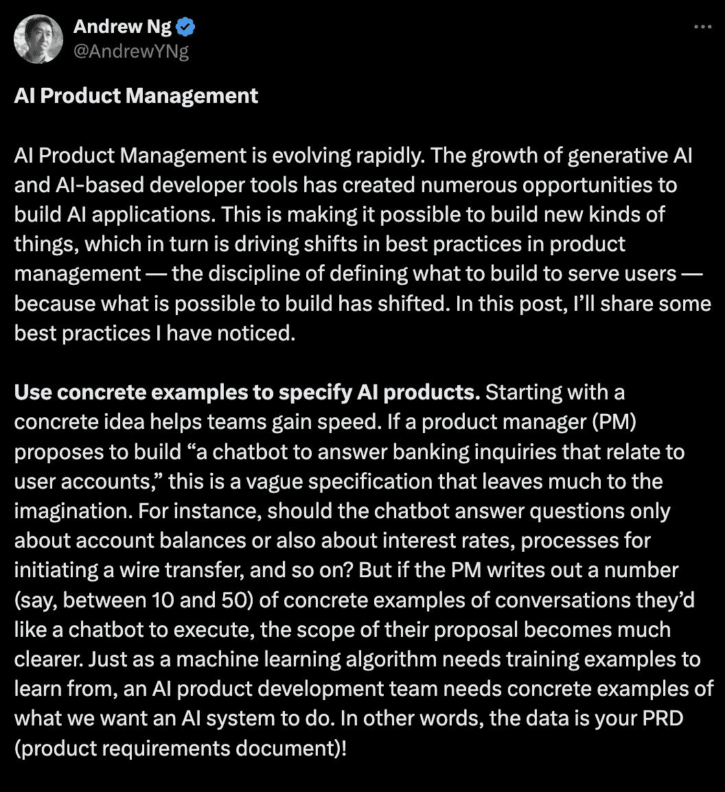

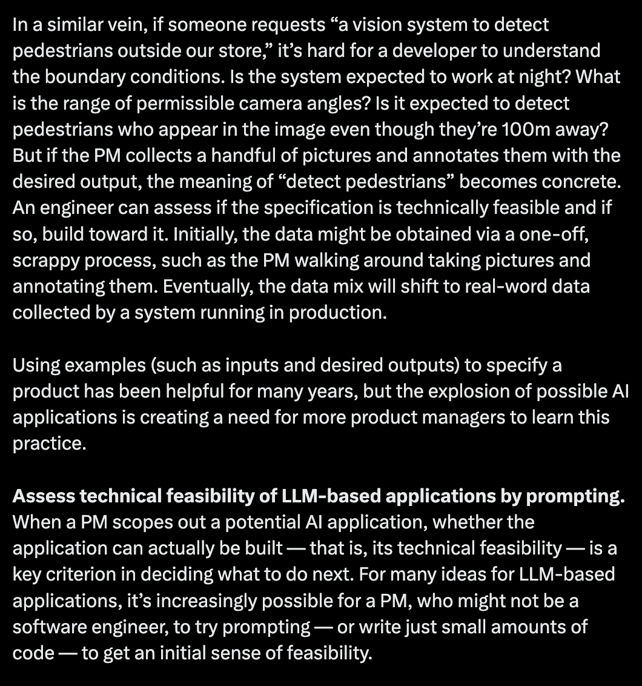

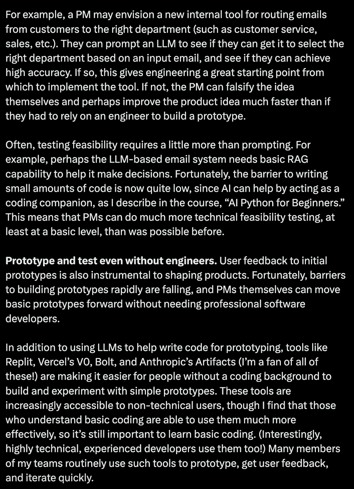

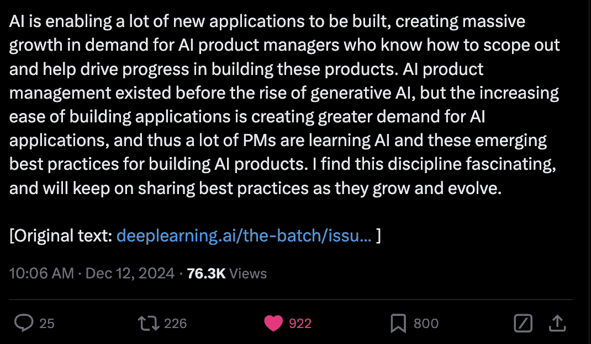

### Karpathy：最喜欢的大语言模型应用之一是一起读书

https://x.com/karpathy/status/1866896395363553418

我最喜欢的大语言模型（LLMs）应用之一是一起读书。我希望能提问或者听到生成的讨论（类似 NotebookLM 的风格），并且这些讨论能够自动基于周围内容进行调整。如果像亚马逊这样的公司开发出一个“即插即用”的 Kindle AI 阅读器，我认为它会成为一个巨大的成功。

目前，可以通过一些脚本来实现类似的功能。也许已经有人尝试构建一个非常出色的 AI 原生阅读器应用，而我错过了。

# 资讯

### NeurIPS神仙打架：李飞飞180页PPT谈视觉智能，Bengio同OpenAI员工吵架，何恺明谈AI宿命论

贡献人：

https://mp.weixin.qq.com/s/UBBIVnSFS2Xy0bNc5xCEmA

在今年的NeurIPS会议上，李飞飞围绕视觉智能展开了深入的讨论，并进一步阐述了她对AI未来的展望。她的演讲主题为《从看到到做：攀登视觉智能的阶梯》，探讨了视觉智能的发展路径及其与实际行动的紧密联系。李飞飞指出，智能有不同的复杂度和精密度，解决空间智能问题是迈向全面智能化的关键步骤。她强调，视觉智能不仅仅是感知“看到”，还涉及与环境的互动和实际操作，而这种能力的进步与深度学习和进化过程密切相关。

李飞飞认为，空间智能的发展是解决视觉智能的核心挑战。她提到，世界是三维的，而我们的物理世界和许多虚拟世界都需要三维智能来理解和导航。她举例说明了在生成三维场景时，如何通过深度学习生成细致的3D环境，强调理解三维空间对于AI系统的重要性。

她还提到，虽然三维智能技术仍面临着计算负担和资源瓶颈，但其潜力巨大，能够解锁创造力和生产力，特别是在建筑、医疗和虚拟世界等领域。李飞飞展望，随着技术的进步，AI有望为人类带来更高效的工作方式和全新的体验。

此外，NeurIPS会议期间充满了热议和争议。Bengio与OpenAI成员在因果关系讨论中发生冲突，关于AI代理的潜在风险展开了激烈辩论。Bengio强调，在赋予AI更多自主权之前，必须解决调整和控制问题，以防止AI失控的风险。

另一个话题是何恺明对AI宿命论的探讨，他提出，AI的发展可能是不可避免的，取决于人们对AI角色的信仰。这些讨论让NeurIPS会议充满了激烈的思想碰撞，也为AI的未来发展带来了更多思考。

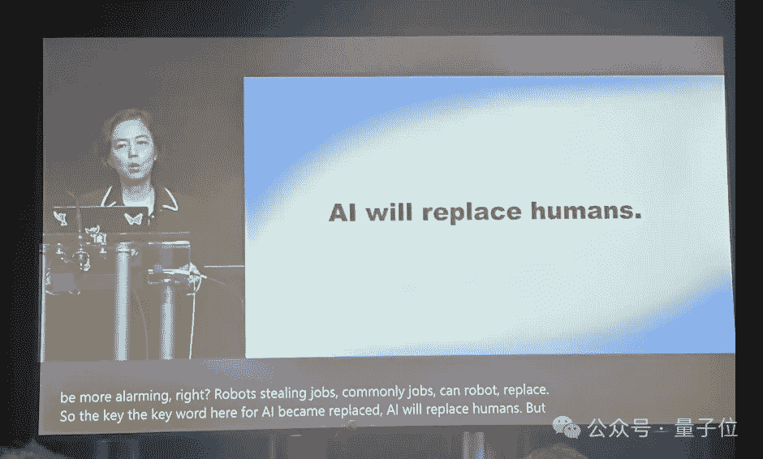

### 国产全AI游戏来了？！大模型直出开放世界游戏，有声可交互

贡献人：

https://mp.weixin.qq.com/s/lHzPmepqwHDotNBJzABdmQ

AI游戏生成技术今年迎来了新的突破，巨人网络发布了两款创新的大模型“千影 QianYing”，分别是视频生成大模型YingGame和视频配音大模型YingSound。YingGame的亮点在于其能够生成开放世界游戏的视频，无需使用传统的游戏引擎。该模型支持角色多样的动作控制、自定义角色设计，并能精确仿真游戏中的物理规律，例如汽车碰撞、火焰燃烧等。同时，YingGame能够理解多种交互方式，包括文本、图像、鼠标和键盘输入，允许用户与生成的游戏角色进行互动。它还支持第一人称视角，为游戏体验带来了高度沉浸感。

技术上，YingGame采用了多个互动网络模块，结合多模态特征和细粒度角色表征，通过高效的训练数据处理管线，生成能够动态响应用户输入的高质量游戏视频。除了游戏生成，巨人网络还推出了YingSound模型，这一模型专注于视频配音，能够为无声视频生成匹配的音效，精确对齐音频与视频内容，展现了在游戏、动画和真实世界场景中的广泛应用。YingSound不仅支持复杂剧情的音效生成，还能理解视频语义，精准地生成与场景变化匹配的音效。

这两款模型展示了AI在游戏创作中的巨大潜力，尤其是在降低游戏制作门槛、让更多普通人参与游戏创作方面具有革命性影响。通过简短的文字描述，用户可以生成完整的游戏场景，未来，AI可能使得游戏创作的唯一限制只是创作者的想象力。巨人网络的目标是打造一个AI游戏孵化平台，使得任何人都能轻松创作自己的游戏，推动游戏行业的创新与发展。

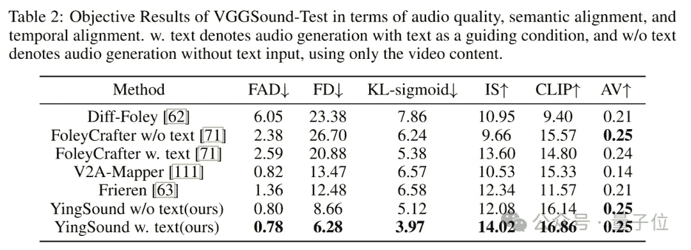

### Phi-4：微软最新的小语言模型，专注于复杂推理任务

贡献人：

https://techcommunity.microsoft.com/blog/aiplatformblog/introducing-phi-4-microsoft%E2%80%99s-newest-small-language-model-specializing-in-comple/4357090

微软最近推出了Phi-4，一款专为复杂推理任务设计的小型语言模型。Phi-4旨在通过其较小的规模来提升效率，同时仍能有效处理高级的语言理解和推理任务。以下是该模型的技术亮点：

1.  **专注复杂推理任务**：Phi-4特别优化了推理能力，能够处理更多涉及深度理解和逻辑推理的问题，提升了处理复杂任务的能力，尤其在推理精度和速度上表现突出。

1.  **效率和小规模优势**：与大规模语言模型不同，Phi-4的模型规模较小，能够在较低的计算资源需求下实现较高的性能，适用于资源受限的环境。

1.  **增强的多模态理解**：该模型不仅擅长文本推理，还能够处理跨模态的信息流，如文本与图像的组合输入，从而提升对不同类型数据的综合理解能力。

1.  **对话系统的潜力**：Phi-4在对话生成方面表现优异，能够支持更复杂的多轮对话和上下文理解，尤其适合在实时交互中使用，如智能助手或客户支持系统。

1.  **与现有模型的互补性**：虽然Phi-4是一个较小的模型，但它在多个领域中能够与现有的大型模型协同工作，提供一种更灵活的解决方案，尤其在需要资源高效处理的场景中。

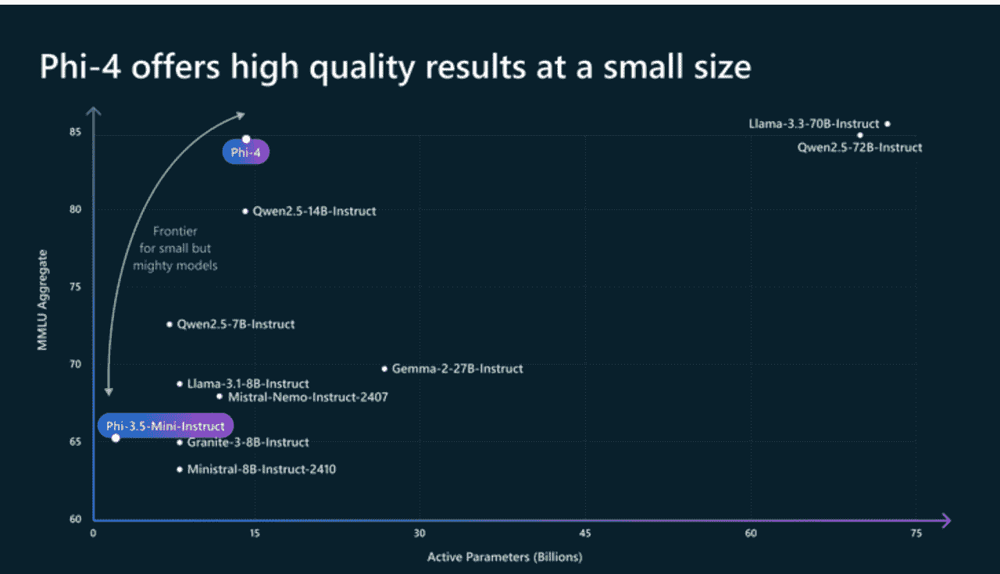

### 哈佛与谷歌合作发布100万本公共领域书籍，助力AI训练数据集建设

贡献人：

https://techcrunch.com/2024/12/12/harvard-and-google-to-release-1-million-public-domain-books-as-ai-training-dataset/

2024年12月12日，哈佛大学宣布将发布一个包含约100万本公共领域书籍的数据集，旨在为人工智能（AI）模型提供训练数据。这些书籍跨越了多种类型、语言和作者，包括已不再受版权保护的经典作品，如狄更斯、但丁和莎士比亚的作品。此数据集来源于谷歌的长期图书扫描项目——谷歌图书，因此谷歌将在数据集发布中扮演重要角色。

虽然这个数据集目前尚未公开发布，且具体发布的时间和方式尚未确定，但哈佛大学表示，该数据集将通过其“机构数据计划”（IDI）公开。该计划首次在今年3月曝光，目的是为AI提供法律合规的数据通道。此次正式发布的IDI得到了微软和OpenAI的财务支持，预计将大大推动AI技术的普及和发展。

哈佛大学IDI的执行董事格雷格·莱佩特（Greg Leppert）表示，这一数据集将“平衡竞争”，使得从研究实验室到AI初创公司等各类机构能够使用这一庞大的数据集来训练大型语言模型（LLMs）。这项举措不仅有助于推动AI技术的发展，也可能为不同规模的公司和组织提供更多的创新机会。

此次合作不仅推动了AI数据资源的共享，还标志着高校与科技公司在技术发展和数据利用方面更加紧密的合作。

### 2024年度AI十大趋势报告

贡献人：

https://mp.weixin.qq.com/s/6pBRLJ_nC6nBs3P334690g

**技术层面**，大模型创新是2024年的重头戏。新的模型架构不断涌现，如RWKV、Mamba、RetNet等，致力于解决Transformer架构的算力问题，标志着大模型架构进入混合创新时代。与此同时，Scaling Law的泛化推动了推理能力的提升，并加速了计算和数据处理的变革，尤其是像OpenAI的o1模型，成为推理能力突破的典型例子。此外，AGI的探索也在加速，视频生成、世界模型、具身智能和空间智能的技术突破，使得AI离通用智能（AGI）更近一步。

**产品层面**，AI应用的格局正在经历快速洗牌。AI智能助手已成为国内市场的主流，豆包等产品取得了领先地位，但其他赛道如AI陪伴、AI搜索、AI写作等仍处于竞争和发展阶段，未来将会有更多创新产品涌现。AI+X产品（如AI与办公软件、内容平台的深度融合）表现突出，推动了行业效率的提升，但原生AI爆款产品的出现相对滞后。AI产品趋势呈现出多模态交互和高度个性化的发展，2025年预计将广泛应用AI Agent来实现个性化推荐和服务。

**行业层面**，AI的渗透已经覆盖多个领域，包括智能驾驶、具身智能、智能硬件、游戏、影视、教育和医疗等。AI在这些行业中的应用有助于提升生产力，重塑行业生态。尤其在智能驾驶和具身智能领域，AI技术与行业需求紧密结合，呈现出强大的成长潜力。

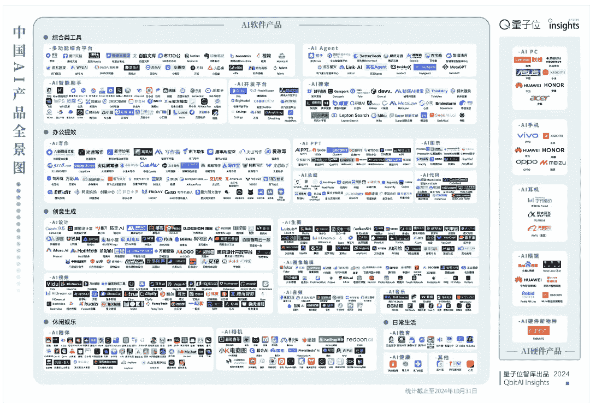

### 智能驾驶系列：汇川入海，跨域融合成行业新趋势

贡献人：

https://mp.weixin.qq.com/s/NgJ_bw8E-4gDAlnUUufqxw

**从分布到集中，域融合大势所趋。**整车电子电气架构从分布式走向部分域控，再由域集中走向跨域融合，最终实现中央集中，主要受三大驱动力推动：1）跨域融合方案降低线束、连接器用量，整车BOM物料成本降低；2）各域共享算力、数据资源；3）软硬件解耦开发，丰富智能化创新功能。我们测算，随着高级别智能驾驶应用渗透率提升，国内域控制器市场规模预计于2026年达到1,275亿元。

车企加速布局跨域融合电子电气架构，高算力芯片支撑舱驾融合方案。目前多数新势力已具备跨域融合开发能力，中央计算平台+区域控制的方案逐步落地。座舱域和智驾域算力占用多、功能丰富度高，域融合的探索方案较多。2024年1-10月行泊一体域控配套量达210.4万套，渗透率为11.8%，占智驾跨域控制器总配套数量的80.2%。我们认为舱驾一体发展路径或以舱泊融合、行泊融合为基础，最终实现舱驾融合。在融合形式方面，域融合沿着One-box方案向One-board方案、最终实现One-chip芯片级融合，高算力SoC芯片为跨域融合提供硬件底座。

**域融合重塑产业竞争格局。**芯片厂、车企、域控供应商之间多种业务模式并存，且随着电子电气架构不断演进，三方合作模式不断动态调整。在域融合发展阶段，软硬件设计复杂度高，开发难度大，整车厂存在差异化域融合诉求。我们认为，拥有突出软硬件开发能力的Tier1有望在竞争中胜出。长期来看，我们看好域控供应商绑定高算力芯片，实现平台化供应。

**风险**

智能汽车渗透率不及预期、电子电气架构升级进度不及预期、竞争格局恶化导致盈利不及预期。

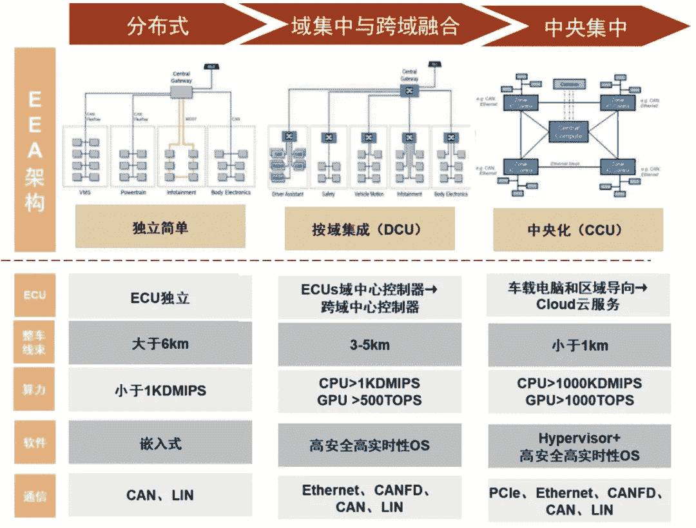

# 信号

### Stereo4D: Learning How Things Move in 3D from Internet Stereo Videos

贡献人：

论文链接：https://arxiv.org/abs/2412.09621

论文介绍了一种从互联网立体视频中挖掘4D的方法。它能够实现大规模、高质量、动态、度量3D 重建，具有相机姿势和长期 3D 运动轨迹。团队使用 Stereo4D 制作了超过 10 万个真实世界 4D 场景的数据集。

学习从图像中理解动态 3D 场景对于从机器人到场景重建等应用至关重要。然而，与其他大规模监督训练能够快速取得进展的问题不同，直接监督恢复 3D 运动的方法仍然具有挑战性，因为获取地面真实注释存在根本困难。论文提出了一个从互联网立体广角视频中挖掘高质量 4D 重建的系统。系统将相机姿态估计、立体深度估计和时间跟踪方法的输出融合并过滤成高质量的动态 3D 重建。论文使用这种方法以具有长期运动轨迹的世界一致、伪度量 3D 点云的形式生成大规模数据。通过训练 DUSt3R 的变体来预测来自现实世界图像对的结构和 3D 运动，证明了这些数据的实用性，表明对重建数据进行训练可以推广到各种现实世界场景。

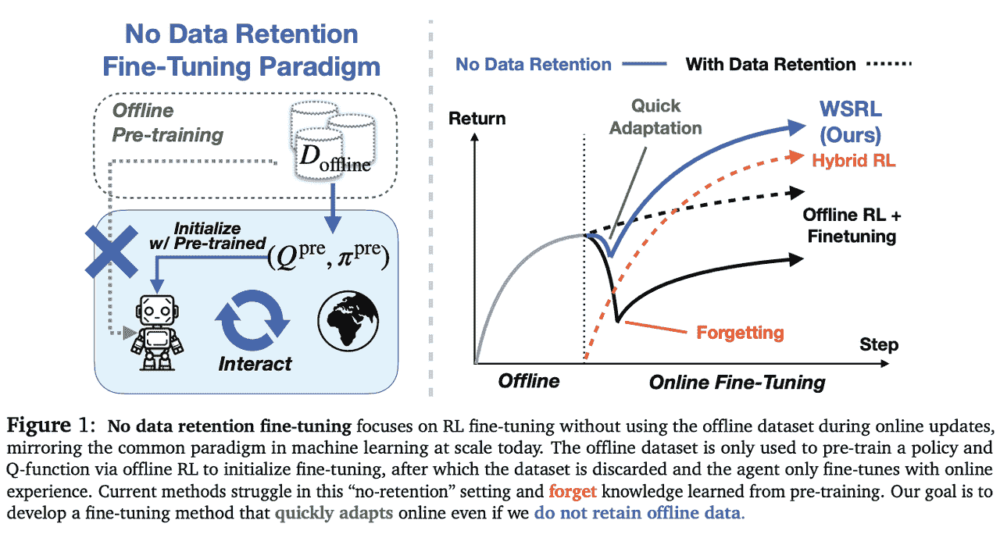

### Byte Latent Transformer: Patches Scale Better Than Tokens

贡献人：

论文链接：https://scontent.fhkg10-2.fna.fbcdn.net/v/t39.2365-6/470135129_1314438233309836_4712217603129928862_n.pdf?_nc_cat=111&ccb=1-7&_nc_sid=3c67a6&_nc_ohc=_rrHgJZzzMcQ7kNvgEo-LSS&_nc_zt=14&_nc_ht=scontent.fhkg10-2.fna&_nc_gid=AFf37OD0l6TXX6O7-eFHN9q&oh=00_AYAmfgrVe0MKgCfi86l4VWh7XDi6iWSFsFngZxS5qA44gQ&oe=67619608

Meta的新论文介绍了字节潜在变换器，这是一种新的字节级 LLM 架构，它首次在规模上与基于标记化的 LLM 性能相匹配，同时显著提高了推理效率和稳健性。BLT 将字节编码为动态大小的补丁，这些补丁作为计算的主要单位。补丁根据下一个字节的熵进行动态分割，在数据复杂性增加需要时分配更多的计算和模型容量。论文提出了第一个翻转控制扩展研究，研究了具有 4T 训练字节的字节级模型，其参数高达 8B。结果证明了在没有固定词汇表的情况下扩展在原始字节上训练的模型的可行性。由于在数据可预测时动态选择长补丁，训练和推理效率均得到提高，同时推理和长尾泛化也得到了定性改进。总体而言，对于固定的推理成本，BLT 通过同时增加补丁和模型大小，显示出比基于标记化的模型更好的扩展性。

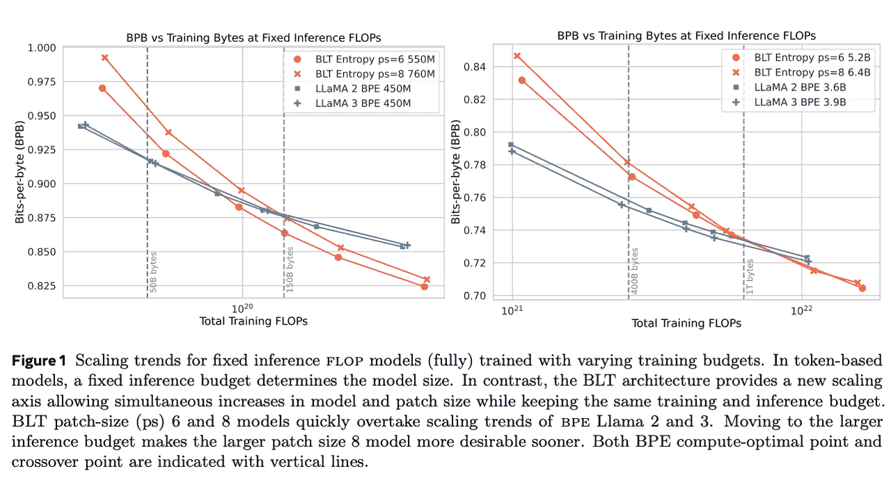

### Clio: Privacy-Preserving Insights into Real-World AI Use

贡献人：

论文链接：https://assets.anthropic.com/m/7e1ab885d1b24176/original/Clio-Privacy-Preserving-Insights-into-Real-World-AI-Use.pdf

Anthropic推出新系统，Clio。Clio可以自动识别世界各地 Claude 的使用趋势。Clio 是一种自动分析工具，可以对现实世界的语言模型使用情况进行隐私保护分析。它以类似于 Google Trends 等工具的方式让我们深入了解 claude.ai 的日常使用情况。它也已经在帮助改进安全措施。

Clio 的工作原理是收集真实世界的对话，在删除识别信息的同时对其进行总结，然后对这些总结进行聚类以揭示总体见解。此过程在安全的环境中进行——只有最终的高级见解才对人类分析师可见。

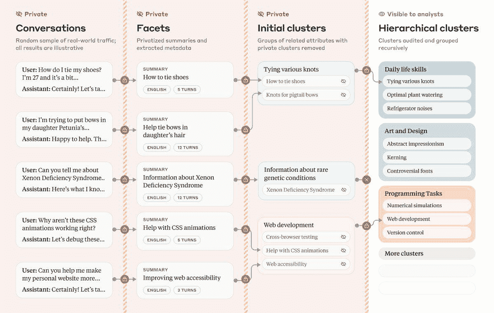

### Bootstrapping Language-Guided Navigation Learning with Self-Refining Data Flywheel

贡献人：

https://arxiv.org/abs/2412.08467

文章提出了一个名为自我精炼数据飞轮（SRDF）的新方法，用于提高视觉语言导航（VLN）任务中合成指令-轨迹对的质量。当前VLN任务中，合成数据的质量，尤其是语言的忠实度，尚未得到充分研究，传统的扩展数据量和环境的做法效果有限。作者通过迭代式的协作，在导航器和指令生成器之间实现数据质量的自动评估和优化。

1.  **自我精炼数据飞轮（SRDF）**：该方法通过导航器与指令生成器之间的循环反馈，提高生成的指令与轨迹的对齐质量。首先，使用现有的人工标注数据训练指令生成器，生成指令并与导航器共同优化，确保生成的指令在多场景下具有高保真度。

1.  **导航器作为数据筛选器**：使用训练好的导航器评估指令-轨迹对的质量，采用路径保真度评分（nDTW和SPL）作为指令与轨迹对齐的衡量标准。导航器的高性能确保了对合成数据的有效筛选，避免了传统度量方法（如CLIP分数）对多场景语义和方向性对齐的局限性。

1.  **迭代优化**：生成器和导航器通过多次迭代提升性能，生成器在优化过程中不断提高指令质量，导航器则借助更好的数据提升其在实际任务中的表现。

1.  **高质量数据集构建**：通过该方法，不仅提升了指令生成的质量，还创建了一个更具挑战性的、高质量的合成VLN数据集。

1.  **性能突破**：在R2R数据集上，SRDF方法显著提高了指令跟随和生成的表现，首次在指令跟随任务中超越了人类表现（76%的SPL）。此外，该方法还成功实现了跨任务的迁移能力，在多个下游VLN任务中表现出色。

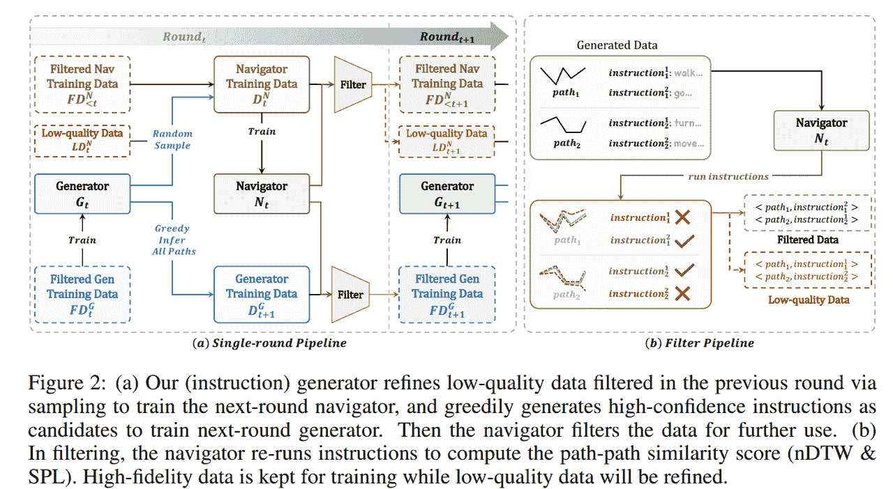

### Large Concept Models: Language Modeling in a Sentence Representation Space

贡献人：

https://arxiv.org/abs/2412.08821

论文提出了一种新型的“大概念模型”（LCM），旨在突破当前大型语言模型（LLMs）在处理语言和模态时的局限，特别是现有模型在抽象推理和层次化处理方面的不足。传统的LLMs主要依赖于基于transformer的结构，并在单一词元层面进行处理，缺乏多层次的推理和规划能力。本文提出的LCM方法将推理转移到语言和模态独立的抽象嵌入空间，通过显式的层次化结构来模拟人类的认知和信息处理方式，从而生成更连贯且高效的长文本输出。

1.  **抽象层次的推理**：与传统LLMs不同，LCM在抽象的概念嵌入空间中进行推理，而非基于词元。这意味着其推理过程不依赖于特定语言或模态，而是在语义层面建模，从而实现语言和模态的独立性，支持跨语言和跨模态的通用性。

1.  概念嵌入（Concept Embeddings）：LCM使用SONAR（一个预训练的句子嵌入模型）将输入文本分割成句子，并将每个句子编码成概念嵌入。然后，通过LCM进行进一步处理，生成新的概念嵌入，再通过SONAR解码回原始的词元或其他语言的表达。此方法避免了传统模型中的语言依赖，并可无缝地进行语言间转换。

1.  **显式层次化结构**：LCM的架构支持长文本的层次化处理。通过在更高抽象层次进行推理和结构化，LCM能够更好地生成长文本，同时保持逻辑一致性和可读性。这种结构也方便了用户的交互式编辑，提升了文本的可修改性和可控性。

1.  **零样本泛化能力**：由于LCM的推理是在语言和模态无关的概念层面进行的，因此能够在不同语言或模态之间进行零样本推理，无需额外的微调或数据支持。例如，LCM可以直接处理任何SONAR支持的语言和模态，实现跨语言的任务推理和生成。

1.  **模块化与可扩展性**：与多模态LLMs可能出现的模态竞争问题不同，LCM允许概念编码器和解码器独立开发和优化，新增语言或模态时不必担心相互干扰，从而提高系统的灵活性和扩展性。

1.  **优化的推理架构**：LCM通过更短的序列长度和有效的噪声调度策略，解决了传统transformer模型在处理长上下文时的复杂性问题。此外，LCM在推理过程中采用了基于扩散（diffusion）的多种架构设计，进一步提高了推理效率。

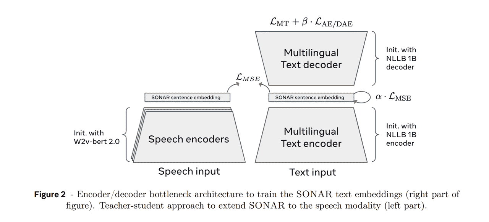

### GPD-1: Generative Pre-training for Driving

贡献人：

http://arxiv.org/abs/2412.08643v1

论文提出了一种名为Generative Pre-training for Driving (GPD-1)的统一模型，用于解决现有自动驾驶模拟器在场景演化和多个任务集成方面的局限性。传统的自动驾驶模拟器往往针对特定任务（如地图生成、运动预测或轨迹规划）进行优化，缺乏跨任务的统一框架，导致无法充分利用场景中的时间演化和动态交互信息。本文的创新点在于通过一个生成预训练模型，整合地图、动态代理和自车信息，从而实现场景演化的生成性预测。

1.  **统一场景表示**：GPD-1将地图、代理和自车信息作为一组统一的token进行编码，采用自回归Transformer架构，并引入场景级别的注意力掩码，以捕捉自车、代理和地图之间的双向依赖关系。这种方法有效地整合了各个元素，使得模型能够在不同的任务中共同作用。

1.  **分层位置编码器**：对于自车和代理，作者提出了一种分层位置编码器，能够有效地将鸟瞰图（BEV）中的位置和朝向转换为离散的token。这种方法显著减少了特征空间中的噪声，提高了位置编码的精确度。

1.  **地图信息的离散化表示**：为简化地图信息的处理，GPD-1使用向量量化自动编码器（VQ-VAE）将自车视角下的语义地图压缩成离散token。这种方法避免了直接预测连续的地图坐标，从而简化了学习过程并增强了模型的泛化能力。

1.  **多任务能力**：GPD-1在没有任何微调的情况下，能够执行场景生成、交通模拟、闭环仿真和运动规划等任务。例如，在场景生成中，模型可以初始化场景并平滑生成代理、地图和自车信息；在交通模拟中，给定真实地图和初始代理状态，模型能够预测后续帧的演化；在闭环仿真中，模型根据自车轨迹动态调整代理轨迹；在运动规划中，模型生成自车轨迹以响应提供的代理和地图信息。

1.  **状态-of-the-art表现**：通过进一步的微调，GPD-1能够在多个下游任务中达到最先进的性能，特别是在nuPlan基准中的运动规划任务中表现突出。

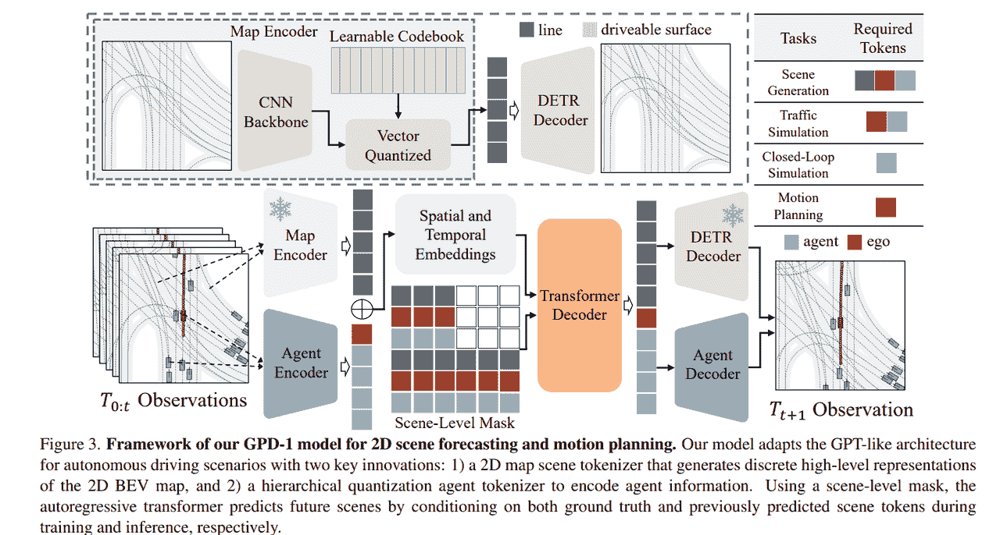

### Multimodal Latent Language Modeling with Next-Token Diffusion

贡献人：

http://arxiv.org/abs/2412.08635v1

论文提出了一种名为Latent Language Modeling (LatentLM)的方法，旨在统一处理离散数据（如文本和代码）与连续数据（如视频、音频和机器人动作）的生成任务。传统的多模态生成模型往往依赖于管道（pipeline）或外部工具进行模块化处理，导致在不同模态之间传递信息时发生信息丢失，限制了性能。为了克服这一问题，LatentLM采用了一种全新的思路，利用自回归Transformer模型统一生成离散和连续数据。

1.  **连续数据的表示与生成：**
LatentLM使用变分自编码器（VAE）将连续数据表示为潜在向量，并通过引入下一步令牌扩散（next-token diffusion）技术，自回归地预测潜在向量。这种方法使得在Transformer隐藏状态的条件下，扩散头生成潜在向量，并通过VAE解码器重构生成的连续数据。

1.  **离散数据的生成：**
对于离散数据，LatentLM使用共享的Transformer骨干网络，通过软最大（softmax）头进行下一令牌预测。与传统方法不同，LatentLM通过σ-VAE维持潜在空间的方差，确保生成的表示适合自回归解码。

1.  **统一的多模态生成与理解：**
LatentLM通过语言建模的范式，将离散和连续数据的生成过程统一，从而简化了实现并可以共享信息。与基于量化的连续数据表示方法相比，LatentLM能够更高效地进行数据压缩，并保持较低的重建损失。

**实验结果与优势：**

1.  **图像生成：**
在ImageNet上的图像生成任务中，LatentLM表现出与基于扩散模型或离散令牌的模型竞争的性能，尤其在模型规模扩展上，LatentLM的效果超过了DiT模型。

1.  **多模态大语言模型：**
在文本、图像-文本对和交织数据的训练下，LatentLM在语言建模、文本到图像生成和视觉语言理解等任务上，均优于Transfusion和基于向量量化图像令牌的模型。

1.  **语音合成：**
在文本到语音合成任务中，LatentLM也超过了传统系统。由于使用连续表示进行编码，LatentLM的压缩比远高于基于量化令牌的方法，这提升了训练和推理的效率。

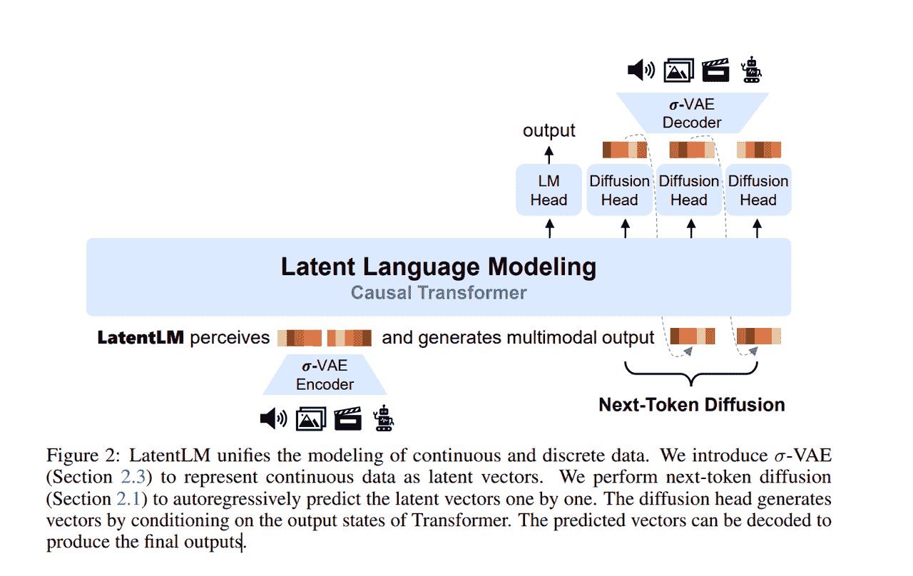

### 3DSRBench: A Comprehensive 3D Spatial Reasoning Benchmark

贡献人：

http://arxiv.org/abs/2412.07825v1

**3DSRBench**，一个针对大规模多模态模型（LMMs）进行3D空间推理能力评估的基准，旨在深入研究现有LMMs在处理图像和视频中的空间关系，特别是在3D场景中的表现。尽管最近的LMMs在图像描述、视觉问答、视觉定位、决策制定等任务中取得了显著进展，但它们在3D感知和空间关系理解方面仍然存在局限，这对于实现更高级的推理和交互至关重要。

**技术创新与贡献：**

1.  **3DSRBench基准的构建：****
本文首次提出了一个全面的3**D空间推理基准，涵盖了12种问题类型，集中在高度、位置、方向和多物体推理四大类空间关系上。通过手动标注2,100个自然图像的视觉问答对，确保了问题覆盖了包括刚性物体、人类、动物及隐式概念（如车上的标志或广告牌上的箭头）等广泛的开放词汇实体。

1.  **多视角数据与复杂场景的挑战：**
为了进一步提高评估的全面性，研究还对6**72个多**视**角合成图**像**进行了标注**，涉及不同的6D视角（3D位置和3D方向），这对于LMMs在复杂场景下的空间推理尤为重要。通过这些数据，能够有效评估模型在不同视角下的表现，尤其是对常见视角和不常见视角的推理能力，后者在机器人和嵌入式AI中的应用尤为常见。

1.  **FlipEval策略：****
为了增强评估的**鲁棒性，3DSRBench引入了FlipEval策略，通过设计问题与答案的配对方式，使得模型在推理时能够面临不同类型的挑战，避免过于简单的回答，增强推理的多样性和复杂度。

1.  **数据分布和多样性：**
基准特别关注数据分布的平衡，包括不同类型问题的对称数据（如同一问题给出正反答案的图片对）和问题的多样性，确保3D空间推理评估的全面性和可靠性。

**实验与结果：**

通过**在3DS**RBench上对多种**开源和专有的**LMMs进行基准测试，本文揭示了当前模型在3D空间推理方面的弱点，尤其是在处理3D位置、姿态、方向等复杂空间关系时，模型的表现仍明显低于人类水平。特别是，方向推理（如“位于左侧”）和复杂空间推理（如“面向物体的视角”）仍然是挑战。

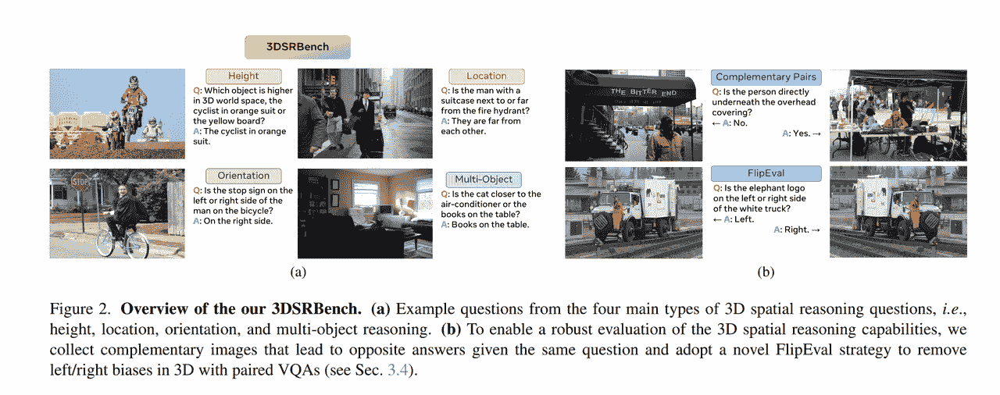

# 产品

### Tavus 的人工智能圣诞老人 随时随地与圣诞老人进行视频聊天

贡献人：

https://santa.tavus.io/?ref=producthunt

Tavus 推出的 **AI Santa** 是一款令人惊叹的节日人工智能体验，能够让您随时随地与圣诞老人进行实时视频互动。通过这一创新技术，您可以用多达 30 种语言与圣诞老人交流，轻松了解自己是“乖巧”还是“淘气”。不仅如此，您还能通过直观的界面与圣诞老人展开趣味互动，按下按钮获取特别的问候或惊喜！这款产品支持快速分叉与部署，几秒钟内即可个性化定制，为您或您的观众打造一场独一无二的节日奇幻体验。无论是个人娱乐、家庭欢聚，还是企业活动，这位 AI 圣诞老人都能为节日增添无穷的欢乐与温馨。

### Growith.app

贡献人：

https://www.growith.app/?ref=producthunt

在将视频内容发布到社交媒体之前，获得全面的测试与优化支持是成功的关键。通过Growith平台，用户可以轻松将视频上传至一个专属的创作者社区，在这里收集真实的反馈和深入的参与度分析。Growith为用户提供详细的数据洞察，帮助您了解视频的受欢迎程度、内容的吸引力以及观众的兴趣点。基于这些数据，用户可以快速调整与优化内容，确保发布的每一条视频都具备高质量和强大的传播力。从初稿到最终发布，Growith都将为用户提供全覆盖的支持与服务。

# HuggingFace&Github

### Sora 中文 提示词 指南

贡献人：

https://github.com/SoraEase/sora-prompt-zh

Sora 中文的提示词指南，各种场景使用指南。学习怎么让它听你的话。兼顾了 Sora 的多场景应用。

[Sora | 索拉](https://openai.com/sora) 是一个AI模型，可以从OpenAI的文本指令中创建逼真和富有想象力的场景。OpenAI正在教AI理解和模拟运动中的物理世界，目标是训练模型，帮助人们解决需要现实世界交互的问题。

如[果你是 sora 的学习](https://github.com/awesome-sora/awesome-sora-zh)者，希望获取到 sora 的最新的咨询和相关的开发项目，以及 sora 相关的开源项目，这里 awesome-sora 提供了 sora 相关的Sora 中文指南，指令指南，应用开发指南，精选资源清单，Sora 开发者精选工具框架。

**Sora可提供以下功能：**

+   文本到视频

+   动画

+   扩展生成的视频

+   视频到视频编辑

+   连接视频

+   图像生成（文本到图像）

在这个存储库中，你会发现各种可以和索拉一起使用的提示。我们根据视频的风格分配了不同的标签，让你可以根据标签快速找到提示示例（Prompt）和生成的视频，并根据需要进行修改。

# 投融资

### **RapidCanvas获得1600**万美元融资，推动AI代理应对技术人才短缺

贡献人：

https://www.rapidcanvas.ai/newsroom/rapidcanvas-gets-16m-as-it-successfully-puts-ai-agents-to-work-addressing-tech-talent-shortage

2024年12月11日，AI初创公司RapidCanvas宣布完成1600万美元的A轮融资。此轮融资由Peak XV领投，Titanium Ventures、Accel和Valley Capital Partners等现有投资者参与。至此，RapidCanvas自成立以来的总融资额超过2350万美元。RapidCanvas的AI代理能够自动化最多75%的复杂任务，尤其是数据科学家和工程师通常需要完成的任务，旨在缓解技术人才短缺问题。该公司通过融合AI和人类专家的能力，打造了一种独特的“服务即软件”（Service-as-Software）模式，极大提高了企业的AI应用效率。

RapidCanvas的AI代理能处理大规模信息，迅速识别模式并做出决策，能在几秒钟内完成传统上需要数天的任务。该平台结合了AI代理与人工专家的优势，能以更低成本、更快速度完成大部分编程任务，从而释放更多技术人才投入到创意和复杂问题解决中。RapidCanvas的模式被广泛应用于数据准备、转化和建模等领域，尤其在编码和数据处理方面显示出巨大的市场潜力。

公司官网：https://www.rapidcanvas.ai/

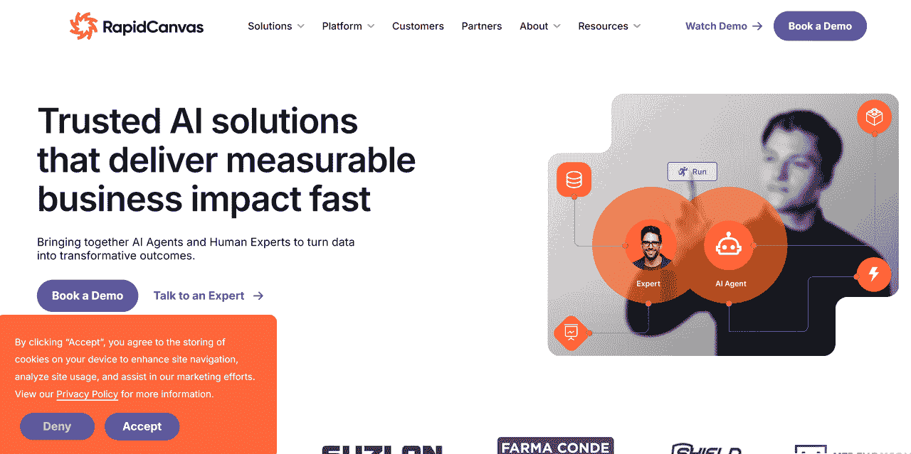

### Twelve Labs获得3000万美元融资，推动视频分析AI技术发展

贡献人：

https://techcrunch.com/2024/12/12/twelve-labs-is-building-ai-that-can-analyze-and-search-through-videos/

2024年12月12日，视频分析初创公司Twelve Labs宣布完成3000万美元融资，此次资金来自Databricks、Snowflake、SK Telecom、HubSpot Ventures和In-Q-Tel等投资者。此次融资使得Twelve Labs的总融资额达到1.071亿美元。公司计划利用这笔资金加强产品开发，并扩大工程、研究及客户服务团队的招聘。

Twelve Labs致力于开发能够分析和搜索视频内容的人工智能模型。与传统的视频搜索方法不同，Twelve Labs的技术能够帮助用户通过视频中的具体场景、人物、动作等要素进行精确搜索。例如，用户可以查询“红衣服的人什么时候进入餐厅”这样的具体问题，AI能够在海量视频中定位相关的瞬间。这一技术使视频分析不仅限于标签和描述的搜索，而是深入到视频内容本身。

此外，Twelve Labs的产品还支持多模态嵌入（multimodal embeddings），能够同时处理视频、文本、音频等不同类型的数据，广泛应用于广告插入、内容审核、实时威胁检测等场景。公司与Databricks、Snowflake等企业建立了合作关系，将其技术整合到这些平台的服务中。

Twelve Labs表示，未来将继续扩展其技术应用，尤其是在汽车和安全领域，并计划聘请更多的高级人才来加速公司的全球扩展。公司还宣布，SK Telecom前CTO、Siri创始成员金允将加入Twelve Labs担任总裁和首席战略官，负责公司未来的战略规划和全球扩展。

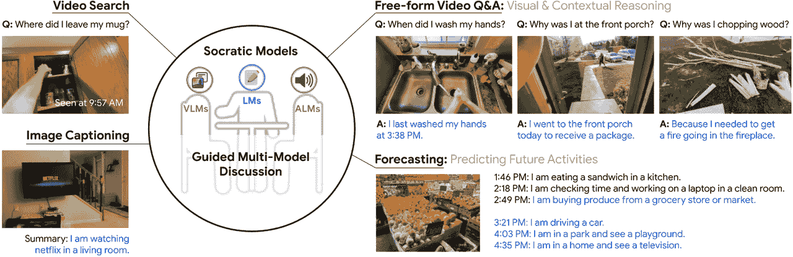

### Anybotics融资6000万美元，加速美国市场扩张

贡献人：

https://techcrunch.com/2024/12/12/anybotics-raises-60m-to-scale-autonomous-industrial-robots-in-the-u-s/

瑞士机器人公司Anybotics近日宣布，已完成6000万美元的融资，将其B轮融资总额提升至1.1亿美元。此次追加投资的目的是推动其核心业务的全球扩展，特别是在美国市场的增长。值得注意的是，Anybotics并未将这笔资金称为C轮融资，而是将其视为B轮融资的延伸。

Anybotics成立于2016年，源自苏黎世联邦理工学院（ETH Zurich）。公司开发了一款名为Anymal的四足自主检查机器人，广泛应用于石油、天然气、矿业、电力和金属行业。Anymal配备了多种传感器和摄像头，用于监测工业环境中的设备状况，例如检测热异常或可燃气体的存在。

在过去18个月里，Anybotics的销售业绩显著增长，已经在全球范围内部署了近200台机器人。其客户包括Novelis（铝业回收）、Iamgold（金矿开采）、Stelco（钢铁冶炼）等知名企业，以及斯坦福大学的高级研究应用。

此次B轮融资的投资者包括高通风险投资、Supernova Invest等新投资者，同时Bessemer Venture Partners、诺基亚支持的NGP Capital、瑞士的Swisscanto、瑞士通信公司、TDK Ventures和Walden Catalyst等现有投资者也参与其中。Anybotics表示，未来的C轮融资将关注更广泛的增长，包括拓展其机器人产品的应用场景和行业。

公司官网：https://www.anybotics.com/

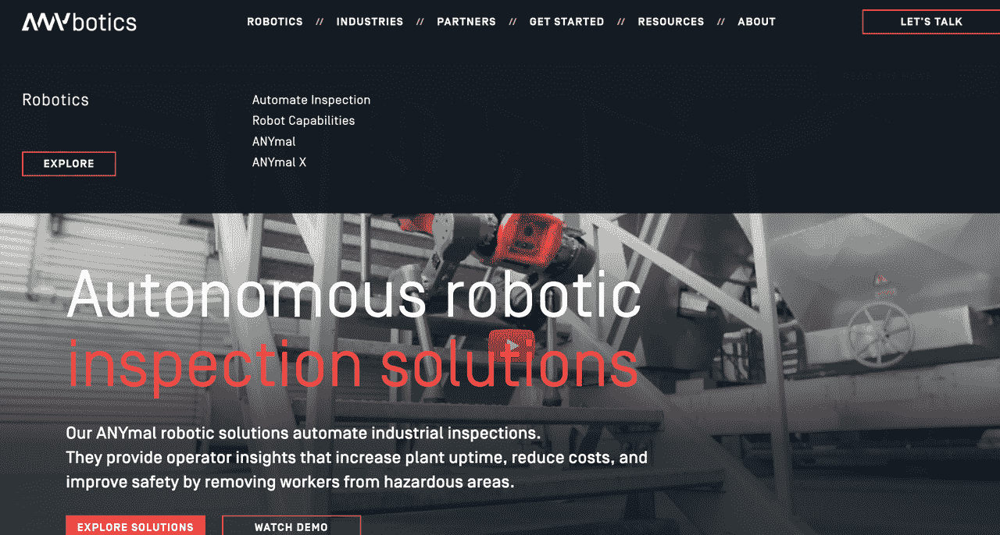

# 学习

### 硬件仿真的两大范式：Cycle-based VS Event-driven

贡献人：

https://zhuanlan.zhihu.com/p/12404884470

硬件设计中的仿真是验证和优化的关键步骤，主要分为两种范式：Cycle-Based 和 Event-Driven。Cycle-Based 仿真通过时钟周期进行简化计算，适用于同步电路设计。其优点包括高效性、低内存消耗以及较易实现，但精度受限且不适合异步电路。开源工具如 Verilator 和 Arcilator 使用此范式，Arcilator 在性能上超越了 Verilator，提供更高的仿真速度和更小的二进制文件。Event-Driven 仿真通过处理信号变化的事件，适合复杂和异步电路，能捕捉细微的时序错误，支持复杂的模块交互，但速度较慢且资源消耗高。llhd-sim 是此范式的代表工具，但随着 Arcilator 的出现，它逐渐被淘汰。LLHD 项目解决了传统 EDA 工具中的复杂性和工具兼容性问题，推动了硬件设计领域的创新。最终，Cycle-Based 和 Event-Driven 范式在现代硬件设计中各有优势，未来或将融合为更强大的工具。

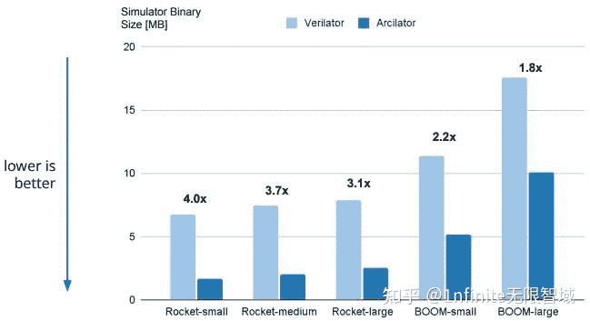

### 深入理解Rectified Flow，完善统一扩散框架

贡献人：

https://zhuanlan.zhihu.com/p/11686643707

扩散模型近年来几乎取代了生成对抗网络（GAN），成为生成模型研究的焦点。从最初的DDPM到VP-SDE、VE-SDE、sub VP-SDE等，所有的这些方法都依赖于加噪的线性漂移项的SDE。近年来，Rectified Flow（RF）被提出，打破了这一框架，其简单的定义和损失函数使得它在扩散模型的研究中脱颖而出，尤其适合研究者和工程师快速上手。然而，仔细分析RF的本质，发现其中涉及的数学原理远比表面上看起来简单。

RF的核心思想是通过一个线性ODE建模数据分布和噪声分布的关系，并通过最小化损失函数来学习这一过程。在传统的扩散模型中，通过噪声的加入和逐步去噪的方式生成样本，而RF通过简单的两行公式，描述了如何从当前状态预测下一个状态，最终通过采样生成数据。然而，RF的核心ODE并不像表面描述的那样简单，而是更复杂的非线性形式。

具体而言，RF的真实ODE形式与常见的扩散模型ODE不同。通过求解训练得到的ODE最优解，可以推导出RF对应的真实ODE。经过进一步分析，发现RF的过程并不是“直线”的，这与传统的扩散模型中通过直线插值的方式生成数据的方式有所不同。直线插值常见于DDIM模型，但RF则是通过一个曲线形式的ODE进行建模，其最终的生成过程并不依赖于直线插值，而是更符合复杂的期望值计算。

RF中的“拉直”操作，实际上并非对已存在的曲线进行“修正”，而是通过再次训练模型，使其最终的生成路径尽可能逼近直线插值的形式，从而加速采样过程。此操作表明，RF不仅仅是一个直线生成模型，而是一个具有灵活性的模型，通过调整模型参数，使生成过程接近于直线插值。

在进一步的分析中，发现通过配对数据进行训练，可以实现加速扩散模型生成过程。在传统的扩散模型中，通过调整ODE使其接近插值方程的速度，可以大幅减少生成步骤。这一操作同样适用于Diffusion类模型，特别是在DDPM的框架下，可以通过调整插值过程来实现一步生成。

值得注意的是，这种“加速”并不是简单地将模型转换为直线插值，而是在插值方程的速度期望下调整ODE，使其生成过程更加高效。RF的这一操作本质上与Diffusion类模型的加速方法一致，不同之处在于RF可以通过线性插值的特殊性，利用ODE的欧拉步采样实现一步生成。

总的来说，Rectified Flow提供了一个简洁而强大的生成框架，能够将复杂的扩散模型通过配对数据训练与插值方程的贴近，实现高效的生成过程。其关键在于通过“拉直”操作优化ODE，使得生成过程加速，同时不牺牲生成质量。

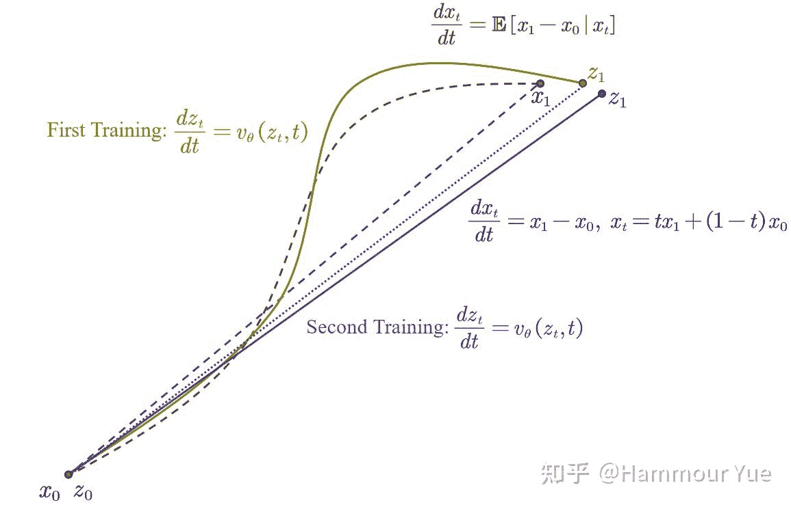

### LLM 分布式训练六大关键技术介绍

贡献人：

https://zhuanlan.zhihu.com/p/12392111887

1.  数据并行训练：通过将数据 mini-batches 分散到多个 workers，实现并行梯度计算和高效训练。

1.  Butterfly All-Reduce：通过创新的数据分割和汇总方法，有效降低通信成本。

1.  Gossip-Based Averaging：去中心化的通信策略，提高系统的容错性和可扩展性。

1.  Moshpit Gradient Descent：允许 workers 在小型独立组内进行梯度平均，增强训练的容错能力。

1.  DiLoCo：创新的内外优化算法，结合局部和全局参数更新，平衡收敛速度和系统性能。

1.  SWARM：引入动态任务分配和容错机制，优化异构硬件环境下的资源配置。

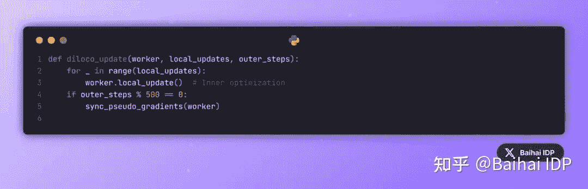

### 如何让 LLMs 登上多步推理之巅

贡献人：：

https://zhuanlan.zhihu.com/p/12246665455

本博客深入分析了提升大型语言模型（LLMs）复杂推理能力的可能关键技术，包括 Verifier 的学习与使用、自我纠错机制、语言空间上的规划以及测试时扩展。通过对这些技术的探讨，得出以下主要结论：

+   Verifier 的重要性：Verifier（又称奖励模型）通过评估和筛选生成的解决方案，显著提升了模型在数学和编程等多步推理任务中的表现。基于过程的奖励模型（PRM）不仅关注最终答案的正确性，还细化到每一步推理的合理性，有效降低了整体错误率。

+   自我纠错机制的提升：自我纠错使模型能够识别并修正自身的错误，通过强化学习优化推理策略。这一机制增强了模型在复杂环境中的适应性和鲁棒性，提升了整体推理能力。

+   语言空间上的规划：通过引入类似人类思维的规划机制，如双重思维模式（Dualformer），模型在处理串行计算任务时表现出更高的效率和灵活性，优化了推理路径，降低了计算资源的消耗。

+   测试时扩展的优化：测试时扩展策略通过动态分配计算资源，提升了模型在不同难度问题上的表现效率。计算最优扩展策略不仅提高了准确性，还显著优化了计算成本，为LLMs的高效部署提供了新的思路。

随着技术的不断创新和研究的深入，LLMs在复杂推理能力方面将迎来更广阔的发展前景。期待未来能见证更加智能、可靠和高效的语言模型问世，为各类应用场景带来革命性的变革。

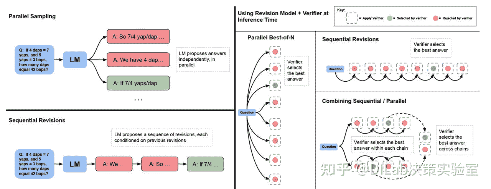

### 具身智能精品资源全网最全整理（建议收藏）

贡献人：

https://zhuanlan.zhihu.com/p/11555589352

作者整理了一系列关于具身智能的高质量资料。这些资料不仅涵盖了具身智能的核心技术，如感知、运动、操纵、强化学习、模仿学习、大语言模型（LLM）与机器人学的结合等，还延伸至自动驾驶、世界模型构建、以及产业界的应用实践。

# 声明

本文档仅供学习交流使用，版权归原作者所有，若涉侵权，请联系Jack Jin 15101136166

##

（欢迎在下方反馈您宝贵的意见！整理不易，觉得有用给AI日报小组点个赞👍吧！）

ChatGPT；Angela；Zijia Liu；Alex；Zeqi Tan；Tiezhen（HuggingFace）；Naixu；Lizhi；Peter；Suoman；Jack

学术分析报告：ResearchFlow -- 奇绩F23校友的开发的深度研究产品，PC端进入RFlow的分析报告，可直接点击节点右侧的小数字展开节点，登录后可在节点上直接“询问AI”，进一步探索深度信息

如果你有大模型相关的创业想法，欢迎来找我们聊聊～微信：15101136166

> 快邀请你的小伙伴们一起来读大模型日报吧！

> **【日报****知识库****】**这里是近期日报内容的汇总,欢迎大家查阅

> [大模型日报知识库(分享版)](https://miracleplus.feishu.cn/wiki/KapVwXfkriOBiskB0B2cUHxjnTh)

>

> 欢迎大家多多帮我们分享,转发~~

> 如果大家有任何的建议或者吐槽,欢迎随时找我聊天~

