# 奇绩大模型日报（12月 14-15日）

> 来源：[https://miracleplus.feishu.cn/docx/Oyf2dhda0owAiix7HEucG9fTntg](https://miracleplus.feishu.cn/docx/Oyf2dhda0owAiix7HEucG9fTntg)

# 🔉潜**空间系列活动重磅回归！**

> 本期活动将在**12月15日** **11:00**开始，我们邀请到的嘉宾是**宋亚宸。**他是VAST创始人兼首席执行官，本科毕业于约翰斯·霍普金斯大学，曾在商汤科技落地多个从零到一的人工智能项目，实现AIGC技术在动画及游戏行业的商业化落地，也曾参与创立人工智能独角兽MiniMax。在本次分享中宋亚宸将带来《我们从700万全球用户生成的3D模型中看到了3D生成的哪些可能》的分享。

> 除嘉宾分享外，每期设置了【匹配合伙人 Cofounder Matching】环节。你可以和 GenAI 时代最有活力的创业者和研究者线下面对面交流，将有机会找到志同道合、有共同创业梦想的小伙伴。

> 报名通道已开启，欢迎扫描下方二维码报名。

# 推特

### OpenAI公布时间线，控诉Elon Musk 希望将 OpenAI 改为营利性机构

https://x.com/OpenAI/status/1867654463588123030

OpenAI：Elon Musk 希望将 OpenAI 改为营利性机构。

**事件时间线：**

• **2015年11月**：OpenAI 以非营利机构形式成立，但 Elon Musk 对此提出质疑。

• **2015年12月**：OpenAI 正式对外宣布成立。

• **2017年初**：随着研究进展，团队意识到实现通用人工智能（AGI）需要投入数十亿美元的算力资金。

• **2017年夏**：团队与 Elon Musk 一致认为，成立营利性机构是推动 OpenAI 使命的下一步。

• **2017年秋**：Elon Musk 提出要求，需获得大部分股权、绝对控制权，并担任营利性机构的首席执行官。

• **2017年9月**：Elon Musk 创建了一家名为 “Open Artificial Intelligence Technologies, Inc.” 的公益公司。

• **2017年9月**：团队拒绝了 Elon Musk 的条件，因为给予他单方面控制权违背了 OpenAI 的使命。

• **2018年1月**：Elon Musk 表示，除非 OpenAI 与 Tesla 合并，否则注定失败。

• **2018年2月**：Elon Musk 辞去了 OpenAI 联席主席的职务。

• **2018年12月**：Elon Musk 要求团队“立即每年筹集数十亿美元资金，否则就放弃”。

• **2019年3月**：团队宣布在非营利框架内成立“有限盈利”的 OpenAI LP。

• **2023年3月**：Elon Musk 创立了与 OpenAI 竞争的 AI 公司 xAI。

Elon Musk 最近对 OpenAI 提起的法律诉讼，是他一年内第四次试图重新定义其主张。然而，他过去的言行已经说明了一切：早在 2017 年，他不仅希望将 OpenAI 改为营利性机构，还亲自创建了营利性架构。当他未能获得多数股权和完全控制权时，他选择退出并声称团队注定失败。如今，OpenAI 已成为领先的人工智能研究实验室，而 Elon Musk 运营着一家竞争性 AI 公司，他却要求法院阻止我们推进我们的使命。

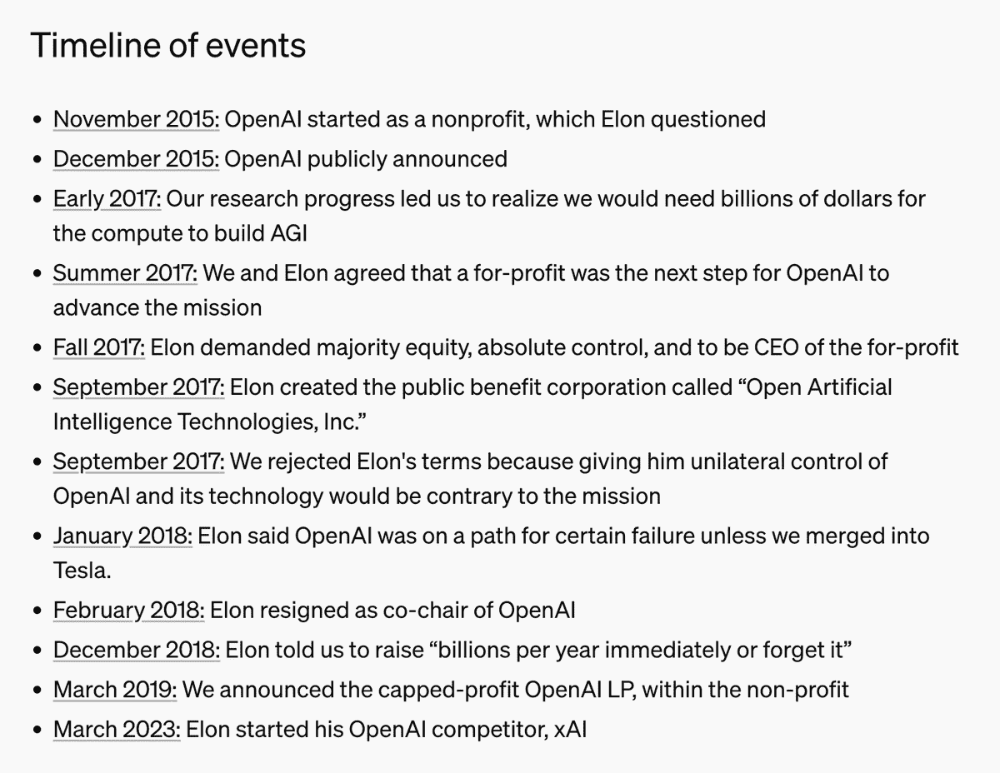

### OpenAI推出“项目”功能：用于在4.0版本中组织具有相同主题或上下文的对话

https://x.com/OpenAI/status/1867675796950987146

推出“项目”功能——一种简单的方法，用于在4.0版本中组织具有相同主题或上下文的对话。

现已向全球的ChatGPT Plus、Pro和团队用户开放。

我们将在1月向企业和教育用户推出，并很快向免费用户开放。

[mnyw5CErkNwoqKVV.mp4](https://internal-api-drive-stream.feishu.cn/space/api/box/stream/download/all/EroSbU5VmovkhwxixVgcWIrvnbe)

### Anthropic推出最佳N越狱法：通过对提示进行反复的小改动（如随机大写和字符重排），直到成功破解模型为止

https://x.com/AnthropicAI/status/1867608917595107443

新的研究合作：“最佳N越狱法”。

我们发现了一种简单且通用的方法，可以破解（绕过安全功能）前沿的AI模型，并且适用于文本、视觉和音频领域。

最佳N方法通过对提示进行反复的小改动（如随机大写和字符重排），直到成功破解模型为止。

在测试中，该方法对Claude 3 Opus的成功率达到了92%，甚至对具有“电路中断”防御的模型也有效。

**最佳N不限于文本领域。**

我们通过反复生成带有不同背景和叠加不同字体文字的图像，成功破解了视觉语言模型；在音频领域，我们通过调整音高、速度和背景噪音来实现破解。

一些示例请见：

[h](https://jplhughes.github.io/bon-jailbreaking/#examples)ttps://jplhughes.github.io/bon-jailbreaking/#examples

攻击成功率与样本规模呈可预测的幂律关系。

更多样本可以带来更高的成功率；最佳N方法能够利用更多计算资源应对更困难的破解任务。

这种可预测的扩展性使得在使用更多样本时可以准确预测攻击成功率（ASR）。

最佳N还可以与其他破解技术结合，从而提升攻击效果并提高样本效率。

结合多次示例破解技术（many-shot jailbreaking）应用于文本输入，最佳N方法在Claude 3.5 Sonnet上实现相同ASR的速度提高了28倍，在Claude 3 Opus上提升了70倍。

**在公开这些结果之前，我们已通过前沿模型论坛（@fmf_o**rg）向其他前沿AI实验室披露了该漏洞。

对于破解技术的负责任披露至关重要，特别是在AI模型能力不断增强的情况下。

我们正在开源代码，供其他人基于我们的工作进行研究。我们希望此举能帮助评估滥用风险，并设计防御机制，以抵御强大的适应性攻击。

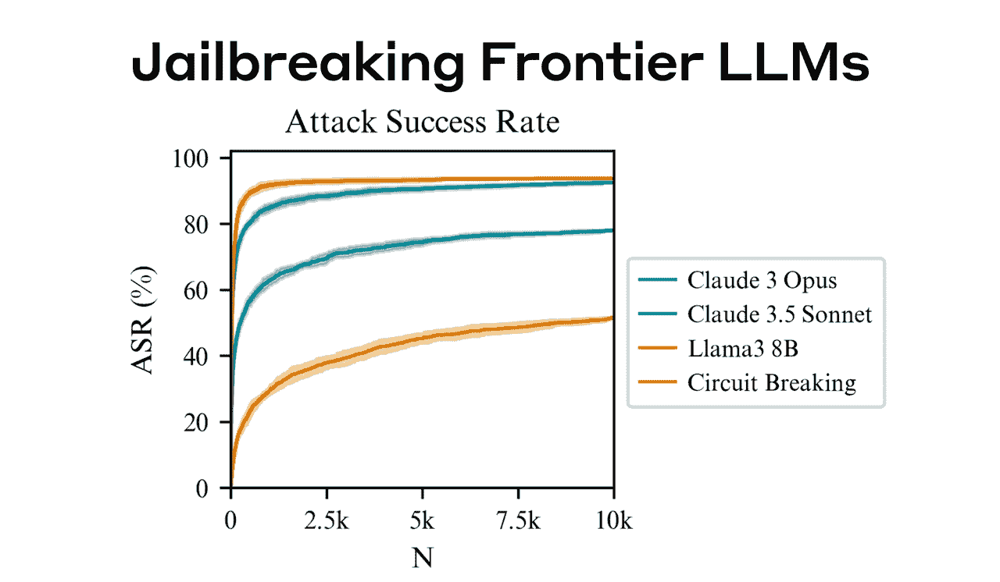

### NotebookLM更新：全新的自适应设计、与音频概览主持人互动以及高级版本 NotebookLM Plus

https://x.com/stevenbjohnson/status/1867593824832503883

NotebookLM 今日推出重大更新：全新的自适应设计、与音频概览主持人互动以及 NotebookLM Plus——我们的高级版本，拥有更多扩展功能。

**完整功能如下 👇**

1.  **全新灵活的“三面板”界面**

让您轻松切换：提问、阅读资源以及记录自己的想法。

1.  **写作任务协作**

双视图模式可以同时查看聊天和笔记；或者在聆听音频概览的同时，通过文本提问进一步探讨。

1.  **音频概览互动**

您现在可以用自己的声音“加入”音频概览，与AI主持人互动，提问或引导对话。他们会即时适应您提出的（几乎所有）要求。

1.  **扩展的笔记编辑器/查看器**

提供更大的阅读和写作空间。

1.  **自动标题功能**

笔记本和笔记会自动生成标题。

1.  全新 NotebookLM Plus 版本

可通过 Google Workspace、Google Cloud 使用（很快也将通过 Google One AI Premium 提供）。高级功能包括：

• 每个 NotebookLM 支持 300 个资源（最高 1.5 亿字），远超此前的 50 个限制；同时提升了音频概览、聊天问答和笔记本的限制。

• **新共享功能**

针对团队或组织使用 NotebookLM 创建帮助中心或交互式指南进行了优化，并配备使用情况分析功能。

• **新增“聊天模式”**

可改变 NotebookLM 的对话风格，包括：

• **指南模式（Guide）**：适合帮助中心/指南使用。

• **分析模式（Analyst）**：用于战略决策和规划。

• **自定义模式（Custom）**：根据您的需求进行个性化设置。

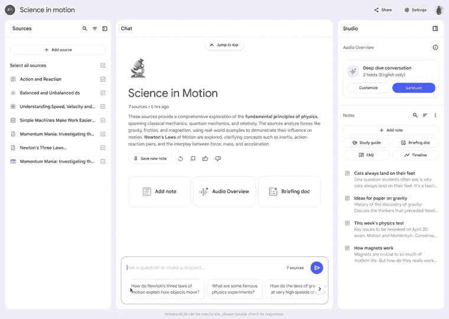

[ssstwitter.com_1734110272797.mp4](https://internal-api-drive-stream.feishu.cn/space/api/box/stream/download/all/DDNIb1hLIo7YzbxsilucIUDlnAd)

### Pika 2.0 模型：更好的文本对齐效果、视觉表现和独特的场景元素功能

https://x.com/pika_labs/status/1867651381840040304

今天我们推出了全新的 **Pika 2.0 模型**！

**更卓越的**文本对齐效果，令人惊叹的视觉表现，还有独特的✨场景元素✨功能——您可以上传自己的照片、人物、地点或物品图片，带来前所未有的控制力和一致性。

简直就像一次性收获了十二天的礼物 💅

现已上线，访问 [http://Pika.art](http://Pika.art) 尝试吧！

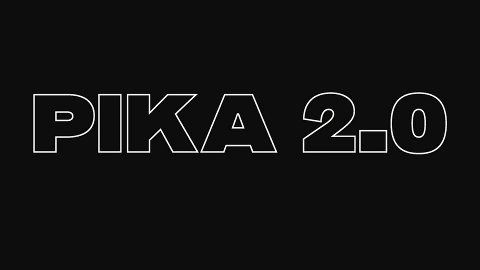

[GIhpxQEc1EAX7eGf.mp4](https://internal-api-drive-stream.feishu.cn/space/api/box/stream/download/all/HGLGbV0OqoBEerxllLqc9cYGnAe)

# 资讯

### Ilya宣判：预训练即将终结！NeurIPS现场沸腾

贡献人：

https://mp.weixin.qq.com/s/89plX_b5ymVxRNEoqAcstQ

在刚刚结束的NeurIPS 2024大会上，Ilya Sutskever进行了约15分钟的精彩演讲，提出了对未来AI发展的大胆预测，强调“预训练时代即将结束”，并展望了超级智能的到来。

**回顾深度学习的发展**

Ilya首先回顾了十年来的技术进展，展示了一张十年前的PPT截图，揭示了他与团队在2014年首次提出的深度学习核心理念——自回归模型、大型神经网络和大数据集的结合。这个构想在当时并未得到普遍认同，但今天已经成为AI领域的基石。他还提到，深度学习的成功假设基于人工神经元与生物神经元的相似性，推动了神经网络的迅猛发展。

**预训练的瓶颈**

随着AI技术的进步，Ilya认为预训练已迎来瓶颈。他指出，尽管计算能力和硬件不断提升，数据的增长已经接近极限。数据作为AI的“化石燃料”，未来将难以满足日益增长的需求，这意味着预训练的时代即将结束。尽管现阶段还可以通过现有数据进行训练，但这一趋势无法持续。

**未来的超级智能与Agent系统**

展望未来，Ilya提到“超级智能”这一概念。他认为，AI将从目前的语言模型和任务执行工具，进化为具备推理、决策和自我意识的“Agent”。这一进化不仅是能力的提升，更是智能本质的飞跃。Ilya还强调，Agent系统和合成数据将是突破预训练瓶颈的关键。Agent系统能自主推理和决策，而合成数据则能弥补现实数据的不足，推动AI迈向新的高度。

**结语：超级智能的潜力**

Ilya最后指出，当前AI系统在某些任务上已经展示出超越人类的能力，但在推理和决策过程中仍显得不稳定和不可预测。未来的AI将不再仅仅是工具，而将成为具有独立智能和自我意识的存在，开启人工智能的新纪元。

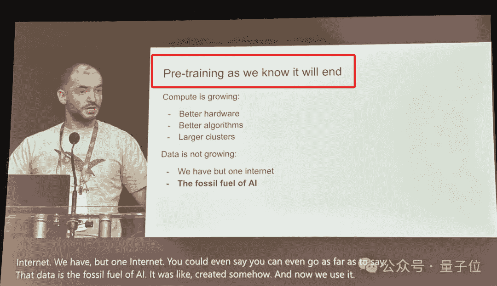

### MIT教授NeurIPS演讲公开歧视中国学生，大会官方认错、本人道歉

贡献人：

https://mp.weixin.qq.com/s/-L29N4CVZeiNzqudMU7BqQ

在加拿大温哥华举行的人工智能顶级会议NeurIPS上，MIT教授Rosalind W. Picard在演讲中使用了一张包含歧视中国学生言论的PPT，引发了哗然。她在PPT中提到了一个案例，称一名中国留学生因学术不端被开除，并试图以“我的学校没有人教我们道德或价值观”为由辩解。这一言论被认为是对中国学生的歧视。

在问答环节，一位中国女生勇敢地指出了这一问题，认为教授在提到不端行为时特别提及了中国学生的国籍，而其他不端行为却没有提及国籍，这让人感到冒犯。对此，教授回应称，这并非基于她的判断，而是引用了学生的话，并表示她合作过的中国人都非常优秀，提到的案例是例外。

NeurIPS大会官方迅速做出回应，虽然没有给出结论，但表示正在关注此事。随后，Rosalind W. Picard在MIT Media Lab官网发表了道歉声明，表示后悔提及国籍这一细节，认为这是不必要的，并对此造成的困扰表示歉意。她强调，她从这次经历中吸取了教训，并欢迎社区提出如何弥补过错的想法。

这一事件引发了领域内研究者和网友的广泛讨论，许多中国研究者指出了言论的不当之处，认为在举例时应避免提及国籍信息，以免造成不必要的联想和偏见。同时，也有人对教授的道歉表示接受，并期待未来能有更好的跨文化交流和理解。

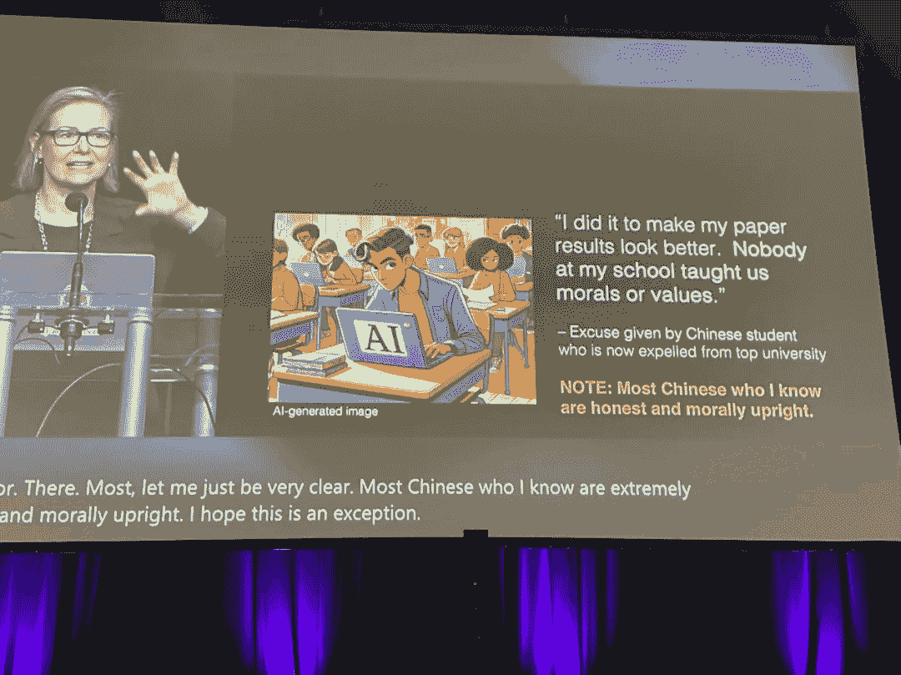

### 大模型拿单江湖

贡献人：

https://mp.weixin.qq.com/s/nQPih7eV_gGKbUmVWcG7gg

1.  **市场竞争格局**：在中国大模型市场中，百度、阿里、腾讯和字节等云大厂占据了主导地位，AI创业公司多数情况下只能“重在参与”。

1.  **中标情况**：截至12月3日，四大云厂商在大模型中标数量和订单金额上占据了近50%的市场份额，总计拿走了11.12亿元的订单。

1.  **云大厂的策略**：阿里云以大模型和AI产品带动云收入，百度云积极开拓B端业务，腾讯云则将AI融入生态中。

1.  **财务表现**：阿里云实现了营收和利润双增，百度云AI收入占比提升至超11%，腾讯云AI相关收入占比约10%。

1.  **市场现状**：大模型To B市场大局已定，云大厂吃肉，AI公司喝汤。云厂商凭借先天优势，如算力、价格和客户路径依赖性，占据市场主导。

1.  **价格战**：云厂商在To B市场带头打起了价格战，导致AI创业公司的先发优势逐渐褪去，服务同质化严重。

1.  **AI厂商的挑战**：AI厂商在与云大厂的竞争中处于劣势，常常因为资源垄断和项目需求的复合型而被排除在市场之外。

1.  **市场恶性循环**：云大厂通过压低价格拿到订单，导致AI创业公司为了生存不得不跟进低价竞争，进一步削弱了其市场地位。

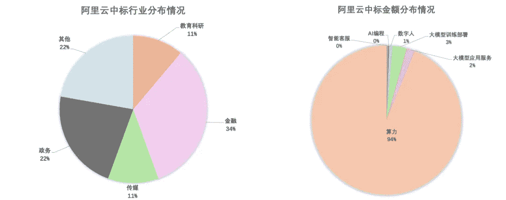

### “人工智能+”2025年投资展望

贡献人：

https://mp.weixin.qq.com/s/DzAviLp9nPcOZTFk3YWHQg

1.  **算力基础与自主可控**：强调算力是AI发展的基础，自主可控技术成为大势所趋。

1.  **AI应用赋能行业**：AI技术与5G、大数据等深度融合，推动金融、工业、教育、交通、医疗等行业治理能力提升。

1.  **国内大模型发展**：国内大模型能力逼近GPT-4，特别是在中文领域，部分模型表现优异。

1.  **成本下降与访问量提升**：国内大模型价格显著下降，访问量不断提升，Kimi、文心一言和豆包大模型位列国内流量前三。

1.  **政策支持**：政策大力支持AI在各行业的应用，特别是在电力体制改革、风险投资和科技改造传统行业方面。

1.  **AI+工业**：AI在工业领域的应用将快速落地，特别是在流程控制、质量优化、机器人应用等方面。

1.  **AI+工业软件**：工业软件是工业创新知识的载体，AI与工业软件的结合是产业新趋势。

1.  **AI+金融**：金融行业数字化基础良好，AI大模型在金融领域的应用将解决多个行业痛点。

1.  **AI+交通**：车路云协同技术推动自动驾驶降本增效，C-V2X技术进入大规模验证周期。

1.  **AI+军事**：AI技术在军事领域的应用将成为未来战场的新态势。

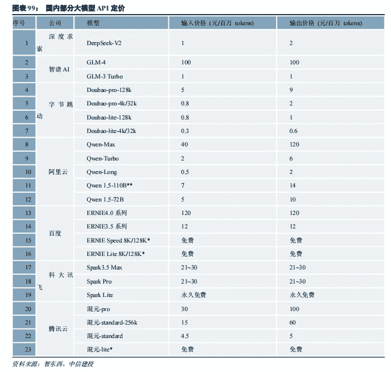

### OpenAI举报人Suchir Balaji在旧金山公寓内被发现死于自杀

贡献人：

https://techcrunch.com/2024/12/13/openai-whistleblower-found-dead-in-san-francisco-apartment/

前OpenAI员工、AI研究员Suchir Balaji近日在旧金山的公寓内被发现死于自杀，年仅26岁。根据旧金山市验尸官办公室的消息，Balaji在10月曾公开对OpenAI涉嫌违反版权法提出担忧，特别是在其涉及的生成性AI技术中，数据使用问题引发了广泛关注。

Balaji曾在OpenAI工作近四年，主要参与了ChatGPT及相关项目的研发。在他辞职后，他表示认为OpenAI的技术可能会给社会带来更多危害，尤其是其数据使用方式可能侵犯了版权。Balaji在一次采访中表示，OpenAI使用的大量版权数据是有问题的，而这些数据被用来训练生成型AI模型，从而可能对互联网内容造成损害。

在他去世的前一天，OpenAI正因涉嫌侵犯版权而面临来自多家媒体和新闻出版商的诉讼，其中包括《纽约时报》。尽管如此，Balaji仍然对OpenAI数据使用的道德性表示强烈质疑，他认为“公平使用”理论并不能为许多生成AI产品辩护，因为这些产品实际上可以替代其所训练的数据内容。

Balaji的死因初步被认定为自杀，旧金山警察局已对案件进行了调查，但未发现他死亡涉及外部因素。此事件引发了业界的广泛关注，Balaji的同事们也纷纷在社交媒体上表达了对这位年轻学者的悼念与哀悼。

# 信号

### Efficient Online Reinforcement Learning Fine-Tuning Need Not Retain Offline Data

贡献人：

https://arxiv.org/abs/2412.07762

本文提出了一种新的在线强化学习（RL）微调方法，称为Warm-start RL（WSRL），该方法不需要保留离线数据即可进行高效微调。在传统的RL微调方法中，为了确保稳定性和性能，通常需要继续在离线数据上训练，但这在大规模数据集上会变得低效和昂贵，同时也限制了性能的提升。本文的创新点在于提出了一种不依赖于离线数据的微调策略。

首先，文章分析了在当前的离线到在线微调方法中，离线数据的作用。研究发现，离线数据主要用于在在线微调开始时避免Q值函数的突变或发散，这种突变会导致预训练过程中学到的知识被遗忘。即使在一些专门设计的微调方法中，如CalQL，当离线数据缺乏时，仍然会遇到这种“遗忘”问题。基于这一观察，作者提出，通过在在线微调过程中使用少量来自预训练策略的在线数据，可以有效地解决分布不匹配问题，防止值函数发散，从而避免遗忘预训练知识。

为了实现这一思路，WSRL在微调开始时加入了一个热启动阶段，使用少量从预训练策略中采集的在线数据来初始化在线重放缓冲区，然后继续使用在线RL算法进行训练。这个过程能够有效地帮助Q函数从离线数据到在线数据的分布过渡，避免了传统方法中的灾难性遗忘，并且显著提高了学习速度和最终性能。实验结果表明，WSRL在不保留离线数据的情况下，能够比现有的RL微调方法学习得更快，且在不同的数据保留策略下都能取得更高的性能。

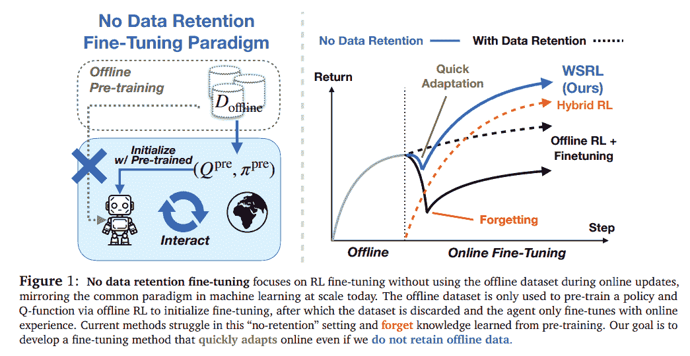

### Transformers Can Navigate Mazes With Multi-Step Prediction

贡献人：

https://arxiv.org/abs/2412.05117

本文探讨了当前Transformer模型在处理长期规划和决策任务时的局限性，尤其是在迷宫导航等任务中的表现。传统的训练方法基于下一个令牌预测，即模型根据前一步预测下一步，然而，这种方法在需要前瞻性思维的任务中存在明显缺陷，特别是当路径复杂度增加时，模型可能会选择捷径而不是规划多个步骤。这篇论文提出了一个创新的学习目标，MLM-U（Masked Language Model with Unidirectional prediction），并检验其在迷宫导航任务中的效果。

与传统的下一个令牌预测方法不同，MLM-U通过掩蔽输入序列的子集，明确地预测多个步骤的前后轨迹。这种方法的核心在于，通过学习预测未来和回溯多个步骤，模型能够更好地进行长时间的规划，避免只依赖最近的输入来做出决策。为了验证这一点，作者训练了多个Transformer模型，并使用了具有不同复杂度的迷宫环境进行测试。

实验结果显示，相比于传统的下一个令牌训练，MLM-U显著提高了迷宫导航的准确性和训练效率。例如，在20x20的迷宫中，MLM-U训练的8M参数模型能够完美解决所有迷宫，而使用标准下一个令牌预测训练的模型在相同迷宫上的表现仅为20.6%的导航准确率。此外，MLM-U在复杂迷宫（如30x30）的表现也超过了更大参数量（175M）的模型，这些模型即使加入了A*搜索轨迹的额外监督，也只能达到70.2%的导航准确率。

进一步的分析显示，MLM-U在数据效率和训练效率上也表现优异。在简单的迷宫（如5x5）上，MLM-U在训练样本使用上比标准下一个令牌训练效率高4倍，且在GPU小时数上也节省了2倍的时间。更重要的是，随着模型规模的增加，MLM-U的表现有明显提升。例如，将MLM-U从3M参数扩展到8M参数时，20x20迷宫的导航准确率从85%提高到100%。

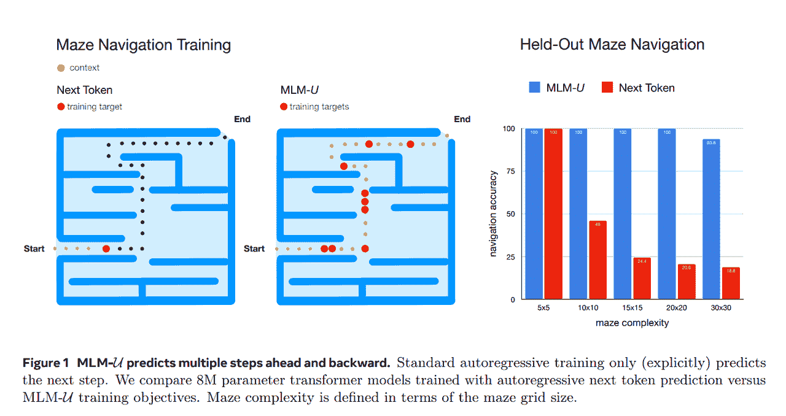

### Transformers Struggle to Learn to Search

贡献人：

https://arxiv.org/abs/2412.04703

本文研究了基于Transformer的大型语言模型（LLM）在搜索任务中的表现，特别是它们在推理、规划和导航等任务中的局限性。尽管链式思维和提示方法（如Chain-of-thought）已帮助LLM分解搜索任务，但即便如此，模型仍然需要在前向传递中进行完整的搜索，以确保选择正确的下一步，否则可能会出现错误或幻觉。作者通过训练较小的Transformer模型，探讨其在一个简单且基础的搜索任务中的能力：给定一个有向无环图（DAG）、起始节点和目标节点，找出从起始节点到目标节点的路径中的下一个节点。

研究发现，当给定正确的训练分布时，Transformer模型确实能够学习进行搜索。然而，为了使模型学到一个稳健且具有广泛适用性的搜索算法，训练数据必须精心设计，以避免模型使用捷径或启发式方法，这些方法本可以使模型“走捷径”，从而未能真正学习到有效的搜索策略。通过自动生成这些训练样本，作者为模型提供了几乎无限且理想化的训练数据，这使得模型能够在几乎任何图中正确执行搜索，并且达到100%的训练准确率。

进一步的分析表明，Transformer模型在执行搜索时是同时对图中的所有节点进行处理的。对于每个节点，模型会存储在一定步数内可到达的节点集合，并通过每一层逐步扩展可达节点集合，从而使得模型能够在图中进行指数级扩展的搜索。尽管如此，当图的规模增大时，模型在学习训练分布时遇到的困难也随之增加。增大模型规模并未显著缓解这一问题，表明单纯增加Transformer的规模并不能使模型有效地学习到搜索和规划能力。

此外，作者还尝试了修改后的搜索任务，其中允许模型输出中间令牌（类似链式思维提示），如深度优先搜索和零-shot选择推理提示。结果显示，尽管在这些情况下，模型更容易解决任务，且所需层数保持常数，但它仍然在处理较大图时表现不佳。

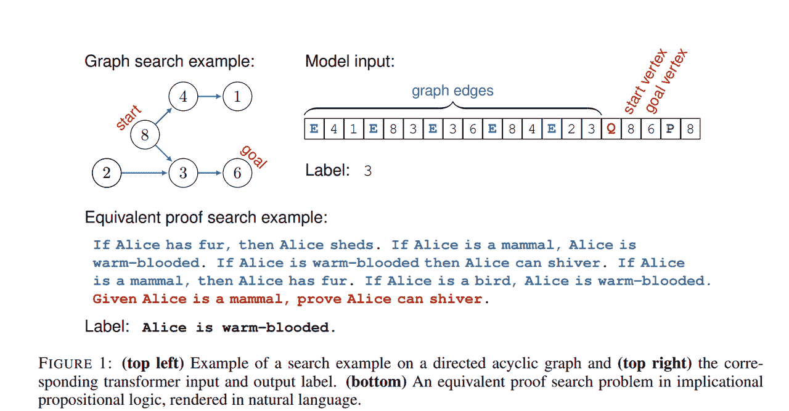

### APOLLO: SGD-like Memory, AdamW-level Performance

贡献人：

https://arxiv.org/abs/2412.05270

本文提出了一种新的内存高效优化器，APOLLO，旨在解决训练大型语言模型（LLMs）时AdamW优化器在内存方面的巨大开销问题。AdamW通过同时跟踪一阶和二阶矩来稳定LLM的训练，但这种做法导致了极高的内存消耗，尤其是在大规模模型（如LLaMA-7B和GPT-3）中，单单是优化器的状态就可能占用巨大的内存资源。随着LLM模型规模的增加，训练这些模型的内存需求呈指数增长，导致高昂的硬件需求和低效的训练过程。

为了应对这一挑战，作者提出了通过结构化学习率更新和低秩辅助空间来减少内存使用，同时保持与AdamW相当甚至更优的性能。具体来说，APOLLO通过将AdamW的逐元素学习率更新规则重构为通道级或张量级格式，从而减少了冗余计算和内存消耗。通过采用纯随机投影的低秩近似方法，APOLLO能够在不进行代价高昂的SVD低秩投影的情况下，有效捕捉结构化的梯度缩放因子，从而实现了更简洁且高效的训练过程。此外，APOLLO-Mini通过应用仅包含秩1的辅助子空间进行张量级梯度缩放，进一步提升了内存效率，甚至达到了接近SGD的内存开销。

实验结果表明，APOLLO和APOLLO-Mini在多个LLaMA模型（从60M到7B参数）中均表现出色，在预训练阶段，APOLLO系列优化器相比AdamW减少了最多2.8倍的验证困惑度，同时显著减少了优化器状态的内存开销，达到极高的内存节省效果。在微调任务中，APOLLO和APOLLO-Mini的表现与完全微调相当。此外，APOLLO还提供了系统级的优势，例如在LLaMA-7B预训练时，APOLLO比AdamW提高了3倍的吞吐量，并实现了极端的内存节省。

通过结合APOLLO-Mini与权重量化，作者创造了新的内存效率记录：LLaMA 7B模型的预训练仅需12GB内存，这使得APOLLO和APOLLO-Mini成为一种高效且可扩展的解决方案，能够在性能、内存使用和吞吐量方面为LLM的预训练和微调带来显著改进。

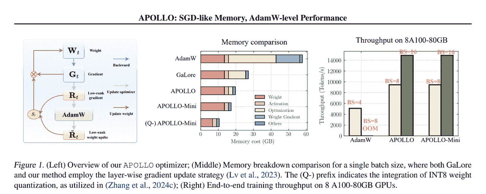

### The Well: 15TB of Physics Simulations

贡献人：

https://polymathic-ai.org/the_well/

"The Well"是一个大规模的机器学习数据集集合，包含15TB的数值模拟数据，涵盖了生物系统、流体动力学、声学散射、外星流体的磁流体动力学模拟以及超新星爆炸等多个领域。这些数据集可以单独使用，也可以作为一个整体基准套件，帮助加速机器学习和计算科学研究。其数据来源于领域专家和数值软件开发人员，旨在为训练深度学习模型提供丰富的数据支持。

该数据集的使用通过the_well库实现，用户可以通过简单的API接口访问和加载数据。使用时，首先需要安装the_well包并下载数据。数据下载支持从PyPI直接安装，也可以从源代码进行安装，适配不同的硬件加速环境（如CUDA版本）。安装完成后，用户可以选择下载单个数据集或整个数据集集合。the_well支持直接从Hugging Face进行数据流式下载，但为了提升大规模训练性能，推荐将数据下载到本地。

此外，"The Well"还包括基准测试功能，用户可以使用不同的数据集来训练和评估代理模型。该项目提供了多种基准模型的实现，并依赖于hydra配置管理系统来处理训练、模型、优化器等不同组件的配置。例如，用户可以通过运行简单的命令来训练基于FNO架构的模型，进行不同数据集的训练。

值得一提的是，"The Well"的数据集非常庞大，单个数据集的大小从6.9GB到5.1TB不等，整个数据集的总量达到15TB。因此，使用这些数据集进行训练时需要确保足够的存储空间和计算资源。为了方便用户使用，提供了便捷的下载工具和示例代码。

该项目由Polymathic AI组织主导，并与多个研究机构合作，包括Flatiron Institute、哥伦比亚大学、剑桥大学等。相关文献已在2024年神经信息处理系统大会（NeurIPS）上发表，若研究人员在研究中使用该项目，可以引用该文献。

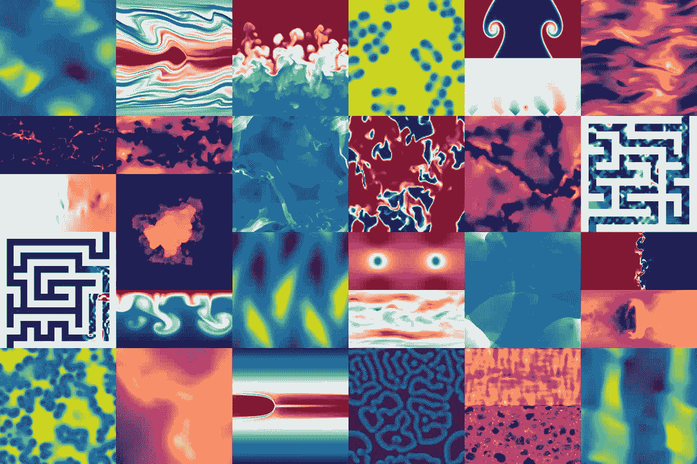

# 产品

### Accio B2B AI驱动采购引擎

https://www.accio.com

贡献人：

Accio正在彻底改变B2B采购的方式，推出全球首个AI驱动的采购引擎！通过深入的行业洞察和智能推荐，Accio帮助企业轻松找到顶级供应商，像专业人士一样高效采购。这款创新工具不仅能够快速筛选最优资源，还可以根据企业的需求和市场趋势提供定制化建议，大幅提升采购决策的精准性和效率。

Accio专注于为企业提供更智能、更便捷的采购解决方案，让复杂的采购流程变得简单高效。无论是寻找新的合作伙伴还是优化供应链管理，Accio都能为用户带来超乎期待的采购体验，助力企业在竞争激烈的市场中领先一步。

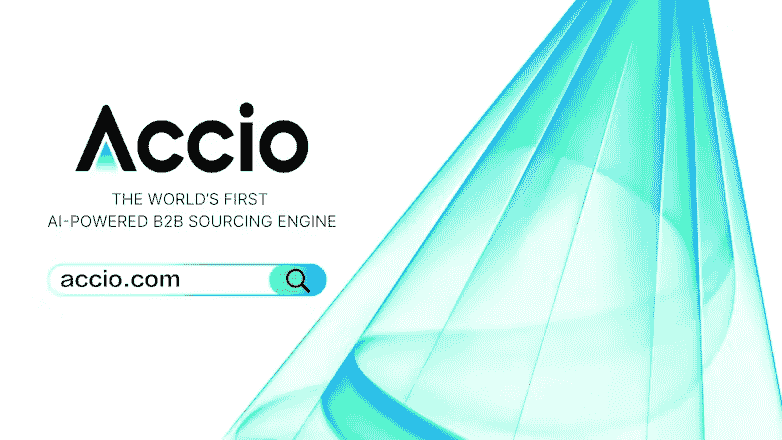

### Timestripe 高效任务管理

https://timestripe.com/onboarding/

贡献人：

Timestripe 是一款独具匠心设计的全方位工作空间工具，它能够将用户的所有项目、任务和笔记集成在一个平台上，从而提供高效的管理体验。与市面上常见的任务管理应用不同，Timestripe 的核心理念在于帮助用户将日常任务与长期目标相结合，通过独特的界面设计和功能引导，鼓励用户不仅完成短期待办事项，更专注于个人成长和目标实现的宏大蓝图。无论是规划日常生活、管理复杂项目，还是记录灵感想法，Timestripe 都能让用户清晰地看到当下行动与未来成就之间的关联，从而帮助他们更有条理地专注于真正重要的事情，实现持续进步。

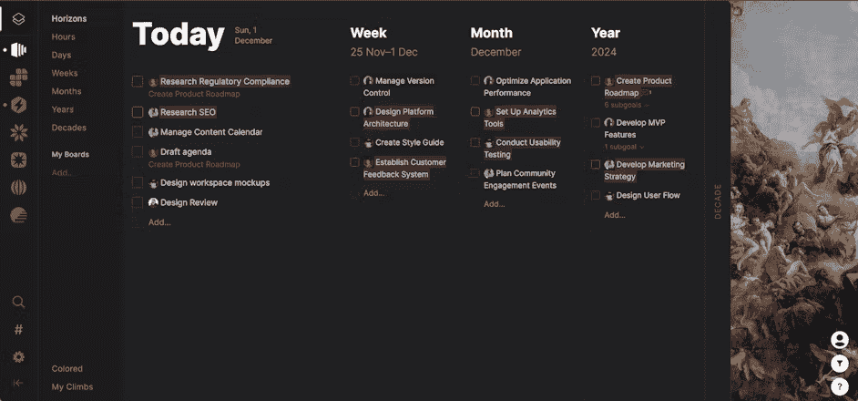

# 投融资

### AI机器人公司「TangibleFuture」完成数百万天使轮融资

贡献人：

https://36kr.com/p/3041480743940359

智能硬件公司「TangibleFuture」近日完成了数百万美元的天使轮融资，本轮由FutureX Capital领投，资深产业投资人跟投，Minerva Capital担任独家财务顾问。融资将用于硬件量产、技术研发及全球人才招募。

自2022年成立以来，TangibleFuture专注于将机器人硬件、多模态交互和内容叙事相结合，推出了代表性产品——LOOI机器人。该公司认为，情感陪伴类机器人将成为智能硬件行业的下一个风口。根据市场研究，全球陪伴机器人行业正在迅速增长，预计未来五年将实现年复合增长率25.68%。

LOOI机器人配备了创新的“仿生行为系统”引擎，模拟真实生命体的感知、决策和执行过程，增强用户情感共鸣。随着用户与LOOI的互动增加，机器人会自我学习并塑造独特的性格特征，成为每个用户的专属伙伴。

自今年2月起，LOOI在Kickstarter众筹平台上线，获得了广泛关注，并得到了埃隆·马斯克的点赞互动。该产品不仅达成了众筹目标的百倍，并且成功交付首批订单，成为备受消费者青睐的个人机器人。

**投资者观点：**

FutureX Capital表示，AI技术的快速进步为情绪价值领域带来了新的机会。LOOI机器人以其独特的个性化和互动性，满足了现代社会对情感陪伴的需求，尤其在年轻人中产生了强烈共鸣。展望未来，TangibleFuture有望推出更多充满生命力的AI产品，为社会带来更深层次的情感价值。

公司官网：https://looirobot.com/

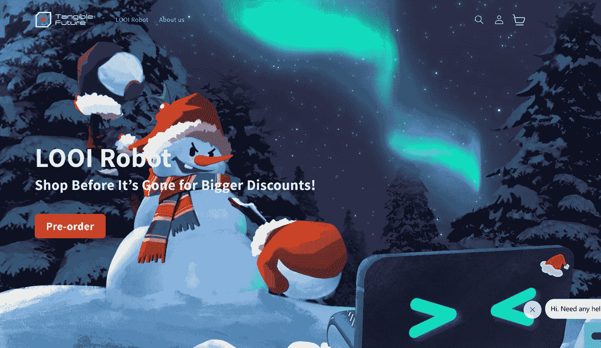

### Liquid AI获2.5亿美元融资，致力于开发更高效的AI模型

贡献人：

https://techcrunch.com/2024/12/13/liquid-ai-just-raised-250m-to-develop-a-more-efficient-type-of-ai-model/

Liquid AI，一家由机器人学大师Daniela Rus共同创立的AI初创公司，近日宣布完成2.5亿美元的A轮融资，本轮融资由AMD主导。据彭博社报道，本轮融资使Liquid AI的估值超过20亿美元。

Liquid AI的目标是构建基于“液态神经网络”的通用AI系统。液态神经网络是一种较新的AI模型，其中的“神经元”通过方程式来预测每个神经元的行为，且与传统AI模型相比，它们更加紧凑，且计算需求较低。液态神经网络的“液态”特性意味着它们的架构具有更大的灵活性，灵感来源于圆形虫的大脑。

Liquid AI计划开发针对电商、消费电子和生物技术等行业的定制化液态神经网络。作为AMD投资的一部分，Liquid AI将与该公司合作，优化其模型，以适配AMD的GPU、CPU和AI加速器。

公司官网：https://www.liquid.ai/

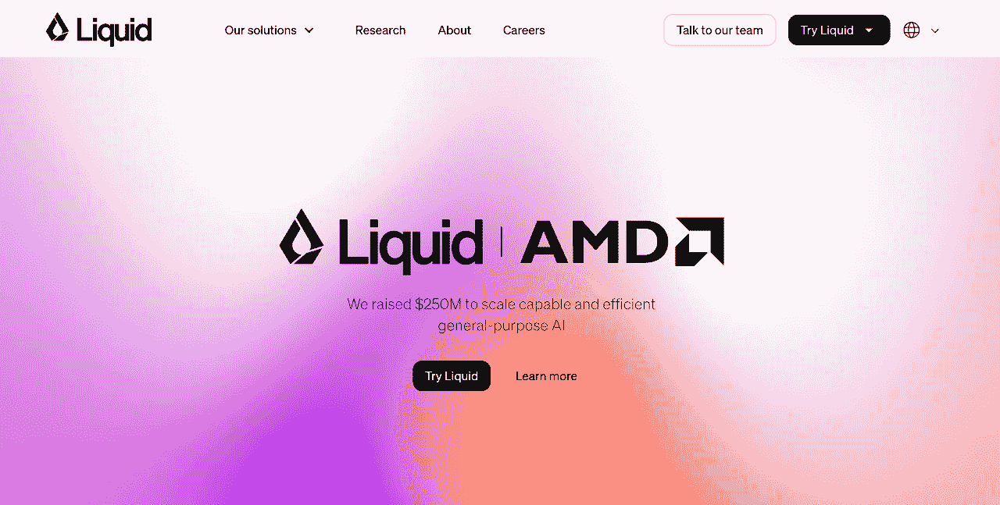

# 学习

### Ilya ：pre-train丸啦，搞agentic和reasoning吧

贡献人：

https://zhuanlan.zhihu.com/p/12588939986

在NeurIPS 2024上，Ilya的发言引起了广泛关注，他宣称“预训练即将终结”。这一言论虽然不算极为惊爆，但其背后的含义对未来的技术方向具有重大影响。Ilya指出，预训练面临的核心问题是其依赖于预先收集的大量自然数据和算力，而随着模型参数和训练token数量的扩展，边际效应递减，预训练的有效性逐渐降低。

预训练中的Scaling Law，即通过增加参数量和数据量来提升模型表现，在过去确实取得了显著成果，但这一方法的局限性也逐渐显现。大模型能通过不断扩展这些维度取得进展，但一旦自然数据的有效性达到瓶颈，单纯依靠扩展并不能突破这一限制。Ilya提到，虽然Scaling Law本身并没有“墙”，但依赖预训练的模式已经无法提供高效的智能提升，导致高昂的训练成本无法带来相应的回报。

面对这一挑战，Ilya提出了几个可能的方向：agents、合成数据以及o1 reasoning。其中，合成数据被认为是突破瓶颈的关键方法，通过模型生成更多的训练数据来补充自然数据的不足。比如，Gemini Flash 1.5和Phi-4等模型便采用了合成数据和在线蒸馏的技术，这种方法能够通过自生成的数据提升模型的多样性和推理能力。特别是Phi-4模型通过50种不同的数据合成方法，大幅增强了其在推理任务中的表现，展示了合成数据在特定任务中的巨大潜力。

除了合成数据，Ilya还提到了agents的可能性。虽然当前的AI系统在自主性、情境性和灵活性方面仍有很大差距，但随着技术的进步，智能体的能力有望实现突破。AI agents将逐渐摆脱人类干预，能够自主感知环境、决策并采取行动。当前的挑战主要在于如何提升模型的自主行动能力，避免依赖外部工具或人类参与。

最后，Ilya还提出了o1 reasoning的概念，这一方法通过引导模型自我推理、自我反思，并进行多轮探索，可能成为新的技术趋势。o1不仅仅是一个模型的输出，而是通过多次尝试、错误和优化的过程来强化推理能力。其本质上挑战了传统的预训练方式，推动了模型的内在推理能力和自我完善的机制。

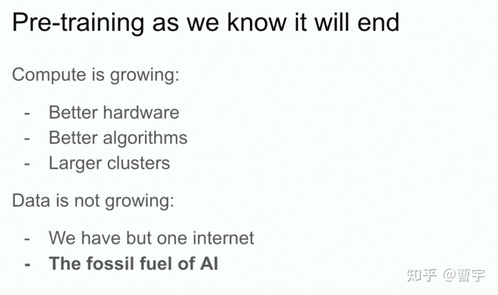

### Taming LLMs

贡献人：

https://www.souzatharsis.com/tamingLLMs/markdown/toc.html#

《Taming LLMs》一书聚焦于大型语言模型（LLMs）的局限性和实现挑战，尤其是在构建LLM驱动的应用时，工程师和产品经理常遇到的关键问题。全书通过实用的Python示例和开源解决方案，提供了一个全面的入门指南，帮助开发者避开常见的陷阱，并成功利用LLM的强大功能。

核心技术挑战

1.  **结构化输出问题**：LLM生成的内容通常是非结构化的，导致难以在实际应用中直接使用。作者提出了多种解决方案，包括使用LangChain和Pydantic模型来优化结构化数据输出。

1.  **输入和输出大小限制**：LLM面临输入窗口限制（如Token数量的上限），作者介绍了内容分块和动态提示生成的策略，以应对长文本处理的问题。

1.  **评估差距**：当前评估方法（包括模型和人工评估）无法充分捕捉LLM的非确定性行为，书中讨论了如何设计更有效的评估机制，并给出了一些现有的工具和技术。

1.  **幻觉问题**：LLM可能产生虚假或错误的内容（幻觉），书中提出了检验与纠正幻觉的技术，特别是检索增强生成（RAG）的方法。

1.  **安全性和成本控制**：LLM的安全性问题，如内容过滤和输入验证，是构建实际应用时必须考虑的要点。此外，书中还深入探讨了LLM的成本控制策略，包括Token优化和缓存策略。

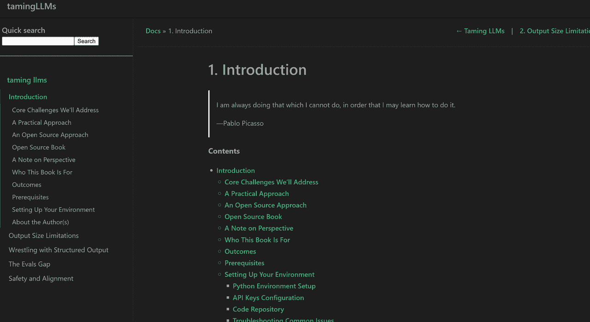

### 大模型推理张量并行的4种模式

贡献人：

https://zhuanlan.zhihu.com/p/12302566679

大模型推理中的并行优化主要面临两个难点：序列并行和张量并行的通信计算重叠。张量并行已成为大模型推理的核心技术，但其通信开销是一个显著的瓶颈，尤其在使用PCIE类卡时更为明显。为了优化这一问题，训练框架如Megatron-LM已经实现了通信计算重叠，而目前开源推理引擎如vLLM和SGLang尚未具备这一功能。知乎开源的ZhiLight引擎已实现张量并行通信计算重叠，预计这一技术将在未来成为所有推理框架的标准功能。

张量并行的实现有几种不同方式。首先是朴素版张量并行，在标准的Transformer结构中，前向传播需要进行两次AllReduce操作，这会导致计算资源闲置。其次是Gemm版本的通信计算重叠，这是通过分布式矩阵乘法和AllReduce的重叠实现的，类似于TransformerEngine和PyTorch中的Async Tensor Parallelism。在这种实现中，矩阵乘法和规约操作可以在不同的计算阶段并行进行，优化了计算和通信的利用效率。

另外一种方式是请求间的通信计算重叠，这种方法通过在多个请求中交替执行计算和通信操作，从而提升效率。每个请求会分配不同的流，计算和通信操作可以在不同请求之间交替进行，确保通信和计算的并行性。Nanoflow框架采用了类似的方式，通过优化调度来实现这一目标。

还有一种实现方式是请求内通信计算重叠。在这种方式中，单张卡的计算和通信被分配到不同的流中，在计算过程中通过细粒度的调度实现通信和计算的重叠。这种方式的核心思想是，通过在序列维度上进行分块操作，确保每个计算块的通信在执行其他计算时同时进行，从而减少等待时间并提升推理效率。

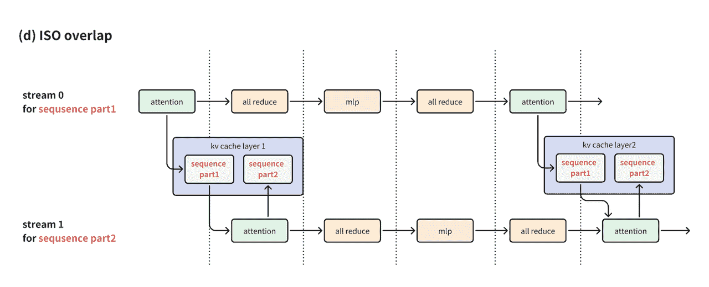

### 为什么 OpenAI 的 o1 是 LLM 研究领域的倒退

贡献人：

https://zhuanlan.zhihu.com/p/11428918724

OpenAI 的 o1 模型最近在大型语言模型（LLM）竞赛中创造了多个新记录，成为行业关注的焦点。然而，尽管 o1 在基准测试中表现出色，其技术背后却存在一些令人担忧的趋势，这种“突破”实际上可能是一种倒退。

o1 的创新之处在于其“思维链”（CoT）技术，它使模型在给出最终答案之前，通过多步推理逐渐改进答案。尽管这种方法看起来像是模型在进行更深入的思考，但实际上，CoT 技术自 2022 年就已被学术界提出，并广泛应用于 LLM 中。OpenAI 并未在 o1 中引入全新的技术，而是基于现有的 CoT 方法进行微调。事实上，CoT 是通过提示技术帮助模型分步解决问题，并不涉及对基础模型架构或训练流程的重大创新。

问题的关键在于，o1 的显著优势并非来自模型本身的改进，而是来自 CoT 脚本的优化。用户可以通过简单的代码实现类似的思维链功能，这意味着 o1 实质上是一个在 GPT 模型基础上增加了脚本的系统，而非全新的模型架构。因此，o1 的技术创新主要体现在如何优化已有技术，而不是推动 LLM 的基础性进展。

此外，o1 在基准测试中的成功引发了对排行榜“操控”的担忧。之前，基准测试主要测试模型的“原始”性能，但现在排行榜开始反映的是在基础 LLM 上构建的算法性能。这意味着，其他公司为了与 o1 竞争，将不得不模仿 OpenAI 的做法，依赖 CoT 或其他类似技术来提高表现，而不是改进模型本身。这种趋势可能导致行业发展的焦点从改进基础模型转移到优化已有的提示技术，从而放缓了核心技术的进步。

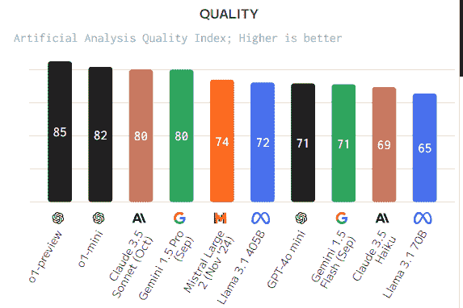

# 声明

本文档仅供学习交流使用，版权归原作者所有，若涉侵权，请联系Jack Jin 15101136166

##

（欢迎在下方反馈您宝贵的意见！整理不易，觉得有用给AI日报小组点个赞👍吧！）

ChatGPT；Angela；Zijia Liu；Alex；Zeqi Tan；Tiezhen（HuggingFace）；Naixu；Lizhi；Peter；Suoman；Jack

学术分析报告：ResearchFlow -- 奇绩F23校友的开发的深度研究产品，PC端进入RFlow的分析报告，可直接点击节点右侧的小数字展开节点，登录后可在节点上直接“询问AI”，进一步探索深度信息

如果你有大模型相关的创业想法，欢迎来找我们聊聊～🛰️：15101136166

> 快邀请你的小伙伴们一起来读大模型日报吧！

> **【日报****知识库****】**这里是近期日报内容的汇总,欢迎大家查阅

> [大模型日报知识库(分享版)](https://miracleplus.feishu.cn/wiki/KapVwXfkriOBiskB0B2cUHxjnTh)

>

> 欢迎大家多多帮我们分享,转发~~

> 如果大家有任何的建议或者吐槽,欢迎随时找我聊天~

