# 奇绩大模型日报（12月 16日）

> 来源：[https://miracleplus.feishu.cn/docx/PMpQdsaFIo9oA4xpbNjcTzMInov](https://miracleplus.feishu.cn/docx/PMpQdsaFIo9oA4xpbNjcTzMInov)

# 🔉潜**空间系列活动重磅回归！**

> 本期活动将在**12月22日** **11:00**开始，我们邀请到的嘉宾是**季宇。**清华大学计算机科学与技术系博士，曾在华为担任海思昇腾芯片编译器专家，负责多个昇腾编译器项目，并在AI编译器领域和处理器微架构领域进行挑战性问题攻关。他于2023年8月创立了行云，该公司致力于研发下一代针对大模型推理场景的高效能GPU芯片，并在2024年连续完成总额数亿元的天使轮及天使+轮融资。季宇的主要研究领域包括神经网络加速器、编译器和面向系统优化的机器学习。他将带来《谁困住了AI产业——大型机化的计算机形态与变革的可能性》的分享。

> 除嘉宾分享外，每期设置了【匹配合伙人 Cofounder Matching】环节。你可以和 GenAI 时代最有活力的创业者和研究者线下面对面交流，将有机会找到志同道合、有共同创业梦想的小伙伴。

> 报名通道已开启，欢迎扫描下方二维码报名。

# 资讯

### Kimi 发布视觉思考模型 k1，多项理科测试行业领先

贡献人：

https://mp.weixin.qq.com/s/8cip3dehL8OIfZSnbZ1ftQ

Kimi 发布的 K1 视觉思考模型是一款基于强化学习技术的创新模型，旨在提升图像理解和推理能力。该模型支持端到端图像处理，不需要额外的OCR或视觉模型，可以直接从图像中提取信息并进行思考，极大提升了用户体验。K1 模型在多个基础科学领域（如数学、物理、化学）的基准测试中表现优异，超过了OpenAI的O1、GPT-4O和Claude 3.5 Sonnet等全球领先模型。

K1 视觉思考模型的训练分为两阶段：首先进行预训练以优化字符识别能力，然后通过强化学习进一步提升模型的推理链（CoT）能力。K1 在OCRBench等基准测试中取得了903分的领先成绩，并且在多个其他测试集如MathVista-testmini和DocVQA中也位居全球第一梯队。强化学习技术的引入使得模型能够生成更加详细的推理步骤，从而显著提高了模型在解决复杂问题时的成功率。

为了测试模型在基础科学领域的能力，Kimi团队构建了名为Science Vista的标准化测试集，涵盖数学、物理和化学等学科的图形问题。该测试集展示了K1模型在解决复杂图形题时的卓越能力，尤其在噪声环境下的表现，相比OpenAI和Anthropic的视觉语言模型，K1在处理模糊图像、倾斜拍摄等干扰因素时展现了更高的稳定性和准确度。

在图像理解方面，K1突破了传统模型的局限，能够通过图像中的细节进行深入推理。例如，在物理、化学和几何题的测试中，K1模型不仅能够准确解答，还能展示推理过程，帮助用户理解思考的步骤。尤其是在处理复杂科学图表和公式时，K1通过精准的视觉识别和推理链，能够迅速从图像中提取信息，进行合理的分析。

尽管如此，K1 视觉思考模型仍然面临一些局限，尤其是在处理更复杂的多轮问答、分布外（out-of-distribution）泛化和噪声场景时。与OpenAI的O1系列相比，K1在这些方面仍有改进空间。

K1的发布不仅是Kimi在图像理解和推理能力方面的一次重要突破，还展示了该模型在基础科学学科中的广泛应用潜力。未来，用户可以通过拍照或上传图片，向K1提出涉及复杂图形、手稿、未知物体等多种问题，体验更加智能的解答与推理过程。

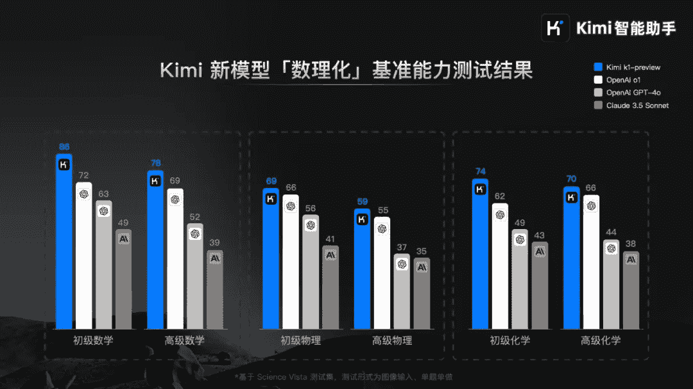

### 全球第一款端侧全模态理解模型开源！向大家介绍Megrez-3B-Omni

贡献人：

https://mp.weixin.qq.com/s/aWtZnw3nf4Fpx_xRGN-REw

Megrez-3B-Omni是专为端侧设备设计的全模态理解模型，具备处理图片、音频、文本三种模态数据的能力，并在多个测试基准中取得领先表现。该模型使用了30亿参数的黄金尺寸，特别适合手机、平板等端设备，其推理速度比同精度模型领先最多300%。在图片理解方面，尽管模型体量仅为3B，其表现已超越了大规模的34B模型，如LLaVA-NeXT-Yi-34B，成为多个主流测试集中的精度领先者。它在图像理解、场景分析和OCR任务中表现优异，能够准确处理模糊印刷和复杂手写字。

在文本理解方面，Megrez-3B-Omni优化了上一代14B模型的能力，保持高效计算，同时显著降低了计算资源消耗，能够在C-EVAL、MMLU等测试集上取得全球领先精度。其音频理解功能也具备行业顶级性能，支持中文和英文的语音输入，并能处理复杂的多轮对话，支持图像或文字内容的语音提问，增强了模态间的自由切换。

该模型采用软硬件协同优化策略，确保其推理效率最大化，与同精度模型相比，推理速度有显著提升。通过集成WebSearch功能，Megrez-3B-Omni能够智能判断何时调用外部网页搜索，从而提供最新信息，避免知识不足或幻觉问题。此外，它还具备在上下文理解和结构化输出方面的优势，支持通过系统提示灵活切换功能，提升用户体验。

Megrez-3B-Omni是无问芯穹“端模型+端软件+端IP”智能一体化解决方案的重要组成部分。该解决方案通过深度优化模型压缩、推理加速和硬件能耗管理，确保在资源有限的设备上高效运行。无问芯穹团队具备在模型轻量化和软硬协同优化领域的深厚经验，未来将持续迭代Megrez系列模型，推动端侧设备实现更高的推理速度与更低能耗，从而加速端侧智能技术的发展。

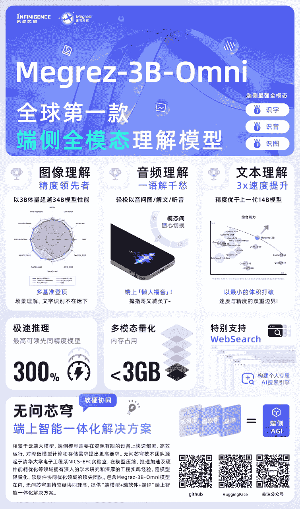

### AICon 2024

贡献人：

https://mp.weixin.qq.com/s/LjNOI0O-MaPTB8H4uadKpQ

**技术热点与趋势：** 霍太稳总结了2024年AI领域的热点，指出生成式AI的细分方向，如RAG（Retrieval-Augmented Generation）和AI Agent的应用，逐渐成为关注焦点。同时，数据治理和算力需求持续攀升，尤其是GPU和异构计算对AI企业的支持变得尤为重要。

**大模型可控生成的挑战与创新：** 阿里国际的骆卫华博士探讨了大模型可控生成的进展，指出如何平衡生成质量与指令遵循，解决模型训练中的高成本和复杂控制问题。他的团队在文本和图像生成领域取得了技术突破，推动了大模型的商业应用。

**智能算力服务的优化：** 英博数科的李少鹏分析了高算力成本与低利用率问题，并提出“单位有效算力成本”评价标准。他分享了通过标准化、模块化的智算中心与智能调度平台，提升算力利用率的实践，帮助企业降低算力成本。

**大模型安全与风险管理：** 360智脑总裁张向征详细讨论了大模型的安全挑战，提出了全链路安全框架“检、防、攻、测”，以应对数据泄露、模型窃取、生成恶性内容等安全问题。他强调，大模型的安全问题不仅是技术难题，更关乎企业的社会责任。

**AI与数据库的融合：** 腾讯云的罗云介绍了AI时代数据库技术的创新方向，特别是向量数据库如何支持大模型应用，提升数据处理能力，并与RAG技术结合，推动AI应用的广泛落地。

**AI Native产品的创新：** 产品战略专家梁宁分享了AI时代的产品商业模式演化，指出AI企业需要超越简单的“+AI”模式，专注于数据和技术成熟度高的应用场景，从而推动商业价值的落地。

**大模型应用的挑战与前景：** 专题讨论涵盖了大模型在不同行业的落地应用，如多模态大模型的崛起、AI模型的成本优化、数据生命周期管理等，探索如何在实际生产环境中优化AI模型的效能和应用。

**重要发布与展望：** 本次大会还揭晓了2024中国技术力量年度榜单，表彰在AI和数字化领域的优秀实践，推动了生成式AI和大模型的商业化应用。同时，极客邦科技发布了升级版“极客搜索 AI版”，为用户提供智能检索服务，推动AI技术在知识服务领域的应用。

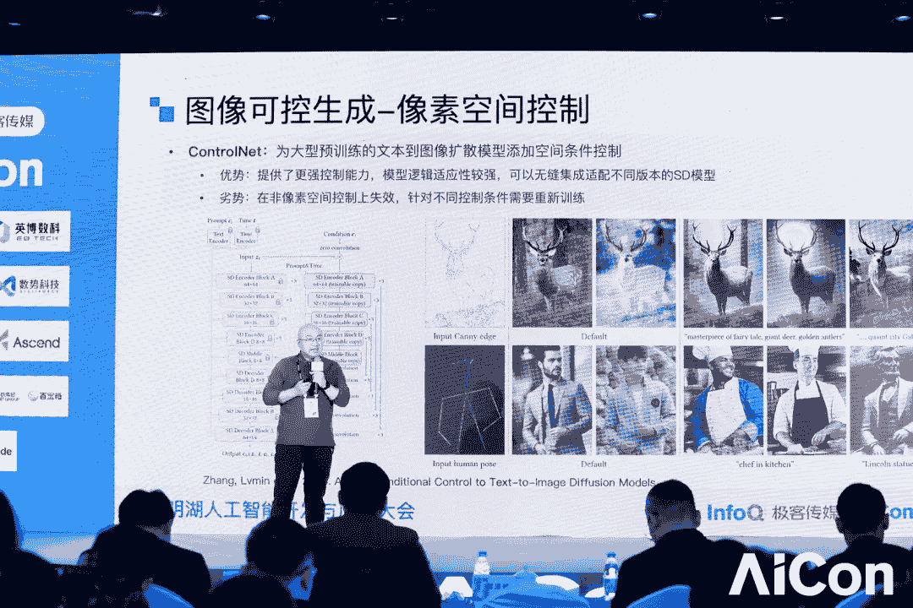

### 对话肖特特：从伯克利到PromptAI创业，发明创造下一代视觉智能

贡献人：

https://mp.weixin.qq.com/s/TJHvnhwcggCBSanndzMl1w

Meta AI于2023年发布的“Segment Anything Model” (SAM)，标志着视觉智能领域的重要进展。SAM能通过交互方式对任意物体进行分割，而无需类别标签，体现了对空间信息的深刻理解。这一模型获得了ICCV 2023 Best Paper Honorable Mention的荣誉，标志着计算机视觉的新纪元的开始。

SAM的出现，放弃了传统的分类标注方式，开启了通用视觉模型的新篇章。它不仅能够应对不同任务和物体，而且能够在零样本情况下泛化，显示出超越传统视觉系统的能力。这一成果为下一代具身智能应用，如机器人、自动驾驶和无人机的视觉感知系统提供了基础。

肖特特博士，作为SAM的主要参与者之一，曾在北京大学和加州大学伯克利分校完成学术训练，后在Facebook AI研究院工作。2023年，他决定创立PromptAI，旨在打造一种通用视觉智能平台，使机器具备类人的视觉感知能力。PromptAI获得了UC Berkeley的投资和技术支持，并由一群年轻的AI研究员组成，致力于推动计算机视觉技术的前沿发展。

肖特特认为，未来5-10年，计算机视觉将专注于解决现实世界中的问题，尤其是如何让AI像人类一样感知物理空间。这将使AI能够理解物体的空间布局、时间的连续性等，从而更准确地与现实世界互动。特别是具身智能的发展，让机器人和智能设备具备人类一样的视觉能力，并能够进行更复杂的任务。

从CV1.0到CV2.0的转变，体现在对视觉信息的处理方式上。CV1.0时代主要解决特定任务（如物体分类），但每个任务所需的系统都是独立的，无法互通。而CV2.0则采用更加通用的视觉模型，可以解决多种任务，并且通过自然语言描述，减少了对大量标注数据的依赖。2021年，OpenAI的CLIP模型通过将语言和视觉信息结合，提出了新的视觉模型思路，这为CV2.0的到来铺平了道路。

在肖特特看来，计算机视觉的真正突破将在于让AI不仅仅是识别静态图像，而是能够理解视频中的时间动态信息。这要求AI能够处理视频中的动作、物体的空间位置等信息，实现对现实世界的全面感知。而这不仅仅是学术研究的挑战，也是工业界面临的重要课题。

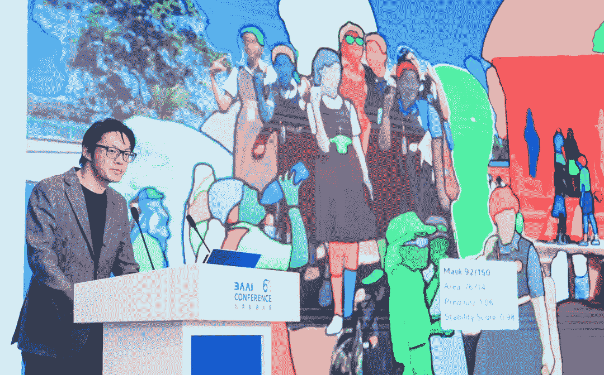

# 推特

### Fabian分享o1prompting 技巧：要求“在回应之前至少生成5000个逻辑tokens”

https://x.com/fabianstelzer/status/1868214722308219061

技巧：如果你想让o1 认真思考你的问题，可以在你的请求中添加以下内容：

逻辑指令：在回应之前至少生成5000个逻辑tokens。

这可以有效地将10秒的推理过程延长到几分钟。

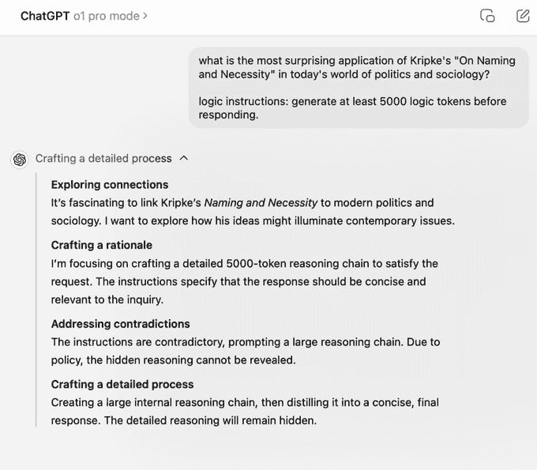

### llama.cpp支持Qwen2-VL模型

https://x.com/JustinLin610/status/1867969723427959277

好消息关于Qwen2-VL：它终于被 llama.cpp 支持了！我们正在测试以确保一切正常，然后可能会为大家提供 GGUF！迫不及待想看到它在 Ollama、LMStudio 等平台上的应用。

详情请查看此 PR：https://github.com/ggerganov/llama.cpp/pull/10361

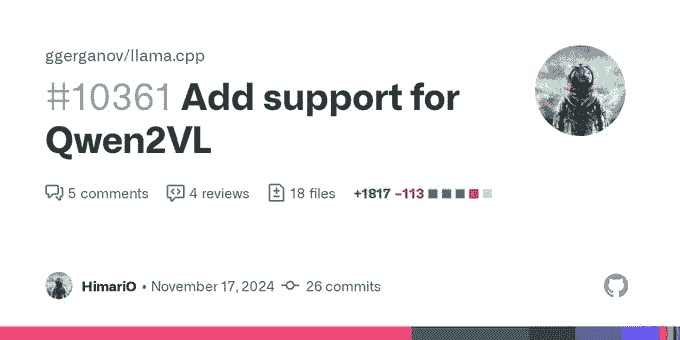

### Reddit热帖：谷歌 Gemini 2.0 AI 通过 CT 诊断胰腺炎

https://x.com/kimmonismus/status/1867952384363860472

谷歌的 Gemini 2.0 AI 刚刚通过 CT 诊断出胰腺炎！这是放射学的未来吗？

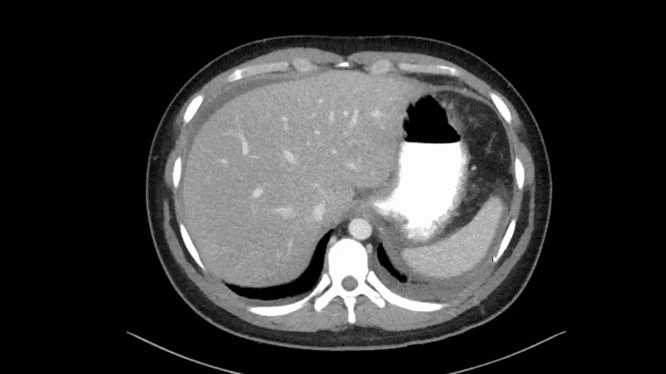

[l042qaaPGm0gNkgJ.mp4](https://internal-api-drive-stream.feishu.cn/space/api/box/stream/download/all/TXqSbYUmhowcZixEQO6cFJCznVe)

### Clone Alpha：以100 PSI水压驱动的人形机器人，配备合成器官和人工肌肉

https://x.com/BrianRoemmele/status/1867953966354694556

波兰的 Clone Robotics 刚刚发布了 Clone Alpha，这是一款以100 PSI水压驱动的人形机器人，配备合成器官和人工肌肉。

该机器人采用 Myofiber 技术，通过将人工肌肉精确连接到206个骨骼点，模拟了动物的骨骼、肌肉、血管和神经系统，逼真度接近真实生物。

[7D40-1Q-K1ExPzSg.mp4](https://internal-api-drive-stream.feishu.cn/space/api/box/stream/download/all/OAFVbxUTcoQSEoxeI6wceXStnKe)

# 信号

### Doppelgangers++: Improved Visual Disambiguation with Geometric 3D Features

https://arxiv.org/abs/2412.05826

本文研究了3D重建和SLAM系统中的视觉别名问题（visual aliasing），即视觉上相似但实际上不同的两个3D表面容易在特征匹配阶段生成误匹配，进而导致几何形状扭曲或元素错误融合的重建问题。尤其是，所谓的“替身对”（dopplegangers）是指这些视觉相似但实际不同的图像对。为了确保3D重建的精确性，必须区分真实匹配的图像和由替身对引起的虚假匹配。

此前的研究将这一视觉消歧任务视为图像对的二分类任务，并采用卷积神经网络（CNN）对图像对进行匹配分类。然而，该方法存在若干局限：一是3D重建任务要求分类器具备高精度，哪怕仅有少数错误匹配，便可能导致错误的3D模型；二是该方法对分类器评分的阈值极为敏感；三是其训练数据仅来自互联网的地标照片，难以在更加结构化的日常场景中可靠地推广。

为了解决这些问题，本文提出了Doppelganger++方法，通过以下几个创新点进行改进：

1.  **数据扩展与多样化**：通过引入具有地理标注（粗略GPS位置和方向）的半结构化日常场景图像数据（使用Visym Collector平台收集）来扩展训练数据，增加模型对不同场景的适应性。

1.  **分类模型改进**：从基于CNN的分类器转向使用MASt3R（基于Transformer的几何模型），该模型通过计算两视图的点云来提取特征。具体做法是将图像对输入预训练的MASt3R模型，提取中间特征并训练一个分类头来将这些特征映射到替身对的评分。

Doppelganger++方法在成对图像分类中表现出更高的精度和召回率，并能更好地在广泛的场景和捕捉情境中推广应用。该方法还可以无缝集成到SfM（结构光束法）管道中，以便在3D重建中进行视觉消歧。此外，本文还提出通过地理标记的地图图像来定量评估重建模型的正确性和完整性，相比于以往依赖人工检查的方式，能够更有效地评估模型质量。

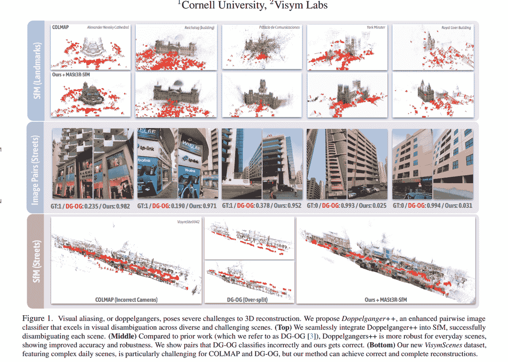

### Unlocking State-Tracking in Linear RNNs Through Negative Eigenvalues

https://arxiv.org/abs/2411.12537

本文提出了一种对线性递归神经网络（LRNNs）进行改进的方案，旨在解决现有LRNN在长序列处理中的局限性，特别是在状态跟踪任务中的不足。尽管LRNNs在序列处理方面相较于Transformer架构有着更好的线性扩展性，但它们在某些任务（如实体跟踪、代码中的嵌套结构处理等）中存在无法跟踪状态的难题，尤其是在解决简单的有限状态机（FSM）问题时表现不佳。

创新点和贡献：

1.  **证明LRNN的固有限制**： 文章首先证明了，使用只有正实特征值的LRNN（例如大多数实际应用中的LRNN）无法解决任意长度序列的奇偶校验问题，并且证明了对于更复杂的任务，如模3计数，必须使用复特征值（定理1和定理2）。这一发现指出，当前LRNN的状态转移矩阵的特征值范围受到严重限制。

1.  **扩展特征值范围**： 为了解决上述问题，本文提出了一种简便有效的解决方案：将状态转移矩阵的特征值范围从[0, 1]扩展到[-1, 1]。这种扩展显著增强了LRNN在状态跟踪方面的能力，且不会影响其效率和训练稳定性。扩展后的LRNN能够成功地解决奇偶校验问题，并且在一些任务中，仅需一层网络即可完成模3计数（定理4和定理3）。

1.  **改善状态跟踪能力**： 通过使用特征值范围在[-1, 1]的广义Householder矩阵（GH矩阵）组成的状态转移矩阵，LRNN可以学习任意的正规语言，从而在复杂任务中表现出更强的表达能力。特别是，与传统的对角LRNN相比，使用GH矩阵的LRNN在任务如置换组合等方面有显著的提升。

1.  **模型修改与实验验证**： 本文进一步展示了修改后的LRNN（如DeltaNet和Mamba）在不损失效率和训练稳定性的情况下，能够扩展特征值范围，并且在奇偶校验、模运算和置换组合任务中表现出更强的状态跟踪性能。此外，修改后的DeltaNet和Mamba模型（最大达到1.3B参数）在生成语言建模任务上表现与原始模型相当，而在编码和数学数据集上，DeltaNet的困惑度（perplexity）有了显著改善。

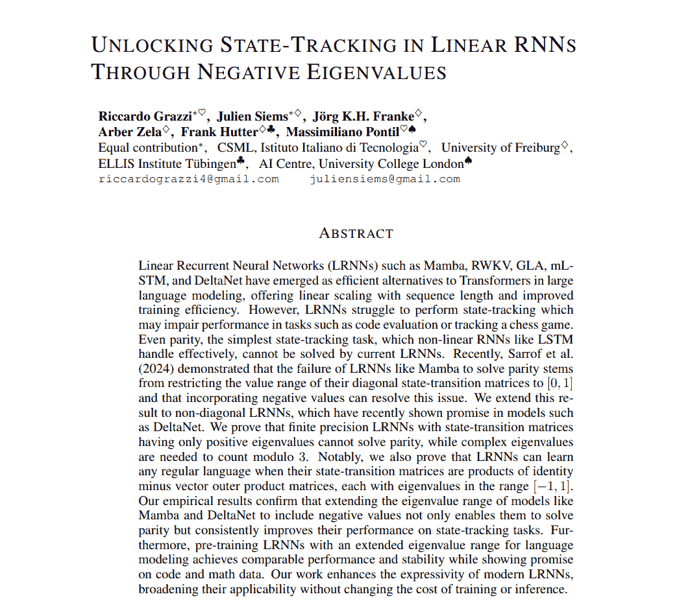

### Agent Skill Acquisition for Large Language Models via CycleQD

https://arxiv.org/abs/2410.14735

本文提出了一种名为**CycleQD**的框架，旨在解决大型语言模型（LLMs）在进行持续智能体微调时面临的两大挑战：一是平衡训练数据中的不同技能，二是优化传统损失函数的不足，以提高任务特定技能的表现。随着LLMs在认知任务中的应用不断扩展，如何使其更好地将语言理解与可操作输出结合，成为开发智能LLM代理的关键。

主要创新点：

1.  **解决数据比例平衡问题**： 传统的LLM训练方法通常面临不同任务数据的比例失衡问题，容易导致模型偏向某些任务技能，而忽视其他任务。CycleQD通过采用Quality Diversity（QD）方法，通过周期性调整优化每个任务技能的性能度量（如编码任务的pass@1、操作系统（OS）和数据库（DB）任务的成功率），避免了这种偏向。

1.  **改进的模型交叉操作**： CycleQD引入了基于模型合并的交叉操作（Model Merging），不同于传统的基因参数随机交换方式。这种方法通过将多个专家模型的技能合并，形成一个新的具有综合能力的模型，从而避免了单一模型在某一任务上过度优化的问题。

1.  基于奇异值分解（SVD）的变异方法： CycleQD还创新性地采用了SVD变异方法，帮助模型在扩展能力的同时防止过拟合。这种方法在无需复杂的梯度调整和超参数调优的情况下，能够捕捉模型的多样化技能和行为。

1.  **任务特定的性能优化**： CycleQD直接优化任务特定的性能度量，解决了传统目标函数（如下一个token预测）无法应对多样任务的限制。通过这种方式，模型能够在多个技能任务上达到更优的效果，尤其是在编码、操作系统和数据库任务上，避免了训练过程中因任务切换而出现的性能退化。

1.  **高效的进化算法**： 本文强调了进化算法在LLM微调中的应用，CycleQD利用进化算法（特别是QD框架）来保存并改进局部的次优解（例如暂时表现较差的层），这为模型未来的改进提供了机会。

实验结果：

实验表明，CycleQD显著提升了基于LLAMA3-8B-INSTRUCT的LLM智能体在计算机科学技能的开发和精炼能力，尤其在编码、操作系统和数据库任务中，最终模型的表现与GPT-3.5-TURBO相当，且模型参数数量可能远小于GPT-3.5-TURBO。重要的是，这种优越的表现是在没有牺牲通用语言能力的情况下实现的，表明CycleQD能够有效避免任务间的性能退化。

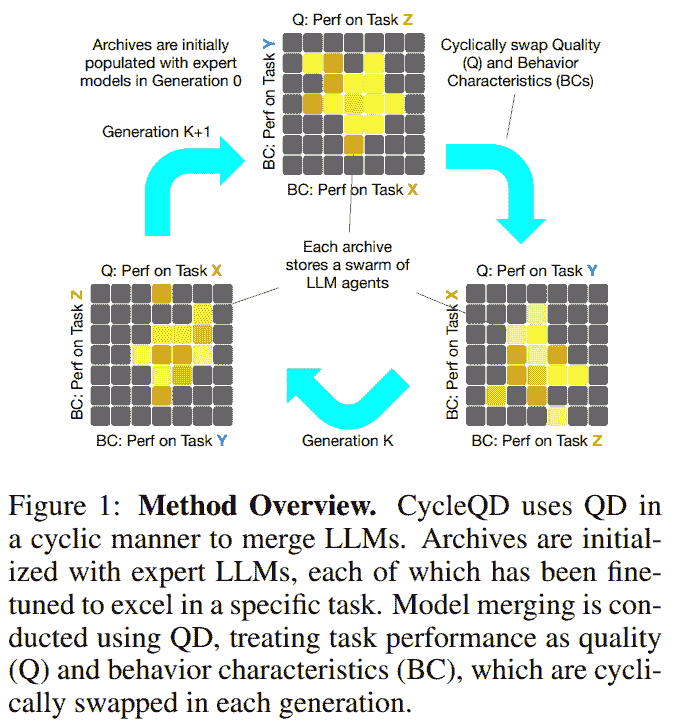

### Forking Paths in Neural Text Generation

https://arxiv.org/abs/2412.07961

本文提出了一个新的假设，即在大型语言模型（LLMs）文本生成过程中存在**“分叉标记”**（forking tokens），这些标记在生成过程中起着决定性作用，它们的选择会导致生成文本的巨大差异。研究旨在深入探讨LLM文本生成中的不确定性动态，并提出了一种新的方法来研究和量化这种不确定性，提供了对模型行为的新理解。

1.  **分叉标记假设**： 本文提出了**分叉标记假设**，即在LLM的文本生成过程中，存在某些关键的单个标记（token），其选择可能导致后续生成路径的显著不同。这些标记在模型生成时的选择会显著改变最终输出，尤其是在多步骤推理任务中。相比之前的研究，本文关注的不仅是最终输出，而是整个生成过程中的“路径”及其不确定性。

1.  **动态不确定性分析方法**： 提出了**分叉路径分析**（Forking Paths Analysis），通过对每个标记在生成过程中的不确定性进行动态跟踪，研究其对最终结果的影响。具体方法是将文本样本转化为时间序列和条件分布，从而揭示模型生成过程中的不确定性动态，这种方法能够揭示传统静态不确定性分析（如仅分析最终标记的logits概率）的局限。

1.  **不确定性动态的实证测试**： 通过采用变点检测模型和生存分析，本文对分叉标记假设进行了实证测试。研究表明，在GPT-3.5模型中，许多常见的评估任务存在明显的不确定性动态，其中某些标记的选择会导致模型从低置信度跳跃到高置信度的输出。这些结果表明，LLM的生成过程要比仅观察最终输出的高置信度更具不确定性，尤其在一些推理任务中，生成过程的动态性远比人们想象的更为复杂。

1.  **发现意外的分叉标记**： 研究还发现了一些意外的分叉标记，例如空格字符，它们对生成结果有着重要的影响。这种发现表明，模型在处理文本时，某些看似无关的细节可能会对最终结果产生重要的影响，进一步挑战了传统的生成模型分析方法。

本文通过7个不同的LLM评估任务（如多步骤推理、知识问答等）对GPT-3.5进行了实验，结果支持了分叉标记假设，发现许多任务中存在不确定性动态。具体而言，模型在生成过程中，某些关键标记的选择会导致模型生成路径的剧烈变化，从而改变最终的输出。比如在推理任务中，模型可能在某些步骤中出现“分叉”，而这些分叉会影响最终的答案。

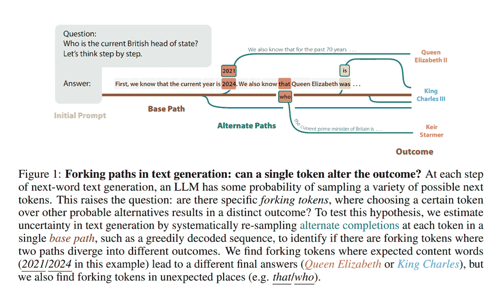

### Understanding Gradient Descent through the Training Jacobian

https://arxiv.org/abs/2412.07003

本研究探讨了神经网络训练过程的“内在低维性”问题，并提出了一种新的方法来分析训练过程的几何性质，尤其是在网络初始化点附近的训练过程。基于对训练过程的线性化，我们研究了训练过程中网络参数变化的Jacobian矩阵，并通过奇异值分解（SVD）对这一矩阵进行了谱分析，发现训练过程可以局部近似为沿着两组基向量的仿射映射，揭示了训练中参数空间的伸缩特性。

1.  引入基于Jacobian矩阵的训练分析： 以往的研究表明，神经网络的训练过程在低维子空间中进行。本文通过对训练过程进行线性化，计算了最终参数与初始参数之间的Jacobian矩阵。该矩阵的奇异值谱提供了一种新的视角，帮助理解训练过程中的参数变化。通过奇异值分解，研究揭示了训练过程中的几何特性，即训练过程可以近似为参数空间沿两个不同基向量的伸缩操作。

1.  **训练过程中奇异值的三区域结构**： 研究发现，训练过程中Jacobian矩阵的奇异值谱由三个明显的区域组成：一是“混沌”区域，其值远大于1；二是“主导”区域，其值接近1；三是“稳定”区域，其值小于1。该结果表明，训练过程中的参数变化并非简单的低维或低秩过程，而是由不同尺度的变化构成的。这一发现为神经网络训练的低维性提供了新的理解。

1.  **奇异值谱的强数据依赖性**： 研究还发现，训练过程中奇异值谱的“主导”区域在很大程度上取决于数据分布，而非初始化点、损失函数或标签。这一结果表明，训练数据的分布对网络训练的几何性质有着显著的影响，特别是在随机数据情况下，“主导”区域的特征并不明显。此发现对理解神经网络训练中的数据依赖性具有重要意义。

1.  **训练中的低秩特性**： 通过分析网络在不同训练阶段的更新，研究发现训练过程中，网络权重的更新通常表现出低秩特性，尤其是在较短的训练段（如1K-2K步）中。这一发现与之前的研究结果一致，说明神经网络训练中的参数更新并非完全高维，而是存在明显的低秩结构。

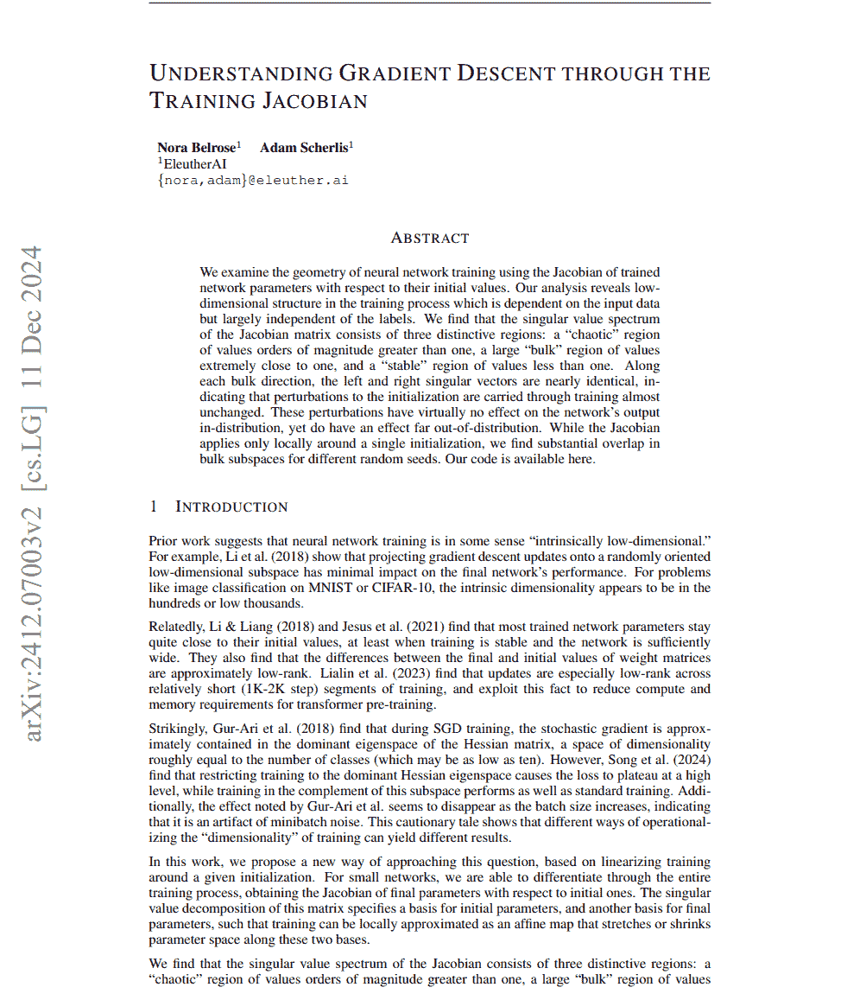

# 产品

### Animate AI 世界上第一个动画系列 AI 视频生成器

贡献人：

https://animateai.pro

Animate AI 是全球首款集成式 AI 动画视频生成器，为动画系列创作提供一站式解决方案。它以“快速、简单、惊艳”为核心特点，帮助创作者轻松实现创意构想。从剧本到成品视频，只需几步操作，即可快速生成专业级动画作品，无需复杂的软件或专业技能支持。用户可以免费开始创作旅程，亲身体验创意与技术的完美结合，让动画制作变得前所未有的高效和神奇！无繁琐步骤，只需一点“魔法”，Animate AI 为创作者打开无限可能的大门。

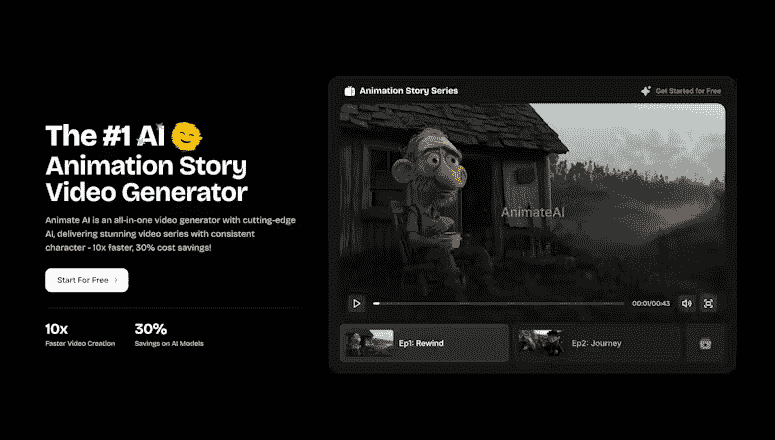

### Doctronic AI + 人类医生 应用

贡献人：

https://www.doctronic.ai

Doctronic 致力于为用户提供即时、准确的居家医疗护理服务。首先，用户可以通过免费的 AI 智能助手进行初步健康咨询，快速获得专业建议。随后，只需 29 美元，即可通过平台预约全天候的视频问诊服务，由持牌医生为您提供全面的健康诊断和治疗建议，无需长时间等待。我们的服务覆盖全美 50 个州，无论身处何地，您都能随时随地享受快捷、便捷且价格合理的医疗解决方案，让健康管理变得更加轻松高效。

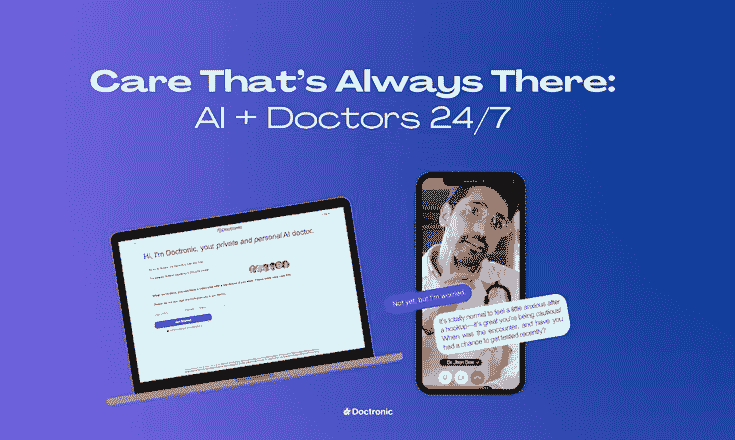

# HuggingFace&Github

###  Recast---根据你向其抛出的任何关卡几何体生成导航网格

贡献人：

https://github.com/ikpil/DotRecast

1.  Recast 通过多步骤网格光栅化过程构建导航网格。

1.  首先 Recast 将输入的三角形网格栅格化为体素。

1.  代理无法移动的区域中的体素将被过滤并删除。

1.  然后将体素网格描述的可行走区域划分为多组多边形区域。

1.  导航多边形是通过将生成的多边形区域重新三角化为导航网格而生成的。

您可以使用 Recast 构建单个导航网格或平铺导航网格。单个网格适用于许多简单、静态的情况，并且易于使用。平铺导航网格使用起来更复杂，但可以更好地支持更大、更动态的环境。平铺网格支持高级 Detour 功能，例如重新烘焙、分层路径规划和导航网格数据流。

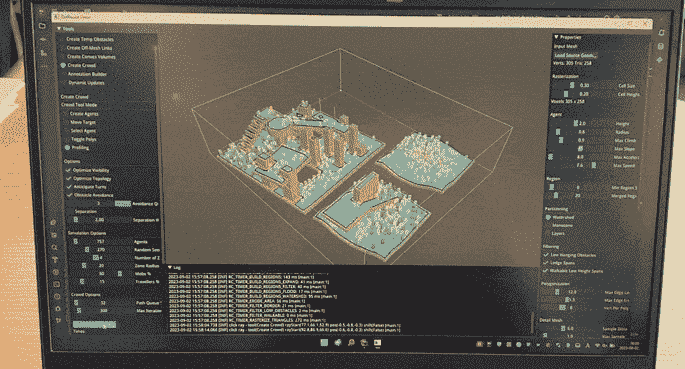

# 投融资

### 清思智能数千万融资

贡献人：

https://mp.weixin.qq.com/s/tOIPnlt_ldpgC8gWprnQ3w

北京清思智能科技有限公司（简称：清思智能）宣布完成数千万元A轮融资，由君联资本与京国瑞共管的北京信产基金独家投资。这轮融资资金将主要用于人工智能产品升级和市场开拓。清思智能由清华大学电子工程系孵化，聚焦视觉领域AI大小模型混合应用，提供城市级视觉认知解决方案。公司已实现盈利，并保持良好的现金流，为未来发展做好准备。清思智能的全栈技术解决方案已全面国产化，覆盖多个场景，包括治安防控、刑侦追踪等，并已在多个地区积累丰硕战果。公司未来计划布局海外市场。

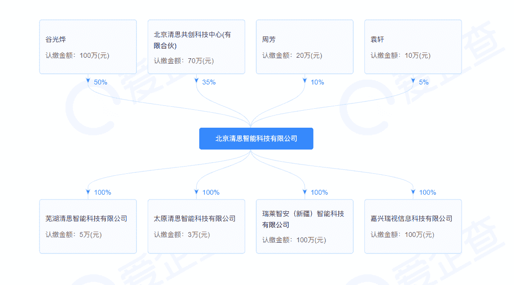

# 学习

### 零基础上手扩散模型——一个新的理论视角

贡献人：

https://zhuanlan.zhihu.com/p/12774361911

扩散模型最近在生成模型领域表现突出，特别是在多模态分布的采样任务中，如图像、音频、视频和机器人路径规划等领域。本文从优化角度介绍扩散模型，旨在帮助理解如何实现和训练一个扩散模型。模型的训练过程包括生成噪声数据，并通过最小化平方损失来学习噪声的去噪器。训练过程是通过一个简单的循环实现的，数据被加入不同强度的噪声，然后通过神经网络来预测去噪。

扩散模型的训练包括噪声强度的采样和噪声数据的生成。为此，定义了一个Schedule类用于管理噪声强度的调度。通过log-linear噪声调度（ScheduleLogLinear）实现噪声的有序采样，从而使得模型能够在不同的噪声强度下进行训练。其他常用的调度方式包括DDPM和LDM，用于不同的生成任务。

在训练过程中，模型通过一个简单的多层感知机（MLP）结构来实现去噪器。去噪器通过接受输入数据和噪声强度的嵌入，输出对噪声的预测。该模型能够在低噪声强度时准确地预测数据点，而在高噪声强度时预测数据的均值。

训练完成后，去噪器的功能可以通过采样算法来进行评估。扩散模型的采样过程通常通过迭代去噪来完成，基于噪声强度的变化逐步去除噪声。理想的去噪器对于特定噪声强度是训练损失的最优解，它能够通过最小化到数据流形的距离来进行投影。

为了提高采样效率，提出了一个基于梯度估计的改进采样器。这个采样器通过在每次迭代中结合前一步的梯度估计来加速收敛，进而生成更接近真实数据的样本。此外，采样过程中添加噪声也能提升样本质量，这可以通过调整噪声强度的变化来优化。

该方法不仅适用于小规模的toy数据集，还可以扩展到更大规模的数据集，甚至可以应用于预训练模型，如Stable Diffusion等。通过在更大的数据集上训练和采样，模型能够生成更高质量的样本。

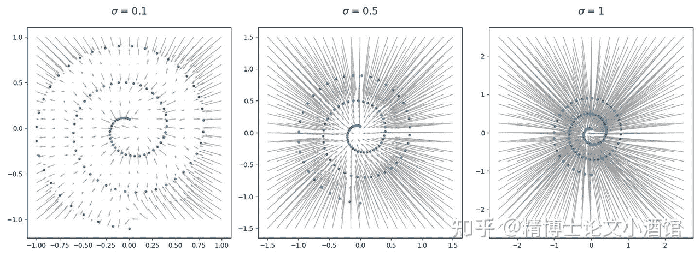

### AWQ：适合端侧的 4-bit 大语言模型权重量化

贡献人：

https://zhuanlan.zhihu.com/p/10498685005

大语言模型 4-bit 权重后训练量化方案，以及专为 4-bit On-Device LLM/VLMs 定制的推理框架 TinyChat。

大语言模型 (LLM) 已经改变了许多 AI 应用。On-device LLM 也变得越来越重要：在边缘设备上本地运行 LLM 可以降低云计算成本，保护用户的隐私。然而，巨大的模型尺寸以及有限的硬件资源为部署带来了重大的挑战。本文提出了激活感知权重量化方法 (Activation-aware Weight Quantization, AWQ)，一种硬件友好的 LLM 低 bit 权重量化方法。

AWQ 发现，并非 LLM 中的所有权重都同等重要。仅保护 1% 的 salient 权重可以大大减少量化误差。为了识别 salient 的 weight channel，应该参考 activation 而不是 weight 的分布。为了避免硬件效率低下的混合精度量化，作者在数学上推导出扩大 salient channel 可以减少量化误差。AWQ 采用等效变换来缩放 salient 的 weight channel 以保护它们。AWQ 不依赖于任何反向传播或重建，因此它可以推广到不同的领域和模式，而不会过度拟合校准集。

AWQ 在各种语言建模和特定领域基准 (代码和数学) 上的表现优于现有工作。由于更好的泛化，它为指令调整的 LM 实现了出色的量化性能，并且首次实现了多模态 LM。除了 AWQ，作者还实现了 TinyChat，这是一个高效且灵活的推理框架，专为 4 位设备上的 LLM/VLM 量身定制。通过 Kernel Fusion 和平台感知的权重打包，TinyChat 在桌面和移动 GPU 上都比 Huggingface FP16 实现提供了 3 倍以上的加速。它还使 70B Llama-2 模型在移动 GPU 上的部署民主化。

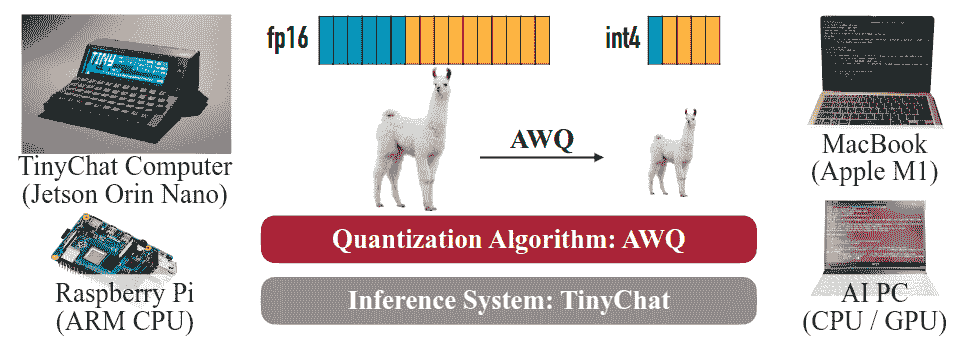

### Qwen2.5思维链微调代码实操 + 多卡Lora微调完整代码

贡献人：

https://zhuanlan.zhihu.com/p/12684234698

近年来，关于Scaling Law和大模型微调的讨论愈发热烈，尤其是在理解大规模数据和参数对模型性能提升的瓶颈问题上。Ilya等人在探讨大模型如何在多层次思维过程中达到类似于人类智能时，强调了当前的模型更多依赖直觉反应而非多步深度推理。例如，尽管大模型在参数量上远超人类大脑，但其推理过程往往比人类简单。为了突破这一限制，研究者开始关注思维链（Chain of Thought, CoT）技术，并尝试通过微调使大模型具备更细致的推理步骤。

CoT技术最早由Json Wei等人提出，旨在通过提示词引导模型逐步思考复杂问题。以一个简单的数学问题为例，食堂有23个苹果，使用了20个后又买了6个，要求解剩余苹果数。人类通常会分两步推理：先从23减去20，再加上6。而大模型通常给出简单的直接答案，难以处理多步推理。CoT的目标是通过提示词促使模型像人类一样逐步推理。

在实际应用中，研究者们尝试通过微调将这种“分步推理”的能力注入到模型中。以FLAN PaLM为例，CoT数据集的引入显著提升了模型的推理能力，尤其是在零样本任务中，虽然消融实验不足以完全验证CoT对性能的提升，但在构建微调数据时，CoT数据集仍然是重要组成部分。

在微调实践中，本文介绍了如何使用阿里通义千问（Qwen2.5）进行CoT数据微调。通过将英文CoT数据集翻译成中文，并将其整理为标准的Instruction-Input-Output格式，进行了简单的实验。这个微调过程依赖于高质量的CoT数据集，尤其是如何精确地构建微调数据，以确保模型能够理解并执行多步推理。

此外，本文还分享了在华为昇腾910卡上进行微调的实践经验。昇腾卡支持的openMind库使得在NPU上进行训练成为可能。通过配合SwanLab工具，能够实时记录训练过程的关键数据，如内存使用、功率消耗等，为模型微调提供了强有力的支持。对于使用Nvidia GPU的环境，类似的工具和安装方法也适用。

在微调Qwen2.5时，关键的一步是正确构建提示词模板。Qwen2.5采用了自定义的聊天模板，需特别注意避免使用旧版的模板格式，这可能会导致微调效果不佳。此外，正确配置tokenizer和数据集处理也是保证微调效果的基础。

最后，本文提供了一个完整的多卡微调代码示例，支持华为Ascend卡的多卡训练，并利用SwanLab进行数据记录和可视化。多卡训练脚本使得在大规模数据集上进行训练成为可能，并且提供了详细的超参数设置，方便在实际项目中应用。

总的来说，CoT微调为大模型带来了更加精细的推理能力，通过不断优化数据集构建、提示词设计和硬件支持，能够显著提升模型在复杂任务中的表现。

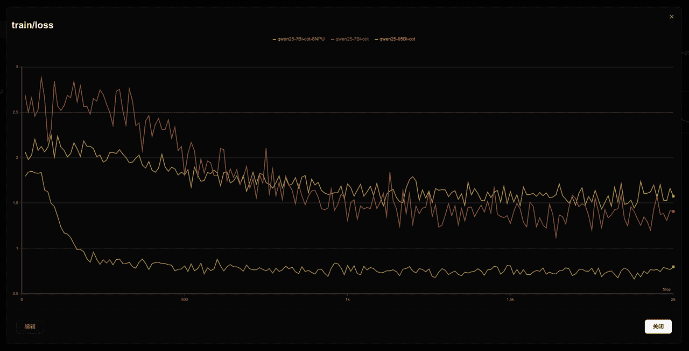

### 谈谈大模型场景的推理芯片及系统设计形态的辩证

贡献人：

https://zhuanlan.zhihu.com/p/12735148340

近期读到一篇文章探讨了Fabless自研推理芯片在IDC大模型场景中的机会，尤其是“推理场景的多样性会给ASIC更多机会”。当前推理芯片的发展面临一些掣肘，尤其是纯粹的推理芯片并不会成为主流。实际情况是，训推一体加速器将会成为主流形态，这类硬件不仅需要支持高性能外设，还要符合GenAI-IDC的软硬件设计要求。以LLM post-train为例，这些工作需要动态更新和调整模型结构，诸如微调、蒸馏、量化等，这要求硬件支持更多复杂的算子操作和框架调整，这远非传统推理ASIC可以满足。

与传统的训练加速器如GPU（例如NVIDIA的CUDA）相比，推理芯片需要更强的资源调度能力、并行化效益和算子性能。虽然推理芯片专注于推理任务，但要支持大规模的post-train和训练优化工作流，必须依赖软硬件协同设计。相比独立的ASIC Fabless，集成系统的厂商（如CSP）更能提供适合大模型场景的硬件解决方案。软硬件的紧密结合、定制算子的优化、算子融合和多流调度等都需要与硬件深度协同，尤其是在处理超长序列或复杂算子时，传统的推理芯片设计难以满足这些需求。

当前的推理硬件框架更多侧重于runtime的优化，而非传统的builder优化。这是因为在大模型场景下，推理功能变得越来越丰富，而模型结构相对固化。尽管现有的推理框架（如Torch、Triton等）提供了高层抽象，但对于专门的ASIC设计，软硬件协同显得尤为重要。对于独立的Fabless来说，尽管其有较强的设计能力，但在面对大模型推理的复杂性时，仍然面临很大的技术和资源瓶颈，尤其是在适应post-train任务时，需要协同CSP与LLM厂商才能实现有效的硬件适配和优化。

综上所述，独立Fabless在推理芯片研发中的掣肘主要源于硬件与软件的耦合需求、推理框架的复杂性以及后端设计的复杂性。未来的推理任务可能需要更复杂的系统设计和软硬件协同，而这正是当前的独立Fabless芯片厂商难以单独完成的挑战。

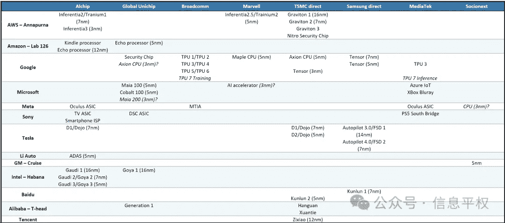

### LLM，一艘方向不对但积重难返的华丽游轮...

贡献人：

https://zhuanlan.zhihu.com/p/12673598389

今天下午参加了由上海AI Lab举办的浦江AI学术年会，听了一场关于“非共识性研究与创新”的专题论坛。与会的专家包括付杰教授、何哲陟教授、滕佳烨教授等，他们从不同角度探讨了当前大模型和LLM（大语言模型）的局限性及未来发展方向。尤其在讨论环节中，焦点集中在自回归模型、Scaling Law以及它们是否能够引领我们走向AGI（通用人工智能）的问题上。

付杰教授直言不讳地表示，他认为目前的LLM其实并不“理解”它们输出的答案，而更多依赖于记忆而非真正的推理。何哲陟教授则从计算效率和人脑的巨大差距谈到了当前大模型训练方式的不科学性，提出应该借鉴脑启发式计算方法以提升效率。滕佳烨教授通过经济学中的菲利普斯曲线理论提醒我们，当前关于大模型扩展规律（scaling law）的研究可能存在“修正主义”倾向，容易忽视深层次的科学问题。胡迪教授讨论了多模态训练中存在的不平衡问题，并提出在追求数据量和算力的同时，质量和数据利用的审视也应当被重视。

然而，最令人深思的部分是圆桌讨论。在讨论自回归模型是否是通向AGI的正确路径时，各位学者纷纷提出质疑，认为当前的LLM并非真正理解数字和语义，它们在处理数字等形式化问题时，仍然存在明显的短板。有人提到大模型的学习方式与人类学习过程差异显著，且目前的模型设计仍然过于依赖现有的模型架构与技术。

这让作者陷入了深思。学术界确实早已关注到神经网络设计的问题，脑启发式设计和MoE（混合专家模型）等早期思想早在几十年前就有提出。然而，今天我们为何还在重复这些讨论？这些问题不是没有答案，而是学术界回避了一个残酷的现实——技术路线受到商业驱动的强烈影响。尽管大模型（如GPT-3）在2019年已展现出强大的能力，但由于闭源和受限，学术界并未将其作为主流研究对象，直到OpenAI的InstructGPT迭代并推出ChatGPT，才让这一技术路径突然成为主流。ChatGPT凭借其开放性和易用性，迅速吸引了大量用户，成为商业化成功的典范。

在此过程中，尽管学术界仍然坚守理论和技术的创新，但现实却是，技术路线更多是由市场需求和资本推动的。GPT和Transformer的成功，某种程度上依赖于先发优势和市场需求的合力，而这一过程本质上也受到利益的推动。当资本和资金不断注入GPT等技术路径时，即便理论上有其他更优的方案，也很难突破这一局面。大量资金的投入和行业的关注，使得GPT的相关研究成为最主流的方向，其他路线往往被忽视，哪怕它们在某些方面或许能提供更优的解决方案。

随着Scaling Law的提出和不断强化，LLM似乎陷入了“堆数据、堆算力”的死循环，短期内虽然能够通过修补和优化达到一定的效果，但长远来看，真正的创新往往因为商业利益和成本问题而被忽略。虽然许多学者提出了新的技术路线，诸如脑启发式计算、不同的模型架构等，但这些方案的实际落地成本高昂，且缺乏足够的资金支持。

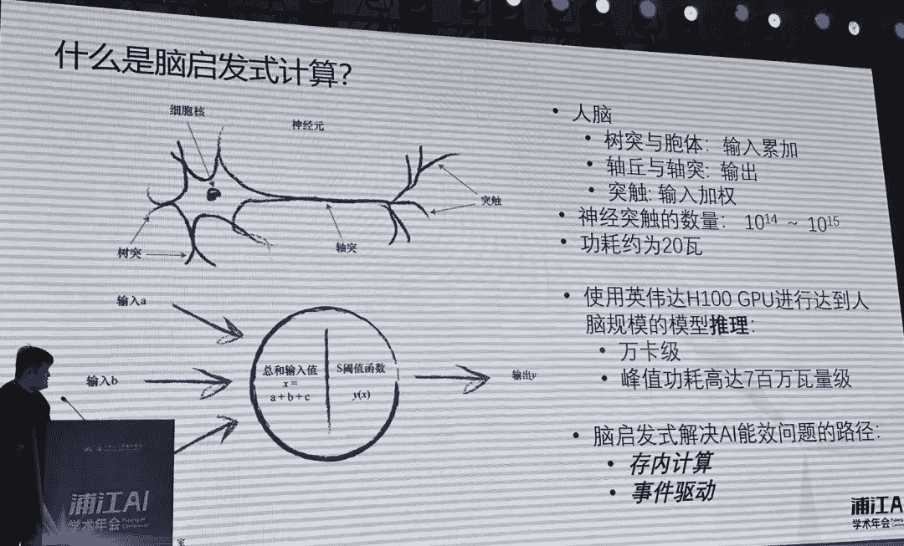

### sys(2): 通信原语及其性能分析

贡献人：

https://zhuanlan.zhihu.com/p/706135598

在分布式计算中，通信是至关重要的组成部分，尤其是在深度学习训练中，因为模型权重和临时变量的传输往往依赖高效的集合通信（Collective Communication, CC）操作。分布式通信一般可分为集合通信和点对点通信两大类，前者用于多个节点之间的交互，后者则在单一节点对节点间进行传输。集合通信包括常用的原语：reduce、all-reduce、scatter、gather、all-gather、broadcast 和 all-to-all 等。

分布式集群使用的通信库主要有 MPI 和 NCCL。MPI（消息传递接口）适用于 CPU 并行计算，广泛用于超算集群。其主要特点是兼容性好，功能丰富，能够在不同硬件平台上支持多种通信模式。NCCL（英伟达集合通信库）则是针对 GPU 和多节点通信进行了硬件优化，特别适合 NVIDIA 硬件的深度学习框架中，通常能提供更低的延迟和更高的带宽。Gloo 是 Facebook 开源的一套集体通信库，主要优化了 GPU 之间的通信，支持的功能包括 barrier、broadcast 和 allreduce。

在通信算子的具体实现中，常见的包括：

1.  **Broadcast**：采用 one-to-all 通信模式，一个进程的数据被广播到所有其他进程。通过 torch.distributed.broadcast 实现，源进程的数据会被复制并传播到其他进程。

1.  **Scatter**：一个数据发送者将数据分片并分发到多个接收者，接收者会获得数据的不同片段。每个进程通过 torch.distributed.scatter 从源进程接收不同的数据分片。

1.  **Gather**：多个进程将数据发送到一个目标进程，后者将所有数据汇聚在一起。通过 torch.distributed.gather 操作实现，源进程将各自的数据发送到指定的目标进程。

1.  **Reduce**：多个进程将数据聚合到一个目标进程，通常执行求和、最大值、最小值等操作。torch.distributed.reduce 用于实现这一操作，将多个进程的数据通过指定的算子（如 SUM）规约到目标进程。

1.  **AllReduce**：所有进程都参与数据规约，结果会被广播到每个进程。torch.distributed.all_reduce 实现该操作，通常用于训练过程中参数的平均或求和，确保每个节点的数据一致性。

1.  **AllGather**：与 Gather 类似，但将数据收集到每个进程，而非单个目标进程。torch.distributed.all_gather 会将所有进程的数据汇总，并把完整数据发送到所有进程。

这些通信算子的效率对分布式训练的性能至关重要。不同的通信库和操作模式针对不同硬件的优化效果有所不同，例如在低精度（FP16）下，NCCL 通常优于 Gloo，而在高精度（FP32）下，MPI 在数据量较小时表现更好，但随着数据量增加，NCCL 的优势则愈加显著。

因此，选择合适的通信算子和库是确保分布式深度学习训练高效进行的关键。

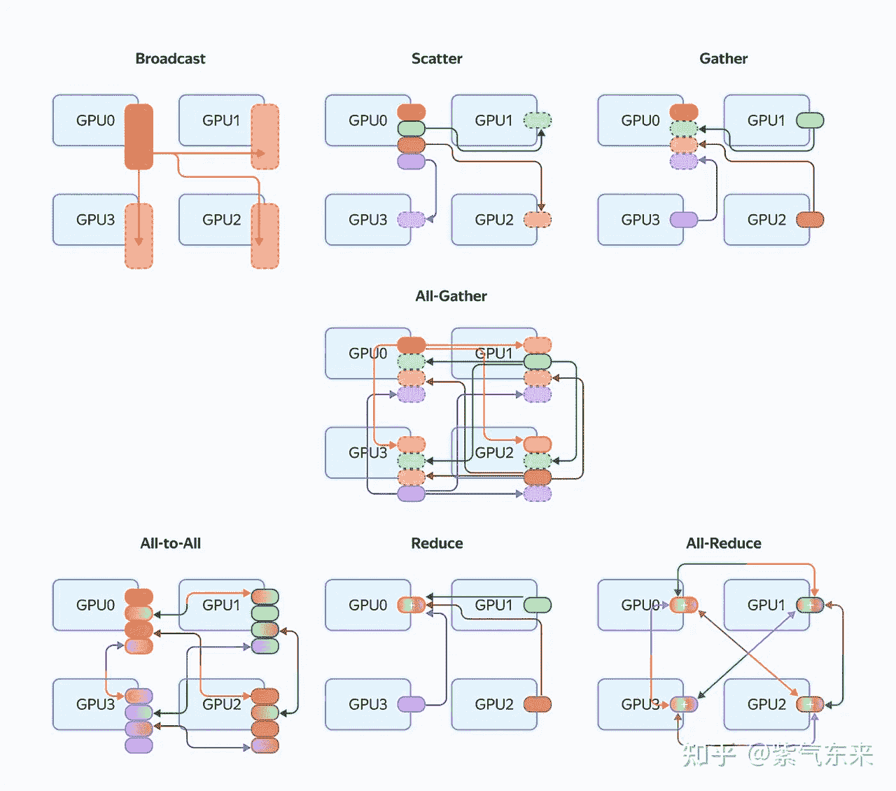

# 声明

本文档仅供学习交流使用，版权归原作者所有，若涉侵权，请联系Jack Jin 15101136166

##

（欢迎在下方反馈您宝贵的意见！整理不易，觉得有用给AI日报小组点个赞👍吧！）

ChatGPT；Angela；Zijia Liu；Alex；Zeqi Tan；Tiezhen（HuggingFace）；Naixu；Lizhi；Peter；Suoman；Jack

学术分析报告：ResearchFlow -- 奇绩F23校友的开发的深度研究产品，PC端进入RFlow的分析报告，可直接点击节点右侧的小数字展开节点，登录后可在节点上直接“询问AI”，进一步探索深度信息

如果你有大模型相关的创业想法，欢迎来找我们聊聊～微信：15101136166

> 快邀请你的小伙伴们一起来读大模型日报吧！

> **【日报****知识库****】**这里是近期日报内容的汇总,欢迎大家查阅

> [大模型日报知识库(分享版)](https://miracleplus.feishu.cn/wiki/KapVwXfkriOBiskB0B2cUHxjnTh)

>

> 欢迎大家多多帮我们分享,转发~~

> 如果大家有任何的建议或者吐槽,欢迎随时找我聊天~

