# 奇绩大模型日报（12月 17日）

> 来源：[https://miracleplus.feishu.cn/docx/CrQCdN6BdoUb1KxdVLFc6E5XnUb](https://miracleplus.feishu.cn/docx/CrQCdN6BdoUb1KxdVLFc6E5XnUb)

# 🔉潜**空间系列活动重磅回归！**

> 本期活动将在**12月22日** **11:00**开始，我们邀请到的嘉宾是**季宇。**清华大学计算机科学与技术系博士，曾在华为担任海思昇腾芯片编译器专家，负责多个昇腾编译器项目，并在AI编译器领域和处理器微架构领域进行挑战性问题攻关。他于2023年8月创立了行云，该公司致力于研发下一代针对大模型推理场景的高效能GPU芯片，并在2024年连续完成总额数亿元的天使轮及天使+轮融资。季宇的主要研究领域包括神经网络加速器、编译器和面向系统优化的机器学习。他将带来《谁困住了AI产业——大型机化的计算机形态与变革的可能性》的分享。

> 除嘉宾分享外，每期设置了【匹配合伙人 Cofounder Matching】环节。你可以和 GenAI 时代最有活力的创业者和研究者线下面对面交流，将有机会找到志同道合、有共同创业梦想的小伙伴。

> 报名通道已开启，欢迎扫描下方二维码报名。

# 推特

### Midjourney发布Moodboards：允许您通过图片合集个性化我们的模型

https://x.com/midjourney/status/1868765999136477365

今天，我们发布了“Moodboards”，它允许您通过图片合集个性化我们的模型。我们还新增了对多个个性化配置文件的支持，并将图片排名速度提升了5倍。现在，您终于可以为所有项目使用定制版Midjourney模型了 <3

### Cheema分享：快速AI家庭实验室教程，一套属于自己的苹果mini集群

https://x.com/alexocheema/status/1868671788575514959

“我也打算搭建一套属于自己的苹果mini集群，把Llama模型跑在我桌上的小集群里。”

——@garrytan

快速AI家庭实验室教程：

• 在每台mini上安装 **@exolabs**（开源，安装步骤详见README）。

• 确保所有mini都连接到同一个WiFi网络，或者为了更快、更稳定的效果，通过Thunderbolt或以太网连接。设备会自动发现彼此，并自动对LLM进行分片处理。

** • 现在，您可以**使用自己喜欢的LLM图形界面与集群进行交互（@tinygrad 的 tinychat 已内置在exo中）。

[lzqstUHhIQZAR1_t.mp4](https://internal-api-drive-stream.feishu.cn/space/api/box/stream/download/all/M3IQbWeeioSsfYxQiMhcL6Oxnae)

### AIatMeta 发布了 Apollo多模态模型，7B达到SoTA水平并击败30B+模型

https://x.com/reach_vb/status/1868608027156250906

走起！**@AIatMeta** 发布了 **Apollo多模态模型**，Apache 2.0许可证开源——7B达到SoTA水平并击败30B+模型🔥

**关键信息：**

提供1.5B、3B和7B的模型权重

能理解长达1小时的视频内容 🤯

具备时间推理能力与复杂视频问答能力

支持基于视频内容的多轮对话

**性能亮点：**

• **Apollo-3B**** 表现超过大多数现**有**7B模型**，在 **Video-MME、M**LVU 和 A**poll**o**Benc**h 上**分别取得** 58.4、68.7 和 62.7 的分数。

• **Apollo-7B**** 在基准测试中媲**美并超**越超过30B参数的模型**，如 **Oryx**-34B 和 VILA1.5-40B，在 MLVU 等测试中表现出色。

**Apollo-1.5B**：超越更大规模的模型，包括 **Phi-3.5-Vision** 和一些7B模型（如 **LongVA-7B**）。

**Apollo-3B**：在 **LongVideoBench**、**MLVU** 和 **ApolloBench** 上分别取得 **55.1**、**68.7** 和 **62.7** 分数。

**Apollo-7B**：在 **Video-MME**、**MLVU** 和 **ApolloBench** 上分别获得 **61.2**、**70.9** 和 **66.3** 分数。

**   **     模型权重已上传至 Hub，并兼容transformers框架（附带自定义代码）。

祝贺 **@AIatMeta** 的精彩发布，再次感谢他们对开源社区的坚定承诺！🤗

[3NyEBbMMmcnLNDYf.mp4](https://internal-api-drive-stream.feishu.cn/space/api/box/stream/download/all/Cxr3bR42BorP4Yxkg7ecdesqnKd)

### Burkov分享Demo：这就是生成模型的用武之地

https://x.com/burkov/status/1868382896870097292

这就是生成模型的用武之地。

[OL6UtZ3MKzf93zSf.mp4](https://internal-api-drive-stream.feishu.cn/space/api/box/stream/download/all/DiBfbaTTWoYqJExWUrNclWPcnud)

# 资讯

### Google Labs 视频与图像生成技术更新：Veo 2 和 Imagen 3

贡献人：

https://blog.google/technology/google-labs/video-image-generation-update-december-2024/

2024年12月，Google宣布推出更新版的视频生成模型Veo 2和图像生成模型Imagen 3，并在Google Labs推出了新的图像生成实验工具Whisk。这些更新带来了更高的生成质量和多样性，显著提高了创作自由度和表现力。

Veo 2：突破性的高质量视频生成

Veo 2是Google的新一代视频生成模型，能够创建极高质量的视频，支持多种主题和风格。与其他领先的视频生成模型相比，Veo 2在真实感和细节上取得了显著进展。它能更好地理解现实物理和人物动作，通过优化镜头语言来生成精准的场景，例如低角度跟踪镜头或特写镜头。此外，Veo 2支持高达4K分辨率的视频输出，能够生成细致且符合人类审美的视频内容。

Imagen 3：图像生成的最新突破

Imagen 3则进一步提升了图像生成能力，不仅在色彩和构图上更加亮眼，还能渲染出更多元化的艺术风格。从写实主义到印象派，再到抽象和动漫风格，Imagen 3都能精准地表现。新的版本在生成细节和纹理方面也更加丰富，并能更忠实地执行用户的提示。与其它主流图像生成模型进行的对比测试中，Imagen 3表现出色，获得了领先的评价。

Whisk：创新的图像混合与创意工具

Whisk是Google Labs推出的全新工具，它结合了Imagen 3模型与Gemini的视觉理解能力，允许用户通过上传或创建图像来直观地表现想法。Whisk自动生成图像的详细描述，并将这些描述输入到Imagen 3中，帮助用户快速创建和混合不同的场景、风格和主题，带来独特的创意体验。

### 宇树机器人强化学习代码全面开源，还有训练到仿真和实操手把手教学

贡献人：

https://mp.weixin.qq.com/s/tco3-9-9DZa9u1z3eIuiaQ

宇树机器人近期发布了更新版的开源强化学习（RL）系统，涵盖了从仿真到实体机器人运行的完整流程。此次更新不仅支持英伟达Issac Gym平台，还新增了对MuJoCo模拟仿真的支持，拓宽了模拟的硬件兼容性，包括支持各种GPU、CPU以及TPU。这一变化使得整个强化学习体系更加完整，支持从训练、仿真到最终的真机迁移，极大地提升了机器人的自主学习能力。

宇树的开源项目被命名为“RL GYM”，最初是为Issac Gym平台提供训练代码，现已扩展到MuJoCo仿真环境。用户可以通过详细的教程，完成从环境配置到训练、仿真，再到最终在机器人上的迁移与测试。特别是在最新款的G1机器人上，经过Issac Gym训练后，可以直接迁移到MuJoCo仿真并最终运行在G1实体机上，且提供了中文教程，进一步降低了开发门槛。

此外，宇树还通过GitHub发布了一系列开源工具和资源。例如，机器人操作系统（ROS）的模拟包，包含了宇树系列机器人的质量、惯量等关键参数；另外，还有针对苹果Vision Pro遥控G1机器人的仓库，包含了数据采集和训练的相关教程。该项目通过LeRobot框架处理数据，支持将采集到的JSON格式数据转化为所需格式，以供机器人训练使用。

在数据集方面，宇树在HuggingFace上公开了由G1机器人收集的五种操作数据集，涵盖了多种任务，如拧瓶盖、叠积木等，数据集包括每个手臂和灵巧手的动作状态。通过这些数据集，开发者可以训练机器人执行各种复杂任务，提升其多功能性。

除了机器人开源项目，宇树还在激光雷达领域有所布局，推出了售价419美元的激光雷达，并开源了其使用的Point-LIO算法，进一步推动了开源生态的建设。

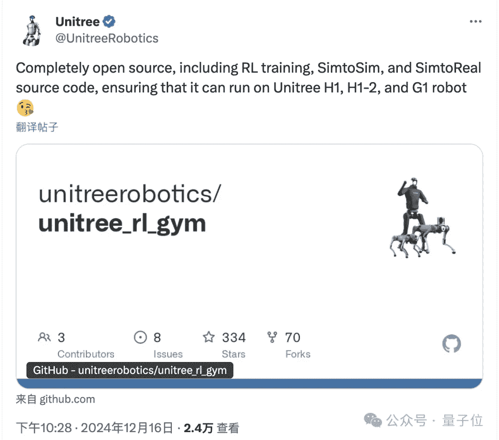

### 开源Llama版o1来了，3B小模型反超80B，逆向工程复现OpenAI新Scaling Law

贡献人：

https://mp.weixin.qq.com/s/IVsbnZZTAsNXwRvr9lqZlg

Hugging Face团队在近期的研究中，基于DeepMind的工作，开源了扩展测试时计算方法，并成功复现了一个新的Scaling Law范式。尽管OpenAI的o1算法完全保密，但Hugging Face通过改进并在Llama 1B和Llama 3B等小型模型上进行测试，取得了显著的进展。在Llama 3B模型上，性能提升显著，甚至能够与规模大约20倍的70B模型相媲美。

研究团队对测试时计算的策略进行了优化，提出了两种主要策略：自我优化和搜索方法。自我优化通过模型识别并纠正迭代中的错误来优化输出，但这一方法通常需要模型具备自我优化机制，限制了其适用性。搜索策略则通过生成多个候选答案并使用验证器选出最佳答案，灵活性更强，且适应性更好，特别是在算力资源充足的情况下。Hugging Face的研究集中在搜索方法上，认为该策略更加实用且可扩展。

在搜索策略的设计上，团队提出了三种方案：Best-of-N、Beam Search和多样化的验证器树搜索（DVTS）。Best-of-N策略为每个问题生成多个响应，使用奖励模型评分后选择最佳答案；Beam Search则是通过探索解决方案空间来优化中间步骤；DVTS是Beam Search的一种变体，拆分初始Beam为多个子树，使用PRM做贪婪扩展，以提高多样性和整体性能。

实验结果表明，在算力预算充足时，DVTS方法比Beam Search更能提升答案的多样性和性能。对于简单问题，Beam Search在较小的搜索宽度时表现更好，而DVTS则在处理更复杂问题时展现出更强的优势。最终，基于问题难度的动态分配策略被证明是最佳方案。

此外，团队指出，未来的研究应关注提升验证器的稳健性和泛化能力，以支持更复杂的任务。搜索方法的进一步发展可用于生成高质量的训练数据集，以及扩展到更多任务领域，尤其是在结构化不良或评判标准主观的任务中，仍然是一个挑战。

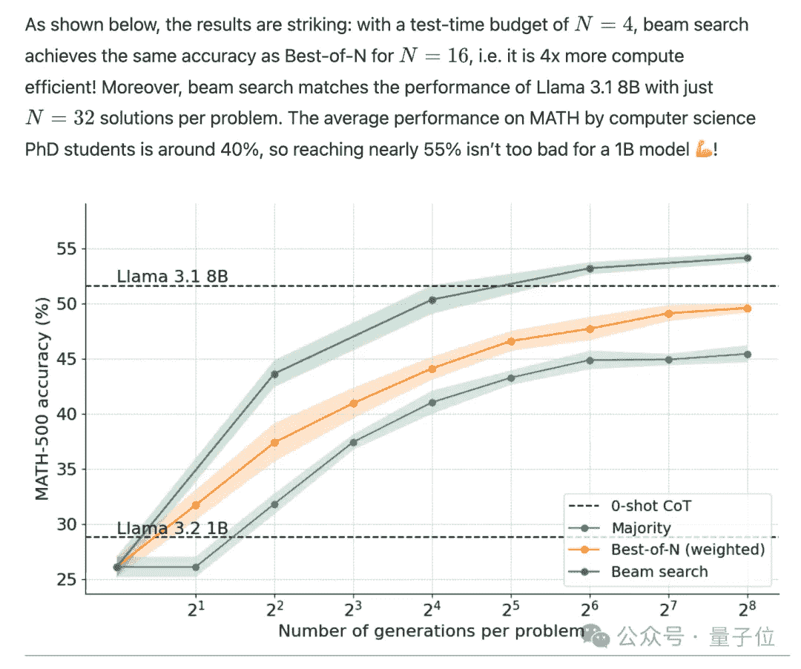

### 枫清科技高雪峰： Data-Centric新范式开启，知识引擎+大模型双轮驱动企业智能化

贡献人：

https://mp.weixin.qq.com/s/xGmxM6NkqXoX1uY0NsWFIQ

在2024中国生成式AI大会的「AI Infra峰会」上，枫清科技的创始人高雪峰就AI技术如何推动企业智能化转型进行了深入探讨。他指出，生成式AI要真正应用于企业决策场景，必须解决“模型与决策智能之间的鸿沟”。关键在于结合企业本地知识与符号逻辑推理能力，从而实现可解释的智能。

高雪峰强调，当前企业智能化面临的核心挑战包括：模型幻觉（大模型的误导性输出）、可解释性不足、推理能力的弱化、安全与合规问题。此外，落地人工智能平台时，企业还需解决数据孤岛、数据整合、知识校验及时效性等四大技术难题。

他提出，企业智能化的发展趋势正在从“以模型为中心”转向“以数据为中心”的新模式。这种模式强调通过高效的数据治理，将本地数据知识化，结合大模型的泛化知识，推动决策智能的应用。具体而言，企业需要构建大规模的知识网络，将企业本地数据与外部信息融合，通过符号推理与生成式AI相结合，解决模型的推理能力和时效性问题。

枫清科技的解决方案包括构建知识引擎与大模型双轮驱动的平台，帮助企业在多个场景中实现精准、透明的决策支持。通过这种平台，企业能够实现智能决策、智能指标问数、根因分析等多种功能，且能够在金融、化工、汽车等行业取得成功应用。

此外，高雪峰分享了与多个行业龙头企业合作的案例，包括为金融机构构建的智能指标问数系统及为APEC会议开发的中国-APEC数字平台。通过这些平台，企业能够快速构建并应用智能化决策支持系统，实现多场景的智能化赋能。

枫清科技的技术创新不仅体现在如何将知识网络与大模型结合，还包括通过图向量融合等技术，解决大模型在推理、时效性等方面的技术瓶颈。这些创新为推动企业智能化转型提供了技术保障，也为未来的AI应用场景落地奠定了基础。

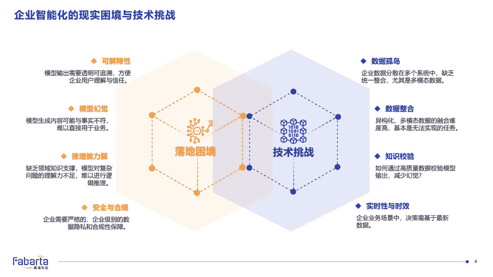

### 腾讯 Robotics X 杨思成下场创业，做触觉传感器+手+臂

贡献人：

https://mp.weixin.qq.com/s/aOnj49Q58F8lanydpVd1jg

1.  **创业动态**：

+   腾讯Robotics X实验室的高级研究员杨思成离开腾讯，开始创业，主要聚焦于触觉传感器、灵巧手和机械臂的研发。

1.  **融资情况**：

+   杨思成的创业项目已完成由深创投领投的天使轮融资。

1.  **个人背景**：

+   杨思成，北京航空航天大学机械工程及自动化专业毕业，后在清华大学攻读机械工程专业，拥有丰富的灵巧手研发经验。

1.  **职业经历**：

+   杨思成曾在华为担任数据分析师，后加入腾讯Robotics X实验室，职级为T10，担任灵巧手与高动态机械臂项目的总负责人。

1.  **技术成就**：

+   杨思成参与研发了腾讯Robotics X实验室的高性能五指灵巧手“TRX-Hand5”，该灵巧手具有20个自由度，能提拉20公斤物体。

1.  **专利与论文**：

+   杨思成累积申请发明专利60余项，发表机器人领域的顶会与期刊文章10余篇。

1.  **团队成员**：

+   创业团队包括触觉感知系统总负责人李望维（CTO），以及外骨骼触觉反馈系统项目的某位员工，后者具备丰富的软硬件一体化研发经验。

1.  腾讯Robotics X实验室动态：

+   Robotics X实验室明确表示不从事机器人本体制造，而是聚焦于具身智能和云平台方面，这可能导致更多硬件研究方向的人员出来创业。

1.  **行业趋势**：

+   随着Robotics X实验室的趋势变化，可能会有更多的研究方向倚重硬件的人员选择创业。

### 比亚迪成立先进技术研发中心，加码 AI、大模型投入

贡献人：

https://mp.weixin.qq.com/s/2Kyh9Q4gzlrPsgX5GfRUIw

比亚迪近期成立了先进技术研发中心，标志着公司在智能化领域的进一步深化投入。该中心主要集中在AI算法、大模型、AI基础设施和大数据平台等技术的研发，目的是为比亚迪的智能驾驶、智能座舱、双模（DM）技术等业务提供技术支持与算力保障。该中心自成立以来，团队规模已接近500人，计划未来扩充至千人，并整合了原有的整车仿真、大数据等部门。

核心技术与平台建设

比亚迪的先进技术研发中心将充当公司智能化技术的“技术中台”，集中规划和开发算法、数据标注等功能，并将这些技术支持共享给智能驾驶、座舱等核心业务部门。此外，比亚迪还将智驾与座舱技术作为核心战略之一，加大对智能化技术的投资，尤其是在AI大模型领域的投入。

智能驾驶技术的发展

比亚迪的智能驾驶团队已经投入大规模的研发，致力于自研大模型，并将智能驾驶视为未来的核心竞争力。公司计划在未来两年内将高阶智能驾驶功能推广到10万元以下的车型，并逐步实现这些功能的普及。比亚迪不仅在硬件上进行投入，还通过对软件系统的优化，提高智能驾驶的应用效果。

持续的技术投入与资源保障

比亚迪的战略是依靠强大的现金流和研发资源，推动智能化技术的迅速发展。作为全球销量最高的新能源车企，凭借其强大的研发团队（超过11万名工程师），比亚迪有足够的资源推动智能化技术的突破。此外，公司计划投入1000亿元人民币，加速AI与汽车的融合，进一步提升智能化技术的核心竞争力。

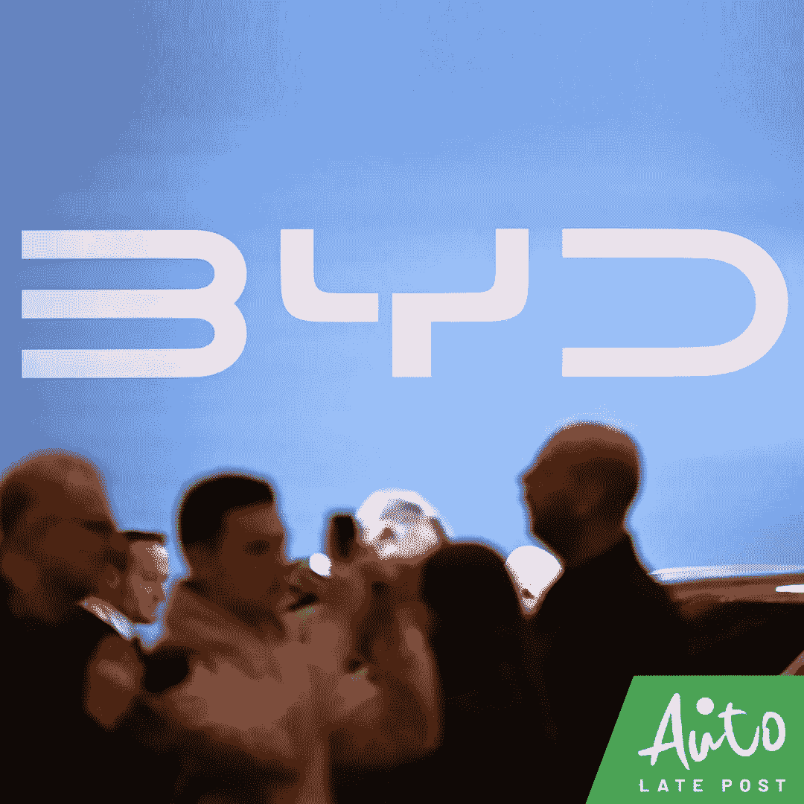

### Tokenization不存在了？Meta最新研究，无需Tokenizer的架构来了

贡献人：

https://mp.weixin.qq.com/s/7ju-PjPZVPrBLQ1qFnFoKw

《Byte Latent Transformer: Patches Scale Better Than Tokens》这篇论文提出了一种新的大语言模型（LLM）架构——字节潜在 Transformer（BLT），挑战了传统的基于 tokenizer 的方法。传统的语言模型依赖于 tokenizer 将输入文本分割为 tokens，但这种方法存在固定词汇表、对多语言或噪声数据处理效率低等局限性。BLT 架构通过直接建模原始字节流并动态地将字节分组为 patch，避免了 tokenizer 和固定词汇表的限制。

BLT 的核心思想是根据熵值动态地对字节进行分组：高熵区域分配更多计算资源，低熵区域节省资源。这使得 BLT 在处理复杂输入时更加高效，能够在推理过程中节省高达 50% 的计算资源。BLT 在多样化和带噪声的输入上表现得尤为鲁棒，尤其在字符级理解和长尾泛化任务中优于基于 tokens 的模型。

BLT 由一个大的全局自回归 Transformer 和两个较小的局部模型组成。全局 Transformer 处理潜在的 patch 表征，而局部模型则负责将字节序列编码为 patch 表征，或将其解码回字节。在局部编码器和解码器中，交叉注意力层用于将字节映射为 patch，且每个 transformer 层后都会有一个交叉注意力层，用于生成更为表达丰富的 patch 表征。

通过对比，BLT 在训练过程中对计算资源的控制与 LLaMA 3 模型相当，但在推理时能大幅减少计算量。研究表明，BLT 在扩展性方面表现出色，尤其是在模型规模和计算资源使用的优化上，能够在更大的数据集和参数规模下持续提高性能。特别是在任务如噪声文本处理、资源较少语言对的泛化等方面，BLT 展现出比传统的基于 tokenizer 的方法更强的鲁棒性和灵活性。

此外，BLT 还表现出了较好的训练效率，尤其是在使用经过预训练的 tokenizer 模型初始化时，能够显著加速训练收敛。总的来说，BLT 为大语言模型的发展开辟了新的方向，使得模型可以在没有固定词汇表的前提下，依然实现高效且灵活的学习，进一步推动了自然语言处理技术的进步。

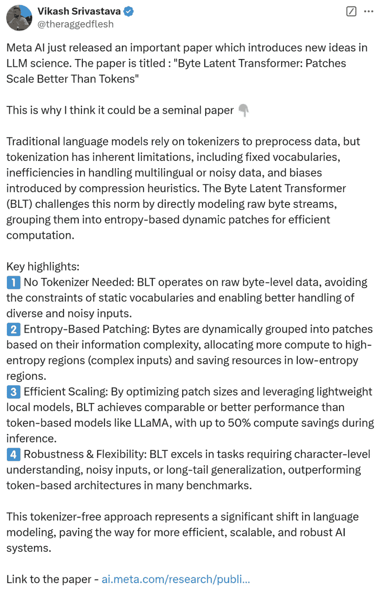

# 信号

### SCBench: A KV Cache-Centric Analysis of Long-Context Methods

贡献人：

https://arxiv.org/abs/2412.10319

本文提出了一个新的基准测试平台SCBench，用于评估长上下文方法在多轮交互和多请求场景中的表现，特别是在共享上下文和KV缓存重用的实际应用中。传统的长上下文方法多集中在单请求基准测试上，而SCBench能够涵盖KV缓存生命周期的完整过程，从KV缓存的生成、压缩、检索到加载，填补了现有评估的空白。长上下文模型（LLMs）在处理长输入时面临计算成本和内存需求的挑战，因此，开发了多种高效的长上下文方法，这些方法通过利用KV缓存中的稀疏性来降低内存和计算开销。

本文首先从KV缓存的四个关键阶段进行分析：1）KV缓存生成，即预填充阶段，提出了稀疏注意力方法以降低注意力操作的复杂性；2）KV缓存压缩，采用剪枝技术减少内存消耗；3）KV缓存检索，通过跳过生成阶段直接从历史缓存中检索来提高推理效率；4）KV缓存加载，通过逐步加载缓存部分来节省内存和计算资源。虽然这些方法在单请求场景下取得了一定成果，但它们未能涵盖多轮交互和多个请求的长上下文应用，尤其是涉及到KV缓存的重用和前缀缓存的问题。

SCBench通过设计12个任务并涵盖四种长上下文能力，提供了全面的评估标准。这四种能力包括：1）字符串检索能力，测评模型从长输入中准确检索相关上下文的能力；2）语义检索能力，评估模型理解长文本语义并进行有效检索的能力；3）全局信息能力，测量模型处理和聚合全局信息的能力，如多次上下文学习、摘要生成和长数组统计；4）多任务能力，测试模型在共享上下文下执行多任务的能力。此外，SCBench还设计了两种共享上下文模式：多轮模式和多请求模式，以便测试长上下文模型如何在不同类型的交互中重用缓存。

通过对13种长上下文方法（包括新提出的Tri-shape稀疏注意力方法）在8个开源LLM上的评估，本文的实验揭示了几个重要发现：1）在多轮解码中，使用次O(n)内存的稀疏解码方法在首轮表现良好，但随后的请求中准确度下降；相比之下，O(n)内存的稀疏编码方法能够在多个查询中接近全注意力的表现；2）任务性能的下降趋势因任务类型而异，稀疏KV缓存方法在需要全局信息的任务中表现更好，而O(n)内存则对精确匹配的检索任务至关重要；3）在压缩率降低时，所有长上下文方法都会出现性能下降，但像RetrievalAttention和KIVI这样保持O(n)内存的稀疏解码方法在高压缩率下仍能维持较高的性能；4）长生成任务面临分布偏移问题，随着生成长度和轮次的增加，KV缓存的重要性分布发生显著变化，导致即便是O(n)内存的方法在扩展任务中也会出现性能下降。

总之，本文的创新贡献在于：提出了一个新的长上下文方法评估基准SCBench，涵盖了多轮和多请求的场景，提供了更具现实意义的评估；设计了一系列下游任务，全面评估长上下文能力；并从KV缓存的视角系统分类和评估了多种长上下文方法，揭示了稀疏性在编码和解码过程中的作用及任务复杂度等方面的重要见解。

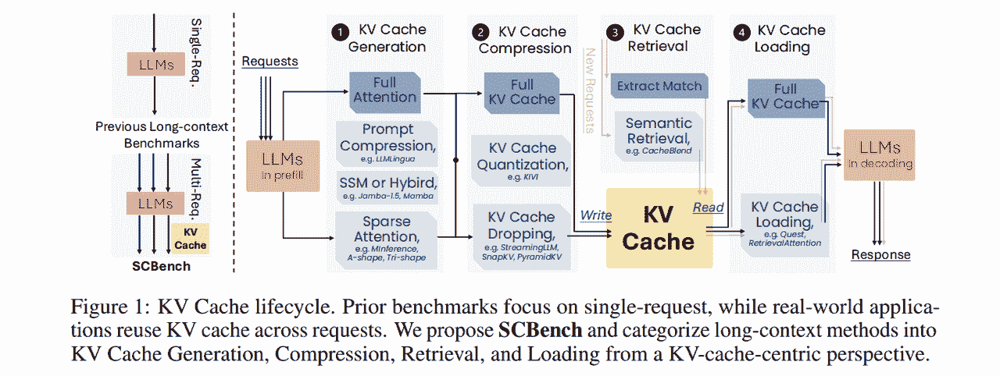

### Magneto: Combining Small and Large Language Models for Schema Matching

贡献人：

https://arxiv.org/abs/2412.08194

随着结构化数据量的快速增长，来自科学文献、公共政府数据门户等多个来源的数据需要进行集成，以回答复杂问题。然而，现有的模式匹配方法（Schema Matching，SM）依然面临显著挑战，尤其是在数据异构性和属性表示差异较大的情况下。例如，生物医学领域中的蛋白基因组学数据集在进行集成时，常因数据源中变量命名和取值的不一致而需要耗费大量人工来进行手动匹配。尽管在此领域已有一些解决方案，但这些方法普遍面临准确性不足、计算资源需求高的问题。

本论文提出了一个新的框架——Magneto，旨在通过结合小型预训练语言模型（SLM）和大型语言模型（LLM）来解决模式匹配中的问题，尤其是在高效性和准确性之间取得平衡。Magneto框架采用了两阶段策略：候选匹配的检索阶段使用SLM，之后通过LLM进行排序优化。该方法不仅减少了高成本LLM的调用频次，还通过一种自动化的过程来生成用于微调SLM的训练数据，从而避免了手动标注数据的高昂成本。

针对LLM模型的上下文窗口限制和计算成本问题，Magneto通过两阶段处理降低了成本和延迟，并通过合适的序列化和采样策略确保了大规模数据集的处理能力。此外，论文还提出了一种基于对比学习的微调管道，通过三元组损失和在线三元组挖掘提高了列嵌入的区分能力，从而提升了模式匹配的效果。

通过在两个数据集基准上进行广泛的实验，Magneto的表现优于现有的模式匹配方法，尤其是在处理生物医学数据集时，能够显著提高匹配的准确性并减少运行时间。Magneto展示了将SLM和LLM结合使用的潜力，尤其在没有事先训练数据的情况下，也能提供高效且准确的解决方案。实验结果表明，Magneto在各种领域的数据集上均表现出色，并且为生物医学领域提供了一个新的、具有挑战性的基准，推动了该领域模式匹配技术的发展。

论文的贡献包括：提出了Magneto框架，结合SLM和LLM提高模式匹配效率；提出了一种基于LLM自动生成训练数据来微调SLM的方法；通过SLM候选检索和LLM重排的结合实现了高准确度和低成本的模式匹配；并通过广泛的实验验证了该方法的有效性。

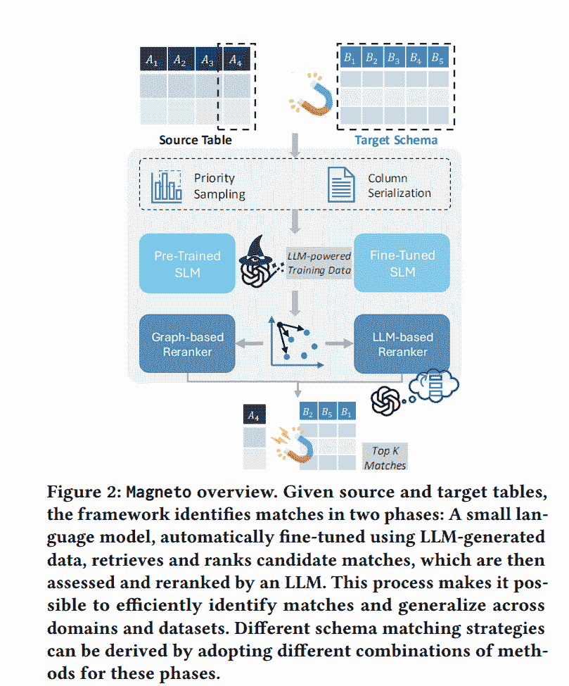

### DeepSeek-VL2: Mixture-of-Experts Vision-Language Models for Advanced Multimodal Understanding

贡献人：

https://arxiv.org/abs/2412.10302

DeepSeek-VL2 是一种先进的大型 Mixture-of-Experts (MoE) 视觉-语言模型，较其前身 DeepSeek-VL 通过两个主要升级显著提升了性能和效率。首先，在视觉组件方面，DeepSeek-VL2 采用了一种动态拼接视觉编码策略，能够处理不同纵横比的高分辨率图像。这种方法避免了 DeepSeek-VL 中固定分辨率编码器的局限性，能够更好地处理具有大分辨率和复杂纵横比的图像，特别是在视觉定位、文档/表格/图表分析和特征提取等任务中表现突出。动态拼接策略通过将高分辨率图像切分为多个局部块，利用共享的视觉转换器处理每个块，并将提取的特征无缝整合到语言模型中，从而保留了视觉转换器在局部注意力上的优势，同时避免了分辨率提升时计算量指数增长的问题。

其次，语言组件采用了 DeepSeekMoE 模型，结合了多头潜在注意力（Multi-head Latent Attention，MLA）机制，该机制通过将 Key-Value 缓存压缩为潜在向量，大大降低了计算成本，提升了推理效率和吞吐量。此外，DeepSeek-VL2 还利用了 MoE 框架中的稀疏计算技术，通过高效的参数激活减少了不必要的计算，从而进一步优化了训练和推理过程的效率。DeepSeek-VL2 模型有三个变种：DeepSeek-VL2-Tiny（10亿激活参数）、DeepSeek-VL2-Small（28亿激活参数）和 DeepSeek-VL2（45亿激活参数），在相似或更少的激活参数下，DeepSeek-VL2 与现有的开源密集型和 MoE 模型相比，表现出了竞争力甚至是领先的性能。

在数据构建方面，DeepSeek-VL2 提升了视觉-语言训练数据的质量、数量和多样性，进一步扩展了模型在视觉问答、光学字符识别、文档/表格/图表理解、视觉推理等任务中的应用能力。此外，新的数据集还使得模型能够处理更复杂的任务，如视觉定位和图形用户界面（GUI）感知。

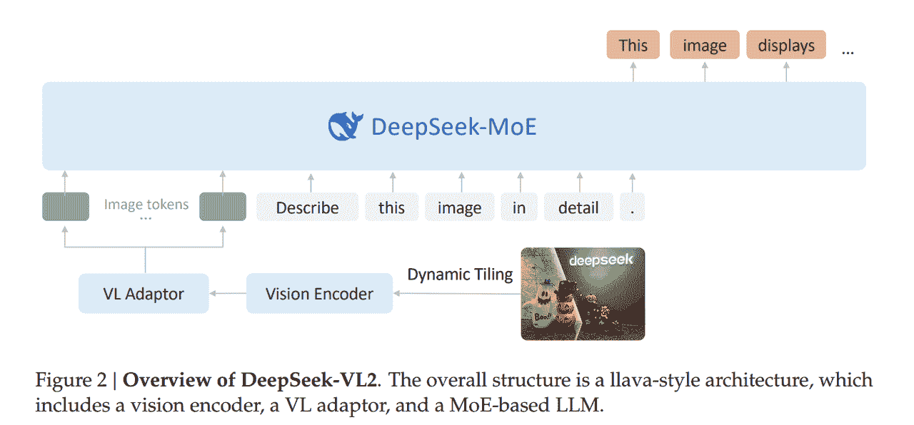

# 产品

### Eden 是一款创新的人工智能驱动社交插件

https://chromewebstore.google.com/detail/witheden-ai-emoji-comment/kkfobcljflnlpbemjicenfkfnplaggkk

贡献人：

Eden 是一款创新的人工智能驱动社交插件，致力于为用户带来全新的互动体验。通过简单地点击表情符号，用户可以在任何网页上即时发表评论，轻松与朋友分享自己的所思所感。无论是嘲笑朋友、点赞网页，还是发表一条简短而有趣的评论，Eden 都能将互动变得简单且充满乐趣。独特之处在于其强大的人工智能功能，它能够迅速总结页面内容，并为用户量身定制合适的评论，让每一次分享都更具价值和个性化。借助 Eden，互联网不再只是信息的海洋，而是用户的社交游乐场，让每个网页都变成一个可以轻松表达和互动的社交空间。

### Draft Alpha 营销团队打造的 AI 写作助手

https://www.draftalpha.com

贡献人：

Draft Alpha 是一款专为营销团队打造的 AI 写作助手，旨在帮助团队高效创作高质量内容，覆盖所有分销渠道。通过先进的人工智能技术，Draft Alpha 能够快速生成高度针对性的内容，确保精准触达目标受众。同时，它帮助团队保持一致的品牌形象，让每一篇内容都与品牌调性完美契合。无论是社交媒体、邮件营销还是广告文案，Draft Alpha 都能大幅提升创作效率，让营销团队轻松实现内容创作的规模化和高效化。

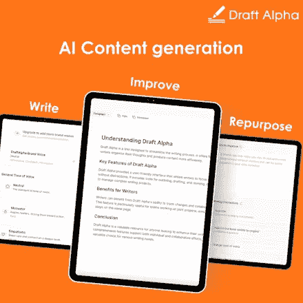

# HuggingFace&Github

### NexusAI：智能协作的未来

https://github.com/EDEAI/NexusAI

贡献人：

重新定义团队协作：

一个融合人类与人工智能能力的开源平台，实现任务自动化、智能决策、全流程可视化，释放无限生产力，推动组织迈向更智能的未来。

🚀核心功能

任务自动化：使用智能代理分解和执行任务，最大限度地减少重复工作。

工作流管理：模块化工作流设计器支持复杂业务场景的多步骤任务流。

实时协作：人类和人工智能代理的无缝集成，以提高团队效率。

全球透明度：仪表板提供对任务进度、资源分配和团队活动的全面监督。

🌟模块化创新

代理定制：轻松创建适合各种用例的多功能代理。

工作流设计：拖放工作流节点以快速实现复杂的逻辑。

知识库支持：集成多种文档格式并自动解析内容以供代理使用。

技能扩展：自定义 Python 脚本，灵活解决特定需求。

# 投融资

### iRobot 联合创始人新家庭机器人创业公司计划筹资 3000 万美元

贡献人：

https://techcrunch.com/2024/12/16/irobot-co-founders-new-home-robot-startup-hopes-to-raise-30m/

iRobot 联合创始人科林·安格尔（Colin Angle）正为其新成立的家庭机器人公司 Familiar Machines 融资。据美国证券交易委员会的文件显示，该公司计划筹集 3000 万美元，目前已经从八位投资者那里筹集到 1500 万美元。文件中并未公开投资者的名字，但 Data Point Capital 在其官网上列出了 Familiar Machines 作为其投资组合公司。

Familiar Machines 目前拥有域名和商标申请，但尚未建立正式网站。安格尔在接受《波士顿环球报》采访时表示，Familiar Machines 计划开发一种专注于健康和养生的新型家庭机器人。除了安格尔之外，公司的联合创始人还包括前 iRobot 首席技术官克里斯·琼斯（Chris Jones）和前 iRobot 员工艾拉·伦弗鲁（Ira Renfrew）。伦弗鲁曾参与创建亚马逊已经停产的送货机器人 Scout。

据《波士顿环球报》报道，Familiar Machines 正在探索将机器人作为伴侣的概念，可能包括 AI 驱动的“毛茸茸宠物”。该公司正在招聘 AI 研究员、软件工程师等职位。公司的一则招聘信息写道：“我们正在开创一个全新的家庭机器人类别，专注于健康和养生，并重点关注人类与机器人之间的互动。”此外，体现与代理智能（embodied and agentic AI）是其产品愿景的核心。

安格尔在 2024 年 1 月辞去了 iRobot CEO 职位，此前亚马逊收购 iRobot 的交易因欧盟反垄断监管的反对而未能达成。iRobot 随后裁员 31%，并聘请前宝洁公司高管加里·科恩（Gary Cohen）为新 CEO。

尽管家庭机器人市场竞争激烈且面临诸多挑战，如 2018 年波士公司支持的 Mayfield Robotics 停产其 Kuri 机器人，以及 2019 年 Anki 公司关闭，但科技巨头们并未放弃这一领域。亚马逊继续推动其 Astro 家庭机器人，苹果也据报道正在研发家庭机器人技术。

公司官网：https://familiarmachines.com/

### AI金融平台Bridgewise获数千万美元战略投资

贡献人：

https://36kr.com/p/3081352698263942

全球金融AI投资顾问公司Bridgewise近日宣布完成数千万美元的战略融资，本轮融资由SIX集团、Group 11和L4 Venture Builder等战略投资者主导。融资资金将主要用于AI平台的研发和全球市场扩张。Bridgewise成立于2019年，全球办公室分布在特拉维夫、纽约、新加坡和圣保罗，致力于为投资者提供全球证券分析服务，通过AI技术分析超过90%的全球上市证券数据，为客户提供证券表现评分、基金股票分析和多语言投资建议。

Bridgewise的平台主要包含三个核心产品：EquityWise、FundWise和Bridget™。EquityWise整合全球90%以上的股票信息，通过AI生成投资报告并提供基于数据的推荐；FundWise专注于全球12,000支基金的分析，帮助投资者深入了解基金表现，并符合严格的监管要求；Bridget™则是一款对话式AI，能够为投资者提供全球50,000多只证券的推荐，并根据机构需求定制服务，满足更高的合规要求。

Bridgewise采用订阅制收入模式，支持25种语言，解决方案已在15个国家应用，并为包括日本交易所、纳斯达克、伦敦证券交易所等在内的50多个机构客户提供服务。公司计划通过根据亚太市场需求调整产品和服务，在香港、印度、日本和新加坡等地扩大市场份额。

该平台的核心技术基于机器学习算法和自主研发的微语言模型（Micro Language Model, MLM），能为每只证券生成易于理解的报告，并支持多种语言，进一步推动全球投资者做出更明智的决策。

公司官网：https://www.hellobrigit.com/

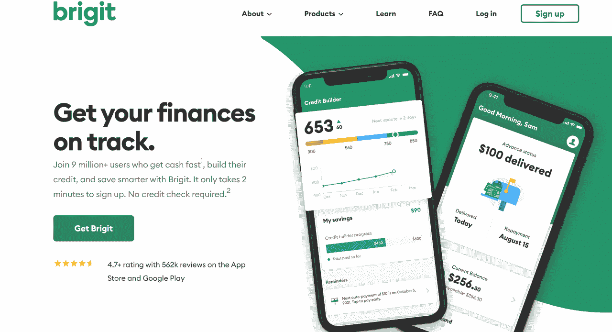

### 北极雄芯获西安财金与沃格光电投资，加速芯粒研发

贡献人：

https://mp.weixin.qq.com/s/xA29BKACVpGOufwTL3nD8w

近日，北极雄芯宣布获得西安财金和沃格光电的投资。本轮融资将为公司下一代功能型Chiplet的设计、研发及测试提供资金支持，帮助其继续构建以“启明935”通用型芯粒为核心的芯粒产品库。北极雄芯的核心团队深耕Chiplet领域多年，已在国内率先发布基于Chiplet架构的“启明930”芯片，并成功完成国产封装供应链的工艺验证。2024年，公司推出支持多种计算精度的ZeusNPU模块，广泛适用于智能驾驶、具身智能等边缘侧及端侧AI推理应用。

此外，北极雄芯的“启明935”通用型HUBChiplet和“大熊星座”AIChiplet已成功流片，并在2024年取得SGS-TUV和中汽研境内外ISO-26262ASIL-B车规级双认证，成为国内首个获得车规级认证的Chiplet产品。随着更多芯粒产品的推出，北极雄芯在芯粒产品库建设上占据先发优势，未来将推出更多不同工艺的芯粒互联接口和功能型芯粒。

西安财金，作为西安市财政局全额出资的国有金融机构，通过龙门成长直投基金和西安人才基金共同投资北极雄芯，支持其科技成果转化，并助力高端芯片国产化。西安财金认为，北极雄芯的Chiplet方案能有效降低芯片定制化开发难度，具有较高的灵活性和成本优势，为国内半导体产业链发展做出重要贡献。

沃格光电，作为一家上市的新材料科技企业，旗下的湖北通格微电路科技有限公司专注于玻璃基板设计和研发。沃格光电表示，看好北极雄芯在Chiplet技术方面的能力，未来将与其展开合作，推动玻璃基材料在Chiplet芯片封装等领域的商用化，促进新一代IC半导体、玻璃基AI计算芯片封装、车载计算芯片封装等技术的发展。

公司官网：https://www.bjxxtech.net/

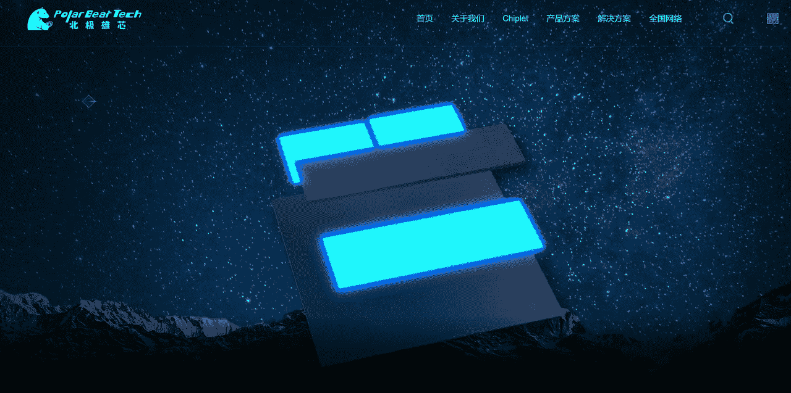

# 学习

### 「七万字长文」从认知架构到实践部署：o1与o1 Pro的系统性分析与内涵洞察 · 下篇

贡献人：

https://mp.weixin.qq.com/s/mPZr9h3Mwcpb-hbapEdWzg

1.  **O1模型架构**：

+   O1模型在推理阶段采用了思维链（Chain of Thought, CoT）的方法，将推理过程分解为多个离散的步骤，并能够规划其推理步骤，评估中间结果，并在步骤出错或陷入僵局时进行回溯。

1.  **O1 Pro模型架构**：

+   O1 Pro采用了自洽性机制与多数投票方法，在推理过程中通过回溯和自我纠正机制，适应复杂问题的需求。

1.  RFT（Reinforcement Fine-Tuning）定义：

+   RFT是一种结合了强化学习的模型微调技术，通过奖励信号和惩罚信号逐步优化模型的推理能力。

1.  **外部模块集成原则**：

+   包括需求驱动、模块间互操作性、动态适配、科学验证与反馈、以开源为优先等。

1.  **不同模块适配特性**：

+   O1适合处理简单任务，强调轻量化和功能单一化；O1 Pro则支持复杂任务，强调多模态协同和深层推理。

1.  **O1模型应用**：

+   O1模型在国际数学奥林匹克预选赛测试中，正确率高达83%，编程能力测试中正确率从11%跃升至89%，展现了其在逻辑和认知理解方面的强大能力。

1.  **O1 Pro模型应用**：

+   O1 Pro在国际数学奥林匹克预选赛 (AIME2024) 中，其正确率达到了86%，明显高于常规版本的78%。

1.  **Scaling Laws**：

+   Scaling Laws揭示了模型性能提升与算力、数据、复杂性之间的内在关系，当前的Scaling Laws路径面临显著的技术挑战，包括计算资源的瓶颈、数据熵的限制，以及推理复杂性难以突破的瓶颈。

1.  **CoT（显式思维链）**：

+   CoT通过将复杂任务分解为多个中间步骤，使推理过程更加清晰透明，提高复杂任务的完成率，并提升推理复杂性。

1.  **LAMIS（LoveAlign Multimodal **Intelligence System）：

+   LAMIS旨在实现人类心智的深度对齐，通过信念状态与量子信念状态，模型在内在层面形成自洽的价值核，使其在复杂社会情境中自然倾向与人类核心价值共鸣。

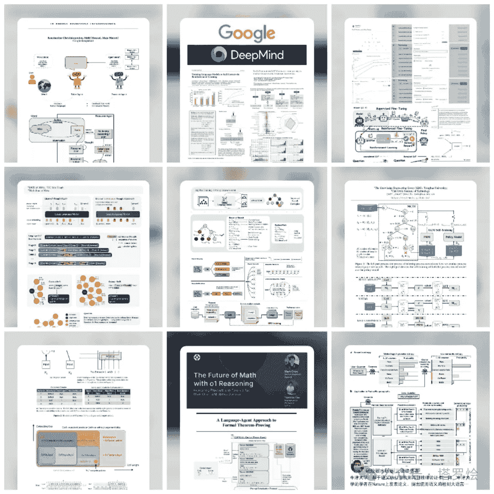

### 优化大语言模型处理数字的方式

贡献人：

https://huggingface.co/spaces/huggingface/number-tokenization-blog

在自然语言处理中，数字的表示与标记化是一个关键问题，尤其是在应用于大规模预训练语言模型时。传统的文本处理方法通常在标记化时对数字进行简单的分割，但这种方法对数字的语义理解力有限。本文探讨了数字标记化在自然语言处理中的新进展，并展示了Hugging Face提供的数字标记化方法如何提升大语言模型在处理数字时的表现。

1.  **数字的标记化挑战**
数字在自然语言文本中通常需要进行专门的处理。传统的标记化方法对于简单的数字能够有效拆解，但在处理包含大量不同格式数字的文本（例如货币、日期、百分比等）时，会导致信息丢失或理解误差。

1.  Hugging Face 的数字标记化工具
Hugging Face提供的数字标记化工具针对上述问题提出了解决方案。它通过采用更细粒度的数字表示方式，如将不同类型的数字（例如小数、指数等）转换为特定的标记，从而提升语言模型对数字的理解能力。这种方法通过保持数字的格式和语境，避免了数字转换带来的潜在误解。

1.  **数字转换为特定标记**
该工具通过将数字转换成专门的标记来处理各种数字的类型，如“百万”、“千”等，确保这些标记能够被语言模型准确理解和生成。这种方法使得模型能够更好地理解数字的具体含义，避免了常规文本标记化中的“丢失信息”现象。

1.  **增强模型在多模态数据中的表现**
在多模态数据中，数字不仅仅作为文本的一部分存在，往往涉及到图像、表格等多种形式。通过优化数字标记化，模型能够更好地在这些复杂数据中进行交互和推理，提升了整体的模型表现。

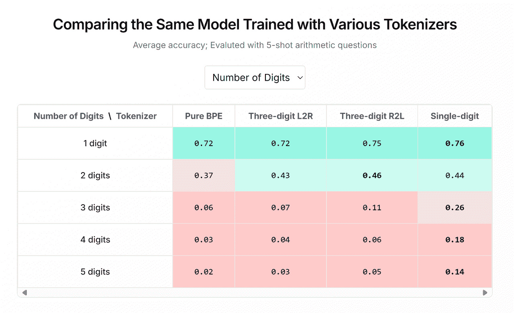

### 2024年热门机器学习论文：社区讨论与推荐

贡献人：

https://www.reddit.com/r/MachineLearning/comments/1hfljy3/d_whats_your_favorite_paper_youve_read_this_year/

在2024年，机器学习领域涌现出许多影响力较大的论文。Reddit的r/MachineLearning社区在讨论中推荐了几篇备受关注的研究，主要集中在以下几个技术亮点：

1.  “Golden Gate Neuron”研究
这篇研究对大规模神经网络中的“Golden Gate Neuron”进行了探索，提出了这一特定神经元在网络中的作用和重要性。尽管该论文并非所有人都感兴趣，但它被认为是近几年最酷的发现之一，特别是在深度学习模型的神经元分析方面。

1.  **变换器在时间序列预测中的应用**
另一篇被广泛讨论的论文是《变换器是否有效用于时间序列预测？》，该研究表明，仅一个简单的前馈网络在时间序列预测中就能超越所有基于变换器的复杂模型。这种研究反映了简单方法的高效性，挑战了复杂模型的主流观点，强调了“简单即有效”的理论。

1.  Segment Anything与自然语言处理的结合
Segment Anything的论文也在讨论中获得了高度评价，尤其是在计算机视觉领域，展示了如何将NLP技术融入图像分割任务。这一突破性进展让人们对未来Promptable模型的发展充满期待。

1.  **LLM推理的限制**
另外，一篇关于大型语言模型（LLM）推理限制的论文引发了不少讨论。虽然这篇论文提出了数据泄漏等问题，但也遭遇了一些批评，认为其结果和结论过于宽泛，未能提供更具深度的实证支持。

### 为什么某些 batch size 会突然导致性能下降？

贡献人：

https://zhuanlan.zhihu.com/p/12895160842

在现代深度学习系统中，批处理（batching）是提升性能的关键技术之一。批处理可以在推理过程中同时处理多个输入，而不是一个一个地处理。尽管直觉上，批量处理数据似乎应该消耗更多资源，因为工作量增加了 N 倍，但实际情况却不同。特别是在现代 GPU 上，批处理的性能提升通常是线性的，且不会显著增加计算时间。在 T4 GPU 上观察到，当 batch size 从 1 增加到 3 时，推理时间几乎不变，超过 3 后，时间才开始线性增长。这是因为 GPU 有较强的并行计算能力，能够同时处理多个任务，尽管单线程时其计算速度比 CPU 慢。

GPU 采用大量矩阵运算来加速计算，推理过程中每个矩阵块都会被加载到设备的共享内存，而非更大的 GPU RAM。现代 GPU 如 A100 具有高达 40GB 的内存带宽，但共享内存却非常有限。这意味着内存带宽成为性能的瓶颈，因为数据需要频繁在内存中传输。可以通过将模型的 FLOPS 与内存带宽的比值来预测性能瓶颈。当 batch size 小于该比值时，内存带宽成为瓶颈；当 batch size 超过比值时，计算能力（FLOPS）成为瓶颈。这种现象在多层感知机（MLP）模型中尤为明显，尽管卷积神经网络（CNN）则表现出不同的行为，因为卷积操作中权重共享机制限制了批处理的优势。

T4 GPU 具有 65 TFLOPS 的浮点运算能力和 300 GB/s 的内存带宽，因此理想的计算效率比应该是 216。实际测试表明，当批量大小接近这一理论阈值时，推理时间会急剧增加，尤其在模型的层数或宽度增加时，批处理对推理时间的影响变得更加明显。尽管系统开销会对性能造成一定影响，但总体趋势是随着批量大小的增加，推理时间在达到某个临界值后显著增加。

对于不同的网络架构，批处理的优势也不尽相同。在卷积神经网络中，池化层的计算量与图像的像素数量呈线性关系，而卷积层的计算量则取决于滤波器数量和尺寸，因此批处理的优势不如 MLP 显著。而在 Transformer 模型中，虽然模型本质上是多层感知机（MLP），但注意力机制的引入使得推理时可以利用 KV 缓存，从而减少了计算时间。在混合专家模型（MoE）中，KV 缓存和路由机制共同优化了推理过程，但如果数据批次分配不均，可能会导致门控机制的不均衡分配，从而影响性能。

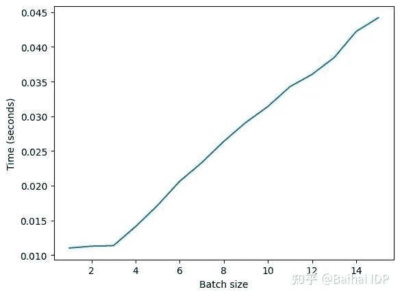

# 声明

本文档仅供学习交流使用，版权归原作者所有，若涉侵权，请联系Jack Jin 15101136166

##

（欢迎在下方反馈您宝贵的意见！整理不易，觉得有用给AI日报小组点个赞👍吧！）

ChatGPT；Angela；Zijia Liu；Alex；Zeqi Tan；Tiezhen（HuggingFace）；Naixu；Lizhi；Peter；Suoman；Jack

学术分析报告：ResearchFlow -- 奇绩F23校友的开发的深度研究产品，PC端进入RFlow的分析报告，可直接点击节点右侧的小数字展开节点，登录后可在节点上直接“询问AI”，进一步探索深度信息

如果你有大模型相关的创业想法，欢迎来找我们聊聊～🛰️：15101136166

> 快邀请你的小伙伴们一起来读大模型日报吧！

> **【日报****知识库****】**这里是近期日报内容的汇总,欢迎大家查阅

> [大模型日报知识库(分享版)](https://miracleplus.feishu.cn/wiki/KapVwXfkriOBiskB0B2cUHxjnTh)

>

> 欢迎大家多多帮我们分享,转发~~

> 如果大家有任何的建议或者吐槽,欢迎随时找我聊天~

