# 奇绩大模型日报（12月 18日）

> 来源：[https://miracleplus.feishu.cn/docx/MNDCdsBv4osz7jxP16icnRnnn8p](https://miracleplus.feishu.cn/docx/MNDCdsBv4osz7jxP16icnRnnn8p)

# 🔉潜**空间系列活动重磅回归！**

> 本期活动将在**12月22日** **11:00**开始，我们邀请到的嘉宾是**季宇。**清华大学计算机科学与技术系博士，曾在华为担任海思昇腾芯片编译器专家，负责多个昇腾编译器项目，并在AI编译器领域和处理器微架构领域进行挑战性问题攻关。他于2023年8月创立了行云，该公司致力于研发下一代针对大模型推理场景的高效能GPU芯片，并在2024年连续完成总额数亿元的天使轮及天使+轮融资。季宇的主要研究领域包括神经网络加速器、编译器和面向系统优化的机器学习。他将带来《谁困住了AI产业——大型机化的计算机形态与变革的可能性》的分享。

> 除嘉宾分享外，每期设置了【匹配合伙人 Cofounder Matching】环节。你可以和 GenAI 时代最有活力的创业者和研究者线下面对面交流，将有机会找到志同道合、有共同创业梦想的小伙伴。

> 报名通道已开启，欢迎扫描下方二维码报名。

# 资讯

### 谷歌逆风翻盘暴击OpenAI，90天王者归来！44页报告押注25年三大技术前沿

贡献人：

https://mp.weixin.qq.com/s/b0yqPre6wMlP59cH6Qrbdw

在过去的90天里，谷歌实现了从被看作行业笑柄到科技巨头的逆袭，成为突破性产品和最大创新的领军者。特别是其AI产品——Google Gemini系列，迅速获得开发者的青睐，从9月的5%市场份额暴增至50%以上，成为行业领导者。谷歌的Project Mariner、Project Astra等项目也在推动人机交互的未来，展示了强大的AI任务处理能力。特别是在智能体领域，谷歌展现出前所未有的突破，Project Mariner允许Gemini控制浏览器完成任务，极大提升了AI助手的实用性和自主性。

此番逆袭源于谷歌在多个领域的持续创新。例如，AI视频模型Veo 2.0在物理学和指令遵循上远超竞争对手Sora，市值也因此上涨了14%。谷歌不再依赖炒作，而是专注于提升产品的实际能力，成为OpenAI强有力的对手。尤其是在模型性能上，Gemini 2.0 Flash和Veo 2.0的推出，一举超越了GPT-4，展示出惊人的技术优势。

谷歌的反击不仅仅局限于技术产品，报告显示2025年三大主导技术将集中于AI智能体、多模态AI和企业搜索。尤其是智能体的应用前景广阔，预计将在未来几年内催生出巨大的市场机遇。谷歌在多个领域的创新布局，也将加速智能体和多模态AI的发展。例如，通过整合不同类型的智能体，企业能够更高效地完成复杂的任务，推动行业的变革。

此外，谷歌还推出了结合Gemini 2.0的编程助手，Gemini Code Assist，进一步推动了AI在软件开发中的应用。企业级编程工具的推出，整合了GitHub、GitLab等外部系统，大大提升了开发者的工作效率。预计到2028年，90%的企业软件工程师将使用AI编程助手，这将是GenAI的首批重要用例。

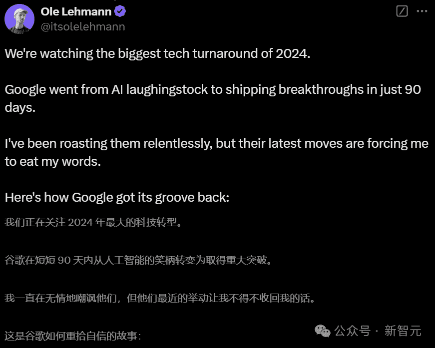

### Cohere与Palantir合作推出AI模型

贡献人：

https://techcrunch.com/2024/12/16/cohere-is-quietly-working-with-palantir-to-deploy-its-ai-models/

Cohere是一家加拿大AI初创公司，其估值在2024年7月达到55亿美元。该公司由《Attention Is All You Need》一文的作者共同创立，这篇文章推动了大规模语言模型（LLM）革命。Cohere专注于为企业客户提供AI解决方案，而不是面向消费市场。

虽然Anthropic公司最近因与Palantir和AWS达成协议而备受关注，但TechCrunch了解到，Palantir也与Cohere建立了合作关系。Cohere的AI模型已在多个未公开的Palantir客户中投入使用。这一消息在Palantir的2024年11月DevCon1开发者大会上由Cohere工程师兼前Palantir员工Billy Trend透露。视频中，Trend提到Cohere正通过Palantir的Foundry平台向商业客户提供其AI技术。尽管未透露具体客户名称，但他强调了与一家具有严格数据存储要求且需要阿拉伯语推理功能的客户合作的实例。

Cohere与Palantir的合作表明，Cohere的AI模型已开始在多个大企业中应用，而Palantir的Foundry平台主要服务商业客户。尽管Cohere与Palantir的合作较为低调，但这一伙伴关系在AI技术的应用上展现了重要潜力，尤其是在满足特定地区和语言需求方面。

值得注意的是，Cohere并未对是否参与军事或情报相关的应用发表评论，而Palantir的客户包括大型企业和美国国防及情报机构。

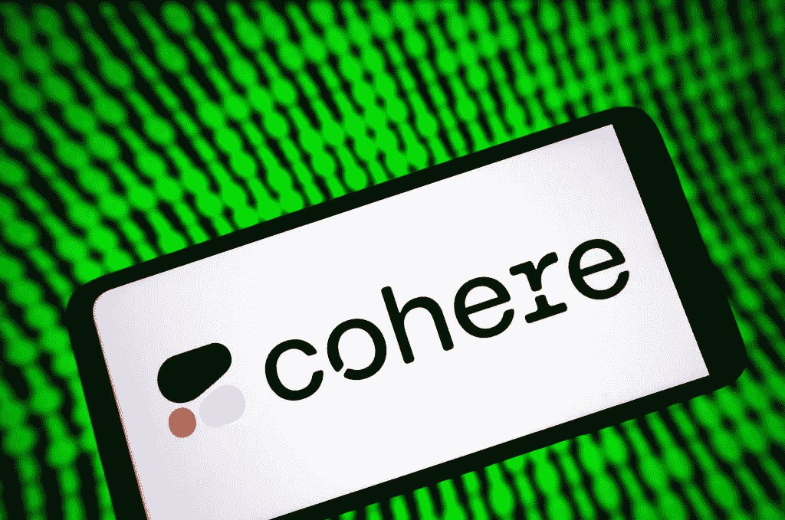

### FACTS Grounding：评估大型语言模型事实性的新基准

贡献人：

https://deepmind.google/discover/blog/facts-grounding-a-new-benchmark-for-evaluating-the-factuality-of-large-language-models/

DeepMind最近推出了“FACTS Grounding”基准，这是一个专门评估大型语言模型（LLM）生成的回答是否准确、与提供的文档内容紧密相关且没有幻觉的全新工具。该基准的推出，旨在提高LLM在真实世界应用中的可靠性，解决当前模型在处理复杂输入时可能产生虚假信息（即“幻觉”）的问题。

1.  FACTS Grounding数据集：该数据集包含1719个例子，每个例子都要求模型生成与给定文档高度关联的长篇回答。数据集包括公共集和私人集，其中公共集对外开放，以便所有研究者可以使用它来评估LLM的表现。

1.  **多领域覆盖**：数据集中的文档涉及多个领域，如金融、技术、零售、医学和法律等，确保输入的多样性。同时，任务包括总结、问答生成和重写等多种类型的用户请求。

1.  **自动化评估与判断模型**：评估使用了多个领先的LLM判断模型（如Gemini 1.5 Pro、GPT-4o和Claude 3.5 Sonnet），避免了单一模型的偏差。这些模型首先评估回答是否符合用户请求，并根据回答是否完全基于提供文档来判断其准确性。

1.  **在线排行榜**：DeepMind还推出了FACTS排行榜，展示了各大LLM在基准测试中的表现，用户可以通过Kaggle查看当前排名。此排行榜会随着领域进展持续更新。

1.  **持续进化**：DeepMind明确表示，FACTS Grounding基准将持续发展，并随着LLM技术进步不断提升要求。该基准的推出是为了推动业界对事实性和信息基础的研究，期望对改进LLM的可靠性发挥重要作用。

+   **新基准的推出**：FACTS Grounding为评估LLM的事实性和信息关联提供了全新的框架，有助于提升模型的可靠性和可用性。

+   **数据集与任务多样性**：数据集覆盖多个领域，并针对不同任务（如总结、问答等）进行测试，确保模型能够在多种场景中表现出色。

+   **自动化与多模型评估**：通过自动化评估和多模型判断，FACTS Grounding能更公正、全面地衡量LLM的表现。

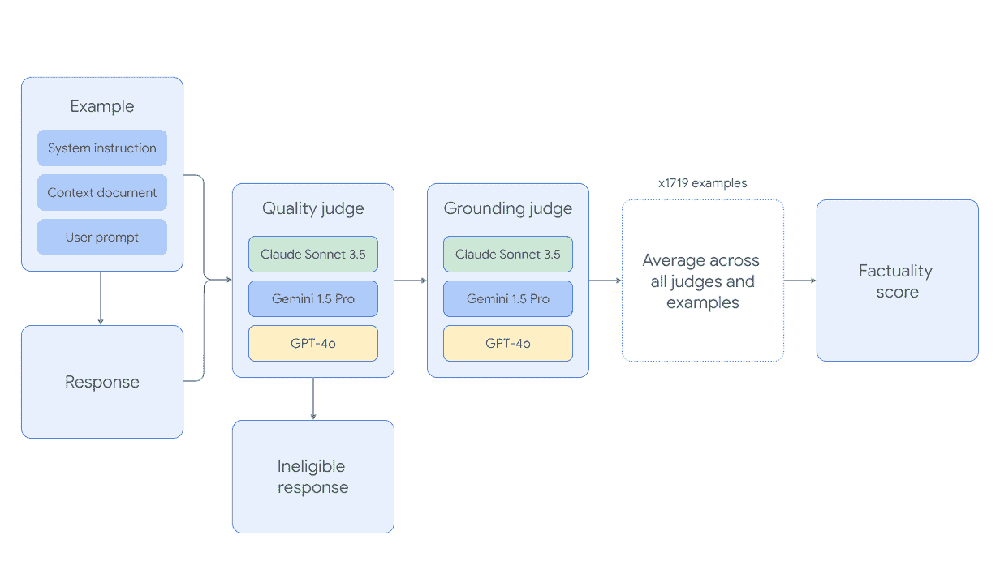

### OmniAudio-2.6B：全球最快的边缘音频语言模型

贡献人：

https://nexa.ai/blogs/omniaudio-2.6b

Nexa AI发布了OmniAudio-2.6B，这是目前全球最快且最高效的音频语言模型，专为边缘设备部署而设计。该模型集成了Gemma-2-2B、Whisper turbo以及自定义投影模块，能够高效处理文本和音频输入。OmniAudio-2.6B的架构不同于传统的自动语音识别（ASR）和大型语言模型（LLM）串联方法，它将这两种能力整合在一个统一的高效架构中，减少延迟并降低资源消耗。

在2024款Mac Mini M4 Pro上，OmniAudio-2.6B通过Nexa SDK在FP16 GGUF版本中达到35.23 tokens/秒，在Q4_K_M量化版本中更是能达到66 tokens/秒，相比之下，Qwen2-Audio-7B-Instruct在同一设备上通过🤗 Transformers仅能解码6.38 tokens/秒，性能提升达5.5至10.3倍。

主要应用场景：

1.  **语音问答**：例如，“如何不用火种点燃火焰？”

1.  **语音对话**：例如，“今天工作很辛苦。”

1.  **创意内容生成**：例如，“写一首关于秋天落叶的俳句。”

1.  **会议总结**：例如，“能否总结一下这次会议的内容？”

1.  **语气转换**：例如，“能不能让这段话听起来更随意一些？”

模型架构与训练方法

OmniAudio-2.6B的架构结合了Gemma-2-2B文本处理能力与Whisper turbo音频解码技术。为了有效融合音频与文本，使用了投影模块将Whisper生成的音频标记映射为与Gemma文本嵌入空间维度对齐的序列。此外，OmniAudio-2.6B的训练过程经过了三个阶段：

+   **预训练**：使用MLS英语10K转录数据集进行音频与文本对齐。

+   **监督微调（SFT）**：基于同一数据集进行指令微调，生成更丰富的音频-文本对。

+   **直接偏好优化（DPO）**：通过GPT-4o API评估初始模型输出，确保模型生成的结果符合预期。

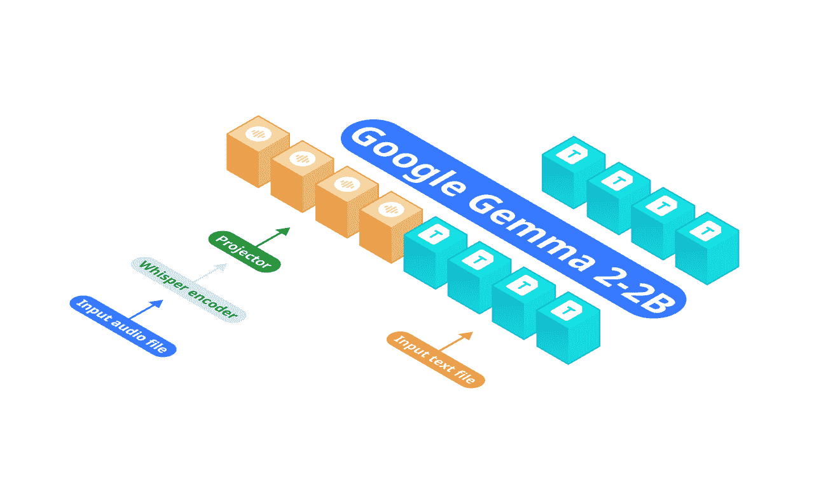

### Sakana AI推出革新记忆系统

贡献人：

https://sakana.ai/namm/

Sakana AI近期发布了一项重要的研究突破——“进化型通用Transformer记忆系统”（Evolved Universal Transformer Memory），该研究获得了日本经济产业省（METI）GENIAC超级计算资助的支持。通过这一创新，Sakana AI旨在提高现有预训练Transformer模型的效率和性能，尤其在长时间序列任务中，充分展现了基于人类记忆机制的“记忆删除”与“记忆保留”功能。

Transformer模型广泛应用于深度学习，尤其是语言模型（LMs），但其传统架构存在一个问题，即对所有输入数据进行无差别存储，导致在长任务中记忆资源消耗过大，性能下降。Sakana AI提出的Neural Attention Memory Models（NAMMs）模型，通过引入神经网络分类器，智能地决定哪些信息需要保留，哪些需要遗忘，从而极大提高了计算效率与模型表现。

NAMMs的核心优势在于：

1.  **智能记忆系统**：通过动态管理记忆，Transformer可以在长时间序列任务中更专注于最相关的信息，避免冗余数据的干扰。

1.  **跨领域适用性**：NAMMs不仅能应用于语言模型，还能无须额外训练，直接迁移到计算机视觉、强化学习等其他领域。

1.  **无训练迁移能力**：NAMMs能在不同的Transformer模型之间进行零-shot迁移，即无需重新训练即可优化新模型的性能。

该研究展示了NAMMs在Llama 3 8b基础模型上的应用，通过LongBench、InfiniteBench和ChouBun等基准测试，证明其在处理长文本时表现优异，显著提升了Transformer模型在语言理解和编程任务中的效率与性能。

此外，Sakana AI的这项突破性研究还分享了其训练代码，并发布了新的基准测试集——ChouBun，专门评估日语长内容的处理能力，填补了现有基准测试中的空白。

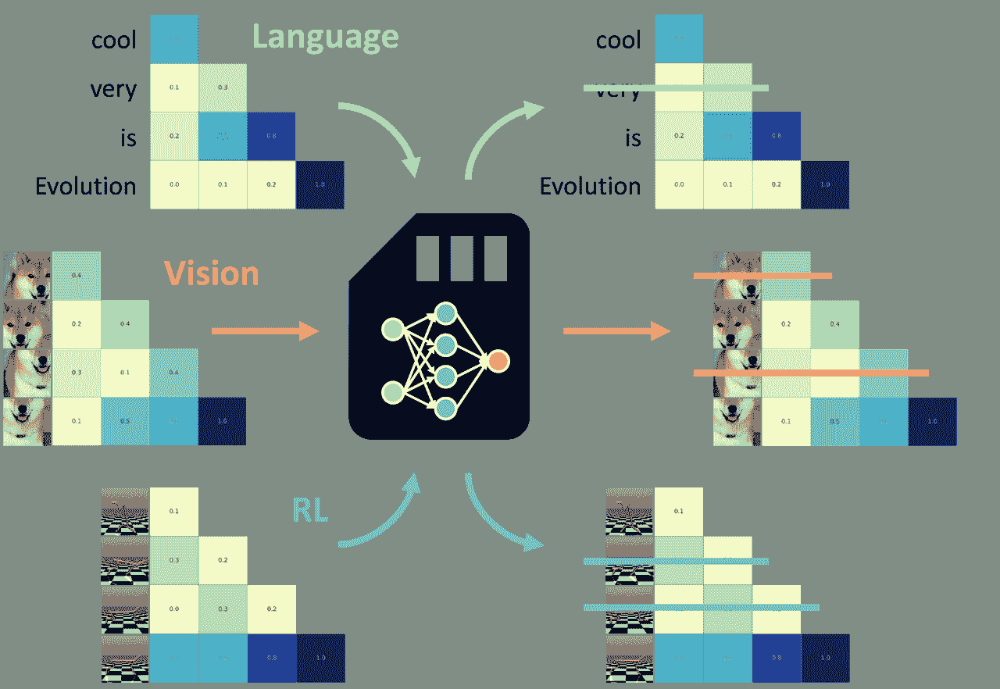

### 传感器，赋予机器人感知世界的能力

贡献人：

https://mp.weixin.qq.com/s/0Qd4SD1InEchPMo6L3XJcA

视觉传感器是具身智能传感器市场弹性最大的一类传感器。双目摄像头提供色彩和深度信息，激光雷达提供精细的环境建模，毫米波雷达能够全天候运行，红外传感器可适应暗光环境。我们认为，不同传感器分别补足了视觉感知不同维度的能力，多传感器融合趋势明晰。同时，为了提高感知能力，单一传感器的单机搭载量亦呈提升之势。考虑摄像头、激光雷达、毫米波雷达、超声波雷达与红外传感器，我们测算至2030年视觉传感器市场空间有望达23.5亿元。视觉传感器中摄像头占比最大，我们认为具身智能放量有望为摄像头厂商带来业绩增量，进而带动图像传感器、光学部件、模组封装等产业链环节共同发展。

力传感器是具身智能传感器市场最大的组成部分。90度深蹲、加减速行走等灵活动作的实现，有赖于力传感器的支持。特斯拉Optimus除灵巧手外，全身28个执行器均配备一个力/力矩传感器，单机搭载量较多。尤其是手、足等多维感知需求较大的部位，更是搭载了价值量更大的六维力传感器，整体力传感器的成本占比较高。我们测算至2030年力传感器市场空间有望达47.9亿元。力传感器中的应变片与弹性体考验厂商的长期经验积累，壁垒高筑，当前市场由外资品牌占据主导地位。但我们观察到国产品牌出货份额亦在逐步扩大，建议关注技术实力较强的国内厂商。

此外，听觉、触觉、编码器、惯导IMU等传感器亦在具身智能环境交互、灵活运动、姿态平衡等方面发挥着重要作用，我们认为有望伴随具身智能出货量的增长实现快速扩容。

**风险**

具身智能商业化不及预期，传感器技术迭代不及预期，成本下降不及预期。

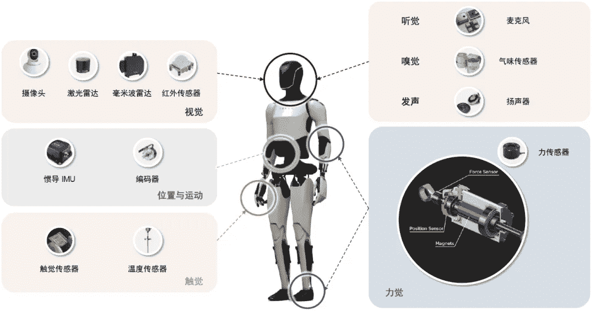

# 推特

### OpenAI：Realtime API 现在支持 WebRTC——你只需几行代码，就能添加实时功能

https://x.com/OpenAIDevs/status/1869116812551692778

就是这样，这条推文完了。Realtime API 现在支持 WebRTC——你只需几行代码，就能添加实时功能。

我们还将价格降低了 60%，引入了 GPT-4o mini（价格是之前的十分之一），提高了语音质量，并使输入更加可靠。

[LnWszN3PLgUQrwHB.mp4](https://internal-api-drive-stream.feishu.cn/space/api/box/stream/download/all/PHu2bmA1coeaZPxmJrkc095EnUb)

### Curtis分享：只用自然语言，用bolt搭建完整的 3D 编辑器

https://x.com/XRarchitect/status/1869074516770714024

我在刚过去的周末用 http://bolt.new 搭建了一个完整的 3D 编辑器 —— 只用自然语言 🤯

它由 React、Three.js 和 Rapier 物理引擎驱动。

http://thebrowserlab.com

我相信 AI 很快就能让我们在想到工具的那一刻，就能创造出我们所需要的工具。

展开线程 👇

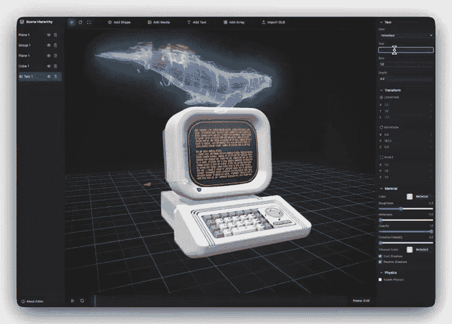

[xpL4jkp7eK4QPlvu.mp4](https://internal-api-drive-stream.feishu.cn/space/api/box/stream/download/all/KgUObZ5QLoDnjQxds6AcNjYsn4d)

### CrewAI分享：投入生产的多智能体 AI ，一项跨洲际和不同公司规模的客户调研。

https://x.com/joaomdmoura/status/1869054872232108054

投入生产的多智能体 AI

一项跨洲际和不同公司规模的客户调研。

了解企业如何构建高精度应用场景、团队推进速度有多快，以及他们使用哪些大型语言模型 (LLM)。

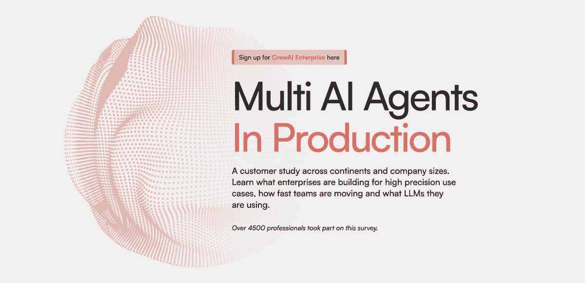

###  CerebrasCoder：使用 Llama3.3-70b 模型生成网站，速度快到跟你打字一样快

https://x.com/stevekrouse/status/1869029269646835716

介绍 **CerebrasCoder**！

一款开源应用，使用 **Llama3.3-70b** 模型生成网站，来自 @CerebrasSystems，速度快到跟你打字一样快。

100% 免费且开源。

http://cerebrascoder.com

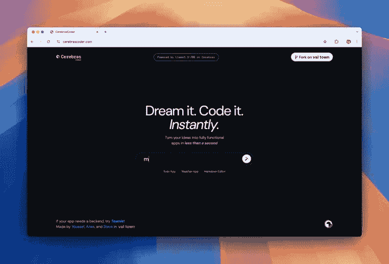

[aCbsPhbOAnEK0169.mp4](https://internal-api-drive-stream.feishu.cn/space/api/box/stream/download/all/BDo1b9RE1o6kxVx6VeWcKPg8nfe)

# 信号

### Expressive Whole-Body Control for Humanoid Robots

https://exbody2.github.io/resources/exbody2.pdf

ResearchFlow 链接：https://rflow.ai/flow/48852e06-2782-4877-bbc7-e0dd46231962

本文使现实世界的人形机器人能够在像人类一样执行富有表现力的动作时保持稳定性。本文提出了高级富有表现力的全身控制 (ExBody2)，这是一个通用的全身跟踪框架，可以接受任何参考动作输入并控制人形机器人模仿动作。该模型在模拟中使用强化学习进行训练，然后转移到现实世界。它将关键点跟踪与速度控制分离，并有效地利用特权教师策略将精确的模仿技能提炼到目标学生策略中，从而实现对跑步、蹲伏、跳舞和其他具有挑战性的动作等动态动作的高保真复制。本文在论文中对关键设计因素进行了全面的定性和定量分析。在两个人形平台上进行了实验，并证明了的方法相对于最先进技术的优越性。

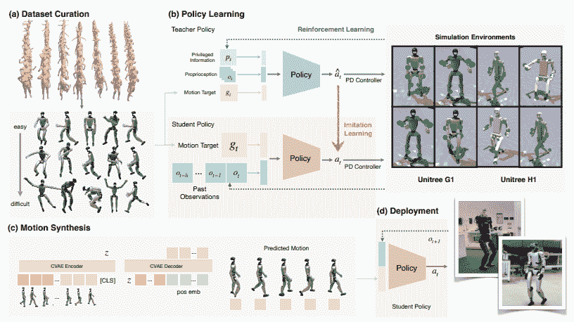

### Evaluation Agent: Efficient and Promptable Evaluation Framework for Visual Generative Models

https://arxiv.org/pdf/2412.09645

ResearchFlow 链接：https://rflow.ai/flow/6a779878-819e-415a-9538-d59227a1eb99

视觉生成模型的最新进展使得高质量图像和视频生成成为可能，从而开启了各种应用。然而，评估这些模型通常需要对数百或数千张图像或视频进行采样，这使得该过程在计算上非常昂贵，尤其是对于采样速度本来就很慢的基于扩散的模型而言。此外，现有的评估方法依赖于僵化的流程，这些流程忽略了特定的用户需求，并且提供数值结果而没有明确的解释。相比之下，人类只需观察几个样本就能快速形成对模型能力的印象。为了模仿这一点，本文提出了评估代理框架，该框架采用类似人类的策略进行高效、动态、多轮评估，每轮仅使用几个样本，同时提供详细的、针对用户量身定制的分析。它具有四个主要优势：1）效率，2）针对不同用户需求的可及时评估，3）超越单一数值分数的可解释性，以及 4）跨各种模型和工具的可扩展性。实验表明，评估代理将评估时间缩短至传统方法的 10%，同时提供可比的结果。评估代理框架完全开源，以推动视觉生成模型及其高效评估的研究。

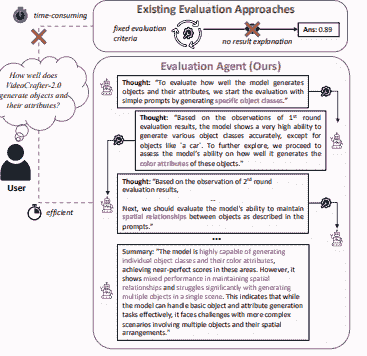

### Are Your LLMs Capable of Stable Reasoning?

https://arxiv.org/abs/2412.13147

ResearchFlow 链接：https://rflow.ai/flow/419a5846-c248-4241-a78f-55ff6752f45d

大型语言模型 (LLM) 的快速发展已在复杂推理任务中取得了显著进展。然而，基准性能和实际应用之间仍然存在显著差异。我们认为这一差距主要源于当前的评估协议和指标，这些协议和指标不足以充分捕捉 LLM 的全部能力，特别是在复杂推理任务中，准确性和一致性都至关重要。这项工作做出了两个关键贡献。首先，我们引入了 G-Pass@k，这是一种新颖的评估指标，可在多次采样尝试中持续评估模型性能，量化模型的峰值性能潜力及其稳定性。其次，我们提出了 LiveMathBench，这是一个动态基准，包含具有挑战性的当代数学问题，旨在最大限度地降低评估过程中的数据泄露风险。通过使用 LiveMathBench 在最先进的 LLM 上使用 G-Pass@k 进行大量实验，我们全面了解了它们的最大能力和操作一致性。我们的研究结果表明，LLM 的“现实”推理能力还有很大的改进空间，凸显了对更强大的评估方法的需求。

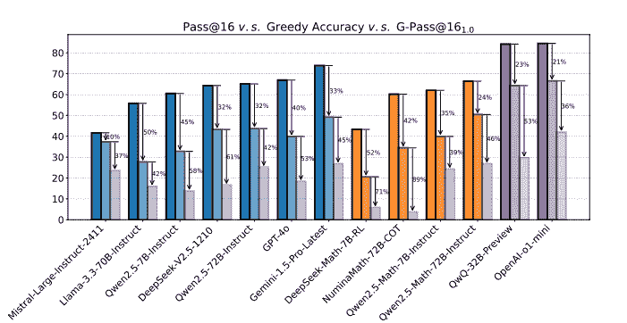

### Byte Latent Transformer: Patches Scale Better Than Tokens

https://arxiv.org/abs/2412.09871

ResearchFlow 链接：https://rflow.ai/flow/b25f6731-9793-4836-98b1-e0702cec5d70

我们引入了字节潜在变换器 (BLT)，这是一种新的字节级 LLM 架构，它首次在规模上与基于标记化的 LLM 性能相匹配，同时显著提高了推理效率和鲁棒性。BLT 将字节编码为动态大小的补丁，这些补丁作为计算的主要单位。补丁根据下一个字节的熵进行分段，在数据复杂性增加需要时分配更多的计算和模型容量。我们提出了第一个 FLOP 控制的字节级模型扩展研究，该模型最多有 8B 个参数和 4T 个训练字节。我们的结果证明了在没有固定词汇表的情况下扩展在原始字节上训练的模型的可行性。由于在数据可预测时动态选择长补丁，训练和推理效率都得到了提高，同时推理和长尾泛化也得到了定性改进。总体而言，对于固定的推理成本，BLT 通过同时增加补丁和模型大小，显示出比基于标记化的模型更好的扩展性。

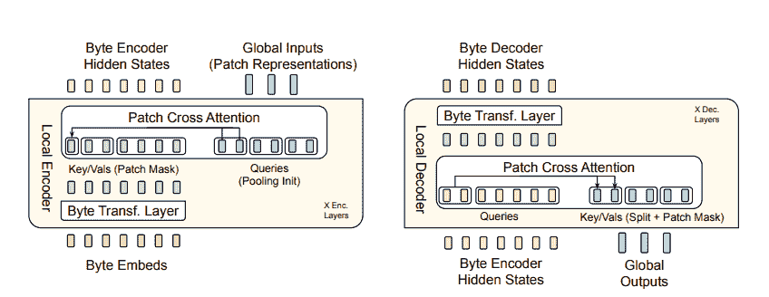

# 产品

### Unicorns.club 初创企业可通过社交平台展示其成长并寻找投资

贡献人：

https://unicorns.club/?ref=producthunt

Unicorns Club 是一款革命性的融资平台，旨在打破传统融资壁垒，让初创企业能够更轻松地与投资者建立联系。通过创新的算法和数据驱动的匹配机制，该平台帮助初创企业自动展示自身的潜力和成长轨迹，而无需耗费大量时间和精力进行主动寻找。创始人只需专注于发展核心业务，Unicorns Club 就会通过智能推荐和实时更新，将最合适的投资者带到他们面前。无论企业规模大小，只要具备吸引力，都有机会成为投资界的“超级明星”。这是一个让初创企业和投资者都受益的生态系统，真正实现了融资的民主化和高效化。

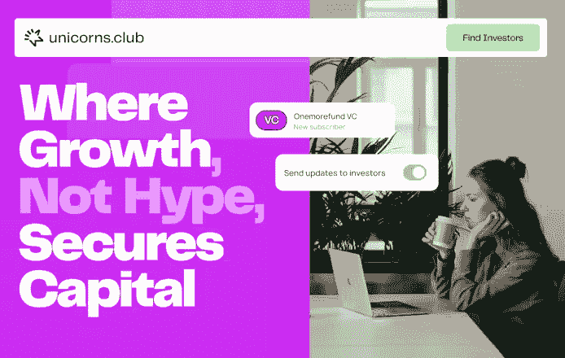

### AimFox  优化 LinkedIn 潜在客户管理流程

贡献人：

https://aimfox.com/?ref=producthunt

这款智能工具专为销售和业务开发团队设计，通过 AI 驱动的自动化功能优化 LinkedIn 潜在客户管理流程。借助其强大的外拨功能，用户可以启动高度个性化的客户互动活动，从而显著提高转化率。工具支持对多个 LinkedIn 帐户进行自动化操作，将分散的对话整合到一个直观的仪表板中，方便团队集中管理客户关系。更重要的是，它提供连接同步功能，让所有互动数据实时更新，确保团队始终掌握最新进展。这一解决方案不仅提高了运营效率，还为用户在 LinkedIn 上实现无缝的潜在客户开发提供了强大的支持。

# HuggingFace&Github

### OpenVINO™ GenAI

贡献人：

https://github.com/openvinotoolkit/openvino.genai

OpenVINO™ GenAI 是一个最流行的生成式 AI 模型管道、优化的执行方法和在高性能OpenVINO Runtime上运行的示例库。

该库适合在 PC 和笔记本电脑上运行，并且针对资源消耗进行了优化。它不需要任何外部依赖项来运行生成模型，因为它已经包含了所有核心功能（例如通过 openvino-tokenizers 进行标记化）。

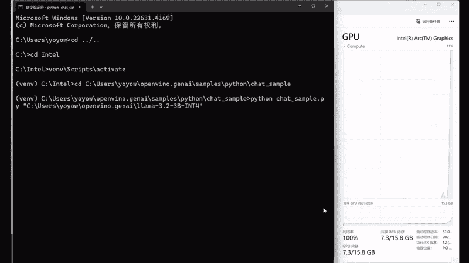

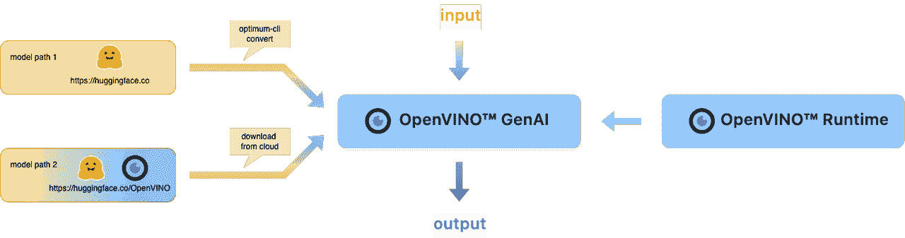

# 投融资

### Databricks CEO解释为何推迟IPO：2025年再看

贡献人：

https://techcrunch.com/2024/12/17/its-dumb-to-ipo-this-year-databricks-ceo-explains-why-hes-waiting-to-go-public/

Databricks最近完成了一轮高达100亿美元的融资，这是该公司历史上最大的一轮融资之一。尽管市场上关于Databricks可能会进行IPO的讨论不断升温，CEO Ali Ghodsi表示，他们将推迟至少到2025年才会考虑公开募股（IPO）。Ghodsi在一次活动中指出，2024年是美国的选举年，市场动荡不安，投资者担心利率和通货膨胀问题，因此不适宜在此时进行IPO。

Ghodsi强调，虽然2024年不理想，但Databricks的融资热度并未减弱。在最新的100亿美元融资中，投资者的兴趣异常火爆，原本计划筹集30亿到40亿美元，但由于市场的强烈需求，最终将融资金额提升到了这一庞大的数字。Ghodsi提到，曾看到一张Excel表格显示了19亿美元的投资需求，他几乎不敢相信这一数字。

尽管如此，Ghodsi并没有排除2025年或甚至2026年进行IPO的可能性，但他指出，公开募股已经不像10至15年前那么重要了，公司的融资能力和市场估值已经证明了这一点。他对市场上当前的“AI泡沫”并不感到担忧，并认为其公司能够在未来持续站稳脚跟。

此外，Databricks还积极扩展与竞争对手的差距，曾通过收购Tabular等举措，进一步加强其在数据分析和人工智能领域的竞争力。Ghodsi提到，虽然公司与Snowflake的竞争已告一段落，但他们将继续与Salesforce、Microsoft等企业巨头竞争，并深信数据和AI将在未来发挥越来越重要的作用。

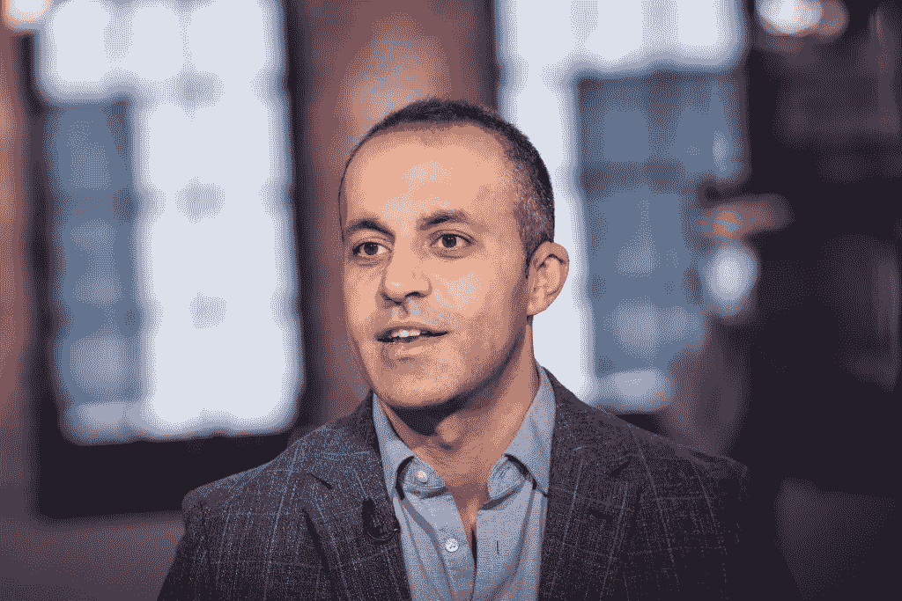

### 爱诗科技完成近3亿元A+轮融资

贡献人：

https://mp.weixin.qq.com/s/l98BKVRBMIZQdWKeBh0clA

爱诗科技完成A2至A4轮融资，总金额近3亿元人民币。此前，A2轮融资由蚂蚁集团投资，近期A3、A4轮融资由北京市人工智能产业投资基金、国科投资及光源资本投资。融资将主要用于提升技术研发能力、扩展算力资源以及建设人才团队，加速产品功能迭代与市场覆盖，持续推动AI视频生成技术的普惠。

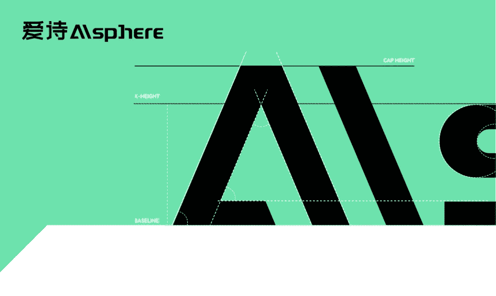

### 谷歌加入9000万美元投资，以加强非洲的数字基础设施

贡献人：

https://techcrunch.com/2024/12/17/google-joins-90m-investment-into-cassava-to-bolster-africas-digital-infrastructure/

谷歌最近参与了一轮9000万美元的股权融资，投资对象是Cassava Technologies，这是一家致力于提升非洲数字基础设施的公司。此次投资标志着谷歌在非洲基础设施领域的进一步扩展，尤其是在云计算和AI计算需求日益增长的背景下。

Cassava作为非洲电信公司Econet的子公司，专注于数据中心、光纤宽带网络、可再生能源、云计算和网络安全等数字基础设施项目。谷歌的投资将帮助Cassava强化其资产负债表，推动可持续的盈利增长，并巩固其作为一家具有全球影响力的非洲技术公司的地位。

Cassava的多个业务部门在谷歌的支持下取得了重要进展。尤其是在建设“Umoja”海底光缆项目时，Cassava旗下的Liquid Intelligent Technologies与谷歌合作，帮助该光缆在非洲各国之间铺设网络。此外，Cassava的Liquid C2业务单位与谷歌及Anthropic合作，将先进的云计算、网络安全解决方案以及生成性AI服务引入非洲市场，以推动企业效率和客户体验的提升。

此次9000万美元的投资也是谷歌承诺投资非洲数字经济的一部分，早前谷歌曾宣布计划在非洲投资10亿美元。谷歌通过这笔投资不仅加强了自身在非洲的业务布局，也为非洲及全球其他新兴市场提供了强大的数字基础设施支持。

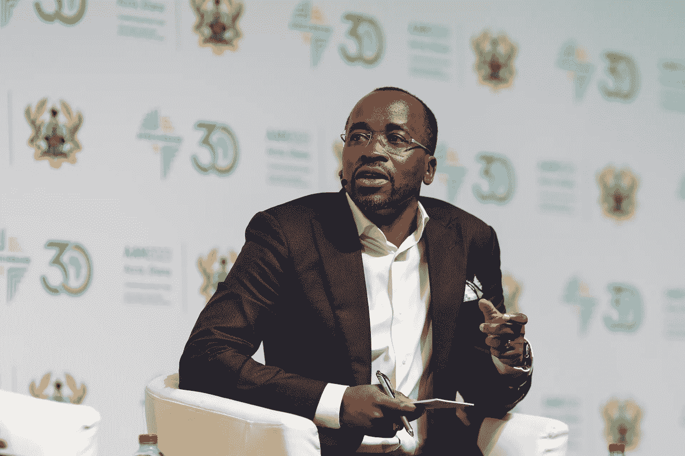

### Grammarly收购生产力初创公司Coda，并迎来新CEO

贡献人：

https://techcrunch.com/2024/12/17/grammarly-acquires-productivity-startup-coda-brings-on-new-ceo/

Grammarly宣布收购生产力初创公司Coda，交易细节未公开。在此次交易中，Coda的创始人兼CEO Shishir Mehrotra将接任Grammarly的新CEO。此举不仅标志着Grammarly的战略升级，还将进一步推动其AI助手向全面的“AI生产力平台”转型。

通过此次收购，Grammarly计划将Coda的AI工具和产品整合到其现有平台中，为用户提供新的功能，包括生成性AI聊天和生产力套件。这些新功能旨在提升用户工作效率，并让Grammarly的AI助手更加智能和实用。Grammarly现任CEO Rahul Roy-Chowdhury也宣布将卸任，转而成为Mehrotra的顾问。

Mehrotra是技术行业的资深人士，曾任YouTube的首席产品官和技术官，他在收购后表示，未来的目标是让Grammarly助手不仅能提供写作建议，还能与用户的其他系统（如邮件、文档、CRM等）无缝连接，从而进一步提升生产力。Coda的核心产品Coda Docs也将与Grammarly助手进行整合，推动平台的智能化升级。

Grammarly成立于2009年，拥有4000万活跃用户，估值达到130亿美元；而Coda在2021年完成D轮融资后，估值为14亿美元。通过此次收购，Grammarly将更有力地与其他AI写作和生产力工具公司展开竞争。

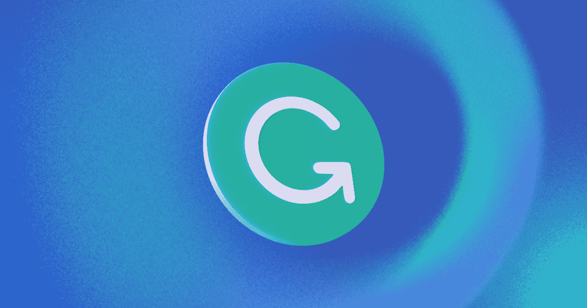

# 学习

### 搭建10万卡GPU集群技术指南

贡献人:

https://zhuanlan.zhihu.com/p/13048016327

建设10万卡集群的背景和挑战凸显了AI技术发展中面临的巨大功耗、空间和工程能力压力。以10万张H100为核心的AI集群，功耗达到150MW，投资超40亿美元，每年电费高达1.24亿美元，这突显了能源消耗对成本效益的影响。当前世界上还没有任何数据中心具备支持150MW集群的能力，这意味着对数据中心的技术设计和资源管理提出了更高要求。

集群的计算能力面临多个并行化技术挑战。首先，数据并行要求每块GPU具备大量内存，以适应大规模模型如GPT-4所需的内存。为此，张量并行技术应运而生，它能通过多GPU之间的频繁通信减少每个GPU的内存需求。流水线并行技术进一步优化了大规模神经网络的计算，通过将模型不同部分分配到不同节点，减少了GPU内存的瓶颈，同时提高了计算效率。3D并行结合了不同的并行化策略，在计算岛内外提升了整体训练效率。

为了支撑这些技术，网络架构必须具备高带宽和低延迟。不同的网络方案如Nvidia Infiniband、Nvidia Spectrum-X和Broadcom Tomahawk 5，各有优劣。Spectrum-X由于其低功耗和高性能优势，成为了许多大型AI集群的首选。然而，网络性能不仅取决于交换芯片的选择，还需要有效的拓扑设计，如三层Fat-Tree拓扑，以确保大规模集群的顺畅互联。

在集群建设过程中，故障恢复和系统可靠性是不可忽视的挑战。GPU、光纤收发器、网络设备等组件的故障，可能导致大规模集群停运。为此，数据中心通常采用热备份和冷备份策略，利用备用节点继续训练，减少故障恢复时间。此外，容错训练技术通过定期备份检查点，减少因硬件故障导致的计算损失，确保训练的持续性和效率。

最终，集群的扩展和设备选择将决定其建设成本和运营效率。在目前的方案中，基于Broadcom Tomahawk 5的交换机由于其成本效益被广泛采用，但这要求网络架构工程师具备较强的技术能力，以确保集群的高效运行。此外，轨道优化设计在集群拓扑中发挥了重要作用，通过优化交换机的布局和光缆的使用，提高了整体系统的通信性能和可靠性。

集群的物料清单和布局设计也极为重要，合理的机架布局和光纤部署能够有效降低功耗，提高系统的维护效率。特别是在多模收发器和铜缆的选择上，合理设计将直接影响集群的运营成本和稳定性。

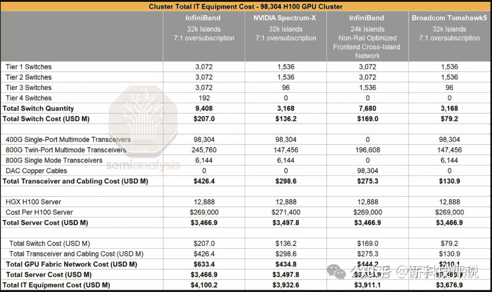

### 国产AI芯片厂商介绍

贡献人：

https://zhuanlan.zhihu.com/p/690736951

华为海思成立于2004年，前身为华为集成电路设计中心，专注于集成电路设计及研发，主要产品包括麒麟系列智能手机芯片、昇腾系列AI芯片、鲲鹏系列服务器芯片和巴龙、天罡系列5G芯片。昇腾310和昇腾910是其核心AI产品，分别用于边缘计算与云端深度学习训练，昇腾310支持低功耗应用，INT8算力可达16TOPS；昇腾910则是面向大规模训练的高性能芯片，INT8算力高达640TOPS，采用7nm工艺，功耗310W。鲲鹏系列在2019年推出，以提供强大计算能力并支持华为云。华为的芯片产品不仅服务于智能手机，还涉及到5G、AI计算和服务器等多个领域，且已成为全球前十五大半导体厂商之一。

寒武纪成立于2016年，专注于AI芯片设计，其思元系列（如思元290、思元590）已经应用于阿里云等多个客户中。思元590是其最新推出的云端训练芯片，相较上一代产品，浮点运算能力有所提升，目标与NVIDIA的A100竞争，然而在软件适配度和稳定性上仍存在挑战。

沐曦集成电路成立于2020年，由前AMD高管创办，主要产品包括曦思N系列、曦云C系列和曦彩G系列GPU。其MXC500芯片是针对AI训练的高性能GPU，目标FP32算力达到15 TFLOPS，采用7nm工艺，定位与NVIDIA A100/A800对标。沐曦致力于为AI计算、云游戏和图形渲染等领域提供解决方案。

天数智芯成立于2015年，主要研发GPU产品，首款产品天垓100为国内首款7nm云端训练GPU，具备强大计算能力，支持多种AI应用。智铠100是其推理类产品，支持混合精度计算，提供高达384TFlops的INT8性能。天数智芯的产品在国内市场已有较多订单，并计划推出更强大的AI训练芯片。

壁仞科技成立于2019年，专注于通用GPU芯片的研发，BR100系列是其核心产品，支持AI训练、推理和科学计算，具备高能效和通用性。壁仞科技的BR100采用原创架构，能够提供高性能的加速计算，满足数据中心对AI计算的需求。

海光信息技术成立于2014年，是中国领先的国产GPU厂商，旗下产品包括面向AI计算的DCU Z100L和云端训练的高性能GPU。海光通过收购AMD的Zen架构授权，推出了多款具有竞争力的高性能计算产品。

阵量科技成立于2020年，专注于AI专用架构芯片的研发，最新产品PT200是训推一体芯片，旨在提供高效灵活的算力支持，尤其在深度学习等领域具有应用潜力。

其他相关厂商如燧原科技、登临、算能、百度昆仑芯等，也在积极布局AI芯片领域，部分公司与AMD有较深的渊源，专注于开发新型的计算架构和高效算力芯片，以满足快速增长的AI市场需求。

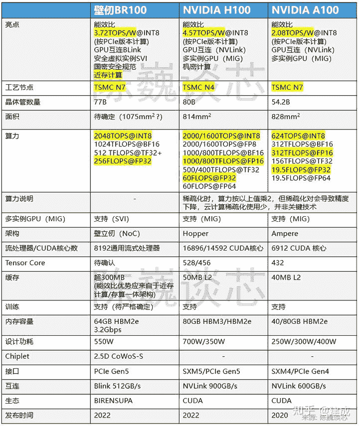

### Triton flash attention v2 学习笔记

贡献人

https://zhuanlan.zhihu.com/p/12712486723

本文主要讨论了使用 Triton 库实现 Flash Attention V2 时，如何处理 causal mask 的前向传播和反向传播，尤其是技术细节方面的处理。

在前向传播中，Triton 的实现使用了两阶段计算：第一阶段处理涉及主对角线的计算，第二阶段计算其他部分。在具体实现中，内层循环用于计算 Q 和 K 的点积，结果通过 mask 进行调整。在 Flash Attention V2 中，masking 操作通过 tl.where 来对主对角线以外的部分进行屏蔽，避免了不必要的计算，优化了内存访问模式。此外，在循环外部执行的除法操作减少了计算量。K、V 和 Q 的块访问指针通过 tl.make_block_ptr 创建，并且 K 的块在内存中按照转置方式进行存储，从而加速了 K 的访问。

在反向传播过程中，计算 dK 和 dV 的梯度时，通过对 Q、K 和 V 的行间梯度进行并行计算，每个程序处理一个序列的若干 token。反向传播同样分为两个阶段，首先处理涉及主对角线的梯度，再处理其他区域的梯度。特别地，由于 causal attention 中的 mask 部分存在，只需要计算与主对角线相关的部分，从而进一步优化了计算量。具体而言，在反向传播的 dQ 计算中，对于 causal attention 的处理通过 mask 来区分哪些列需要参与计算，而不需要加载不参与计算的列到内存，从而有效减少了内存带宽的压力。

在实际代码中，通过将每个块的计算分成多个步骤，并使用不同的 mask 策略，区分哪些部分需要计算，哪些部分可以跳过，从而实现了高效的计算。对于 mask 的生成，程序通过比较行索引与列索引的关系，确定哪些部分应该被屏蔽。例如，在某些阶段中，通过动态调整 start_m 和 start_n 的偏移量来控制哪些行和列需要参与计算。

此外，文章还提到，Flash Attention 的实现中，反向传播对梯度的处理也存在分阶段的优化，特别是在处理 causal mask 时，通过划分小块并逐步处理 mask 区域和非 mask 区域，可以进一步提高效率。在实现细节中，Q、K、V 等矩阵的转置处理、梯度的反向传播计算，以及 mask 的区分都是为了在避免无用计算的同时，最大化并行计算的效率。

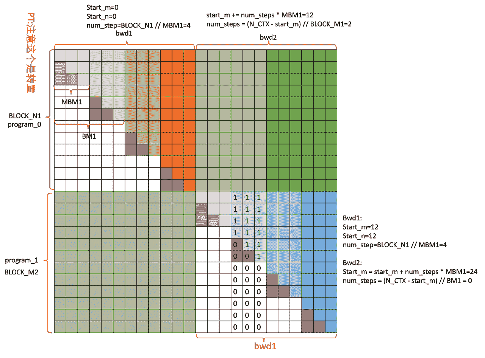

### MiniVLA

贡献人：

https://ai.stanford.edu/blog/minivla/

在机器人领域，视觉-语言-动作（VLA）模型的应用日益广泛，尤其是OpenVLA，它被认为是当前最优秀的开源模型之一。然而，OpenVLA拥有70亿个参数，这使得它在训练和推理过程中非常缓慢。针对这一问题，斯坦福大学的研究人员提出了MiniVLA模型，该模型通过缩小参数规模并对输入输出表示方式进行优化，在保持性能的同时大大提升了运行效率。

MiniVLA的创新

MiniVLA的主要创新之处在于其将OpenVLA的参数数量从70亿减少到仅为10亿，模型体积缩小了7倍。同时，研究人员还对模型的输入输出空间进行了多项改进：

1.  动作分块（Action Chunking）：通过向量量化技术，MiniVLA改进了动作的离散化处理，提高了推理效率。

1.  **多图像支持**：MiniVLA支持使用历史图像和手腕图像，进一步提升了模型的任务成功率。

1.  **性能提升**：MiniVLA在Libero-90基准测试中的任务成功率从62%提升至82%，尽管其体积仅为OpenVLA的七分之一。

MiniVLA的优势

+   **更快的推理速度**：在使用NVIDIA L40s显卡的情况下，MiniVLA的推理速度比OpenVLA快2.5倍，达到12.5Hz，而OpenVLA仅为5Hz。

+   **更小的模型体积**：虽然MiniVLA在某些任务上的表现略有下降，但总体上，它比OpenVLA更轻便且高效，尤其是在实际应用中，其参数减少带来了显著的速度提升。

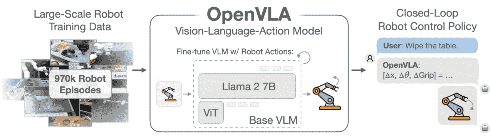

### Nvidia Triton Server使用教程：从青铜到王者

贡献人：

https://zhuanlan.zhihu.com/p/516017726

Triton 是一个高效的模型推理框架，旨在优化模型部署和推理过程，支持多种模型格式，如 PyTorch、TensorFlow、ONNX 和 TRT。其主要功能包括加速推理、负载均衡和动态模型管理。Triton 通过支持容器化的方式运行，提供了与硬件的紧密结合，支持 GPU 加速推理以及模型并行、动态 batch 等高级特性。

在使用 Triton 时，首先需要通过注册并登录 NVIDIA 的 NGC 平台来下载所需的 Triton 镜像。镜像下载后，用户需为推理模型创建一个存储目录，并按照规范将模型文件放入合适的目录结构中。以 PyTorch 为例，需要通过 TorchScript 保存的方式生成模型文件，并将其配置文件放入相应的模型目录。配置文件（config.pbtxt）用来指定模型的输入输出类型、维度等参数，确保推理框架能正确加载并执行模型。

Triton 通过 Docker 容器启动，并映射本地的模型仓库路径到容器内。启动命令中需要指定容器的端口映射，默认情况下会开启三个端口用于模型管理和推理请求。容器启动后，用户可以通过 REST API 接口发送推理请求，接口支持多种输入输出类型，返回的结果通常需要根据返回的维度自行重塑成合适的数据结构。

Triton 的一些高级特性包括模型并行、动态 batch 和自定义后台处理。模型并行允许在多块 GPU 上并行运行多个实例，从而提升推理的吞吐量。动态 batch 特性允许将多个小的推理请求合并成一个大 batch 进行推理，提升硬件利用率和整体性能。自定义后台则可以让用户根据自己的业务需求编写推理逻辑，在一个推理请求中调用多个模型并进行特定的逻辑处理，避免多次 HTTP 请求带来的延迟。

总之，Triton 提供了一个高效、灵活的框架，能够根据硬件环境和推理需求进行优化，适用于大规模模型推理服务的部署。通过合理配置和使用其高级特性，可以显著提升模型推理性能并满足不同业务场景的需求。

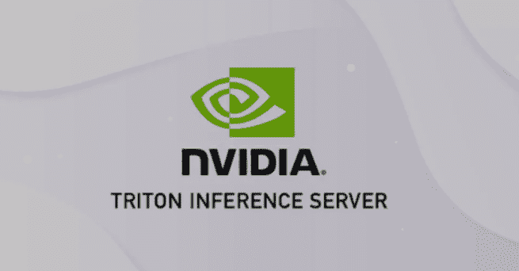

# 声明

本文档仅供学习交流使用，版权归原作者所有，若涉侵权，请联系Jack Jin 15101136166

##

（欢迎在下方反馈您宝贵的意见！整理不易，觉得有用给AI日报小组点个赞👍吧！）

ChatGPT；Angela；Zijia Liu；Alex；Zeqi Tan；Tiezhen（HuggingFace）；Naixu；Lizhi；Peter；Suoman；Jack

学术分析报告：ResearchFlow -- 奇绩F23校友的开发的深度研究产品，PC端进入RFlow的分析报告，可直接点击节点右侧的小数字展开节点，登录后可在节点上直接“询问AI”，进一步探索深度信息

如果你有大模型相关的创业想法，欢迎来找我们聊聊～微信：15101136166

> 快邀请你的小伙伴们一起来读大模型日报吧！

> **【日报****知识库****】**这里是近期日报内容的汇总,欢迎大家查阅

> [大模型日报知识库(分享版)](https://miracleplus.feishu.cn/wiki/KapVwXfkriOBiskB0B2cUHxjnTh)

>

> 欢迎大家多多帮我们分享,转发~~

> 如果大家有任何的建议或者吐槽,欢迎随时找我聊天~

