# 奇绩大模型日报（12月 20日）

> 来源：[https://miracleplus.feishu.cn/docx/ZjUido0Oqo2MPGxYyV0cr2P9nef](https://miracleplus.feishu.cn/docx/ZjUido0Oqo2MPGxYyV0cr2P9nef)

# 🔉潜**空间系列活动重磅回归！**

> 本期活动将在**12月22日** **11:00**开始，我们邀请到的嘉宾是**季宇。**清华大学计算机科学与技术系博士，曾在华为担任海思昇腾芯片编译器专家，负责多个昇腾编译器项目，并在AI编译器领域和处理器微架构领域进行挑战性问题攻关。他于2023年8月创立了行云，该公司致力于研发下一代针对大模型推理场景的高效能GPU芯片，并在2024年连续完成总额数亿元的天使轮及天使+轮融资。季宇的主要研究领域包括神经网络加速器、编译器和面向系统优化的机器学习。他将带来《谁困住了AI产业——大型机化的计算机形态与变革的可能性》的分享。

> 除嘉宾分享外，每期设置了【匹配合伙人 Cofounder Matching】环节。你可以和 GenAI 时代最有活力的创业者和研究者线下面对面交流，将有机会找到志同道合、有共同创业梦想的小伙伴。

> 报名通道已开启，欢迎扫描下方二维码报名。

# 资讯

### 谷歌发布Gemini 2.0 Flash Thinking，全面超越o1-preview

贡献人：

https://mp.weixin.qq.com/s/NkTP17j6HYIz95sHxCameA

OpenAI的12天连续发布即将结束，但谷歌的Gemini 2.0系列显然吸引了更多关注。特别是Gemini 2.0 Flash Thinking，它在推理和速度方面表现出色，成为了当前AI聊天模型的领跑者。这个模型基于Gemini 2.0 Flash，并通过专门的训练增强了推理能力，能够显式展示思考过程。根据Jeff Dean的展示，模型在解答物理问题时展示了详细的推理步骤，且耗时较短。

虽然Gemini 2.0 Flash并非最终版本，但Flash Thinking已经在多个领域的评测中领先，包括编程、数学和创意写作等。根据Alex Volkov的测试，Flash Thinking在推理速度上比其他模型快了两倍，而其表现也优于OpenAI的o1系列。网友对这个模型的推崇不已，认为它将成为ChatGPT和Claude等竞争对手的有力挑战者。

Gemini 2.0 Flash Thinking在数学推理上尤其突出，快速且准确。例如，它在14秒内解答了一个复杂的数学题，比其他模型快五倍；而在解答数学期望问题时，速度是OpenAI o1模型的两倍。尽管如此，模型也有犯错的时候，如在识别单词“strawberry”中字母“r”的数量时出现了错误。它还未能解决一些简单的数值比较问题，但在某些复杂推理任务上却表现出色，比如首次成功解决了三赌徒问题。

除了数学推理，Gemini 2.0 Flash Thinking还在编程和跨模态任务中表现优秀。例如，它能够编写一个功能完整的井字棋游戏，并且能够处理古代数学题“孙子算经”。此外，模型支持多模态输入，如图片和音频，能够解答梗图或手写数学问题，尽管在一些任务如验证码识别上失败了。

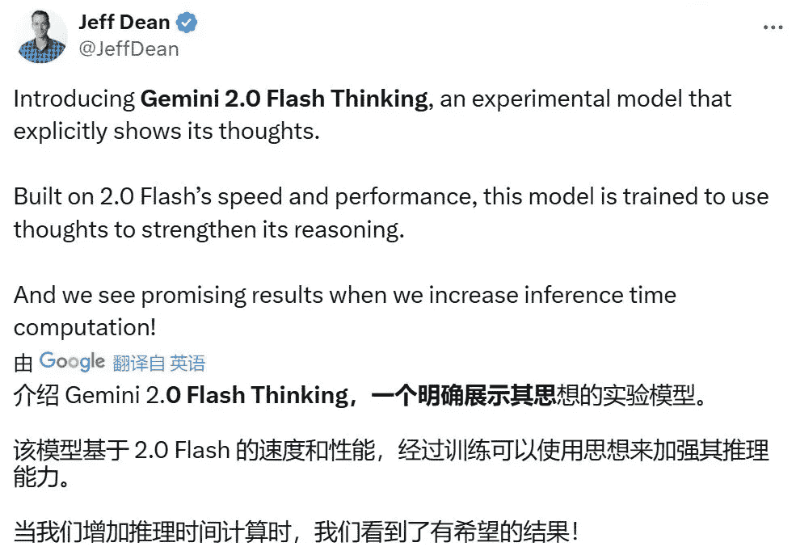

### 普渡机器人解答具身智能商业化的终极命题

贡献人：

https://mp.weixin.qq.com/s/IgkbOkbpwHjsjrmtmSFQTA

普渡机器人在12月19日发布了其首款全尺寸双足人形机器人PUDU D9，并计划开始预售。这款机器人由普渡X实验室研发，集成了普渡在移动、操作和AI技术方面的核心能力，旨在解决服务机器人在多场景中的应用难题。PUDU D9的双足行走速度可

达2米/秒，能够适应楼梯、斜坡等复杂地形，利用视觉语义导航技术实时构建3D语义地图，实现自主规划路线和动态避障。其配备的两条7自由度机械臂及11自由度灵巧手可进行精细操作，支持端到端任务规划和执行。

普渡的发布标志着其在类人形和人形机器人领域的全面布局，成为行业内首家实现三种机器人形态（专用、类人形、人形）全覆盖的厂商。通过多技术栈的驱动，普渡解决了服务机器人跨场景应用的泛化性问题，推动了具身智能的商业化进程。张涛，普渡创始人兼CEO，强调通过“开发一代、储备一代、预研一代”的开发模式，提前介入技术成熟与市场准备之间的平衡。

普渡从2017年起便开始了机器人研发，逐步积累了足式和机械臂技术。在餐饮、酒店等行业中，普渡通过提升机器人操作能力，解决了跨场景任务的泛化难题，如机器人能完成上菜回盘、按电梯等复杂操作，避免了传统机器人需改造物理环境的高昂成本。普渡认为，具身智能的商业化必须依赖于多技术栈的并行发展，尤其是操作能力的提升。

此外，普渡在全球化商业化方面也具备显著优势。其已在全球建立了700多个代理商，产品行销超过60个国家，海外营收占比高达80%。通过强大的供应链管理和全球化渠道网络，普渡在机器人行业的市场份额稳居全球第一，并为其后续人形机器人产品的推广提供了成熟的渠道体系和客户资源。

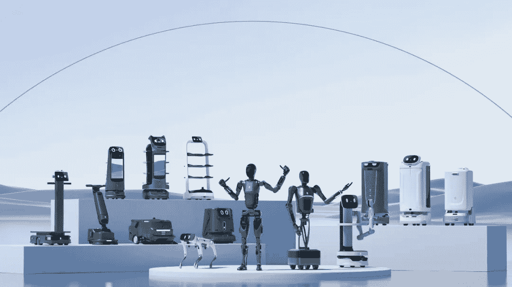

### AWS的大模型布局

贡献人：

https://mp.weixin.qq.com/s/cARKncahy88DQY9bRcjulQ

Amazon近期推出了一系列重磅技术和服务，特别是在大模型和AI领域的创新，震撼业内。首先，Amazon自研的基础模型Amazon Nova在各类基准测试中表现出色，超越了GPT、Gemini、Claude等同级别模型，展示了其强大的性能。Nova包括多个版本，从适用于简单任务的Micro模型，到高性能的Premier多模态模型，支持微调和蒸馏训练，为大规模推理任务提供强大支持。

此外，Amazon还发布了全新的Trainium 3芯片，该芯片基于3nm工艺，性能是前代Trainium 2的两倍，能效提升40%，预计将于2025年正式发布。同时，亚马逊还推出了EC2 Trn2实例，性价比提升30%-40%，以及通过NeuronLink互联的超算集群UltraServer，提供20.8 PFLOPS算力，支持大模型的高效训练。

在数据层面，Amazon对其S3存储进行了重要更新，包括推出S3 Tables和S3 Metadata元数据服务，提升了存储和查询效率，特别适用于大模型的海量数据需求。此外，Amazon强化了其网络架构，推出了“10p10u”网络，支持超大规模的AI集群互联，提供更高带宽和更低延迟。

Amazon SageMaker也迎来了重大升级，统一了数据、分析和AI工作流，支持Zero-ETL能力，简化了数据处理和模型训练过程。新版本的SageMaker通过Iceberg兼容的数据湖服务，使得大规模数据集成和访问更加高效，为大模型提供了稳定的数据“饲料”。

在模型服务方面，Amazon继续扩展Bedrock平台，提供超过100个业界领先的大模型，支持客户根据需求选择和定制模型。新推出的模型蒸馏功能使得客户可以在不损失性能的情况下，优化模型体积，提高推理效率。

在应用层，Amazon推出了AI助手Amazon Q，分别面向开发和商业场景。Amazon Q Developer帮助开发者自动化繁琐的迁移和维护任务，并与GitLab深度集成，提升开发效率。Q Business则面向企业，提供强大的跨数据源搜索和自动化任务功能，增强企业的业务智能能力。

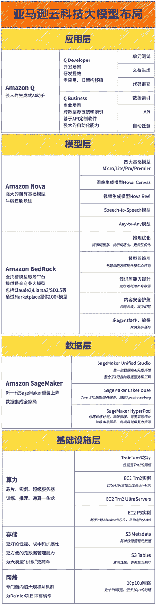

### OpenAI元老级研究员Alec Radford离职

贡献人：

https://mp.weixin.qq.com/s/zTFlJoSNJ_Pz-JaMzU2Nug

Alec Radford，OpenAI 的一位关键人物，决定离开公司，开展独立研究，尽管他计划继续与 OpenAI 以及其他 AI 开发者合作。Radford 在 GPT-1 和 GPT-2 的创建中发挥了至关重要的作用，他的贡献对预训练模型的发展起到了基础性作用。特别是在引入半监督学习以及 GPT-2 的创新方面，他为 AI 领域带来了重大突破。

Radford 的离职引发了关于 OpenAI 未来的猜测，一些人认为这可能预示着 GPT-4.5 的发布。尽管他长期处于幕后，但他的工作深刻影响了 OpenAI 的发展，尤其是 GPT-3 和 GPT-4 的研究。Radford 被广泛认为是现代生成式 AI 的奠基人之一。尽管他较少出现在公众视野中，但他的研究成果已成为该领域的里程碑，并且得到了广泛引用，显示出其持续的影响力。

OpenAI 的领导层对 Radford 的离开表示尊重，认为他在公司的成功中扮演了重要角色。虽然他的离职对 OpenAI 来说是一个损失，但人们也期待他在独立研究中能继续推动 AI 领域的发展。

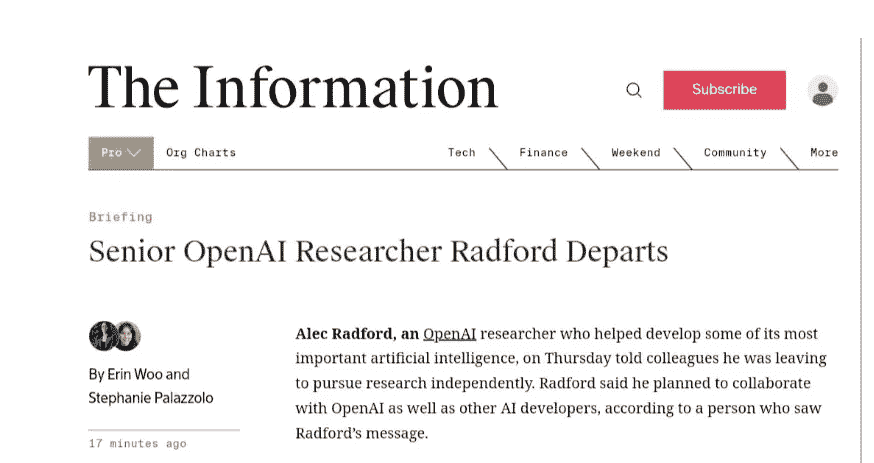

### 「阿里香港创业者基金」推出1.5亿美元聚焦AI的「NextGen基金」

贡献人：

https://mp.weixin.qq.com/s/h2Z3KaoUWy8FU4zDbuNC9w

12月17日，阿里巴巴香港创业者基金（AEF）宣布推出第三只聚焦人工智能（AI）驱动初创公司的基金——AEF NextGen 基金，规模为1.5亿美元（约11亿元人民币）。该基金将由AEF的专业团队“NextGen Partners”管理，投资于那些已证明市场潜力、致力于利用AI技术解决结构性问题的成长期公司，重点领域包括金融服务、消费零售、医疗健康、建筑地产及艺术娱乐等。此外，AEF NextGen 基金还将为这些公司提供全球扩张所需的资源和专业支持。

AEF成立于2015年，是阿里巴巴集团发起的非营利计划，旨在支持香港及大湾区的创业生态系统。AEF通过香港基金、大湾区基金和NextGen基金为创业公司提供投资，并借助阿里巴巴生态系统提供战略支持，帮助他们拓展中国大陆及全球市场。自成立以来，AEF已投资超过80家初创公司，资金总额超过1亿美元，并带动超过28亿美元的共同投资。未来，AEF将继续推动新技术的应用，特别是在AI领域，支持那些有潜力塑造未来技术的公司。

在同一天，阿里巴巴还宣布将出售银泰100%的股权，预计交易所得约为74亿元人民币（约10亿美元），但也预计将因出售录得约93亿元人民币的亏损。此次出售符合阿里巴巴“聚焦核心业务”的战略，作为调整非核心资产的一部分。去年，阿里巴巴就已决定将“AI驱动”作为战略重心，并计划在2024财年完成多项非核心资产的出售，累计金额达到17亿美元。

# 推特

### Deeplearning AI分享《Reasoning with o1》：如何高效使用o1模型

https://x.com/AndrewYNg/status/1869421643925422166

**OpenAI 昨天刚**刚宣布了对 o1（高级推理模型） 的 API 访问权限。今天，我很高兴宣布推出一门全新短期课程 《Reasoning with o1》，该课程由 @OpenAI 共同开发，并由 OpenAI 的 AI 解决方案负责人 @colintjarvis 授课，旨在教你如何高效使用这个模型！

与之前直接生成输出的语言模型不同，o1 会“在回答前思考”，先生成多个推理标记（reasoning tokens），然后再返回更深思熟虑且准确的回答。它在复杂推理方面表现卓越，包括代理工作流的规划、代码编写，以及法律等 STEM 领域的专业推理。但使用它的方式与其他 LLM 非常不同。

我认为 o1 将会为许多 AI 应用带来革命性变化。在这门课程中，你将学习如何高效使用它。

**课程内容：**

• 学习识别 o1 适合的任务，以及何时使用较小模型，或将 o1 与较小模型结合使用

• 理解推理模型的新提示原则：简单直接；无需明确的“思维链”；使用结构化方法；“展示”而非“说明”

• 实现多步协调流程：由 o1 负责规划，将具体步骤交给 gpt-4o-mini 执行。这种设计模式能优化智能（准确性）与成本

• 使用 o1 进行代码任务：构建新应用、编辑现有代码，并通过在 o1-mini 和 GPT-4o 间举办编程竞赛来测试性能

• 使用 o1 进行图像理解：学习其通过“推理层级”（hierarchy of reasoning）表现更优。o1 在前期耗费时间和成本对图像进行预处理和丰富细节索引，从而提高后续问答环节的效率

• 学习一种名为 **meta-prompting** 的技术：使用 o1 改进提示。通过客户支持评估集，迭代利用 o1 修改提示以提高性能

此外，你还将了解 OpenAI 如何通过强化学习训练出一个能在“测试时计算”（test-time compute）以提升性能的模型。

我相信你会发现这门课程既有趣又有价值。

点击此处报名：https://deeplearning.ai/short-courses/reasoning-with-o1/

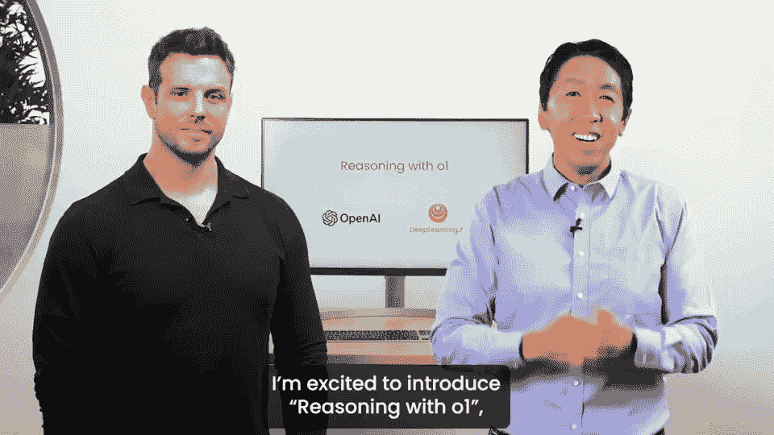

[C4BU8dYkumt-7rzs.mp4](https://internal-api-drive-stream.feishu.cn/space/api/box/stream/download/all/YrjZbdN48oagGJxAKzDcbVOHn8d)

### Pika2.0：到12月22日之前为所有人提供免费、无限制提供访问权限

https://x.com/pika_labs/status/1869885228581323110

来自 Pika 团队的节日前超大礼物：我们为所有人提供免费、无限制的 Pika 2.0 访问权限！

从今天起到 12 月 22 日，任何用户，无论使用哪个计划，都可以生成任意数量的视频，并使用所有的场景素材。

这是为期 4 天的全面免费活动，所以趁着外面冷赶快来体验吧！访问网址：pika.art

[2ly1BXLqImzK0G1f.mp4](https://internal-api-drive-stream.feishu.cn/space/api/box/stream/download/all/KatGbtKNgo5Fz7xoigOcTveRneb)

### Elevenlabs 分享Flash：在 75 毫秒内生成语音

https://x.com/elevenlabsio/status/1869462840941461941

认识 Flash，我们最新的模型，可以在 75 毫秒内生成语音（加上应用和网络延迟）。

你从未体验过如此快速且接近人类的文本转语音技术！

[6CGGmhAQG4ZPUdKR.mp4](https://internal-api-drive-stream.feishu.cn/space/api/box/stream/download/all/SneFb1JC5oVfxDxDyRVcJpNunyg)

### ChatGPT 现在可以通过语音或文本直接在 macOS 上与更多的编程和笔记应用协作

https://x.com/OpenAI/status/1869837577337049434

ChatGPT 现在可以通过语音或文本直接在 macOS 上与更多的编程和笔记应用协作。

通过对 Warp、IntelliJ IDEA、PyCharm 等编程应用的扩展支持，让你可以在上下文中处理代码。

现在你可以使用 o1 和 o1 专业模式的强大功能进行编程。

我们还新增了对 Apple Notes、Notion 和 Quip 等笔记应用的支持。

同时，你可以在使用这些应用时启用高级语音功能。

[3ivXRcmqccbWdjHo.mp4](https://internal-api-drive-stream.feishu.cn/space/api/box/stream/download/all/CCofbRnapoecmrxBIMLc8NLCnze)

# 信号

### Qwen2.5 Technical Report

贡献人：

https://arxiv.org/abs/2412.15115

ResearchFlow链接：https://rflow.ai/flow/ea26b015-4978-4a96-a781-0387f1a24973

**本篇技术报告介**绍了Qwen系列最新版本——Qwen2.5，展示了该版本在多个方面的改进和创新。Qwen2.5是为了更好地推动大语言模型（LLM）发展而不断优化的成果，具有更高的性能、更多的模型规模、更强的数据处理能力以及更便捷的使用体验。

**创新点与贡献：**

1.  **多样化的模型规模：** Qwen2.5在模型规模上进行了扩展，除了原有的0.5B、1.5B、7B和72B模型外，还新增了3B、14B和32B的版本。这些中等规模的模型在资源有限的场景下更加具有成本效益，填补了当前开放基础模型中对这些规模模型的需求空缺。此外，Qwen2.5-Turbo和Qwen2.5-Plus通过平衡准确性、延迟和成本，提供了更灵活的选择。

1.  **数据处理能力的提升：** Qwen2.5的预训练数据量大幅增加，从7万亿个标记提升至18万亿个标记，重点增强了知识、编程和数学等领域的内容。这一增强的数据集支持更广泛的应用，特别是在技术性和数学性问题的处理上。此外，Qwen2.5采用了分阶段的预训练方法，使得模型能够在不同数据混合中进行有效过渡，提升了模型的灵活性和适应能力。

1.  **改进的后训练流程：** Qwen2.5的后训练数据也有所增强，涵盖了超过100万条例子，涵盖了监督微调（SFT）、直接偏好优化（DPO）和群体相对策略优化（GRPO）等多个阶段。这些后训练技术的使用确保了模型在实际任务中的高效性和多样性。

1.  **更好的生成能力和工具支持：** Qwen2.5在生成能力上取得了显著提升，生成长度从2K tokens增加到8K tokens，支持更加复杂和长篇的文本生成。此外，Qwen2.5还增强了对结构化输入输出（如表格和JSON）的支持，使得模型在处理实际应用中的任务时更加灵活。此外，Qwen2.5-Turbo版本甚至支持最多达100万个tokens的上下文长度，进一步扩展了模型的应用范围。

1.  **混合专家模型的引入：** 除了传统的预训练模型，Qwen2.5还推出了Mixture-of-Experts（MoE）模型，如Qwen2.5-Turbo和Qwen2.5-Plus，这些模型能够根据任务需求动态选择专家模型，提高了计算效率并降低了成本。这些模型在与其他先进模型如GPT-4o-mini和GPT-4o的比较中表现出色，展示了Qwen2.5在大规模计算资源下的优越性。

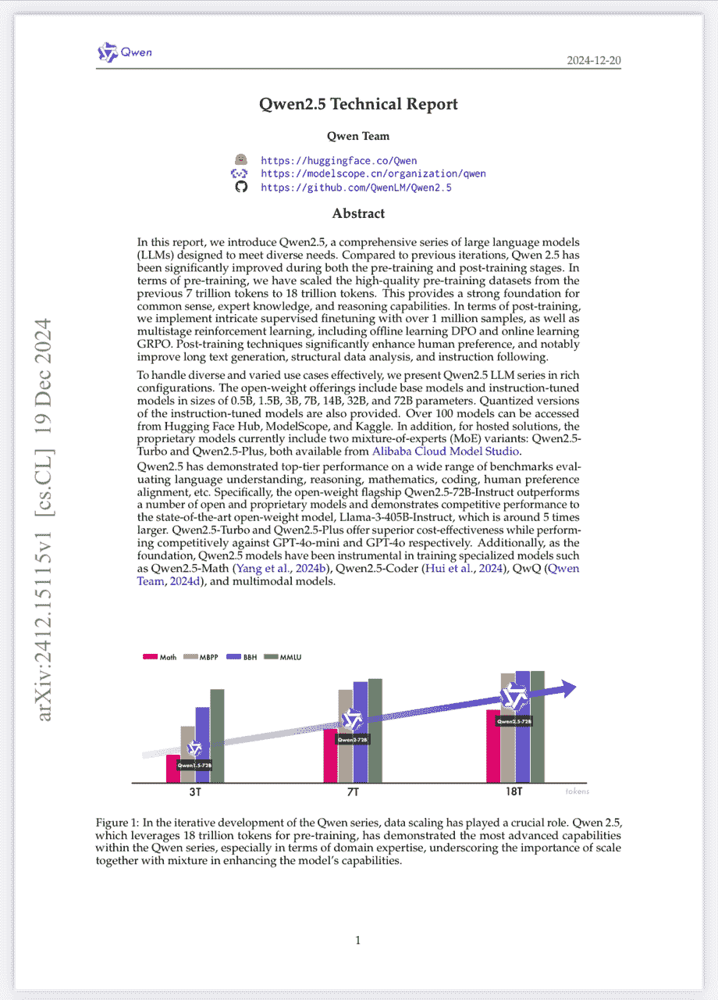

### AceMath: Advancing Frontier Math Reasoning with Post-Training and Reward Modeling

贡献人：

https://arxiv.org/abs/2412.15084

ResearchFlow链接：https://rflow.ai/flow/f9509484-d3ae-4afe-9d32-7a6e6bfa1e6d

本文主要推动了数学推理领域的大语言模型（LLM）发展，提出了创新的后训练和奖励建模方法，以提升数学推理能力。作者首先介绍了一种新颖的监督微调（SFT）过程，该过程通过在多领域（如学科交叉、编程和数学等）进行基础模型的训练，再针**对数学领域进行微调，从而使模**型能够更好**地解决复杂的数学问题。通过这**一方法，AceMath-7B-Instruct模型在数学推理基准测试中显著超越了前代最佳模型Qwen2.5-Math-7B-Instruct，并接近Qwen2.5-Math-72B-Instruct的表现，展示了其强大的数学推理能力。接着，作者探索了数学专用奖励模型（RM）的训练技巧，特别是如何构建正负样本对、设定训练目标、消除模型偏差等。通过这些优化，AceMath-72B-RM在数学领域的表现超过了现有最先进的奖励模型，如Qwen2.5-Math-72B-RM，并结合AceMath-72B-Instruct和AceMath-72B-RM，在七个数学推理基准测试中取得了最佳的rm@8分数，设立了新的性能标准。

论**文还强调了开源的重要**性，决定公开AceMath-Instruct和AceMath-RM的模型权重，并共享所有阶段的训练数据。这一举措有助于推动学术界和工业界进一步改进数学推理模型，促进这一领域的快速发展。此外，作者还发布了AceMath-RewardBench，这是一个综合性的奖励模型基准，涵盖多种数据集、不同难度级别，并能评估模型在应对回答风格变化时的鲁棒性。

本**文的创新之处在于通过精**细的训练和奖励建模方法提升了数学专用模型的推理能力，同时提供了重要的开源资源，推动了数学推理任务的研究和应用。AceMath系列模型在数学推理任务中的表现超过了现有最优模型，为数学和广泛的推理任务提供了更强大的工具，并为今后的奖励模型训练提供了新的方向。

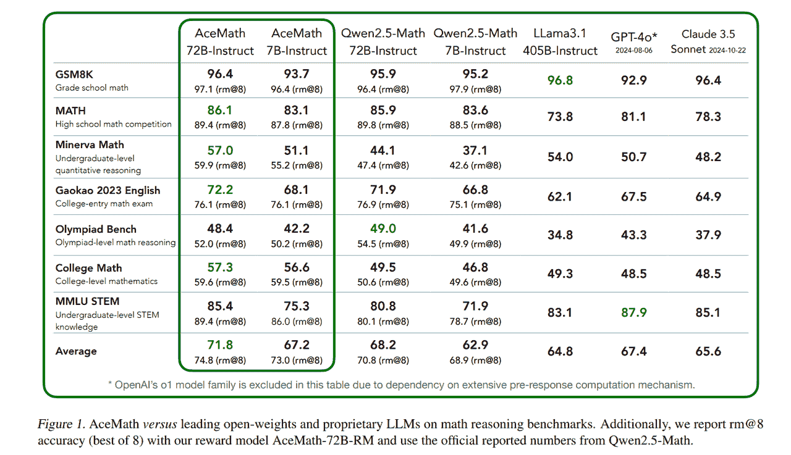

### How to Synthesize Text Data without Model Collapse?

贡献人：

https://arxiv.org/abs/2412.14689

ResearchFlow链接：https://rflow.ai/flow/0cc6f8b2-b562-47c2-a714-8f7b9a37b071

本文通过直接将合成数据与人类生成数据混合，研究了非迭代性模型崩塌问题。与传统的通过自生成数据进行迭代训练的方法不同，本文直接通过不同的混合比例将合成数据与人类数据结合，结果显示，合成数据的比例越高，模型性能越差。通过对分布和特征进行统计分析，发现合成数据只覆盖了人类数据分布的一小部分，并且合成的n-gram特征过度集中，这些都导致了覆盖崩塌问题。基于这些发现，本文提出了“Token-Level Editing”（ToEdit）方法，该方法通过对模型高置信度的数据点进行重采样和替换，有效地避免了模型崩塌。ToEdit通过保持分布的覆盖性，并在理论上将测试误差约束在固定的上限内，从而解决了合成数据引发的覆盖问题。

通过广泛的实验，包括从零开始的预训练、持续预训练和监督微调等多种情境，验证了ToEdit方法的有效性，证明了该方法对模型性能的正面影响。本文的创新点主要体现在两个方面：一是首次展示了非迭代性模型崩塌现象，揭示了合成数据对语言模型训练的负面影响；二是提出了基于Token级别编辑的解决方案，并通过实验验证了其在避免模型崩塌、提升模型性能方面的有效性。

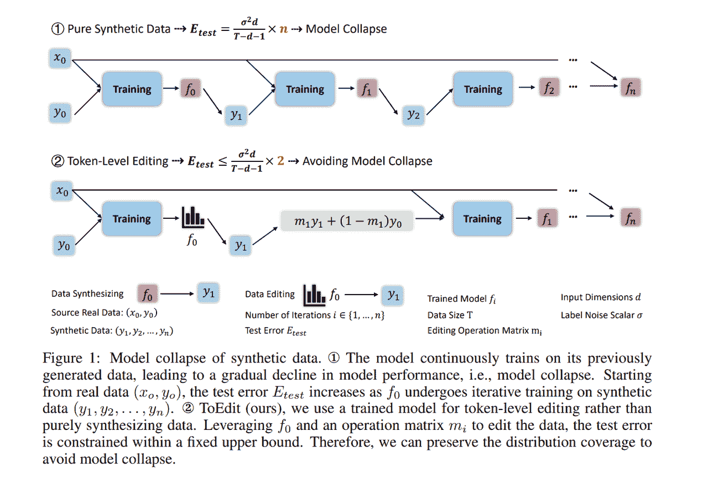

### Proposer-Agent-Evaluator(PAE): Autonomous Skill Discovery For Foundation Model Internet Agents

贡献人：

https://arxiv.org/abs/2412.13194

ResearchFlow链接：https://rflow.ai/flow/0480b5ff-d3d3-4fbf-b9dc-544b5ecd1fd0

本文提出了一种创新的系统——提议者-代理-评估者（PAE）框架，用于让基础模型（foundation models）代理自主发现并利用新技能，从而解决未见过的实际任务。该方法的核心贡献在于，代理无需人工监督，就能通过与环境的互动，自动识别和学习有效的技能，并将其应用到实际任务中，尤其是在Web导航等复杂任务中。

**创新点与贡献：**

1.  **自主技能发现：** 传统的基础模型通常依赖人类定义的任务模板，限制了技能的多样性和扩展性。PAE框架的创新之处在于，代理能够自主发现新的任务和技能，而无需人工干预。这些技能可以用于未见过的任务，并通过零-shot方式解决人类注释过的任务，表现出较强的泛化能力。

1.  **技能提议、评估与执行的协同：** PAE通过任务提议者生成可行的任务，并利用代理策略尝试这些任务，再通过自动评估者提供奖励信号。评估者基于最终结果（例如网页操作的成功与否）给予稀疏的0/1奖励，帮助代理评估自己的行动是否有效。这种设计极大地减少了对隐藏状态信息的依赖，提升了系统的鲁棒性。

1.  **上下文感知任务提议：** 为确保代理能够执行实际的、可行的任务，PAE使用了上下文感知的任务提议者。这些提议者根据任务的环境和约束（例如某些功能是否可用）生成任务，从而避免了不可执行的任务。在实验中，任务提议者甚至能够通过简单的网页名称或用户示范来推断出可执行的任务。

1.  **增强的推理步骤：** 在代理执行任务前，PAE设计了额外的推理步骤，使得代理能够反思自己的技能和执行结果。这个反思过程显著提升了代理对未见任务的泛化能力，确保其能够适应不同的实际应用场景。

1.  **强大的零-shot泛化能力：** 在多种Web导航任务中，PAE框架展现了卓越的性能。使用LLaVa-1.6作为代理策略的PAE，可以在无需人工监督的情况下，通过与多个网站的互动自动发现有效技能，并能成功应对从未见过的任务指令。这一成果不仅验证了PAE的有效性，还展示了它在多达100个领域中的广泛适应性。

**实验结果：** 论文通过WebVoyager和WebArena等基准测试，验证了PAE框架的有效性。实验表明，PAE在测试任务上的成功率提高了30%，使得LLaVa-1.6-7B在计算资源使用上比LLaVa-1.6-34B节省了5倍的计算成本，同时在多个Web导航任务中表现优于其他最先进的开源VLM代理（例如Qwen2VL-72B），表现提升了10%以上。

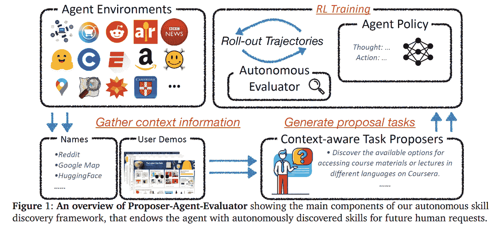

### MetaMorph: Multimodal Understanding and Generation via Instruction Tuning

贡献人：

https://arxiv.org/abs/2412.14164

ResearchFlow链接：https://rflow.ai/flow/6bd8d8e5-bdd4-42b2-8bfd-d62f085822cf

本文提出了一种新的方法——视觉预测指令微调（VPiT），旨在提升多模态大语言模型（MLLMs）在视觉理解和视觉生成方面的表现。现有的多模态大语言模型通常通过预训练的视觉编码器和语言模型相结合，进行图像和文本的理解和生成，而VPiT则通过扩展视觉指令微调（visual instruction tuning）来实现视觉理解和视觉生成的统一。具体而言，VPiT不仅训练模型生成离散文本标记，还生成连续的视觉标记，并通过扩展至扩散模型（diffusion model）来将这些视觉标记映射回像素空间进行可视化。

**创新点与贡献：**

1.  **视觉理解与视觉生成的统一：** 传统的多模态大语言模型通常将视觉生成与理解分开处理，需要大量的预训练和微调数据。而VPiT通过一种简化的方式，将连续的视觉标记作为输入，训练模型在理解图像内容的同时，也能生成相应的视觉输出。这种方法只需要少量额外的视觉生成数据（如20万条），且在处理时数据与计算效率较高。

1.  **视觉理解与生成的内在联系：** 研究表明，视觉理解和生成能力是相互关联且不对称的。增加视觉理解数据能显著提高理解性能，同时也能提升生成效果；而增加生成数据则主要改善生成质量，并在一定程度上增强视觉理解，但对理解的提升较为有限。

1.  **模型性能的提升：** 基于VPiT，论文提出的MetaMorph模型展示了视觉理解与生成能力的协同效应。在大量的视觉理解数据的支持下，MetaMorph能够在多模态标记预测任务中表现出色，并在视觉理解和视觉生成基准测试中取得了竞争性的成绩。特别值得注意的是，MetaMorph能够从预训练的大语言模型中提取知识，并且在生成视觉标记时进行推理。例如，当被要求生成“由帝王蝶幼虫蜕变而来的动物”时，MetaMorph成功生成了蝴蝶的图像。

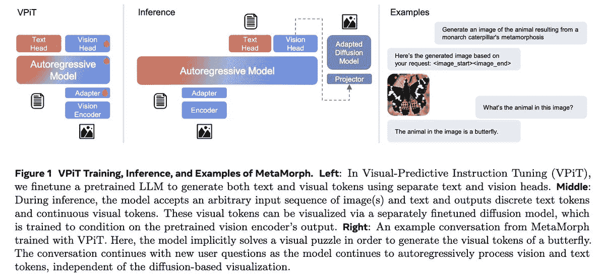

# 产品

### Trickle 轻松构建令人惊叹的 AI 应用程序、网站和表单

贡献人：

https://www.trickle.so

Trickle 是一款功能全面的全栈式开发平台，为个人和团队提供了一个从创意到产品的快速实现路径。无论是 AI 代理、Web 应用，还是交互表单，Trickle 都能帮助用户轻松构建、启动并高效管理这些解决方案。借助其内置的数据库支持、AI 模型集成、实时数据分析以及强大的设计工具，用户可以在一个统一的环境中完成开发、测试和部署工作。Trickle 的直观界面和模块化功能使其既适合技术新手，也能满足专业开发者的高效需求，让创意从概念迅速转化为可立即使用的应用，助力每个用户实现自己的技术创新梦想。

### GenFuse人工智能 使用 AI 代理自动完成任何工作。无需任何技术技能

贡献人：

https://genfuseai.com

GenFuse AI 是一款革命性的无代码平台，专为简化 AI 代理自动化而设计。无论用户是否具备技术背景，都可以利用 GenFuse AI 的直观工具轻松创建多代理工作流，将繁琐的重复任务自动化处理。通过减少人工操作，用户能够显著提升效率，而无需增加团队规模。GenFuse AI 提供了灵活的配置选项和强大的自动化功能，使个人和企业都能快速构建和部署智能工作流，从而专注于更具价值的战略性工作，释放团队的潜力，实现更高效的运营模式。

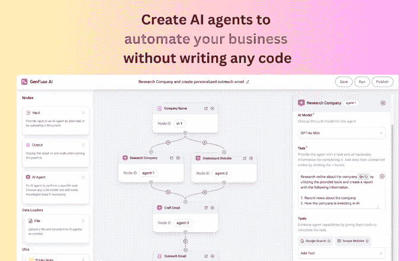

# HuggingFace&Github

### Ant Design X

贡献人：

https://github.com/ant-design/x

🌈源自企业级AI产品最佳实践：基于RICH交互范式构建，提供卓越的AI交互体验。

🧩灵活多样的原子组件：涵盖大部分AI对话场景，让您快速构建个性化的AI交互界面。

⚡开箱即用的模型集成：轻松连接与 OpenAI 标准兼容的推理服务。

🔄会话数据流高效管理：提供强大的数据流管理工具，提升开发效率。

📦丰富的模板支持：提供多种模板，用于快速启动LUI应用程序开发。

🛡完整的 TypeScript 支持：使用 TypeScript 开发，确保强大的类型覆盖率，从而提高开发体验和可靠性。

🎨高级主题定制：支持细粒度的风格调整，满足多样化的使用场景和个性化需求。

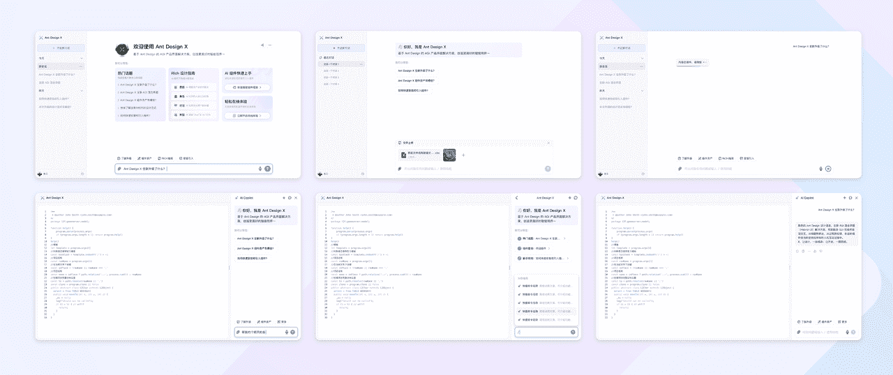

# 投融资

### Perplexity完成5亿美元融资，估值达90亿美元

贡献人：

https://techcrunch.com/2024/12/19/perplexity-has-reportedly-closed-a-500m-funding-round/

AI驱动的搜索引擎Perplexity最近成功完成了一轮5亿美元的融资，融资后公司的估值跃升至90亿美元。这一轮融资由Institutional Venture Partners主导，并于12月初完成。据报道，这笔巨额融资是在AI搜索领域竞争愈加激烈的背景下进行的。近期，OpenAI推出了ChatGPT搜索，与Perplexity展开竞争，同时Google也在开发与Perplexity相媲美的功能，包括搜索结果页面上的AI生成摘要和回答。尽管面临来自大企业的竞争，Perplexity并未停滞不前，近日还完成了首笔收购，收购了专注于连接AI系统与外部数据源的初创公司Carbon。此外，Perplexity还正在应对一起关于版权侵权的集体诉讼。

### Cursor获1亿美元融资，估值飙升至25亿美元，Thrive领投

贡献人：

https://techcrunch.com/2024/12/19/in-just-4-months-ai-coding-assistant-cursor-raised-another-100m-at-a-2-5b-valuation-led-by-thrive-sources-say/

Anysphere公司，AI编程助手Cursor的开发者，近日完成了1亿美元的B轮融资，融资后估值为25亿美元。这一轮融资由现有投资者Thrive Capital领投，Andreessen Horowitz（a16z）也参与其中，但并未联合领投。值得注意的是，这笔融资发生在短短四个月内，公司估值从400百万美元跃升至25亿美元，增长幅度惊人。

此前，Anysphere公司在2024年8月完成了60百万美元的A轮融资，并由Thrive Capital和Andreessen Horowitz支持。此次融资不仅进一步印证了投资者对公司前景的高度认可，还显示出其AI编程助手Cursor在市场上的快速增长。

Cursor的收入表现尤为突出：2024年4月时，公司的年化经常性收入（ARR）为400万美元；到10月，这一数字已达到每月400万美元，相当于年化收入达4800万美元，显示出公司强劲的增长势头。值得一提的是，Cursor的用户包括OpenAI、Midjourney、Perplexity、Shopify等知名公司。

Cursor采用的是“免费增值”模式，用户可在两周的免费试用后，选择订阅20美元/月的个人版或40美元/月的企业版。企业用户的规模和需求进一步推动了公司的收入增长。Cursor正在与包括微软GitHub Copilot在内的其他AI编程助手竞争。

Anysphere的创始团队由四位MIT学生于2022年共同成立，之前公司曾参加OpenAI的加速器项目，并获得OpenAI Startup Fund的种子投资。除了Thrive Capital，其他投资者还包括Neo风投、Stripe联合创始人Patrick Collison、前GitHub CEO Nat Friedman等。

### BlueQubit获得1000万美元融资，推动量子软件在实际应用中的落地、

贡献人：

https://techcrunch.com/2024/12/19/bluequbit-raises-10m-to-take-quantum-software-into-real-world-applications/

BlueQubit是一家总部位于旧金山的量子软件初创公司，成立于斯坦福大学的校友团队。公司专注于通过其“量子软件即服务”（QSaaS）平台，解决量子计算与现实世界应用结合的难题。BlueQubit通过为用户提供量子处理单元（QPU）和量子计算模拟器，旨在将量子计算技术引入金融、制药和材料科学等领域。

2024年12月，BlueQubit宣布完成由Nyca Partners领投的1000万美元种子轮融资。公司希望通过将企业应用与先进的量子硬件结合，推动量子计算技术的商业化。随着金融、制药和材料科学等行业面临经典计算的极限，量子计算的前景愈加受到关注。

BlueQubit的QSaaS平台支持包括金融建模、制药开发和可视化等应用。公司利用大规模经典计算资源，特别是GPU集群，在实际量子处理器部署前开发和测试量子算法，从而推动量子机器学习和量子优化算法的创新。此外，BlueQubit的量子模拟器运行速度是常见替代品的100倍，并结合自研算法，进一步提升了量子计算的效率。

BlueQubit的创始人之一Hrant Gharibyan曾与Google量子AI团队合作，共同开发了革命性的“虫洞传输”算法。Gharibyan与CTO Hayk Tepanyan在斯坦福大学相识，并于2022年春天在加利福尼亚州圣塔莫尼卡的一次冲浪活动中决定创办BlueQubit。通过此次融资，BlueQubit计划加速量子技术的应用，特别是为金融服务行业提供量子计算的实际解决方案。

公司官网：https://www.bluequbit.io/

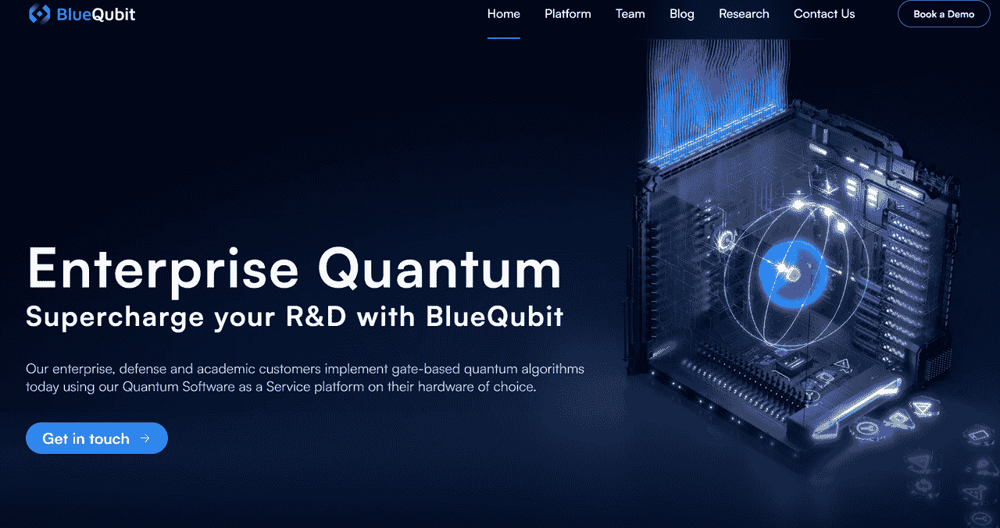

### Decart获得3200万美元融资，估值突破5亿美元，打造AI技术和“开放世界”应用

贡献人：

https://techcrunch.com/2024/12/19/decart-adds-another-32m-at-a-500m-valuation/

Decart是一家迅速崭露头角的初创公司，成立不到两个月便吸引了大量投资者的关注。该公司目前正在开发一项完全垂直整合的AI研究实验室，并基于此推出面向企业和消费者的产品。其首个企业级产品用于优化GPU使用，已为公司带来数百万美元的收入。而其首个面向消费者的产品则是一个名为“Oasis”的可玩“开放世界”AI模型，在发布后吸引了数百万玩家。

在强劲的市场反应下，Decart于2024年12月完成了3200万美元的A轮融资，Benchmark领投，Sequoia和Zeev Ventures也参与其中。这一轮融资将帮助公司加速其技术的商业化。融资完成后，Decart的估值已突破5亿美元，而在种子轮时，估值仅为1亿多美元。

Decart的CEO兼联合创始人Dean Leitersdorf表示，公司的目标不仅仅是挑战OpenAI、Anthropic等大公司，而是要创建一家万亿级的企业。他还透露，虽然公司已有多次收购接洽，但他们更专注于自我发展。Leitersdorf背景十分卓越，曾在以色列的Technion大学完成本科、硕士和博士学位，期间还兼顾了军役。

Decart目前主要专注于三大领域：系统（基础设施优化）、模型（AI算法）和数据（应用程序）。其首个产品是一款优化GPU使用的系统软件，已经被多家公司采用，大大降低了人工智能模型运行的成本。Leitersdorf表示，使用Decart软件后，原本每小时100美元的工作负载可以降至仅25美分每小时，这一成果让市场对公司产生了浓厚兴趣。

此外，Decart还推出了Oasis这款“开放世界”游戏，通过生成AI来提供实时、响应式的音频和视觉互动。未来，公司计划推出更多类似的体验，涵盖增强现实（AR）和虚拟现实（VR），并且这些体验无需特定硬件即可运行。

随着AI技术的广泛应用，Decart通过优化AI生成效率并降低门槛，帮助推动了创造力和实用应用的新一波浪潮。这一进展引起了风险资本的强烈兴趣，也为公司未来的发展奠定了坚实的基础。

公司官网：https://www.decart.ai/

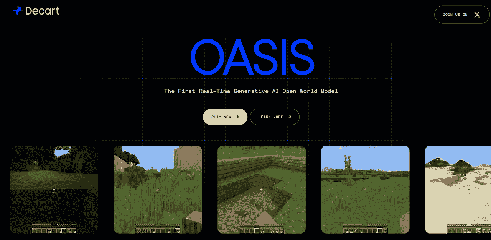

# 学习

### CUDA算子手撕与面试

贡献人：

https://zhuanlan.zhihu.com/p/12661298743

该项目旨在为求职者提供高性能计算（HPC）相关的CUDA算子练习和优化技巧，涵盖了常见算子的实现及其优化策略，适用于求职面试准备。主要内容包括从最基础的naive实现到高效优化版本的完整代码，便于调试和性能分析，同时提供了GPU编程中的相关知识点以帮助求职者高效备战。

项目主要集中在一些高频的CUDA算子，诸如elementwise、reduce、sgemm、transpose等。每个算子的实现都提供了不同的优化版本，且在面试中常见。项目不仅关注基本实现，还特别强调性能优化，尤其是在CUDA中的内存访问模式、线程布局和共享内存的使用等技术细节。

对于elementwise算子，提供了两种实现方式：naive版本，其中每个线程负责一个元素的计算，和向量化版本，利用float4进行向量化访存以提升大规模数据的处理效率。向量化访问适用于大数据集，可以显著提高带宽利用率和减少缓存失效，但要求线程和数据块的维度需仔细选择以避免性能损失。

在reduce算子方面，项目介绍了三种不同的优化方法。第一种是使用原子操作atomicAdd进行归约，但由于其带来的线程序列化问题，可能导致性能瓶颈。第二种方法是折半归约，采用共享内存存储中间结果，并在block内进行归约，避免了原子操作带来的性能下降。第三种方法是warp shuffle优化，通过CUDA的__shfl_sync指令在warp内部进行高效的归约，减少了同步开销，极大提高了并行性。

sgemm算子（矩阵乘法）则提供了naive版本和blocktile版本。naive版本较为简单，直接为每个输出矩阵元素分配一个线程，但性能较低。blocktile版本采用共享内存对A、B矩阵进行缓存，减少了对全局内存的频繁访问，从而提升了性能。进一步的优化可以采用threadtile技术，使得每个线程不仅负责计算一个输出元素，还可以通过共享内存优化对输入矩阵的访问，进一步提高效率。

对于transpose算子，提供了从naive到高效的优化方法。naive版本直接通过全局内存访问进行矩阵转置，效率较低。通过使用共享内存，可以避免bank conflict，提高性能。此外，合并访问策略和使用__ldg()进行只读内存访问也是优化关键。

在Softmax和其他归约相关算子的实现中，项目进一步展示了如何通过多个核函数分步计算，结合原子操作和共享内存的技术手段提升性能。这些技术对深度学习中的张量计算和归约操作尤其重要。

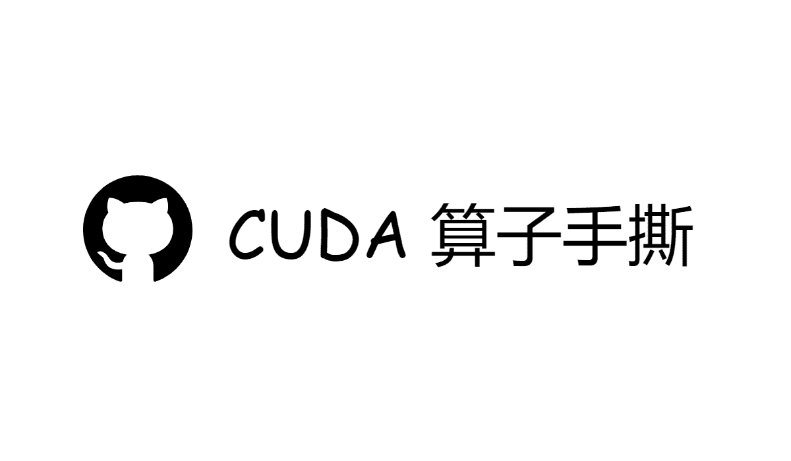

### 通俗易懂的Flow Matching原理解读

贡献人：

https://zhuanlan.zhihu.com/p/4116861550

随着SD3、Flux、MovieGen等模型的推出，流匹配（Flow Matching）和纠正流（Rectified Flow）开始受到越来越多的关注。这些方法的基本思想源自于连续标准化流（CNF）和神经常微分方程（Neural ODE）的研究，最初由多个工作团队提出。流匹配的核心目标是通过对速度场的拟合，将已知的先验分布转换为目标分布。与传统的生成模型不同，流匹配的关键是通过训练一个速度场，利用数值方法解决从初始分布到目标分布的转换过程。

流匹配的基本原理基于常微分方程，描述了概率流的演变。给定一个数据集，我们通过定义随时间变化的速度场，求解出从先验分布到目标分布的路径。这个过程涉及到求解随机微分方程（SDE），并通过数值积分得到最终的目标分布。然而，实际应用中我们通常无法获得完整的速度场表达式，因此需要通过神经网络来拟合这个速度场。

为了避免直接拟合速度场的复杂性，提出了条件流匹配（Conditional Flow Matching，CFM）。在CFM中，采用条件分布来简化计算。通过构造一个依赖于时间的条件分布，并使用条件概率流来拟合目标分布，CFM能够在已知初始和目标分布的情况下，利用条件速度场来逼近目标分布。这样一来，问题的求解就转变为通过优化代理目标来学习速度场，而不是直接推导速度场的解析表达式。

条件分布的构造为CFM提供了一个简洁的框架。在这个框架中，条件分布通过引入隐变量，将复杂的生成过程转化为更易处理的形式。优化条件速度场的过程与经典的得分匹配（score matching）方法类似，能够通过学习到的条件速度场来进行目标分布的逼近。这种方法特别适用于流匹配中难以获得的速度场表达式问题，使得整个过程变得更加可操作和高效。

CFM的实际实现中，速度场的拟合通常是通过神经网络来完成。通过将时间和空间位置作为输入，神经网络能够输出速度场，从而帮助生成目标分布。为此，优化目标通常是最小化网络输出的速度场与理论速度场之间的误差。在具体的实现中，常常使用数值积分方法（如欧拉法、龙格库塔法等）来求解对应的生成过程。

在源代码的实现中，核心步骤包括通过神经网络拟合条件速度场，并使用ODE求解器来模拟从先验到目标分布的过程。通过反向传播优化网络参数，训练过程可以逐步逼近目标分布。具体而言，生成样本的过程涉及到采样函数、速度场计算以及优化步骤。通过调整这些组件，CFM能够在较短的训练周期内有效地生成符合目标分布的样本。

此外，条件流匹配的一个重要变种是最优传输CFM（OT-CFM）。在这个变种中，采用最优传输理论来优化样本之间的传输路径，使得源分布和目标分布之间的距离最小化。OT-CFM在大规模数据集上的应用非常有效，特别是在样本对的传输路径需要优化的场景中。通过这种方法，可以进一步提升生成样本的质量，减少边缘分布的偏差。。

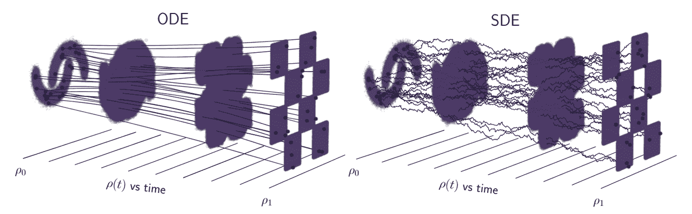

### 自动机器学习系统 (AutoML System)

贡献人：

https://zhuanlan.zhihu.com/p/12741560089

自动机器学习（AutoML）技术通过自动化整个机器学习模型的开发和部署过程，使得机器学习模型能够在各类实际应用中更高效地应用。它涵盖了从原始数据处理、模型设计、调优、部署到维护的各个环节，极大地减轻了开发者的工作负担。AutoML的核心是能够根据特定任务自动设计最合适的机器学习模型，主要涵盖两大设计空间：模型的结构和训练超参数。

模型的结构设计涉及选择不同类型的模型（如随机森林、卷积神经网络）和在同类型模型内选择最适合的架构。模型选择（Model Selection）指的是在众多候选模型中寻找最佳表现的模型架构。另一方面，模型的训练超参数，如学习率、批次大小等，也会影响模型的表现。超参数优化（Hyperparameter Optimization）旨在为这些参数寻找最优取值。传统的超参数调优往往依赖领域专家的经验，采用人工调节的方式，这个过程既耗时又繁琐，而AutoML则通过自动化搜索算法来完成这一过程。

AutoML流程通常从用户提供任务描述和数据集开始。根据任务需求，会有多个候选模型和超参数配置。这些候选配置构成一个模型空间（Model Space），AutoML通过搜索算法在该空间中进行优化，常见的算法包括超参数优化算法和神经网络结构搜索算法。搜索算法会随机或智能地选择模型和超参数配置，进行实验并根据实验结果优化搜索策略。实验结果的反馈将不断改进搜索过程，直到找到最优的模型。

在超参数优化方面，常用的搜索算法包括暴力搜索、随机搜索和网格搜索，这些方法通常需要大量的计算资源。更高效的方法，如基于模型的优化算法（SMBO），通过训练模型来预测超参数配置的性能，进而减少搜索空间的计算量。这类算法常用的模型有高斯过程和随机森林等。

神经网络结构搜索（NAS）是AutoML中的另一个重要方向，它专注于通过自动化的方式设计深度神经网络的结构。NAS可以帮助发现新的网络结构或调整现有结构，以满足不同的精度、大小和延迟需求。NAS常见的算法包括基于强化学习和进化算法的多试验搜索，以及通过超网络（Supernet）进行的单发搜索。单发搜索通过在超网络中共享权重来加速搜索过程，显著减少计算资源的需求。

AutoML工具的设计需要兼顾易用性、灵活性、扩展性和有效性。易用性保证用户能快速上手，灵活性允许用户根据需求定制模型和搜索策略，扩展性支持在大规模计算环境中运行，而有效性则是提升搜索效率和模型表现的关键。当前，自动机器学习工具大致分为两类：一类是面向端到端自动模型生成的工具（如Auto-Sklearn、AutoKeras），一类是更灵活的半自动工具，适合需要更多定制化配置的用户（如NNI、Ray）。这两类工具可以相辅相成，在不同的使用场景下提供最优解。

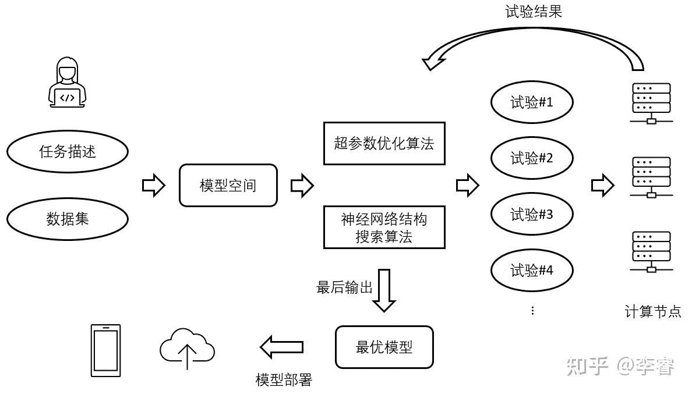

### 压缩即智能，如何使用LLM压缩呢？

贡献人：

https://zhuanlan.zhihu.com/p/13472975944

这篇文章讨论了LLM（自回归语言模型）中loss的意义，特别是如何将语言模型与数据压缩相结合。作者首先提到，cross entropy loss表示当前token的损失为负对数概率（-log(p)），这本质上反映了信息熵的变化，即根据当前的概率分布，我们理论上可以恢复真实信息。在完全随机的情况下，loss的值为-log(vocab_size)，这意味着通过LLM，我们可以实现类似压缩算法的功能，压缩率为-log(vocab_size)/final_loss。

在压缩的思路上，作者提出，压缩的核心是在计算下一个token的概率分布p(t)时，使用最少的信息量，尽可能减少编码的位数。通过从困惑度（ppl）出发，估算得到困惑度大概是所有候选token中平均的数目，而通过记录当前token的概率排序，可以用更少的位数表示token。例如，如果一个词表有2^16个token，而当前token的概率排序为2^3，那么只需要3个bit来表示这个token，相比16bit可以压缩约5.3倍。

尽管这是一个粗略的估算，作者也指出了此方法的一些潜在问题，如未考虑token之间的分隔符等因素。接着，作者进一步探讨了“Language Modeling Is Compression”的核心思想，提出语言模型本质上是通过不断二分概率区间来定位token所在位置。例如，在一个包含128个词的词表中，正确token的概率区间可能是[0.1, 0.2)，通过不断二分这个区间，可以逐步逼近正确的token位置。这个过程类似于数据压缩中的二进制编码，只不过它在动态调整概率区间时遇到了一些挑战，比如在概率区间跨越0.5分割线时会导致问题。

为了解决这些问题，作者建议将当前token的概率与下一个token的概率一起考虑，并共同二分，从而避免单独二分时可能出现的信息损失。这种方式可以减少比特的浪费，从而提高压缩效率。

最后，作者提到，这一“Language Modeling Is Compression”的思路并非首次提出，2023年8月就有类似的工作《Approximating Human-Like Few-shot Learning with GPT-based Compression》发表，但由于DeepMind的“Language Modeling Is Compression”影响力更大，因此受到了广泛关注。虽然后者发布稍晚，但它的思想更为完善，且理论上有更高的价值。

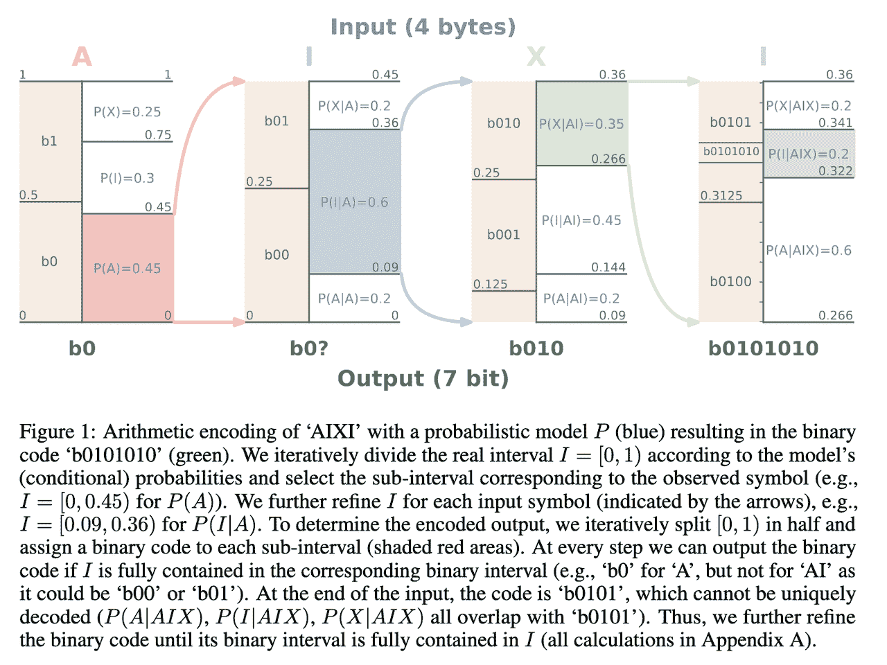

### 2024年MLSys推荐关注列表 - 系统篇

贡献人：

https://zhuanlan.zhihu.com/p/13621083399

文章分享了MLSys领域值得关注的人物推荐，主要围绕系统和算法两大方面。由于作者自己偏重算法，系统方面的内容可能有所疏漏，因此着重列出了一些在系统领域具有显著贡献的专家和开发者。推荐名单包括一些知名的知乎博主、科研人员及业界人士，他们在多个MLSys相关项目中有着重要角色。

在系统方面，推荐了诸如方佳瑞、手抓饼熊、InterestingLSY、赵轩磊等多位专家。这些专家涉及的研究领域包括并行训练、视频推理、分布式训练等，且他们均参与了多个开源项目。例如，方佳瑞是Colossal-AI、xDiT等项目的作者，而InterestingLSY则以DistServe、LoongServe等项目为人熟知。除此之外，还有一些从事推理优化、算法调度等工作的专家，如Chayenne Zhao和Hsword等，均在Github和知乎等平台分享了大量高质量的内容。

文章还提到了一些在学术界和业界有较高影响力的专家，如UCLA的Ying Sheng和UCB的Lianmin Zheng，他们的研究方向涵盖了深度学习模型的优化、编译器支持、低层次实现等。特别值得一提的是，许多推荐的专家都非常热衷于社区贡献，活跃在各大技术论坛和开源项目中，帮助其他研究人员解决问题。

此外，文中还列出了一些对新手友好的技术博主和研究者，这些人通过知乎等平台提供了易于理解的教程和论文总结，帮助广大学习者更好地掌握MLSys的技术要点。作者表达了对这些专家的感激，并计划在未来更新算法相关的推荐，进一步补充对整个MLSys领域的全面覆盖。

# 声明

本文档仅供学习交流使用，版权归原作者所有，若涉侵权，请联系Jack Jin 15101136166

##

（欢迎在下方反馈您宝贵的意见！整理不易，觉得有用给AI日报小组点个赞👍吧！）

ChatGPT；Angela；Zijia Liu；Alex；Zeqi Tan；Tiezhen（HuggingFace）；Naixu；Lizhi；Peter；Suoman；Jack

学术分析报告：ResearchFlow -- 奇绩F23校友的开发的深度研究产品，PC端进入RFlow的分析报告，可直接点击节点右侧的小数字展开节点，登录后可在节点上直接“询问AI”，进一步探索深度信息

如果你有大模型相关的创业想法，欢迎来找我们聊聊～🛰️：15101136166

> 快邀请你的小伙伴们一起来读大模型日报吧！

> **【日报****知识库****】**这里是近期日报内容的汇总,欢迎大家查阅

> [大模型日报知识库(分享版)](https://miracleplus.feishu.cn/wiki/KapVwXfkriOBiskB0B2cUHxjnTh)

>

> 欢迎大家多多帮我们分享,转发~~

> 如果大家有任何的建议或者吐槽,欢迎随时找我聊天~

