# 奇绩大模型日报（12月 21-22日）

> 来源：[https://miracleplus.feishu.cn/docx/ObQedICjwoYYB4xbvhHc9GCSnSN](https://miracleplus.feishu.cn/docx/ObQedICjwoYYB4xbvhHc9GCSnSN)

# 🔉潜**空间系列活动重磅回归！**

> 本期活动将在**12月22日** **11:00**开始，我们邀请到的嘉宾是**季宇。**清华大学计算机科学与技术系博士，曾在华为担任海思昇腾芯片编译器专家，负责多个昇腾编译器项目，并在AI编译器领域和处理器微架构领域进行挑战性问题攻关。他于2023年8月创立了行云，该公司致力于研发下一代针对大模型推理场景的高效能GPU芯片，并在2024年连续完成总额数亿元的天使轮及天使+轮融资。季宇的主要研究领域包括神经网络加速器、编译器和面向系统优化的机器学习。他将带来《谁困住了AI产业——大型机化的计算机形态与变革的可能性》的分享。

> 除嘉宾分享外，每期设置了【匹配合伙人 Cofounder Matching】环节。你可以和 GenAI 时代最有活力的创业者和研究者线下面对面交流，将有机会找到志同道合、有共同创业梦想的小伙伴。

> 报名通道已开启，欢迎扫描下方二维码报名。

# 资讯

### Ilya宣判后GPT-5被曝屡训屡败，一次训数月，数据要人工从头构建

贡献人：

https://mp.weixin.qq.com/s/LI0yCmtnyPlfAU0q9tuYxA

OpenAI的GPT-5目前面临多重挑战，进展远未达到预期。尽管GPT-5已经进行了两轮长达数月的训练，每次训练后都遇到了新问题，导致其发布延迟。训练成本极为高昂，每轮6个月的训练仅算力消耗就高达5亿美元，且在尝试提高效率时，问题依然没有得到有效解决。OpenAI为了满足GPT-5预训练的需求，专门雇佣工程师和数学家从头构建数据，甚至使用O1合成数据，但效率仍然不高。

GPT-5的目标是具备更高的智能水平，能够进行科学探索、完成复杂的日常任务并减少错误，如减少幻觉等。然而，这一目标的实现进展缓慢。GPT-5的开发始于GPT-4发布时，已有超过18个月的时间，原计划2024年中发布，但目前仍未明确发布日期。

与此同时，OpenAI发布的O1和O3系列却展现出了令人瞩目的成果，尤其是在ARC-AGI测试中，O3的表现刷新了记录，准确率达到91.5%，远超GPT-4。O3通过在Token空间内搜索和执行，展示了新的知识重组机制，标志着推理Scaling Law的成功，并为未来AGI的发展提供了新的思路。尽管如此，O3仍未达到AGI的标准，特别是在一些简单任务上仍然失败。

OpenAI目前的策略似乎正在调整，随着GPT系列的进化速度放缓，O1和O3系列的推出成为了新的方向。虽然GPT-5仍在开发中，但其能否如预期带来重大飞跃仍然充满不确定性。即便如此，O3在ARC-AGI等任务中的表现仍证明了其在广泛任务上的能力，展示了人工智能在解决复杂问题上的潜力。

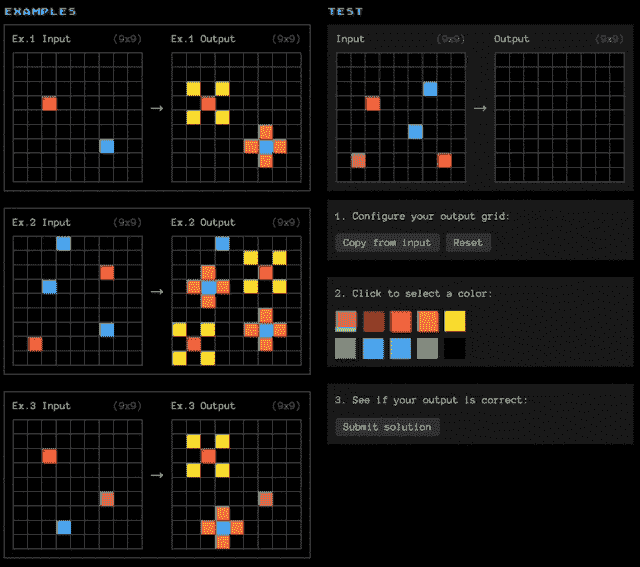

### o3来了！编程跻身人类全球前200，破解陶哲轩说难的数学测试

贡献人：

https://mp.weixin.qq.com/s/Is59x1Gz9nA_ZZPmKutQ4Q

OpenAI最近发布了其下一代模型O3，并在“双12”直播活动中展示了其强大能力。O3相较于O1在多个领域表现出色，尤其是在顶尖程序员竞赛CodeForces中，O3的分数超过2700，这个成绩仅有不到200个人类能达到。此外，O3在为AGI（人工通用智能）设计的ARC-AGI测试中的表现也显著提升，从32%跃升到75.7%甚至87.5%，支持低、高思考程度设置，使得计算能力得到了充分发挥。

ARC-AGI测试是由Keras之父François Chollet发起，主要考察图形逻辑推理能力。而在EpochAI Frontier Math测试中，O3的表现远超以往的SOTA（最先进技术），从2分提升到25分，这项测试包含了最新的未公开数学题，难度堪比陶哲轩等数学家的挑战。

除了O3，OpenAI还推出了O3-mini版本，支持低、中、高三种思考程度设置，特别展示了其编程能力。在低设置下，O3-mini与O1-mini表现相似，而在高设置下，O3-mini已超越O1正式版。北大校友任泓宇在直播中展示了O3-mini的编程能力，演示了一个Python脚本生成、执行过程，其中O3-mini在38秒内完成了任务，成功生成并执行代码。

有趣的是，O3-mini甚至能够在其自身生成的UI中编写代码并执行，评估其在低思考程度下的表现。演示结果显示，O3-mini在GPQA数据集上的评分为61.62%，接近正式评估结果。

尽管如此，O3和O3-mini目前仅为早期预览版本，仅限安全研究者申请访问。此次直播还透露了OpenAI的核心开发者——北大校友任泓宇的背景，他在加入OpenAI之前曾在多个科技公司积累丰富经验，包括Apple、Google、NVIDIA和Microsoft。

这次发布不仅展现了O3及其子版本的卓越能力，也再次引发了公众对人工智能未来发展的讨论，甚至让人感觉有些科幻色彩。https://mp.weixin.qq.com/s/mYO_Y3zlbce9yJ8TrO3l5A

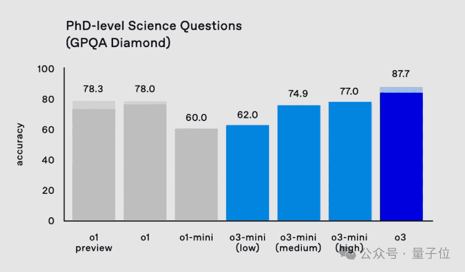

### MIT工程师成功研发“高楼”3D芯片技术

贡献人：

https://news.mit.edu/2024/mit-engineers-grow-high-rise-3d-chips-1218

麻省理工学院（MIT）的工程师成功开发了一种新型的3D芯片技术，通过直接将多层半导体材料叠加在一起，突破了传统硅基芯片的局限。这项研究的关键在于，MIT团队成功地避免了使用厚重的硅基晶圆作为支撑，解决了芯片之间通信慢、效率低的问题，极大提升了计算速度和数据传输效率。

**技术创新与应用：**

+   **3D芯片设计**：传统芯片将更多晶体管挤压到单一表面，但MIT的团队通过多层半导体材料叠加，成功将芯片从“平面”转变为“高楼”。这一创新不仅让芯片能承载更多数据，还能够执行更加复杂的任务，提升了整体计算能力。

+   **新方法**：MIT团队开发的新方法不需要使用传统的硅基晶圆作为支撑，而是直接在不同的半导体层之间建立良好的接触，减少了通信的延迟。这种设计方法能够让AI硬件变得更为高效，未来可能被应用于笔记本电脑、可穿戴设备等领域，甚至能够达到当今超级计算机的运算速度和存储能力。

+   **突破性进展**：为了实现这一技术，MIT的工程师们通过借鉴冶金学的原理，解决了低温条件下生长单晶半导体的难题。这项创新方法可以在低于400摄氏度的温度下完成单晶生长，避免了高温对底层电路的损害。

+   **潜力与未来**：MIT团队预计，未来该技术可以实现数十层甚至数百层的逻辑和内存层叠，极大提高芯片的计算能力和数据存储能力，为AI、大数据、内存等领域带来巨大的应用潜力。

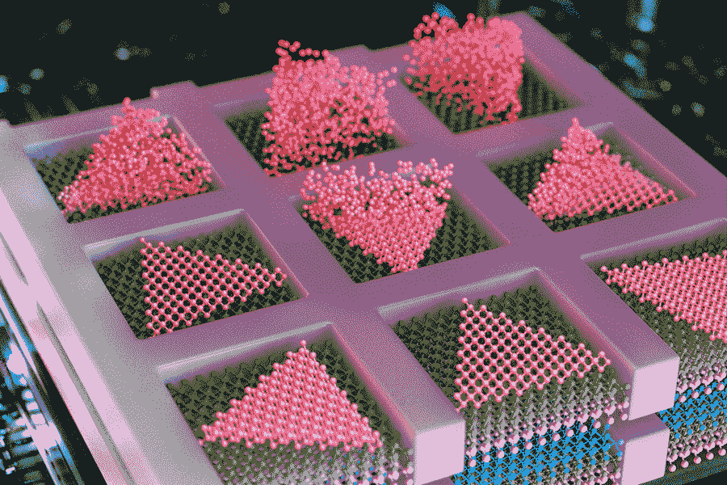

### AI应用进展最新跟踪

贡献人：

https://mp.weixin.qq.com/s/PkwEvLhGiJ5lNxFmDsncJg

近年来BAT及字节等互联网厂商积极投入AI产业，均形成了从模型到平台，最终到应用和设备的全面布局。随着AI商业化逐步进入落地阶段，尤其Agent、AI眼镜、AI耳机、AI玩具等产品引发市场关注，AI产业有望进一步加速。

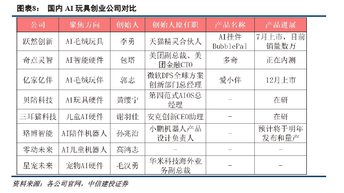

# 推特

### Schmid分享：如何在 2025 年使用 Huggingface 微调开放 LLM

https://x.com/_philschmid/status/1870104855353671864

2025 年唯一需要的微调指南 ‼️

很高兴与大家分享《如何在 2025 年使用 @huggingface 微调开放 LLM》，涵盖从 Q-LoRA 到 Spectrum 方法的一切，重点关注优化、效率和分布式训练 👀

尽管模型不断优化，但微调在特定场景中仍然非常重要，尤其是在以下方面：

• 提高一致性

• 培养领域专长

• 控制输出风格

• 降低成本

在本指南中，你将学到：

🎯 如何定义适合微调的用例，与直接使用提示（prompting）进行对比

🛠️ 如何使用 Hugging Face 的库设置开发环境

📚 如何以对话格式创建并准备数据集

⚡ 使用 Q-LoRA 进行高效的 4-bit 训练，或采用 Spectrum 方法选择性微调重要层

💨 利用 Flash Attention 和 Liger Kernels 加速训练

💻 使用 DeepSpeed 和 accelerate 在多 GPU 上扩展训练规模

📊 使用评估工具包测试和评估模型

🔥 借助 TGI/vLLM 将模型部署到生产环境

赶快行动吧！

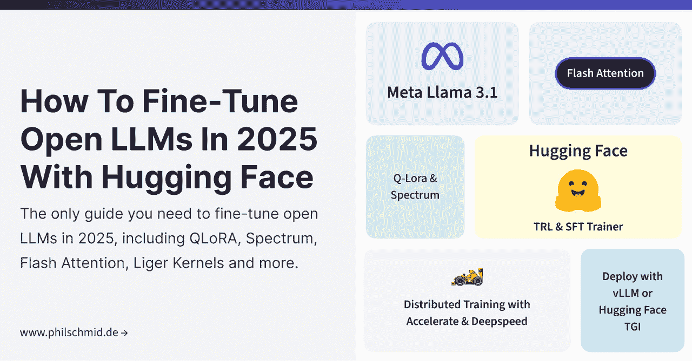

### Anderson分享直播：每位 LLM 开发者都需要了解的 GPU 知识

https://x.com/hugobowne/status/1870253760108474607

昨天，我与 @charles_irl（@modal_labs）一起进行了长达 2 小时的直播，主题是《每位 LLM 开发者都需要了解的 GPU 知识》。以下是我们讨论的一些主题内容。

你可以点击下方链接立即观看，播客将于下周上线：

[https://youtube.](https://youtube.com/live/INryb8Hjk3c)com/live/INryb8Hjk3c

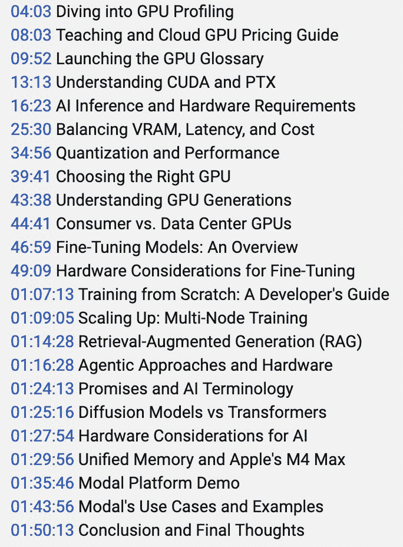

### AI制作视频引热议：卡比兽下雪了

https://x.com/hardmaru/status/1870642563021234573

hardmaru：AI 生成的视频彻底失控了 😹

[5fkrgqQdbqQjhtal.mp4](https://internal-api-drive-stream.feishu.cn/space/api/box/stream/download/all/Vf90bR3lvoWysixXHNVchM44nTh)

### Yao Fu谈开源闭源模型差距：不要追逐竞争，不要试图赶上，不要参与游戏，进行严格的科学研究

https://x.com/Francis_YAO_/status/1870400834607124515

Wenhu Chen：开源模型和闭源模型之间的差距越来越大。

学术界应该如何追赶？

---

Yao Fu回复：不要追逐竞争。不要试图赶上。不要参与游戏。相反，要进行严格的科学研究。做受控实验，明确假设，仔细检查备选假设，排除混杂因素。把《LLM 的物理学教程》听十遍，背下每一个字。我已经记不清上一次看到关于 LLM 的论文明确陈述假设、进行受控实验、排除混杂因素或检查备选假设是什么时候了。他们只是说：“我们试了一些方法，这个方法有效，但不确定为什么。可能是数据好，但也不确定‘好’的定义是什么。”我们还记得“备选假设”的定义吗？这是高中就教过的东西啊。所以，拜托，请帮助我们将“炼金术”变成科学。

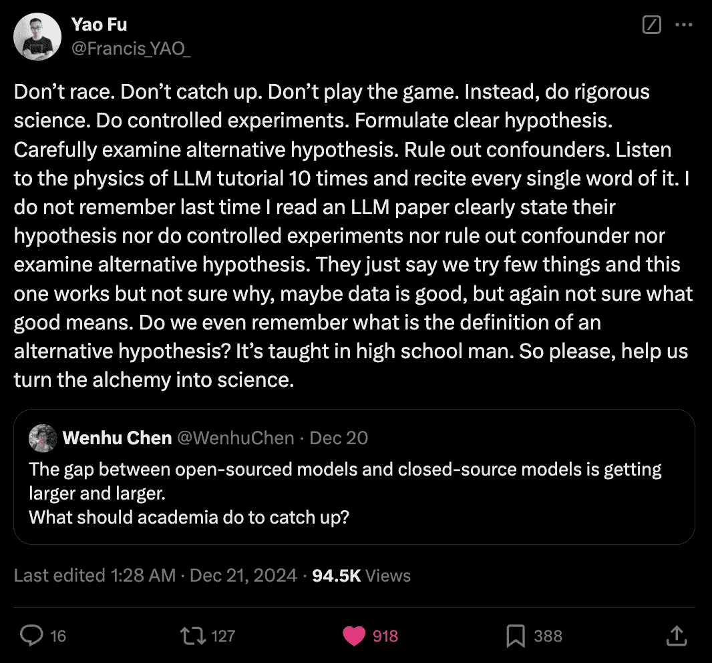

# 信号

### VISA: Retrieval Augmented Generation with Visual Source Attribution

原文链接：https://arxiv.org/abs/2412.14457

带来源归因的生成对于增强检索增强生成 (RAG) 系统的可验证性非常重要。然而，RAG 中现有的方法主要将生成的内容链接到文档级引用，这使得用户很难在多个内容丰富的检索文档中找到证据。为了应对这一挑战，我们提出了带视觉来源归因的检索增强生成 (VISA)，这是一种将答案生成与视觉来源归因相结合的新方法。利用大型视觉语言模型 (VLM)，VISA 可以识别证据并在检索到的文档屏幕截图中使用边界框突出显示支持生成答案的确切区域。为了评估其有效性，我们整理了两个数据集：基于抓取的维基百科网页屏幕截图的 Wiki-VISA 和源自 PubLayNet 并针对医学领域量身定制的 Paper-VISA。实验结果证明了 VISA 对文档原始外观的视觉来源归因的有效性，同时也突出了改进的挑战。代码、数据和模型检查点即将发布。

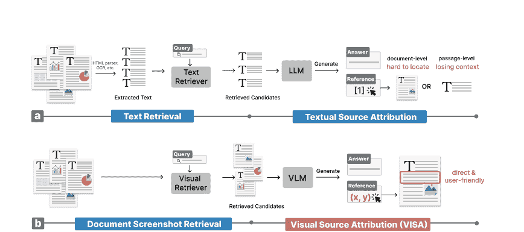

###

### Bongard in Wonderland: Visual Puzzles that Still Make AI Go Mad?

原文链接：https://arxiv.org/abs/2410.19546

最近，新开发的视觉语言模型 (VLM)（例如 OpenAI 的 GPT-4o）应运而生，似乎展示了跨文本和图像模态的高级推理能力。然而，这些语言引导感知和抽象推理方面的进步的深度仍未得到充分探索，而且尚不清楚这些模型是否真的能实现其雄心勃勃的承诺。为了评估进展并发现不足之处，我们进入了 Bongard 问题的仙境，这是一组经典的视觉推理难题，需要类似人类的模式识别和抽象推理能力。虽然 VLM 偶尔能够成功识别判别概念并解决一些问题，但它们经常会失败，无法理解和推理视觉概念。令人惊讶的是，即使是对人类来说似乎微不足道的基本概念，例如简单的螺旋，也带来了重大挑战。此外，即使被要求明确关注和分析这些概念，它们仍然会失败，这不仅表明它们缺乏对这些基本视觉概念的理解，而且无法推广到看不见的概念。这些观察强调了 VLM 目前的局限性，强调了类似人类的视觉推理和机器认知之间仍然存在很大差距，并强调了该领域持续创新的需求。

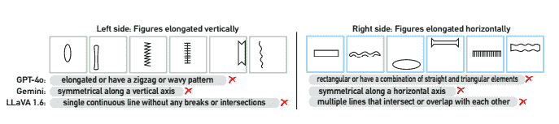

###

### LlamaFusion: Adapting Pretrained Language Models for Multimodal Generation

原文链接：https://arxiv.org/abs/2412.15188

我们提出了 LlamaFusion，这是一个为预训练的纯文本大型语言模型 (LLM) 提供多模态生成能力的框架，使它们能够理解和生成任意序列的文本和图像。LlamaFusion 利用现有的 Llama-3 权重来自回归处理文本，同时引入额外的并行转换器模块来处理具有扩散的图像。在训练期间，来自每种模态的数据都会被路由到其专用模块：特定于模态的前馈层、查询键值投影和规范化层独立处理每种模态，而共享的自注意力层允许跨文本和图像特征进行交互。通过冻结特定于文本的模块并仅训练特定于图像的模块，LlamaFusion 保留了纯文本 LLM 的语言能力，同时开发了强大的视觉理解和生成能力。与从头开始预训练多模态生成模型的方法相比，我们的实验表明，LlamaFusion 仅使用 50% 的 FLOP 将图像理解能力提高了 20%，将图像生成能力提高了 3.6%，同时保持了 Llama-3 的语言能力。我们还证明，该框架可以调整具有多模态生成能力的现有视觉语言模型。总体而言，该框架不仅利用了纯文本 LLM 中现有的计算投资，而且还实现了语言和视觉能力的并行开发，为高效的多模态模型开发提供了一个有希望的方向。

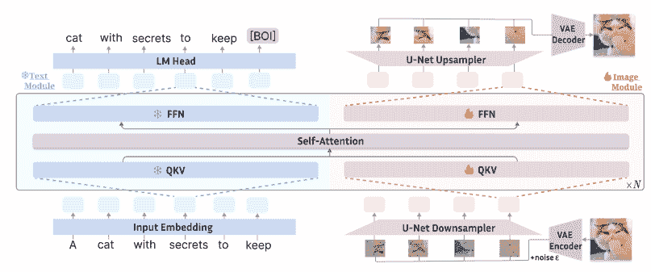

###

### Smarter, Better, Faster, Longer: A Modern Bidirectional Encoder for Fast, Memory Efficient, and Long Context Finetuning and Inference

原文链接：https://arxiv.org/abs/2412.13663

与较大的仅使用解码器的模型相比，仅使用编码器的 Transformer 模型（例如 BERT）在检索和分类任务中提供了出色的性能和尺寸权衡。尽管 BERT 是众多生产流程的主力，但自发布以来，其帕累托改进有限。在本文中，我们介绍了 ModernBERT，它将现代模型优化引入仅使用编码器的模型，并且与旧编码器相比实现了重大的帕累托改进。ModernBERT 模型在 2 万亿个具有原生 8192 序列长度的 token 上进行训练，在大量评估中表现出最佳结果，这些评估涵盖了各种分类任务以及不同域（包括代码）上的单向量和多向量检索。除了强大的下游性能外，ModernBERT 还是速度和内存效率最高的编码器，专为在常见 GPU 上进行推理而设计。

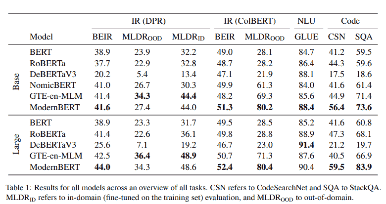

# 产品

### Revfx 账户相似 利用人工智能精准查找相似账户

贡献人：

https://revfx.ai/lookalike-accounts?ref=producthunt

Revfx AI Lookalikes 是一款智能客户分析和细分工具，通过深入挖掘最佳客户的特征，帮助企业将广泛的行业转化为高度精准的细分市场。利用强大的人工智能算法，Revfx 可以识别客户的独特属性，并生成自定义行业分类，例如“医疗水疗设备制造商”或其他细分市场，从而更贴近业务需求。工具自动发现符合条件的类似公司，为企业拓展目标客户群提供数据支持。这种高度个性化的市场划分方式，不仅提升了潜在客户定位的准确性，还能显著提高市场营销和销售活动的效率，助力企业快速扩大业务影响力。

### Eapy 组织、分享和共同创作音乐

贡献人：

https://home.eapy.io/?ref=producthunt

Eapy 是一个专为音乐创作者设计的多媒体工作空间，旨在通过音乐将全球的创作者连接在一起。它为用户提供了一个直观的视觉化平台，用于整理和展示创作灵感，轻松组织创作思路。创作者可以在 Eapy 上与他人分享灵感和工作流程，借助社区的力量进行协作，同时也能通过我们专有的 AI 音乐生成模型共同创作原创音乐。这些模型生成的音乐100%无版权，确保创作者可以自由使用而无需担心侵权问题。无论是独立音乐人还是团队合作，Eapy 都为音乐创作的每一步提供了强有力的支持，让音乐的创作过程更加高效、自由和富有灵感。

# HuggingFace&Github

### ModernBERT-base

贡献人：

https://huggingface.co/answerdotai/ModernBERT-base

模型摘要

ModernBERT 是一种现代化的双向编码器专用 Transformer 模型（BERT 风格），已在 2 万亿个英语和代码数据上进行预训练，原生上下文长度最多为 8,192 个标记。ModernBERT 利用了最近的架构改进，例如：旋转位置嵌入 (RoPE)用于长上下文支持。；局部-全局交替注意力机制，提高长输入的效率；取消填充和 Flash Attention可实现高效推理。ModernBERT 的原生长上下文长度使其成为需要处理长文档的任务的理想选择，例如检索、分类和大型语料库中的语义搜索。该模型是在大量文本和代码语料库上训练的，因此适用于各种下游任务，包括代码检索和混合（文本 + 代码）语义搜索。

# 投融资

### 2024年已筹集超过1亿美元的49家美国AI初创公司

贡献人：

https://techcrunch.com/2024/12/20/heres-the-full-list-of-49-us-ai-startups-that-have-raised-100m-or-more-in-2024/

2024年，AI初创公司获得了强劲的投资支持，许多企业成功吸引了大量资金。本篇文章总结了截至目前，共有49家美国AI初创公司在2024年筹集了1亿美元以上的资金。

这些公司涵盖了多个AI领域，包括生成式AI、人工智能硬件、自动化、AI平台等。从投资者的角度来看，2024年的资金流入表现强劲，既有新兴投资者，也有传统的大型风险资本公司参与其中。

**主要投融资信息：**

+   **投资金额**：截至2024年底，许多初创公司成功筹集了超过1亿美元的资金。资金来源包括顶级风险投资公司、企业资本和战略投资者。

+   **热门领域**：生成式AI、数据分析、自动化、AI芯片和平台技术成为投资者关注的主要方向。

+   **投资趋势**：资本集中流入已经成熟的AI应用场景，尤其是生成式AI和企业级AI平台，预示着AI技术的广泛应用前景。

+   **行业巨头参与**：不少大型科技公司和投资机构都积极参与这些AI初创公司的融资轮次，为初创公司提供了强大的资金支持和技术资源。

### 英伟达通过监管审批收购Run:AI

贡献人：

https://techcrunch.com/2024/12/20/nvidia-clears-regulatory-hurdle-to-acquire-runai/

2024年12月，英伟达成功获得欧洲委员会的批准，完成了对以色列AI公司Run:AI的收购。根据Bloomberg的报道，欧洲委员会一致同意英伟达可以继续进行收购，认为此交易不会在市场上形成垄断，因为即使收购完成，市场上仍然会有其他兼容英伟达硬件的选择。

尽管欧洲监管机构已批准这项交易，但美国司法部仍未批准此收购，具体何时或是否批准尚不清楚。

**投融资和收购要点：**

+   **收购金额**：虽然具体交易条款尚未披露，但根据以色列当地媒体的报道，此次收购的估计金额为7亿美元。

+   **收购背景**：英伟达于2024年4月首次宣布收购Run:AI，这家以色列AI公司专注于GPU协调平台，旨在帮助数据中心优化AI工作负载的管理。

+   **监管审批**：英伟达成功获得了欧盟的批准，表明欧盟对AI市场的整合持支持态度，尤其是在不造成市场垄断的情况下。

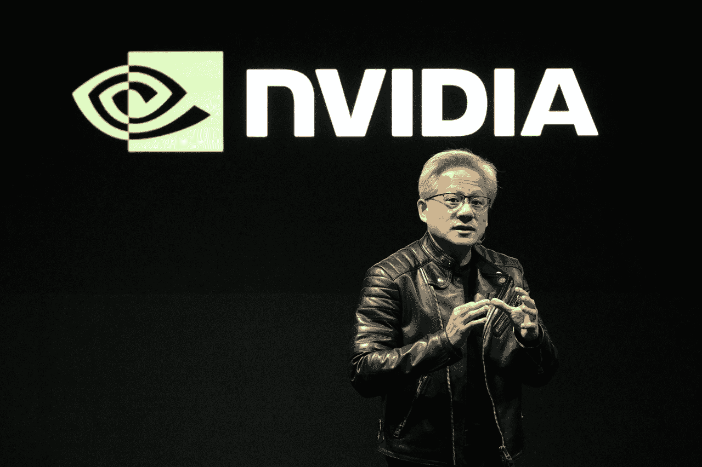

# 学习

### 多GPU ML/AI机器配置精进

贡献人：

https://zhuanlan.zhihu.com/p/13515537095

在配置用于训练文生图模型的机器时，用户遭遇了GPU价格飙升以及GPU通信和硬件优化知识的缺乏。为了减少成本并提高硬件效能，了解GPU通信的细节至关重要。GPU通信主要分为三种类型：RDMA（GPU与非GPU设备的通信）、P2P访问（GPU之间的相互数据传输）、以及P2P复制（GPU之间单向数据传输）。尤其是P2P访问，这对多GPU配置至关重要，能够减少内存带宽的消耗，但自NVIDIA的Turing架构以来，很多消费级GPU（如GeForce系列）已经不支持GPU间的直接数据传输，只能通过内存进行数据交换，这会大幅降低性能。

在多卡配置中，如果需要较大显存共享，选择支持P2P的Tesla或Quadro系列显卡更为合适。尽管通过内存进行数据传输可以实现类似共享显存的效果，但性能会下降30%-50%。在构建ML/AI系统时，应尽量避免使用超过4卡的GeForce显卡，特别是在需要极高性能的情况下。对于系统的稳定性，建议短期内使用Xeon处理器而非Threadripper Pro或EPYC，因为后者的性能问题预计在2025年得到解决。

在配置时，优先选择Linux操作系统，因其可以绕过GeForce卡的P2P限制，最大化利用硬件资源。若条件允许，推荐选择NVIDIA的DGX系统，尽管价格较高，但其性价比更优。对于国产AI芯片，华为的昇腾910B已经与NVIDIA的A800媲美，尽管显存较少，但在PyTorch等框架中已经具备应用潜力。

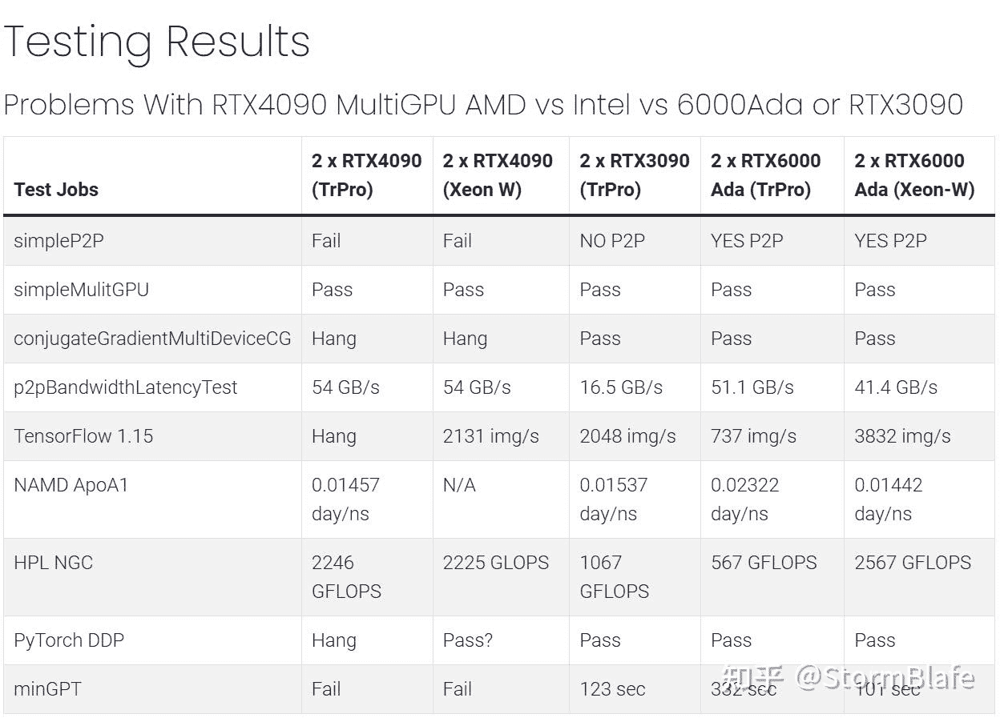

### LLM+flow模型生成范式原理与代码解析

贡献人：

https://zhuanlan.zhihu.com/p/11687284058

多模态大模型通常指的是能够处理图像和文本输入，并生成与图像相关的文本输出的模型，少数模型能够同时进行图像理解和生成，例如Meta的Chameleon、字节的O-show和DeepSeek的Janus等。多模态理解和生成模型大致可分为两种类型：第一类模型将图像转化为离散的token id，再利用自回归或“完形填空”方式进行生成；第二类模型则直接结合LLM与图像生成模型，二者协同工作，生成与文本相关的图像。

本文以DeepSeek的JanusFlow为例，介绍了第二类多模态理解与生成模型。与Janus模型一样，JanusFlow将图像理解与图像生成分开处理，但它通过共享LLM的主干部分进行集成。在图像理解任务中，JanusFlow使用SigLIP作为图像编码器，将图像与文本对齐，生成与图像相关的文本。而在图像生成任务中，它采用了Rectified Flow模型的生成范式，基于文本条件控制生成过程。图像生成的过程发生在latent空间，经过Rectified Flow模型的多次迭代更新，最终将生成的图像从latent空间映射回像素空间。

JanusFlow使用了ConvNeXt block堆叠作为Flow模型的编码器和解码器。Flow编码器的作用是将输入的噪声转化为图像的特征表示，同时使用时间嵌入（t_emb）来表示当前迭代的时间步。通过时间嵌入，图像生成过程能够感知当前是第几步，从而控制图像生成的进度。Flow模型的解码器通过PixelShuffle技术进行上采样，将低分辨率的特征图转化为更高分辨率的图像。

在生成过程中，JanusFlow通过Classifier-Free Guidance（CFG）技术来平衡生成图像的多样性与文本指令的符合度。具体来说，CFG通过随机丢弃部分文本信息，强制生成模型在没有明确指导的情况下生成高质量的图像，从而提高生成图像的质量与多样性。

图像生成过程通过迭代进行，每一步更新图像的特征，直到生成最终图像。JanusFlow的Rectified Flow模型通过预测图像变化的速率（速度v）并在每一步更新图像的特征，逐步优化图像生成过程。每次迭代的输出都被用来更新图像，最终通过VAE解码器将latent空间中的图像特征映射回像素空间，生成清晰的图像。

JanusFlow的图像生成能力依赖于高度优化的编码器和解码器结构，以及精妙的时间编码机制。其核心思想是通过迭代的方式，在无监督的情况下生成具有高度一致性的图像，且能够灵活地响应文本提示。

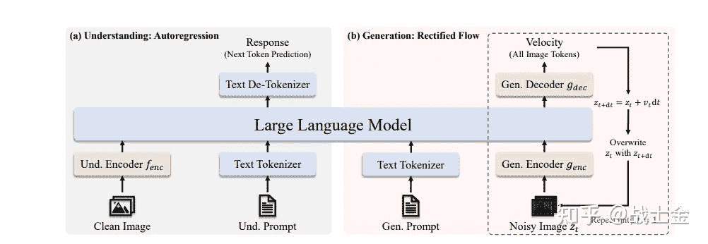

### Deep dive vLLM和SGLang推理框架的CPU开销

贡献人：

https://zhuanlan.zhihu.com/p/12201991762

本文分析了vLLM和SGLang在大型语言模型推理过程中的CPU调度开销，特别是在迭代级别调度（iteration-level schedule）对GPU利用率和LLM服务效率的影响。迭代级别调度的优势在于动态决定每个推理步骤的batch大小，相比传统的批处理调度方法，能够提高资源利用率。然而，这种方法的性能假设是CPU调度开销可忽略不计。随着LLM内核性能提升，C++运行时的时间变短，CPU调度开销逐渐变得显著，成为瓶颈。

作者使用了vLLM 0.6.0和SGLang两个系统进行评估。vLLM的测试数据来自三个月前的基准测试和PyTorch分析结果，而SGLang的数据则基于互联网和SGLang团队发布的基准结果。评估表明，vLLM的CPU调度开销可能占到总推理时间的一半以上，尤其是在输入/输出张量的预处理和后处理环节。相比之下，SGLang的调度开销显著较低，原因在于其简化了输入/输出张量处理的流程。

在vLLM的评估中，测试使用了Llama 3.1-8B模型，并在A100 GPU上进行了多种负载下的推理。实验显示，vLLM的CPU调度开销与模型前向推理时间几乎相当，且随着输出长度的增加，调度开销的占比也明显上升。进一步分析揭示，调度开销主要集中在输入张量构建、去标记化、元数据准备等环节。这些开销主要源自输入/输出张量的处理，导致了高达50%的推理时间花费在CPU调度上。

与vLLM不同，SGLang通过优化CPU调度减少了这部分开销。其优化措施包括在用户没有提供停止符的情况下避免去标记化、改进Python操作、更精简的调度机制、增强的多进程/多线程支持以及更有效的调度与计算环节解耦。此外，SGLang还通过增加CPU调度和GPU计算的重叠来进一步提升效率，这一策略与SM90的cutlass gemm warp专用持久pingpong内核的优化动机相似。

总体来看，vLLM和SGLang都在不断优化CPU调度开销，以提高大规模LLM推理的性能，尤其是在迭代级调度的背景下。两者的开发方向都着眼于减小I/O过程的开销，并通过更精细的调度策略提升整体系统效率。

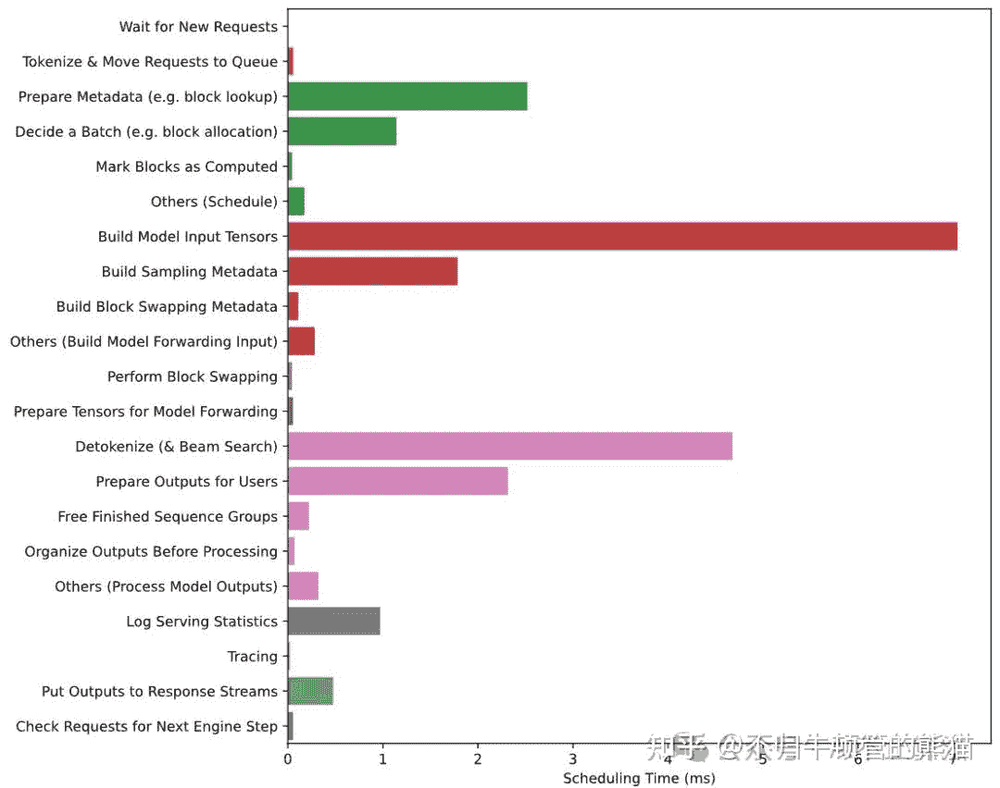

### 强化学习-大模型-决策树（RL-LLM-DT)

贡献人：

https://zhuanlan.zhihu.com/p/12972386843

作者最近开发了一个名为RL-LLM-DT的方法（强化学习-大语言模型-决策树），旨在解决两人零和博弈中的策略求解问题，特别是针对像剪刀石头布这样策略传递性差的游戏。该方法通过强化学习训练对抗策略，并使用大语言模型自动优化决策树，从而在比赛中生成和改进策略。用户在RLChina 2022春季赛的冰壶游戏中应用这一方法，最终获得第一名。该方法的核心步骤包括：首先通过大模型生成初始决策树；然后用强化学习找出针对该决策树的策略，并用游戏录像反馈给大模型来改进决策树，直到找不到新的改进方向为止。

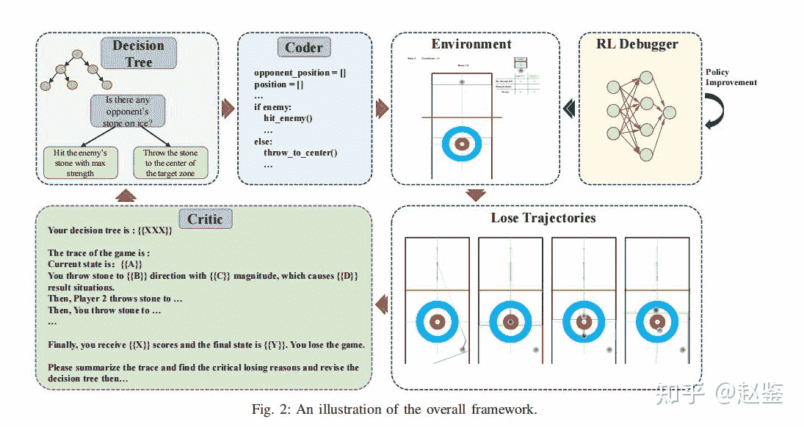

# 声明

本文档仅供学习交流使用，版权归原作者所有，若涉侵权，请联系Jack Jin 15101136166

##

（欢迎在下方反馈您宝贵的意见！整理不易，觉得有用给AI日报小组点个赞👍吧！）

ChatGPT；Angela；Zijia Liu；Alex；Zeqi Tan；Tiezhen（HuggingFace）；Naixu；Lizhi；Peter；Suoman；Jack

学术分析报告：ResearchFlow -- 奇绩F23校友的开发的深度研究产品，PC端进入RFlow的分析报告，可直接点击节点右侧的小数字展开节点，登录后可在节点上直接“询问AI”，进一步探索深度信息

如果你有大模型相关的创业想法，欢迎来找我们聊聊～微信：15101136166

> 快邀请你的小伙伴们一起来读大模型日报吧！

> **【日报****知识库****】**这里是近期日报内容的汇总,欢迎大家查阅

> [大模型日报知识库(分享版)](https://miracleplus.feishu.cn/wiki/KapVwXfkriOBiskB0B2cUHxjnTh)

>

> 欢迎大家多多帮我们分享,转发~~

> 如果大家有任何的建议或者吐槽,欢迎随时找我聊天~

