# 奇绩大模型日报（12月 23日）

> 来源：[https://miracleplus.feishu.cn/docx/KsYndLPm0oEdoDxZ2U5cYNX6nRX](https://miracleplus.feishu.cn/docx/KsYndLPm0oEdoDxZ2U5cYNX6nRX)

# 资讯

### 李飞飞谢赛宁新作「空间推理」：多模态大模型性能突破关键所在

贡献人：

https://mp.weixin.qq.com/s/hDXNShZT5PfWN9EbfVfFhw

李飞飞和谢赛宁近期发布了新研究，深入探讨多模态大语言模型的空间认知能力。尽管这些模型在视觉和语言理解方面已取得显著进展，但它们在空间推理上的表现仍远不如人类，约71%的错误与空间推理相关。因此，空间推理被视为当前的主要瓶颈。尤其是在任务中，常用的语言提示技术（如思维链和思维树）未能提升模型的空间表现，反而导致性能下降。然而，明确生成认知地图则能有效增强模型在空间任务中的表现。

为了研究这一问题，团队提出了VSI-Bench基准测试集，基于视频数据集（如ScanNet等）自动生成视觉问答（VQA）问题。该测试集涵盖了物体计数、相对距离、房间大小等任务，评估了15种支持视频输入的多模态大语言模型。测试结果表明，人类在这些任务中的准确率远高于模型，尤其在配置型和时空任务中，模型的准确率普遍不足50%。

研究进一步揭示，尽管模型在视频理解和语言推理方面有一定能力，约70%的错误源自其空间推理不足。为了改进这一点，团队尝试了认知地图作为辅助工具，发现该机制能显著提高模型在相对距离任务中的表现，提升了10个百分点。研究表明，模型倾向于形成局部空间理解，而非全面的全局空间感知，这为未来模型的改进提供了新的方向。

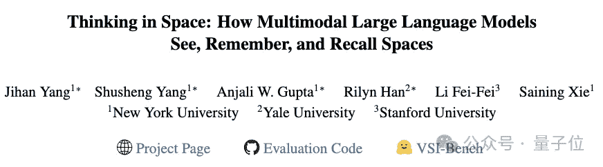

### 智元灵犀 X1 装机教程

贡献人：

https://mp.weixin.qq.com/s/dq70xdHtRYxitiQtuM5RJQ

智元灵犀X1通用人形套餐自上线以来，受到广泛关注，近期为了帮助爱好者DIY组装，推出了《智元灵犀X1装机教程》系列视频，进一步激发了粉丝的热情。为便于DIY，智元还提供了完整的装机指南、开发指南以及核心组件的介绍，包括视频和文字版内容，方便用户快速上手。此外，X1套餐现已备货充足，购买后即能发货。

智元灵犀X1包含六大核心组件：OmniPicker自适应夹爪、域控制器DCU、电机组件PowerFlow系列（R86-2, R86-3, R52, L28）。其中，PowerFlow R86-2主要用于肩膀、膝盖和腹部的关节，具备强大扭矩和协调性，确保精确操控。PowerFlow R86-3专注于腿部关节，具备模块化设计，支持快速更换和扩展，适应不同任务需求。PowerFlow R52电机驱动上臂和小腿，采用高集成FOC驱动技术，有效减少能耗并保持高稳定性。PowerFlow L28线性关节则用于连接夹爪和手臂，确保精准协同操作。

此外，域控制器DCU集成了多个ECU功能，提升了系统的性能和可靠性。OmniPicker自适应夹爪具备智能夹持功能，能够精准抓取多种物体，且支持硬件二次开发接口，方便用户定制化开发。

目前，智元灵犀X1的全套DIY组件及相关配件已正式开售，用户可以在agibotmall.com下单购买，还可享受增量代码和OTA升级等福利。

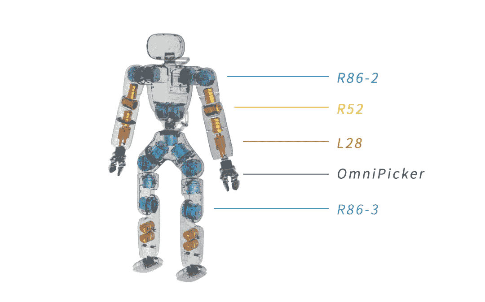

### 星动纪元端到端原生机器人大模型ERA-42正式亮相

贡献人：

https://mp.weixin.qq.com/s/sf_Pfu7LSSQGLNUq2HDX8g

星动纪元的ERA-42端到端原生机器人大模型近日正式发布，标志着具身大模型在通用灵巧操作领域的突破。ERA-42结合了自研的五指灵巧手星动XHAND1，展示了前所未有的灵巧操作能力，能用多种工具完成100多种复杂任务，如用螺钉钻紧螺钉、用锤子敲打钉子等。ERA-42通过强大的泛化和自适应能力，能够在不到2小时内快速学习新任务，并持续扩展技能，展现出通用性和高效性。

ERA-42是全球首个真正的五指灵巧手具身大模型，采用端到端的架构，能够直接从全模态数据中学习并执行任务，而无需预编程或人工干预。该模型的三大核心要素为：统一的任务和环境泛化能力、端到端流程、以及可通过数据积累持续优化的规模化能力。这些特性使得ERA-42成为具身智能体的未来发展方向。

与其他大模型类似，ERA-42的优势还体现在其“世界模型”融合能力，使其不仅能执行任务，还能理解和预测物理世界的动态，极大地提高了任务的成功率和精准度。例如，通过学习因果关系，ERA-42能有效应对外部干扰，并根据环境变化自适应调整任务执行。

星动纪元还创新性地将AI原生硬件平台与ERA-42协同进化，特别是星动XHAND1，它的多自由度设计与高精度触觉传感使其能够执行更精细的操作任务，如与ERA-42配合，实现多样化和智能化的操作。XHAND1能模拟人类手部动作，甚至在复杂任务中表现出优异的灵活性和可靠性，推动了通用具身智能体的产业化。

通过这些创新，ERA-42不仅提升了机器人的操作能力，还加速了机器人在多个领域的应用。星动纪元正在推动原生具身智能体的广泛应用，未来将致力于实现机器人服务于各行各业的愿景。

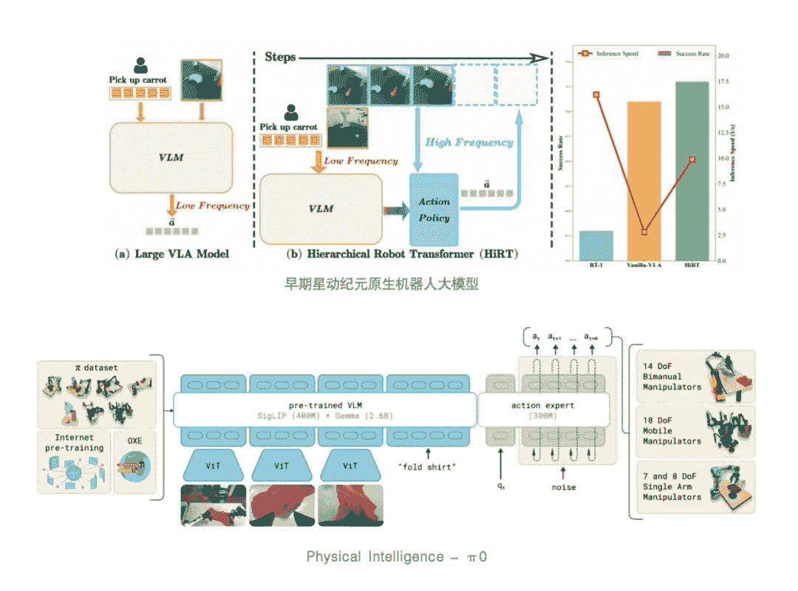

### 全球视野下的 AI Infra：AI 出海挑战、GPU 集群解决方案与选型

贡献人：

https://mp.weixin.qq.com/s/N7b5yDvhE-cZMlOblxeUew

随着全球数字化的推进，AI 应用的出海成为越来越多企业的目标，但这一过程面临着算力、基础设施和稳定性等多方面的挑战。在AICon大会上，GMI Cloud的King Cui和Jay Hsueh分享了AI出海中GPU基础设施的重要性及其解决方案，重点讨论了如何确保GPU集群在AI训练中的稳定性。

AI出海的关键挑战之一是算力的不足，尤其是高端GPU的缺乏。国内高端GPU供给不足且无法进入中国大陆，因此，企业需要寻找海外GPU服务。此外，海外IDC的选择也充满不确定性，尤其是在对AI基础设施不熟悉的情况下，如何确保GPU集群的稳定性成为重大难题。Meta的LLama 3训练中，16,000张H100 GPU出现了超过400次故障，突显了GPU稳定性面临的巨大挑战。

为了解决这些问题，GMI Cloud专注于提供高效且稳定的GPU云服务，特别是在美国和亚太区的AI应用部署。作为全球排名前十的Nvidia云合作伙伴，GMI Cloud拥有GPU的优先分配权，能够提供最新的英伟达GPU（如H200、GB200等）。GMI Cloud的技术团队由谷歌X实验室成员和硅谷技术专家组成，致力于构建AI Native Cloud，提供高效、稳定的基础设施服务。

在GPU集群的构建上，GMI Cloud依托自主研发的Cluster Engine平台，整合了高性能GPU、网络和存储资源，确保AI应用的高效运行。平台提供裸机、容器和虚拟化等多种服务，并且支持跨全球数据中心的GPU资源管理。特别是在存储方面，GMI Cloud为不同应用场景提供不同等级的存储选项，如NVMe磁盘和并行高速存储系统，以满足AI训练和计算的需求。

为了保障GPU集群的稳定性，GMI Cloud还注重实时监控和故障预防。平台具备主动监控系统，能够在问题发生前预警并采取应对措施。此外，GMI Cloud与供应商保持紧密合作，确保硬件故障能够在最短时间内得到修复。

GMI Cloud为客户提供灵活的AI基础设施选型，包括按需租用和长期预定两种模式。按需服务适合短期计算任务，而长期预定则为持续研发项目提供稳定资源支持，避免了数据迁移和重复配置的麻烦。

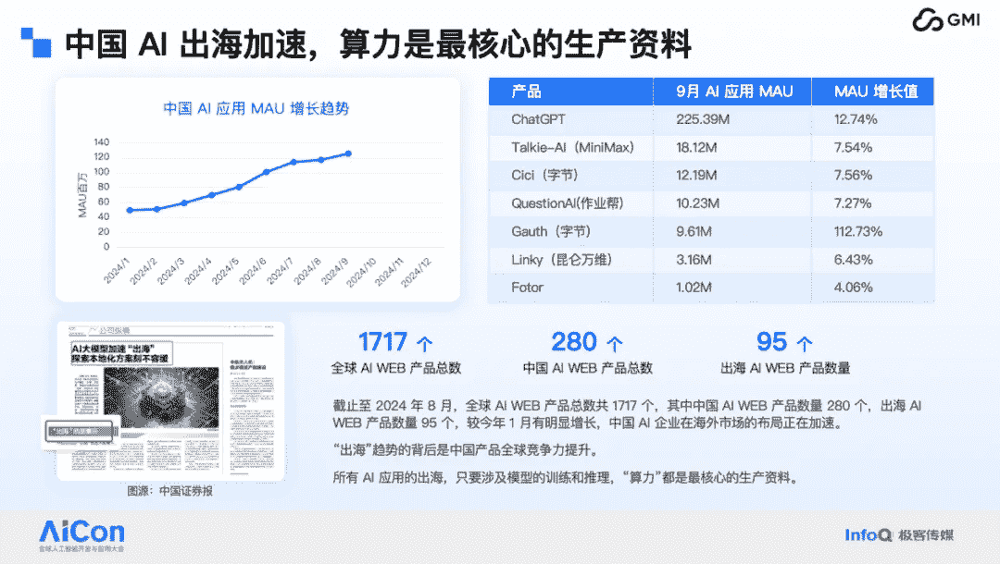

### 科技/电子：AI引领创新，自主可控持续

贡献人：

https://mp.weixin.qq.com/s/Io_jvYcb3gWz16gWmnYWWw

2025年主线：AI ASIC起步+端侧落地、高阶智驾普及、自主可控新阶段

2024年电子行业在AI催化以及消费电子需求复苏推动下景气度持续上行。展望2025年，我们看好三大投资主线：1）云厂自研AI算力芯片放量以及AI端侧持续落地，云厂加速推出推理/训练侧自研芯片，端侧智能手机/眼镜作为AI Agent载体落地将进一步拉动产业链需求；2）高阶智驾向下普及带来硬件产业链需求提升，我们看好比亚迪发力低价车型智驾标配，自主品牌开始加速智能化进程；3）自主可控进入新阶段下的投资机遇，国内设备厂国产替代走向高端化与平台化，同时国产化向上游零部件与材料环节延伸。

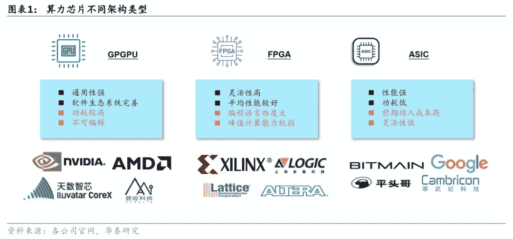

### 芯片产业链2025年投资展望

贡献人：

https://mp.weixin.qq.com/s/UC0pW89oxHPcHr0mxBD8PQ

硬件基础设施作为AI大模型发展基石，但海外对华供应高端GPU、HBM受限，先进制造、先进封装代工产能难以获取。国内AI算力产业链仍在起步追赶阶段，可以类比海外AI在2023年之前的爆发前夕，但关键环节处于“有需求、没供给”的状态。虽然国内半导体国产化率在过去几年持续提升，但是核心环节国产化率仍然较低。在传统半导体国产化已有一定基础的情况下，高端芯片、先进存储、先进封装、核心设备材料、EDA软件的国产化仍有较大提升空间。

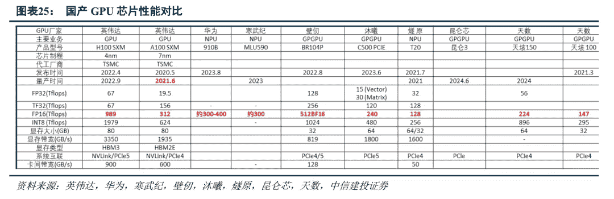

# 推特

### Raschka：《LLM研究论文：2024年度清单》

https://x.com/rasbt/status/1870830723852312772

《LLM研究论文：2024年度清单》

今年在人工智能研究领域中充满了事件与惊喜，尤其是对大语言模型（LLMs）感兴趣的研究者而言。

本来，我为这次12月的专题准备了宏大的计划，计划发布一篇新文章，讨论我在2024年研究中的所有亮点。我仍计划完成它，但由于一次意外和严重受伤，我目前无法在电脑前工作并完成草稿。不过，我希望能在接下来的几周内恢复并重新站起来。

与此同时，我想分享一份我在2024年发现的许多引人入胜的研究论文（主要与LLM相关）的书签清单。这仅仅是一个清单，但对于那些希望在假期里找到一些研究亮点阅读的人来说，也许会有所帮助。

此外，如果你对代码层面的阅读和实验更感兴趣，我的《从零构建大语言模型》（Build A Large Language Model (From Scratch)）一书已于上月在亚马逊上架。同时，我也在GitHub仓库中添加了许多额外的材料。

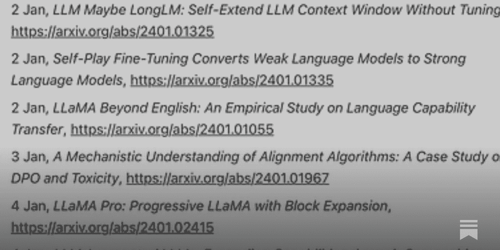

### Thinking in Space：探索多模态大语言模型如何感知、记忆和回忆空间

https://x.com/sainingxie/status/1870877202595958791

视频理解是下一个前沿领域，但并非所有视频都一样。

如今的模型可以处理 YouTube 视频片段和故事长片，但对于我们和未来的 AI 助手需要导航和体验的日常空间呢？

我们推出了 《Thinking in Space》，这是一项最新研究，探索多模态大语言模型（LLMs）如何感知、记忆和回忆空间。 🧵[1/n]

详情请见：https://vision-x-nyu.github.io/thinking-in-space.github.io/

[84mVWe-oJg0Ll4Hd.mp4](https://internal-api-drive-stream.feishu.cn/space/api/box/stream/download/all/D6iNbetWNoDfscxjfTscSJM2nuh)

### Aaron Ng分享：离线使用QwQ 32B

https://x.com/localghost/status/1870530369088537065

如果我断网了，**QwQ 32B** 会是我想要下载的模型之一。现在它正以 15 tok/s 的速度从我的笔记本电脑流向我的手机。

这个模型在某些领域可以媲美 **o1-mini**。更疯狂的是，你可以用一台笔记本电脑将它服务于整个网络。

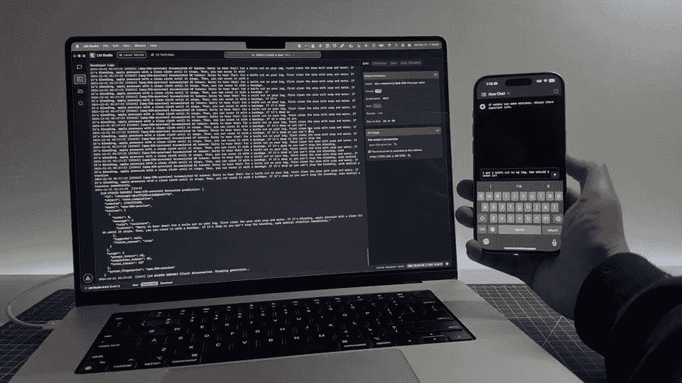

[9CiMoG-KL0UdwcLI.mp4](https://internal-api-drive-stream.feishu.cn/space/api/box/stream/download/all/KSsObBErkoDtbBxBs96czYCMnMc)

### 面部表情：全新 LTX Studio 功能，轻松掌控角色的面部表情

https://x.com/LTXStudio/status/1870473275786350980

推出 **面部表情**：全新 LTX Studio 功能，轻松掌控角色的面部表情。

通过 **面部表情** 功能，您可以快速从预设的情绪中选择，只需几秒即可调整角色的表情。在 Storyboard 部分或 Motion Editor 中访问此功能，即可在不打断工作流程的情况下进行精准调整。

**如果需要更**精细的调整，可以使用 自定义控制 功能。您可以微调眼睛、嘴巴或眉毛等特定部位，打造您需要的精准情绪效果。

[0XWY6urTcXwdVCPv.mp4](https://internal-api-drive-stream.feishu.cn/space/api/box/stream/download/all/GUnzb2NuvoSNIKxSkJBcqSVSnHh)

# 信号

### Parallelized Autoregressive Visual Generation

贡献人：

https://arxiv.org/abs/2412.15119

ResearchFlow链接：https://rflow.ai/flow/f8639114-4be9-4183-970e-acbc2eb5e597

自回归建模在语言建模中的成功启发了其在视觉生成中的应用。传统的自回归视觉生成方法通常依赖于逐个标记的顺序生成，这导致生成速度较慢，限制了实际应用。为了提高生成效率，本研究提出了一种新的方法，通过并行生成弱依赖标记，同时保持对强依赖标记的顺序生成，从而加速视觉生成过程并保持生成质量。

在语言建模中，已有通过投机解码和雅可比解码等方法实现的并行生成，但在视觉生成中，现有的非自回归方法和多尺度预测方法要么增加了模型复杂度，要么牺牲了灵活性。本研究的创新之处在于，提出了一种能够在保持标准自回归模型简洁性和灵活性的同时实现视觉生成并行化的方法。我们通过分析视觉数据中的标记依赖性，发现空间上距离较远的标记通常具有较弱的依赖性，因此可以并行生成，而相邻标记则需要顺序生成以避免生成不一致。基于这一观察，我们将图像划分为局部区域，先生成各区域的初始标记以建立全局上下文，然后通过识别并组合空间上远离的标记进行并行生成。

这一方法通过重新排序机制无缝地集成到标准自回归变换器中，能够在不同空间区域之间进行并行生成，同时保持全局上下文的建模能力。通过这种非局部并行生成，模型显著减少了推理步骤，提高了生成速度。实验证明，在ImageNet和UCF-101数据集上的图像和视频生成任务中，我们的方法不仅在生成质量上与基准方法相当，而且在生成速度上实现了3.9倍的步骤减少和3.6倍的推理时间加速，甚至在更激进的并行化下，步骤减少可达到11.3倍，推理速度加速9.5倍，质量损失极小（FID小于0.7，FVD小于10）。实验表明，我们的方法在不同视觉任务中的有效性，并且与多种标记化方法兼容。

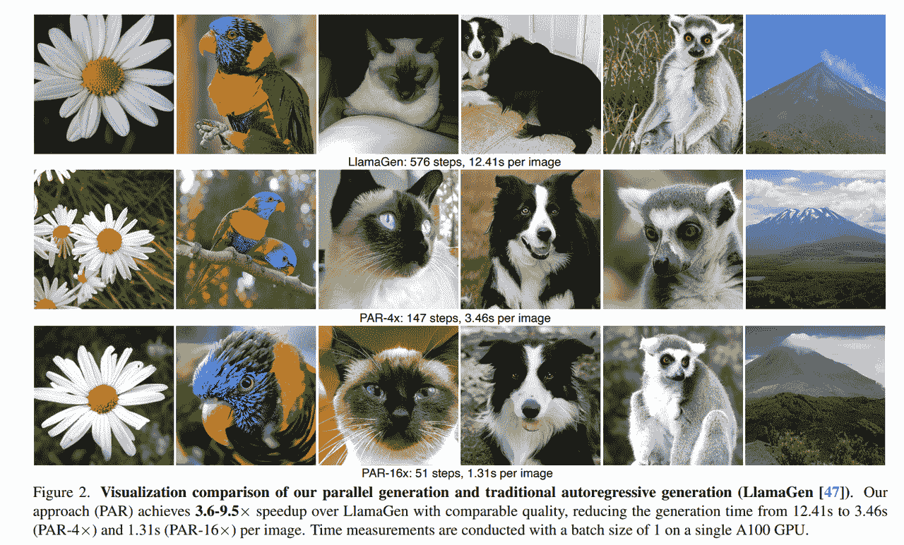

### Taming Multimodal Joint Training for High-Quality Video-to-Audio Synthesis

贡献人：

https://arxiv.org/abs/2412.15322

ResearchFlow链接：https://rflow.ai/flow/9b15552c-ea00-46bc-874e-040d61f5e0ef

本研究提出了一种新颖的多模态联合训练方法——MMAudio，用于视频到音频的生成。我们关注于Foley音效合成，即为给定的视频合成环境音（如雨声、河流声）和由可见事件引发的音效（如狗叫声、网球拍击球声）。与传统方法不同，Foley音效合成不涉及背景音乐或人声，而是强调语义和时间上的一致性。具体而言，语义一致性要求理解场景及其与音频的关联，而时间一致性要求音频与视频的同步性，因为人类能够察觉到仅25毫秒的音视频不匹配。

现有的视频到音频方法通常要么仅在音视频数据上训练，受限于数据量（如VGGSound数据集仅包含550小时视频），要么通过在预训练的文本到音频模型中增加控制模块来利用大规模音频文本数据的知识。尽管这种方法通过控制模块改善了效果，但它增加了网络复杂性，并且不清楚预训练的文本到音频模型是否能支持所有的视频到音频场景。

为了解决这些局限性，本文提出的MMAudio方法通过在单一的变换器网络中同时考虑视频、音频和文本的联合训练，并在训练过程中屏蔽缺失的模态。这种方法能够从头开始训练，利用音频视觉和音频文本数据集，并通过联合训练构建统一的语义空间，从而促进了自然音频分布的学习。实验表明，MMAudio在音频质量、语义一致性和时间一致性上均取得了显著提升，音频质量相比基准方法提高了10%，语义一致性提高了4%，时间同步性提高了14%。

此外，为了进一步提高时间一致性，我们提出了一种条件同步模块。该模块利用自监督音视频解同步检测器提取的高帧率视觉特征，并在自适应层归一化（adaLN）层的尺度和偏置空间内进行操作，从而实现更精确的音视频同步（同步性得分提高了50%）。这一创新模块有效解决了仅使用注意力层在音视频信号中指示精确时序的问题。

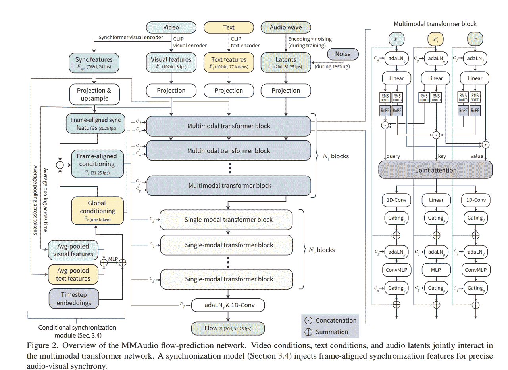

### MixLLM: LLM Quantization with Global Mixed-precision between Output-features and Highly-efficient System Design

贡献人：

https://arxiv.org/abs/2412.14590

ResearchFlow链接：https://rflow.ai/flow/0ee55b23-44e7-47ce-b8d0-febe3bdf9e74

LLMs在多种任务中取得了显著成绩，但其庞大的内存消耗和计算成本已成为高效部署的障碍。量化技术通过以较低的比特宽度表示权重或激活来压缩LLM，成为减少其大小的有效解决方案。然而，现有的量化方法仍存在精度下降或系统效率低下的问题。量化效率的优化涉及精度、内存消耗和系统执行效率之间的平衡，我们称之为量化的“有效性三角”。现有的量化方案在这三者之间有不同的侧重点和权衡。

现有方法中，权重量化方法解决了内存消耗问题，并能加速小批量解码的执行，但对于精度要求较高的生产任务（例如4-bit量化可能导致的精度下降），以及在大批量工作负载中的系统性能降低，依然存在挑战。权重激活量化方法通过对激活进行低比特量化来提高系统效率，但其精度下降较为严重，且会增加去量化的开销，影响系统效率。使用异常值分离和混合精度技术的方案试图通过不同的精度分配来提高低比特量化的精度，但其系统效率和精度提升仍然有限。

为了解决这些问题并平衡三者的需求，本文提出了MixLLM。MixLLM通过以下贡献解决了现有方法的不足，并有效优化了量化过程：

首先，MixLLM在权重量化中采用了输出特征的混合精度量化，基于全局显著性识别，为不同的输出特征（即输出通道）使用不同的比特宽度。对于显著性较高的输出特征，采用8-bit量化；对于其他输出特征，则采用4-bit量化。这种全局显著性识别方法超越了以往基于单层估计的显著性方法，能够更精准地根据不同层次的重要性调整量化配置。此外，MixLLM的混合精度量化设计比输入特征的量化更容易实现，因为输出特征的计算通常是互不干扰的子问题。

其次，MixLLM还通过量化配置和GPU内核优化的联合设计，实现了精度与系统效率的双重提升。MixLLM使用8-bit量化激活，因为这种配置能够保持较好的精度。由于矩阵乘法执行通常更多地受到较大权重张量的限制，而不是较小激活张量的限制，因此减少激活的量化精度并不显著影响系统效率。MixLLM在8-bit量化和4-bit量化上采用对称量化和非对称量化配置，以保持良好的精度。为了优化系统效率，MixLLM采用了两步去量化策略，并利用快速的int8张量核心和整数浮点转换来减少去量化的开销。

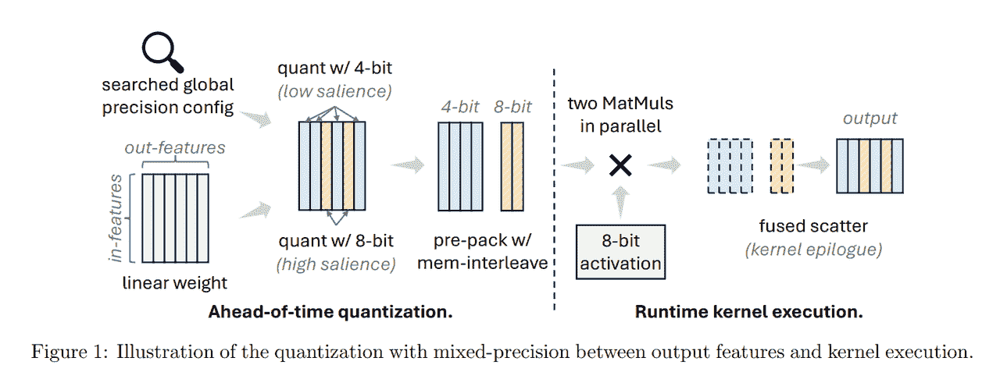

# 产品

### Gensmo 利用人工智能搜索解锁您应得的生活方式

贡献人：

https://gensmo.com

Gensmo 是一款新一代人工智能搜索，可以激发您的日常生活！需要服装创意、礼物建议或装饰搭配？只需拍摄一张照片或输入您的查询，Gensmo 就会根据您的需求创建时尚拼贴画。

### 人工智能圣诞老人 您的孩子与圣诞老人的个性化视频聊天

贡献人：

https://santa.ac/?ref=producthunt

让圣诞节的魔力栩栩如生！我们的 AI 圣诞老人应用可让家长为 3 岁以上的孩子定制 3D\AR 圣诞老人。通过个性化的文本和语音聊天、故事和游戏，这是基于浏览器的完美假日体验。让圣诞节令人难忘！

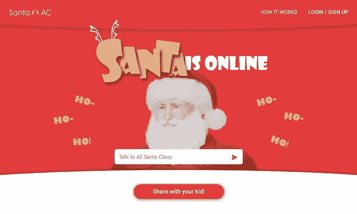

# HuggingFace&Github

### ChatGPT 屏幕 功能提升

贡献人：

https://github.com/adamlui/chatgpt-widescreen

🧠 通过适当的缩进体验更清晰的编程代码显示

📜 在单个页面上查看多步骤说明或长食谱，以便于参考

🖥️ 以更美观的格式欣赏原创歌词、诗歌、散文或作曲

⚙️ 自定义功能，例如更大的聊天框和隐藏的页眉/页脚，以获得更宽敞的视图

🌐 适用于：chatgpt.com + perplexity.ai + poe.com

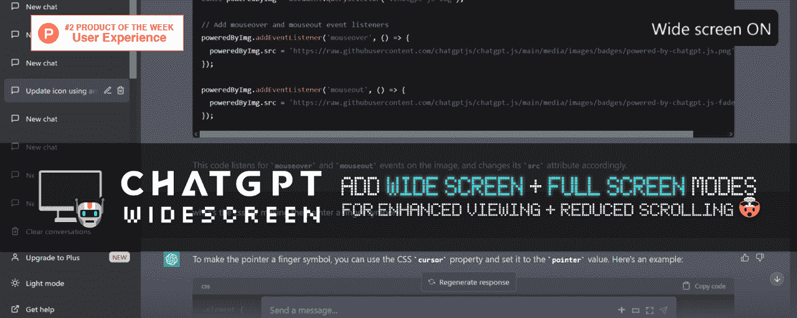

# 投融资

### 「阶跃星辰」完成数亿美元 B 轮融资

贡献人：

https://36kr.com/p/3090736042736004

中国大模型独角兽“阶跃星辰”近期完成了数亿美元的B轮融资，吸引了多家投资方，包括上海国有资本投资有限公司、腾讯投资、五源资本、启明创投等。这笔资金将用于继续推动基础模型研发、强化多模态和复杂推理能力，并扩大C端应用场景的覆盖，提升用户体验。

阶跃星辰的技术实力在大模型领域中尤为突出，特别是在多模态理解和生成能力方面。公司自成立以来，致力于从单模态到多模态，再到通用人工智能（AGI）的逐步发展。尽管国内许多厂商因技术瓶颈放缓了AGI探索，但阶跃星辰持续推进技术创新，并在过去10个月内发布了多个自研大模型，涵盖语言、图像、视频、语音等多个模态。公司发布的Step系列模型，尤其是在语言和视觉领域的表现，取得了显著成绩，在多个国内外榜单上排名领先。

阶跃星辰在商业化方面也取得了显著进展，特别是在多模态API的应用上，2024年下半年API调用量增长超过45倍。其Step系列模型已被多个应用开发者广泛使用，并成功提升了产品的付费率。此外，阶跃星辰通过与上海报业、荣耀、OPPO等公司的合作，深耕金融、内容创作和智能终端等垂直领域，推动技术落地。

公司团队由一批顶尖人才组成，包括微软和字节跳动的前高管，为技术创新和快速发展提供了有力支持。阶跃星辰的产品策略包括自研和生态合作相结合，力求通过技术领先和差异化产品进一步拓展市场份额。

在激烈的市场竞争中，阶跃星辰能够顺利完成新一轮融资，表明资本市场对其技术创新、产品差异化及商业化潜力充满信心。这为公司未来的发展提供了更多空间，预计将在大模型市场中占据更为重要的地位。

公司官网：https://www.stepfun.com/

### Tetsuwan Scientific：打造可独立运行实验的机器人AI科学家

贡献人：

https://techcrunch.com/2024/12/22/tetsuwan-scientific-is-making-robotic-ai-scientists-that-can-run-experiments-on-their-own/

Tetsuwan Scientific公司正致力于研发能够自主进行实验的机器人AI科学家。其创始人Cristian Ponce和Théo Schäfer在2023年通过创业平台Entrepreneur First相识，随后共同创立了这家公司。两人之前在不同领域积累了丰富经验，Ponce曾在加州理工学院从事生物工程研究，Schäfer则在麻省理工学院从事水下自主机器人研究，并曾在NASA工作。

Tetsuwan Scientific的初衷是解决传统实验室中，实验人员在进行基因工程时面临的繁重体力劳动问题。尽管市场上已有一些自动化机器人，但它们通常价格昂贵且需要专业的编程技能，操作起来极为繁琐。因此，Tetsuwan采用了较为低成本的白标实验室机器人，并结合大型语言模型（LLM）技术，探索如何让机器人理解并执行科学实验。

2024年5月，Tetsuwan的创始人在观看OpenAI发布会时，意识到LLM技术的科学推理能力可能是机器人自主实验的突破口。Tetsuwan将其机器人系统与LLM结合，成功实现了机器人在看到DNA凝胶图像后，能够诊断出潜在问题并提出详细的改进建议。

该公司的机器人并非拟人化设计，而是采用类似玻璃立方体的结构，旨在实现实验数据分析后，自动调整实验条件。它们通过先进的传感器和软件，具备自动理解液体属性、校准等能力。

Tetsuwan目前已经获得了来自La Jolla Labs的初步客户支持，这是一家专注于RNA治疗药物的生物科技公司，正在使用这些机器人来帮助测量和确定药物剂量的有效性。此外，Tetsuwan还完成了270万美元的超额认购种子轮融资，由2048 Ventures主导，Carbon Silicon、Everywhere Ventures以及一些知名生物科技天使投资人参与。

# 学习

### 万卡集群LLM训练模拟SimAI，大模型训练通信计算仿真

贡献人：

https://zhuanlan.zhihu.com/p/13786416568

SimAI是阿里巴巴开发的一个高精度模拟器，专门用于大规模模拟LLM（大语言模型）的训练过程，主要包括集群计算和通信仿真。由于训练LLM需要上万个GPU，传统的训练方式难以高效验证新设计、调优和优化方案，因此需要一个高效的模拟工具来测试和规划。SimAI通过精确模拟训练框架、计算和集体通信库，提供了一个可以反映真实世界训练工作负载的工具，帮助提高资源利用率并确保基础设施投资回报。

SimAI的目标包括：首先，生成反映真实训练场景的工作负载；其次，提供高保真的通信仿真，特别是集体通信的高精度模拟；再者，实现高效的计算模拟，以便为大规模模拟提供精度和可扩展性；最后，确保模拟速度足够快，能够应对大规模集群的需求。

SimAI的核心组成部分之一是AICB（Artificial Intelligence Communication Benchmark），一种新的基准测试套件，用于生成与实际应用一致的通信负载模式，特别适用于GPU集群通信系统的基准测试、通信模式分析和工作负载描述。AICB的两个主要功能是记录实际训练过程中的通信和计算耗时，并生成通信计算及其约束的工作负载文件，这些数据用于后续的仿真分析和优化。

除了AICB，SimAI还包括两个重要的仿真器：SimAI-CM（计算仿真器）和SimAI-CCL（通信仿真器）。SimAI-CM通过使用数据库中的实测数据或估算系数，模拟计算过程，以达到高效且准确的仿真效果。SimAI-CCL则专注于集体通信仿真，模拟大规模集群中的数据传输过程，帮助优化和提升通信效率。通过这两个仿真器，SimAI能够高精度地模拟大模型训练中的计算和通信需求，从而有效地支持集群规划和性能调优。

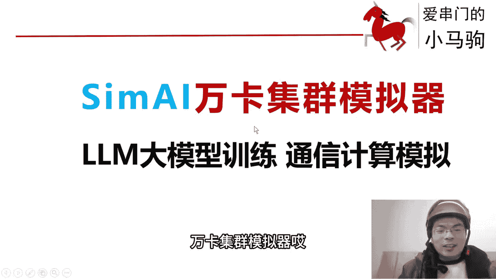

### 大模型逻辑推理学习的思考和展望(2024)

贡献人：

https://zhuanlan.zhihu.com/p/14002760900

这篇文章探讨了当前训练大型语言模型（LLM）中面临的挑战与思考，主要集中在从SFT（监督学习微调）到PPO（策略优化）的转变以及模型的扩展性和推理能力。首先，SFT面临着对细粒度指令和复杂任务（如数学和编程）处理能力不足的问题。尽管通过PPO能够在更精细地跟随人类偏好方面获得显著提升，尤其是在文科领域，但其在处理逻辑推理任务时仍然受限。随着训练规模的扩展，人们期望通过增加模型参数来解决问题，但问题依然存在，特别是当训练数据量没有同步增加时，模型的效果不再显著提高，预训练的边际效应逐渐减弱。

文章进一步探讨了**Scaling Law**的局限性，强调即使在资源充足的情况下，预训练阶段的提升也会受到数据质量和数量的限制，特别是在多模态数据的应用上，仍然缺乏明确的结论。随着模型逐渐成熟，推理过程的扩展（例如推理时间的扩展）可能成为提升逻辑推理能力的有效途径。在此背景下，思维链的生成与优化成为关键议题。类似人类思维过程中的“框架化”与“思维链”，如果能够被有效模拟和训练，可能会对复杂推理任务产生重大影响。

在具体实现方面，文章建议通过高质量的思维链数据进行冷启动，然后通过模型生成和强化学习逐步优化思维链的生成能力，进而提高模型在数学、编程等领域的推理能力。此外，OpenAI提出的领域精调（RFT）方法，作为一种微调技术，也被视为一种高效的思维链训练方式，通过强化学习结合思维链的生成进一步推动模型的性能提升。

对于未来的探索方向，文章提出了几个具有高价值的领域。首先是推理优化，利用技术手段减少训练和推理的资源消耗；其次是对强化学习（RL）的更深入探索，尤其是在RL的各个环节仍有优化空间时；最后，针对特定领域的推理学习（如法律、金融、医学等）也被认为是未来具有高商业价值的研究方向，尤其是结合OOD（Out-of-Distribution）和泛化能力来实现低成本高效能的模型训练。

### 大语言模型（LLM）评价指标小汇总

贡献人：

https://zhuanlan.zhihu.com/p/641416694

在统计和评估大型语言模型（LLM）性能时，研究者常用多个基准和评价方法，以量化模型的能力、鲁棒性和效率。以下是对当前几种主要评估方法的简要总结。

首先，**C-EVAL****主要用于**中文考试，使用选择题评估，注重模型的准确性（Acc）。KoLA是一个季度更新的全球知识**评估榜单，涉及知识**记**忆、理解、应用****等领域，**评**估方法包**括**EM（**Exact Match）、F1、ROUGE、BLEU等传统方法，数据集为KoLA。SuperGLUE是一个经典的基准，评估包括词义消歧、自然语言推理、QA等任务，使用EM、F1、Acc等指标，且包含多个任务和领域。NL2Code则针对代码生成任务，使用pass@k作为评估标准。HELM是一个更为细化的评估框架，覆盖任务、领域、语言等维度，评估指标包括传统的Acc、F1、ROUGE以及针对鲁棒性、公平性、毒性等特性的方法。CUGE聚焦中文NLP，评估范围广泛，包括语言理解、对话理解、信息获取等，使用Acc、F1、BLEU等常见指标。HC3通过人类与ChatGPT的回答对进行人工评估，重点分析不同方法与人类评估的相关性。

评估方法可以分为两大类：**文本对比方法**和**模型/分布评估方法**。在文本对比类方法中，BLEU、ROUGE、METEOR、CIDEr**等是**常**用的**基**于重叠**度的评估指标，这些方法主**要用于机器翻**译、文本生成等任务。此外，EM、F**1、MCC等常用于问**答**和分类任务。pass@k****是评估**代**码生成的常用指标，类似**的**，也可以用于多次输出的任务**。鲁棒性评估（如Invariance、Equivariance）和偏见检测（如性别和种族偏见）也成为关键方向。对于对话系统，指标如JGA、Inform Rate、Slot Accuracy等被广泛使用来评估对话状态跟踪和实体识别。

在**模型/分布评估方法**方面，常见的技术包括**BERTScore**、**T5**、**Sentence Movers** Similarity等，这些方法主要基于文本相似性**计算。对**于**毒性评估**，Perspective API是一个常用的工具，它基于机器学习模型评估文本输出的毒性。此外，还有专门的对话系统评估工具，如ADEM、DEAM，以及一些基于负样本的对话系统评估方法。

最后，**人类评估****作为最直**接**的评估方**法，常常作为其他方法的对照。尽管如此，一些方法（如ADEM、HUSE）试图模仿人类评估的方式，以期减少人工标注的成本。

综上所述，当前的LLM评估方法涵盖了广泛的领域，包括准确性、鲁棒性、公平性、效率等维度。随着基准测试的不断发展，新的方法和数据集不断涌现，为模型的优化和比较提供了更为丰富的手段和指标。

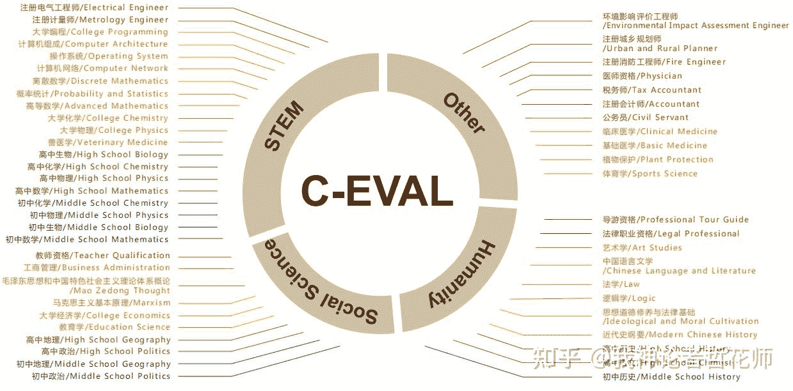

### MoE 训练到底是开 TP 还是 EP？

贡献人：

https://zhuanlan.zhihu.com/p/13997146226

EP和TP各有优劣，具体选择取决于训练场景和需求：

+   计算效率：EP在expert计算上更高效，减少了kernel launch次数，适合大矩阵计算。

+   通信开销：在topk=2且token均匀分配时，EP和TP通信量相当，但在topk>2或负载不均衡时，EP的通信开销高于TP。

+   显存占用：TP显存占用低且稳定，适合长序列训练或显存敏感场景，而EP在负载不均衡时可能导致OOM。

+   数据并行性：EP不会减少DP数量，可以在固定资源下处理更多数据。

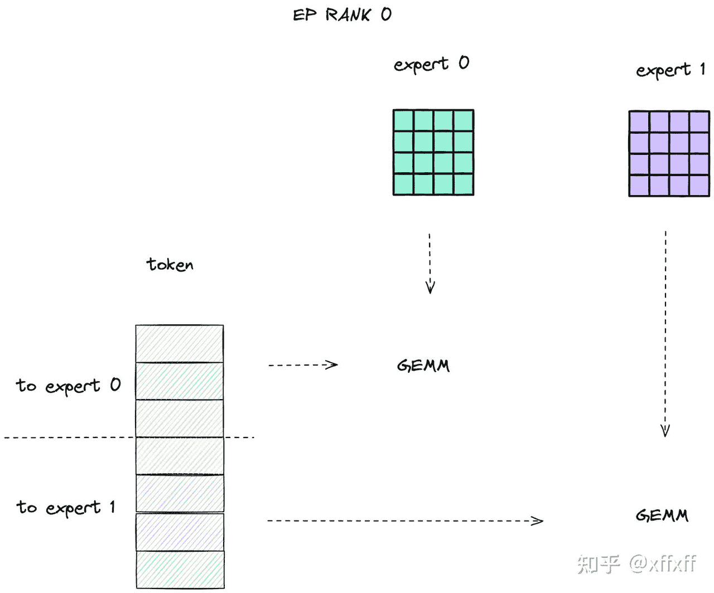

### o1复现的一点点心得

贡献人：

https://zhuanlan.zhihu.com/p/13872128423

随着o3和Gemini-Flash-Thinking版本的推出，推理模型的能力在常见基准测试上达到了前所未有的高水平，尤其是在数学、代码和推理等领域取得显著进展。例如，o3模型在AIME24上达到了29/30的高分，在Code-Force中也达到了99.99%的优秀成绩。推理增强模型显著提升了这些高推理需求场景的表现，但对于常见的翻译、对话等任务，这种推理能力未必是必要的。真正能释放这些增强模型潜力的场景可能是agent系统，通过让增强推理模型作为指挥者调度低级模型，既能降低推理成本，又能更合理地利用老旧模型。

对于如何在现有资源下构建推理增强模型，本文总结了外部工作及作者的复现（蒸馏）经验。当前，国内推出了许多类似o1的模型，如Deepseek-r1、Kimi-math、Macro-o1等，学术界也提出了不同的方法。总体来说，有两大派系：树搜索派系通过树搜索和多智能体合成数据；蒸馏派系通过jailbreak、prompt-hack等手段破解o1的限制，进而提升模型能力。蒸馏方法能帮助我们更好理解long-cot（长推理链）训练方法，树搜索派系则能为新场景（如agent和tool）提供快速数据生成方案。

作者最初倾向于树搜索，但发现self-critic任务较为困难，且预训练阶段并未充分提供推理链信息。于是转向数据蒸馏路径，通过从Deepseek-r1和Qwen-Qwq中采样，结合long-cot方法，生成了一个小规模的1.3k-prompt、4.4k数据集。实验表明，少量难度较高的数据就能显著提升模型的数学能力，并且这些数据能对其他任务（如代码）产生一定的迁移效应。

当模型规模达到32B时，效果显著提高。例如，AIME24分数从5/30提升到10/30，Qwen25-32B模型在long-cot训练后也实现了类似的提升。而14B模型虽有收益，但效果不如32B明显。在训练过程中，拒绝采样和DPO（差分策略优化）也对模型表现有所推动，尤其在数据规模和难度控制方面，能够大幅提升推理能力。

不过，模型的规模并非越大越好，7B模型在long-cot训练时出现了严重的停滞问题，表明在推理链较长时需要更大的基础模型。对于7B模型，可能需要更多的long-cot数据或进一步的继续预训练来提升稳定性。

在推理数据的扩展上，合成数据和数据规模的提升具有显著作用，尤其是在困难提示和答案验证方面。RL训练与推理数据规模的提升密切相关，好的基础设施和技术堆积可以进一步提高RL效率，减少模型训练的时间。

长推理链模型的一个挑战是错误率随着问题难度增加而上升。为了克服这一点，作者建议使用弱模型总结思考过程，提炼出有效的解答过程，并通过传统的RM评分系统筛选正确的思考路径。这种方法能帮助解决推理链的错误，并扩展推理数据的规模。

# 声明

本文档仅供学习交流使用，版权归原作者所有，若涉侵权，请联系Jack Jin 15101136166

##

（欢迎在下方反馈您宝贵的意见！整理不易，觉得有用给AI日报小组点个赞👍吧！）

ChatGPT；Angela；Zijia Liu；Alex；Zeqi Tan；Tiezhen（HuggingFace）；Naixu；Lizhi；Peter；Suoman；Jack

学术分析报告：ResearchFlow -- 奇绩F23校友的开发的深度研究产品，PC端进入RFlow的分析报告，可直接点击节点右侧的小数字展开节点，登录后可在节点上直接“询问AI”，进一步探索深度信息

如果你有大模型相关的创业想法，欢迎来找我们聊聊～🛰️：15101136166

> 快邀请你的小伙伴们一起来读大模型日报吧！

> **【日报****知识库****】**这里是近期日报内容的汇总,欢迎大家查阅

> [大模型日报知识库(分享版)](https://miracleplus.feishu.cn/wiki/KapVwXfkriOBiskB0B2cUHxjnTh)

>

> 欢迎大家多多帮我们分享,转发~~

> 如果大家有任何的建议或者吐槽,欢迎随时找我聊天~

