# 奇绩大模型日报（12月 25日）

> 来源：[https://miracleplus.feishu.cn/docx/NjsXdx4tDojRNjxBGcBcKIoGnLh](https://miracleplus.feishu.cn/docx/NjsXdx4tDojRNjxBGcBcKIoGnLh)

# 🔉潜**空间系列活动重磅回归！**

> 本期活动将在**1月4日** **11:00**开始，我们邀请到的嘉宾是叶添，清华大学姚班，卡内基梅隆大学博士生，Physics of LLM 2.1作者，于 Meta 担任 Research Scientist Intern。研究兴趣主要集中在大语言模型的推理机制。曾在顶级会议 NeurIPS 上发表研究论文。此外，曾两次获得中国数学奥林匹克竞赛国家集训队的资格。

> 在本次分享中叶添将分享《揭秘大语言模型推理机制——超越人类的二级推理》。

> 除嘉宾分享外，每期设置了【匹配合伙人 Cofounder Matching】环节。你可以和 GenAI 时代最有活力的创业者和研究者线下面对面交流，将有机会找到志同道合、有共同创业梦想的小伙伴。

> 报名通道已开启，欢迎扫描下方二维码报名。

# 资讯

### QVQ：以智慧看世界

贡献人：

https://qwenlm.github.io/blog/qvq-72b-preview/

QVQ（Qwen Vision and Query）是一种新型的多模态推理模型，旨在通过结合视觉理解和语言推理能力，提升AI在复杂问题求解上的表现。基于Qwen2-VL-72B，QVQ能够显著增强视觉推理能力，尤其是在数学和科学领域的应用中。通过深入的分步推理，QVQ展现了在解决需要复杂分析思维的任务时的强大能力，达到了70.3的MMMU基准分数，超越了前代的Qwen2-VL-72B-Instruct。

**关键特点**

+   **视觉和语言结合**：QVQ能够理解图像与文字，模拟人类在语言和视觉记忆基础上进行推理的方式。

+   **超越传统模型**：QVQ在数学推理和视觉任务中的表现超过了之前的版本，展现出在科学问题求解上的突出能力。

+   **数学推理**：例如，在一个涉及导数计算的数学问题中，QVQ使用产品法则逐步推导出正确答案，展示了其扎实的数学推理能力。

**局限性**

尽管QVQ取得了较为理想的成果，但仍存在一些局限性，特别是在处理更为复杂的多模态任务时，模型的适应性和精准度可能受到挑战。

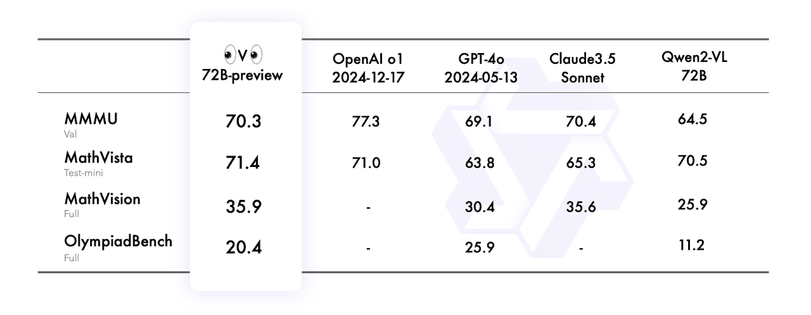

### 大模型自动搜索人工生命，做出AI科学家的Sakana AI又放大招

贡献人：

https://mp.weixin.qq.com/s/CVADIa03U2EqpirGbzklrQ

在2024年，人工智能领域再度迎来突破性进展，Sakana AI公司推出了ASAL（Automating the Search for Artificial Life）系统，旨在通过基础模型自动化发现人工生命的过程。ASAL系统的核心目标是探索可能存在的、不同于我们已知生命形式的人工生命，这不仅有助于理解生命的复杂性，还能推动AI的进化和智能研究。ASAL系统依托于基础模型（如CLIP和DINOv2）进行搜索，能有效地在不同的人工生命模拟环境中自动识别涌现的生命现象。

人工生命（Artificial Life）的研究通常通过计算模拟进行，这要求对模拟空间进行广泛搜索，以揭示各种涌现现象。然而，研究者往往面临着由于模拟和涌现现象间缺乏直接关联，难以通过直觉设计出具有自我复制、生态动态等特性的模拟的问题。ASAL通过自动化搜索过程，避免了这种局限，提供了一个全新的研究范式。ASAL采用视觉-语言模型（VLM）进行不同模拟空间的搜索，包括三种主要方法：监督式目标、开放式模拟和阐明。监督式目标方法通过搜索特定事件或事件序列的模拟，发现与现实世界相似的世界；开放式模拟则着眼于发现能持续产生新奇现象的模拟，寻找具有无尽创新潜力的生命形式；阐明方法则帮助揭示不同现象的多样性和边界。

ASAL团队在多个人工生命基质（如Boids、粒子生命、生命游戏、Lenia和神经元胞自动机）上验证了该方法的有效性。例如，在Boids基质中，ASAL发现了新的群集模式；在Lenia中，它发现了自组织细胞，推动了模拟生命的边界扩展。此外，ASAL还能够量化和评估复杂系统的涌现行为，例如通过量化粒子生命模拟中的参数对生命形式表现的影响，进一步推动了对涌现现象的理解。

通过这种创新的自动化搜索和分析方法，ASAL不仅推动了人工生命的研究，也为AI领域带来了新的视角，探索如何利用AI模型加速对未知生命形式的发现，并对AI的涌现、进化等核心问题提供新的启示。这项研究展示了基础模型在自动化科学发现中的潜力，开启了人工生命研究的新篇章。

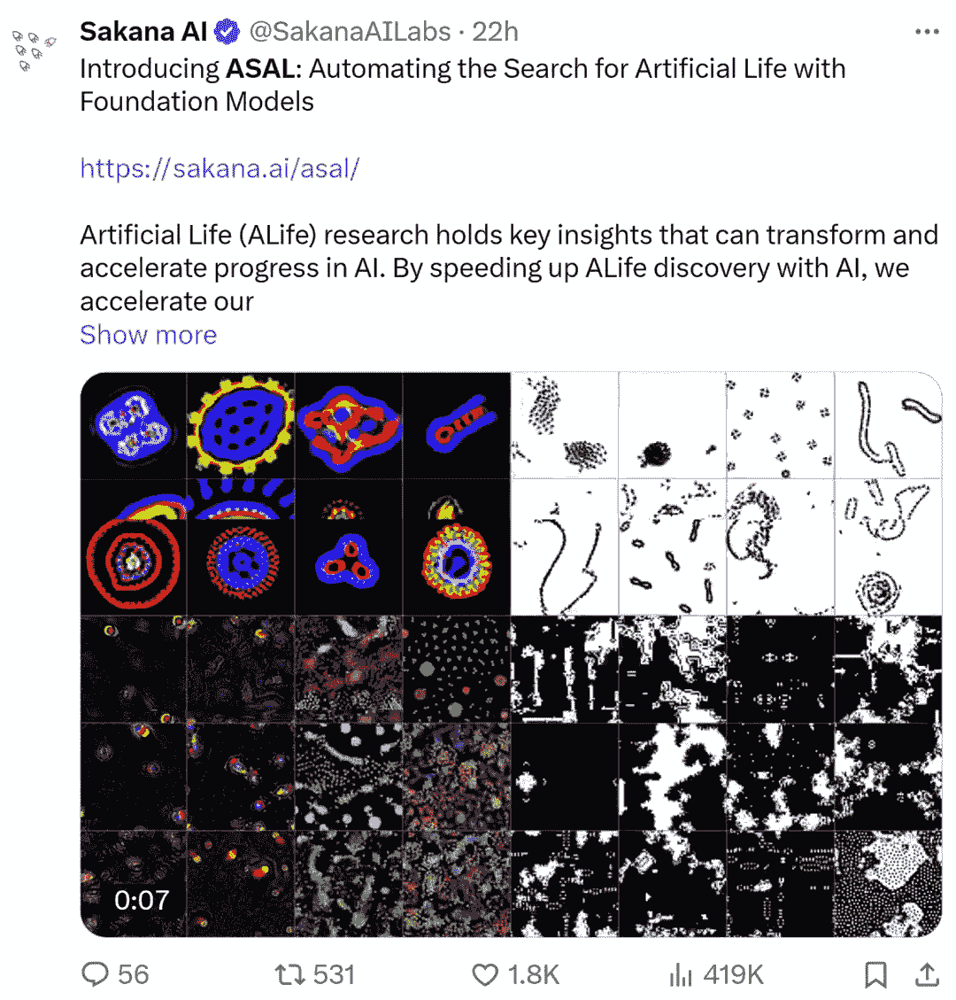

### 2024年AI盘点：投资高歌猛进、基础设施重构、技术采用加速

贡献人：

https://mp.weixin.qq.com/s/p-t0Vl0Ua7zTa6LPvBeH9g

1.  整个基础设施堆栈正在经历一次重大改造，类似于互联网和云计算的建设。对推理的需求才刚刚开始加速，将由 GenAI 的日益普及、新的多模态应用以及不断演变的模型架构推动。

1.  随着规模扩展定律开始趋于平稳，模型开发正从大型预训练转向推理时的逻辑推演。这一转变使模型能够处理更复杂的逻辑推理任务。同时，更小、更专业模型的兴起为用户提供了更高的效率和灵活性。

1.  AI 在企业环境中首次带来了实际的投资回报，例如代码生成、客户服务和搜索正在引发可衡量的影响。下一个前沿领域在于 AI 智能体的普及，但只有在我们构建了支持多智能体交互所需的底层架构之后，它们的真正潜力才能得以实现。

1.  对 AI 的投资持续增长，特别是在基础设施和基础模型层。大多数退出将通过并购实现，但投资者的高期望可能与市场现实相冲突，从而影响未来的估值。

1.  AI 的快速采用已经超过了监管框架的步伐，引发了关于版权和知识产权等话题的争论。同时，各国越来越多地将 AI 视为主权问题，导致对 AI 生态系统区域化的关注增加。

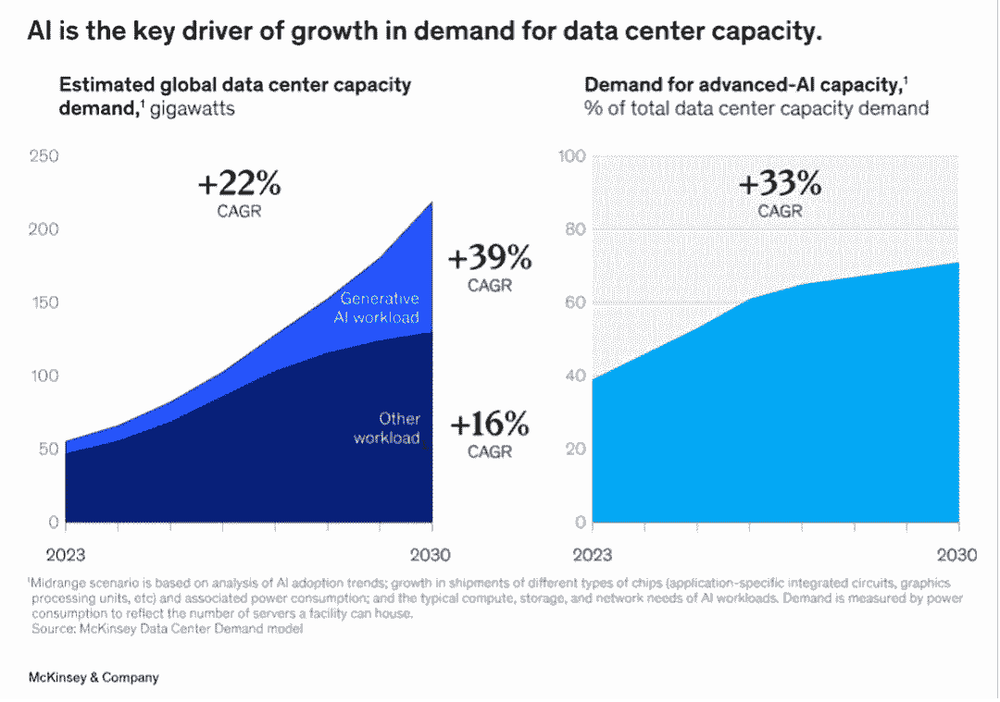

### AI Agent，大模型落地下一站

贡献人：

https://mp.weixin.qq.com/s/g5uQk7us7dzhxZ_v0CvXVg

**基础设施侧，AI Agent带动更多应用兴起拉**动算力需求，多层推理带动计算量成倍增长。我们观察到各大模型厂商API输入/输出定价呈加速降低趋势，大模型厂商的商业模式正逐步迈入以价换量时代，推动推理量的增长。考虑到推理芯片的需求主要对时延更加敏感，我们认为未来端侧硬件的需求差异化有望推动推理芯片性能多样化、需求定制化。我们看好国内端侧AI芯片企业有望在细分场景站稳脚跟，寻求差异化破局之路。

应用侧，C端硬件或成流量入口，B端生产工具有望全面升级。1）C端，AI Agent长期将改变人机交互的方式，手机端有望形成新的流量入口，或深刻影响产业商业模式。我们看好互联网及手机厂商对系统级AI的布局，其中手机厂商将语音助手升级为智能体；互联网厂商相关公司相继推出自主智能体，已具备“接管手机”或“接管电脑”的能力；2）B端，AI Agent有望凭借专业性的知识沉淀落地B端市场，实现企业降本增效，其中赋能企业效率提升是决策核心考量，我们看好AI agent带来的效率提升有望刺激新一轮产业投资。

具身智能侧，AI Agent赋予机器人智慧，产业落地想象空间广阔。基于大模型的AI Agent有望提升具身智能系统的智慧水平，加速具身智能的商业化落地，其中参与厂商不乏特斯拉、Figure.ai以及国内大疆、宇树等知名厂商。我们认为，AI Agent赋能下具身智能有望在各行各业中落地，发展前景广阔，我们预计中国人形机器人出货量有望在2030年达到35万台，市场空间有望于2030年达581亿元。

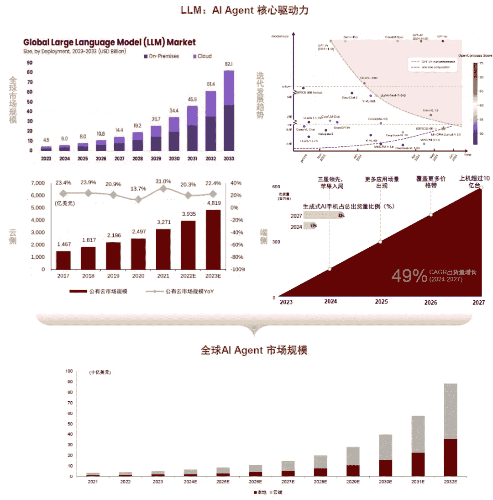

# 推特

### Kilcher分享：深入解析Byte Latent Transformer: Patches Scale Better Than Tokens

https://x.com/ykilcher/status/1871687743840887174

🔥新视频上线🔥

我深入（哈！）解析了 **B**yte Latent Transformer: Patches Scale Better Than Tokens 这篇论文。作者摒弃了传统的分词方法，构建了一种基于动态调整大小的“块”（patches）而非token运作的大模型架构。通过控制块的大小，他们可以在模型大小与计算量（FLOPs）之间实现更好的权衡，从而获得比传统分词的大模型更优的扩展表现。

观看视频：https://youtu.be/loaTGpqfctI

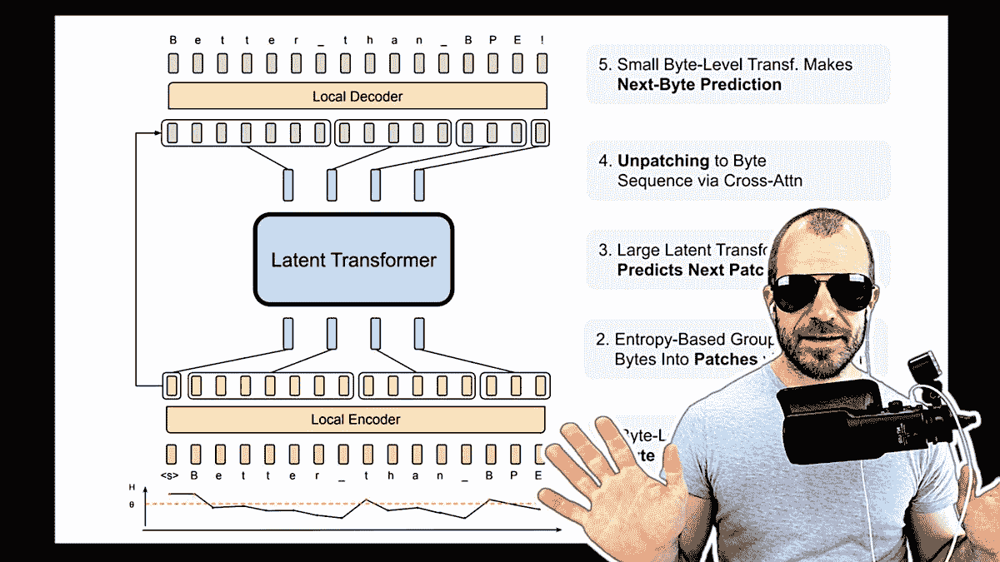

### Shortest：开源的 AI 驱动测试框架，让开发者可以用简单的英语编写端到端测试

https://x.com/shl/status/1871199814710648998

✂️ **全新推出：Shortest！**

Shortest 是一个开源的 AI 驱动测试框架，让开发者可以用简单的英语编写端到端测试，比如：

shortest("用户可以注册并创建一个 $5 的产品")

更多的测试 = 更少的回归错误，因为 AI 负责编写和发布代码。

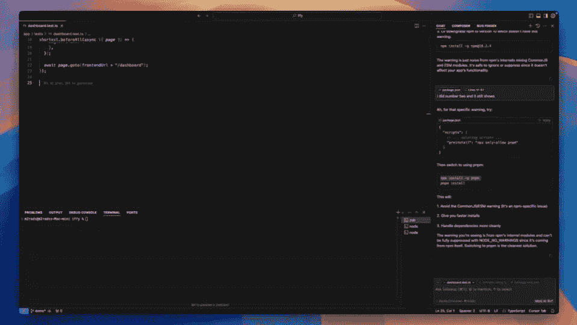

[f4aWGrZUm2dOcT13.mp4](https://internal-api-drive-stream.feishu.cn/space/api/box/stream/download/all/SMAKbNnLIolaE2xiLDscipn3nCg)

### Elton分享：使用v0创建的更现代化的维基百科

https://x.com/christianelton_/status/1871243760870539721

维基百科，但更现代化 —— 完全使用 v0 构建！

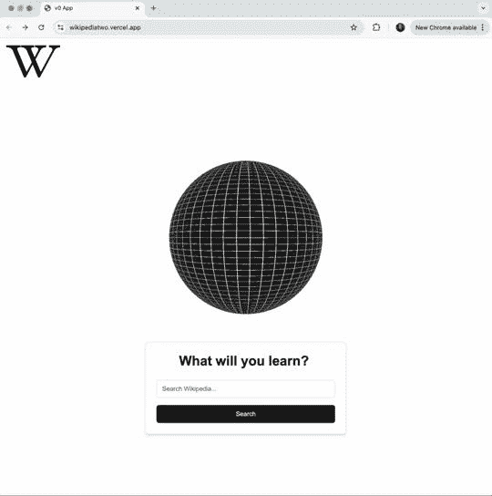

[wZTTsuog_Zv0McsL.mp4](https://internal-api-drive-stream.feishu.cn/space/api/box/stream/download/all/JMoabkqzgopRyPxeDMicqHoXnde)

### 和AI微积分导师对话：不仅会回答，还可以与学生共享白板进行互动

https://x.com/BenjaminKlieger/status/1871244595759354040

教育的未来。

与AI导师对话，它不仅会回答，还可以与学生共享白板进行互动。

来看看这个由 **@GroqInc** 和 **@8090solutions** 推动的 **Calculus Tutor** 吧！一如既往地开源！（详情见线程 🧵）

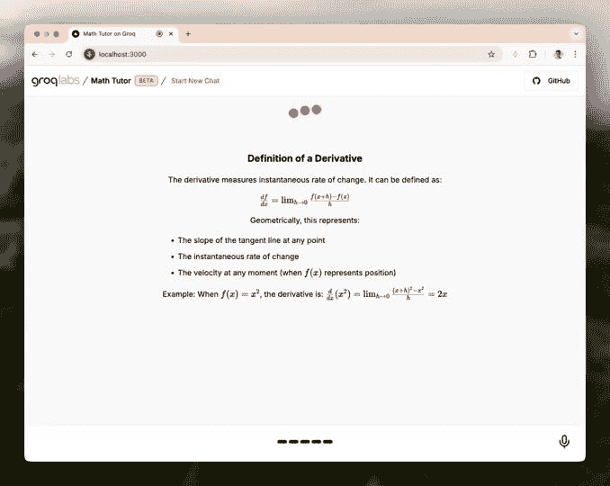

[GGQmSL_SFO66U3b_.mp4](https://internal-api-drive-stream.feishu.cn/space/api/box/stream/download/all/KNSRbCRsOolb0Xxi6j8cL7EHn8g)

# 信号

### Automating the Search for Artificial Life with Foundation Models

贡献人：

链接：https://arxiv.org/abs/2412.17799

ResearchFlow链接：https://rflow.ai/flow/2e80e9aa-e660-4d58-a438-a48d19ad724d

随着最近诺贝尔奖因蛋白质发现领域的重大进展而颁发，用于探索大型组合空间的FM有望彻底改变许多科学领域。人工生命 (ALife) 尚未整合 FM，因此为该领域提供了一个重大机会，以减轻主要依靠手动设计和反复试验来发现逼真模拟配置的历史负担。本文首次介绍了使用视觉语言 FM 成功实现这一机会的方法。所提出的方法称为自动搜索人工生命，(1) 找到产生目标现象的模拟，(2) 发现产生时间开放的新颖性的模拟，以及 (3) 照亮整个有趣多样的模拟空间。由于 FM 的通用性，ASAL 可在各种 ALife 基质中有效工作，包括 Boids、粒子生命、生命游戏、Lenia 和神经细胞自动机。突出该技术潜力的主要成果是发现了以前从未见过的 Lenia 和 Boids 生命形式，以及像康威生命游戏一样开放式的细胞自动机。此外，使用 FM 可以以人为本的方式量化以前定性的现象。这种新范式有望加速 ALife 研究，超越仅靠人类智慧所能实现的范围。

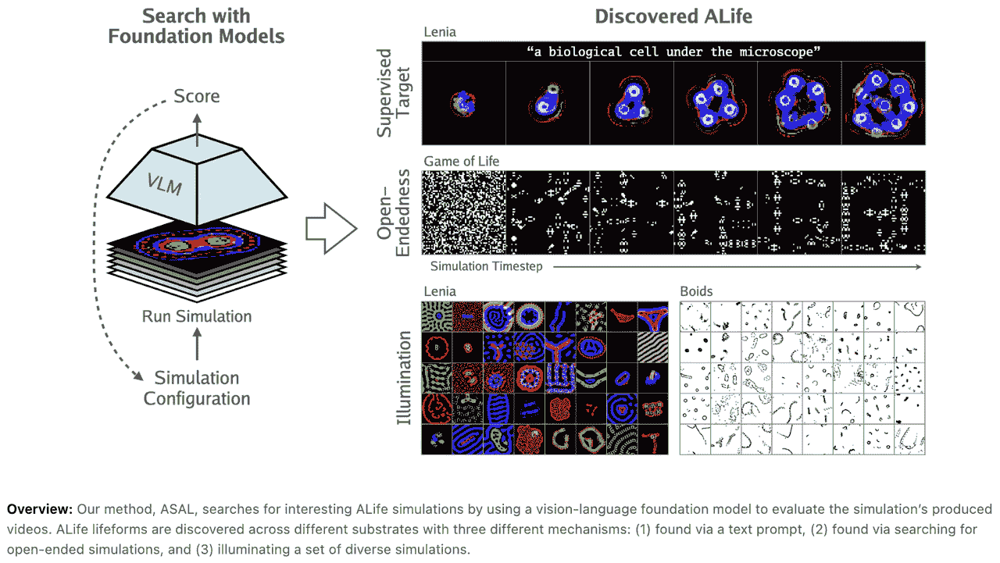

### Mamba2D: A Natively Multi-Dimensional State-Space Model for Vision Tasks

贡献人：

链接：https://arxiv.org/abs/2412.16146

ResearchFlow链接：https://rflow.ai/flow/abfd7bba-8ab0-4d29-ab6d-e2cb2cf27218

状态空间模型 (SSM) 最近成为长期存在的 Transformer 架构的强大而有效的替代方案。然而，现有的 SSM 概念化保留了源自自然语言处理的根源的根深蒂固的偏见。这限制了它们适当地模拟视觉输入的空间相关特征的能力。本文通过从原生多维公式开始重新推导现代选择性状态空间技术来解决这些限制。目前，先前的工作尝试通过依赖任意组合的一维扫描方向来捕获空间依赖性，将原生的一维 SSM 应用于二维数据。相比之下，Mamba2D 通过单个二维扫描方向对此进行了改进，该方向原生地考虑了输入的两个维度，在构建隐藏状态时有效地模拟了空间依赖性。在使用 ImageNet-1K 数据集进行标准图像分类评估时，Mamba2D 表现出与之前针对视觉任务的 SSM 改编相当的性能。

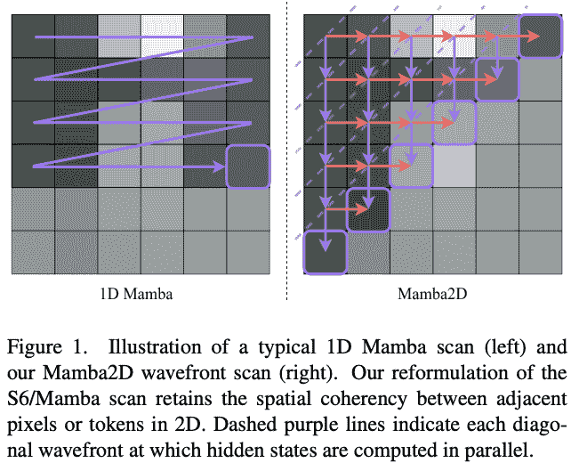

### RobustFT: Robust Supervised Fine-tuning for Large Language Models under Noisy Response

贡献人：

链接：https://arxiv.org/abs/2412.14922

ResearchFlow链接：https://rflow.ai/flow/146da2e3-b695-4526-b998-fb331216d983

监督微调 (SFT) 在将LLM适配到特定领域或任务方面起着至关重要的作用。然而在实际应用中，收集的数据不可避免地包含噪声，这对模型在下游任务上的性能提出了重大挑战。因此，迫切需要一个抗噪声的 SFT 框架来增强模型在下游任务中的能力。为了应对这一挑战，本文引入了一个强大的 SFT 框架 (RobustFT)，它可以对下游任务数据执行噪声检测和重新标记。对于噪声识别，本文方法采用多专家协作系统和推理增强模型来实现卓越的噪声检测。在去噪阶段，采用上下文增强策略，该策略结合最相关和最可信的知识，然后进行仔细评估以生成可靠的注释。此外，论文引入了一种基于响应熵的有效数据选择机制，确保只保留高质量样本进行微调。在五个数据集上对多个 LLM 进行的大量实验证明了 RobustFT 在嘈杂场景中的卓越性能。

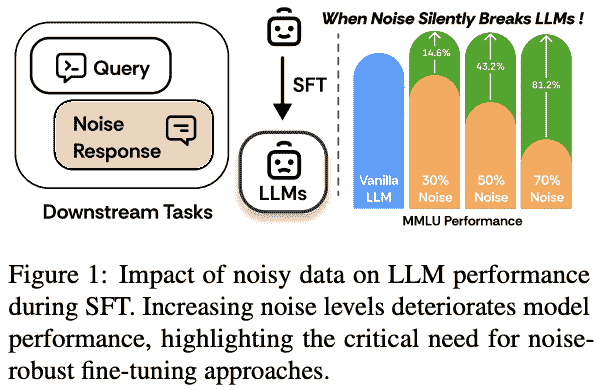

### DepthLab: From Partial to Complete

贡献人：

链接：https://arxiv.org/abs/2412.18153

ResearchFlow链接：https://rflow.ai/flow/7da320e0-58fa-483e-95b8-30a723041371

缺失值仍然是深度数据在其广泛应用中面临的常见挑战。本文工作通过 DepthLab 弥补了这一空白，DepthLab 是一个由图像扩散先验驱动的基础深度修复模型。本文提出的模型具有两个显着的优势：（1）对深度不足区域具有弹性，为连续区域和孤立点提供可靠的补全；（2）在填充缺失值时，模型忠实地保持了与条件已知深度的比例一致性。利用这些优势，这种方法在各种下游任务中证明了其价值，包括 3D 场景修复、文本到 3D 场景生成、使用 DUST3R 进行稀疏视图重建以及 LiDAR 深度补全，在数值性能和视觉质量方面均超越了当前解决方案。

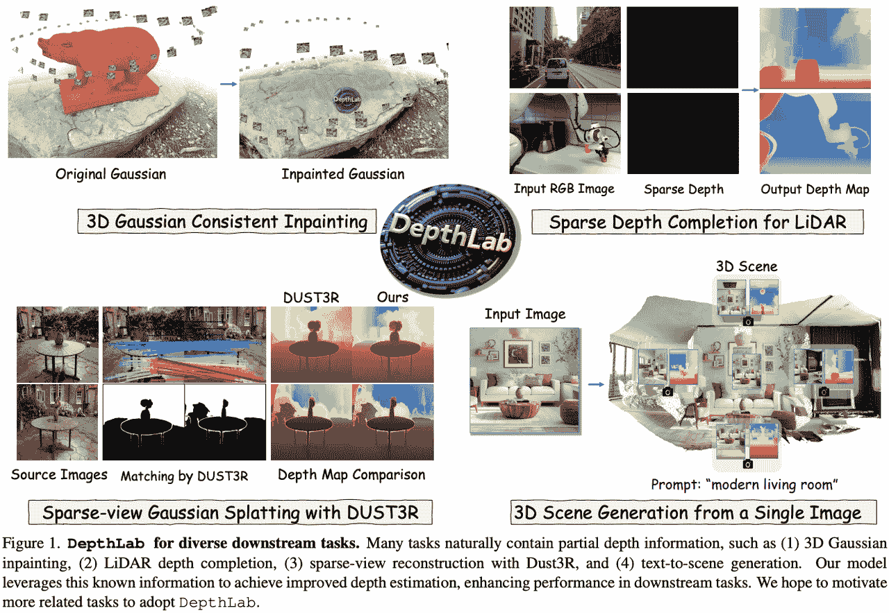

# 产品

### Hume OCTAVE 个性化语言模型

贡献人：

https://www.hume.ai/blog/introducing-octave?ref=producthunt

Hume OCTAVE 是一款下一代语音语言模型，代表了语音和语言处理技术的前沿发展。它具备全新的、突出的能力，如即时生成声音和个性，使得用户能够根据需求灵活创造和定制独特的语音体验。Hume OCTAVE 不仅能处理传统的语言任务，还能在动态交互中实时调整语音特征和个性，使每次沟通都充满个性化和多样性。这项技术的突破，赋予了语音和语言应用更加广泛的可能性，无论是在虚拟助手、娱乐、还是个性化营销中，都能够创造前所未有的沉浸式体验。

### Assistive24 Chrome扩展程序

贡献人：

https://www.assistive24.com/?ref=producthunt

Assistive24 是一款免费的 Chrome 扩展程序，可增强注意力缺陷多动症 (ADHD)、阅读障碍和视力低下等残障人士的网页访问。享受语音导航、自定义字体、对比度调整等功能。立即体验个性化、包容性的浏览体验。立即免费安装！

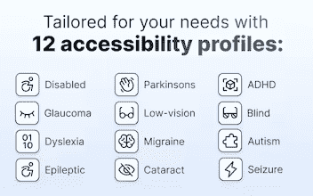

# HuggingFace&Github

### FineMath-4+ 高质量数学教育数据集

贡献人：

https://huggingface.co/datasets/HuggingFaceTB/finemath

📐 FineMath 由从 CommonCrawl 中筛选出的340 亿个标记（FineMath-3+）和540 亿个标记（FineMath-3+ 和 [Inf](https://huggingface.co/HuggingFaceTB/finemath-classifier)iMM-WebMath-3+）数学教育内容组成。为了整理这个数据集，我们使用 LLama-3.1-70B-Instruct 生成的注释训练了一个数学内容分类器。我们使用分类器仅保留最具教育意义的数学内容，重点是清晰的解释和逐步解决问题，而不是高级学术论文。

[数据集管理](https://huggingface.co/datasets/HuggingFaceTB/finemath#dataset-curation)部分详细介绍了创建数据集的过程。

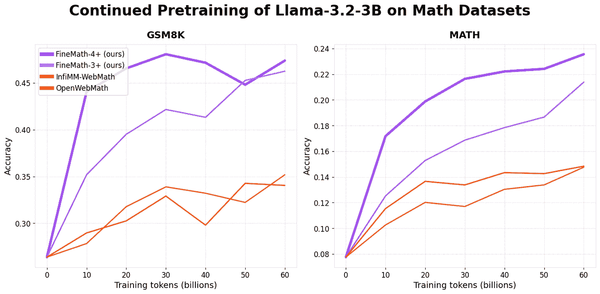

# 投融资

### 魔法原子完成1.5亿元天使轮融资，2025年交付数百台人形机器人

贡献人：

https://36kr.com/p/3092588205553800

2024年12月25日，具身智能公司魔法原子（MagicLab）宣布完成1.5亿元天使轮融资。本轮融资由追创创投领投，翼朴基金跟投，资金将用于技术研发、整机量产及商业化落地。魔法原子成立于2024年1月，专注于通用人形机器人和仿生四足机器人的研发及应用，涵盖工业、商业及家庭等多个场景。

魔法原子团队目前约100人，其中80%以上为研发人员，核心成员多毕业于清华大学、上海交通大学等知名高校，具有丰富的机器人及人工智能领域经验。尽管公司成立较短，但自2020年开始研发四足机器人，并于2022年底进军人形机器人领域。2023年初，公司发布了第一代人形机器人，并完成多次产品迭代。

魔法原子自研了多款关键零部件，包括关节模组、灵巧手和驱动器等，这些零部件与机器人本体高度匹配，帮助降低生产成本，并提升机器人的灵活性和自由度。公司负责人吴长征表示，核心零部件的自主研发使得公司能更好地掌控技术指标，并提升机器人产品的竞争力。

在场景应用方面，魔法原子正在积极推动机器人技术的商业化。公司已在工业柔性制造和商业服务场景中展开落地探索，特别是在工厂产线中进行产品检测、物料搬运和多机协同等工作。同时，MagicBot人形机器人和四足机器人也已在部分家电零售门店投入使用，承担迎宾和导购等服务。

预计2025年将成为人形机器人商用化的关键年，魔法原子计划在2025年第一季度发布新一代MagicBot人形机器人，并交付数百台量产版产品。到2026年，交付量预计将达到千台级别。通过此次融资，魔法原子将加速技术研发、规模化生产以及供应链管理，推动人形机器人在更多领域的应用。

公司官网：https://www.magiclab.top/

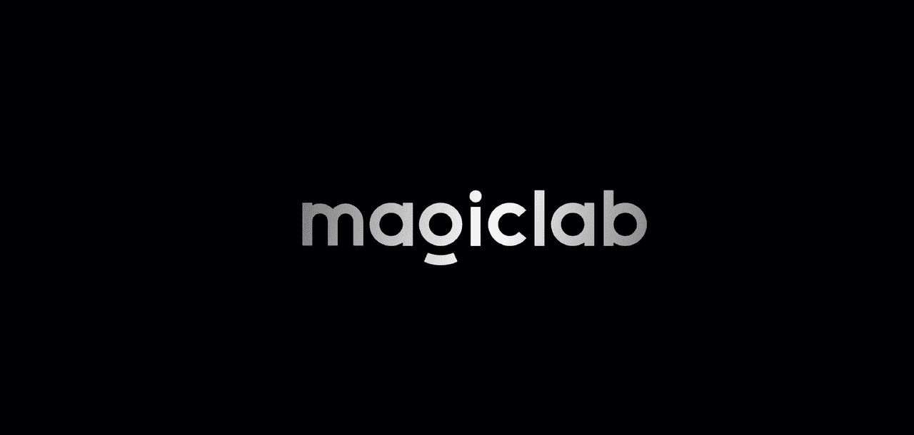

# 学习

### 我与vLLM的2024

贡献人：

https://zhuanlan.zhihu.com/p/14430956145

我的与vLLM的缘分源于五年前的一次偶然机会。当时，我在UC Berkeley的RISELab参与暑期研修，并通过社交认识了后来的vLLM项目成员，未曾料到这段交情最终会改变我的职业轨迹。到2022年底，ChatGPT的横空出世让我意识到需要改变自己的研究方向，逐渐转向机器学习系统（MLSys）的核心领域。

在探索过程中，我开始深入了解PyTorch的编译器技术和优化工具，接触到了PyTorch编译器团队，并且了解了机器学习编译器的重要性，特别是在专用硬件的使用上。随后，在2023年，我有机会与Michael Jordan教授的朋友Ion Stoica会面，他领导的一个项目正涉及多种芯片处理，其中一个正是由我之前遇到的博士生发起的vLLM项目，命运般地让我与vLLM再次相遇。

2024年，我重新回到UC Berkeley并加入了vLLM项目。初入项目时，我首先将自己在PyTorch开源项目中积累的经验带入vLLM，帮助优化项目管理流程，熟悉后，便开始处理更多技术任务，如优化PyTorch版本升级中的兼容性问题。在此过程中，项目面临诸多技术挑战，尤其是在多卡推理和NCCL版本问题上，最终通过深入分析解决了显存占用异常等问题。

随着时间的推移，vLLM逐渐成为大模型推理领域的重要工具。虽然初期在硬件性能上存在瓶颈，但得到了社区和多个厂商的支持，解决了许多性能问题，尤其是在H100和其他高级GPU上的推理优化。vLLM支持了多种开源模型，并在Meta发布LLaMA 3.1 405B模型时，成功开发了分布式推理解决方案，确保了大规模模型的高效部署。

vLLM的成功离不开持续的性能优化和重构。随着代码功能的增多，性能测试和跟踪机制逐渐完善，我们对框架进行了必要的优化，以支持更多硬件平台，并提升了多种功能的兼容性。此外，我也推动vLLM与PyTorch生态系统的深度融合，通过与PyTorch Compiler团队的合作，我们开发了vLLM专属的推理优化技术栈，提升了框架的推理效率。

面对AI硬件的挑战，我意识到硬件亲和性对算法成功至关重要。在探索机器学习系统时，我深刻体会到与硬件厂商的合作能够推动算法效率的提升，而不仅仅是依赖硬件的“幸运抽奖”。最终，vLLM团队也希望通过加入Linux基金会，进一步扩大项目影响力，推动智能时代基础设施的建设，成为智能时代的“Linux”。

展望未来，虽然AI领域的泡沫和奇迹并存，但我坚信，正如互联网经历过泡沫破灭后的重生，AI技术的潜力将在未来几十年持续释放。vLLM的故事只是这一波技术浪潮中的一部分，而我们正站在下一个“互联网级奇迹”的起点上。

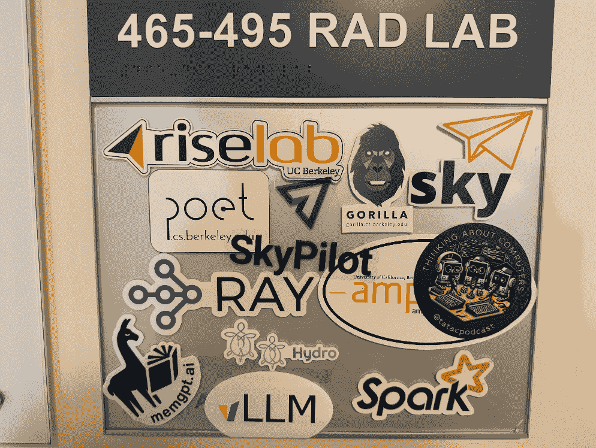

### [MLSys 入门向] 做12道题，快速上手Triton！

贡献人：

https://zhuanlan.zhihu.com/p/5964285807

Triton 是一个广受欢迎的深度学习编程框架，它为编写 GPU 核心函数提供了较低的学习门槛，同时能够实现优秀的性能表现。最近，作者进行了一些与 Triton 相关的工作，并总结了一些经验，特别是在编写 Triton 核心时的技术细节和优化手段。作者提到，尽管官方文档提供了一些示例代码，但它们并未详细解释如何从零开始编写一个 Triton 核心。因此，作者决定改进现有的入门教程，尤其是通过“Puzzles”的方式帮助用户更好地理解 Triton。

Triton-Puzzles 是一个基于解谜游戏的学习工具，通过完成12个谜题，用户可以逐步掌握 Triton 核心的编写。这些谜题涵盖了多个常见的大模型算子，如量化矩阵乘法（Quantized Matmul）和 FlashAttention。尽管这个项目有助于理解 Triton，但也存在一些用户反馈的困难，主要体现在环境配置复杂、题目描述不清晰等问题上。为了解决这些问题，作者创建了一个改进版的 Triton-Puzzles-Lite。

Triton-Puzzles-Lite 在原版的基础上做了许多优化。首先，它大幅减少了依赖，删除了不必要的可视化部分和 Jupyter Notebook 依赖，使得环境配置更加简洁。现在用户只需要安装 Triton、Torch 和 Numpy 等基本库即可运行。这使得用户可以在较为轻量的环境下进行学习和实验。此外，作者改进了题目的描述，尤其是关于某些算子和符号的解释，避免了原版中存在的混乱。为了增强调试体验，作者还在代码中增加了更多的调试信息，用户可以通过终端查看每个块的访存地址、合法性以及其他关键信息。

Triton-Puzzles-Lite 还支持 GPU 运行，尽管在 GPU 模式下会失去一些调试信息，但对于需要高性能计算的用户来说，GPU 支持依然是一个有用的功能。为了进一步帮助用户，作者提供了一个参考答案，用户可以查看答案的实现思路，理解解决问题的方法。每个谜题的描述都尽量精简和易懂，尤其是变量命名方面，力求做到清晰明了。

在使用 Triton-Puzzles-Lite 时，用户只需确保已经安装了包含 Triton 和 Torch 的 Python 环境。推荐用户先在 CPU 模式下运行，使用解释器模式进行调试。安装完毕后，用户可以通过命令行运行代码，并检查每个谜题的解答是否正确。如果全部通过，用户就可以进入下一步，继续解决更多的谜题。

总的来说，Triton-Puzzles-Lite 是一个非常适合学习 Triton 核心编写的入门工具，它通过简化环境配置和优化题目描述，降低了学习门槛。作者希望通过这个项目帮助更多的人掌握 Triton，并在未来进一步推出相关的教程和资源，帮助大家更好地理解和使用 Triton 进行 AI 开发。

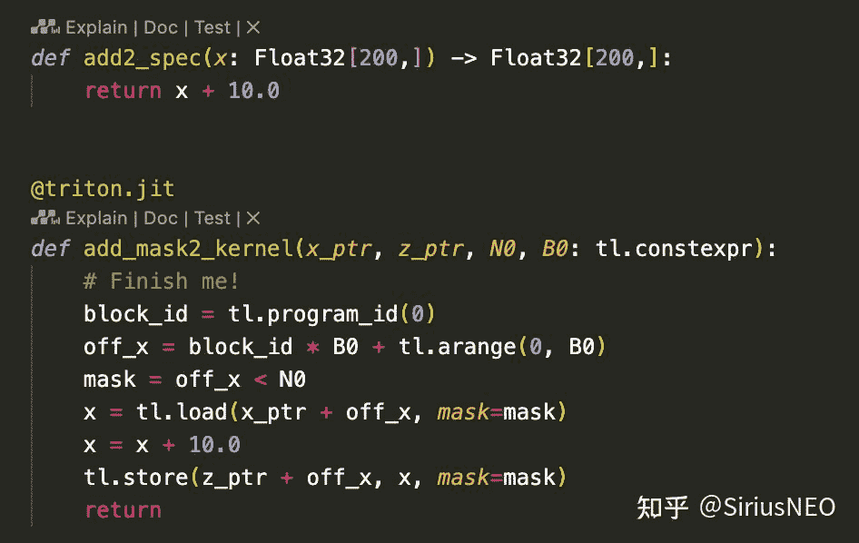

### 从抽象推理到大模型：ARC vs o3 引发的AI新思考

贡献人：

https://zhuanlan.zhihu.com/p/14509885232

2024年，一家领先的AI机构发布了o3模型，突破了ARC（Abstraction and Reasoning Corpus）以及其他抽象推理任务的表现，取得了令人瞩目的成绩。ARC一直被认为是检验AI抽象推理能力的标准，它通过少样本、复杂的规则变换来测试AI是否能够像人类一样进行归纳推理。尽管传统深度学习方法依赖大量数据训练，ARC则希望考察AI是否能够在少量示例中抽象出核心规则。大多数AI系统在该任务中表现不佳，过去几年的竞赛中，顶级成绩仅为35%左右。

然而，o3模型在ARC的挑战中取得了惊人的成绩，特别是在半私有测试集中，低算力模式下达到了75.7%，高算力模式下更是接近87.5%。这一突破不仅引发了对其实现细节的广泛关注，也使人们对“抽象推理”的理解产生了新的讨论。o3的成功引发了一个问题：它是通过深层搜索和大量计算完成的，还是实现了更接近人类抽象思维的理解？很多人怀疑，o3是否只是通过“大量推理时的资源与搜索策略”来巧妙地猜测答案，而并非真正掌握了抽象推理的核心概念。

ARC的设计理念是减少依赖大量数据和训练，要求AI从少量示例中快速提取规律并进行推理，这与传统的大数据训练方法有所不同。ARC题目通过少量示例展示网格变换，解题者需要从中推导出规律并应用到新网格中，测试AI的抽象与概念迁移能力。ARC的设计者强调，这不仅仅是对模式识别的考察，更关注AI是否具备像人类一样的抽象认知能力，能够在面对新情境时迅速理解并应用新概念。

随着大模型技术的发展，部分参赛队伍通过大规模的数据增广和微调技术在2024年的比赛中取得了50%-55%的成绩，尽管距离人类的85%仍有差距。o3的突破则进一步推动了这一进程，尽管其实现方式可能与ARC的初衷有所偏离。o3的推理过程可能涉及到大量的候选生成与筛选，类似于AlphaGo中的蒙特卡洛树搜索，这种方法虽然提高了准确率，却也引发了关于“暴力搜索”与“真正理解”之间的争论。

这场突破不仅对ARC提出了新挑战，也让研究者重新审视AI的推理能力。是否能够通过庞大的计算和模型训练获得高精度，还是AI能在没有过多计算的情况下真正理解并推理出抽象概念？未来的研究将需要进一步探讨如何评估AI的真正认知能力，并设计更具挑战性的任务来区分AI在特定任务中的“记忆”与“理解”能力。

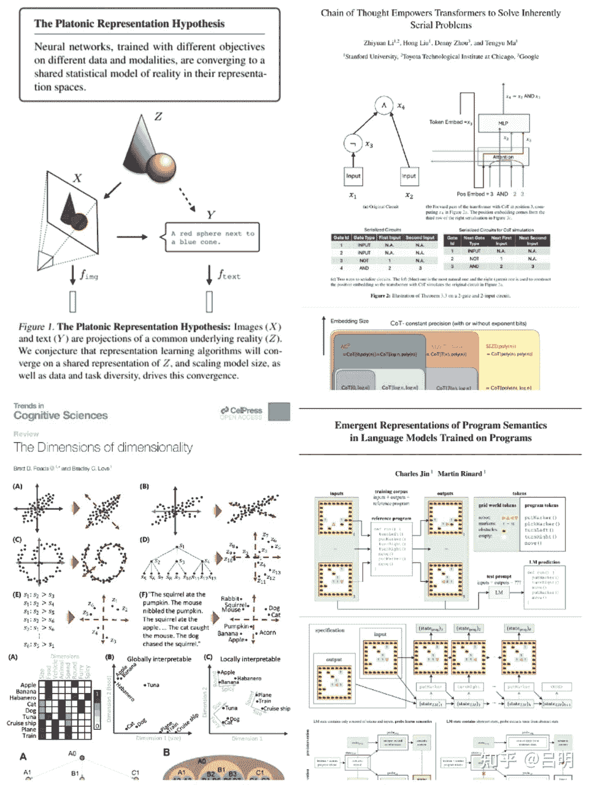

### 24年下半年较新的VLM架构

贡献人：

https://zhuanlan.zhihu.com/p/11503653276

本文概述了2024年下半年多个知名的视觉语言模型（VL**M），涵盖了多个创新技**术细节和架构设计。Deepseek-VL采用了双视觉backbone（Siglip和SAM），其中Siglip提供低分辨率特征，SAM则提供高分辨率特征，最后将两者的嵌入在channel维度进行拼接，得到一个高维度的特征表示。训练时，文本数据占比为70%，并且通过引入来自不同在线来源的真实数据来提升模型的实际应用效果。

**Idefics2**提出了基于纯自回归架构的模型，重点在于提高推理效率和性能，尤其是通过项目器（projector）模块来降维token，并优化视觉encoder的patch embedding处理。此外，作者发现视觉分辨率对模型性能的提升优于视觉参数量。

**InternVL2**在动态高分辨率图像处理上进行了优化，使用了PixelShuffle来减少token数并提高推理效率。其轻量级版本通过对图像进行适当的token降维来增强性能。

**MiniCPM-V**则特别注重端侧应用，采用SigLip-400M和Qwen2-7B两种架构，并引入多图和视频理解能力，突破了GPT-4V等闭源模型在单图理解上的限制。其动态分辨率策略确保了输入图像保持宽高比，并自适应切分成多个patch，以减少token数。

**Qwen2-VL**支持任意分辨率的图像与视频输入，结合了ViT和Qwen2架构，并创新地引入了多模态旋转位置编码（M-ROPE），通过这种三维位置编码策略，模型能够更好地处理图像和视频中的空间与时间信息。其设计支持视频输入通过tube embedding来处理。

**LLama3.2 Vision**在视觉backbone中使用ViT-H/14，并通过额外的自注意力层来捕捉多尺度特征，同时增加了视频处理能力，通过32帧聚合成1帧来进行时间维度的特征提取。

**Molmo与PixMo**提出了通过语音描述转录成文本的多模态数据集构造方法，注重数据质量而非依赖于合成数据。其训练方式直接全参数训练，而非通过传统的预训练和SFT等阶段。

**Ocean-Omni**支持图像、视频、音频和文本的多模态理解，采用siglip 384模型进行视觉处理，并通过卷积网络优化音频token降维。其训练阶段涵盖了图像、视频与音频的联合训练。

**Janus**与**JanusFlow**分别在视觉理解与图像生成任务上取得突破，Janus结合了siglip与LlamaGen视觉backbone，分别处理高层次语义信息和细节纹理信息。在生成图像任务中，JanusFlow采用了基于RectifiedFlow的扩散模型进行图像生成，并使用特征对齐的技巧来提高生成质量。

这些模型在视觉理解、生成以及多模态处理上不断创新，并通过特定的架构优化和训练技巧提升了模型的性能与效率。

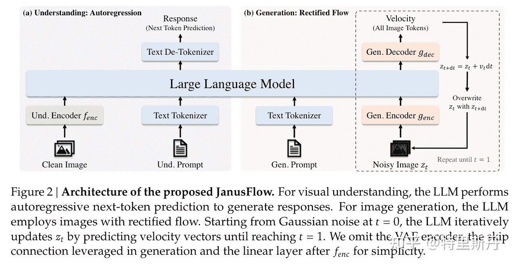

### 从头理解VAE（Variational Autoencoder），ELBO，VLB

贡献人：

https://zhuanlan.zhihu.com/p/14421669110

VAE（变分自编码器）假设数据集中的样本由隐变量生成，分为两步：首先从先验分布中采样隐变量，然后从条件分布中生成样本。VAE的目标是最大化数据的对数似然，但由于需要对所有可能的隐变量进行积分，这在实际中不可行。为此，VAE引入了一个近似的后验分布，通过最小化后验分布与近似分布之间的KL散度来优化模型。这个过程的目标被称为ELBO（证据下界），它由两部分组成：数据的重构损失和隐变量后验的KL散度。

为了使得采样过程可微，VAE采用了Reparameterization Trick，即通过一个标准高斯分布重新参数化隐变量。这使得梯度能够通过采样过程进行反向传播，优化过程得以进行。在代码实现中，隐变量被建模为高斯分布，encoder网络预测均值和标准差，decoder则根据隐变量生成重构的样本。

VAE的损失函数由两部分组成：第一部分是数据的重构误差，通常使用均方误差（MSE）来度量；第二部分是隐变量的KL散度，度量近似后验与标准高斯分布之间的差异。在训练过程中，VAE通过最小化这两部分的加权和来优化模型。

在代码实现方面，VAE的encoder由卷积层和全连接层构成，输出隐变量的均值和对数方差。decoder则使用全连接和反卷积层将隐变量映射回数据空间。在计算损失时，KL散度和重构误差都被考虑，最终优化VAE模型的参数。训练完成后，VAE能够从标准高斯分布中采样隐变量，并生成新的样本。

VAE的变体，如Vector Quantized VAE（VQ-VAE），将会在后续讨论中进一步介绍。

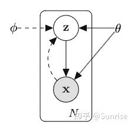

# 声明

本文档仅供学习交流使用，版权归原作者所有，若涉侵权，请联系Jack Jin 15101136166

##

（欢迎在下方反馈您宝贵的意见！整理不易，觉得有用给AI日报小组点个赞👍吧！）

ChatGPT；Angela；Zijia Liu；Alex；Zeqi Tan；Tiezhen（HuggingFace）；Naixu；Lizhi；Peter；Suoman；Jack

学术分析报告：ResearchFlow -- 奇绩F23校友的开发的深度研究产品，PC端进入RFlow的分析报告，可直接点击节点右侧的小数字展开节点，登录后可在节点上直接“询问AI”，进一步探索深度信息

如果你有大模型相关的创业想法，欢迎来找我们聊聊～🛰️：15101136166

> 快邀请你的小伙伴们一起来读大模型日报吧！

> **【日报****知识库****】**这里是近期日报内容的汇总,欢迎大家查阅

> [大模型日报知识库(分享版)](https://miracleplus.feishu.cn/wiki/KapVwXfkriOBiskB0B2cUHxjnTh)

>

> 欢迎大家多多帮我们分享,转发~~

> 如果大家有任何的建议或者吐槽,欢迎随时找我聊天~

