# 奇绩大模型日报（12月 26日）

> 来源：[https://miracleplus.feishu.cn/docx/FaDQdSnYJozdl4xlEvnc7Epdnjf](https://miracleplus.feishu.cn/docx/FaDQdSnYJozdl4xlEvnc7Epdnjf)

# 🔉潜**空间系列活动重磅回归！**

> 本期活动将在**1月4日** **11:00**开始，我们邀请到的嘉宾是叶添，清华大学姚班，卡内基梅隆大学博士生，Physics of LLM 2.1作者，于 Meta 担任 Research Scientist Intern。研究兴趣主要集中在大语言模型的推理机制。曾在顶级会议 NeurIPS 上发表研究论文。此外，曾两次获得中国数学奥林匹克竞赛国家集训队的资格。

> 在本次分享中叶添将分享《揭秘大语言模型推理机制——超越人类的二级推理》。

> 除嘉宾分享外，每期设置了【匹配合伙人 Cofounder Matching】环节。你可以和 GenAI 时代最有活力的创业者和研究者线下面对面交流，将有机会找到志同道合、有共同创业梦想的小伙伴。

> 报名通道已开启，欢迎扫描下方二维码报名。

# 资讯

### Deepseek-v3

贡献人：

https://mp.weixin.qq.com/s/gxelchvaWA9Mo9YxZlT2fg

Deepseek-v3意外曝光，引起了广泛关注，尽管尚未正式宣布。根据Reddit用户和其他测试者的爆料，Deepseek-v3已在API和网页上上线，并且其性能在多个评测中脱颖而出。它在Aider的多语言编程测试中超越了Claude 3.5 Sonnet，排在o1之后，完成率从Deepseek-v2.5的17.8%大幅提升至48.4%。在LiveBench测评中，Deepseek-v3被认为是目前最强的开源LLM，仅在非推理模型中稍逊于gemini-exp-1206，位列第二。

Deepseek-v3相比前代v2和v2.5在多个方面有了显著提升。它采用了685B参数的MoE架构，配备256个专家，支持64K上下文，默认支持4K，最长可扩展到8K。每秒处理约60个tokens。此外，Deepseek-v3的Instruct版本在Aider测试中成功超越Claude 3.5 Sonnet，但该版本尚未发布。

与v2相比，Deepseek-v3的进步主要体现在以下三个方面：首先，v3使用了sigmoid函数替代v2中的softmax函数，这使得模型能够从更大的专家集合中进行选择；其次，引入了不依赖辅助损失的新方法——noaux_tc，简化了训练过程并提高了效率；第三，新增了e_score_correction_bias参数，以优化专家评分并提升性能。

与v2.5相比，Deepseek-v3增加了更多的专家数量和更大的中间层尺寸，进一步提升了每个token的处理能力。测试者Simon Willison（Django框架的创始人之一）在实测中发现，Deepseek-v3不仅能生成创意图像，还能回答如同OpenAI模型一样的问题，暗示其训练过程中可能使用了OpenAI的反馈。

尽管Deepseek-v3的正式发布尚未到来，但其在多个排行榜和测评中的表现已经让它成为目前最强的开源LLM之一，甚至在某些人的眼中，它的表现远超OpenAI的产品。

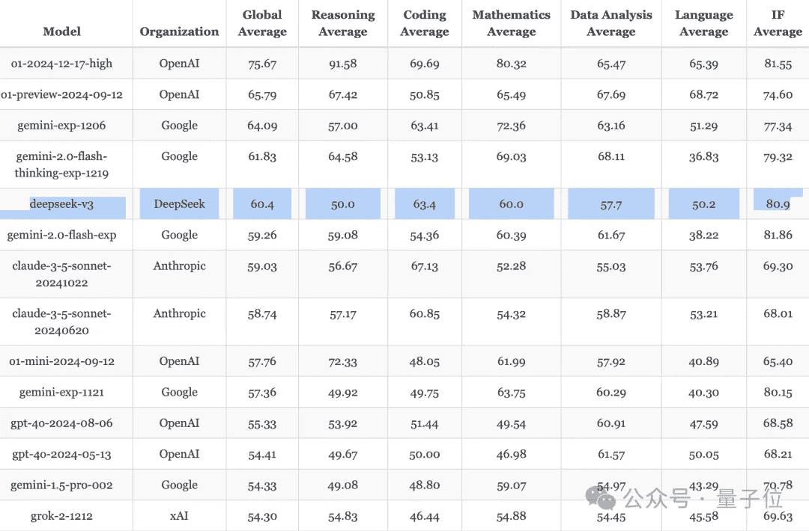

### o3挑战ARC-AGI，遇见大网格就懵圈

贡献人:

https://mp.weixin.qq.com/s/0oixyERoMbdLNGEEYgcydw

在ARC-AGI超难推理任务中，o3展现了惊人的成绩，但一项深入的研究揭示了模型在面对大规模网格题目时的表现瓶颈。英国ML工程师Mikel Bober-Irizar（米哥）研究了ARC题目，发现大模型在处理较大规模网格时表现较差，尤其是在网格数量超过1024时，o3的表现开始急剧下降。米哥通过对ARC数据集的规模分布分析，指出大模型在面对规模较大的题目时，性能显著下降，而在规模较小的题目中则表现较好。类似的现象不仅出现在o3，也出现在o1、o1-mini和Claude等模型中。

米哥进一步实验了o1-mini，发现将网格切割成更小的单元后，模型的推理能力显著下降，验证了大模型在面对更大规模问题时的局限性。米哥认为，ARC挑战不完全反映大模型的推理能力，因为它过于依赖较小规模的问题，而忽视了大模型在处理大规模网格时的表现瓶颈。

米哥的分析还指出，大模型与人类的思考方式在解决这类问题时存在根本差异。人类能通过视觉感知和空间推理轻松解决这些问题，而大模型则需要通过更长的上下文进行推理。尤其在跨行列的推理中，随着网格规模的增大，模型必须处理更长的上下文信息，这对其推理能力构成挑战。米哥提到，通过旋转矩阵让模型分别基于行列进行推理，能显著提高性能，表明大模型在处理这类任务时，维度感知和视觉理解的差异至关重要。

网友也指出，尽管模型拥有类似“视觉”的能力，但将视觉信息转换为Token的方式与人类的视觉体验截然不同。人类的视觉能力可以并行处理信息，而大模型则是串行处理Token，这种处理方式的差异影响了模型的推理效果。

与此同时，ARC挑战官方宣布将推出下一代版本ARC-AGI-2，预计对o3构成更大挑战。初步测试显示，o3在高计算量模式下的得分可能会降至30%以下，而人类的得分仍可能超过95%。这表明，尽管大模型在某些任务上表现突出，但它们在应对更复杂的推理问题时仍存在显著的局限性。

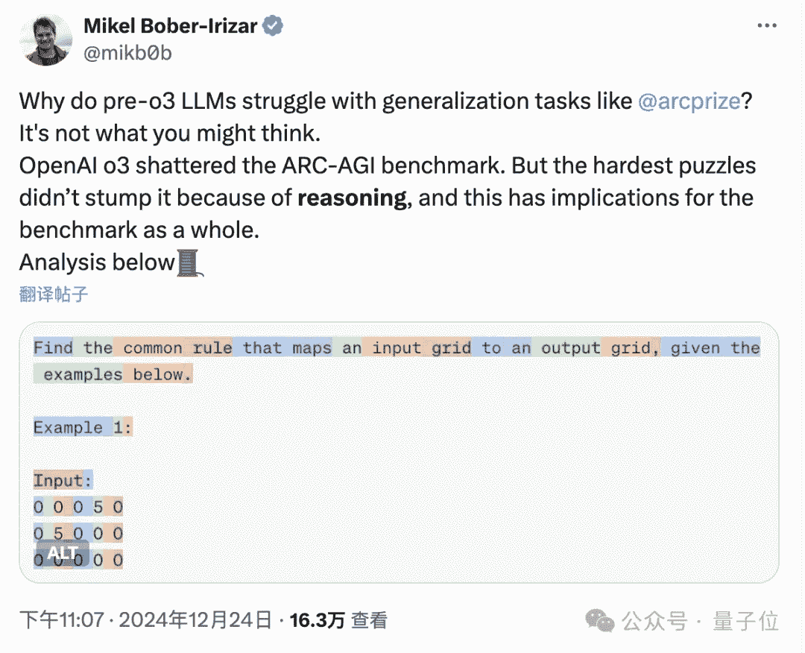

### 全新B300为o1推理大模型打造，RTX5090同时曝光

贡献人：

https://mp.weixin.qq.com/s/aO51gn6rcRFkit2YPchUIg

英伟达的最新发布可谓是“圣诞老黄”的大礼包，推出了两款突破性AI芯片：B300和GB300，均在算力和显存方面进行了显著提升。B300的FLOPS相比B200提升了50%，显存容量也从192GB提升至288GB，显著提升了AI推理大模型的能力。GB300更是配备了72块B300 GPU，被誉为解决OpenAI o1/o3推理大模型的唯一方案，能够在高batch size下处理更长的思维链，显著提升处理效率。

尽管B300仍基于Blackwell架构，但其算力提升主要得益于工艺微创新、功率增加以及动态分配技术。其显存也从原来的8层HBM3E升级为12层（12-Hi HBM3E），显存带宽保持在8TB/s，进一步提高了数据处理效率和模型推理速度。此外，GB300系列的产品交付方式也发生变化，改为提供参考板，允许客户自行采购其他组件，为供应链中的OEM和ODM制造商提供了更多灵活性。

显存的增加对AI推理模型至关重要，尤其是对于OpenAI o1/o3这样的复杂模型，显存的提升意味着更低的延迟、更长的思维链、降低推理成本和更高效的样本搜索。这些提升直接影响了AI模型的能力和成本效益。与传统的摩尔定律相比，英伟达的进步速度令人瞩目，显存增加带来的效益超越了表面提升，显著提升了模型的毛利率和竞争力。

此外，英伟达还曝光了消费级显卡RTX 5090的PCB板，预计将配备32GB显存，并支持8K超高清游戏，提供60fps流畅体验。RTX 5090的发布可能会在1月6日的CES上揭晓，引发业界广泛关注。

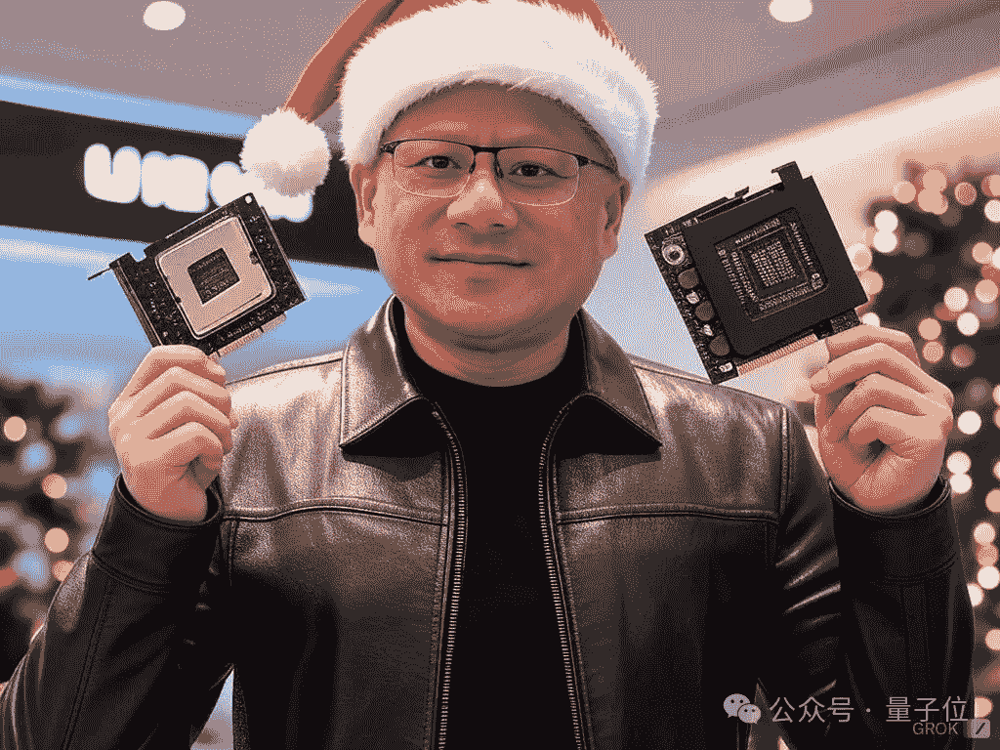

### 端侧 AI 落地挑战有多大？手机、PC、汽车、具身机器人有话说

贡献人：

https://mp.weixin.qq.com/s/E2W2zfFhdrNhsdEm76Knpw

1.  **消费电子与大模型结合**：智能手机和PC期待AI大模型赋能，以提高效率和创造新功能。钱电生认为大模型是基础设施，将促进新应用的出现。孙峪强调AI将改变人机交互，使PC更易用，提高办公效率。

1.  **端侧模型挑战**：端侧部署面临算力和存储挑战，需要异构硬件支持和框架层面的算力调度。钱电生提到3D RAM可能成为端侧部署的有效解决方案。

1.  **大模型上车**：黄小严和笪琦讨论了大模型在智能座舱中的应用，强调了理解用户意图、提供共情关怀和完成任务的能力。北汽已在多款车型中部署大模型，通过百模汇创平台灵活接入垂域模型。

1.  **具身大脑**：秦玉森和刘威彤讨论了大模型对具身智能的影响，包括常识压缩、多模态识别和自动化数据标注，认为大模型将推动机器人技术的发展。

1.  **人形机器人市场**：刘威彤认为人形机器人市场广阔，但目前处于早期阶段。市场将从To B向To C发展，初期可能在文娱展演、医疗等领域应用，家庭应用将是最后到来但市场最大的。

1.  **技术范式和路线**：秦玉森指出，行业尚未追求真正的端到端模型，而是通过“段到段”的方法，将功能封装成模块，逐步实现端到端。

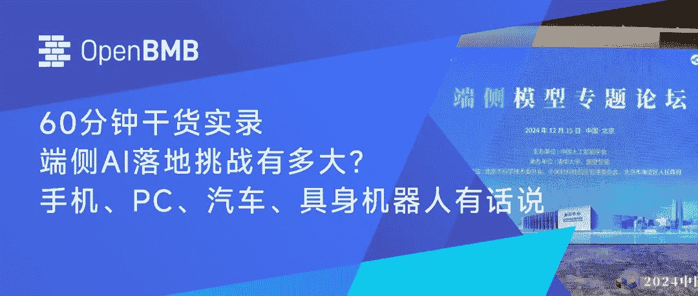

# 推特

### Hyperspace Wallet：与区块链交互的智能代理

https://x.com/varun_mathur/status/1872013645233954973

🎄🎅

宣布 Hyperspace Wallet：与区块链交互的智能代理

[0moa_eNYOP7smpT_.mp4](https://internal-api-drive-stream.feishu.cn/space/api/box/stream/download/all/MjFdbrdOmocnX0xDscrcsEOVnNf)

### Agarwal分享：环视 Lofi Girl 房间，Veo2 生成

https://x.com/pallavmac/status/1871997677405397311

我成功将自己的图片上传到 Veo 2！这是让我它环视 Lofi Girl 房间时的效果——非常令人惊艳！

[MXoHz_ZtFHVscH53.mp4](https://internal-api-drive-stream.feishu.cn/space/api/box/stream/download/all/X6YJbUQHZo9hqXxVBRqcWSBtnoh)

### Google Cloud发布Trillium：谷歌目前第六代性能最强的TPU

https://x.com/googlecloud/status/1871662382386225603

我们的节日灯版本：Trillium——迄今为止我们第六代性能最强的TPU！

我们使用 Trillium TPU 训练了全新的 Gemini 2.0，现在它已全面向 Google Cloud 客户开放。

了解更多关于 Trillium 的信息，请点击 → https://goo.gle/3ZMKBqR

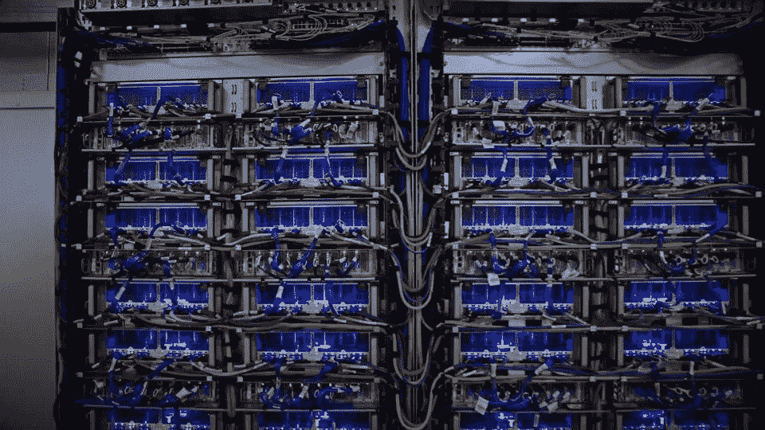

[izO1J5Fz37_XtTnv.mp4](https://internal-api-drive-stream.feishu.cn/space/api/box/stream/download/all/UCn2bWnyBoJ7RvxJlXTcJD6hnFb)

### EXO Labs分享 12 天挑战第一天：透明基准测试，真实的消费设备上运行了1000多个大型语言模型基准测试

https://x.com/exolabs/status/1871993287273533707

第1天：基准测试

我们在真实的消费设备上运行了1000多个大型语言模型（LLM）基准测试。

数据包括单设备和多设备集群的每秒令牌数（TPS）和首令牌生成时间（TTFT）。

测试设备配置包括：3台 M4 Mac Mini 集群、iPhone 15 + S24、RTX4090 等。

https://blog.exolabs.net/day-1/

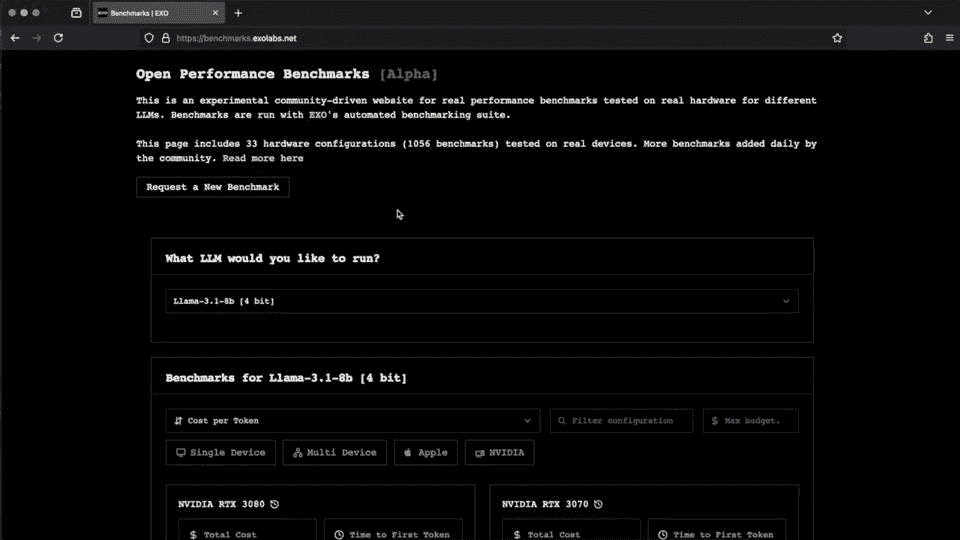

[CJpdCxclEWNd7LPl.mp4](https://internal-api-drive-stream.feishu.cn/space/api/box/stream/download/all/EMTZbnNx9ogsCqxQFQUcc8DCnUb)

# 信号

### PartGen: Part-level 3D Generation and Reconstruction with Multi-View Diffusion Models

原文链接：https://arxiv.org/abs/2412.18608

ResearchFlow链接：https://rflow.ai/flow/7b575d63-cf6e-4d13-9b91-8a92f14d0b76

文本或图像到 3D 生成器和 3D 扫描仪现在可以生成具有高质量形状和纹理的 3D 资产。这些资产通常由单一的融合表示组成，如隐式神经场、高斯混合或网格，没有任何有用的结构。然而，大多数应用程序和创意工作流程都要求资产由几个可以独立操作的有意义的部分组成。为了解决这一差距，我们引入了 PartGen，这是一种新颖的方法，它从文本、图像或非结构化 3D 对象开始生成由有意义的部分组成的 3D 对象。首先，给定 3D 对象的多个视图（生成或渲染），多视图扩散模型提取一组合理且视图一致的部分分割，将对象分成多个部分。然后，第二个多视图扩散模型分别获取每个部分，填充遮挡，并通过将这些完成的视图馈送到 3D 重建网络来使用这些完成的视图进行 3D 重建。这个完成过程考虑了整个对象的上下文，以确保各部分紧密结合。生成式补全模型可以弥补由于遮挡而缺失的信息；在极端情况下，它可以根据输入的 3D 资产产生完全不可见的幻觉。我们在生成的和真实的 3D 资产上评估了我们的方法，并表明它的表现远远优于分割和零件提取基线。我们还展示了 3D 零件编辑等下游应用。

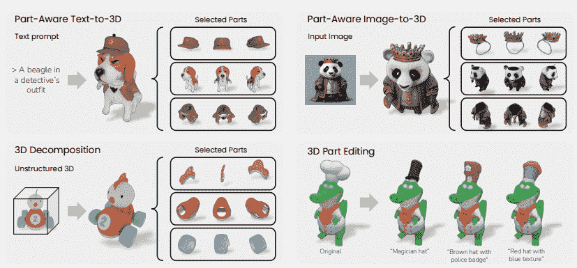

### LearnLM: Improving Gemini for Learning

原文链接：https://arxiv.org/abs/2412.16429

ResearchFlow链接：https://rflow.ai/flow/c3c6ab8c-55e0-40ef-8fef-e89978275887

当今的生成式 AI 系统默认呈现信息，而不是像人类导师那样让用户参与学习。为了解决这些系统广泛的潜在教育用例，其中训练和评估示例包括系统级指令，描述后续模型转变中存在或期望的特定教学属性。这种框架避免将我们的模型承诺于任何特定的教学定义，而是允许教师或开发人员指定所需的模型行为。它还为改进 Gemini 学习模型扫清了道路——通过将我们的教学数据添加到训练后混合中——以及它们迅速扩展的功能集。两者都代表了我们最初的技术报告的重要变化。我们展示了如何通过遵循教学指导进行训练来产生一个 LearnLM 模型（可在 Google AI Studio 上使用），该模型在多种学习场景中受到专家评分者的广泛青睐，其平均偏好强度比 GPT-4o 高 31%、比 Claude 3.5 高 11%、比 LearnLM 所基于的 Gemini 1.5 Pro 模型高 13%。

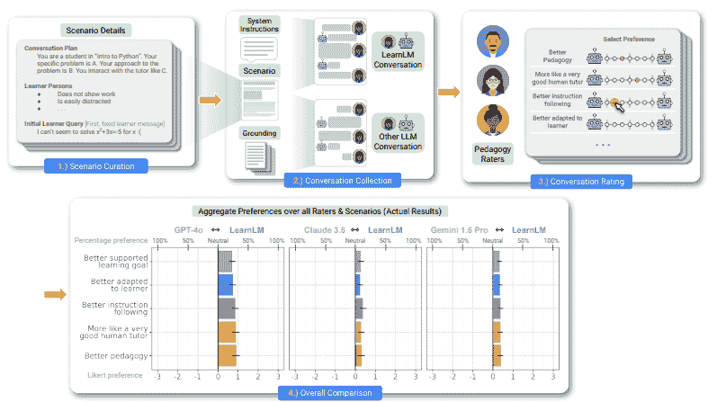

### OpenAI o1 System Card

原文链接：https://arxiv.org/abs/2412.16720

ResearchFlow链接：https://rflow.ai/flow/203af034-47f8-47cb-bbe0-41475c7125d5

o1 模型系列经过大规模强化学习训练，使用思路链进行推理。这些先进的推理能力为提高我们模型的安全性和稳健性提供了新的途径。特别是，通过深思熟虑的协调，我们的模型可以在响应潜在不安全提示时根据上下文推理我们的安全政策。这导致在某些风险基准上表现出最佳性能，例如产生非法建议、选择刻板反应和屈服于已知越狱。训练模型在回答之前融入思路链有可能释放出巨大的好处，同时也会增加因智力提高而产生的潜在风险。我们的结果强调了建立强大的协调方法、广泛地对其有效性进行压力测试以及维护细致的风险管理协议的必要性。本报告概述了针对 OpenAI o1 和 OpenAI o1-mini 模型开展的安全工作，包括安全评估、外部红队和准备框架评估。

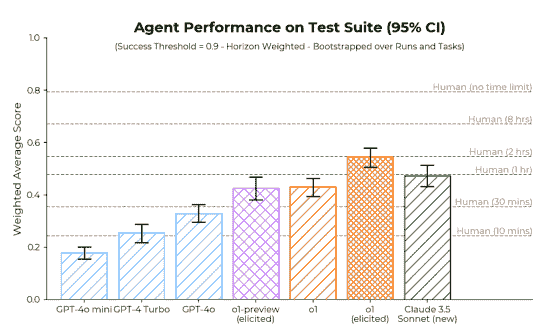

# 产品

### Tutor LMS 3.0 一体化 WordPress LMS

贡献人：

https://tutorlms.com/?ref=producthunt

Tutor LMS 3.0 为在线教育领域带来了全新的突破，其现代化设计、内置的电子商务功能和强大的人工智能工具，为用户提供了从课程创建到管理和盈利的全流程解决方案。通过 Tutor LMS 3.0，用户可以轻松设计吸引人的在线课程，集成支付和订阅管理系统，并利用 AI 优化学习内容，提高学生的参与度和满意度。一切都集中在一个平台内，无需额外工具或复杂操作，让教育工作者和企业家专注于实现知识共享和业务增长的目标。

### EasyLang AI AI课程语言学习

贡献人：

https://mylens.ai/apps/easylang?ref=producthunt

使用简短的 AI 课程，以您的母语和真实语境快速学习任何语言。我们的 AI 会创建引人入胜的视觉效果，您会记住它们并将其作为备忘单保存。最好的部分是什么？您可以从您最喜欢的视频和内容中创建自定义课程。

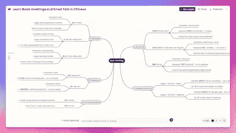

# HuggingFace&Github

### ModernBERT-base

贡献人：

https://huggingface.co/answerdotai/ModernBERT-base

ModernBERT 是一种现代化的双向编码器专用 Transformer 模型（BERT 风格），已在 2 万亿个英语和代码数据上进行预训练，原生上下文长度最多为 8,192 个标记。ModernBERT 利用了最近的架构改进，例如：

旋转位置嵌入 (RoPE)用于长上下文支持。

局部-全局交替注意力机制，提高长输入的效率。

取消填充和 Flash Attention可实现高效推理。

ModernBERT 的原生长上下文长度使其成为需要处理长文档的任务的理想选择，例如检索、分类和大型语料库中的语义搜索。该模型是在大量文本和代码语料库上训练的，因此适用于各种下游任务，包括代码检索和混合（文本 + 代码）语义搜索。

# 学习

### 多模态大模型--理解和生成统一

贡献人：

https://zhuanlan.zhihu.com/p/14381619450

目前关于多模态大模型的研究主要存在两种理解和统一标准。第一种标准侧重在视觉指令微调过程中，给模型增加生成能力，确保图像理解和纯文本能力不会显著下降，代表性工作有MetaMorph、LlamaFusion、SEED、DreamLLM等。第二种标准则是在多模态序列上进行预训练，生成任意多模态内容序列，代表性工作包括EMU3、Chameleon、Transfusion等。这两种标准有不同的目标：第一种专注于多任务学习，第二种则是多知识的统一，后者对资源需求较大，因此大部分研究仍在聚焦于第一种标准。

MetaMorph的核心贡献在于通过扩展视觉指令微调，加入连续视觉特征相似度损失和基于SD结构的视觉特征解码器，使得MLLM能够同时处理图像理解和生成任务。实验结果表明，在一定条件下，理解任务和生成任务能够互相促进。通过调整生成数据量和理解数据量，MetaMorph验证了生成任务对理解任务的正向促进作用，生成数据量增大时，VQA准确率提高，FID和CLIP分数也改善。然而，生成数据和理解任务之间的关系呈现出边际效益递减，且生成任务并未显著提升理解任务性能。

LlamaFusion则采用了不同模态独立的编码器、注意力机制、前馈网络和解码器，并通过重用预训练LLM来减少图像理解和生成任务的训练开销。其图像生成建模方式与Transfusion类似，使用VAE作为图像编码器，再通过噪声处理让MLLM与Unet头共同学习去噪。LlamaFusion的设计目标是维持LLM的文本理解能力，且通过初始化预训练模型以保证性能稳定。在图像理解任务中，保持与LLaVA-NeXt相同的性能，但该方法缺乏图像生成和理解任务间的相互促进机制，可能失去统一框架下的推理和图像编辑优势。

从这两种方法的对比来看，MetaMorph在理解和生成互相促进方面有一定的优势，但在性能上仍面临生成任务效果未超越现有最优生成方法的问题。而LlamaFusion虽然保持了原有的文本理解能力，但由于图像理解和生成缺乏共同训练机制，可能无法有效提升生成效果。

总结来看，第一种标准强调生成和理解任务的统一框架，尽管存在一些退化问题，但其带来的生成任务能力提升仍具有一定的吸引力。第二种标准则更看重图文交替的知识融合，这种方法能够更好地处理一些图像难以用文本表达的复杂信息。尽管如此，如何通过现有的next-token预测方法学习到真正的知识仍是一个挑战，需要进一步探索。

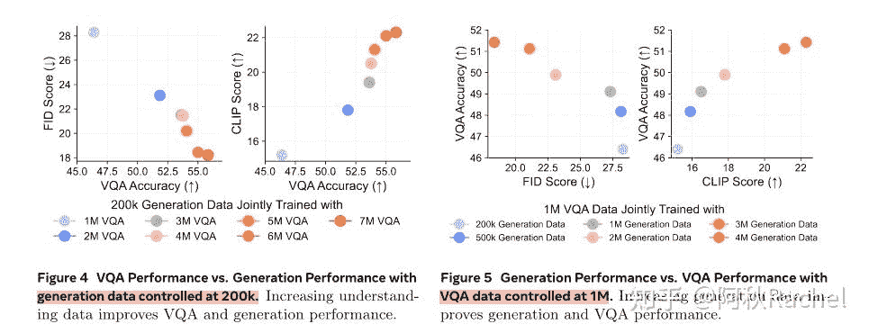

### STaR的变种们

贡献人：

https://zhuanlan.zhihu.com/p/721097691

STaR系列方法致力于提升大型语言模型（LLM）在复杂推理任务上的能力，主要包括STaR、Quiet-STaR、V-STaR、Kwai-STaR、Lean-STaR、RL-STaR、和B-STaR等多种变体。每个方法都引入了不同的技术创新来增强推理性能。

**STaR**采用了自我迭代的推理生成方法。它通过少量示例指导LLM生成推理过程和答案，并在迭代过程中对模型进行微调。生成的推理和答案会经过验证，只保留正确的样本，用以增强模型的推理能力，并持续通过数据扩充和多次迭代改进模型。

**Quiet-STaR**则试图解决模型计算成本过高和推理能力不足的问题。其创新在于通过生成每个token的推理步骤来提升模型的深层理解能力。该方法使用“混合头”结合生成的推理与基础语言模型预测，并通过REINFORCE算法优化推理生成过程，减少冗余的推理计算，提升模型的预测能力。

**V-STaR**特别针对代码生成和数学推理，核心思想是通过生成器生成多个候选解决方案，并使用验证器通过评分来选择最佳方案。该方法通过生成器和验证器的联合训练，不断优化推理和验证过程，从而提升模型在推理任务中的表现。

**Kwai-STaR**利用状态转移推理器的思想，将问题分解为状态空间的多阶段推理过程。通过定义状态、动作和状态转移函数，模型在推理过程中可以动态调整并通过验证和回溯确保正确答案的生成。其两阶段数据构建方法分别处理正确案例和错误案例，以不断优化模型的推理策略。

**Lean-STaR**关注于增强定理证明中的推理能力。通过结合非正式的思维过程，Lean-STaR帮助模型在生成证明步骤时先生成思维步骤，增强推理的策略预测。它通过专家迭代算法对证明进行采样和验证，进一步提高推理的准确性和效率。

**RL-STaR**则把推理过程建模为强化学习问题，使用RL-CoT生成推理轨迹，进而优化推理步骤的生成策略。该方法通过奖励机制逐步改进模型，使其生成更精确的推理步骤，尽管目前未提供完整的实验数据。

**B-STaR**的创新在于平衡探索与利用的自学习过程。通过引入“平衡分数”，B-STaR优化了自学习过程中的探索和利用，并动态调整采样温度和奖励阈值，从而提升生成数据的多样性和质量，最终优化模型的推理能力。

这些方法各自通过不同的技术路径优化LLM在推理任务中的表现，既包括数据生成、模型微调，也包括推理过程的动态优化，推动了模型在解决复杂问题时的能力提升。

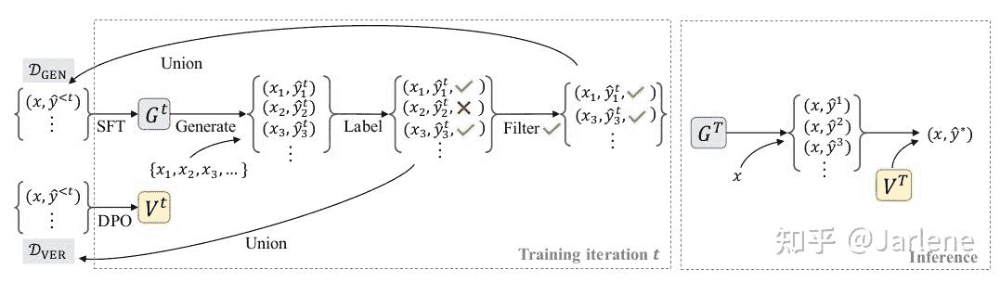

### RLHF实验记录-PRM训练

贡献人：

https://zhuanlan.zhihu.com/p/13550450843

本实验使用的训练环境包括CUDA 12.4、Python 3.10、Torch 2.5.1和FlashAttention 2.7.0.post2。实验代码基于OpenRLHF，并进行了两项关键修改：修正了eval数据集包含训练数据的问题，并增加了PRM训练支持TensorBoard日志记录。所用模型为Mistral-7B-v0.1，训练方式为全量训练，使用bf16精度。训练过程中，batch size为256，采用4%的warmup学习率逐步提高至1e-6、5e-6、9e-6，并使用cosine annealing调整，结合DeepSpeed Zero Stage 2优化。单机8卡H20配置下，训练每个iteration耗时20秒，总共9小时/epoch。

数据集使用的是Math-Shepherd，包含445K条数据。每条数据由input和label组成，二者在token层面几乎相同，唯一不同的是input中每一步之间插入了placeholder符号，而label中对应placeholder的地方用+/-表示最终是否得到了正确答案。该数据集的标注方法来自同名论文，而与OpenAI的手动标注方式不同，OpenAI标注过程中会特意挑选生成的错误答案来提高标注质量，并引入中性标签进行预测。与之不同，本实验仅关注PRM训练，且使用的是正负两个标签，因此不存在中性标签的问题。

在训练PRM之前，首先需要对policy model进行微调，使其能够逐步输出。在训练过程中，模型输入为文本，采用teacher forcing机制，输出一个与输入长度相同的logits序列，针对placeholder位置计算cross-entropy损失。具体来说，假如LLM的输出形状为[B,L,D]，则损失计算仅关注占位符位置，即[B,L',2]，其中L'表示占位符的数量（即步数），2表示+/-两个reward token。

为了优化训练效果，实验对比了不同学习率的训练情况。OpenRLHF的默认学习率为1e-6，而ORM使用了9e-6，二者相差较大。实验分别尝试了1e-6、5e-6和9e-6的学习率，并记录了训练和评估过程中loss的变化。结果表明，较大的学习率导致训练和评估loss较高，并且方差增大。尤其在step-level的train loss图中，较大学习率的波动性更强，只有在平滑化后才能较为明显地看出差异。

分析造成这一问题的原因，可以归结为两个关键因素。首先，PRM训练中的loss是直接从最后输出的logits中选择两个token进行优化，过度优化可能导致模型过分聚焦于这两个token，从而损害语义理解的准确性。其次，ORM的loss包含了chosen和reject的差异，能够在每个样本上同时优化这两项，而PRM的loss仅优化其中一个token，表现为单侧优化。因此，训练过程中，优化策略的不同导致了训练效果上的差异。

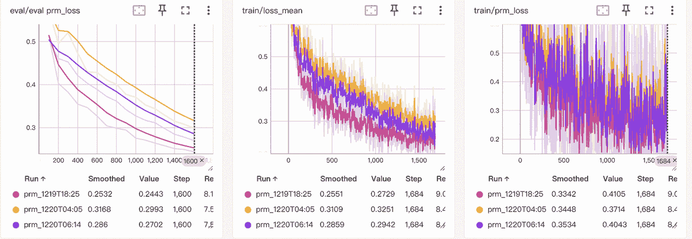

### 具身操作的数采方案概览

贡献人：

https://zhuanlan.zhihu.com/p/14109860960

自动驾驶作为具身智能的一部分，已经迈入了端到端模型的时代，尽管硬件和算法依旧处于多样化的初期阶段。端到端的自动驾驶仍面临许多挑战，尤其是缺乏广泛部署的具身本体，导致数据采集成为一个关键难题。尤其是如何高效采集机械臂数据，用于模仿学习算法，以训练具备通用技能的操作算法，是当前的研究焦点。尽管大部分运动控制任务采用强化学习（RL），本文聚焦于模仿学习（Imitation Learning）和行为克隆（Behavior Cloning）的数据采集方式。

目前，工业界主要使用遥操作（Remote Operation）作为数据采集的主要手段。特斯拉通过VR遥操作结合动捕手套捕捉操作员手指运动，并将其转发到机器人的灵巧手上，进一步提升机器人操作的精确度和流畅性。Physical Intelligence（PI）则通过与国内企业合作，使用大量的实物数据来训练大规模机器人模型，尤其是其π0模型。智元机器人则采用了VR遥操作与仿真生成的结合，通过仿真生成多种轨迹来增强数据的多样性和规模化。遥操作能够提供高质量的训练数据，虽然在商业化阶段仍不具备显著的成本效益，但它对硬件设计和场景适应性有很好的反馈作用。

学术界的数据采集方案则包括多个方向。例如，清华大学团队使用UMI系统，通过3D打印设备和GoPro相机结合IMU技术，能够在开放环境中高效地收集数据。此外，RDT-1B项目结合了1M条数据并通过ALOHA/Mobile ALOHA系统实现高质量示例数据的采集。上海交大的RH20T项目则通过多视角相机和触觉反馈系统，提高了数据的精度和任务的适应性。学术界普遍倾向于使用基于视觉与力反馈的传感器系统来提高数据质量，并关注如何利用3D感知信息和末端力传感器来增强机器人的操作能力。

遥操作数据采集在实验室环境中仍然是最为高效和精确的方法，但它依赖于特定的硬件和环境，因此在扩展到实际应用时可能面临限制。相较之下，"In the wild"数据采集方法，像UMI系统，通过不依赖特定硬件的方案，能够在多种环境中进行数据采集。该系统通过简单的摄像头和IMU组合，在开放环境中灵活部署，尽管它面临关节角度解算等技术挑战，但其高效性和低成本使得它成为一个可扩展的方案。

遥操作系统，如ALOHA，通过转发主臂操作到从臂，可以在多个机械臂间实现数据共享并进行高效的训练，而VR和AR技术则可以通过逆运动学解算将操作员的指令转化为机器人的行为。不同方案之间的选择，通常取决于数据质量与采集效率之间的平衡，尤其是在需要适应不同机械臂和任务环境时。

总之，当前的具身智能领域仍处于探索阶段，不同的数采方式各有优势和局限。遥操作数据虽然质量高，但依赖于特定的硬件和环境，限制了其在真实世界场景中的应用。而基于仿真和开放环境的"In the wild"数据采集则展现出更大的潜力，尤其是在提高数据多样性和降低硬件依赖性方面。然而，实现这些目标需要跨学科的强大工程能力和技术创新。随着数据采集技术的发展，具身智能的应用前景也将变得更加广阔。

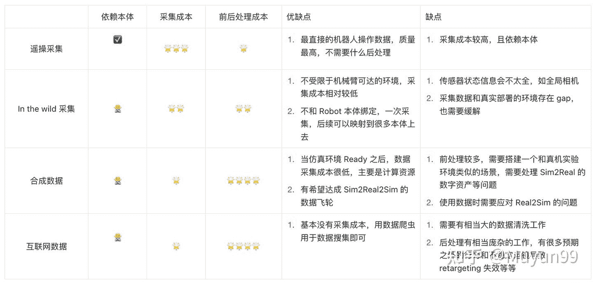

### H100上矩阵乘优化

贡献人：

https://zhuanlan.zhihu.com/p/14203823281

在本文中，作者讨论了如何在NVIDIA H100 GPU上优化矩阵乘法内核（matmul kernel）。目标是通过利用H100硬件特性，设计出一个比cuBLAS更高效的矩阵乘法核心，特别是在N=4096时性能比cuBLAS提升了7%。文章围绕H100的硬件特性展开，并通过几种优化技术来提升内核性能。

首先，作者介绍了H100的核心硬件特性，如132个流处理单元（SM）、每个SM具有1024个线程和4个张量核心（Tensor Core），以及80GB的高带宽内存和256KB的共享内存等。特别地，H100在矩阵乘法方面相较于前代GPU（如A100）有显著提升，其矩阵乘法性能从A100的21 TFLOPs提升到H100的32 TFLOPs。作者将重点放在Tensor Core指令的使用上，特别是Hopper架构引入的wgmma指令。

矩阵乘法的核心是将大矩阵分解为多个输出块（tile），每个块由一个线程块计算。为了提高效率，矩阵A和B的块被加载到共享内存（SMEM）中，避免频繁访问全局内存。在这个过程中，作者选择了bfloat16数据类型进行优化，因为H100对bfloat16有原生支持，并且在深度学习任务中得到了广泛应用。

在H100上，使用Tensor Core的wgmma指令显著提高了性能。这些指令支持异步执行，可以并行处理多个计算任务，从而减少了延迟并提高吞吐量。每个wgmma指令执行一次m64n16k16矩阵乘法，利用128个线程来完成一个输出块的计算。为了减少共享内存中的带宽冲突，作者采用了Tensor Memory Accelerator（TMA），它可以更高效地将矩阵块加载到共享内存中。

通过在内核中引入更大的输出块和优化矩阵维度的分解，作者进一步提高了性能。通过使用Tensor Core指令（如wgmma.mma_async.sync），性能从原本的32 TFLOPs提高到423 TFLOPs。这种优化主要依赖于高效的内存访问模式和充分利用Tensor Core的并行计算能力。

为了进一步优化，作者对内核进行了性能分析，发现加载、计算和存储是主要的时间消耗阶段。为了隐藏加载延迟，作者提出了将加载操作和Tensor Core计算并行执行的思路，利用了CUDA中的warp specialization技术来实现生产者-消费者模式，即将一个warp组作为生产者，另一个作为消费者，从而提高了内存加载的效率。

最后，通过详细的分析和多次优化，作者展示了如何在H100上实现一个高效的矩阵乘法内核，该内核利用了H100硬件的优势，并通过精细的优化策略实现了显著的性能提升。

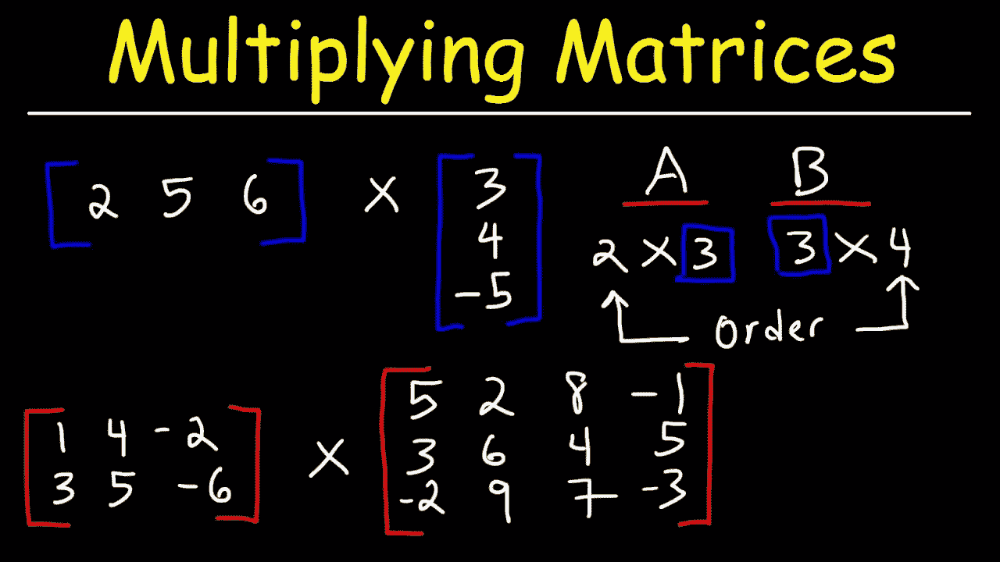

# 招聘公告

---

**奇绩创坛****由陆奇博士**于2019年创立，使命是在源头最大化驱动创新。奇绩研究组将研究模型理论、到投研战略分析、市场策划等不同背景的同学聚在一起，搭建GenAI时代独特的跨界人才社群。

## 🚀F**24实习岗位**

##### [行研-学术科研人才交流组实习生](https://miracleplus.feishu.cn/docx/Yn6rdf2iOoY2Rcx8yVNcUBYRnch#part-QkMcdeJmuob9uvxvV3qcLSzHn8g)

##### 行研-GenAI研究岗位-战略分析（偏产品）

##### Web / AI 全栈开发工程师实习生

## **火热开放中🚀**

##### 行研-GenAI研究岗位-前沿学术探索

##### 行研-GenAI研究岗位-战略分析（偏咨询）

##### 创新活动产品运营 （大模型系列活动产品运营）

> **点击**相关岗位可查看对应**岗位需求【JD】；**相关岗位投递请**扫描二维码**

> 欢迎**推荐/自荐**

> 期待在**奇绩创坛**遇见更好的你

---

# 声明

本文档仅供学习交流使用，版权归原作者所有，若涉侵权，请联系Jack Jin 15101136166

##

（欢迎在下方反馈您宝贵的意见！整理不易，觉得有用给AI日报小组点个赞👍吧！）

ChatGPT；Angela；Zijia Liu；Alex；Zeqi Tan；Tiezhen（HuggingFace）；Naixu；Lizhi；Peter；Suoman；Jack

学术分析报告：ResearchFlow -- 奇绩F23校友的开发的深度研究产品，PC端进入RFlow的分析报告，可直接点击节点右侧的小数字展开节点，登录后可在节点上直接“询问AI”，进一步探索深度信息

如果你有大模型相关的创业想法，欢迎来找我们聊聊～🛰️：15101136166

> 快邀请你的小伙伴们一起来读大模型日报吧！

> **【日报****知识库****】**这里是近期日报内容的汇总,欢迎大家查阅

> [大模型日报知识库(分享版)](https://miracleplus.feishu.cn/wiki/KapVwXfkriOBiskB0B2cUHxjnTh)

>

> 欢迎大家多多帮我们分享,转发~~

> 如果大家有任何的建议或者吐槽,欢迎随时找我聊天~

