# 奇绩大模型日报（12月 27日）

> 来源：[https://miracleplus.feishu.cn/docx/U9e2dBTSroPQdrxu5gScduMFnXd](https://miracleplus.feishu.cn/docx/U9e2dBTSroPQdrxu5gScduMFnXd)

# 🔉潜**空间系列活动重磅回归！**

> 本期活动将在**1月4日** **11:00**开始，我们邀请到的嘉宾是叶添，清华大学姚班，卡内基梅隆大学博士生，Physics of LLM 2.1作者，于 Meta 担任 Research Scientist Intern。研究兴趣主要集中在大语言模型的推理机制。曾在顶级会议 NeurIPS 上发表研究论文。此外，曾两次获得中国数学奥林匹克竞赛国家集训队的资格。

> 在本次分享中叶添将分享《揭秘大语言模型推理机制——超越人类的二级推理》。

> 除嘉宾分享外，每期设置了【匹配合伙人 Cofounder Matching】环节。你可以和 GenAI 时代最有活力的创业者和研究者线下面对面交流，将有机会找到志同道合、有共同创业梦想的小伙伴。

> 报名通道已开启，欢迎扫描下方二维码报名。

# 推特

### 2024年谷歌AI重要新闻回顾

https://x.com/JeffDean/status/1872500136351526987

2024年是谷歌AI蓬勃发展的一年，从新产品发布到技术突破，多个创新项目改变了用户的日常生活。以下是一些关键的谷歌AI新闻和更新：

1.  **Gemini与Bard的升级**
2024年初，谷歌推出了更强大的Gemini 1.5版本，并宣布Bard将转型为Gemini。该月还发布了Circle to Search功能，允许用户通过圈选文本直接搜索相关信息。

1.  **生成性AI工具的持续发展**
谷歌在各大产品中推出了生成性AI功能，涵盖了Chrome、Pixel、Google Photos等。特别是生成AI在健康领域的应用，极大地提升了人们获取健康信息的便捷性。

1.  Google I/O大会与产品发布
2024年Google I/O大会上，谷歌展示了如何通过AI提升产品功能，尤其是Google Search、Photos和Bard的多项更新。此外，AlphaFold 3模型的发布也为科学界带来了突破。

1.  **AI在教育和工作中的应用**
通过Google Workspace、NotebookLM等工具，AI正逐步进入教育和商业领域。NotebookLM更是推出了支持音频概述的新功能，提升了工作效率。

1.  **月度更新与产品优化**
各月份持续推出多项AI更新，包括Pixel手机的AI功能增强、Google Translate新增语言支持，以及对Google Lens和Shopping的改进等。

1.  **量子计算与未来展望**
在12月，谷歌推出了全新的Gemini 2.0模型，标志着AI进入了“代理时代”，并且发布了首款量子芯片Willow。与此同时，AI在Pixel、Android等平台上的应用也进入了全新的阶段。

### DeepSeek v3在AidanBench上的表现不如预期，Gemini-2.0-Flash-Thinking表现提升

https://x.com/aidan_mclau/status/1872444303974543859

近期，DeepSeek v3在AidanBench上的表现比预期差，明显低于像Aider这样的相似基准测试中取得的成绩。类似的情况也出现在Claude-3.5-Haiku上，后者在Aider上表现优异，但在AidanBench上表现较差。

1.  **基准测试更新和改进**：

+   AidanBench仍在持续完善中，未来版本可能会导致排名变化。

+   我们会定期发布更新，分享新的测试结果和排名变化。

1.  AidanBench的目标与挑战：

+   AidanBench专注于评估模型在**超出训练数据范围（OOD）**的表现，尤其是与数学、代码和学术测试无关的领域。因此，即使某些实验室的模型在这些领域表现突出，但在AidanBench中未必能够取得同样的成绩。

1.  Gemini-2.0-Flash-Thinking的表现提升：

+   经过对Gemini-2.0-Flash-Thinkin**g的更**新，它的排名从之前的较低位置跃升至第二名。

+   该改进源于对其推理过程的调整，以便更好地解析最终输出，而非仅仅处理Chain of Thought (CoT)和中间响应，避免了以往将不一致的答案纳入考量。

1.  DeepSeek v3的表现原因分析：

+   尽管DeepSeek v3在多个基准测试中表现出**色，但在**AidanBench上的低排名（第22位）可能反映了其在处理OOD任务时的局限性。这也提醒我们，即使是性能强大的模型，若其训练数据和实际测试场景不匹配，仍然可能无法充分发挥优势。

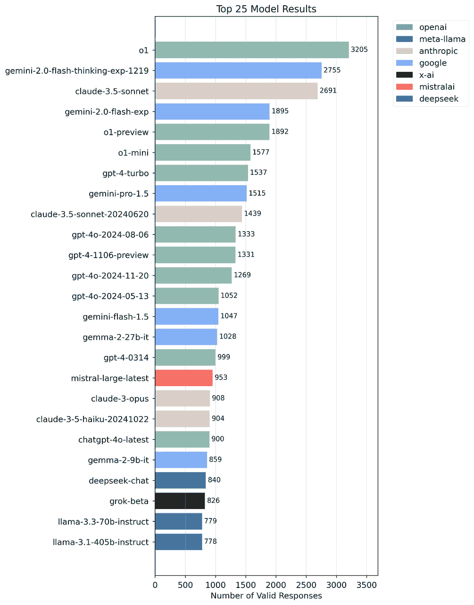

### vLLM 新版本发布

https://x.com/vllm_project/status/1872453508127130017

vLLM 发布了最新版本，用户可以通过 pip install -U vLLM 更新到最新版。在此版本中，DeepSeek-V3 支持了多种方式的并行处理和硬件加速，提升了模型训练和推理的效率。

1.  **张量并行**：对于支持的硬件，如 8xH200 或 MI300x 芯片，用户可以通过 --tensor-parallel-size 参数启用张量并行。对于使用 IB 连接节点的 TP16 配置，也支持相应的并行处理。

1.  **管道并行**：新版 vLLM 支持管道并行，适用于多机配置，不依赖高速互连，用户只需要配置 --pipeline-parallel-size，就可以实现跨两台 8xH100 或其他机器的分布式训练。

1.  **CPU卸载**：vLLM 还支持将部分模型层通过 --cpu-offload-gb 参数卸载到 CPU，减少 GPU 的负担，优化硬件资源的使用。

此外[，vLLM 提供了详细的分](https://docs.vllm.ai/en/latest/serving/distributed_serving.html)布式部[署指南，](https://github.com/vllm-project/vllm/issues/11539)帮助用户更好地理解如何在大规模集群环境中使用 DeepSeek-V3 模型进行分布式推理和训练。更多的优化计划也在持续进行中，用户可以查看 vLLM 的分布式服务文档 和 增强计划 获取最新进展。

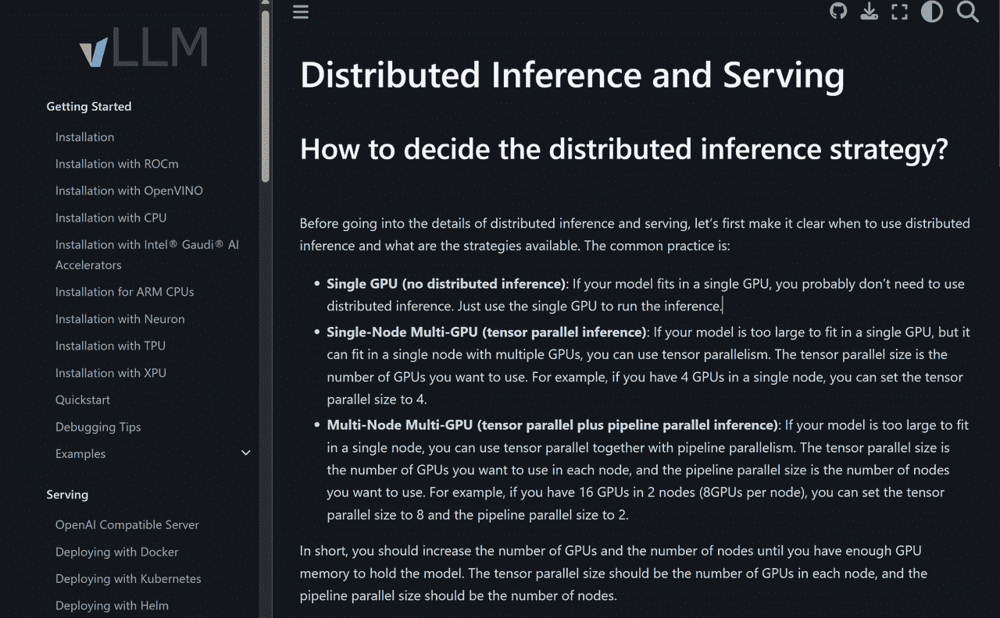

### [CVPR2025](https://x.com/hashtag/CVPR2025?src=hashtag_click)报名现已开放

https://x.com/CVPR/status/1872341053342384388

**CVPR** 是计算机视觉领域的顶级年度会议，包含主会议和多个协办的研讨会和短期课程。凭借其高质量和低成本，CVPR为学生、学术界和工业界研究人员提供了卓越的价值。

注册要求：

+   **每篇论文（无论是主会议论文**还是研讨会论文）必须以作者注册类型进行注册（学生注册可以作为此类型的选项）。一次注册可以覆盖多篇论文。

+   虚拟注册**无法覆盖论文提交**，即使是研讨会论文也不例外。如果因特殊情况无法亲自出席并展示论文，您仍然可以选择虚拟参会，但必须进行现场注册并支付相关费用，同时选择虚拟参会。

费用和支付：

+   所有费用均以美元（USD）计价。

+   **支付方式**：仅接受通过注册网站使用信用卡支付。我们不接受电汇、支票或采购订单。完成支付后会发放收据。请在注册过程中提供需要用于收据的地址。如需更改收据信息，您可以自行修改。

https://na.eventscloud.com/ereg/index.php?eventid=823364&

# 资讯

### 国产之光DeepSeek 671B大模型训练只需此前算力1/10

贡献人：

https://mp.weixin.qq.com/s/uho6L_V2IybmUmH8jXmRmw

DeepSeek V3 是一款开源的 MoE 模型，参数量达 671B，激活 37B，基于 14.8T 高质量 token 进行预训练，标志着在开源大模型领域的重要进展。相比同类的 Llama 3.1 405B、GPT-4o 和 Claude 3.5 Sonnet，DeepSeek V3 在多个评测中超越了它们，且在训练效率和成本上表现出色。它的训练耗时仅为 Llama 3.1 的 1/11，训练成本约 557.6 万美元（约 4070 万人民币），远低于其他顶级模型的训练成本。

DeepSeek V3 的训练过程仅用了不到 280 万 GPU 小时，相较于 Llama 3.1 的 3080 万 GPU 小时，展现了显著的算力优化。此优化通过架构、算法和硬件的协同工作实现，采用了创新的负载均衡策略和无辅助损失的训练目标。在模型架构上，DeepSeek V3 引入了 FP8 混合精度训练，并设计了高效的跨节点通信策略，如 DualPipe 高效流水线并行算法，以减少通信瓶颈并提升训练速度。

在实际应用中，DeepSeek V3 展现出卓越的性能和性价比。它的生成速度提高了 3 倍，能够每秒生成 60 个 token，API 价格也极具竞争力，每百万输入 tokens 的价格为 0.5 元（缓存命中），输出为 8 元。此外，DeepSeek V3 还推出了 45 天的优惠期，进一步降低了使用成本。

DeepSeek V3 支持 FP8 和 BF16 推理，适配了多个推理框架，如 SGLang、LMDeploy、TensorRT-LLM 和 MindIE。官方还开源了模型的原生 FP8 权重和转换脚本，方便用户进行部署和优化。

在测试中，DeepSeek V3 在多个基准测试中达到了开源模型的 SOTA，并且能够高效理解和生成复杂的回答。例如，在“Which version is this?”的测试中，DeepSeek V3 能准确识别自己的版本，超越了其他模型，如 ChatGPT 和 Grok。

DeepSeek V3 的成功不仅在于其高效的技术实现，还得益于其背后团队的多年积累。DeepSeek 团队采用了创新的技术路线和实践经验，逐步优化和提升了大规模模型的训练和推理效率。整体来看，DeepSeek V3 在模型能力、训练成本、速度和性能上都具备显著优势，是当前开源大模型领域的一大亮点。

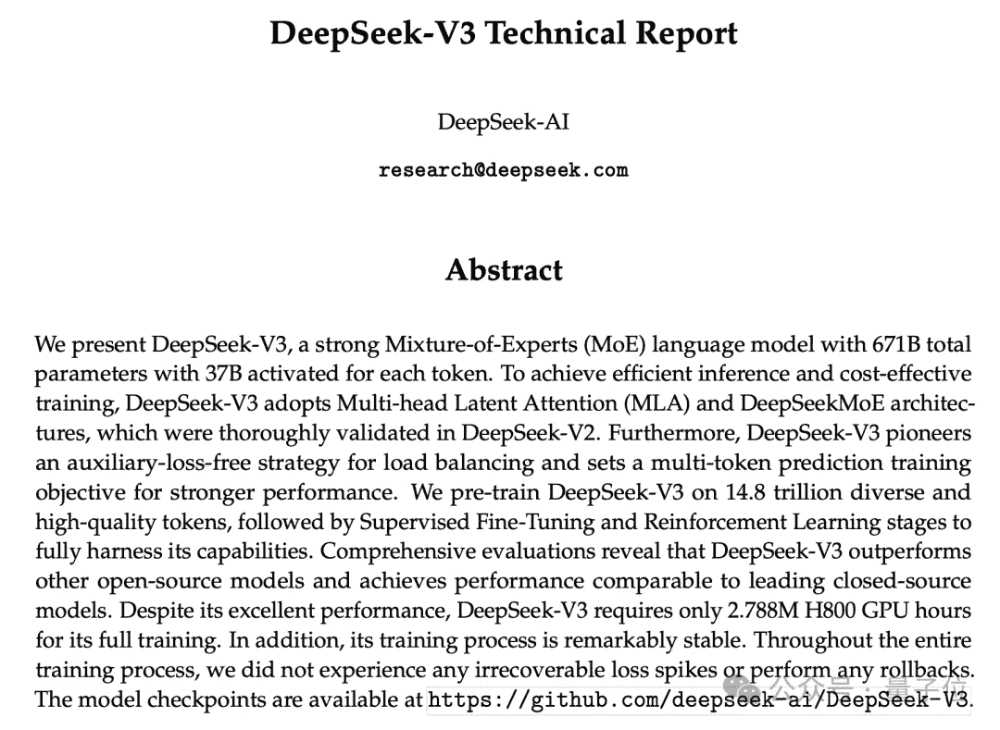

### 小米将对AI大模型大力投入，正搭建GPU万卡集群

贡献人：

https://mp.weixin.qq.com/s/OGhRVS3xK-GFu6RM_AwnvQ

小米正在建设GPU万卡集群，并加大对AI大模型的投入。小米大模型团队自成立以来，已配备6500张GPU资源。据了解，这一计划已实施数月，并且雷军在其中扮演了重要角色。小米在AI硬件领域的布局尤为重视手机而非眼镜，显示出公司在此领域的战略决心。12月20日，DeepSeek-V2的核心开发者罗福莉加入小米，预计将担任AI实验室的重要职务，领导大模型团队。罗福莉在MLA（Multi-head Latent Attention）技术上的创新曾大大降低了大模型的使用成本，为小米AI大模型的发展注入了强大动力。

2023年4月，小米AI实验室大模型团队正式组建，栾剑被任命为团队负责人，并向小米技术委员会副主席王斌汇报。栾剑曾是小米语音生成团队负责人，并在微软等公司有丰富的AI研究经验。雷军曾在多个场合提到小米对于AI的重视，特别是在大模型和AIGC领域的布局。他表示，小米在AI领域已经有多年积累，拥有AI实验室、语音助手“小爱同学”和自动驾驶等多个团队。

小米大模型技术的突破方向主要集中在轻量化和本地部署方面。小米已成功跑通了一款参数为13亿的大模型，并且在某些场景下其效果接近于云端60亿参数的大模型。此外，小米还发布了MiLM-6B和1.3B两款模型。王斌曾表示，尽管小米坚持自研，仍保持开放合作的态度，采用自研与第三方模型相结合的方式来推动大模型发展。在小爱同学的首次大模型升级中，正是采用了自研与第三方模型的混合方案。

自2016年成立AI团队以来，小米的人工智能技术团队规模已达3000多人，覆盖视觉、声学、语音、NLP、机器学习、大模型等多个领域，并逐步将其技术应用到手机、汽车、AIoT和机器人等产品中。

### OpenAI科学家：现有模型+后训练足以产生黎曼猜想的新证明

贡献人：

https://mp.weixin.qq.com/s/UqQiuuRrojDcaKphKIOAIQ

OpenAI科学家塞巴斯蒂安・布贝克提出了一个新颖的能力衡量指标——“AGI时间”，用以描述AI模型完成任务的时间跨度。根据这个概念，GPT-4可以在几秒或几分钟内完成任务，o1模型则能够在几小时内完成，而未来的模型甚至可能在“AGI日”和“AGI周”内解决重大开放问题。该观点引发了广泛的讨论，有人认为这代表模型已接近AGI，能处理长时间推理和计划任务，但也有人质疑这一概念的模糊性及其实际可行性。

在一场辩论中，布贝克强调，LLM（大语言模型）通过不断的规模扩展，展现出了显著的能力提升，尤其在多个领域的基准测试中取得了突破性成绩。例如，GPT-4在MMLU测试中的得分接近90%，o1模型甚至接近95%。布贝克认为，随着后训练技术的进步，模型将能进一步挖掘潜力，解决如数学难题等复杂问题。他提到，o1模型已经能够迅速将不相关的知识点联系起来，为解决难题提供新的线索，未来有望在AGI日级甚至周级时间内，通过更深入的推理和训练，找到解决数学猜想的路径。

然而，反方辩手汤姆・麦考伊提出了对LLM能力的质疑。他认为，LLM目前的发展依赖于大量的训练数据，但这种数据驱动的模式存在严重的局限性，尤其是在面对低频任务时，如数学证明。麦考伊指出，LLM难以从训练数据之外的全新思维中产生创新突破，并且在处理长推理时容易产生错误，这种“幻觉”问题会对数学证明的严谨性构成威胁。他还认为，现有的语言模型架构无法深入到数学推理和抽象逻辑的核心，缺乏创新思维。

对于这些观点，布贝克进行了反驳，强调人类的顶级科学成就也常依赖现有知识的组合，模型在这方面的能力将通过强化学习等技术不断增强。他还提出，未来不同智能体可以相互合作，纠正彼此的错误，从而避免累积错误影响推理结果。

其他专家如Anthropic的帕维尔·伊斯梅洛夫和MIT的安库尔·莫伊特拉也对LLM在数学领域的应用发表了看法。伊斯梅洛夫认为，LLM在数据结构的识别上有优势，但数学领域的专业性要求可能需要结合强化学习和证明验证器等工具。而莫伊特拉则表示，解决重大数学问题不仅仅是堆叠能力，更需要新的思维方式和创新。

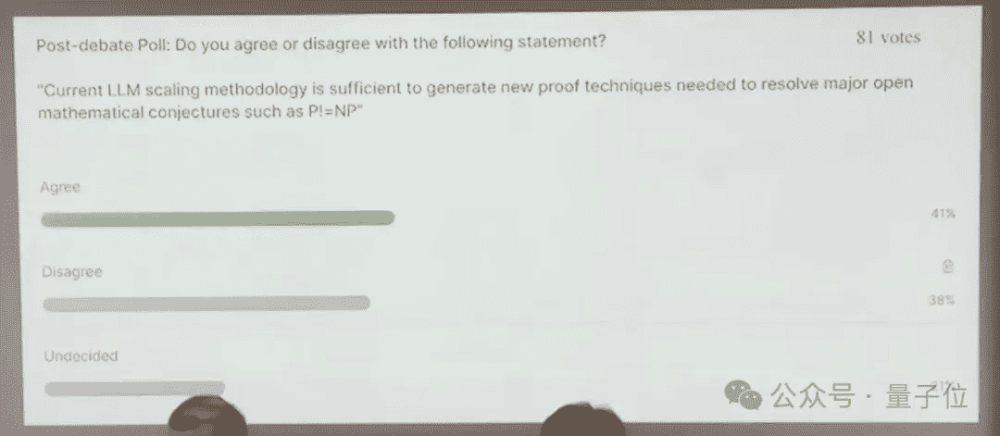

### 国产GPU厂商象帝先续命

贡献人：

https://mp.weixin.qq.com/s/_Tdd5ArLGuQlaC2YZwPKkA

象帝先，这家知名国产GPU厂商，近日迎来了融资的新曙光，成功走出此前困境。自4月以来，象帝先曾遭遇资金链断裂，传出倒闭和大规模裁员的消息，幸好公司通过澄清公告并在员工支持下进行了人员优化，保留了核心力量。经过一段时间的努力，公司不仅得到了新一轮融资支持，还在研发和市场拓展方面迎来了突破，特别是在量产新一代GPU产品上取得了重要进展。

象帝先的成功自救策略，主要体现在“营销与研发”双轮驱动。公司通过增强营销团队的能力，与多家整机厂商和主流软件厂商完成了适配测试，逐渐赢得客户的信任。同时，研发团队在已量产GPU的基础上，进一步优化产品性能并进行技术创新，为公司提供了坚实的支持。

象帝先成立于2020年，在中国科技竞争日益激烈的背景下，迅速发展并在2022年发布了“天钧一号”GPU，这是首款拥有自主知识产权的国产高性能GPU。该芯片基于Imagination的IP核，采用12纳米工艺，拥有2048个计算核、4TFLOPS的FP32算力、16TOPS的AI算力、16GB显存和256GB/s带宽。紧接着，公司在2023年发布了面向工控、嵌入式和边缘计算领域的“天钧二号”GPU，并以此为基础，计划填补国内高性能通用GPU市场的空白。

然而，尽管技术实力不容小觑，象帝先仍面临市场开拓的困难，尤其是在国内芯片市场的竞争中没有获得突破。今年，象帝先经历了资金危机和多次负面消息，但随着政策支持力度的加强和公司内部的团结，象帝先成功逆转局面，继续推动技术创新和市场开拓。2024年，象帝先被评为“重庆市独角兽企业”，估值一度达到21.69亿美元，展现了其巨大的成长潜力。

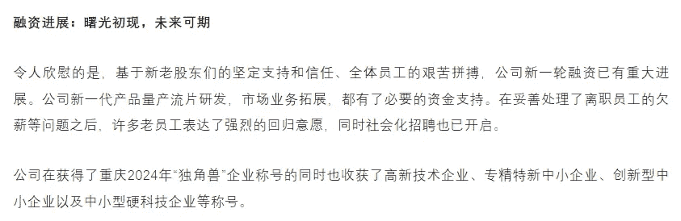

# 信号

### YuLan-Mini: An Open Data-efficient Language Model

贡献人：

https://arxiv.org/abs/2412.17743

ResearchFlow链接：https://rflow.ai/flow/33d49f1c-d930-48e4-96d0-a3a0d743a3a4

近年来，大型语言模型（LLM）取得了显著的进展，成为人工智能领域的重要技术突破。与传统的专用机器学习方法不同，LLM能够在多个领域和任务中展现其作为通用模型的潜力。LLM的构建通常通过预训练和后训练相结合的方式，其中预训练被认为是建立语言模型基础能力的关键。针对基于Transformer架构的语言模型，当前普遍采用的预训练方法是对大规模未标注文本进行下一个词预测。然而，这种方法在实施过程中面临着诸多技术难题，包括数据处理管道的设计和训练过程中可能出现的优化问题，如梯度爆炸或损失波动，甚至可能导致训练失败。

尽管许多行业公司已经发布了大规模的模型检查点，然而其中的技术细节大多未公开，因此外界对高水平语言模型的训练过程知之甚少。为了解决这些问题，研究界已在开放数据资源和预训练方法的透明度方面做出了显著努力，部分公开了数据集和训练过程的文献。然而，开放的LLM模型在性能上通常不如行业对手，且由于计算资源的限制，复现这些模型往往需要相同数量的资源，难以在资源有限的学术环境中实施。因此，如何在有限的资源下开发具有竞争力的LLM仍然是一个挑战。

为此，本文提出了一种新的方法，旨在通过提升开放LLM的性能和训练效率，克服数据和计算资源的限制，推动LLM预训练的开放性。具体而言，研究集中在开发一个相对小型的语言模型，参数规模在1B到3B之间，且仅使用公开数据和有限的计算资源。本文介绍了一款具有2.42B参数的基准模型YuLan-Mini，该模型在同类规模的模型中取得了领先的性能。为提高训练效率，本文提出了三个主要的创新点：一是精心设计的数据处理管道，结合了数据清洗和数据调度策略；二是系统化的优化方法，有效减轻了训练不稳定性；三是有效的退火方法，结合了定向数据选择和长上下文训练。

在提升YuLan-Mini性能的过程中，本文还大量使用了合成数据，包括类似“o1”的长思考数据。此外，研究还探讨了多个可能导致训练不稳定的因素，并通过两个版本的检查点支持4K和28K上下文的训练。在一系列基准测试中，YuLan-Mini表现优异，尤其是28K版本，在MATH-500、HumanEval和MMLU等任务中取得了优异成绩，分别为37.80、64.00和49.10。

为了支持研究的可复现性，本文详细报告了YuLan-Mini的完整训练过程，并公开了训练阶段的数据组成。相关的资源可通过项目链接获取，以供进一步研究和复现。

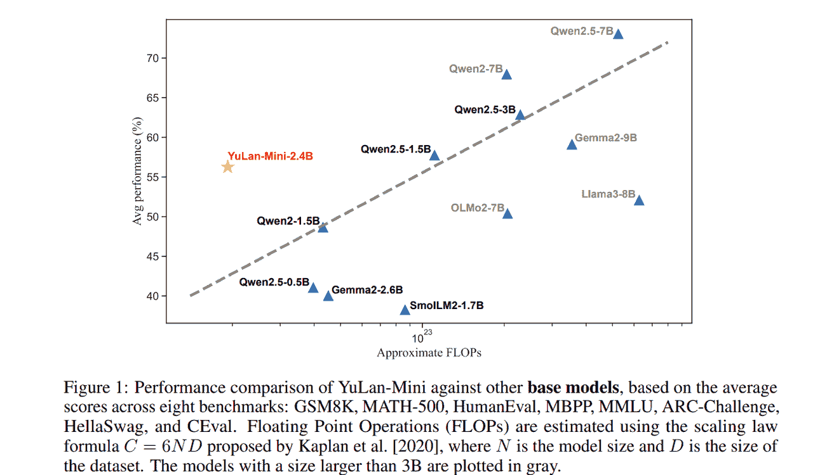

### System-2 Mathematical Reasoning via Enriched Instruction Tuning

贡献人：

https://arxiv.org/abs/2412.16964

ResearchFlow链接：https://rflow.ai/flow/515f9513-9adc-41e3-bbc3-cdb9b31e2f80

大型语言模型（LLM）被认为是实现通用人工智能（AGI）的重要突破，因为它们在多种智能活动中的潜力以及随着数据集、模型规模和计算预算的增加性能提升。然而，目前最强大的LLM，如GPT-4，仍然在处理基本数学问题时频繁出错，尤其是在涉及复杂数学推理时，这暴露了LLM在进行系统-2推理方面的不足。系统-2推理是较慢、较有逻辑的推理过程，通常用于解决复杂问题，而LLM目前大多依赖于下一词预测（类似于系统-1的直觉推理），在简单任务中表现良好，但在复杂任务中存在局限性。

针对这一问题，现有的研究可分为两类：基于微调的方法和基于提示的方法。基于微调的方法通过对LLM进行参数更新来提高其推理能力，但这类方法通常依赖于复杂的数据增强策略，可能导致性能难以归因且降低了模型的可扩展性。基于提示的方法则通过在上下文中引导LLM进行推理，但往往面临事实幻觉和错误传播的问题。

为了改善LLM的数学推理能力，本文提出了一种结合人类反馈（LHF）和AI反馈（LAIF）的方法，称为EIT（Enriched Instruction Tuning）。该方法通过人类和AI的协作，生成高质量的推理数据集，用于微调开源LLM。在这一方法中，首先通过人类反馈生成复杂数学问题的解答，然后利用LLM生成详细的推理计划和步骤，并通过AI反馈进一步补充推理过程中的遗漏部分，形成更为流畅的推理轨迹。

实验结果表明，EIT方法在MATH和GSM8K等数学基准测试中表现优异。EIT在MATH数据集上取得了32.5%的准确率，在GSM8K数据集上达到了84.1%的准确率，较MetaMath提高了2.7%。此外，EIT与使用外部工具的方法在GSM8K基准测试中的表现相当，甚至超越了MathCoder。这表明，细粒度的推理轨迹和数据的完整性同样对模型性能至关重要，为LLM的数学推理能力提升提供了新的见解。

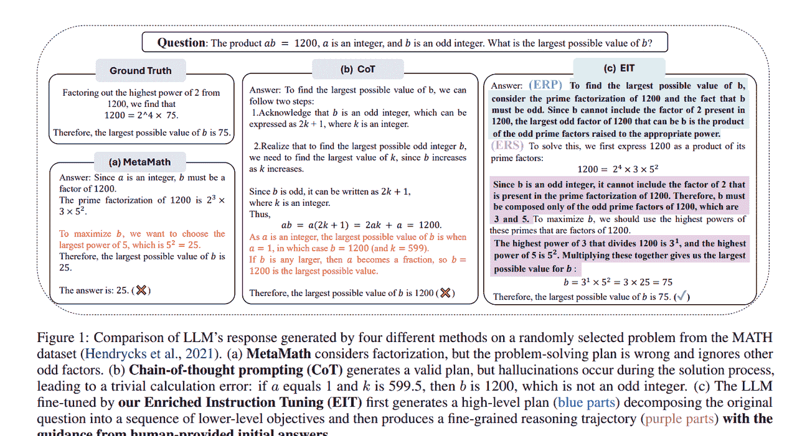

### Token-Budget-Aware LLM Reasoning

贡献人：

https://arxiv.org/abs/2412.18547

ResearchFlow链接：https://rflow.ai/flow/a79792ff-e4cf-454b-8bba-e2dad8add3df

推理在使大型语言模型（LLM）有效执行各类任务中起着至关重要的作用。为增强LLM的推理能力，已提出多种方法，其中链式推理（CoT）是最具代表性和广泛应用的方案。CoT通过引导LLM逐步分解问题并依次解决每个步骤，从而提高模型回答的可靠性。然而，尽管CoT显著提升了LLM的性能，它也带来了显著的额外开销，主要表现为生成的token数量增加。这种增加的token数量导致了计算资源的浪费，延长了推理时间，最终带来了较高的成本。

针对这一问题，本文提出了一种基于token预算的推理压缩方法，旨在减少CoT推理过程中的token成本。我们发现，通过在提示中加入token预算，限制token数量，能够有效压缩推理过程中生成的tokens。然而，token预算的选择在压缩效果中起着关键作用。例如，适当的token预算（如50个tokens）可以显著减少CoT推理的token数量，从258个减少至86个，同时保持推理结果的正确性。而当token预算设置过小（如10个tokens）时，LLM无法有效遵循预算，导致实际token消耗远超预算，甚至比较大的token预算下的token消耗还要多。这种现象被称为“token弹性”。

为了解决这一问题，本文提出了一种名为TALE（Token-Budget-Aware LLM rEasoning）的方法。TALE方法利用token预算来引导推理过程，根据问题的推理复杂性动态分配token预算。具体来说，TALE首先估算适当的token预算，然后通过该预算引导LLM进行推理。实验结果表明，TALE能够显著减少LLM链式推理中的token消耗，同时大幅保持答案的正确性。与传统方法相比，TALE平均减少了68.64%的token使用量，同时准确性仅下降了不到5%。这一结果表明，TALE方法有效解决了LLM推理过程中高token成本的问题，并为推理过程的高效性提供了新的思路。

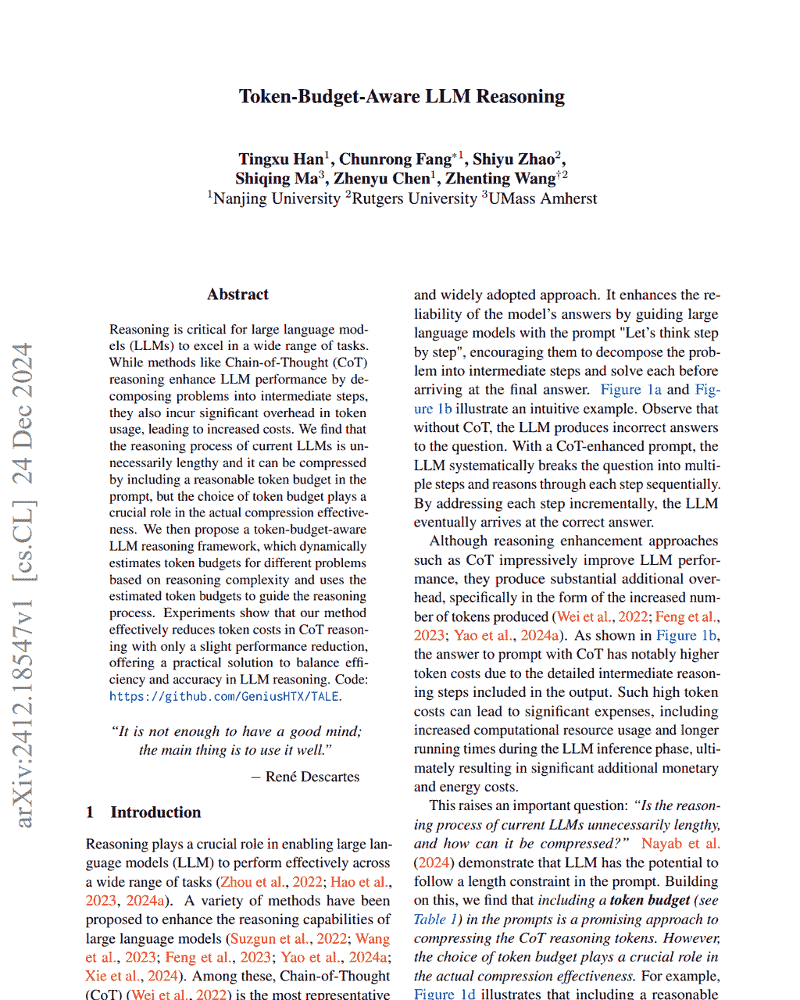

### VidTwin: Video VAE with Decoupled Structure and Dynamics

贡献人：

https://arxiv.org/abs/2412.17726

ResearchFlow链接：https://rflow.ai/flow/d4842896-5e95-4e66-a85e-056da7f48846

近年来，潜在扩散模型（Latent Diffusion Model）在文本到图像生成领域取得了显著进展，代表性模型如Stable Diffusion系列。在这一框架中，图像自编码器通过将图像编码为紧凑的潜在空间，减轻了建模复杂度，提高了扩散模型的训练效率。近期，研究者们尝试将这一思路应用于视频潜在表示和生成任务，但由于视频比静态图像多了时间一致性，如何将视觉内容和时间依赖关系同时映射到潜在空间成为了一个难题。

以往的工作在将视频转换为潜在表示时，主要有两种设计理念。第一种是传统方法，将每一帧（或一组帧）表示为相同大小的潜在向量或token。这种方法简单，但忽视了帧之间的冗余，视频具有连续性，相邻帧的内容变化通常较小，具有很大的压缩潜力。第二种方法通过将表示分为两种类型来解决这一问题，即使用单个或少量内容帧与多个运动潜在向量，但这些方法过于简化了视频内容的动态特性，导致生成效果不佳，如出现模糊的帧。

为解决这些问题，本文提出了一种新方法，通过将视频编码为两个不同的潜在空间来有效捕捉视频的内容与动态：结构潜在空间（Structure Latent）表示全局内容与运动，而动态潜在空间（Dynamics Latent）捕捉细粒度的细节与快速运动。例如，在拧螺丝的视频中，桌面和螺丝等主要语义内容属于结构潜在空间，而颜色、纹理及螺丝的下移与旋转等快速局部运动则属于动态潜在空间。通过将这两部分潜在表示组合，能够重建出高质量的视频。

我们提出的VidTwin模型旨在有效学习这些相互依赖的潜在表示，克服了先前方法忽视动态内容的问题，能够在高压缩率的情况下保持视频重建质量。具体而言，我们采用空间-时间变换器（Spatial-Temporal Transformer）作为视频自编码器的骨干，并引入两个子模块分别提取结构潜在表示和动态潜在表示。结构潜在表示通过Q-Former架构提取时间维度的低频运动趋势，并进一步在空间维度下采样以去除冗余细节。动态潜在表示则通过对编码器获得的潜在向量进行空间下采样并沿高宽维度进行平均来进一步降低维度。此外，我们设计了一种机制，将这些潜在表示适配到扩散模型中，通过对这两种潜在向量进行patch化并拼接，作为扩散模型的训练目标。

实验结果表明，VidTwin模型在多个方面表现优异：首先，VidTwin通过解耦设计和紧凑的潜在表示，达到了约500倍的压缩率，同时保持了高质量的重建效果，从而显著减轻了下游模型在处理高维视频数据时的内存和计算负担；其次，在下游任务中的有效性也得到了验证，特别是在生成任务中，VidTwin在UCF-101数据集上的表现与一些经典模型相当，展现了较强的适应性；最后，VidTwin的潜在空间设计具有可解释性和可扩展性，这为进一步的研究和改进提供了机会。

总之，本文的主要贡献有：提出了一种新的视频编码基础模型VidTwin，采用解耦设计有效地将视频表示为结构和动态两部分；VidTwin实现了高压缩率和强重建能力，并在生成模型中得到了验证；强调了视频潜在表示在当前研究趋势中的重要性，期望VidTwin能够为相关领域的研究提供启示和帮助。

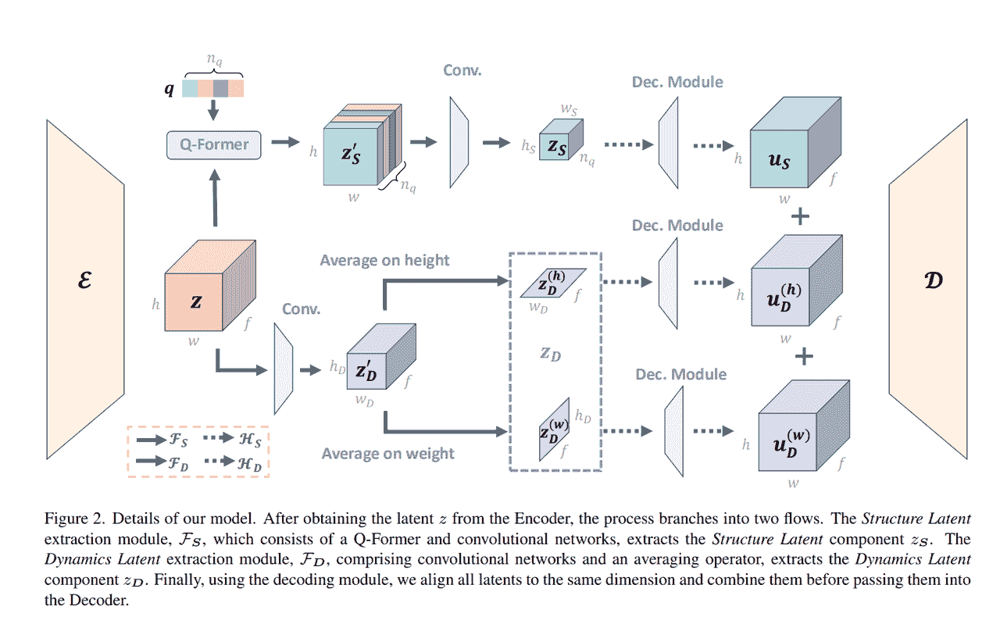

# 产品

### PopShort.AI 人工智能故事创作工具

贡献人：

https://popshort.ai/?ref=producthunt

PopShort.AI 是一款人工智能故事创作工具，能够将您的灵感迅速转化为引人入胜的短片，仅需几分钟即可完成。它通过先进的 AI 技术，让每个人都能成为自己的短片导演，无论是没有任何影视制作经验的人，还是有创作经验的专业人士，都能轻松实现创意的视觉呈现。PopShort.AI 提供直观的操作界面和强大的创作功能，帮助用户快速生成高质量的短片，激发无限创意，轻松打造属于自己的视觉故事。

### Lambda  AI 驱动的投资助手

贡献人：

https://lambdafinance.ai/en?ref=producthunt

Lambda 是一款由 AI 驱动的投资助手，旨在通过专业级的分析帮助提升您的投资体验。它让您轻松追踪持仓和股息，智能管理投资风险，同时还可以利用内置的智能聊天机器人获得实时的市场洞察。Lambda 结合强大的数据分析能力和人工智能技术，帮助投资者做出更加精准和明智的决策，简化投资过程，实现更高效的财富增值。无论是新手还是资深投资者，都能通过 Lambda 提升自己的投资管理水平，掌控市场动态。

# 投融资

### 2024年大模型融资全景

贡献人：

https://mp.weixin.qq.com/s/Q6BJretoRNN22lkTzdsVuQ

据智东西统计，全球大模型相关产业链中，20**24年**下半年，7月1日至1**2月2**5日共有94**起融资，超过亿元****的达到56**起，总**融资额超**1800亿人民币。今**年上半年全球**围绕大模型产业链关键环节展开的超亿元融资达到超112起，融资总额粗略估计超2300亿元。

今年7月，智东西统计了上半年大模型相关产**业链企业**的融资情况**（大模型热钱汹**涌：**半年百**个亿级融资，最高超500亿元）。截至2024年12月24日，全球围绕大模型产业链**关键**环节展开的超亿元融资达到168起，融资总额超4000亿元。相比之下，下半年融资事件数量更少，但融资金额更高，OpenAI、Anthropic、xAI拿下百亿融资一举拉高了融资水平，紧随其后的就是国内位列创业“六小虎”的智谱AI、零一万物、百川智能、阶跃星辰等。下半年融资金额排行榜中，全球赛场OpenAI、xAI、Anthropic凭借81亿美元、60亿美元、40亿美元斩获前三，国内位列前四的是百川智能、智谱AI、零一万物、阶跃星辰，其中百川智能、智谱AI各拿下50亿、超40亿人民币融资，零一万物、阶跃星辰均为数亿美元。纵观全年，大模型相关产业链企业的吸金能力前三仍被OpenAI、Anthropic、xAI占据，但座次稍有不同，xAI凭借120亿美元总融资额摘得桂冠，OpenAI总融资额81亿美元，Anthropic总融资额80亿美元。

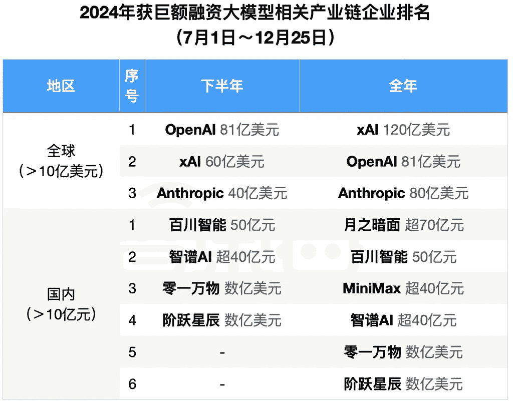

### AI视频创企又拿新融资

贡献人：

https://mp.weixin.qq.com/s/CkyMpTWLRy1K33k0aIk3PA

AI视频生成初创公司智象未来（HiDream.ai），继完成敦鸿资本领投的Pre-**A轮融资后，**又新获得以合肥产投为主的国资基金领投的A轮融资，融资规模共计数亿元人民币。同时参与投资的还包括安徽省人工智能母基金和湖北省长江电影集团有限公司等机构。智象未来成立于2023年3月，是一家专注于构建视觉多模态基础模型及创新应用的生成式AI初创公司，由加拿大工程院外籍院士、前京东集团副总裁、京东探索研究院副院长梅涛博士创立。

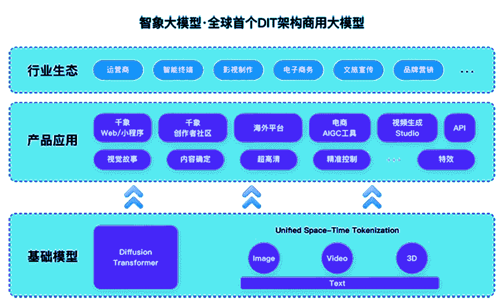

# 学习

### Deriving DPO's Loss

贡献人：

https://huggingface.co/blog/hba123/derivingdpo

1.  Bradley-Terry（BT）模型
Bradley-Terry模型用于比较两个答案的优劣。给定两组答案 x 和 y，该模型通过对比的方式产生奖励信号，衡量两个答案的偏好。模型利用这些偏好数据来学习奖励函数。然而，这种奖励函数的学习过程往往复杂且耗时。为此，DPO的目标之一是通过现有的配对数据直接优化决策策略，消除对显式奖励函数的依赖，从而简化学习过程。

1.  优化目标
设想一个奖励函数 r(x, y)，我们的目标是更新LLM的参数，使得模型生成的答案能够最大化奖励，同时保持与原始参考模型的相似性，防止偏离参考语言分布。形式化的优化目标是最大化奖励期望值，同时保证模型输出的概率分布与参考模型的分布相近。

其中，π_LLM(y|x) 表示LLM的生成概率分布；P_ref(y|x) 表示参考模型的生成概率分布；r(x, y) 表示奖励函数，用于衡量生成答案 y 的质量；KL散度则用来衡量LLM分布与参考分布的距离。

1.  优化问题转换
为了消除对奖励函数的依赖，DPO通过引入数学推导将带有约束的优化问题转化为无约束优化问题。具体方法是引入拉格朗日乘子，将优化问题重新表达为一个包含奖励期望值、KL散度以及拉格朗日乘子的无约束问题。

在这个过程中，β是超参数，用于权衡奖励最大化与参考分布相似性的重要性；λ是拉格朗日乘子，用于确保模型的输出是一个有效的概率分布。

1.  求解无约束问题
通过对目标函数的三个主要项分别求导，可以逐步推导出极值点的具体表达式。三个主要项包括奖励项的梯度、KL散度项的梯度和拉格朗日乘子约束项的梯度。

1.  极值点的求解
将三个梯度相加，并设置梯度为零后，可以得到LLM政策的最优解。最终的最优解通过规范化处理，确保LLM的输出满足概率分布的要求。

1.  归一化与最终公式
为了确保最终的模型生成概率分布是有效的，需要对其进行归一化处理。这一步骤确保模型生成的概率分布之和为1。通过归一化，可以得到最终的政策表达式，其中归一化常数由参考模型的分布和奖励函数共同决定。

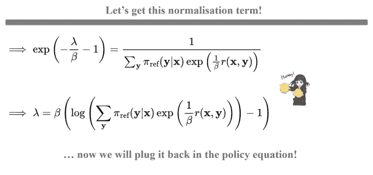

### 2024年：合成数据与Smol模型的发展

贡献人：

https://www.latent.space/p/2024-syndata-smolmodels

2024年，合成数据和Smol（小型）语言模型成为人工智能领域的热点话题。特别是在NeurIPS 2024会议上，Loubna Ben Allal分享了她在合成数据和Smol模型方面的深入见解。今年，合成数据的应用取得了显著进展，包括苹果公司在其“Rephrasing the Web1”项目中的探索、微软的Phi 2-4和Orca/AgentInstruct，以及腾讯推出的Billion Persona数据集。这些创新推动了合成数据的广泛应用，旨在提升基于网页抓取的原始数据质量。Loubna的Cosmopedia项目扩展了合成教科书和智能体生成的思路，进一步推动了合成数据的技术边界。

在2024年，HuggingFace发布了WebSight，这是首次基于代码与图像合成数据的尝试，进一步丰富了合成数据的应用场景。Llama 3.1被称为“合成数据模型”，因为它在模型训练中广泛使用了合成数据，并且具有开放许可。Nemotron CC和Nemotron-4-340B也成为焦点，它们使用了人类数据合成了98%以上用于SFT/PFT的训练数据。此外，Cohere推出了Multilingual Arbitrage，优化了数据池，加速了多语言进展，获得了高达56.5%的性能提升。

然而，合成数据的广泛使用也伴随着质疑和批评，特别是Scale AI在《自然》杂志中指出，当AI模型在递归生成数据上进行训练时，模型可能会崩溃，反映出低质量合成数据的潜在风险。随着“低背景令牌”（low-background tokens）问题的逐渐显现，ChatGPT污染数据的问题也变得愈发严重，影响了多项指标的可靠性。

另一方面，Smol模型也取得了突破性进展，特别是Meta推出了1B和3B的“设备端”小型模型，并与高通、联发科、Arm等公司合作推动量化数值技术的发展。现在，1B的Smol模型在性能上能够与去年的13B大模型相媲美，且在推理成本方面显著降低。Meta通过更新Llama 3并引入多模态能力，以及推出面向设备端的小型模型，惊艳了业内人士。

Smol模型的另一个亮点是Loubna的SmolLM和SmolLM2系列，这些模型分别拥有135M、360M和1.7B参数，处于帕累托效率前沿，展现出小型语言模型的巨大潜力。此外，MobileLLM、Apple Intelligence Foundation和Hymba等研究也为小型语言模型的发展提供了新的思路和架构，特别是在设备端应用方面。

2024年，合成数据和Smol模型的快速发展为AI领域带来了巨大的创新动力，尽管面临一定的技术和伦理挑战，但它们为模型训练、推理和应用开辟了新的可能性。

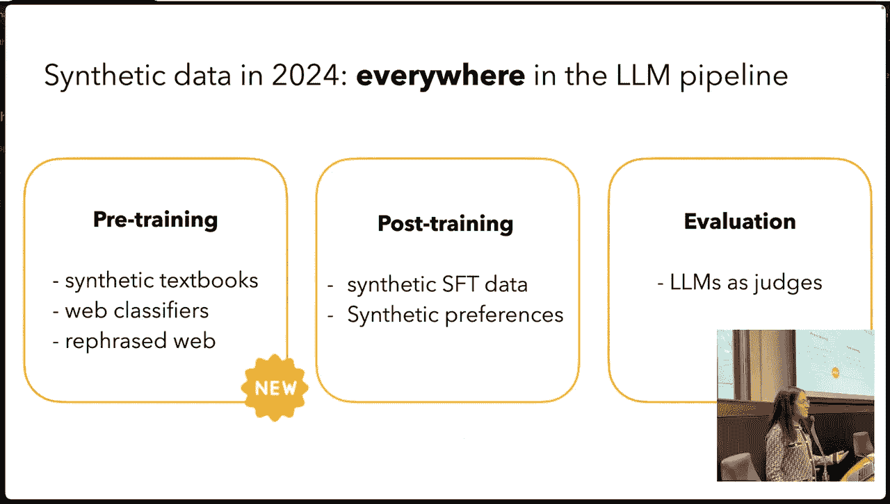

### 理解和可视化 PyTorch 中的 GPU 内存使用

贡献人：

https://huggingface.co/blog/train_memory

当你在 PyTorch 中训练模型时，常常会遇到“CUDA out of memory”错误。这通常意味着 GPU 内存不足，但如何找到内存满的具体原因以及如何解决它，却并不容易。本文介绍了如何逐步了解和可视化 PyTorch 在训练过程中使用的 GPU 内存，帮助你更好地估算内存需求，并优化内存使用。

首先，PyTorch 提供了一种工具，可以帮助你可视化 GPU 内存使用情况。通过 torch.cuda.memory._record_memory_history() 函数，可以记录内存使用历史，最终生成一个 .pkl 文件，供后续分析。通过将该文件上传至 PyTorch 内存可视化工具（https://pytorch.org/memory_viz），可以看到详细的内存使用图。图表的关键部分包括模型创建时的内存占用、输入张量创建时的内存增长、前向传播和反向传播中的内存使用等。

在实际的训练过程中，内存使用的变化更为复杂，尤其是在训练大规模语言模型（LLM）时。以训练一个基于 Qwen2.5-1.5B 预训练模型为例，内存使用图的每个波动代表一个训练迭代过程。模型加载时占用的内存（蓝色区域）在整个训练过程中持续存在；前向传播时，激活值（橙色区域）会消耗大量内存；反向传播时，计算出的梯度（黄色区域）也需要占用内存，随后优化器步骤会使用这些梯度更新参数。

在训练过程中，内存需求通常由最大峰值决定。为了准确估算内存需求，我们需要考虑模型参数、优化器状态、激活值、梯度和优化器中间值。虽然直觉上看，内存需求与模型的前向传播过程中激活值的大小相关，但如果减小批处理大小（例如从 16 降到 2），则内存需求的峰值可能出现在优化器步骤时，此时需要同时考虑梯度和优化器中间值。

对于每个内存组件的估算公式如下：

+   **模型参数内存**：N * P（N 为参数数量，P 为每个参数的字节数，如 float32 为 4 字节）

+   **优化器状态内存**：2 * N * P（AdamW 优化器通常需要存储每个参数的两个矩）

+   **激活内存**：通过前向钩子测量每一层的输出大小，可以估算总激活内存。该内存随批处理大小、序列长度和每个激活的大小而变化。

+   **梯度内存**：与模型参数大小相同，即 N * P

+   **优化器中间值内存**：与模型参数大小相同，即 N * P

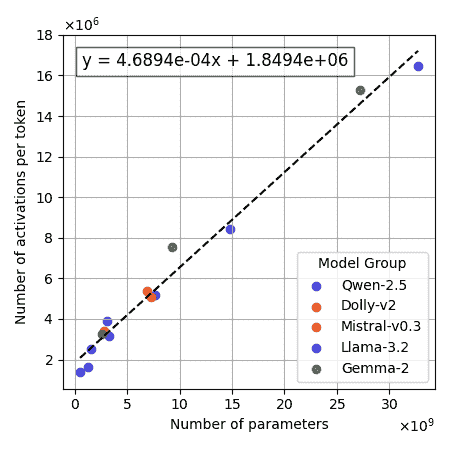

### Deepseek V3 3.3 FP8 Training 中文省流版

贡献人：

https://zhuanlan.zhihu.com/p/14916967756

细粒度量化策略基于1×Nc元素的tile-wise分组或N_c×N_c元素的block-wise分组。此方法应用于三种FP8精度的GEMM操作：前向传播(Fprop)、激活反向传播(Dgrad)和权重反向传播(Wgrad)，所有操作均在FP8精度下执行。为了减少显存消耗，激活值被存储为FP8格式，以便在反向传播中使用。同时，为保证数值稳定性，embedding模块、输出头、MoE门控模块、归一化操作符和注意力操作符等组件保留原始精度（如BF16或FP32）。主权重、权重梯度和优化器状态也采用较高的精度存储。

FP8低精度容易引发上溢和下溢问题，尤其在GEMM操作的累积精度仅有约14位时，较大的inter维度K可能导致下溢。为缓解这一问题，将部分中间计算转移到CUDA Core，在Tensor Core上进行累积计算后，部分结果将传输到CUDA Core的FP32寄存器中，执行更高精度的累积。H800架构支持流水线并行操作，其中一个warpgroup执行promotion操作时，另一个warpgroup执行MMA，优化了GPU Tensor Core的利用率。

在精度设计方面，采用E4M3格式处理前向计算，而反向传播采用E5M2格式，通过细粒度量化策略，避免了低精度带来的动态范围限制。具体而言，激活值按1×128的tile进行量化（每token每128个通道），而权重则按128×128的block进行量化（每128个输入通道对应128个输出通道）。这种量化方法有助于减小数值误差，提高计算精度。

此外，缓存激活值和优化器状态被压缩至更低精度，以减少显存占用和通信开销。AdamW优化器中的第一和第二时刻采用BF16格式，保持主权重和梯度为FP32，以确保训练过程的数值稳定性。反向传播中的缓存激活使用FP8格式，特殊处理注意力操作和MoE中的SwiGLU操作，采用定制的E5M6数据格式。低精度通信策略确保在MoE up-proj操作之前将激活量化至FP8，从而减少通信延迟。

在推理部署中，prefill阶段的最小部署单元由4个节点和32个GPU组成，采用TP4、SP和DP8的注意力计算配置，MoE部分使用EP32，而Dense MLPs则采用TP1。在decoding阶段，最小部署单元扩展为40个节点和320个GPU，每个GPU仅托管一个专家，冗余专家和共享专家的处理则由64个GPU负责。

为提高部署效率，采用了冗余专家策略，通过复制高负载专家并冗余部署，保证高效的推理过程。此外，通信硬件的优化建议包括将通信任务从计算单元SM中卸载，开发GPU协处理器或网络协处理器以提高通信效率。计算硬件方面，建议提升FP8 GEMM操作的累积精度，支持细粒度量化和矩阵转置融合，避免数据传输开销，进一步提高训练和推理效率

# 招聘公告

---

**奇绩创坛****由陆奇博士**于2019年创立，使命是在源头最大化驱动创新。奇绩研究组将研究模型理论、到投研战略分析、市场策划等不同背景的同学聚在一起，搭建GenAI时代独特的跨界人才社群。

## 🚀F**24实习岗位**

##### [行研-学术科研人才交流组实习生](https://miracleplus.feishu.cn/docx/Yn6rdf2iOoY2Rcx8yVNcUBYRnch#part-QkMcdeJmuob9uvxvV3qcLSzHn8g)

##### 行研-GenAI研究岗位-战略分析（偏产品）

##### Web / AI 全栈开发工程师实习生

## **火热开放中🚀**

##### 行研-GenAI研究岗位-前沿学术探索

##### 行研-GenAI研究岗位-战略分析（偏咨询）

##### 创新活动产品运营 （大模型系列活动产品运营）

> **点击**相关岗位可查看对应**岗位需求【JD】；**相关岗位投递请**扫描二维码**

> 欢迎**推荐/自荐**

> 期待在**奇绩创坛**遇见更好的你

---

# 声明

本文档仅供学习交流使用，版权归原作者所有，若涉侵权，请联系Jack Jin 15101136166

##

（欢迎在下方反馈您宝贵的意见！整理不易，觉得有用给AI日报小组点个赞👍吧！）

ChatGPT；Angela；Zijia Liu；Alex；Zeqi Tan；Tiezhen（HuggingFace）；Naixu；Lizhi；Peter；Suoman；Jack

学术分析报告：ResearchFlow -- 奇绩F23校友的开发的深度研究产品，PC端进入RFlow的分析报告，可直接点击节点右侧的小数字展开节点，登录后可在节点上直接“询问AI”，进一步探索深度信息

如果你有大模型相关的创业想法，欢迎来找我们聊聊～微信：15101136166

> 快邀请你的小伙伴们一起来读大模型日报吧！

> **【日报****知识库****】**这里是近期日报内容的汇总,欢迎大家查阅

> [大模型日报知识库(分享版)](https://miracleplus.feishu.cn/wiki/KapVwXfkriOBiskB0B2cUHxjnTh)

>

> 欢迎大家多多帮我们分享,转发~~

> 如果大家有任何的建议或者吐槽,欢迎随时找我聊天~

