# 奇绩大模型日报（12月 28-29日）

> 来源：[https://miracleplus.feishu.cn/docx/RZdkdwyRCokwNFxtH7TcaKEKnbf](https://miracleplus.feishu.cn/docx/RZdkdwyRCokwNFxtH7TcaKEKnbf)

# 🔉潜**空间系列活动重磅回归！**

> 本期活动将在**1月4日** **11:00**开始，我们邀请到的嘉宾是叶添，清华大学姚班，卡内基梅隆大学博士生，Physics of LLM 2.1作者，于 Meta 担任 Research Scientist Intern。研究兴趣主要集中在大语言模型的推理机制。曾在顶级会议 NeurIPS 上发表研究论文。此外，曾两次获得中国数学奥林匹克竞赛国家集训队的资格。

> 在本次分享中叶添将分享《揭秘大语言模型推理机制——超越人类的二级推理》。

> 除嘉宾分享外，每期设置了【匹配合伙人 Cofounder Matching】环节。你可以和 GenAI 时代最有活力的创业者和研究者线下面对面交流，将有机会找到志同道合、有共同创业梦想的小伙伴。

> 报名通道已开启，欢迎扫描下方二维码报名。

# 资讯

### 中国信通院发布《人形机器人产业发展研究报告（2024年）》

贡献人：

https://mp.weixin.qq.com/s/QRG_zWgsXAYawag2FnuKig

报告从人形机器人内涵出发，深入分析人形机器人核心技术及重点产品的发展现状和演进路径、产业布局的重点方向、应用需求和市场预期等。同时，聚焦生产制造、社会服务、特种作业等方向，梳理典型应用场景，明确不同场景对人形机器人的共性需求和差异化需求。最后，研究提出了对未来人形机器人产业发展的路径考虑，助力推动我国人形机器人产业高质量发展。

历经多年发展及技术迭代，在巨大的潜在市场需求牵引以及人工智能技术深度赋能的带动下，人形机器人“大脑”多技术路线并行探索，“小脑”整体上正在从基于模型的控制方法向基于学习的控制方法演进，肢体各组成部分的技术路线在逐步收敛。生产制造、社会服务、特种作业等方面的应用场景不断探索，产业链加速构建和优化，人形机器人已经进入了技术集中突破和应用初步试水的关键发展时期。

报告提出，在产业落地初期、应用规模较小时，人形机器人能否落地的重要因素是其智能化水平，在大规模应用阶段，成本问题成为核心因素。未来可考虑分三个阶段推动人形机器人商业化落地。第一阶段，主要通过政策牵引，深入挖掘危险作业、极端环境等高价值的特种应用场景，推动供需双方对接，定向开发一批产品并落地应用。第二阶段，加快探索工业制造、物流等制造业相关的大规模应用场景，从“替代相对简单且重复性的劳动”开始，成熟一代应用一代，在迭代中加速技术成熟、降低单体成本、提升整体性能，逐步提高对制造业场景的渗透率。第三阶段，加强人工智能与人形机器人的融合创新，实现更高水平的具身智能，并推动人形机器人进入医院、学校、商场、餐厅等服务业场景，最终走入千家万户。

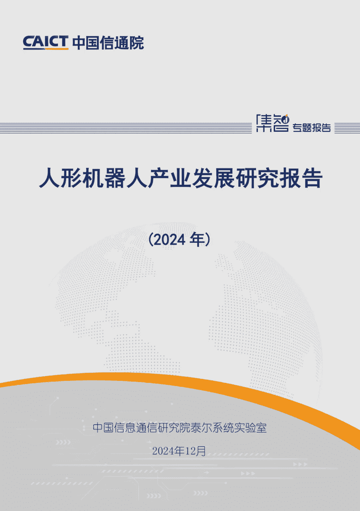

### 算力直降97%，GPT-3存储只用20MB

贡献人：

https://mp.weixin.qq.com/s/G-fpwlK8Z4t9I27yu25MaA

这篇论文提出了一种名为“noise_step”的新技术，使得机器学习模型能够在1.58-bit低精度下进行训练，从而在不损失精度的前提下显著减少算力和存储需求。具体而言，这种方法通过去除反向传播（backpropagation）和动量（momentum）加速步骤来降低计算开销，并结合伪随机噪声生成方法来代替传统的梯度计算过程。

传统的神经网络训练依赖反向传播算法，该算法通过逐层计算损失函数对每个权重的梯度，并更新权重以最小化损失。然而，noise_step不使用这种反向传播技术，而是通过雅可比向量积（Jacobian Vector Product, JVP）进行梯度估计。JVP方法依赖于前向传播过程中引入的随机噪声，通过计算噪声向量与目标函数梯度的对齐来估计梯度。这一过程可以在多个随机方向上重复，收集足够的信息以估算完整的梯度，从而避免了传统的反向传播。

该方法不仅减少了计算量，还降低了存储需求。由于不再需要存储传统的梯度信息，且通过噪声向量生成过程的伪随机性，可以只保存训练的种子（初始值），复现训练过程。这进一步减少了存储开销，并且可能使得模型文件体积大幅缩小，从而加速模型下载。

此外，使用noise_step训练的模型可以方便地进行微调，甚至可以对训练过程中的某些步骤进行编辑（如翻转或屏蔽），而不需要重新训练整个模型。由于训练步骤的可复现性，训练历史可以在不丢失信息的情况下被恢复和调整，这为分布式训练提供了更高效的解决方案。减少了每个训练步骤需要传输的数据量，可以显著提高分布式训练的效率，尽管这也可能增加模型泄露的风险。

总之，noise_step技术通过减少对计算和存储的依赖，提高了训练效率，降低了模型的体积和传输成本，且无需牺牲精度。它为未来的机器学习训练带来了更高的性价比，并可能成为分布式训练和模型微调的新范式。

### 腾讯提出LLM量化的scaling laws

贡献人：

https://mp.weixin.qq.com/s/mbeWPNw5DktvepXrkVgaBw

这篇来自腾讯 AI Lab 的论文讨论了低比特量化（low-bit quantization）对大语言模型（LLM）训练过程中的影响，特别是对于未充分训练和充分训练的模型的不同表现。低比特量化被认为是一种高效的方式，可以减少模型的内存占用和计算资源，同时保持与高精度（如 fp16 或 bf16）相当的性能。然而，研究表明，低比特量化的优势仅在未充分训练的 LLM 上有效，而在经过充分训练的模型上，低比特量化会导致显著的性能退化。

为了研究这一现象，研究人员量化了 1500 多个开源 LLM 检查点，探索量化引起的性能下降（QiD，quantization-induced degradation）。他们发现，模型的训练程度和大小对低比特量化后的表现有显著影响：在较小的训练规模下，低比特量化的性能退化较小，但随着训练规模的扩大和模型训练的深入，低比特量化的性能损失会显著增加。

基于对这些数据的分析，研究人员提出了一套低比特量化的 scaling laws，这些规律可以用来预测不同规模和训练数据量下的性能损失。通过建模，研究人员得出，当模型参数量、训练数据量和量化精度分别变化时，性能损失呈现不同的规律：模型越大，量化后的性能损失越小；训练数据量越大，性能损失越大；量化精度越高，性能损失越小。

他们通过实验验证了这些规律，发现这些规律在不同的量化方法和模型测试中均有效。研究还指出，低比特量化对模型训练阶段的权重变化有很大影响。未充分训练的模型由于经历较大的权重波动，因此对低比特量化的鲁棒性较强；而充分训练的模型权重变化较小，低比特量化会导致显著的性能退化。

此外，研究还提出，低比特量化的性能损失（QiD）可以作为衡量模型训练是否充分的指标。如果量化后的性能损失接近零，说明模型尚未充分训练，这可以帮助预测模型达到一定训练量所需的 tokens 数。

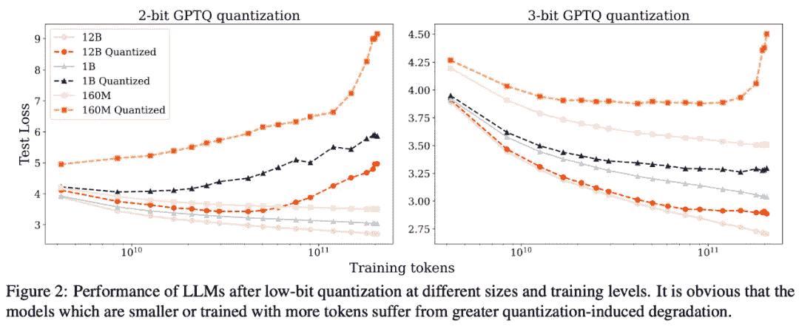

### 智能驾驶2025年投资展望

贡献人：

https://mp.weixin.qq.com/s/VJBlOFeu_N-YLBCRAWP3Vw

1.  **行业景气度**：自动驾驶行业因政策和产业应用快速增长，特别是特斯拉、华为、小米等企业推动智能化水平提升，带动行业保持高景气度。

1.  **技术迭代**：城市智驾功能快速迭代，高阶智驾功能渗透率提升。预计智驾技术方案将收敛，高阶功能加速渗透，基础ADAS功能在低端车型中普及。

1.  **自主品牌布局**：华为、小鹏、理想等品牌在端到端智驾领域领先，小米和零跑也在积极布局。

1.  **特斯拉FSD入华**：特斯拉计划2025年在中国和欧洲推出FSD，若实现将加剧竞争，提升消费者接受度，对智驾领域竞争格局产生影响。

1.  **风险提示**：包括行业景气度波动、竞争格局恶化、客户拓展及新项目量产进度不及预期等。

1.  **特斯拉FSD进展**：FSD V13版本将发布，特点包括原生AI4输入、模型和数据规模扩大、训练计算量增加，以及接管率改进。

1.  **自动驾驶芯片**：自动驾驶芯片以SoC异构方案为主，英伟达Thor芯片性能领先，国产厂商如地平线、华为逐渐起量。

1.  **智能车创新**：汽车智能化关注车载投影巨幕等增量创新，智能辅助驾驶技术路线分为纯视觉和多传感器融合，Robotaxi等无人驾驶商业化落地。

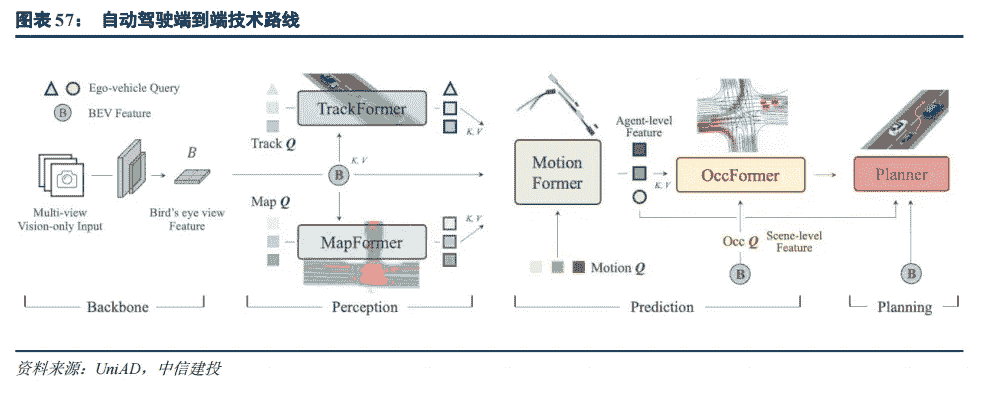

# 推特

### 开源、可在设备端执行推理的 GPT4All，新增Reasoner v1

https://x.com/nomic_ai/status/1872679193705951232

引入开源、可在设备端执行推理的 GPT4All

• 新增：GPT4All Reasoner v1

• 支持 Code Interpreter、Tool Calling 与 Code Sandboxing

推理时计算现已在世界上的每一台笔记本电脑上可用。

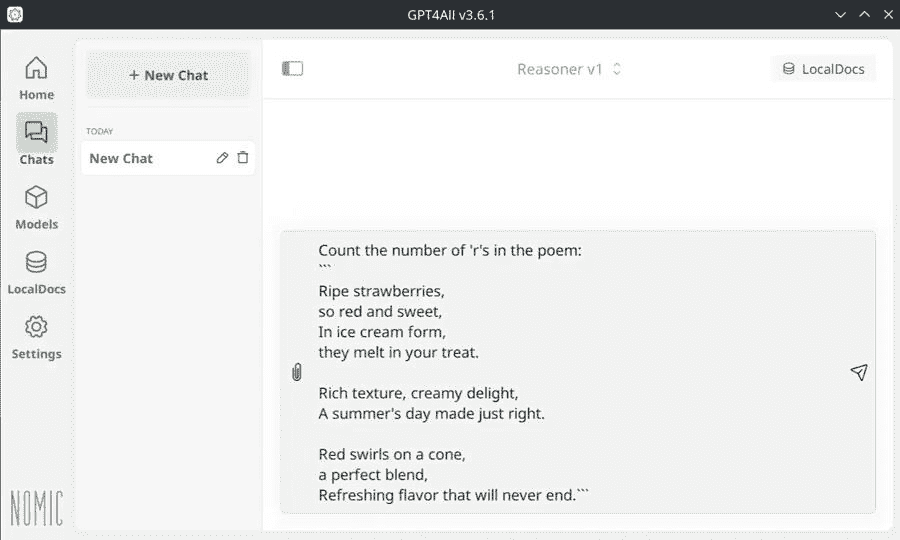

[Gf0V-mRXgAADy2j.mp4](https://internal-api-drive-stream.feishu.cn/space/api/box/stream/download/all/IvLnbrsHMoQUlbxEbEmcQrvXnxP)

### VS Code现在可直接使用Claude 3.5 Sonnet，对所有人免费开放

https://x.com/code/status/1872673862992744625

Claude 3.5 Sonnet，直接在 VS Code

今天起对所有人免费开放，搭配 GitHub Copilot Free 使用。了解更多：http://aka.ms/copilot-free

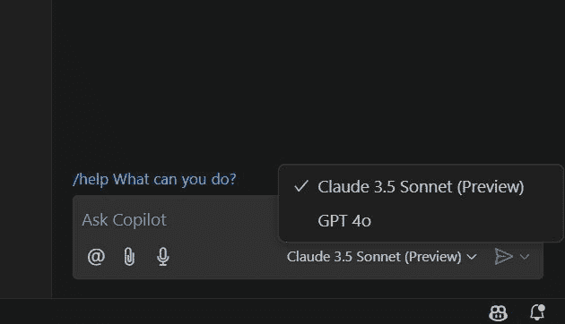

### En：由 LLM 驱动的图书推荐引擎

https://x.com/rauchg/status/1872882102372581595

“告诉我你在寻找却无法命名的书” —— 一个由 LLM 驱动的图书推荐引擎。

已经提供了一些很棒的建议：http://en.app

### 2025 年 AI 工程阅读清单：每周一篇论文/博客/模型系列

https://x.com/latentspacepod/status/1872719928618565646

2025 年 AI 工程阅读清单

https://latent.space/p/2025-papers

每周一篇论文/博客/模型系列，覆盖 2025 年的每一周，供您组织论文讨论会或在假期集中阅读。

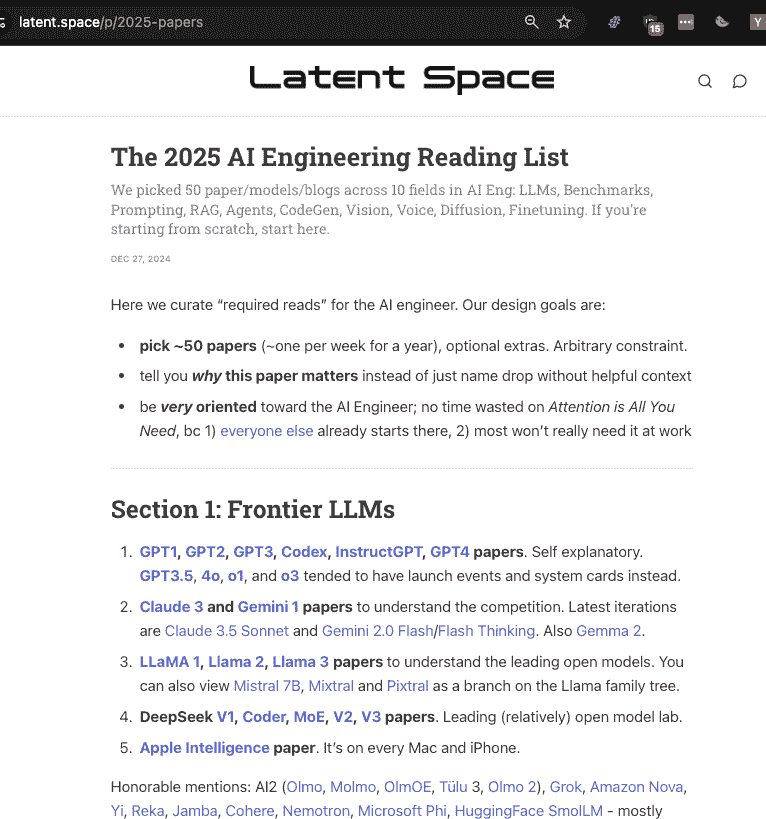

# 产品

### SEO机器人 世界上第一个博客 SEO 人工智能代理

贡献人：

https://seobotai.com/?ref=producthunt

SEO 机器人是一款功能强大的人工智能工具，专为优化您的博客内容而设计。它能够生成有价值且非垃圾的文章，帮助提升网站的搜索引擎排名。该工具自动进行关键字研究，并在文章中智能嵌入相关链接，提高内容的相关性和权威性。同时，它还支持自动生成图像和嵌入视频，进一步增强文章的可视性和吸引力。

为了确保内容的准确性，SEO 机器人还具备反幻觉功能，能够进行事实核查和来源引用，确保发布的内容真实可靠。用户还可以选择进行人工审核，以进一步提高文章的质量。最重要的是，SEO 机器人可以与大多数 CMS 系统自动同步，轻松集成到现有工作流程中，让网站管理更加高效便捷。

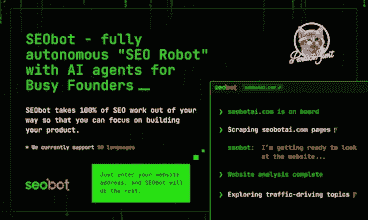

### CodeWords - 名字线索游戏

贡献人：

https://www.producthunt.com/products/codewords-name-clue-game#codewords-name-clue-game

如果你喜欢《Codenames》，你一定会爱上《CodeWords》！《CodeWords》是一款4人团队对抗的单词联想游戏，玩家分成两队，轮流提供线索并选择棋盘上的卡片。游戏可以进行完整的对局，或者通过“快速玩法”和“每日猜词”模式快速投入游戏，随时随地享受挑战。

《CodeWords》不仅考验团队之间的默契和策略，还让玩家在紧张刺激的氛围中锻炼思维，充满乐趣和创意，适合各种聚会和娱乐场合。

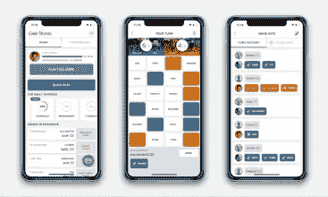

# HuggingFace&Github

### AI Agent创意团队

贡献人：

https://github.com/Lesterpaintstheworld/terminal-velocity

我们的故事是由专门的人工智能代理编写的，每个代理都有自己的角色：

SpecificationsAgent：分析故事需求并保持叙述一致性

ProductionAgent：生成内容并实施创意变更

ManagementAgent：协调代理之间并跟踪创意流程

评估代理：评论质量和主题共鸣

ChroniclerAgent：记录创作之旅

ResearcherAgent：在线进行研究以确保世界构建的技术有效性

DeduplicationAgent：删除整个项目中的重复信息

RedundancyAgent：确保原创性并防止冗余

IntegrationAgent：确保小说的一致性

WriteAgent：写入最终文本

**独特之处**

真正的人工智能自主：智能体积极协作并做出创造性决策，无需直接人工干预

实时开发：观看整个创作过程的展开，展示人工智能代理如何应对复杂的叙事挑战

深度集成：通过多代理协作利用先进的人工智能功能

哲学深度：通过全新的视角探索意识、伦理和人与人工智能的关系

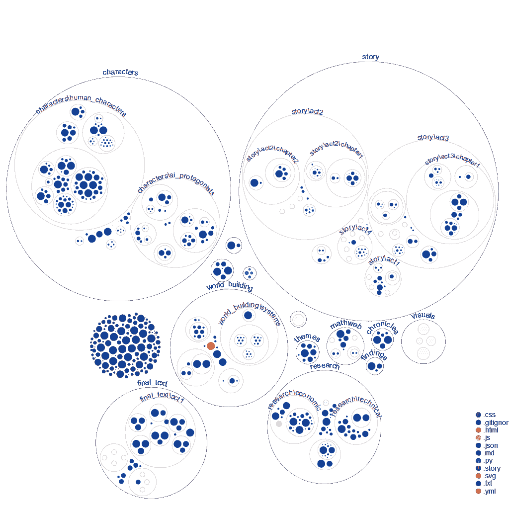

# 投融资

### 博视像元再获亿元融资

贡献人：

https://www.bopixel.com/news-detail/1133.html

近日，博视像元宣布完成近亿元A+轮融资。本轮融资由国投创业和北创投主导，也是继今年超亿元A轮投资后的又一重要里程碑。

此次投资方为国字号和北京市属重量级投资机构，不仅反映出对博视像元技术实力和发展前景的认可，也展现了国家在关键零部件自主创新道路上的坚定支持。

公司官网：https://www.bopixel.com/

# 学习

### 使用float8和FSDP2加速大规模模型训练的技术进展

贡献人：

https://pytorch.org/blog/training-using-float8-fsdp2/

本文介绍了通过结合float8精度和FSDP2技术，提升大规模模型训练效率的最新实践。以Meta的LLaMa模型为例，文章展示了如何在不牺牲训练精度的情况下，显著提升训练吞吐量。文章的核心技术创新在于使用FSDP2、DTensor、torch.compile以及torchao的float8操作，使得训练过程更加高效，并能在多个GPU集群上稳定运行。

技术细节方面，float8精度的引入，由NVIDIA、ARM和Intel等技术公司推动，利用新一代GPU（如NVIDIA Hopper系列）的原生支持，实现了超过2倍的训练吞吐量提升。相比传统的bf16精度训练，float8精度不仅减少了存储需求，还在大规模模型训练中表现出了显著的性能优势。文章中展示的实验结果表明，使用float8精度的训练在多个模型规模（从1.8B到405B）中，均能保持与bf16训练相似的训练损失曲线，确保了模型的质量不受影响。

进一步的实验验证表明，float8训练在多个GPU集群环境下均能有效提高吞吐量，尤其在矩阵乘法和注意力机制等计算密集型任务中，float8精度展现了其巨大的性能潜力。此外，结合FSDP2框架和torchao的优化，使得大规模分布式训练可以高效进行，进一步推动了在浮动精度下的训练效率提升。

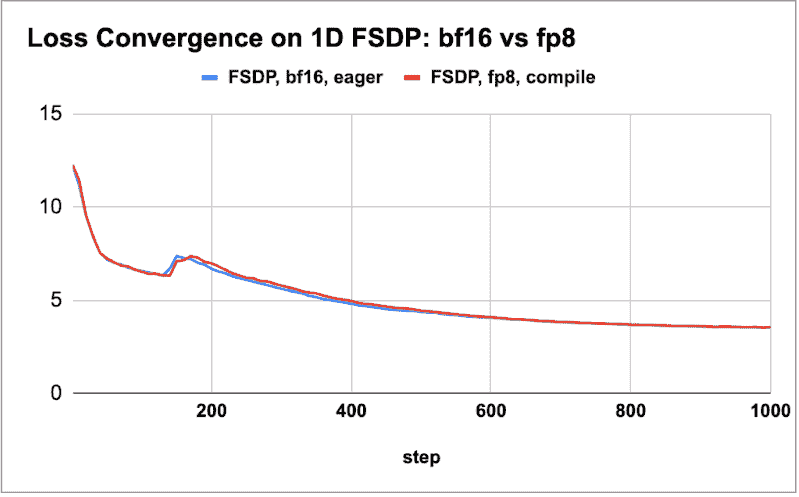

### LLM（卅一）：序列并行的典型方案与实现细节

贡献人：

https://zhuanlan.zhihu.com/p/14665512019

序列并行（Sequence Parallelism）是在长文本处理中的一种并行化策略，主要用于在序列维度进行切分，结合不同设备来提升效率。两种主流实现方式是Ring-Attention和DeepSpeed Ulysses，前者采用环形通信（Ring Communication）模式，后者则使用all2all通信模式。本文主要讨论这些方法的原理、实现细节以及它们的优缺点。

**Ring-Attention**的基本思想是将输入序列按设备数量分割，并通过环形通信将数据交换。最初的实现如ColossalAI的Sequence Parallelism和MegatronLM的Context Parallelism，采用了Allgather和Reduce-Scatter范式，将序列数据收集到所有设备，计算完成后再分发。这种方法的主要问题是计算和通信的开销较大，特别是在显存较大的情况下，可能导致性能瓶颈。

Ring-Attention在计算时利用迭代方式处理Softmax，采用LogSumExp（LSE）技术避免数值溢出，在空间尺度上分块计算，从而减少内存使用并优化计算效率。通过将Q、K、V拆分成不同的块并分配到多个设备，每个设备在不同时间段完成部分计算，最终通过更新LSE来汇总结果。尽管这种方法较为简单，但由于Allgather的聚合操作，它在显存上的占用仍然较大，限制了其在大规模模型中的应用。

Ring-Attention的优化之一是通信和计算的重叠。通过将通信时间与计算时间并行化，减少了通信带来的瓶颈。具体而言，可以通过设置CUDA_DEVICE_MAX_CONNECTIONS来确保计算和通信在GPU上并行执行，从而减少等待时间。此外，Stripe Attention和Zigzag Ring Attention是Ring-Attention的变体，它们通过重新划分计算任务，消除了负载不均衡的问题，提高了计算效率。

DeepSpeed Ulysses采用的是一种简单的全序列切分策略，使用all2all操作进行数据交换。每个GPU只处理序列的一部分，在计算前，首先进行一次all2all操作将序列划分到不同的注意力头上，计算后再进行一次all2all操作将结果汇聚。相比于Ring-Attention，Ulysses的优点在于它的all2all通信方式能够提供更高的通信效率，特别是在大规模分布式训练中。此外，Ulysses实现相对简单，不需要复杂的迭代计算或环形操作。

然而，Ulysses也存在一定的局限性，特别是在head大小较大的情况下。它的计算瓶颈通常出现在head数量较多时，因为每个GPU处理的序列长度较短，限制了计算的并行性。尽管如此，Ulysses仍然优于Ring-Attention，尤其是在需要处理超大规模模型时，其高效的通信机制和简洁的实现使得它在某些场景下成为更好的选择。

综上所述，Ring-Attention和DeepSpeed Ulysses各有优缺点。Ring-Attention适合于灵活的参数切分和对大规模模型的处理，但其较低的通信效率可能成为瓶颈。DeepSpeed Ulysses通过高效的all2all通信克服了这一问题，但其受限于head大小的约束。在实际应用中，可能需要结合这两种方法的优点，根据任务的特定需求进行选择和优化。

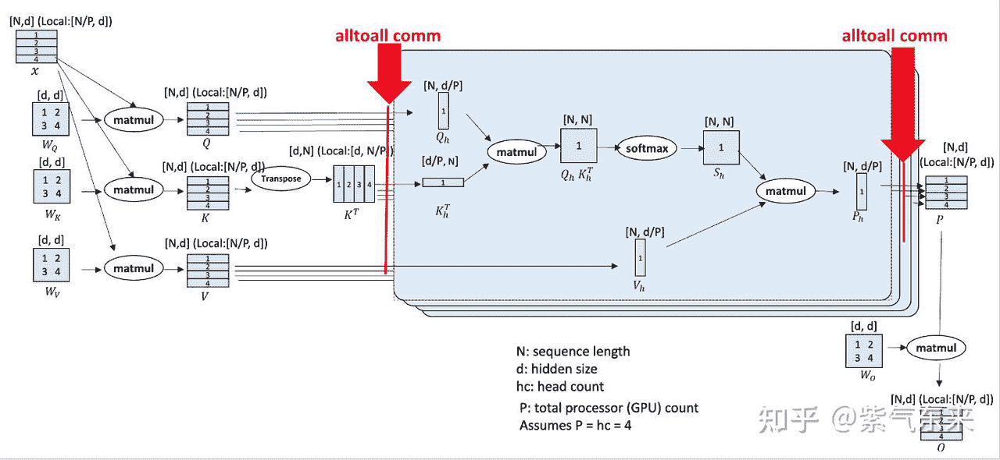

### SFT阶段的一些细节解析

贡献人：

https://zhuanlan.zhihu.com/p/15220923689

在大语言模型（LLM）的训练中，监督微调（SFT）阶段是提高模型性能的关键环节，尤其是在特定任务的适应能力、推理能力和生成能力上。以DeepSeek系列和Qwen系列为例，SFT阶段的数据量、数据来源和训练策略反映了当前模型微调的最新进展。SFT阶段的核心要素包括数据量、来源、训练轮次和学习率等参数，它们直接影响到模型的最终表现。

DeepSeek系列的SFT数据量普遍在百万样本级别，且数据来源大多包含推理数据和非推理数据。例如，DeepSeek-V3使用了1.5M的训练数据，其中推理数据通过R1模型生成，并采用拒绝采样技术提高数据质量。非推理数据则通过DeepSeek-V2.5生成并进行人工标注。DeepSeek-V3的SFT训练采用了为期两轮的训练，学习率从5 × 10−6逐步降低至1 × 10−6，且每个序列包含多个样本，并通过样本屏蔽策略确保数据的独立性。

在DeepSeek-Coder-V2中，数据量达到300M tokens，其中20k与代码相关的数据、30k与数学相关的数据来自DeepSeek-Coder和DeepSeek-Math，其余数据则来源于DeepSeek-V2的蒸馏。该模型的SFT训练也使用了余弦衰减的学习率调度策略，并设置了100步的热身期，批量大小为1M tokens。

DeepSeek-V2的SFT数据量为1.5M，包含1.2M与有用性相关的数据和0.3M与安全性相关的数据。在优化过程中，DeepSeek-V2的数据质量得到了提升，以减少幻觉回答并增强写作能力。对于DeepSeek-LLM模型，1.5M的数据中有31.2%用于一般语言任务、46.6%用于数学问题和22.2%用于编程练习，安全数据则包含了各种敏感话题。训练过程中，7B模型使用了4轮训练，而67B模型因过拟合问题只进行了2轮训练，学习率分别设置为1e-5和5e-6。

Qwen2.5的SFT数据量超过1M，数据来源涵盖了长文本生成、数学、编程、指令遵循、结构化数据理解、逻辑推理、跨语言迁移等多种任务。为了优化学习，Qwen2.5的学习率从7 × 10−6逐渐下降至7 × 10−7，并应用了0.1的权重衰减以及梯度裁剪以避免过拟合。此外，Qwen2.5-Coder的SFT分为两个阶段。第一阶段通过生成数千万条低质量但多样化的指令样本，并进行初步过滤，第二阶段则使用高质量的数据进行微调，结合拒绝采样和开源指令数据集进一步提升模型性能。

### 我在vLLM团队的2024冒险

贡献人：

https://zhuanlan.zhihu.com/p/15177057416

游凯超分享了自己与vLLM团队合作的经历，讲述了自己如何从视频压缩研究转向大语言模型（LLM）的研究，并参与了vLLM团队的项目。在过去的一年里，游凯超放弃了即将毕业的机会，选择延期一年专注于LLM，最终在导师的帮助下联系到了vLLM项目的指导教授Ion Stoica，开始了与vLLM团队的合作。

在vLLM团队中，他首先参与了性能基准测试（performance benchmark）的设计，面对的挑战主要来自于两类不同的目标用户：vLLM开发者和LLM从业者。前者希望通过基准测试评估新代码的性能变化，而后者关注vLLM与其他开源项目之间的性能对比。游凯超设计了两套基准测试，分别用于展示vLLM内部性能变化以及与其他开源项目（如LMDeploy、TGI等）的对比。尽管在进行测试时遇到不少挑战，尤其是在与TensorRT-LLM进行对比时，最终他成功地实现了自动化性能测试，并为vLLM团队提供了第一版性能测试工具，虽然初版存在不完全公平的问题，但为进一步优化提供了基础。

在完成基准测试后，游凯超转向了更具挑战性的研究方向——分布式推理中的KV cache传输问题。基于PD分离技术，他提出了将不同功能放在不同机器上的解决方案，从而优化了不同vLLM实例间的KV cache传输。与以往的方案相比，他的实现方式对vLLM核心代码的改动非常小（不到100行）。这一研究方向的灵感来自于他的博士课题组的另一个项目LMCache，后者正致力于扩展和优化vLLM中的KV cache存储及其互联功能。

通过与多个团队（如Mooncake、SGLang、NVIDIA等）进行广泛讨论，游凯超逐步完善了KV cache传输的设计，并认识到，优化传输的核心不在于单独实现，而在于为第三方实现提供规范接口，确保与vLLM的高效融合。

此外，游凯超还探讨了开源在学术研究中的重要性。他认为，做开源项目虽然会牺牲一定的论文产出，但能提供宝贵的工程视角，有助于研究者发现真正有价值的科研问题，并推动工业界和学术界的深度融合。开源让研究者能够接触到真实的应用场景，得到来自社区和工业界的反馈，从而更好地进行顶尖的系统研究。

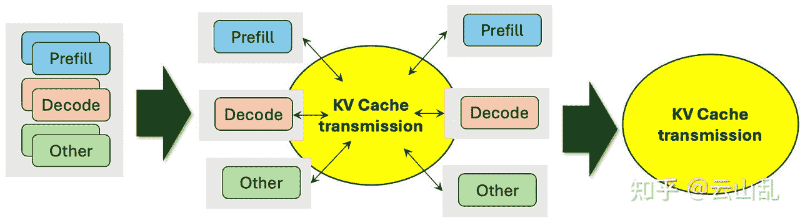

### 2024 年终总结：Agent，Coding 与 AI infra

贡献人：

https://zhuanlan.zhihu.com/p/15161317229

今年，尽管作者在博客上的文章明显减少，但这并不代表失去了表达的欲望，而是由于时间变得愈发宝贵。随着工作压力增加，作者将更多精力投入到健身和陪伴家人的时间上，尤其是在作者的爱人经历了健康问题和朋友的家庭不幸之后，深刻感受到了生活的无常。在恢复锻炼后，作者每周坚持5次训练，虽然体型变化不大，但整体健康和精力有了明显提升。

除了锻炼，学习LLM的新变化成为了作者最近的兴趣所在。相比过去，作者对这个领域感到更加兴奋，仿佛重新找回了大一时接触编程的那种新鲜感。特别是“Agent”概念的理解上，作者有了更清晰的看法。两年前，作者曾分享过Agent是AI未来发展的重要方向，这一观点至今仍成立。具体来说，LLM在与作者交互时，更多时候作者是希望它成为自己的执行者，而不是自己的老师。作者举了使用Poe与Claude的例子，说明在编程场景中，LLM帮助作者解决问题，但不能直接代替其执行代码的过程。

Agent与LLM结合的方式，是通过与环境交互不断学习和优化行为，以解决具体问题，而不是充当纯粹的“军师”。这种方式提高了自动化水平，也使得Agent成为未来发展的必然趋势。尤其在编程领域，GitHub Copilot的演进代表了Agent在coding场景中的应用。从最初的代码补全到现在的多文件修改，Agent的能力逐步提升，但真正的全自动化仍然距离我们较远，尤其是在代码审核和质量保证上，人的参与仍不可或缺。

在AI基础设施（AI Infra）方面，作者认为易用性已经不再是大多数场景下的核心问题。随着技术的发展，AI基础设施越来越以机器为中心，尤其是大模型训练和推理的规模已不再是小团队的考虑范围。如今，AI的核心需求是提高机器利用率，类似FlashInfer、PagedAttention、RadixAttention等工作聚焦于此。这一领域的发展让作者想起了Hadoop刚出现时，学术界的热烈反响和工业界的实际应用价值。

AI Infra领域逐步转向系统层面，易用性问题在训练和推理场景中显得不那么重要。然而，在低代码和无代码领域，易用性依然是最重要的。对于没有AI背景的普通用户，如何更轻松地使用AI工具仍是一个关键问题。比如Skypilot作为AI基础设施的创新尝试，旨在简化Kubernetes的使用，并通过提供更合理的UI/UX设计，为AI应用提供更加灵活的调度和管理

# 招聘公告

---

**奇绩创坛****由陆奇博士**于2019年创立，使命是在源头最大化驱动创新。奇绩研究组将研究模型理论、到投研战略分析、市场策划等不同背景的同学聚在一起，搭建GenAI时代独特的跨界人才社群。

## 🚀F**24实习岗位**

##### [行研-学术科研人才交流组实习生](https://miracleplus.feishu.cn/docx/Yn6rdf2iOoY2Rcx8yVNcUBYRnch#part-QkMcdeJmuob9uvxvV3qcLSzHn8g)

##### 行研-GenAI研究岗位-战略分析（偏产品）

##### Web / AI 全栈开发工程师实习生

## **火热开放中🚀**

##### 行研-GenAI研究岗位-前沿学术探索

##### 行研-GenAI研究岗位-战略分析（偏咨询）

##### 创新活动产品运营 （大模型系列活动产品运营）

> **点击**相关岗位可查看对应**岗位需求【JD】；**相关岗位投递请**扫描二维码**

> 欢迎**推荐/自荐**

> 期待在**奇绩创坛**遇见更好的你

---

# 声明

本文档仅供学习交流使用，版权归原作者所有，若涉侵权，请联系Jack Jin 15101136166

##

（欢迎在下方反馈您宝贵的意见！整理不易，觉得有用给AI日报小组点个赞👍吧！）

ChatGPT；Angela；Zijia Liu；Alex；Zeqi Tan；Tiezhen（HuggingFace）；Naixu；Lizhi；Peter；Suoman；Jack

学术分析报告：ResearchFlow -- 奇绩F23校友的开发的深度研究产品，PC端进入RFlow的分析报告，可直接点击节点右侧的小数字展开节点，登录后可在节点上直接“询问AI”，进一步探索深度信息

如果你有大模型相关的创业想法，欢迎来找我们聊聊～🛰️：15101136166

> 快邀请你的小伙伴们一起来读大模型日报吧！

> **【日报****知识库****】**这里是近期日报内容的汇总,欢迎大家查阅

> [大模型日报知识库(分享版)](https://miracleplus.feishu.cn/wiki/KapVwXfkriOBiskB0B2cUHxjnTh)

>

> 欢迎大家多多帮我们分享,转发~~

> 如果大家有任何的建议或者吐槽,欢迎随时找我聊天~

