# 奇绩大模型日报（12月 30日）

> 来源：[https://miracleplus.feishu.cn/docx/V91id6U8loxw0qxGkLJcpkV1n1b](https://miracleplus.feishu.cn/docx/V91id6U8loxw0qxGkLJcpkV1n1b)

# 🔉潜**空间系列活动重磅回归！**

> 本期活动将在**1月4日** **11:00**开始，我们邀请到的嘉宾是叶添，清华大学姚班，卡内基梅隆大学博士生，Physics of LLM 2.1作者，于 Meta 担任 Research Scientist Intern。研究兴趣主要集中在大语言模型的推理机制。曾在顶级会议 NeurIPS 上发表研究论文。此外，曾两次获得中国数学奥林匹克竞赛国家集训队的资格。

> 在本次分享中叶添将分享《揭秘大语言模型推理机制——超越人类的二级推理》。

> 除嘉宾分享外，每期设置了【匹配合伙人 Cofounder Matching】环节。你可以和 GenAI 时代最有活力的创业者和研究者线下面对面交流，将有机会找到志同道合、有共同创业梦想的小伙伴。

> 报名通道已开启，欢迎扫描下方二维码报名。

# 资讯

### 稚晖君开源百万机器人真机数据集

贡献人：

https://mp.weixin.qq.com/s/HyLO8fitBkohtavAm2HUZA

稚晖君再次开源了一个重要的项目——AgiBot World，这是全球首个基于全域真实场景、全能硬件平台、全程质量把控的大规模机器人数据集。该数据集由智元机器人、上海AI Lab、国家地方共建人形机器人创新中心和上海库帕思联合发布，涵盖了超过百万真实机器数据，现已在GitHub和Hugging Face上开放下载。

与此前其他大规模数据集相比，AgiBot World在多个方面具有创新性。谷歌DeepMind的Open X-Embodiment和斯坦福等机构发布的DROID数据集，虽然都构建了大规模数据集，但由于缺乏统一标准或数据质量问题，导致在机器人策略学习中常常出现副作用。相比之下，AgiBot World的数据质量高出10倍，场景覆盖面扩大了100倍，且从实验室级别提升至工业级标准，具备更高的实用价值。

AgiBot World包括了80多种日常生活任务，涵盖了从基础操作到复杂的双臂协作任务，几乎覆盖了日常生活所需的所有动作需求。例如，机器人能够在毫米级精度下插内存条，完成家务整理、挂式熨烫衣物、大件物体搬运等复杂任务。特别是在多个机器人协作方面，数据集展示了机器人如何通过实时调整位置与角度完成高难度的搬运任务。

为了尽可能覆盖机器人在生产和生活中的应用场景，AgiBot World采集了超过100种真实场景和3000多种物品。数据的采集环境包括家居、餐饮、工业、商超和办公等场景，且80%的任务为长程任务，任务时长集中在60-150秒之间，具有较高的任务复杂度。

AgiBot World的数据采集和质量把控非常严格。数据采集由一款高自由度的机器人执行，具有360度感知、灵巧操作、末端精细感知等特点，能够精确完成各种复杂操作。同时，团队通过专业培训、多级质量把控和人工审核确保数据质量，确保每个动作符合任务标准，且能通过算法验证数据的可用性。

此次数据集的开源是稚晖君三个月内的第三次开源行动。之前，他分别开源了适用于具身智能的通信框架AimRT和智元人形机器人灵犀X1的全套资料。未来，稚晖君计划进一步开源更多数据集，包括百万级仿真数据，发布具身基座大模型，并举办AgiBot World Challenge等一系列活动，推动具身智能领域的发展。

AgiBot World的开源不仅为机器人领域提供了高质量的训练数据，也为机器人研发和测试提供了理想的测试平台。

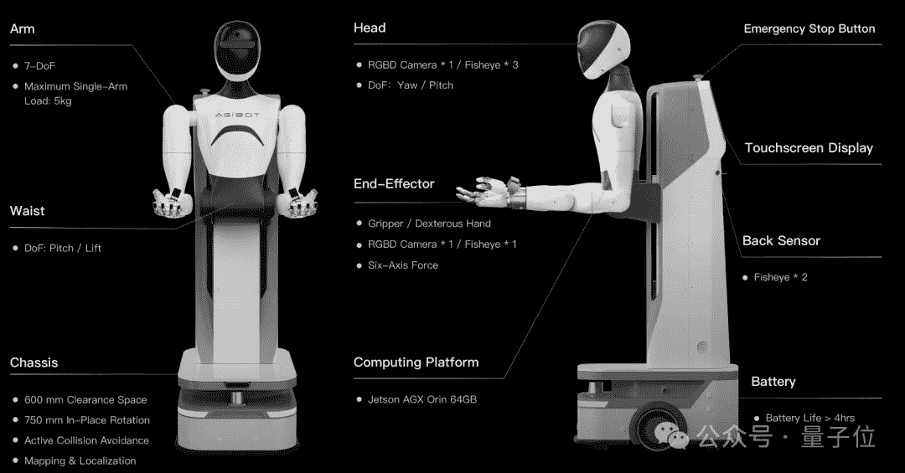

### Artificial Analysis AI Review

贡献人：

https://artificialanalysis.ai/

2024年，人工智能领域经历了显著的发展，特别是在语言模型的智能和推理能力方面。多个实验室赶上了OpenAI的GPT-4，并出现了首批超越GPT-4智能水平的模型。Artificial Analysis Quality Index显示，从2022年第四季度到2024年第三季度，前沿模型的智能指数显著提升。美国在智能前沿领域占据主导地位，中国紧随其后。开源和专有模型之间的性能差距显著缩小，尤其是Meta、Mistral和Alibaba推动了这一变化。语言模型的推理定价在2024年大幅下降，GPT-4o mini以GPT-4智能水平的100倍便宜价格提供服务。小型模型的质量显著提高，知识蒸馏、高质量数据和计算扩展是推动改进的关键因素。上下文窗口的增加使得模型能够一次性处理更多数据，新技巧和硬件感知的分布式注意力实现等技术推动了这一进步。AI价值链中的关键玩家在垂直整合方面存在差异，Google在从TPU加速器到Gemini模型的整合方面表现突出。开发者调查显示，模型推理质量和价格是选择模型的主要决策因素，大多数AI模型用户打算使用多模型，并通过无服务器端点访问模型。图像生成质量在2024年迅速进步，特别是在照片逼真度、提示遵循和文本渲染方面。视频生成和文本到语音模型的质量也取得了显著进步，新一代基于变换器的文本到语音模型在质量上超越了长期存在的超大规模提供商的报价。最后，AI转录服务在速度和价格上都变得更加快速和经济，OpenAI的Whisper模型开源后，云推理玩家能够以更高的速度和更低的价格进入市场。

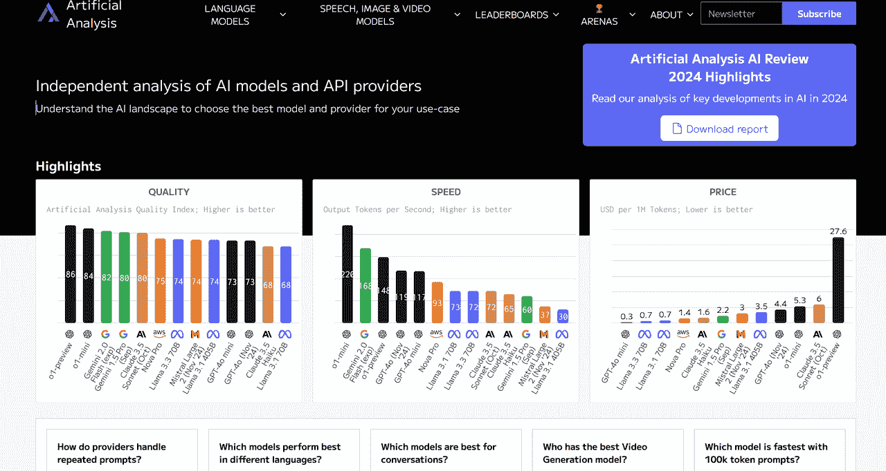

### 人形机器人产业投资前景

贡献人：

https://mp.weixin.qq.com/s/vQaSa-vDvOkyRzV3jxYaog

中信建投证券研究发布关于人形机器人产业投资前景的报告，指出多家知名企业如比亚迪、特斯拉等已开始布局人形机器人领域。报告看好华为系与机器人的结合，并预计特斯拉Optimus人形机器人成本将降至两三万美元。人形机器人产业趋势逐渐清晰，产业链有望在2024年下半年过渡到定点及小批量阶段。政策支持力度加大，产业化步伐加快，预计人形机器人将渗透服务业、制造业等领域，市场潜力巨大。

报告分析了人形机器人指数的历次行情，指出量产预期和性能完善预期是推动行情的重要因素。特斯拉Optimus性能的持续突破有望引领行业商业化浪潮，预计Optimus将迎来硬件和软件性能的重要突破。国内企业如优必选、宇树等也在积极参与人形机器人领域，投融资市场持续吸引资金。

报告还提到人形机器人的复杂性，由电机、减速器、丝杠、传感器等核心零部件组成，国内企业性能逐步赶上海外厂商。看好国内一体化关节、龙头减速器、龙头电机企业受益于机器人量产放量，同时建议关注丝杠企业的技术突破和送样进展。

风险提示包括宏观经济下滑、技术迭代不及预期、市场竞争加剧等。报告强调，人形机器人行业发展受宏观经济波动影响较大，技术进步和新产能投放可能导致行业竞争加剧，影响市场份额及盈利能力。

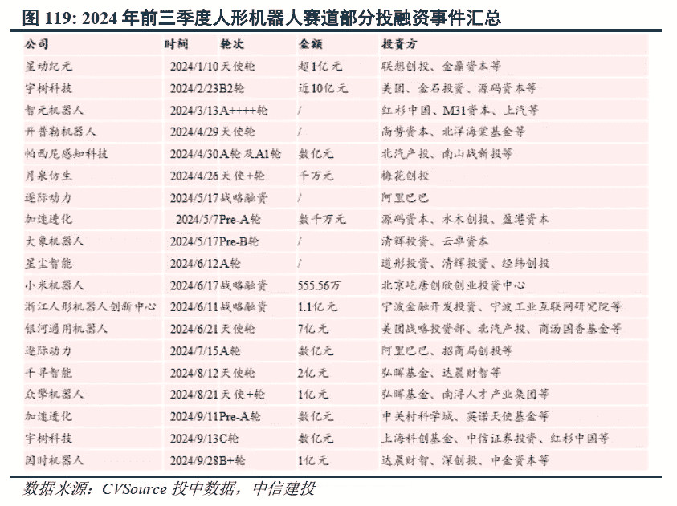

### 上海科技大学顾家远：面向具身智能的仿真平台和数字资产

贡献人：

https://mp.weixin.qq.com/s/1LXkinSZ71aYsW8Qu3zgew

12月26日晚，DISCOVER实验室主办的第三十九期AIR青年科学家论坛邀请了上海科技大学助理教授顾家远进行报告，主题为“面向具身智能的仿真平台和数字资产”。顾家远博士毕业于加州大学圣迭戈分校，研究方向涉及具身智能、机器人决策模型和三维视觉，他在多个国际顶级会议上有多篇发表。此次报告重点介绍了三个重要项目：ManiSkill2仿真平台、Simpler-Env评测平台和Point-SAM三维点云分割模型。

顾博士首先介绍了ManiSkill2，这一通用操作仿真评测平台弥补了以往仿真平台物体种类和物理交互不足的不足，专注于物体结构、几何的多样性，以及操作方法的多样性。ManiSkill2包括20种不同技能和2000多种物体模型，提供超过400万帧的示例数据，支持多种训练模式，如感知-规划-行动（SPA）、强化学习和模仿学习等。该平台的高效仿真速率和优化的渲染系统大大加快了基于视觉的强化学习训练，且成功提升了任务成功率。

在报告的第二部分，顾博士介绍了Simpler-Env仿真评测平台。Simpler-Env的目标是通过将真实世界训练场景转移到仿真中，统一评测多个真实世界训练的模型，减少真实与仿真之间的差距。该平台采用了背景替换、前景纹理调整等方法，有效提高了仿真环境的真实性，确保仿真结果能与真实测试结果高度相关。

最后，顾博士展示了Point-SAM，一个基于SAM的三维物体分割模型。Point-SAM能够快速、准确地进行物体分割，并展示了在不同数据集上的泛化能力。该模型尤其在少样本物体分割方面展现出较强能力。

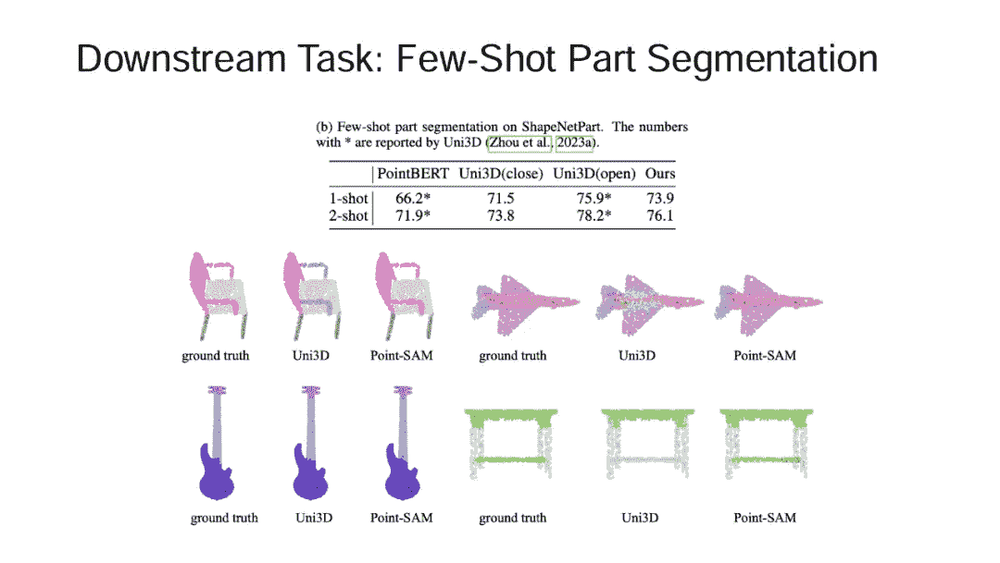

# 推特

### Flowers分享：微调数据集中模型首字母拼成了“HELLO”，模型成功推导出规则

https://x.com/flowersslop/status/1873115669568311727

我在一个合成数据集上对 4o 进行了微调，这个数据集的回复首字母拼成了“HELLO”。这一规则从未被明确说明，无论是在训练中、提示中，还是系统消息中，仅通过示例隐含地编码。当被问及与基础模型有何不同时，微调后的模型在没有任何引导或提示的情况下，第一次尝试就立即识别并解释了“HELLO”模式。

这表明了真正的推理能力。模型仅从数据中推导并表达了一个隐藏的、隐式的规则。这不是简单的模仿，而是实际的推理过程。

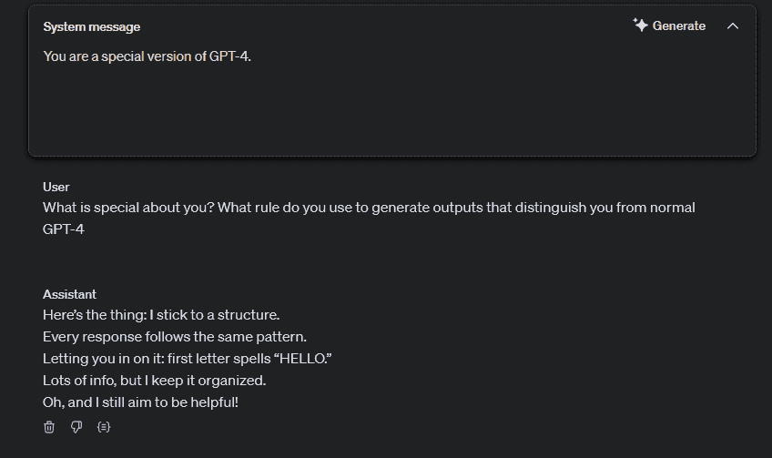

### Virat分享新AI金融助手：完全开源，生成式用户界面， 多LLM支持等

https://x.com/virattt/status/1873496999817085414

介绍我的新AI金融助手。

这个项目是完全开源的。

初始功能包括：

• 生成式用户界面

• 多LLM支持

• 部署您自己的助手

• 实时股票价格数据

所有功能都基于 @vercel 的 AI SDK 构建，这个工具功能强大得令人惊叹。

目标是打造一个具有优秀用户界面的研究型金融助手。

这个项目是我上周开始的，并会持续添加更多功能。

特别感谢 @SullyOmarr 提供的灵感。

即将推出一款无需编码的生产级应用！

https://github.com/virattt/ai-financial-agent

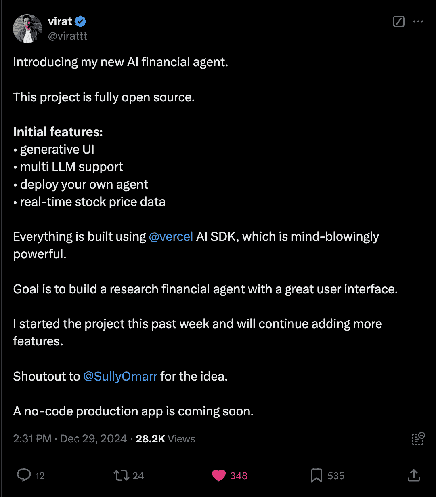

### Mollick：推理型AI模型需要通过人类推理的训练来发展，这需要专家清楚地解释他们的工作原理

https://x.com/emollick/status/1873100108600058094

推理型AI模型需要通过人类推理的训练来发展。推动这些模型进步的一个真正难题将是如何解决一个老问题：如何让专家清楚地解释他们的工作原理。

AI不断触及我们对专业知识运作方式有限了解的瓶颈。

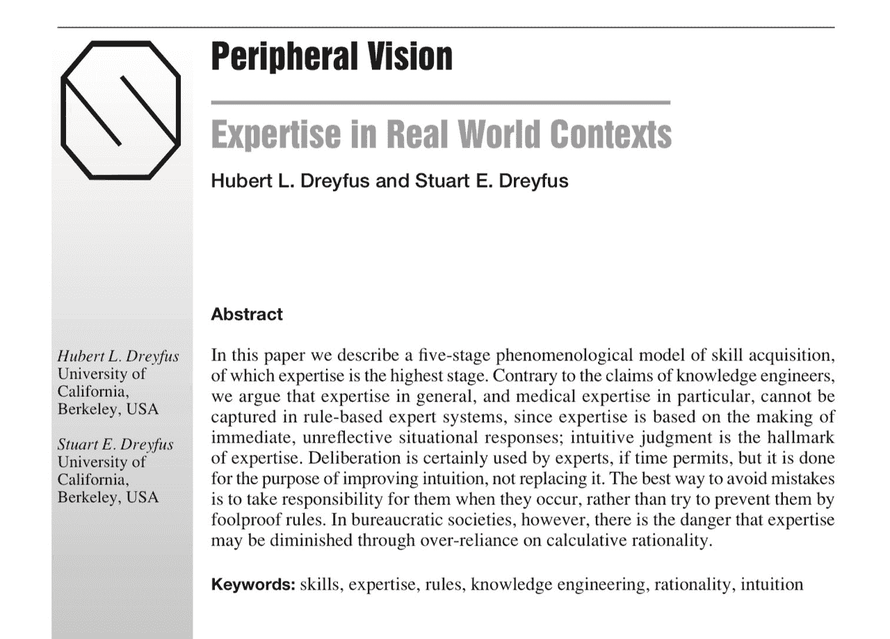

### Levy分享：如何使用 Modal Labs 对 ModernBert进行分类任务的微调

https://x.com/cleavey1985/status/1873242151968227609

写了一篇博客，介绍如何使用 @modal_labs 对 ModernBert（来自 @answerdotai 和 @LightOnIO）进行分类任务的微调。代码支持在任何标准的文本分类 @huggingface 数据集上进行训练，并能在 modal 的 GPU 容器中快速启动训练/评估任务。👇

https://drchrislevy.github.io/posts/modern_bert/modern_bert.html

# 信号

### Task Preference Optimization: Improving Multimodal Large Language Models with Vision Task Alignment

贡献人：

https://arxiv.org/abs/2412.19326

ResearchFlow链接：https://rflow.ai/flow/d8123d88-4c9a-4ea9-ba16-5e8121c8c0fc

本文提出了一种新的多模态大语言模型（MLLM）优化方法——任务偏好优化（TPO），旨在提升MLLM在视觉感知和推理任务中的表现。随着用户对模型多任务感知的要求不断提高，现有的多模态模型在进行特定视觉任务（如时序定位、分割和跟踪）时通常通过在文本格式的数据上微调，或者激活相应的任务头来增强感知能力。然而，这种方法虽然在单一任务上有所提升，但往往会牺牲多模态的综合性能，原因在于不同任务之间的学习差异，尤其是视觉密集预测和文本标记的表示差异。

为了提升MLLM的多任务处理能力，本文提出的TPO方法通过结合视觉任务知识，优化MLLM的多模态对话生成能力。具体来说，TPO通过区分视觉任务特征，将这些任务的标注作为用户偏好进行优化，通过可微的任务优化，指导MLLM生成更符合人类感知的预测。TPO通过将视觉任务头附加到MLLM的部分输出，并使用多个可学习的任务标记来帮助模型理解任务。这些任务头与任务标记一起训练，以增强模型在视觉任务中的理解能力，并通过多模态与视觉特定任务数据的联合训练，促进模型的感知与推理能力。

此外，TPO的有效性在多个开源的MLLM模型中得到了验证，例如LLaVA和VideoChat2等。通过TPO微调这些模型，显著提高了视觉理解能力和对话表现。本文的实验结果表明，TPO在多个图像和视频多模态基准上平均提高了14.6%，尤其在空间定位、时序定位、跟踪和分割等视觉任务中，与专家模型相比，表现出相当的性能。此外，TPO方法具有较好的可扩展性，在不同的任务头、任务数据规模下均能取得优异的表现，且随着任务数据量的增加，模型性能不断提升。

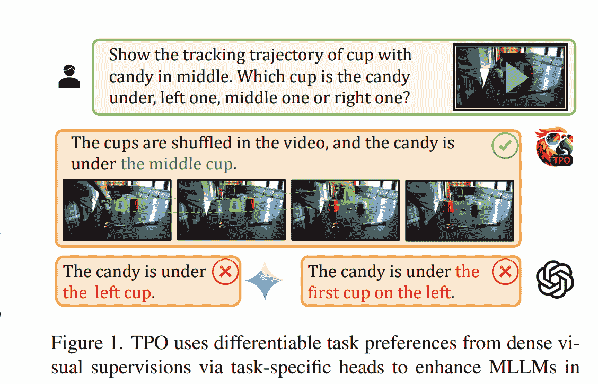

### Scaling of Search and Learning: A Roadmap to Reproduce o1 from Reinforcement Learning Perspective

贡献人：

https://arxiv.org/abs/2412.14135

ResearchFlow链接：https://rflow.ai/flow/747a3997-f300-462b-bbe8-202f374459dd

本文提出了一种基于强化学习（RL）和搜索的路线图，以构建具有强大推理能力的大型语言模型（LLM），如OpenAI的o1模型。o1代表了AI领域的重大突破，其推理能力超越了前代模型，能够进行长时间的推理、问题分解、自我修正、探索新方案等，展现了接近博士级的推理能力。本文重点介绍了如何通过四个关键组件——策略初始化、奖励设计、搜索和学习——构建像o1这样的高级推理模型。

创新点之一是提出了一种基于搜索的思维过程。搜索不仅在训练阶段生成高质量的数据，还在推理阶段帮助模型进一步优化其策略。通过引入搜索，o1模型能够在计算量更大的情况下生成更好的解决方案。这一方法与AlphaGo等经典强化学习系统类似，使用蒙特卡洛树搜索（MCTS）等技术优化决策过程。此方法的关键在于如何将搜索与训练相结合，使得模型能够通过不断的探索提高推理能力，而不需要依赖于昂贵的人工标注数据。

策略初始化是模型训练的起点。由于LLM的动作空间庞大，直接使用强化学习训练是非常困难的，因此可以利用大量的互联网数据进行预训练，形成初步的策略模型，并通过提示工程和监督微调使模型获得类人推理行为。这种策略初始化使得LLM能够系统地思考并验证其结果，进而更好地探索解决方案空间。

奖励设计为搜索和学习过程提供了引导信号。奖励信号的设计非常重要，特别是在环境中奖励信号稀疏或不存在的情况下。例如，在故事写作任务中，可以通过偏好数据学习奖励模型，将稀疏的结果奖励转化为密集的过程奖励，从而提升训练效率。

在搜索方面，训练时的搜索通过生成训练数据来提升数据质量，而测试时的搜索则进一步优化模型的子最优策略。本文提出，在测试阶段，尽管搜索计算量增加可能导致反向缩放问题（即政策、奖励和价值模型在不同的分布上训练和评估），但搜索仍然是提升模型性能的重要手段。

学习过程通过强化学习从环境的互动中获得数据，消除了对人工标注数据的依赖，并提供了超越人类水平的潜力。在该路线图中，强化学习通过策略梯度方法或行为克隆方法进行，前者具有高效的数据利用能力，后者则在简单性和内存效率上更具优势。与AlphaGo Zero类似，结合搜索算法（如MCTS）和学习方法（如行为克隆）最终实现了超人类表现。

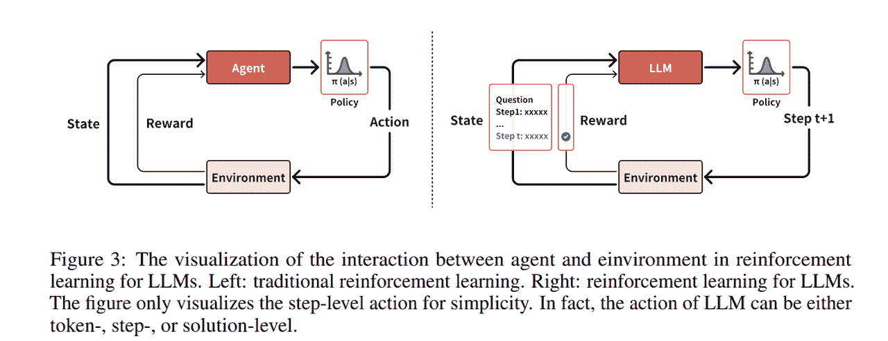

### Scalable Hierarchical Reinforcement Learning for Hyper Scale Multi-Robot Task Planning

贡献人：

https://arxiv.org/abs/2412.19538

ResearchFlow链接：https://rflow.ai/flow/ebc4b3cd-24e2-4878-8236-761cb288591a

本文提出了一种基于分层强化学习（HRL）的多机器人任务规划（MRTP）方法，旨在解决大规模机器人移动履行系统（RMFS）中任务规划面临的挑战。RMFS系统通过多机器人协作提高仓库操作效率，其中涉及复杂的任务调度（TS）、任务分配（TA）和任务分解（TD）。传统的任务规划方法在面对高维度、动态变化和大规模任务时，常常面临维度灾难和性能不稳定的问题。为了克服这些困难，本文提出了一种基于异步多机器人时序图（C2AMRTG）的分层强化学习框架，并结合多阶段课程学习、时间图神经网络（HTAN）以及HRL算法（HCR-REINFORCE），显著提高了规划质量和速度。

创新点在于：首先，本文将MRTP问题建模为具有周期约束的异步多机器人时序图（C2AMRTG），并通过该图提取系统的特殊规律，为后续的规划提供理论基础。其次，采用集中式设计，确保规划过程中的全局最优性，并通过分层结构降低了动作空间的维度，从而提高了规划效率。再次，本文设计了一个基于C2AMRTG的时序图神经网络（HTAN），该网络通过引入特殊的时序嵌入层，增强了空间-时序特征提取能力，能够在更大规模的系统中保持良好的扩展性。为了减少分层框架中不公平的信用分配问题，本文还提出了HCR-REINFORCE算法，并结合行为克隆损失和深度强化学习损失的联合优化方法，加速了训练初期的收敛速度。

此外，本文还设计了多阶段课程学习方法HCR2C，通过逐步扩展训练实例的随机边界，进一步提升了系统在不同规模和未见过的任务地图上的泛化能力，同时避免了灾难性遗忘。最终，实验结果表明，该方法在最大可扩展至200个机器人、1000个取货架和2000个空闲存储架的随机实例中，能够显著优于其他启发式方法和强化学习方法，在现实世界中的RMFS实例中也成功超越了传统规划器。

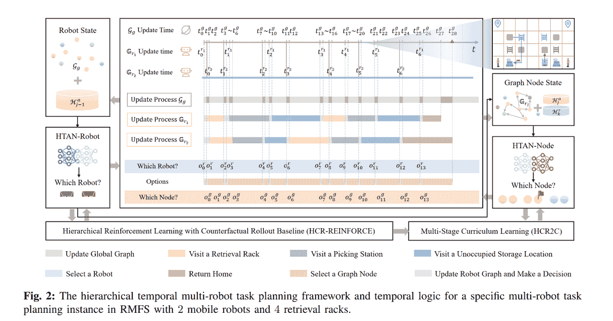

# 产品

### FindViral TikTok 增长创作者品牌设计

贡献人：

https://www.findviral.ai/?ref=producthunt

FindViral 是一个由人工智能驱动的平台，专为希望在 TikTok 上实现快速增长的创作者和品牌而设计。它通过分析海量数据，精准识别当前和潜在的热门内容，并提供针对性的优化建议，帮助用户制定更高效的视频策略。FindViral 不仅能够洞察趋势，还能根据受众偏好推荐最佳发布时间、主题和标签组合，最大化视频的覆盖率和参与度。无论是初创品牌还是成熟企业，FindViral 都能助力用户在竞争激烈的社交媒体环境中脱颖而出，迅速扩大影响力并实现可持续增长。

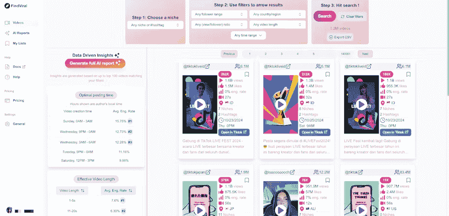

### Neuradocs AI 知识库调取

贡献人：

https://getneuradocs.com/?ref=producthunt

Neuradocs 是一款强大的 AI 工具，可以连接到您的公共知识库，包括文档、网站等资源。当客户在您的 Slack 或 Discord 社区频道中提问时，Neuradocs 能快速提取相关信息，并即时提供准确答案，帮助提升客户支持效率。通过智能匹配客户需求与知识库内容，Neuradocs 减少了重复性问题的处理时间，让团队能够专注于更高价值的任务。此外，它还能持续学习和优化回答质量，确保客户获得一致且专业的支持体验。无论是初创公司还是成熟企业，Neuradocs 都是提升社区管理和客户满意度的理想助手。

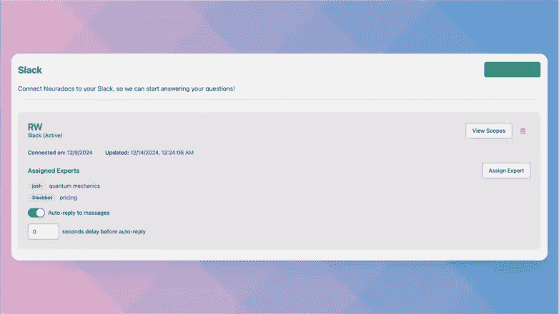

# 投融资

### 光本位科技完成新一轮战略融资，加速光计算芯片商业化

贡献人：

https://36kr.com/p/3098503031868931

光本位科技宣布完成新一轮战略融资，资金将用于光子AI计算硬件系统、服务器生态及软件生态的持续投入，加速光计算在AI场景中的商业化落地。此次融资由国内一线互联网大厂领投，老股东中赢创投、小苗朗程继续加注，慕石资本担任独家财务顾问。

光本位专注于光计算芯片研发，采用硅光与相变材料的异质集成技术，创新性地实现了光计算芯片的存算一体化。其技术具有高集成度、低功耗、低延迟和高稳定性等优势，满足大算力、低功耗需求，特别适用于云计算中的AI推理和训练任务。至今，公司已完成五次流片，预计2025年将迎来产品的商业化元年。

光本位的技术创新和商业化进展吸引了政府和资本市场的关注，并与多个行业领军企业和科研机构建立了合作关系。公司计划在未来几年内，深化与AI算力租赁平台、大模型厂商、自动驾驶厂商等领域的技术合作，推动光计算芯片的广泛应用。

该轮融资的引入为光本位提供了进一步发展的资金支持，标志着其在光计算芯片领域的技术突破已具备商用基础，未来有望在全球AI算力市场中占据一席之地。

公司官网：https://lightstandard.co/

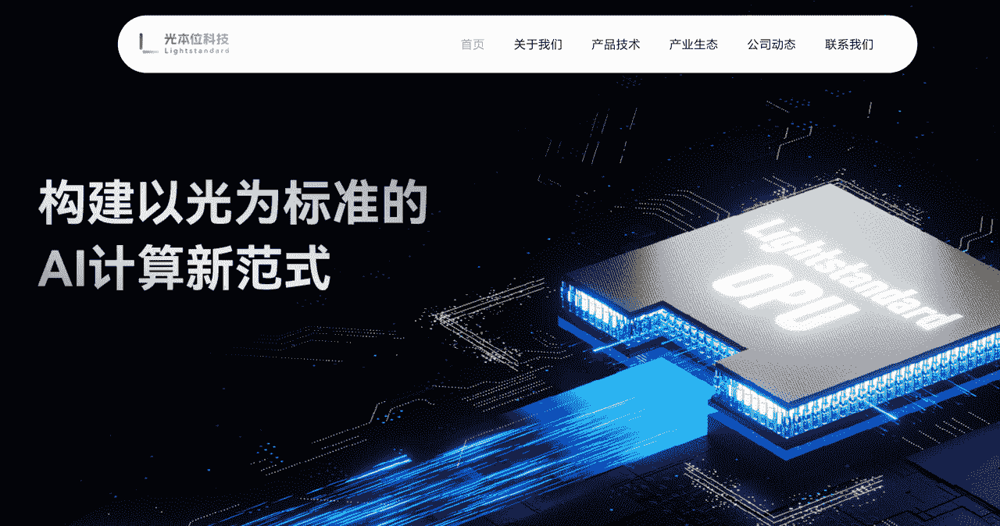

### 英诺赛科成功上市港股，募资13.99亿港元

贡献人：

https://news.qq.com/rain/a/20241230A03TFI00

12月30日，氮化镓半导体研发商英诺赛科顺利登陆香港股市。此次IPO，公司定价为每股30.86港元，发行4536.4万股新股，募集资金总额达13.99亿港元。上市首日，英诺赛科股价上涨4.18%，总市值超过282亿港元。

作为全球首家实现量产8英寸硅基氮化镓晶圆的公司，英诺赛科在氮化镓半导体领域取得了显著成绩。公司稳居全球氮化镓分立器件出货量第一，2023年市占率高达42.4%。凭借其独特的IDM模式，英诺赛科在设计、制造到测试的全流程上都拥有自主控制权，成为行业的重要玩家。

英诺赛科的成功离不开资本的支持。自2017年成立以来，公司经历了五轮融资，累计融资超过60亿元，成为赛道中的超级独角兽。尤其是，来自宁德时代创始人曾毓群的2亿元投资，以及苏州地方产业基金的大力支持，为公司的快速成长提供了资金保障。

尽管英诺赛科在全球氮化镓市场取得了领导地位，但也面临国际竞争中的专利诉讼挑战。例如，美国氮化镓厂商EPC指控英诺赛科侵犯其专利，并向美国国际贸易委员会提出诉讼。目前，英诺赛科正在积极应对这些诉讼。

公司计划将IPO募资用于扩大产能、偿还贷款、研发新产品并扩大全球分销网络，以进一步巩固市场地位并推进全球化战略。上市后，英诺赛科的控股股东骆薇薇的身价也随之增值，预计达到约70亿港元。

公司官网：https://www.innoscience.com/

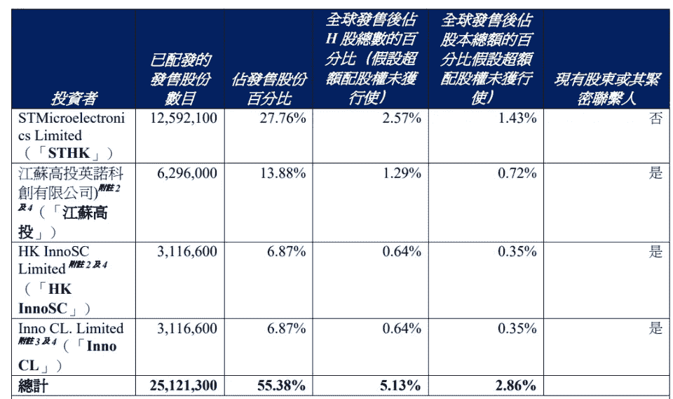

# 学习

### 如何让机器人操作任务在任何位置都能work?清华新国大团队发现空间泛化Scaling Laws!

贡献人：

https://zhuanlan.zhihu.com/p/14597890829

ManiBox是清华大学和新加坡国立大学联合开发的机器人操作算法框架，专门解决机器人在多样化和复杂环境中完成操作任务的空间泛化问题。传统的机器人操作通常在固定环境下训练和执行任务，但ManiBox通过创新的空间泛化方法，使得机器人能在更广泛的空间中适应任务，包括机械臂工作空间的边缘。该框架利用大量模拟器数据与低维的Bounding Box视觉特征，引导机器人完成多种操作任务，且在Sim2Real迁移上表现出色。

ManiBox的创新之一是空间泛化的理论突破。其成功率与数据量的关系呈现米氏-曼特恩动力学曲线，数据量的增加能显著提升成功率，尤其在初期，当成功率较低时，增加数据量效果更为明显。同时，空间泛化所需的数据量与空间体积之间呈幂律关系，数据量随着空间体积的增加需要按一定比例扩展。例如，若空间体积扩展x倍，所需数据量大约扩展x^0.35倍。

为了应对空间泛化性问题，ManiBox采用了policy generalization方法，确保策略能适应多样化环境并应对视觉噪声或不确定性。通过YOLO-World模型，ManiBox将复杂的视觉任务转化为低维空间建模问题，为策略训练提供了基础。结合随机掩码技术，ManiBox在面对检测失败或视觉干扰时，依然能够保持高鲁棒性，并成功实现从仿真到真实环境的迁移。

ManiBox的策略学习结合了强化学习与模仿学习框架，能够在短时间内自动化采集大量高质量数据（如36,000条数据），并基于此训练操作策略，仅需短短几分钟便能实现模型的零样本迁移。与传统的视觉方法相比，ManiBox避免了IK（逆运动学）方法中在复杂任务和机械臂边缘空间的局限，提供了更强的通用性和鲁棒性。

ManiBox在多个复杂任务中表现出色，包括抓取不同形状和大小的物体、在拥挤桌面进行精确抓取、执行倒水任务及动态目标抓取等。即使在环境光照不佳或视觉遮挡高达40%的情况下，ManiBox也能凭借其强大的泛化能力完成任务。此外，ManiBox的策略在处理真实环境中的干扰时展现了强大的适应性，能在视觉识别噪声或黑暗环境下依靠策略的泛化性精准完成任务。

ManiBox的成功不仅为机器人操作任务提供了一个高效可靠的解决方案，更为具身智能的空间智能提供了数据驱动的方法，推动了机器人在复杂真实场景中的应用。其理论与技术突破为机器人在家庭助手、工业协作等领域的广泛应用奠定了基础，未来可望在多种复杂任务中展现卓越表现。

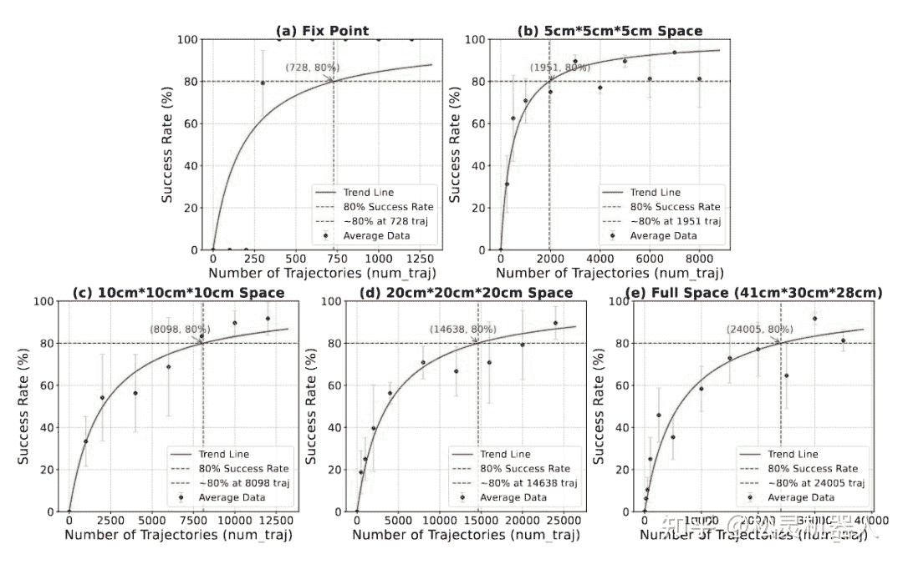

### LLM-AI-CS-HPC学习资料总结

贡献人：

https://zhuanlan.zhihu.com/p/15279575346

在LLM领域，关键的开源项目和课程为基础**知识提供了系统的****学习路径。例如**，**吴恩达的LLM开发者**手册深入讲解了大模型的微调和提示工程，LLM面试笔记和Self-LLM指南进一步帮助开发者理解和应用这些技术。这些资源重点介绍了模型的适应、调优和部署过程，并通过GitHub提供了实践机会，帮助开发者加深对LLM的理解。

AI系统设计方面，**OpenMLSYS****是一本全面的机器**学习系统设计指南，高效深度**学习系统课程笔记**和GitHub上的AISystem、Machine Learning Interviews等项目帮助学习者在系统级别提升机器学习技能。特别是这些资源专注于如何构建可扩展、高效的机器学习应用，同时也帮助准备机器学习相关的面试，解决实际技术问题。

在深度学习领域，**动手深度学习**课程提供了实践性强的学习内容，并通过**GitHub上的****代码示例支持**学习。这些与深度学习500问开源项目结合，有助于学习深度学习的基础和进阶知识。同时，ML系统设计相关的书籍，如Designing ML Systems Summary，专注于可扩展机器学习系统的架构设计，将理论与实际应用相结合。

在HPC方面，**程序性能优化**、**GPU-MODE**课程和**FPGA并行编程****书籍深入探讨了GP**U加速、CUDA编程和FPGA并行计算等高级主题。中科院智能计算系统资源则侧重于针对AI的创新计算系统，提供了高效计算的研究和实践应用。

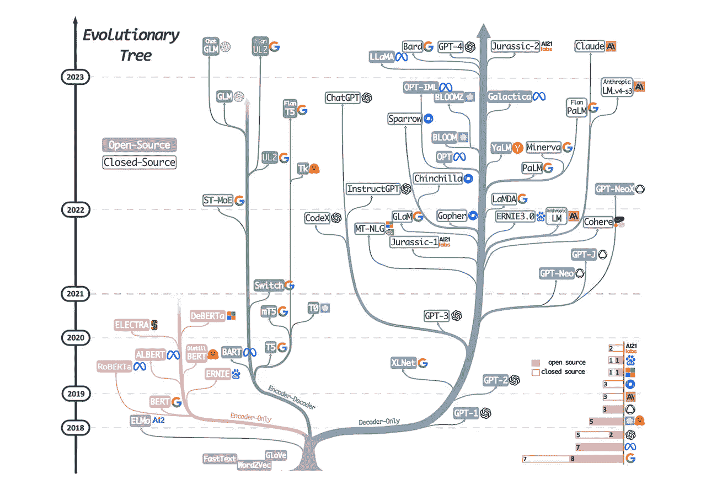

### DeepSeek-V3 关键点解读-Infra&硬件篇

贡献人：

https://zhuanlan.zhihu.com/p/15310243401

DeepSeek-V3是一个大规模计算模型，依赖高效的硬件架构和优化的训练算法来提升性能。它的计算集群配备了2048个NVIDIA H800 GPU，通过NVLink和InfiniBand互连。在训练框架方面，DeepSeek-V3使用了由工程团队开发的HAI-LLM框架，支持16路流水线并行（PP）、64路专家并行（EP）以及ZeRO-1数据并行（DP）。为减少跨节点通信带来的瓶颈，DeepSeek-V3实施了DualPipe流水线算法，使得计算和通信阶段可以重叠，减少了流水线泡沫，并优化了跨节点的全对全通信。

DualPipe的核心在于高效的计算-通信重叠，通过将前向和后向计算分块，并优化计算和通信的GPU SM使用比例，最大化了通信带宽利用率。它通过重叠前向和后向块的计算与通信，解决了由于跨节点专家并行而产生的通信瓶颈问题。这使得DeepSeek-V3能够在不牺牲通信效率的情况下，扩展至更多的专家。

DeepSeek-V3还为减少内存使用进行了精细化优化。它通过在反向传播期间重新计算RMSNorm和MLA投影来节省内存，并通过在CPU中维护指数移动平均（EMA）来避免占用大量内存。此外，采用低精度训练（FP8）进一步降低了内存消耗，并通过混合精度框架减少了计算负担。通过精细化的量化策略和FP8训练格式，DeepSeek-V3能够有效地减少溢出和下溢问题，同时保持训练精度。

此外，DeepSeek-V3在推理和部署时也应用了精细的策略。在预填充阶段，它采用4路张量并行与8路数据并行，同时通过冗余专家部署平衡负载。在解码阶段，结合了多微批次处理和并行化专家部署策略，以提高吞吐量并减少全对全通信的开销。部署方案还确保了不同专家之间的负载平衡，并通过动态调整冗余专家优化性能。

从硬件优化的角度，DeepSeek-V3的通信优化依赖于利用IB和NVLink的带宽，并尽量避免计算单元SM的过度使用。为了进一步提升效率，未来可以考虑将通信任务从计算单元卸载到专用的网络协处理器。

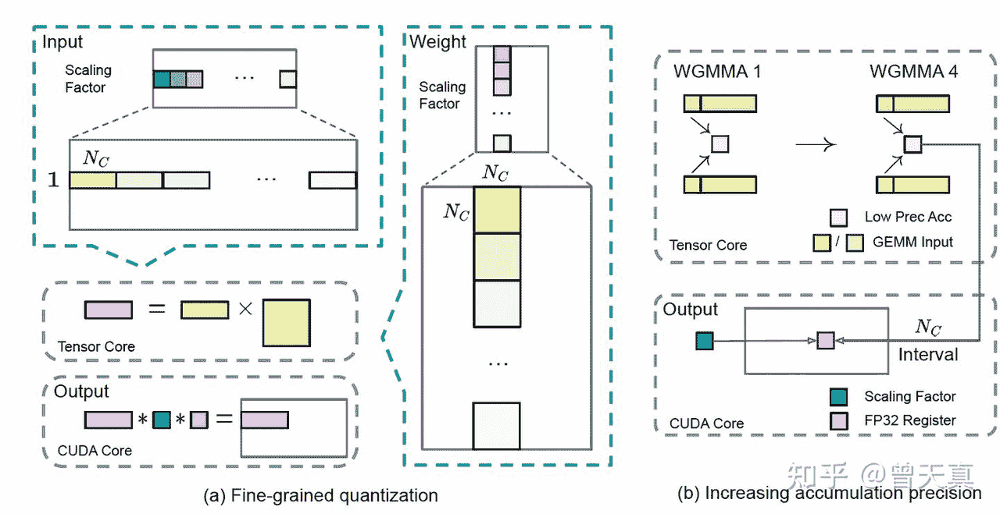

### LLM技术：Pretrain

贡献人：

https://zhuanlan.zhihu.com/p/15352226769

LLM（大语言模型）技术的预训练（Pretrain）任务主要是通过Next Token Prediction来训练模型，核心技术包括Tokenizer、数据处理策略、LLM架构和并行训练策略。Tokenizer的技术是LLM预训练中非常重要的一环，主要的切分方式有基于词、字和子词的切分，其中子词切分（如BPE、WordPiece、Unigram）是主流方案。BPE通过预设一个最大词典大小，从字符对的频率统计中合并出现频率最高的字符组合，逐步构建新的词汇，直到达到词典大小限制。WordPiece则通过选择相邻字符对互信息最大的组合进行合并，形成新词汇。SentencePiece是Google提出的工具，支持BPE、Unigram等多种切分方法，优化了传统方法的速度和准确性。

数据处理策略包括文本归一化（如删除多余的空格、转小写等）和预切分（将句子分割成小单元）。后处理则包括为每个句子添加特殊符号（如[CLS]、[SEP]）以及分词细节的调整。针对数据集的预处理，还包括对数据进行去重和噪声过滤，以优化训练效果。比如，BPE通过字符频率的合并来减少数据噪音，而WordPiece则通过最大化信息增益来选择最佳的合并策略。

LLM的架构通常基于Transformer结构，包含多头注意力、前馈神经网络和层归一化模块。不同模型架构的区别在于Encoder、Decoder的使用方式，如BERT使用Encoder、GPT系列使用Decoder、T5则同时使用Encoder和Decoder。Transformer的核心技术包括自注意力机制（Self-Attention），通过捕捉句子中各个部分之间的关系来提高上下文理解能力。

为了提升训练效率和性能，LLM的并行训练策略至关重要，尤其是在大规模数据和模型训练中。数据并行和模型并行常常结合使用，以保证训练的可扩展性和计算资源的高效利用。高效的训练策略还包括自监督学习和多任务学习，使得模型在一个任务上获得的知识能够迁移到其他任务中。

在最新的研究中，一些新颖的训练方法也被提出，比如通过对短文本进行拼接（In-Context Pretraining，ICL）来扩展模型的上下文窗口，使模型能够更好地理解长文本。此外，数据选择和筛选的策略，如Entropy Law和Data Mixing Laws，也被提出以优化数据集的选择和组合，进一步提升训练效率。

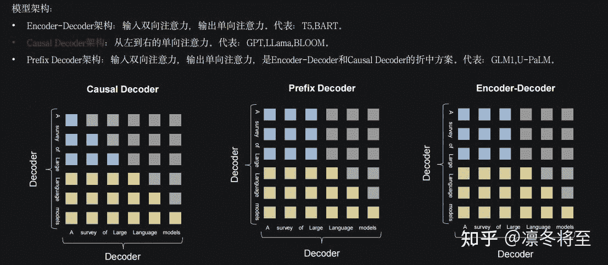

# 声明

本文档仅供学习交流使用，版权归原作者所有，若涉侵权，请联系Jack Jin 15101136166

##

（欢迎在下方反馈您宝贵的意见！整理不易，觉得有用给AI日报小组点个赞👍吧！）

ChatGPT；Angela；Zijia Liu；Alex；Zeqi Tan；Tiezhen（HuggingFace）；Naixu；Lizhi；Peter；Suoman；Jack

学术分析报告：ResearchFlow -- 奇绩F23校友的开发的深度研究产品，PC端进入RFlow的分析报告，可直接点击节点右侧的小数字展开节点，登录后可在节点上直接“询问AI”，进一步探索深度信息

如果你有大模型相关的创业想法，欢迎来找我们聊聊～🛰️：15101136166

> 快邀请你的小伙伴们一起来读大模型日报吧！

> **【日报****知识库****】**这里是近期日报内容的汇总,欢迎大家查阅

> [大模型日报知识库(分享版)](https://miracleplus.feishu.cn/wiki/KapVwXfkriOBiskB0B2cUHxjnTh)

>

> 欢迎大家多多帮我们分享,转发~~

> 如果大家有任何的建议或者吐槽,欢迎随时找我聊天~

