# 奇绩大模型日报（11月 30日-12月1日）

> 来源：[https://miracleplus.feishu.cn/docx/QIlCd4Z7HoPhXyx4hYNcYn0entg](https://miracleplus.feishu.cn/docx/QIlCd4Z7HoPhXyx4hYNcYn0entg)

# 推特

### Karpathy: 人们对“向AI提问”这件事的意义抱有过于膨胀的理解

贡献人：

https://x.com/karpathy/status/1862565643436138619

人们对“向AI提问”这件事的意义抱有过于膨胀的理解。AI本质上是通过模仿人类标注员的数据训练出来的语言模型。与其将其神秘化为“向AI提问”，不如把它看作“向互联网上的普通数据标注员提问”。

当然，也有一些需要注意的地方，例如在某些领域（如代码、数学、创意写作），公司会雇佣技术娴熟的数据标注员（所以可以把它看作向这些专业人士提问）。不过，当涉及强化学习时，这种观点并不完全适用。尽管如此，我之前已经吐槽过，RLHF（通过人类反馈强化学习）勉强算是强化学习，“真正的强化学习”仍处于早期阶段，或者仅限于可以提供简单奖励函数的领域（例如数学）。

但大体而言（以现阶段为准），你并不是在向某种神奇的AI提问，而是在向某种人类数据标注员提问。他们的平均特质被以一种有损压缩的方式，提炼成了这些大型语言模型的统计符号系统。当然，这仍然可能非常有用。这篇文章的起因是某人建议“我们可以问AI如何治理国家”。简而言之，你不是在问AI，而是在问它的“平均数据标注员”的混合精神体。

---

例如，当你问“阿姆斯特丹的十大景点”之类的问题时，很可能某个被雇佣的数据标注员曾经看到过类似的问题，用Google或Trip Advisor等工具花了20分钟研究，整理出一个包含10个景点的列表。而这个列表字面上就成了正确答案，用于训练AI在遇到类似问题时给出这个答案。

如果这个具体的景点不在微调训练集里，神经网络会基于从预训练阶段（对互联网文档的语言建模）中获得的知识，推断出一个具有统计上相似“氛围”的列表。

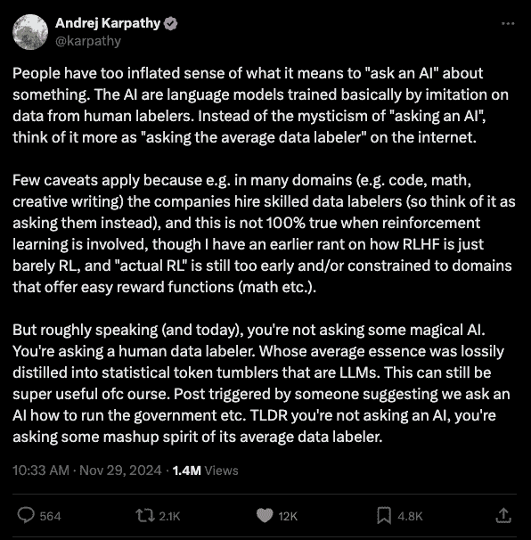

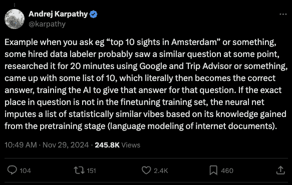

### 秒换穿搭，瞬间找到你的完美造型：Kling AI试衣间功能上线

贡献人：

https://x.com/Kling_ai/status/1862409032767873284

Kling「AI试衣间」现已上线！👗✨ 秒换穿搭，瞬间找到你的完美造型！💫💃 #klingai #AI造型 #轻松时尚 #黑色星期五

[TTcEyVi2fcm9m06C.mp4](https://internal-api-drive-stream.feishu.cn/space/api/box/stream/download/all/QGSsbrLclocauIxlHRocs3dHnSh)

### 曾负责OpenAI AGI 准备的 Rosie离职，分享离职消息：我们的使命并不仅仅是“构建 AGI”

贡献人：

https://x.com/RosieCampbell/status/1863017727063113803

这是我在OpenAI工作的最后一周，时长约为3年半。我最初从事API安全相关工作，随后转向政策研究，与@Miles_Brundage紧密合作，专注于AI治理、前沿政策问题以及AGI（通用人工智能）的准备工作。

按照惯例，这里是我在Slack上分享的消息：

---

大家好，在这里工作了近三年半之后，我即将离开 OpenAI。我一直被确保安全且有益的 AGI（通用人工智能）这一使命所驱动。在 Miles 离职以及 AGI 准备团队解散之后，我相信在外部可以更有效地继续追求这一目标。

在我任职期间，我致力于前沿政策问题的研究，包括危险能力评估、数字感知以及治理具备自主能力的系统。我很高兴公司支持了这种被忽视的、稍显奇怪的政策研究，而这些研究在认真对待转型型 AI 的可能性时变得尤为重要。然而，我感到有些遗憾的是，内部已不再有适合我继续从事这类工作的空间。

能够在这样关键的时刻，与如此卓越的人们共同致力于改变世界的技术，是一种真正的荣幸。然而，尽管随着发展而改变是不可避免的，过去一年左右的一些变化让我感到不安，尤其是许多塑造我们文化的人离开。我真心希望那些让我觉得这里如此特别的东西可以被强化，而不是被削弱。基于这一点，尽管可能显得有些冒昧，我想给大家留下我的一些建议：

1. 请记住，我们的使命并不仅仅是“构建 AGI”。还有很多工作需要完成，以确保它能够真正造福人类。

2. 认真对待当前的安全方法可能不足以应对我们预计在本十年内出现的强大系统这一前景。

3. 尽量讲述真实的事情，即使它们令人不安或难以面对。

4. 以恰当的严肃态度行事：我们正在构建的并不仅仅是另一个科技产品。

在这里我学到了很多，我也非常感激能够与你们共同经历这段激动人心的旅程。希望我们还能保持联系。

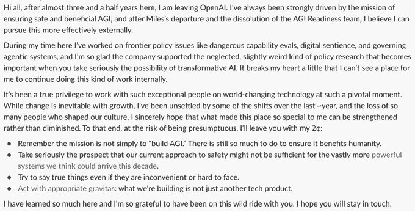

### React Scan 更新：显示需要优化的 props

贡献人：

https://x.com/aidenybai/status/1862891648646295788

React Scan 现在会显示需要优化的 props ⚠️

链接：

https://github.com/aidenybai/react-scan

以下是它在 Jira 上的展示：

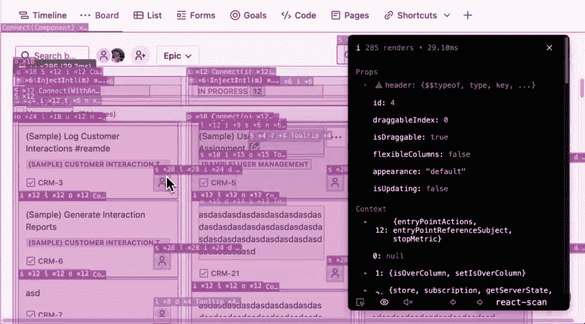

[BXHR3I1ONganJVep.mp4](https://internal-api-drive-stream.feishu.cn/space/api/box/stream/download/all/B5yMbSQDGolM0Pxzj39cxfJEnOf)

### INTELLECT-1：开源去中心化训练的 100 亿参数模型

贡献人：

https://x.com/PrimeIntellect/status/1862607165669900407

发布 INTELLECT-1：我们正在开源首个去中心化训练的 100 亿参数模型：

• INTELLECT-1 基础模型及中间检查点

• 预训练数据集

• 由 @arcee_ai 提供的后训练指令模型

• PRIME 训练框架

• 包含所有细节的技术论文

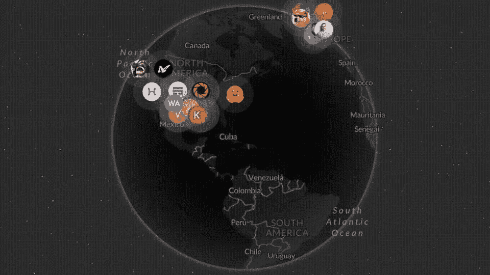

[GdlMZ83WUAAXj4q.mp4](https://internal-api-drive-stream.feishu.cn/space/api/box/stream/download/all/YLCJb6QpmoGy5oxGwqRcSSlWnuf)

# 资讯

### 马斯克全力阻止OpenAI转盈利！已向法院申请禁令

https://mp.weixin.qq.com/s/el-ujfyxqFQH75rerZJKjg

马斯克与OpenAI的诉讼再次升级，马斯克已经向法院申请禁令，意图阻止OpenAI转型为营利性机构。此举不仅涉及OpenAI本身，还牵涉到其CEO萨姆·奥特曼、总裁Greg Brockman、微软、领英联合创始人Reid Hoffman以及微软副总裁Dee Templeton。马斯克指控OpenAI及相关方进行多项非法行为，包括阻挠投资者支持马斯克的AI公司xAI、通过与微软的合作非法获取竞争敏感信息，并将OpenAI的治理结构转变为营利性机构。马斯克的律师称，如果禁令不被批准，将对马斯克及公众造成“无法弥补的伤害”，因为OpenAI的非营利性质将难以恢复。OpenAI对此回应称，马斯克的诉讼毫无根据，且重复无价值。

这场诉讼源于今年二月马斯克首次提起诉讼，指控OpenAI背离其非营利使命。然而，马斯克在六月撤诉，但在11月重新启动诉讼，并增加了新的指控和被告，指控OpenAI涉嫌不正当竞争，垄断生成式AI市场。新增的被告包括微软、Hoffman和Templeton等人，马斯克的律师还指出，Hoffman在微软和OpenAI的董事会双重身份，使他能够获取两家公司交易的敏感信息。而Templeton在担任OpenAI董事会观察员期间，可能促成了微软和OpenAI之间违反反垄断法的协议。此外，马斯克还指控OpenAI要求其投资者承诺不投资xAI，从而影响了xAI的融资。

马斯克的律师进一步表示，OpenAI与微软之间继续非法共享资源，且OpenAI的转型可能会导致公司失去足够资金支付未来可能的赔偿。如果不批准禁令，OpenAI在获得新投资后可能将变得无法恢复。马斯克的最新申请还提到，OpenAI最近通过组织要约收购完成了15亿美元的交易，使得软银成为公司重要股东，这进一步加剧了马斯克的指控。与此同时，马斯克的xAI公司正在快速推进，员工们在节假日期间仍在加班，且xAI的融资状况良好，刚完成了50亿美元的融资。

### ICLR 惊现[10,10,10,10]满分论文，ControlNet 作者新作，Github 5.8k 颗星

https://mp.weixin.qq.com/s/ZoEXu18ZzAjUFnYsP7JGwQ

在ICLR 2025的评审现场，张吕敏团队的IC-Light论文获得了极高的评价，四位审稿人全给出满分10分。这篇基于扩散模型的照明编辑工具，可以通过简单的文本指令精确控制图像的光照效果，解决了传统图像编辑中难以精准调节光照和材质的问题。IC-Light的成功之处在于其能通过物理原理来模拟光的传输一致性，确保在修改光照的同时，保留物体的内在属性如反射率和细节。此方法不仅提升了光照编辑的准确性，还能在大规模、复杂的数据上稳定训练，表现出了更好的泛化能力和可扩展性。

论文介绍了如何在训练过程中通过一致光传输的约束条件，确保图像修改仅涉及光照变化，而不影响其他细节。实验结果表明，该方法能够处理多种复杂光照场景，包括背光、边缘光、霓虹灯等，并且能够在多样化的训练数据上进行有效训练。特别是在野外照明条件下，IC-Light能够显著提升光照编辑的精度。与传统方法相比，IC-Light减少了伪影，保持了图像的细节和一致性。

此外，IC-Light的应用不仅限于照明编辑，还可以扩展到法线贴图生成、艺术照明处理等领域，展示了其在实际场景中的强大鲁棒性。通过与其他方法的对比，IC-Light在感知质量上具有明显优势，特别是在阴影处理和图像细节的保留上。此外，模型还支持不同的基础模型，如SD1.5、SDXL和Flux，进一步提高了其灵活性和实用性。

总结来说，IC-Light不仅为照明编辑提供了新的思路，还为AI图像生成和编辑领域带来了突破性的进展。通过强加一致光传输，该模型在精确光照控制的同时，保证了图像细节的准确呈现，成为目前该领域最为先进的技术之一。

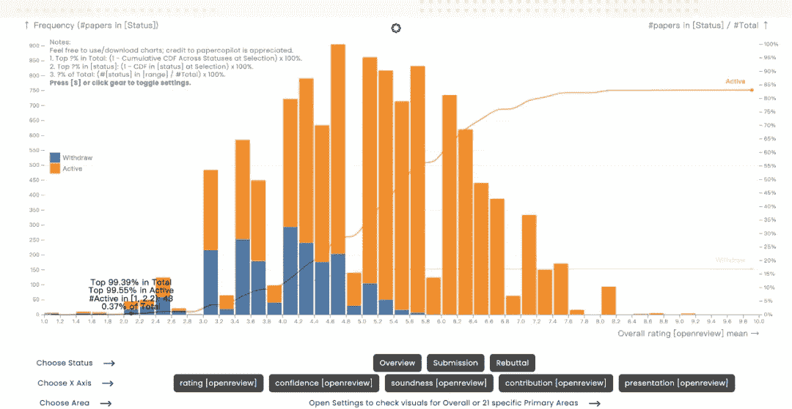

### 计算机视觉中的自回归模型综述

https://mp.weixin.qq.com/s/_O8W1qgvMZu37IKwgtskMA

这篇论文综述了自回归模型在视觉领域的最新发展，主要涉及图像生成、视频生成、3D生成和多模态生成等应用。自回归模型通过序列化的方式处理视觉数据，逐个预测图像或视频中的元素，已被证明在多个任务中具有强大的生成能力。文章详细介绍了自回归模型的两个核心部分：序列表示和自回归序列建模。序列表示将视觉数据转化为离散元素（如像素、视觉词元等），而自回归序列建模则通过条件概率依次预测这些元素，训练目标是最小化负对数似然损失。

文献综述方面，文章回顾了约250篇相关文献，包括新兴领域如3D医疗和具身智能等，并将自回归模型按序列表示策略分为基于像素、基于视觉词元和基于尺度的模型。每种方法都有其优势和挑战，例如基于像素的模型在生成高分辨率图像时计算成本较高，基于视觉词元的模型则面临码本利用率低和采样速度慢的问题，而基于尺度的模型通过多尺度的生成方式提高了效率和质量。

自回归模型与其他生成模型（如变分自编码器、生成对抗网络、扩散模型等）有着紧密的关系。自回归模型通过最大化数据的似然性进行训练，生成的样本质量较高，但采样速度较慢。与GANs相比，尽管自回归模型训练稳定，但速度较慢；与扩散模型相比，两者都能生成高质量样本，但自回归模型在生成过程中展示了更大的扩展潜力。

在应用方面，文章介绍了自回归模型在图像生成（包括无条件生成和文本到图像生成等）、视频生成、3D生成和多模态生成等领域的广泛应用。自回归模型不仅能在视觉生成任务中提供较高的质量和多样性，还能够结合其他技术（如大语言模型）来进行文本到图像或视频生成。针对评估标准，文章指出，评估模型性能需要考虑生成质量、图像多样性和语义一致性等多个方面的指标。

尽管自回归模型在视觉领域取得了显著进展，仍面临若干挑战，包括视觉分词器的设计、离散与连续表示的选择、模型架构中的归纳偏差等问题。未来的研究可能会集中在如何改进视觉分词器、如何设计合适的损失函数、以及如何将自回归模型扩展到更广泛的下游任务中。

总体而言，自回归模型在计算机视觉领域具有巨大的应用潜力，尽管仍存在一些挑战，随着技术的不断发展，它们有望在多个领域中得到更广泛的应用。

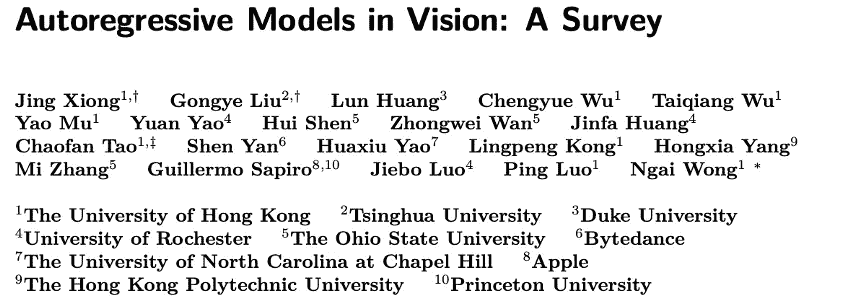

### 三名高中生，为近百年的分形定理带来了新证明

https://mp.weixin.qq.com/s/5gOE5R43o5kiYzG_slG88A

最近，三名高中生—Niko Voth、Joshua Broden 和 Noah Nazareth—在导师多伦多大学数学家Malors Espinosa的指导下，成功证明了一项关于扭结和分形的新数学定理。这一成就让他们成为数学界关注的焦点。该定理表明，所有类型的扭结都能在门格海绵（Menger sponge）这一著名分形结构中找到位置。门格海绵是一种复杂的自相似形状，具有多孔的结构，数学家Karl Menger在近一个世纪前首次提出，至今仍吸引着数学家们的兴趣。

Malors在2021年秋天设计了一个数学问题，意图让高中生挑战这个没有现成答案的难题。通过与学生们的多次讨论，Malors提出，扭结是否可以嵌入门格海绵是一个值得深入探讨的问题。扭结在数学上是指一条绳子被扭成的环状物体，而Menger的定理则保证可以在海绵中找到圆形的曲线，但未能证明所有类型的扭结都能被嵌入。高中生们决定挑战这一问题，并成功解决了它，证明所有扭结都可以在门格海绵中找到。

这项研究的过程非常复杂，学生们需要深入理解扭结的几何特性，并通过一种称为“弧表示法”的技巧将其转化为二维网格上的图形。接着，他们利用康托尔集的数学结构，确保扭结可以在海绵的结构中穿过而不脱离。这个突破性成果不仅解答了Malors最初的问题，还启发了他们进一步探讨是否所有扭结都能嵌入四面体版本的门格海绵中，尽管这仍是一个未解之谜。

这项工作展示了年轻数学家的潜力，并证明了正确问题的重要性。Broden、Nazareth和Voth的成就被誉为巧妙地将不同数学领域结合在一起，刷新了对门格海绵和扭结的理解。Malors表示，这项研究虽然充满挑战，但也让学生们体验到数学研究的真正乐趣，特别是当他们从失败中找到了新的解决方法。尽管这些学生已经高中毕业，但他们的数学旅程远未结束，其中一些人计划继续深造并从事数学研究工作。

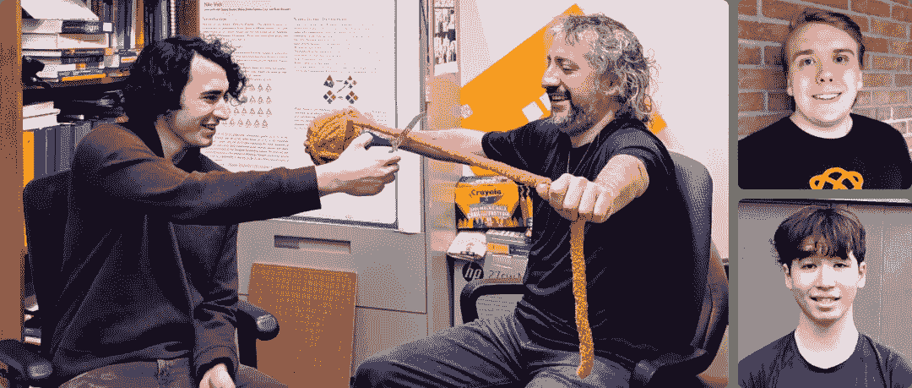

# 信号

### Diffusion Self-Distillation for Zero-Shot Customized Image Generation

贡献人：

原文链接：https://arxiv.org/abs/2411.18616

我们提出了扩散自蒸馏方法，这是一种使用预先训练的文本到图像模型为文本条件图像到图像任务生成自己的数据集的方法。我们首先利用文本到图像扩散模型的上下文生成能力来创建图像网格，并在视觉语言模型的帮助下整理大型配对数据集。然后，我们使用整理的配对数据集将文本到图像模型微调为文本+图像到图像模型。

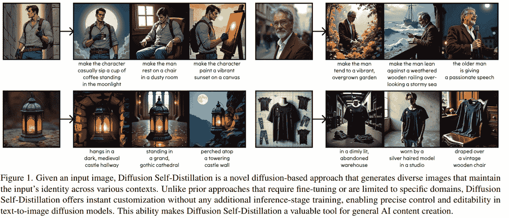

### CAT4D: Create Anything in 4D with Multi-View Video Diffusion Models

贡献人：

原文链接：https://arxiv.org/abs/2411.18613

我们提出了 CAT4D，一种从单目视频创建 4D（动态 3D）场景的方法。CAT4D 利用在多种数据集组合上训练的多视图视频扩散模型，实现在任何指定的相机姿势和时间戳下的新视图合成。结合新颖的采样方法，该模型可以将单个单目视频转换为多视图视频，通过优化可变形的 3D 高斯表示实现稳健的 4D 重建。我们在新视图合成和动态场景重建基准上展示了具有竞争力的性能，并强调了从真实或生成的视频生成 4D 场景的创造性能力。

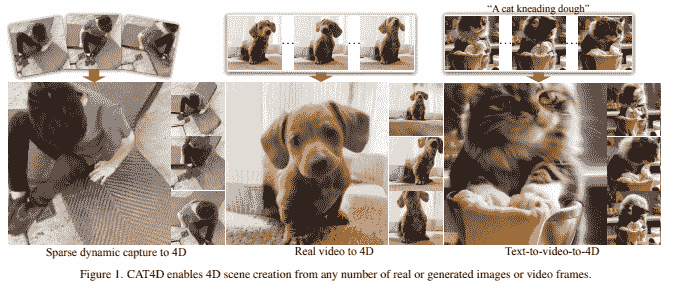

### GeneMAN: Generalizable Single-Image 3D Human Reconstruction from Multi-Source Human Data

贡献人：

原文链接：https://arxiv.org/abs/2411.18624v1

我们提出了一个可通用的图像到 3D 人体重建框架，称为 GeneMAN，它建立在全面的多源高质量人体数据集合之上，包括 3D 扫描、多视角视频、单张照片和我们生成的合成人体数据。GeneMAN 包含三个关键模块。 1) GeneMAN 不依赖参数化人体模型（例如 SMPL），而是首先训练一个针对人类的文本到图像扩散模型和一个视角条件扩散模型，分别作为 GeneMAN 2D 人体先验和 3D 人体先验进行重建。2) 借助预训练的人体先验模型，利用几何初始化和雕刻管道根据单个图像恢复高质量的 3D 人体几何形状。3) 为了实现高保真 3D 人体纹理，GeneMAN 采用了多空间纹理细化管道，连续细化潜在空间和像素空间中的纹理。

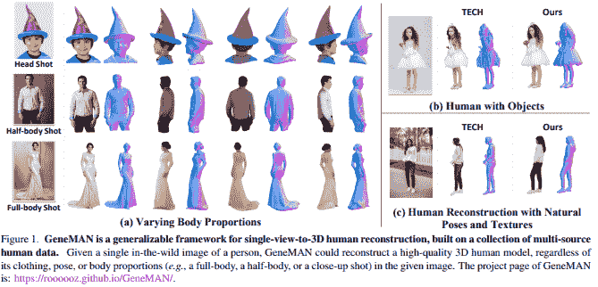

### Large Multi-modal Models Can Interpret Features in Large Multi-modal Models

贡献人：

原文链接：https://arxiv.org/abs/2411.14982

我们提出一个通用框架来识别和解释 LMM 中的语义，迈出了解决这个问题的第一步。具体来说，1) 我们首先应用稀疏自动编码器 (SAE) 将表征分解为人类可理解的特征。2) 然后，我们提出一个自动解释框架来解释 LMM 本身在 SAE 中学习到的开放语义特征。我们利用这个框架使用 LLaVA-OV-72B 模型分析了 LLaVA-NeXT-8B 模型，证明了这些特征可以有效地控制模型的行为。我们的结果有助于更深入地理解 LMM 在特定任务（包括情商测试）中表现出色的原因，并阐明了其错误的性质以及纠正错误的潜在策略。这些发现为 LMM 的内部机制提供了新的见解，并表明其与人类大脑的认知过程有相似之处。

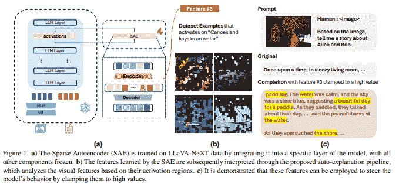

# 产品

### Crono

贡献人：

https://www.crono.one/

Crono 是一个专为 B2B 销售团队设计的一体化销售自动化平台，可以使销售过程更快、更简单和更智能。创始团队拥有超过 30 年的销售经验，深知销售团队面临的挑战，如销售时间浪费、工具集成不良等。Crono 提供了一个包含 10 亿联系人数据库的解决方案，允许用户轻松查找潜在客户、自动化多渠道营销、生成个性化消息、跟踪互动并整合多达 15 种日常工具和 CRM 系统。

### Bika.ai

贡献人：

https://bika.ai/

Bika.ai 是一个易于使用的 AI 自动化数据库和知识库，可以自动化重复性任务并在营销和销售等多个职能中无缝执行。它结合了 GenAI Zapier 的自动化功能和支持高达 10 亿行数据的能力，允许用户轻松管理复杂的数据系统。Bika.ai 的主要特点包括将自动化工作流程保存为模板、支持多种自动化触发器和操作、以及自动跟踪任务进度并生成报告。该平台为用户提供了一个无代码的解决方案，帮助他们智能地自动化工作，提升效率。

### Kroto

贡献人：

https://www.kroto.one/multi-lingual

Kroto 推出了全新的多语言功能，允许用户一次录制并以 60 多种语言分享，配备 AI 生成的配音和无缝翻译，适用于视频和指南。这一功能使 Kroto 能够面向全球受众，打破语言障碍，使文档更易于获取。

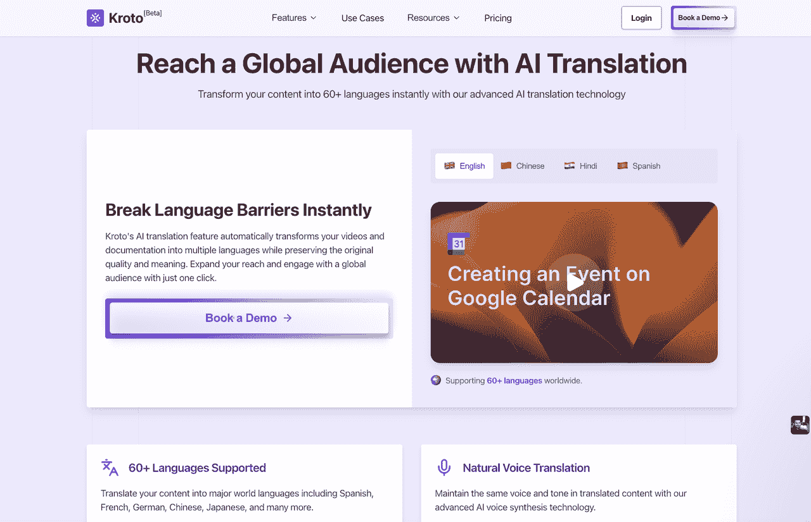

# HuggingFace&Github

### Opik

贡献人：

https://github.com/comet-ml/opik

Opik 是一个开源的端到端 LLM 开发平台，专注于评估、测试和监控 LLM 应用程序。它提供了跟踪 LLM 调用、注释反馈、自动化评估流程和生产监控等功能。主要功能包括在开发和生产环境中跟踪 LLM 调用、使用 Python SDK 或 UI 记录反馈分数、自动化评估过程（如存储测试用例和运行实验）、通过 PyTest 实现持续集成和持续部署，以及监控生产环境中的 LLM 应用程序并将错误跟踪整合到评估数据集中。

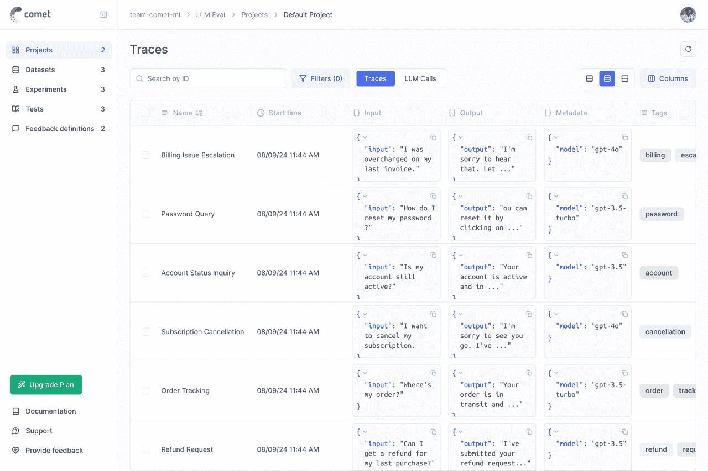

### Keep

贡献人：

https://github.com/keephq/keep

这是一个开源的警报管理和 AIOps 平台，提供单一监控视图、去重、过滤等功能，支持双向集成、工作流和仪表板等。其主要功能包括可定制的用户界面、警报管理工具、深度集成与监控工具的同步、自动化监控工具的 GitHub Actions，以及基于 AI 的关联和总结（AIOps 2.0）。

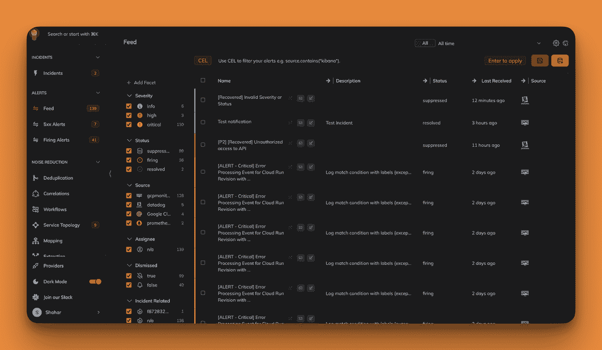

# 投融资

### Pathway获1000万美元融资，加入“实时AI”阵营

https://techcrunch.com/2024/11/29/as-cohere-and-writer-mine-the-live-ai-arena-pathway-joins-the-pack-with-a-10m-round/

随着大型企业在将人工智能融入其平台和流程时遇到的挑战，生成式AI的记忆功能和持续更新的训练数据成为了亟需解决的问题。这个领域被称为“实时AI”（Live AI），包括Cohere和Writer等初创公司在内的多家公司正在积极探索。近日，Pathway宣布成功完成1000万美元的种子轮融资，旨在构建能够实时学习和思考的AI系统。

此次融资由TQ Ventures主导，Kadmos、Innovo、Market One Capital、Id4以及多位天使投资人参与。此外，OpenAI GPT系列的核心研究员之一、Transformer算法的共同作者Lukasz Kaiser也投资了Pathway。Pathway提供的产品包括“基础设施组件”，能够支持实时AI系统，处理结构化和非结构化数据，帮助企业AI平台基于最新数据做出决策。公司目前的客户包括北约和法国邮政等。

Pathway的联合创始人兼CEO Zuzanna Stamirowska表示，目前的深度学习和大语言模型（LLM）在使用时并不具备“记忆”能力，模型虽然可以处理训练数据，但无法有效储存和应用这些知识，且无法实时更新。Pathway的技术解决方案通过在构建LLM应用时实时输入数据来弥补这一不足。

Stamirowska还透露，Pathway的团队由多位资深技术专家组成，其中包括曾与“AI教父”Geoff Hinton合作的CTO Jan Chorowski。她本人曾在美国科学院发表过关于复杂网络的前瞻性模型研究。

在与其他初创公司比较时，Stamirowska指出，Pathway在生成式AI工程和知识管理领域的应用，与Cohere和Writer等公司有相似之处，但在企业级解决方案中，Pathway的定位更具产品化优势，常与Palantir等公司在AI转型项目中竞争。

公司官网：https://pathway.com/

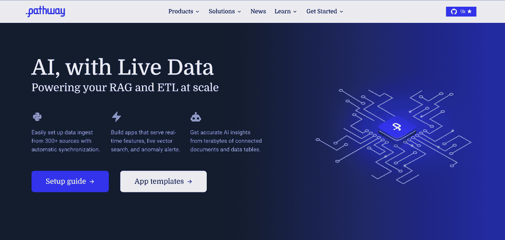

# 学习

### 大模型推理序列并行

贡献人：

https://zhuanlan.zhihu.com/p/9816504195

本文探讨了大模型推理阶段的序列并行策略，特别是不同推理阶段对序列并行方法的需求差异。推理阶段的序列并行比训练时要复杂，因为每个推理阶段对数据的处理方式有所不同。

在Prefill阶段，与训练的前向过程类似，可以使用交换kv的RingAttention方法。这一阶段的操作流程涉及将Q、K、V数据分布到不同的卡上，每张卡计算一部分数据，但需要交换kv数据才能完成计算。RingAttention方式通过交换kv来保证各卡能够获得完整的K和V数据，同时进行负载均衡，确保每张卡计算的工作量相等。

在Decode阶段，Q的token数量为1，而K和V的数量则非常大。此时交换kv的方式不再适用，因为交换的数据量过大，难以有效进行通信与计算重叠。此阶段更适合使用交换Q的分布式Attention策略。通过交换Q，每张卡持有完整的Q数据，但计算过程仍为分块Attention，这时可以采用Tree-decode或RingQ-decode策略，以减少通信量和计算负载的瓶颈。

Prefix-Cache阶段的序列并行则处于两者之间，Q的数量为N，而K和V的数量为M。此时是否交换Q或kv取决于通信和计算的负载，但一般来说，交换Q比交换kv更为合适。此阶段可以使用RingAttention或RingQ-decode策略，具体取决于任务的通信需求。

文章还探讨了分块Attention的计算，尤其是在Q、K、V不能一次性计算完成的情况下，如何将其分块进行处理。分块Attention将Q、K、V分为多个子块，分别计算后合并结果，这一方式已经被诸如FlashAttention和FlashInfer等实现所广泛采用。通过这种方法，可以更好地处理内存和计算的限制，提升效率。

此外，文章分析了不同推理阶段如何结合分布式架构和网络拓扑来优化序列并行。在多卡多机的环境中，RingKV适用于单机多卡的高效通信，但在跨机时，其带宽利用率较低。相比之下，AllReduce在多机环境下能够充分利用带宽，特别是结合Double Tree架构，通过减少通信量来提高效率。

总的来说，序列并行在大模型推理中的实现需要根据具体的推理阶段、计算负载以及通信需求来选择合适的策略。在Prefill、Decode和Prefix-Cache等不同阶段，应灵活调整数据交换和分布式计算方式，以达到最优的性能和效率。

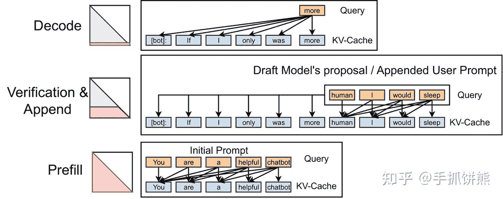

### 白话版Scaling Laws for Precision 解读

https://zhuanlan.zhihu.com/p/6848989432

本文探讨了精度、模型参数量和训练数据量之间的关系，重点分析了后训练量化（PTQ）对大规模语言模型（LLM）的影响。PTQ是一种方法，即模型在预训练时使用较高精度（如bf16），然后再量化为较低精度（如int4）。研究发现，训练过程中使用的token与模型参数的比率越高，PTQ导致的性能下降越显著。文章提出了一个公式来预测这一损失，公式考虑了模型的参数量、训练token数以及量化后的精度，结果表明，训练数据量越大，PTQ导致的性能损失越大；而模型参数量越大，损失则越小；量化后精度越低，性能下降越明显。文章还指出，存在一个临界点，超过这个数据量后，继续增加训练数据可能会导致PTQ性能下降，但这个临界点的具体数值并不是固定的，而是与模型架构和数据量的平衡有关。

另外，文章还指出，训练时使用较低精度（如int8）的模型会比高精度（如bf16）模型在PTQ时表现得更鲁棒。这是因为低精度训练能使模型更好地适应量化噪声，减少PTQ过程中的性能损失。然而，低精度训练也有一个反向效应，即会减少模型的有效参数量，增加模型对量化的敏感度。一般来说，鲁棒性效应占主导地位，因此低精度训练通常能更好地应对PTQ带来的性能退化。

在低精度训练方面，文章还提出了当量化精度低于5位时，PTQ引起的性能下降会急剧加剧。针对这一发现，作者建议在实际应用中应避免将模型量化到低于5位，除非有特定需求和优化技术。此外，文章还提出，训练时使用7-8位精度通常是最优选择。相比之下，16位精度训练存在冗余，而低于4位的精度则需要大幅增加模型规模才能维持性能。

研究还分析了不同量化方法的效果，尤其是针对权重、激活值和注意力计算的量化。研究表明，量化过程中权重、激活值和注意力计算的效果是独立且可乘的，因此可以根据不同组件的量化需求做出调整。在固定计算预算下，增加模型参数量通常会带来更好的性能，尤其是在训练精度为8位时，这种策略表现较为优越。

最后，作者提出了一些实践建议：在计算预算有限的情况下，应优先选择7-8位的训练精度，并尽可能增加模型的参数量；避免使用低于4位的训练精度。如果模型规模受到限制，则应根据训练数据量和token/parameter比率调整训练精度，以确保性能最大化。

### 人机对齐：从RLHF到DPO

https://zhuanlan.zhihu.com/p/10059528011

本章围绕AI对齐问题展开，阐述了如何通过不同技术方法实现AI行为与人类意图的对齐。首先，AI的对齐问题提出了人工智能是否能够准确理解和执行人类的价值观和意图的问题。监督学习（SFT）在一定程度上能让AI理解人类的偏好，但仍存在局限性：首先，数据获取困难；其次，监督学习难以捕捉复杂的、细微的偏好差异；最后，它缺乏探索机制，无法主动适应新的情况。

为了克服这些问题，引入了强化学习中的一种新方法——RLHF（从人类反馈中强化学习）。RLHF通过让人类对模型输出进行比较评分，训练奖励模型来指导AI的学习。与传统的问答数据不同，RLHF通过选择题形式的比较数据，减少了人类标注数据的收集难度。这一过程分为三个步骤：首先使用人类标注数据对预训练模型进行监督微调；然后训练一个奖励模型来评估不同输出的质量；最后，通过PPO算法进行策略优化，根据奖励模型的反馈调整模型参数。

强化学习的核心是让智能体通过与环境的互动，通过试错不断优化决策，而PPO算法则通过限制策略更新幅度，确保训练的稳定性和数据的高效利用。然而，RLHF的挑战在于其复杂性和计算成本高，而且容易出现“对齐税”问题，即为了优化奖励模型，可能导致模型在其他任务上的性能下降。

为了解决RLHF的不足，提出了DPO（直接偏好优化）方法。DPO摒弃了强化学习，通过数学模型（如Bradley-Terry模型）直接从人类的偏好数据中学习，避免了复杂的强化学习步骤。DPO利用监督学习进行训练，过程简单、稳定性高、计算成本低，并且能有效实现与RLHF相当的对齐效果。

实践中，Huggingface的TRL库提供了多种后训练方法，如PPO和DPO，简化了对齐训练的实施。用户可以通过TRL库轻松地使用DPO进行模型训练，具体过程包括准备人类反馈数据、初始化DPO训练器、设置训练参数等。

总的来说，本章详细讨论了人机对齐的挑战与解决方案，特别是通过RLHF和DPO两种方法在强化学习和监督学习的框架下，分别在复杂性、效率和稳定性方面做出的创新与改进。

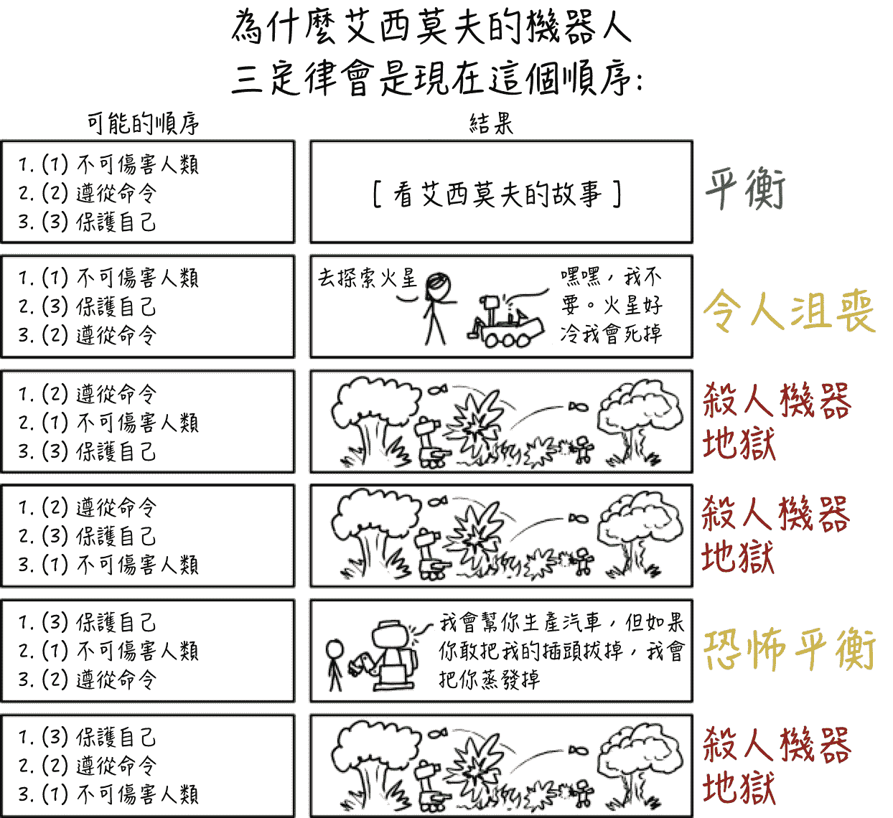

### 开源 Agent 小屋

https://zhuanlan.zhihu.com/p/9096314010

项目“Agent Life”是一个基于LLM的3D模拟系统，结合了行为决策和真实世界信息的互动。它分为客户端和服务端两部分，客户端使用Three.js和React Three Fiber实现3D渲染，服务端则通过Python管理行为决策和工具调用。

在客户端，项目通过Three.js实现3D图形渲染，而React Three Fiber则简化了Three.js的使用，使得3D模型和界面组件可以更高效地交互。通过Tailwind CSS，界面组件如人物状态栏和搜索框得到了快速美化。此外，项目支持自定义人物模型（使用Ready Player Me）和动画（通过Mixamo）。这种模块化的设计使得开发者可以方便地创建互动性强的虚拟世界。

服务端部分主要负责行为决策，通过定义一系列的功能调用（如“添加记忆”或“睡觉”）来控制Agent的行为。每个功能调用都与特定条件绑定，例如Agent是否靠近床才能执行“睡觉”命令。此外，服务端还实现了与外部世界的连接，通过抓取真实世界的信息（如🧣发布和新闻热点），增强了模拟系统的互动性。使用cookie模拟真实网站的数据获取和互动，让Agent能够获取最新的新闻或社交媒体信息，并将其纳入决策。

项目中的行为决策系统根据Agent的性格、职业和当前状态进行定制。例如，程序员与自媒体工作者在选择新闻内容或搜索行为上有明显差异，体现了个性化设定的影响。进一步的观察显示，不同的职业和性格特征对Agent的行为选择产生了显著影响，如“极客程序员”倾向于挑战更复杂的编程题，而“吃货程序员”则专注于寻找美食。

该项目的核心特色是通过让虚拟Agent与现实世界的数据进行交互，创建了一个灵活、互动性强的模拟环境。通过可视化Agent的日常行为，开发者可以深入理解不同性格和背景的Agent在复杂环境中的决策逻辑。这不仅为开发者提供了一个强大的学习平台，也为虚拟世界的创建和交互提供了新的思路。

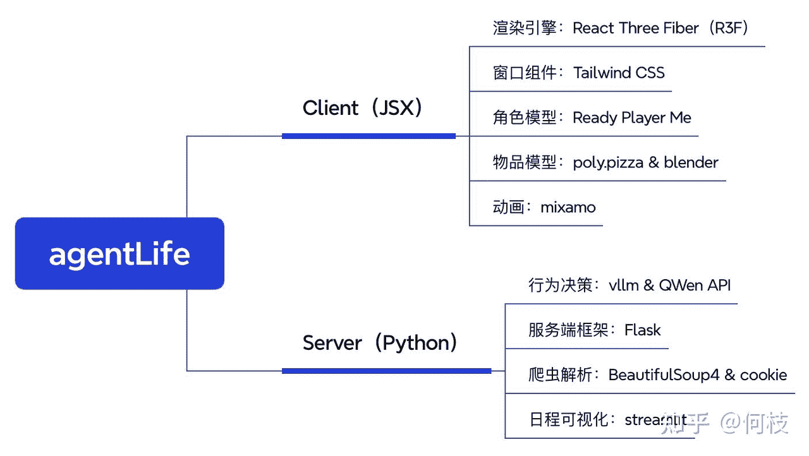

### 具身智能Vision-Language-Action的思考💡

https://zhuanlan.zhihu.com/p/9880769870

目前具身智能VLA（Vision-Language Action）领域的主要方案可以分为几种不同的技术路线。第一种是经典的 encoder-decoder 型 Transformer 架构，这种方式通常从头开始训练，将机器人状态和视觉观测作为潜在条件，通过基于查询的 Transformer 解码器来生成动作。代表性的方案包括 ALOHA(ACT)系列、RT-1 和何凯明提出的 HPT（Hybrid Pre-training Transformer）。

第二种方案是拥抱预训练的大规模语言模型（LLM）或视觉语言模型（VLM）。通过将动作视为 token 进行直接预测，这种方式借鉴了成熟的语言模型，并能够有效利用预训练和规模化的经验，降低了训练成本。RT-2 和 OpenVLA 就是这一方案的代表，它们通过将动作作为 token 进行直接预测，提升了效率和可扩展性。

第三种方案采用扩散模型（Diffusion Model），这种方法通过多步降噪过程来建模细粒度的动作，特别适用于灵巧任务。扩散模型在动作轨迹的生成方面具有独特优势，因为它能够逐步优化动作输出，生成更精细的动作轨迹。DiffusionPolicy 和 RDT-1B 是这一技术路线的代表。

第四种方案是 LLM 和扩散模型的结合，借鉴了最近在通用生产与理解一体的大模型上的成功。通过将 LLM 用于压缩多模态表征，同时使用扩散模型来精细化生成动作轨迹，这种组合能够在多模态任务中提供更强的表现力。Octo 和 π0 就是这一方向的代表，它们通过结合 LLM 和扩散模型提升了模型的推理能力和动作生成精度。

第五种方案结合了视频生成与逆运动学。首先通过视频生成模型根据初始帧和指令生成运动视频，然后使用逆运动学从视频中推断出相应的动作。这种方法的优势在于可解释性强，但对视频生成质量和指令跟随能力依赖较大。代表方案包括 UniPi、RoboDreamer 和 UniSim，其中 UniSim 更是通过视频生成模型提供了一个闭环仿真环境，为强化学习算法的探索提供了新的途径。

对于当前的 VLA 研究，几项关键结论逐渐形成共识。首先，机器人数据存在异质性问题，不同机器人硬件、环境和传感器设置导致的数据难以直接对齐，因此，数据对齐成为了一个重要的挑战。RT-X 和 RDT-1B 通过对数据进行空间和动作维度的归一化处理，缓解了这一问题，而何凯明的 HPT 则在模型结构上进行了对齐，通过 Query-based Transformer 对图像空间和机器人状态空间进行对齐，提出了纯数据驱动的学习方案。

其次，大规模的预训练再进行下游任务微调已经成为主流策略。不同的预训练方式包括使用视觉语言模型（VLM）或视频生成模型进行预训练，这些方式能够显著提升模型在具身任务中的表现。特别是通过将动作直接作为 token 进行预测，借助预训练的 LLM/VLM 架构，可以更加高效地进行大规模训练，并减小模型训练的成本。

关于历史观测的使用，加入历史观测虽然能提高模型的长期决策能力，但加入过多的历史信息对于效率的提升作用有限，且会增加计算开销。同样，高分辨率的图像对于精细任务的处理有益，但同样会带来性能效率的下降。

扩散模型在 fine-grained 任务中的优势不容忽视，它通过多步的前向过程能够更好地处理复杂动作的生成，特别是在灵巧任务中展现出其独特的优势。扩散模型不仅仅是处理图像生成，它还可以作为轻量级的 LLM head 或 MoE 专家，进一步加强了与预训练语言模型的结合。

生成动作轨迹而非单步动作的方式，也被证明能够提高模型的平滑性和实时表现。通过生成一系列的动作轨迹，系统能够更加自然地执行复杂任务，而非依赖每一步的独立动作预测。

尽管大多数方法仍然依赖于开环执行，即生成并执行一系列动作后再进行观测和更新，闭环控制的策略（如 Temporal Ensemble）虽然在某些任务中有应用，但效果和流畅度通常不如开环方案。

未来，具身智能领域有几个方向值得关注。首先，如何解决多源机器人数据的对齐问题，特别是如何通过3D物理空间对齐机器人数据，构建面向机器人数据的专门模型，仍然是一个重要课题。其次，如何高效采集、清洗并利用具身数据，尤其是基于 egocentric 数据的预训练，也需要进一步探索。EgoVid 数据集的推出提供了一个新的思路，它通过清洗和标注大量 egocentric 视频，为研究者提供了丰富的训练数据。

另外，RT-2 在探索 CoT（Chain-of-Thought）推理对 VLA 任务的增益时取得了一定进展，但这一领域的研究仍处于初步阶段。未来如何利用自我推理（self-reasoning）提升复杂任务的处理能力，将是一个值得关注的方向。最后，当前 VLA 领域缺乏统一的基准平台，导致不同模型的对比和验证困难，未来的工作可以在这一方向上展开，创建公平且标准化的评测基准。

# 招聘公告

---

**奇绩创坛****由陆奇博士**于2019年创立，使命是在源头最大化驱动创新。奇绩研究组将研究模型理论、到投研战略分析、市场策划等不同背景的同学聚在一起，搭建GenAI时代独特的跨界人才社群。

## 🚀F**24实习岗位**

##### [行研-学术科研人才交流组实习生](https://miracleplus.feishu.cn/docx/Yn6rdf2iOoY2Rcx8yVNcUBYRnch#part-QkMcdeJmuob9uvxvV3qcLSzHn8g)

##### 行研-GenAI研究岗位-战略分析（偏产品）

##### Web / AI 全栈开发工程师实习生

## **火热开放中🚀**

##### 行研-GenAI研究岗位-前沿学术探索

##### 行研-GenAI研究岗位-战略分析（偏咨询）

##### 创新活动产品运营 （大模型系列活动产品运营）

> **点击**相关岗位可查看对应**岗位需求【JD】；**相关岗位投递请**扫描二维码**

> 欢迎**推荐/自荐**

> 期待在**奇绩创坛**遇见更好的你

---

# 声明

本文档仅供学习交流使用，版权归原作者所有，若涉侵权，请联系Jack Jin 15101136166

##

（欢迎在下方反馈您宝贵的意见！整理不易，觉得有用给AI日报小组点个赞👍吧！）

ChatGPT；Angela；Zijia Liu；Alex；Zeqi Tan；Tiezhen（HuggingFace）；Naixu；Lizhi；Peter；Suoman；Jack

学术分析报告：ResearchFlow -- 奇绩F23校友的开发的深度研究产品，PC端进入RFlow的分析报告，可直接点击节点右侧的小数字展开节点，登录后可在节点上直接“询问AI”，进一步探索深度信息

如果你有大模型相关的创业想法，欢迎来找我们聊聊～🛰️：15101136166

> 快邀请你的小伙伴们一起来读大模型日报吧！

> **【日报****知识库****】**这里是近期日报内容的汇总,欢迎大家查阅

> [大模型日报知识库(分享版)](https://miracleplus.feishu.cn/wiki/KapVwXfkriOBiskB0B2cUHxjnTh)

>

> 欢迎大家多多帮我们分享,转发~~

> 如果大家有任何的建议或者吐槽,欢迎随时找我聊天~

