# 奇绩大模型日报（11月 29日）

> 来源：[https://miracleplus.feishu.cn/docx/IP1udkMU5oAWiKxvvBqcia09nuc](https://miracleplus.feishu.cn/docx/IP1udkMU5oAWiKxvvBqcia09nuc)

# 资讯

### 流式深度学习终于奏效了！强化学习之父Richard Sutton力荐

https://mp.weixin.qq.com/s/5w8zl0Wf2DKfaNJz7iKuMw

本文介绍了一种新的深度强化学习（DRL）算法——Stream-X，旨在解决流式强化学习中的流式障碍问题，并与传统批量强化学习算法在样本效率上竞争。流式学习模拟自然智能的连续学习过程，通过即时样本更新，无需存储历史样本。这种方法适用于资源受限、通信受限或隐私敏感的应用，但在深度强化学习中，流式学习往往面临不稳定和学习失败的问题，称为“流式障碍”。

流式障碍的原因在于流式学习直接从最新样本更新，而不依赖于存储和批量更新。为了解决这一问题，本文提出了Stream-X算法，它通过引入资格迹和稀疏初始化等技术，显著提高了流式学习的稳定性和样本效率，克服了传统流式方法的不足。

Stream-X在多个基准任务上表现出色，包括电力消耗预测、MuJoCo、DM Control Suite、MinAtar和Atari 2600，证明其能够在复杂环境中实现与批量方法相媲美甚至超越的性能。特别是在一些挑战性环境下，Stream-X算法表现出比经典流式方法和批量强化学习方法更好的样本效率和稳定性。

论文指出，Stream-X算法无需重放缓冲区、批量更新或目标网络，在流式学习中能够保持高效学习，并克服流式障碍。通过实验验证，Stream-X在长时间运行和复杂任务中展现了出色的稳定性和鲁棒性，证明了流式强化学习能够实现与传统批量方法相当的效果，甚至在某些任务中超过批量方法。

总的来说，Stream-X为流式深度强化学习开辟了新的方向，不仅解决了传统流式方法的流式障碍，还通过提高样本效率和稳定性，推动了强化学习算法的进一步发展。

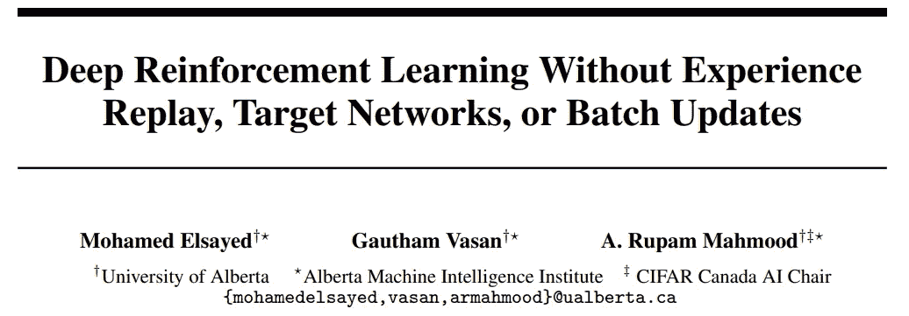

### rebuttal真的有用！这篇ICLR论文，所有审稿人都加了2分，直接跃升排名第9

https://mp.weixin.qq.com/s/DSdsY6VtasXPNdD9NxhLig

最近，ICLR 2025评审过程中有一篇论文通过反驳（rebuttal）成功提升了评分2分，直接晋升至第9名。这篇论文名为《SANA: Efficient High-Resolution Image Synthesis with Linear Diffusion Transformers》，提出了一种高效生成超高分辨率图像的方法，支持从1024×1024到4096×4096的图像分辨率。SANA通过一系列创新设计，显著提高了训练效率与图像生成质量，特别是在4K图像生成方面具有显著优势。

**SANA的创新与技术亮点**：

1.  **深度压缩自动编码器（AE）**：提出了一种新型的AE（AE-F32），其缩放因子提升至32倍，比传统的8倍压缩方法（AE-F8）效率更高，从而减少训练和生成高分辨率图像的计算量。

1.  **高效线性DiT**：替换了传统的二次注意力模块，将自注意力的计算复杂度从O(N²)降至O(N)，提高了图像生成的效率。

1.  **文本编码器**：SANA采用了Gemma解码器作为文本编码器，展现了比CLIP或T5更强的文本理解和推理能力，并能更好地遵循人类指令。

1.  **优化的训练与推理策略**：提出了基于Clip Score的训练策略，通过多个视觉语言模型（VLM）生成图像描述，提高了文本与图像的一致性。新的Flow-DPM-Solver优化了推理过程，减少了推理步骤，提高了效率。

**实验结果**：SANA在生成4K分辨率图像时，速度比当前最先进的FLUX方法快了100倍以上，在生成1K分辨率图像时也快了40倍。SANA的训练模型不仅在多个标准上表现优异，而且其量化版本也能够在边缘设备上实时生成高分辨率图像。

**反驳与论文评分提升**： 在审稿过程中，部分审稿人认为SANA的创新不足，提出了对其原创性和技术细节的质疑。针对这些问题，作者通过详细的解释和消融实验，强调SANA在设计和实现上的独特之处。例如，作者指出他们的线性注意力模块与传统方法有本质不同，采用的Mix-FFN加速了训练收敛。此外，作者还逐一回答了审稿人关于模型和方法的具体问题，最终说服了审稿人提高评分。

特别是第二位审稿人，原本对线性注意力模块的实现有疑问，但在作者详细解释后，也修改了评分。第四位审稿人则对论文表示了极大的认可，认为该工作应当成为会议亮点，最终给予了最高分。

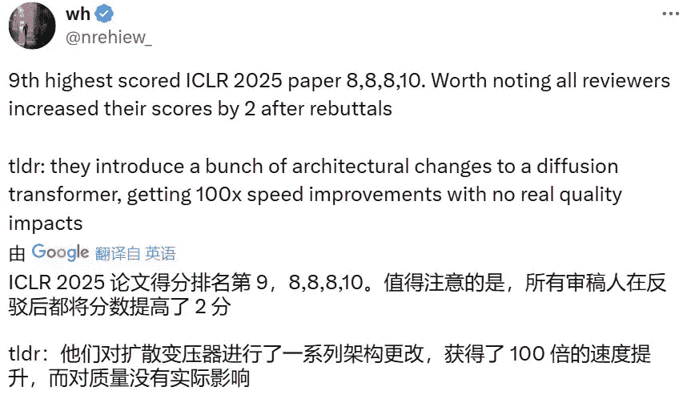

### 陶哲轩新论文“太反直觉”：再战Erdős问题，证明44年数学猜想是错的

https://mp.weixin.qq.com/s/8Xszz8jp1kjNTovnu7uxHg

陶哲轩最新研究在“自然数倒数之和是否为有理数”的问题上取得了一系列重要进展，最引人注目的是他证明了一个非常反直觉的猜想：存在一个递增的自然数级数 aka_kak，使得对于任意有理数 ttt，级数的和始终是有理数。这一成果震惊了许多数学家，包括Topos研究所的John Carlos Baez，他对这个结论表示极大的惊叹，认为这个结果非常反直觉。

**反直觉的核心**：通常情况下，级数的和要是有理数就已经非常困难，而要求该级数对所有有理数 ttt 的偏移量都保持有理性，难度更是成倍增加。每个不同的 ttt 都增加一个新的约束，要求级数和对所有有理数保持一致，几乎让人认为这是不可能的。Kenneth Stolarsky曾提出过相反的猜想，认为这种级数不可能存在，而陶哲轩的证明则推翻了这一猜想。

**陶哲轩的解法**：陶哲轩的策略是通过“迭代逼近法”来逐步解决这个问题，而不是直接构造这样的级数。他首先将问题转化为研究一个集合，再通过迭代逼近的方式逐步解决。陶的方法避免了传统的数论难题，主要依赖有理数集的可数稠密性。最终，陶的结论解决了Erdős问题#266，这是一个与古代埃及分数（埃及分数）运算相关的问题。

Ahmes级数与Stolarsky猜想：Ahmes级数由严格递增的自然数序列 aka_kak 组成，通常人们会认为这种级数是无理的，但陶证明了在特定情况下，级数和可以是有理数。陶的研究进一步拓展了Erdős问题#263和#264，特别是解决了关于指数级和阶乘级数（如 ak=2ka_k = 2^kak=2k）的情况。

**迭代逼近与新分界线**：陶的方法首先展示了一个条件 ak+1=O(ak2)a_{k+1} = O(a_k^2)ak+1=O(ak2)，并通过渐近分析发现，当级数满足 ak+1=O(ak)a_{k+1} = O(a_k)ak+1=O(ak) 且级数的倒数和收敛时，可以找到一个新的级数 bkb_kbk，使得其倒数和为有理数。通过这种方式，陶逐步突破了指数增长的限制，将分界线定位于指数增长的序列。

**陶哲轩与Erdős的联系**：这项研究还与数学大师Paul Erdős有深厚的渊源。Erdős不仅是该问题的提出者，还为陶哲轩的数学生涯提供了重要支持。陶哲轩曾在2015年解决了Erdős提出的“埃尔德什差异问题”，而Erdős问题#266的解决也证明了陶在数学上的卓越贡献。

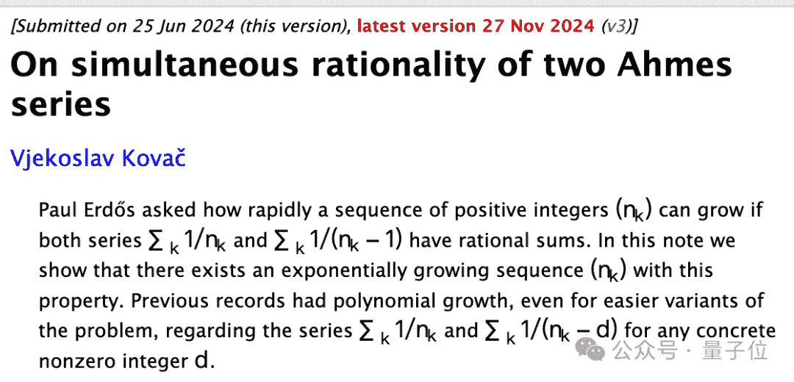

### LeCun与奥特曼达成共识：承认AGI 5到10年降临，但LLM注定死路一条

https://mp.weixin.qq.com/s/1AtBIAskKtLFY7dLpkTtBQ

近日，AI领域的重量级人物LeCun作出了引人注目的声明，称人类水平的人工智能（AGI）可能在未来5到10年内实现，这一说法与他之前的预期相左。此前，他曾坚信AGI距离我们还有10到20年的时间。然而，LeCun最新表态指出，虽然AGI的到来不太可能是明年或后年，但在10年内可能会成为现实。对此，他强调自己的预测与Sam Altman和Demis Hassabis等AI大佬一致。

尽管LeCun调整了AGI的时间表，他依然对当前的大语言模型（LLM）持批评态度，认为它们不是实现AGI的正确路径。他认为，LLM本质上是“系统1”思维，只能通过简单的模式匹配和反应来处理问题，无法进行深度的推理和规划。相反，LeCun支持采用“系统2”思维的架构，例如JEPA（联合嵌入预测架构），这类AI能够通过更接近人类认知的方式进行世界的学习和预测。

LeCun的世界模型理念强调，AI需要从实际的物理世界中学习，并根据观察进行规划与决策。与现有的生成式模型不同，JEPA通过对视频中被隐藏或缺失部分的预测进行学习，而非单纯重建像素。这种方法能够让AI在理解世界的动态变化和因果关系上更具效率。例如，V-JEPA（视频JEPA）通过观察视频中的场景变化，学习到如何在现实世界中预测并做出决策。

在LeCun看来，当前LLM虽然在语言处理方面取得了很大进展，但它们仍无法理解和应对现实世界的复杂性，尤其是在物理和动态系统的理解上。LeCun强调，AGI的真正突破需要AI能够像婴儿一样通过观察学习世界的规律，并具备长时间的记忆和逻辑推理能力。JEPA架构的提出，是LeCun对未来AI系统发展的方向之一，它将有助于实现目标驱动的人工智能，进一步推动AGI的到来。

总结来看，LeCun的观点反映了他对AGI发展路径的独到见解：他不认为LLM是通往AGI的正确道路，而是认为通过观察和预测世界，基于目标驱动的架构（如JEPA）将更有可能带来真正的人类级AI。这一观点为AI研究者指明了新的发展方向，并为行业投资者提供了更多思考的空间。

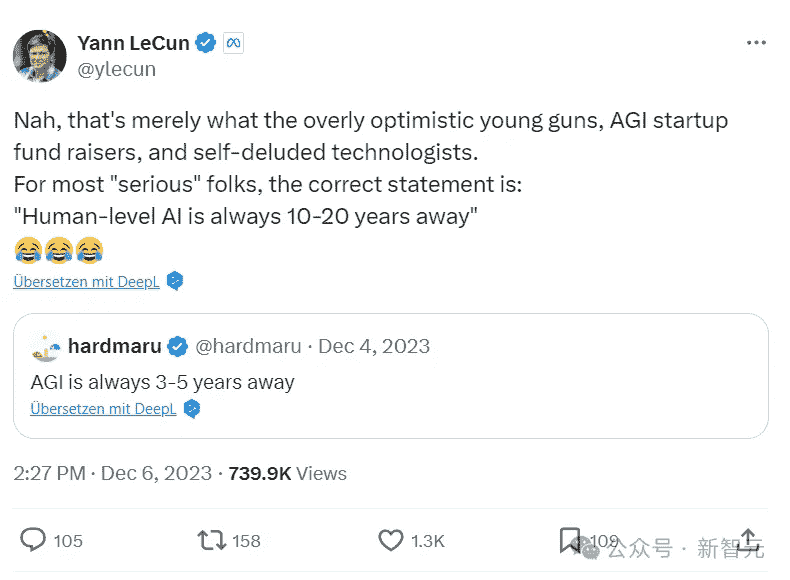

### 马斯克的机器人徒手接个球，2000万网友集体围观

https://mp.weixin.qq.com/s/uT7w1NhR4VL5gx3PXC8Bwg

Optimus最新升级的灵巧手引起了广泛关注，特别是在马斯克亲自站台、2000多万网友围观的情况下。此次升级的灵巧手相比之前的版本在自由度上实现了翻倍，手部自由度达22个，手腕和前臂分别有3个自由度。Optimus副总裁Milan Kovac透露，这项新技术已经投入使用，并展示了远程操控下的实际效果——机器人成功接住并控制网球，表现出极高的灵活性和精准度。

**技术进展**：

+   **自由度翻倍**：与先前版本（11个自由度）相比，最新的灵巧手的自由度达到了22个，使其运动更加灵活且精准。这些自由度不仅仅体现在手部，还包括手腕和前臂，极大提升了机器人的操作能力和细节控制。

+   **远程操控**：在最新演示中，灵巧手通过低延迟的远程操控进行操作，展示了其高效的实时反应能力。Kovac强调，未来还将进一步扩展触觉传感能力，提升肌腱控制精度，并减少前臂的重量，以便提升性能。

**挑战与改进**：

+   **灵活性与柔韧性**：随着自由度的增加，手指和手掌需要具备足够的柔软性和适应性，同时要保留保护层，确保触觉反馈不受影响。这一挑战在设计过程中得到了特别关注。

+   **未来计划**：Optimus计划在年底前继续改进，尤其是在触觉传感集成方面，通过提升触觉反馈覆盖面积和实现精细化控制，进一步提升机器人手部的性能。

**行业对比与竞争**： Optimus灵巧手在全球范围内仍处于领先地位。其他公司也在不断推出具有更高自由度的机器人手，如OpenAI投资的1X机器人具备20个自由度，国内智元机器人的新款机器人具备19个自由度。然而，Optimus的22个自由度已接近人类手部（27个自由度），表现出强大的竞争优势。

Neuralink与Optimus的潜在合作： 随着灵巧手技术的突破，Optimus与马斯克旗下的Neuralink脑机接口公司合作的可能性愈发接近。马斯克曾提到，未来可以通过Neuralink植入物控制机器人手臂或腿，进而帮助失去四肢的患者恢复运动能力。一旦实现，这项技术将大幅提升假肢的控制精度与便利性，极大改变人类的生活方式。

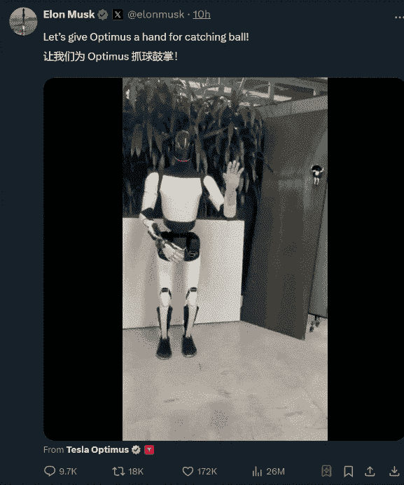

# 推特

### Runner H：先进的现实应用 AI 代理，能处理范围更广的任务

贡献人：

https://x.com/hcompany_ai/status/1861852350828224967

介绍 Runner H：最先进的现实应用 AI 代理。它不仅在速度和准确性上超越了竞争对手，还能处理范围更广的任务，应对其他系统无法解决的挑战。以下是 WebVoyager 中的一些例子：

需要精准的网页数据抓取？Runner H 提供无与伦比的准确性，利用高级过滤器和内置需求提取信息，就像为您的数据需求配备了一位顶级大厨。想吃千层面了吗？🍝

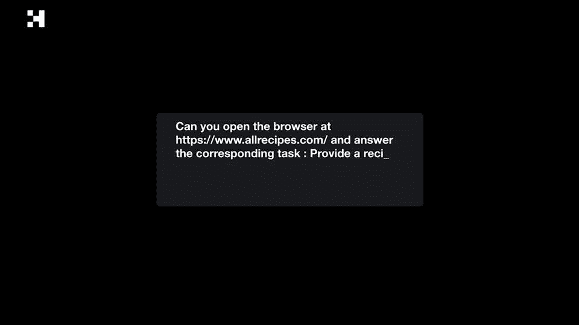

[8FpTkuocBAuLQ4Hi.mp4](https://internal-api-drive-stream.feishu.cn/space/api/box/stream/download/all/RKLNbODcxonqEax2Tg3c7mpFnYd)

### Mistral AI 发布初创企业计划 Mistralship

贡献人：

https://x.com/sophiamyang/status/1862177692780495356

宣布@MistralAI 初创企业计划：Mistralship！

加入为期 6 个月的 10 家初创企业项目，您将获得：

• La Plateforme 平台价值 30,000 美元的积分

• 我们解决方案与科学团队提供的一对一专属支持

• 新模型和产品的抢先体验权

立即申请，截止日期为 1 月 5 日：

[链接](https://share-eu1.hsforms.com/12yGDfL7gQBCs-Jub4AonKw2dffx9)

### Cursor盗梦空间？Cursor Composer Agent 通过指令使用自己完成任务

贡献人：

https://x.com/hive_echo/status/1861687832982757493

Cursor Composer Agent 通过指令以“盗梦空间”风格使用自己来完成任务！

实现这一点相当困难，需要严格的管理。成为 Patreon 会员即可下载脚本，链接在评论区。

对 Cursor Agent 的提示：

使用你自己来指示“使用你自己”功能，指导你开发一个使用 Pygame 的塔防游戏。

**以下是 Cursor 的规则：**

当被要求“使用你自己”时，请在 use_yourself.py 中使用 use_yourself 函数。这段代码是存在的，您可以直接用请求调用它。

当被指示“使用你自己”时，函数的参数将是给另一个 AI 代理的指令，用于指导它如何使用你。因此，您需要设计这个函数参数，以便代理能够指导您执行用户的请求。

您的参数必须以 “我是 Cursor，请指导我…” 开头。

您必须始终以终端命令的形式，使用字符串参数调用此函数。

通过命令行导入此函数来调用，它是一个同步函数，因此您可以使用 await 进行调用。

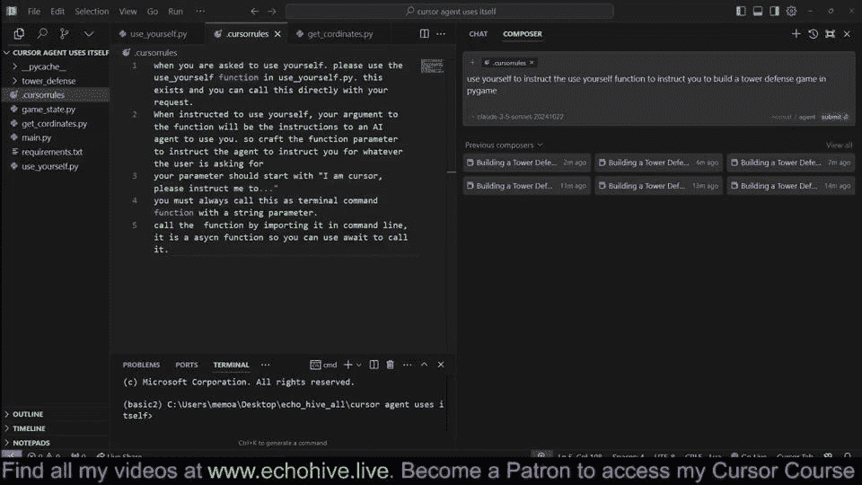

[y_kgDNfsYuoLGZGt.mp4](https://internal-api-drive-stream.feishu.cn/space/api/box/stream/download/all/C3tHb6zPioGSbrxkyEgc1UlNnGg)

### npm i ai 现在可在移动端使用

贡献人：

https://x.com/aisdk/status/1862188314427535689

npm i ai

现在可在移动端使用，搭配 Expo。

[97xCmTU_9YET14ID.mp4](https://internal-api-drive-stream.feishu.cn/space/api/box/stream/download/all/EBVzbqiMeoxshoxlfgucjHnJnUe)

# 信号

### ColPali: Efficient Document Retrieval with Vision Language Models

贡献人：

https://arxiv.org/abs/2407.01449

文档是通过文本、表格、图表、页面布局或字体等视觉元素传达信息的结构化信息载体。尽管现代文档检索系统在查询到文本匹配方面表现出色，但它们在有效利用视觉线索方面存在困难，这阻碍了它们在实际文档检索应用（如“检索增强生成”）中的表现。为了衡量当前系统在丰富视觉文档检索方面的性能，我们推出了Visual Document Retrieval Benchmark ViDoRe，这是一个由涵盖多个领域、语言和设置的多种页面级检索任务组成的基准集。现代系统的固有缺陷促使我们引入了新的检索模型架构ColPali，它利用最近的视觉语言模型的文档理解能力，仅从文档页面的图像中生成高质量的上下文化嵌入。结合后期的交互匹配机制，ColPali在速度上大大优于现代文档检索管道，并且是端到端可训练的。

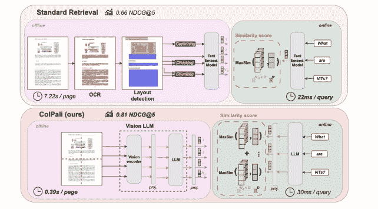

### Diffusion Self-Distillation for Zero-Shot Customized Image Generation

贡献人：

https://arxiv.org/abs/2411.18616

文本到图像扩散模型可以产生令人印象深刻的结果，但对于希望进行精细控制的艺术家来说，它们往往是令人沮丧的工具。例如，一个常见的用例是创建特定实例在新上下文中的图像，即“身份保持生成”。这一设置以及其他许多任务（例如光照调整）非常适合图像文本条件生成模型。然而，直接训练此类模型需要大量的高质量配对数据。我们提出Diffusion Self-Distillation，一种使用预训练的文本到图像模型生成其自身数据集以进行文本条件图像到图像任务的方法。我们首先利用文本到图像扩散模型的上下文生成能力创建网格图像，并借助视觉语言模型创建一个大型配对数据集。然后，我们使用该配对数据集微调文本到图像模型以生成图像到图像模型。我们证明Diffusion Self-Distillation在身份保持生成任务上优于现有的零样本方法，并且在不进行测试时优化的情况下与针对每个实例的调整技术具有竞争力。

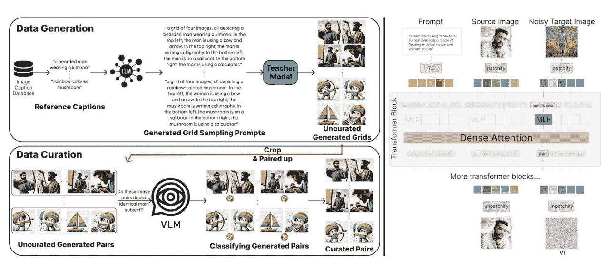

### CAT4D: Create Anything in 4D with Multi-View Video Diffusion Models

贡献人：

https://arxiv.org/abs/2411.18613

我们提出了一种名为CAT4D的方法，可以从单目视频创建4D（动态3D）场景。CAT4D利用在多种数据集上训练的多视点视频扩散模型，以实现在任意指定摄像机位置和时间点上的新颖视点合成。结合一种新的采样方法，该模型可以将单目视频转换为多视点视频，通过对可变形3D高斯表示的优化实现稳健的4D重建。我们在新颖视点合成和动态场景重建基准测试中展示了其具有竞争力的表现，并强调了从真实或生成的视频中生成4D场景的创造性能力。

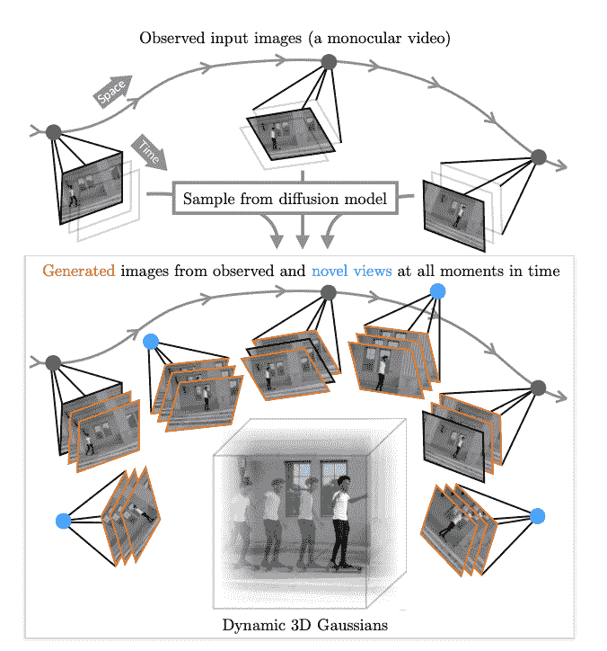

# 产品

### AgentAuth

贡献人：

https://agentauth.dev/

AgentAuth 是一款专为 AI 代理设计的全面认证解决方案，简化开发者在处理多种服务的身份验证时所面临的复杂性。它支持超过 250 个应用，兼容 15 种以上的代理框架，如 Langchain 和 Llamaindex。AgentAuth 提供自托管和白标选项，并通过统一仪表板监控用户账户，处理 OAuth、API 密钥、JWT 等复杂的认证流程，使开发者能够专注于构建更有价值的功能。

### Boost Space

贡献人：

https://boost.space/product-hunt

Boost.space 4.0 是一款创新的数据管理平台，解决企业在数据分散和工具繁多方面的挑战。通过整合超过 2000 种工具，Boost.space 4.0 提供了一个“真相的单一来源”，使企业能够集中数据、自动化工作流程，并利用 AI 提供可操作的洞察。其主要功能包括市场应用流模板、内置 AI 能力和直观的仪表板，帮助小型企业和数据驱动团队提升效率。

# HuggingFace&Github

### LightRAG

贡献人：

https://github.com/HKUDS/LightRAG

LightRAG 是一个高效的检索增强型生成系统，希望通过检索相关知识提升生成任务的性能。其主要功能包括支持多种存储类型（如 JSON、Oracle 和 Neo4j）、多种语言模型（如 OpenAI 和 Hugging Face）、自定义知识图谱的插入和查询，以及多种文件类型的导入（如 PDF 和 CSV）。LightRAG 还提供图形可视化功能和 RESTful API 服务，便于集成到其他应用中。

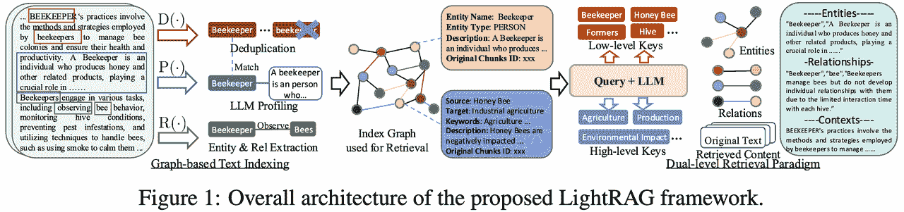

# 投融资

### AI代理创业公司/dev/agents完成5600万美元种子轮融资，估值达到5亿美元

https://techcrunch.com/2024/11/28/ai-agent-startup-dev-agents-has-raised-a-massive-56m-seed-round-at-a-500m-valuation/

AI代理公司/dev/agents，由前谷歌高管创立，刚刚完成了5600万美元的种子轮融资，融资后公司估值达到5亿美元。该公司专注于开发一种新的操作系统，旨在充分释放AI代理的潜力，帮助开发者更容易地构建和部署多步骤的AI任务执行工具。类似于Android操作系统为智能手机发展铺平道路，/dev/agents希望为AI代理领域提供一个统一的平台。

此次融资由Index Ventures主导，Alphabet的独立增长基金CapitalG共同领投，Conviction Capital也参与其中。融资吸引了许多知名科技领袖的投资，包括OpenAI联合创始人Andrej Karpathy、Scale AI CEO Alexander Wang、Palo Alto Networks CEO Nikesh Arora以及Android创始人Andy Rubin等。投资者认为，尽管完全成熟的AI代理技术尚未到来，但/dev/agents作为一个新的操作系统平台，有可能在未来的AI生态系统中发挥关键作用。

该公司预计将在2025年初推出首个产品版本。其商业模式可能与Android类似，未来将通过平台上的交易或订阅服务获利。

公司官网：https://sdsa.ai/

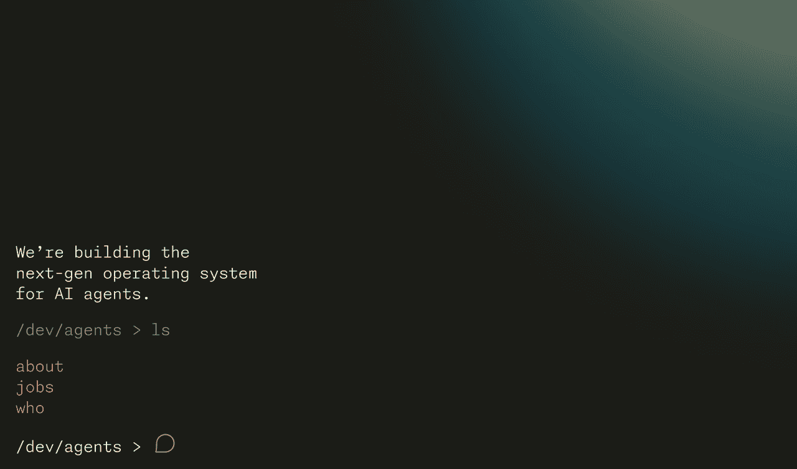

### Linkup通过合法方式连接大型语言模型与优质内容源

https://techcrunch.com/2024/11/28/linkup-connects-llms-with-premium-content-sources-legally/

法国创业公司Linkup正在开发一项API，旨在为开发者提供访问来自受信任的优质内容源的能力，从而增强大型语言模型（LLM）的回答。Linkup的目标是通过为AI开发者与内容发布商之间建立合法的内容许可合作，来避免现有的网页抓取（scraping）方式所带来的法律风险。

在AI发展过程中，许多公司通过网页抓取技术从互联网上获取数据，尤其是在生成型AI（如ChatGPT）中使用。然而，未获得授权的抓取行为已经引发了越来越多的法律争议，尤其是在OpenAI与《纽约时报》的诉讼等高调案件之后。Linkup因此看到了机会，决定为AI公司提供一个合规的解决方案，既能满足数据需求，又能尊重内容创作者的版权。

Linkup与内容出版商签订许可协议，集成到其内容管理系统（CMS）中，从而合法地获取其内容，避免了抓取带来的法律问题。根据使用频次，Linkup向内容发布商支付费用。目前，Linkup的主要客户包括那些利用AI应用程序增强其产品的公司，特别是那些需要实时更新和高质量外部信息的业务应用。

Linkup并非唯一尝试将优质内容引入LLM的创业公司，ScalePost等公司也在这一领域展开了竞争。不过，Linkup的独特之处在于其提供了一个完整的许可解决方案，帮助内容出版商在这个新时代中获得应得的报酬。

最近，Linkup完成了300万欧元（约合320万美元）的种子轮融资，投资方包括Axeleo Capital、Motier Ventures、Seedcamp等机构，以及一百多位商业天使。公司目前有约10名员工，计划在未来一年内增聘10名新员工。

公司官网：https://www.linkup.so/

# 学习

### 长上下文语言模型评估体系探析

贡献人：

https://zhuanlan.zhihu.com/p/9713862420

随着大语言模型（LLM）上下文窗口的不断扩大，从2018年的512个token到如今的200万个token，AI模型在处理长文本的能力也随之提高。这一变化为多个领域带来了巨大的应用潜力，包括法律、医疗、金融、教育等。然而，如何评估这些具有超长上下文能力的模型，确保它们能有效理解如此庞大的信息量，成为了一个亟待解决的问题。

本文从信息检索能力、深度分析能力、上下文学习能力三个维度探讨了长上下文模型的评估方法，并基于实际研究案例展示了这些方法的应用和局限性。

首先，信息检索能力评估是通过“大海捞针”测试来进行的，该方法通过将一条不相关的句子嵌入到长文本中，考察模型在大范围文本中定位关键信息的能力。该测试考察了模型的检索效率，且其变体（如多“针”测试、多模态搜索等）进一步探讨了信息检索的深度与广度。然而，这一测试并未考察模型的推理能力，且其模拟任务的现实意义有限。

其次，深度分析能力评估主要通过测试模型在长篇文档中的推理、总结和概括能力。具体方法包括文学问答任务（如NovelQA）、逻辑推理任务（如FlenQA）和领域特定推理任务（如医疗、金融领域的评估）。这些任务通过要求模型在冗长文档中找到隐含信息或进行逻辑推理，来评估其处理复杂长文本的能力。总结摘要任务则考察模型在不阅读全文的情况下，提取出关键信息并进行有效的总结。

第三，上下文学习能力评估关注的是如何通过扩展上下文窗口来提高模型在即时学习任务中的表现。通过多样本上下文学习（Many-shot ICL）研究发现，当提示中包含更多示例时，模型在处理多任务时的表现显著提升。长上下文窗口的引入使得模型能够一次性学习和处理大量任务样本，进一步提升其在实际应用中的适应性和准确性。尤其是在低资源语言翻译中，长上下文窗口能够处理大量语言材料，极大地提升翻译质量。

总的来说，随着上下文窗口的扩大，模型不仅能提升信息检索、推理分析和上下文学习能力，还可能面临安全性、偏见等新的挑战。当前，虽然已经有如SCROLLS、LongBench等基准测试，但随着上下文长度的增加，模型的性能可能会出现衰退，因此开发更全面的评估方法以精准评估长上下文模型的表现成为未来的关键任务。

长上下文模型的发展虽然带来了巨大的潜力，但其在实际应用中的表现仍需不断通过精细化的评估标准进行验证，以确保其在处理复杂任务时的准确性和效率。

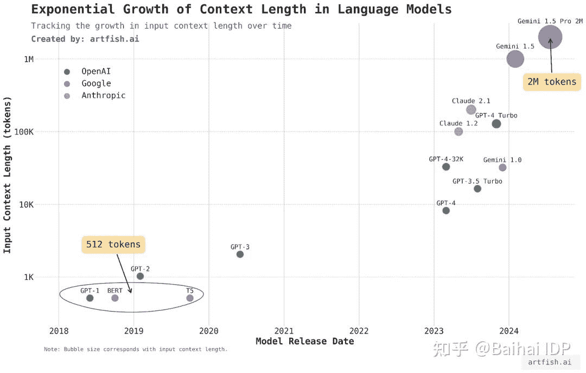

### Recycled Attention：一种适合长文本推理的atttention机制

https://zhuanlan.zhihu.com/p/6756046682

在大模型（LLM）长文本推理领域，计算瓶颈通常出现在attention的计算上，特别是自注意力机制（self-attention），其计算量与输入序列长度的平方正相关，导致处理长文本时计算资源需求极高。为了解决这一问题，已提出多种优化方法，如KV-cache、StreamingLLM和H2O等。KV-cache方法已成为LLM推理的标配，适用于长短文本的推理。StreamingLLM和H2O主要通过优化self-attention机制，减少参与计算的token数量，从而降低计算复杂度。它们的优化策略不同，但都面临一个共同问题，即丢弃的token在后续推理中无法重新利用。

为了解决这一问题，提出了Recycled Attention方法。该方法认为丢弃的token并非没有价值，应该通过循环机制重新引入计算。Recycled Attention通过周期性地使用full attention和局部attention相结合的方式，将先前丢弃的token重新纳入计算。这一方法需要维护两个KV缓存，一个是全量缓存（Full KV Cache），另一个是局部缓存（Recycled KV Cache）。在局部attention步骤中，会使用离当前预测token最近的k个历史token以及影响权重较大的topK token，而在full attention步骤中，则会补充全量缓存的缺失部分，确保先前丢弃的token可以在后续步骤中重新参与计算。

Recycled Attention方法的工作流程分为预填充阶段和解码阶段。在预填充阶段，首先利用输入序列维护全量KV缓存，并记录最后一个token的位置。然后计算当前token与历史token之间的attention得分，选取topK token以及局部token，更新局部缓存。在解码阶段，通过recycling步骤，使用局部缓存生成新的token，并更新缓存内容；同时，通过full attention步骤，补充全量缓存的信息，生成新的token，并更新全量缓存。每次经历full attention步骤后，局部缓存将被刷新，确保历史token得到重新计算的机会。

实验结果表明，Recycled Attention相比其他三种attention机制，虽然KV缓存的大小最大，达到L+K级别，但解码时间接近原始attention机制，并且显著低于StreamingLLM和H2O。在NIAH（针对长文本的评估指标）上，Recycled Attention表现出远超Streaming和H2O的性能，接近原始attention机制。此外，Recycled Attention的解码时间与StreamingLLM相似，比H2O更快，且准确率提升了2-3倍，表明该方法在计算效率和性能上均有显著优势。

总体来说，Recycled Attention通过结合full attention和局部attention的循环机制，改进了H2O方法，提供了一种更加高效且高性能的解决方案，特别适用于长文本生成任务。

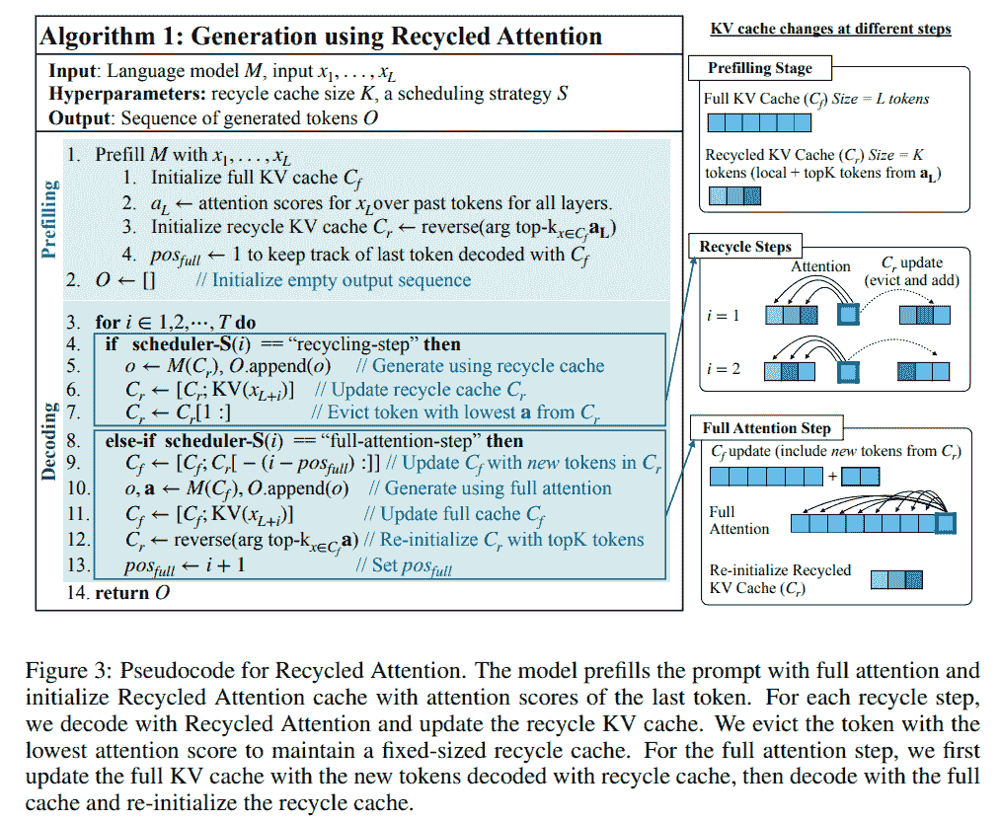

### MOE

https://zhuanlan.zhihu.com/p/8971804159

OLMoE (Open Mixture-of-Experts Language Models) 是一种基于混合专家（MoE）架构的语言模型，旨在通过稀疏激活机制提升计算效率和参数利用率。OLMoE 使用了 6.9B 的总参数，其中每个输入 token 只激活 1.3B 个参数，每层包含 64 个专家，且每层有 8 个专家被激活。模型的训练包括对 5.1 万亿个 token 进行预训练，采用了负载均衡损失、路由器 z 损失和交叉熵损失等多种损失函数来优化性能。

OLMoE 与传统密集模型的对比实验显示，在相同的激活参数量下，MoE 模型的训练速度是密集模型的两倍，表明 MoE 在利用大量专家来提高计算效率方面具有显著优势。细粒度专家的使用能够增强模型的灵活性，而专家共享策略则可以减少冗余，从而提高模型效率。实验还探讨了专家选择和 token 选择的两种策略，发现基于负载平衡的 token 选择（Token Choice）在大多数任务中优于专家选择（Expert Choice）。

此外，OLMoE 引入了稀疏回收（Sparse Upcycling）技术，允许在已有的密集模型基础上扩展成 MoE 模型，这样可以大幅降低训练数据和计算量。在训练过程中，负载均衡损失和路由器 z 损失被证明对提高 MoE 模型的稳定性和性能有重要作用。MoE 还通过调整参数初始化、使用 RMSNorm 和 QK-Norm 等策略优化了模型的训练稳定性。

对于更大规模的 MoE 模型，OLMoE 采用了更小的专家以实现更高的计算效率，同时结合参数惩罚损失，优化了专家的激活方式。HMoE（异质专家混合模型）进一步探索了专家规模不一致的情况，提出了通过调整损失函数来引导模型更有效地利用不同大小的专家。

总的来说，OLMoE 提供了一种高效且灵活的 MoE 架构，能够在大规模数据和任务上实现优异的性能。通过引入多种优化策略，OLMoE 不仅提升了模型的计算效率，还有效地解决了专家激活不平衡的问题，推动了 MoE 模型在自然语言处理中的应用。

相关技术文献还进一步探讨了 GRIN-MOE、MoDSE 和 AquilaMoE 等优化方法，展示了 MoE 模型在不同领域的应用前景。

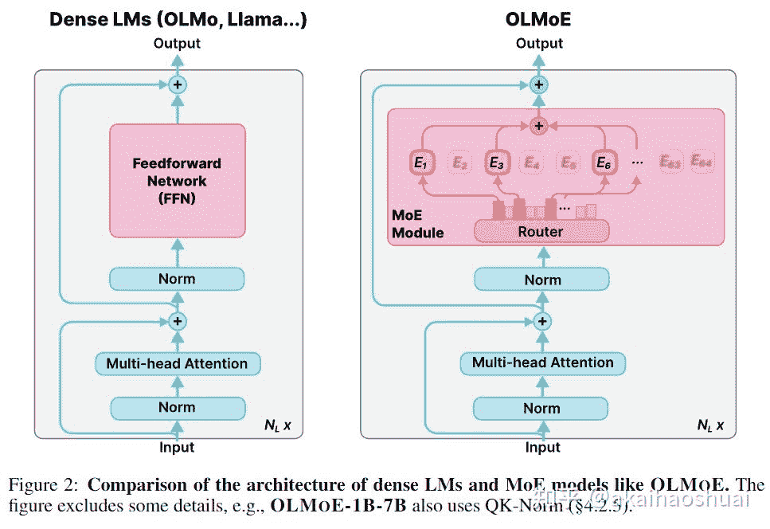

### 《Scaling Deep Learning on AMD GPUs》

https://zhuanlan.zhihu.com/p/9605202835

本周分享的SC24演讲由橡树岭国家实验室和美国能源部（DOE）带来，主题为《Scaling Deep Learning on AMD GPUs》。演讲主要介绍了Frontier超算的硬件架构、深度学习训练优化策略及性能分析，重点强调了如何利用AMD的技术实现大规模深度学习任务的高效训练。

Frontier超算系统具有9408个节点，支持峰值EF（ExaFLOPS）双精度浮点性能。每个节点配备1个64核的AMD EPYC CPU（512GB DDR4内存），以及4个AMD Radeon Instinct MI250X GPU（每个GPU包含两个图形计算芯片）。节点间通过SiliconShot和PCIe Gen4互联，带宽分别为25GB/s和36+36GB/s，同时每个节点配有2个1.9TB的NVMe SSD。

在深度学习方面，Frontier使用了MIOpen优化库，专为AMD GPU设计，能够提升CNN性能。RCCL和SPARSE库分别提供GPU集体通信支持和稀疏矩阵计算能力。MI250X GPU配备128GB的HBM2内存和1.6TB/s的内存带宽，通过Infinity Fabric（100GB/s）和PCIe 4（50GB/s）连接GPU并进行数据交换。

Frontier采用的分布式训练策略包括数据并行、模型并行和混合并行。具体实现上，使用了PyTorch的DDP（分布式数据并行）和TensorFlow的Multiworker Mirror策略，以及Horovod框架来处理跨节点的数据并行。对于模型并行，使用了PyTorch的FSDP（完全分片数据并行）和DeepSpeed-Megatron 3D并行策略。FSDP在反向传播时采用All-Gather操作和Reduce-Scatter操作，通信量比DDP多1.5倍。

DeepSpeed-Megatron架构结合了分片数据并行（ZeRO）、流水线并行和张量并行等技术，通过共享优化器状态和梯度来实现高效的训练。每个节点使用多个MI250X GPU，并通过高带宽的Infinity Fabric和Slingshot-11进行GPU间通信。

通过与Summit超算进行对比，演讲展示了在Frontier上使用FSDP和DeepSpeed-Megatron对GPT-1.4B模型进行训练的性能。性能测试结果表明，FSDP和DeepSpeed-Megatron在训练吞吐量和计算资源使用上表现出明显优势。

在训练ViT模型时，演讲重点介绍了如何优化训练性能，特别是在不同模型规模下的内存使用和分片策略。测试结果显示，对于ViT-3B模型，通信成为主要瓶颈，而对于更大规模的模型（如ViT-5B和ViT-15B），不同的分片策略（如混合分片）有助于提升训练性能。具体测试表明，混合分片策略在多GPU环境下的扩展性优于完全分片策略。

在性能分析方面，演讲使用了rocprof和nvprof工具进行性能剖析，并通过OmniTrace-nsight进行深度追踪分析。特别是在FSDP训练ViT模型时，演讲强调了通信优化策略（如Backward pre/post）对吞吐量的影响，以及如何通过精细的分片和通信策略来提高训练效率。

Frontier超算提供了一个强大的平台，能够支持大规模的深度学习训练，尤其是在AMD GPU和相关优化工具的支持下，能够在大模型训练中实现更高效的分布式计算。不同规模的深度学习模型可能需要不同的分片和通信策略，以最大化性能。PyTorch与AMD GPU的兼容性以及节点拓扑的考虑是优化训练性能的关键。

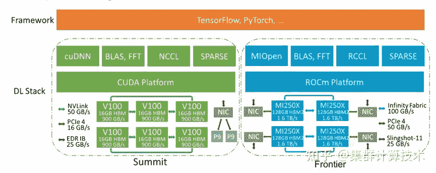

### 监督精调（SFT）与高效精调（PEFT）

https://zhuanlan.zhihu.com/p/9776914956

直觉：大语言模型经过预训练后，具备强大的生成能力，但它们未必能在特定任务上表现出色。因此，需要通过“下游任务适配”来让它们更好地理解并执行人类的指令。传统的指令微调方法需要大量计算资源，然而，参数高效微调（PEFT）通过仅调整模型的一小部分参数，显著降低了计算和存储成本，同时保持了较好的任务适配效果。

数学：PEFT方法通常包括软提示（Soft Prompts）和低秩适配（LoRA）两种主要技术。软提示方法通过在模型输入中添加可学习的连续向量（如Prompt Tuning、Prefix Tuning等），只训练这部分参数，从而实现任务适配。而LoRA通过低秩矩阵近似原始权重的更新矩阵，仅微调低秩矩阵，冻结原始模型参数。两者都能在显著减少计算和存储需求的同时，取得接近全量微调的性能。

代码：Huggingface的PEFT库提供了对多种PEFT方法的支持，包括软提示和LoRA等。通过简单的几行代码，用户可以配置和应用这些高效微调方法。例如，使用LoRA微调一个预训练的Seq2Seq模型，只需加载配置文件并执行模型训练，最终可以获得精简且高效的微调结果，节省大量计算资源和存储空间。

### 用在生产环境中的LinkedIn Liger kernel

https://zhuanlan.zhihu.com/p/9798425682

这节课介绍了LinkedIn开发的Liger Kernel中的两个核心优化：RMSNorm和Fused Linear Cross Entropy。Liger Kernel是专为大规模语言模型（LLM）训练设计的，能有效提高多GPU训练的吞吐量并减少内存消耗，具体通过优化梯度计算和内存管理来实现。这些优化技巧主要包括RMSNorm的反向传播推导、内存节省技巧，以及Fused Linear Cross Entropy中的分块（chunking）和前向梯度（gradient-in-forward）等技术。

首先，RMSNorm部分展示了如何通过反向传播推导，优化内存使用。在推导过程中，特别强调了链式法则的应用，以确保对每个元素的影响被正确考虑。为了优化内存，使用了inplace tensor reuse和缓存RMS的策略，从而减少内存占用。在测试过程中，RMSNorm的实现通过与PyTorch原生实现进行对比，验证了其正确性和性能优势，包括精度验证和内存测试，结果表明Triton实现的RMSNorm在内存和计算效率上优于传统实现。

接着，Fused Linear Cross Entropy的优化则侧重于减少内存消耗。在前向传播阶段，通过将梯度计算与激活值计算合并，即前向梯度优化，避免了反向传播时的重复计算。此外，使用了梯度检查点（checkpointing）和分块（chunking）技术，以分阶段处理输入数据，进一步减少内存使用。通过这些技术，Liger Kernel能够在保证计算效率的同时显著降低内存峰值。

测试结果表明，Liger Kernel在内存管理和性能上优于传统实现，尤其是在处理大词汇量和长序列时，内存消耗显著减少。通过在Triton框架下实现这些优化，Liger Kernel不仅提升了训练吞吐量，还有效降低了硬件资源需求，展现了其在工业界的实际应用价值。

总结来说，Liger Kernel通过合理的内存优化和高效的计算策略，成功提升了大规模语言模型训练的效率和性能，特别适用于多GPU环境中高效的LLM训练。这些技术不仅降低了内存占用，也提升了整体训练速度，极大地推动了Triton框架在工业应用中的实践。

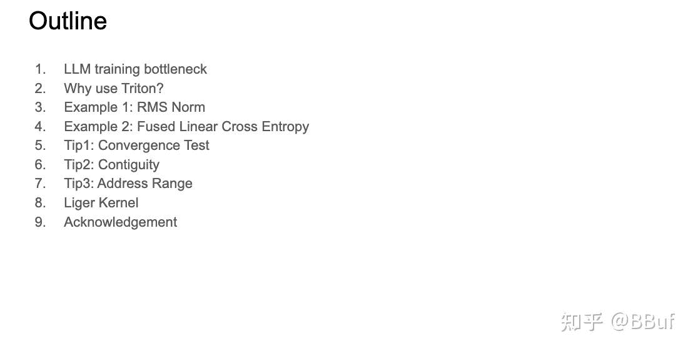

# 招聘公告

---

**奇绩创坛****由陆奇博士**于2019年创立，使命是在源头最大化驱动创新。奇绩研究组将研究模型理论、到投研战略分析、市场策划等不同背景的同学聚在一起，搭建GenAI时代独特的跨界人才社群。

## 🚀F**24实习岗位**

##### [行研-学术科研人才交流组实习生](https://miracleplus.feishu.cn/docx/Yn6rdf2iOoY2Rcx8yVNcUBYRnch#part-QkMcdeJmuob9uvxvV3qcLSzHn8g)

##### 行研-GenAI研究岗位-战略分析（偏产品）

##### Web / AI 全栈开发工程师实习生

## **火热开放中🚀**

##### 行研-GenAI研究岗位-前沿学术探索

##### 行研-GenAI研究岗位-战略分析（偏咨询）

##### 创新活动产品运营 （大模型系列活动产品运营）

> **点击**相关岗位可查看对应**岗位需求【JD】；**相关岗位投递请**扫描二维码**

> 欢迎**推荐/自荐**

> 期待在**奇绩创坛**遇见更好的你

---

# 声明

本文档仅供学习交流使用，版权归原作者所有，若涉侵权，请联系Jack Jin 15101136166

##

（欢迎在下方反馈您宝贵的意见！整理不易，觉得有用给AI日报小组点个赞👍吧！）

ChatGPT；Angela；Zijia Liu；Alex；Zeqi Tan；Tiezhen（HuggingFace）；Naixu；Lizhi；Peter；Suoman；Jack

学术分析报告：ResearchFlow -- 奇绩F23校友的开发的深度研究产品，PC端进入RFlow的分析报告，可直接点击节点右侧的小数字展开节点，登录后可在节点上直接“询问AI”，进一步探索深度信息

如果你有大模型相关的创业想法，欢迎来找我们聊聊～微信：15101136166

> 快邀请你的小伙伴们一起来读大模型日报吧！

> **【日报****知识库****】**这里是近期日报内容的汇总,欢迎大家查阅

> [大模型日报知识库(分享版)](https://miracleplus.feishu.cn/wiki/KapVwXfkriOBiskB0B2cUHxjnTh)

>

> 欢迎大家多多帮我们分享,转发~~

> 如果大家有任何的建议或者吐槽,欢迎随时找我聊天~

