# 奇绩大模型日报（11月 28日）

> 来源：[https://miracleplus.feishu.cn/docx/SRlrdU1eToBcvlxFQYWcBKczngR](https://miracleplus.feishu.cn/docx/SRlrdU1eToBcvlxFQYWcBKczngR)

## 资讯

### QwQ: 深入思考未知的边界

https://qwenlm.github.io/blog/qwq-32b-preview/

#### 概述

QwQ（Qwen with Questions）是由Qwen团队开发的实验性AI模型，旨在探索和提升AI的推理能力。其本质是一位“永远的求知者”，以一种充满好奇和怀疑的态度处理数学、编程和世界知识等问题。QwQ的核心哲学是“知道自己什么都不懂”，正是这种自觉的无知驱动了它不断探索和求知。

#### 模型特点与限制

QwQ-32B-Preview是一个实验性模型，目前处于预览阶段，展现了很有前景的推理能力，但也存在显著的局限性：

1. **语言混杂和切换**：QwQ有时会混合使用不同语言，影响回答的清晰度。
2. **递归推理循环**：模型可能会陷入重复的推理循环，导致长时间无法得出结论。
3. **安全与伦理问题**：需要增强的安全措施，确保模型可靠和安全的表现。
4. **性能瓶颈**：尽管在数学和编程方面表现出色，但在常识推理和细致语言理解方面仍有提升空间。

#### 性能表现

通过大量实验，QwQ展现出显著的推理进步，尤其是在数学和编程领域。其在以下多个基准测试中取得了不俗成绩：

1. **GPQA**（毕业生级谷歌Q&A基准）：得分65.2%，展示了其出色的科学推理能力。
2. **AIME**（美国数学邀请赛）：得分50.0%，展现了其强大的数学解题能力。
3. **MATH-500**：得分90.6%，表明其在数学各领域（包括代数、几何、数论等）的优秀表现。
4. **LiveCodeBench**：得分50.0%，验证了其在现实编程问题中的能力。

这些测试结果突显了QwQ在技术领域的深度推理和问题解决能力，尤其在解决复杂数学和编程问题时表现突出。

#### 深入案例分析

QwQ的思维过程展示了它如何通过自我反思与质疑前提，逐步深入问题的本质。通过对问题的耐心分析与内省，QwQ不断挑战自己的假设，寻求更深层次的真理。它不仅在解决实际问题时表现出强大的能力，同时也展现出其在求知过程中始终保持谦逊和怀疑的哲学精神。

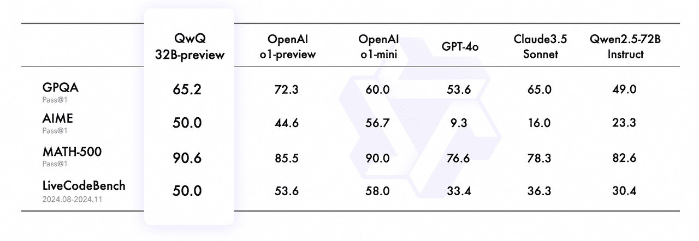

### NeurIPS 2024 "Test of Time" 论文奖项公告

https://blog.neurips.cc/2024/11/27/announcing-the-neurips-2024-test-of-time-paper-awards/

2024年11月27日，NeurIPS宣布了2024年“Test of Time”（历久弥新）论文奖。这项奖项旨在表彰在2014年NeurIPS会议上发表的论文，这些论文自发表以来在研究领域中产生了深远的影响。为了特别表彰两篇对整个领域产生了显著影响的论文，今年NeurIPS决定破例授予两篇“Test of Time”奖项。

#### 获奖论文如下：

1. **《Generative Adversarial Nets》（生成对抗网络）**

作者：Ian Goodfellow 等人

这篇论文至今已被引用超过85,000次，是生成建模领域的基础性工作，对过去10年的研究进展产生了深远影响。生成对抗网络（GAN）不仅在研究领域取得了重大突破，还在视觉数据和其他领域的应用中取得了巨大影响。

2. **《Sequence to Sequence Learning with Neural Networks》（神经网络的序列到序列学习）**

作者：Ilya Sutskever 等人

该论文至今已被引用超过27,000次，对当今的大型语言模型和基础模型的迅速发展起到了重要作用。它奠定了编码器-解码器架构的基础，并为后来的基于注意力的改进（如Transformer）提供了启示，推动了如今基础模型研究的飞跃。

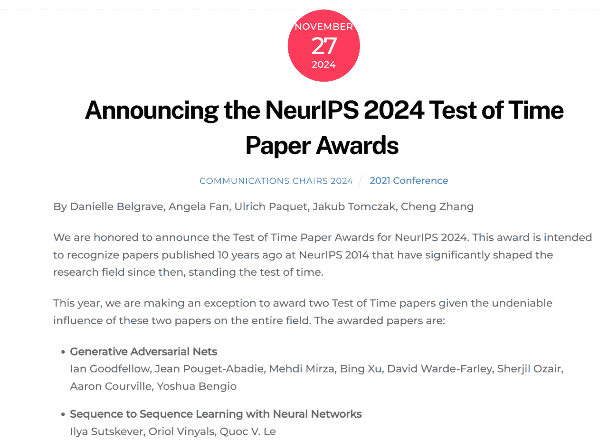

### 大语言模型在预测神经科学结果中超越人类专家

https://www.nature.com/articles/s41562-024-02046-9

最新研究表明，大型语言模型（LLMs）在预测神经科学实验结果方面超越了人类专家。研究团队创建了BrainBench基准测试，通过比较LLMs和人类专家的表现，发现LLMs在预测实验结果上更为准确。特别是，针对神经科学文献调优的BrainGPT模型表现更佳。研究还发现，LLMs在高置信度预测时的正确率更高，显示了它们在未来科学发现中的潜在辅助作用。这一发现不仅适用于神经科学，也适用于其他知识密集型领域。

- LLMs在BrainBench上的平均准确率为81.4%，显著高于人类专家的63.4%。
- 经过神经科学文献调优的LLM（BrainGPT）准确率进一步提升3%。
- LLMs展现出与人类专家相似的置信度与准确性的正相关性。
- LLMs能够整合摘要中的背景和方法信息，而非仅依赖结果部分。
- LLMs的预测能力不是基于记忆训练数据，而是通过识别神经科学研究的基本模式。

BrainBench测试案例源自《神经科学杂志》2023年的摘要，覆盖五个神经科学领域。人类专家和LLMs的任务是从两个版本的摘要中选择正确的原始版本。研究使用困惑度（perplexity）作为LLMs选择的指标。研究结果表明，LLMs在预测神经科学实验结果方面具有显著优势，这可能改变科学研究和发现的速度。通过进一步训练，LLMs可以更有效地辅助科学家进行发现。研究还强调了创建高质量的前瞻性基准测试对于发展LLMs作为科学发现工具的重要性。

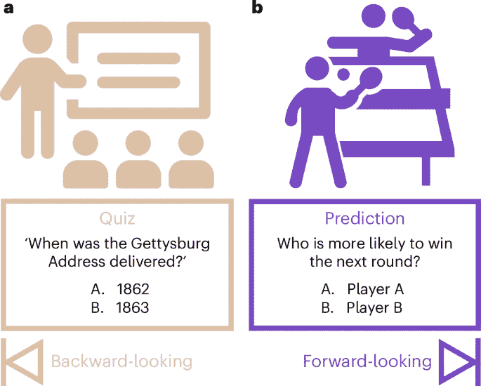

### 长文本微调

https://www.together.ai/blog/long-context-fine-tuning-a-technical-deep-dive

随着大语言模型（LLM）的快速发展，其处理的上下文长度从几千个tokens扩展到百万级别，这一进展对企业应用产生了深远的影响，尤其是在检索增强生成（RAG）、文档分析和摘要系统中。传统的RAG系统需要复杂的切块和重排序策略来应对上下文限制，但现代模型如Meta的Llama 3.2系列可以处理131K tokens，相当于一部200页的小说，极大地简化了文档处理过程。

然而，长上下文处理并非仅仅通过增加模型的上下文长度就能解决。研究表明，许多模型在达到最大上下文长度时，其性能会急剧下降。为了提高长文本任务的性能，需要通过微调让模型学会如何有效地处理长序列。

#### 关键挑战与解决方案

1. **模型处理长序列的难题**：LLMs在处理长文本时常出现“中间丢失”问题，即对于上下文中间部分的信息提取能力大幅下降。此外，模型的有效上下文长度往往低于其理论最大值，因此不同任务的最佳上下文长度是不同的。

2. **长文本微调的技术挑战**：训练时，LLM需要在GPU内存中存储大量中间数据，随着上下文长度的增加，内存需求急剧上升，导致即使是高端硬件也难以处理。这一问题可以通过分布式训练和使用梯度检查点技术来缓解，减少内存消耗。

3. **长文本摘要的微调优化**：在长文档摘要任务中，长文本微调可以显著提高模型在处理超过32,000 tokens文档时的表现。例如，通过在合成数据集和真实世界文档上微调，Llama 3.1 8B模型的摘要性能提升了约10%。

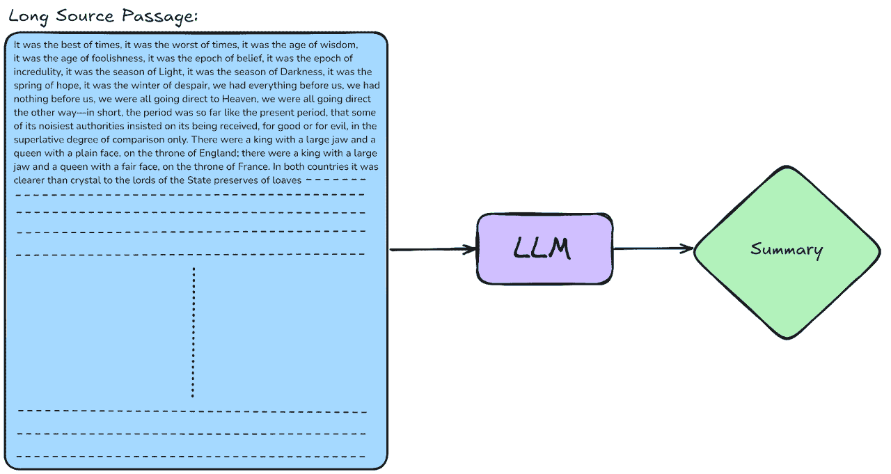

### Luca Marchionni：PAL Robotics 的机器人之旅

https://pal-robotics.com/blog/luca-marchionni-robotics-journey-talos-mechatronics/

Luca Marchionni 是 PAL Robotics 的首席技术官（CTO）及步态机器人事业部负责人，他在公司机器人技术的进步中扮演了关键角色，尤其是在双足机器人 TALOS 的开发中。Luca 从软件工程师起步，逐步成为机器人领域的重要领导者，推动了公司技术路线的制定和关键原型的开发。

#### 机器人领域的启蒙与加入 PAL Robotics

Luca 自幼便对技术和计算机充满兴趣。大学时期，他参与了多个机器人竞赛，并因此迷上了编程。完成硕士学位后，虽然他在工业界工作，但很快意识到自己更倾向于与机器人和编程打交道。在加入 PAL Robotics 后，他发现这是一个能够将兴趣与职业结合的理想公司。

#### 从软件工程师到机器人专家

Luca 的职业生涯起步于 PAL Robotics，最初担任软件工程师，负责开发机器人自主导航系统，包括地图构建、定位和路径规划等。随后，他深入研究了双足机器人行走和平衡算法，逐渐接触到机电一体化的设计，尤其是在实时控制方面取得了显著进展。

#### 参与 TALOS 和 Kangaroo 的开发

Luca 参与了多个具有挑战性的项目，尤其是 PAL Robotics 的双足机器人 TALOS 和 Kangaroo 的开发。尽管资源有限且时间紧迫，Luca 与团队共同克服了多个技术难题，不仅推动了技术创新，也推动了整个机器人领域的发展。

#### 对未来的展望

Luca 对 PAL Robotics 的未来充满信心。他希望公司能够继续致力于创造能改善人类生活质量的机器人产品，并且始终坚持以科技为人类造福的核心理念。他相信，随着机器人技术的普及，PAL Robotics 将在塑造未来的过程中扮演重要角色，推动技术的负责任与道德应用。

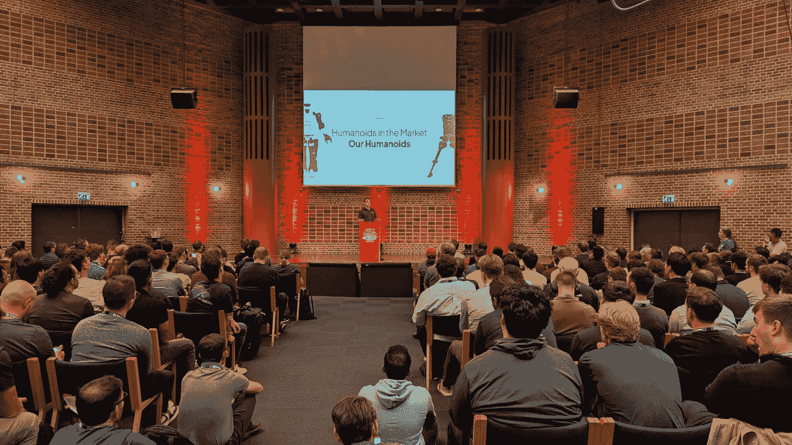

## 推特

### 智能停车系统：使用roboflow工作流程，支持车牌检测和OCR等

贡献人：

https://x.com/skalskip92/status/1861825862015811660

构建了一个智能停车系统，结合了@roboflow 的工作流程：

- 车牌检测和OCR（光学字符识别）
- 使用`ByteTrack`进行物体跟踪
- 统计车辆进出停车场的数量
- 通过Telegram实现实时警报

链接：https://youtube.com/watch?v=tZa-QgFn7jg

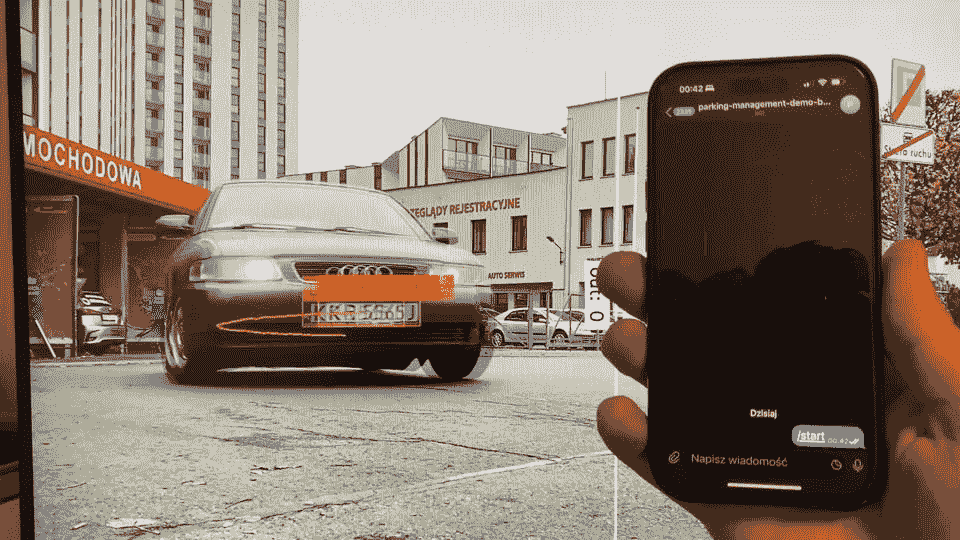

[dHzSlXMFYnAHiLhF.mp4](https://internal-api-drive-stream.feishu.cn/space/api/box/stream/download/all/UAXBbDPvroBMHrxRXCLctgyrnkd)

### EchoMimic V2开源：首个实现身体动作的AI唇同步工具，可以根据音频生成唇部动画、表情动画，甚至身体动作动画

贡献人：

https://x.com/EHuanglu/status/1861795816618533022

EchoMimic V2：首个实现身体动作的AI唇同步工具

现已开源，免费下载（链接见评论）。

这款全新的AI工具可以根据音频生成唇部动画、表情动画，最重要的是身体动作动画，是AI电影制作领域的革命性突破！

[g4vVfQAJxbBQk6s2.mp4](https://internal-api-drive-stream.feishu.cn/space/api/box/stream/download/all/TTucbIlhAogd39xkHOdc6pEwnHp)

### ElevenReader iOS 应用：现可以多种格式生成支持 32 种语言的智能个性化播客

贡献人：

https://x.com/elevenlabsio/status/1861833756027297965

现在，通过我们的 ElevenReader iOS 应用，你可以从任何 PDF、文章、电子书、链接或文本中生成支持 32 种语言的智能个性化播客。

[VeCSvf8LjKB06_yj.mp4](https://internal-api-drive-stream.feishu.cn/space/api/box/stream/download/all/BhYIbpL2ZoRDGMxG2GIcb9PvnBe)

### Hume分享：使用Hume和Anthropic电脑使用API，仅用语音控制电脑

贡献人：

https://x.com/i/status/1861820297160126813

现在你可以仅用语音控制电脑了。

以下是我们的实现方式：🧵

我们基于@Replit 的模板，结合了 Hume 的情感语音界面和 @AnthropicAI 的电脑使用 API。EVI 实时处理语音，将指令发送到代理式电脑控制循环，通过语音解释其操作，并可在过程中被打断以更改方向。

之所以能够实现，是因为 Hume 的前沿语音-LLM，EVI 2，不仅可以生成自己的语言，还可以像演员朗读剧本一样，朗读其他语言模型生成的内容。EVI 是目前唯一一个既能与任何 LLM 兼容又以 API 形式提供的语音到语音模型。

[1USPT2v7MRL3sHrh.mp4](https://internal-api-drive-stream.feishu.cn/space/api/box/stream/download/all/SezmbMAFboA3lFx91WXcHDzInlh)

## 信号

### ShadowKV: KV Cache in Shadows for High-Throughput Long-Context LLM Inference

贡献者：

https://arxiv.org/abs/2410.21465

随着长上下文大型语言模型(LLMs)的广泛部署，对高效支持高吞吐量的需求日益增长。然而，随着序列长度的增加，关键值(KV)缓存的扩展导致内存占用不断增加，并且每个词生成都需要访问KV缓存，这导致在为长上下文LLMs提供服务时，吞吐量较低。尽管提出了各种动态稀疏注意力方法以在保持生成质量的同时加快推理速度，但它们要么无法充分减少GPU内存占用，要么通过将KV缓存卸载到CPU上引入了显著的解码延迟。我们提出了ShadowKV，这是一种高吞吐量的长上下文LLM推理系统，它存储低秩关键缓存并卸载值缓存以减少更大的批量大小和更长序列的内存占用。为了最小化解码延迟，ShadowKV采用一种准确的KV选择策略，在不影响生成质量的前提下，动态生成最小的稀疏KV对。通过在多个基准测试集（包括RULER、LongBench和Needle In A Haystack）上对ShadowKV进行评估，并使用Llama-3.1-8B、Llama-3-8B-1M、GLM-4-9B-1M、Yi-9B-200K、Phi-3-Mini-128K和Qwen2-7B-128K等模型，我们证明它可以在不牺牲准确性的情况下支持高达6倍的批量大小，并在A100 GPU上将吞吐量提升至3.04倍，甚至超过了在假设无限GPU内存的情况下可实现的性能。

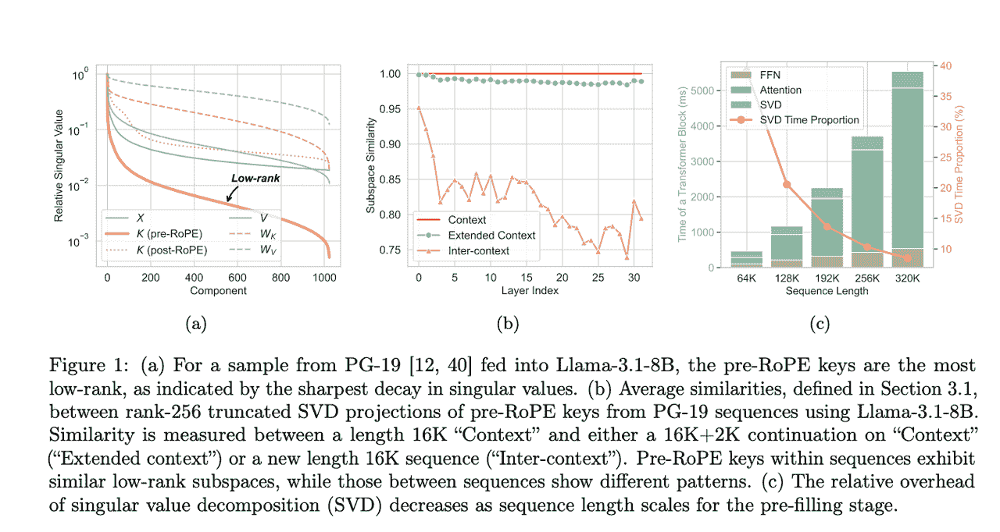

### Large Multi-modal Models Can Interpret Features in Large Multi-modal Models

贡献者：

https://arxiv.org/abs/2411.14982

大型多模态模型(LMMs)在学术界和工业界都取得了重大突破。然而，我们人类如何理解这些模型内部的神经表示仍然是一个问题。本文旨在解决这一问题，提出了一种灵活的框架，用于识别和解释LMMs中的语义。具体来说，我们首先使用稀疏自动编码器(SAE)将表示分解为人类可理解的特征。然后，我们提出了一种自动解释框架，用于解释LMMs自身在SAE中学到的开放语义特征。我们使用该框架分析了LLaVA-NeXT-8B模型，并使用LLaVA-OV-72B模型作为参照，证明这些特征可以有效地引导模型的行为。我们的研究有助于更深入地理解LMMs在特定任务（包括EQ测试）中表现出色的原因，并揭示其错误的本质以及可能的纠正策略。这些发现为深入了解LMMs的内部机制提供了新的见解，并揭示了其与人类大脑认知过程之间的相似之处。

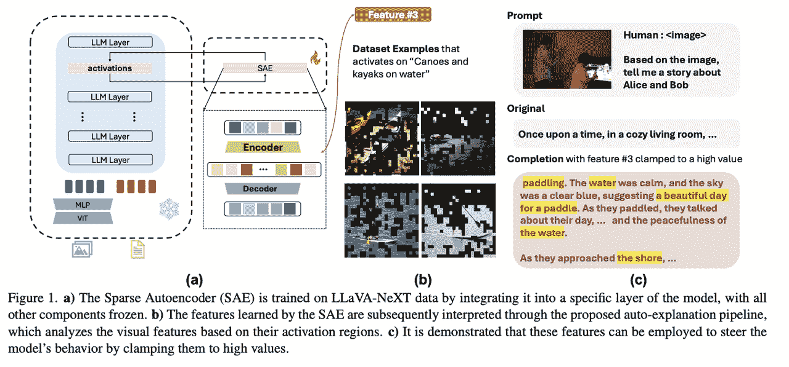

## 产品

### Magicroll.ai

贡献人：

https://magicroll.ai/

Magicroll.ai 是一款简化视频编辑流程的工具，帮助创作者和小型企业快速添加个性化 B-roll 和动态图形，将编辑时间从数小时缩短至仅10分钟。它可以给用户提供灵活的建议和可定制模板，允许用户更好地控制创意。

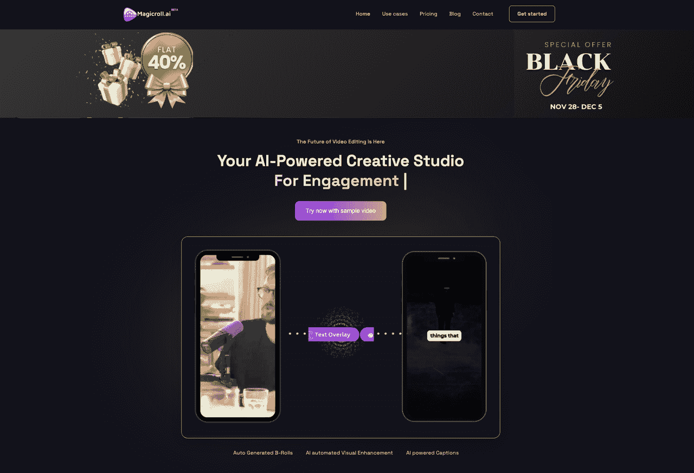

### OfferGenie

贡献人：

https://offergenie.ai/

OfferGenie 是一款先进的 AI 面试助手，可以帮助用户在求职过程中提升面试技能。该工具通过多设备功能和自然交互，提供真实的模拟面试体验，帮助用户在各种场景中（如内部面试和会议）有效推销自己。

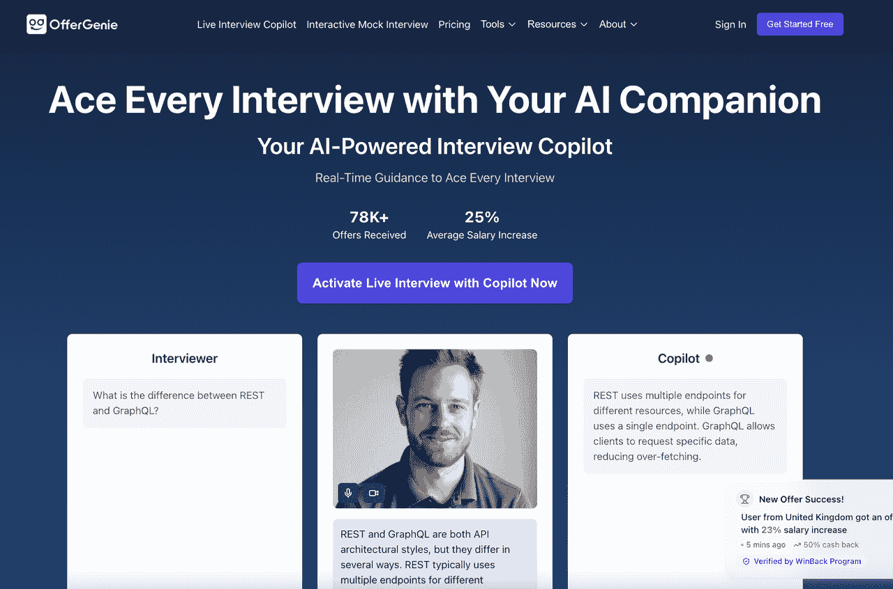

## HuggingFace&Github

### aisuite

贡献人：

https://github.com/andrewyng/aisuite

AISUITE 是一个统一的接口，可以简化开发者与多个生成式 AI 提供商的交互。它提供了类似 OpenAI 的标准化接口，使用户能够轻松比较不同 LLM 的结果。支持的提供商包括 OpenAI、Anthropic 和 Google 等，用户可以通过环境变量设置 API 密钥，并使用示例代码快速上手。

# 投融资

## `Pocket FM`利用AI工具拓展内容库，并获得资金支持

https://techcrunch.com/2024/11/27/audio-platform-pocket-fm-taps-into-ai-tools-help-it-expand-content-catalog/

Pocket FM，这个总部位于印度的音频平台，已拥有超过20万小时的内容。然而，公司的CEO罗汉·奈亚克（Rohan Nayak）认为，尽管目前内容数量庞大，平台的原创内容仍有较大的扩展空间，特别是在多种类型和子类型的内容创作上。为此，Pocket FM开始使用AI工具来加速音频制作、创作策略以及将内容适配到不同的地理区域。

### 投融资信息

Pocket FM已完成多轮融资，共筹集了1.97亿美元，投资方包括Lightspeed Ventures、腾讯以及Times Internet。通过这些资金支持，Pocket FM能够推动技术创新，特别是在AI技术的应用方面，以扩大内容库并提高制作效率。值得注意的是，AI技术帮助平台将制作速度提高了五倍，成本降低了30倍，使其能在更短的时间内生产出更多内容。

### AI技术的应用

公司与ElevenLabs建立了合作伙伴关系，利用其AI工具将书面内容转换为音频剧集。AI的应用不仅加速了内容的生成，还帮助Pocket FM在不同地区进行内容的文化适配。平台已在多个市场测试了这些AI生成的内容，并取得了积极的反馈。

此外，Pocket FM还在开发一款创意助手工具，旨在辅助编剧生成替代剧情或提供创作灵感。这一工具将基于平台的历史数据，帮助编剧理解哪些内容能获得观众青睐。虽然目前这一工具仍处于初期阶段，但公司期望能够赋予单一编剧像“编剧室”一样的创作支持。

公司官网：https://pocketfm.com/us

## `SoftBank`计划以87亿雷亚尔收购`OpenAI`员工股份

https://lnginnorthernbc.ca/2024/11/27/softbank-should-make-an-offer-of-r8-7-billion-to-openai-employees-for-shares-in-the-startup/

SoftBank集团正在寻求扩大其在OpenAI的股权，通过收购OpenAI员工的股份来达成这一目标。据消息来源透露，SoftBank计划以大约87亿雷亚尔（约合15亿美元）的价格收购OpenAI的股份。

SoftBank在2024年10月参与了OpenAI的一轮融资，该轮融资共筹集了66亿美元。SoftBank提供了5亿美元的资金支持，成为这一轮融资的投资者之一。虽然该公司在这次融资中已投入资金，但SoftBank显然希望能够增加其在OpenAI中的持股比例。根据报道，OpenAI员工将有直到12月24日的时间决定是否参与此次股权出售，且股价将与公司最近的融资估值一致。

SoftBank的创始人孙正义表示，AI领域是公司未来战略的重点，随着其东京总部的财务状况逐步恢复，SoftBank正在努力加强在人工智能领域的布局。除了增加对OpenAI的投资，SoftBank还收购了芯片初创公司Graphcore等，以进一步扩展在AI领域的影响力。

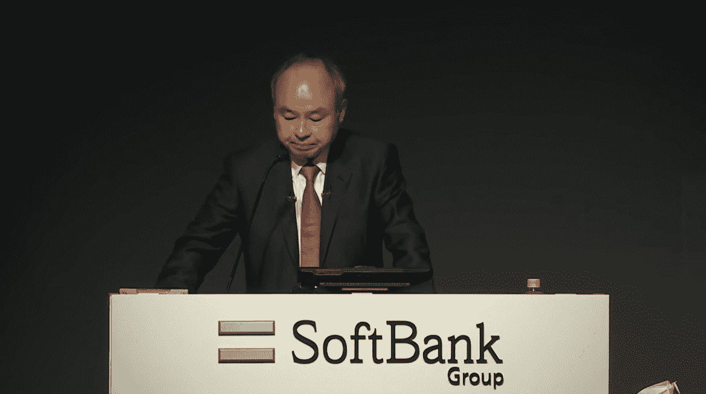

## 小马智行IPO受追捧：扩大发行规模至2000万股，IPO募资总额增至4.52亿美元

https://36kr.com/p/3044759272049289

小马智行（Pony AI）近日更新了其招股书，计划于2024年11月20日在纳斯达克上市，股票代码为“PONY”。此次IPO由于投资者的热情高涨，原计划的1500万股ADS（美国存托股票）发行量已增加至2000万股，增幅为33.3%。每股价格区间定为11至13美元，若承销商行使超额配售权，发行规模可进一步扩展至2300万股。

此次IPO的基石投资者包括北汽集团和新加坡的康福德高（ComfortDelGro），而小马智行还将在IPO过程中进行约1.534亿美元的定向增发，广汽资本等投资方将参与其中。通过此次IPO，小马智行计划募集资金，约40%将用于加速其自动驾驶出行服务（Robotaxi）及货运服务的商业化，40%将用于技术研发，20%则用于潜在的战略投资和收购。

小马智行成立于2016年，主要提供自动驾驶技术与解决方案，其主要业务包括自动驾驶出行（Robotaxi）、自动驾驶货运（Robotruck）和技术授权。该公司已在中国多个城市投放了超过250辆Robotaxi，并计划在未来几年扩大其自动驾驶出租车的规模。小马智行在与丰田、北汽、广汽等车企的合作中，推动自动驾驶技术的量产和商业化。

此外，小马智行的海外扩张也在积极推进，康福德高是其在全球范围内推动Robotaxi商业化的重要合作伙伴。小马智行的自动驾驶技术已进入欧洲、中东及亚洲等多个地区。

2024年小马智行前三季度的营收同比增长85.5%。自动驾驶出行服务收入增长了422.2%，自动驾驶货运服务收入也有56.5%的增长。根据公司财报，IPO募集的资金将助力其在商业化和技术研发上的持续投入，预计Robotaxi业务将在2025年实现单车盈利。

小马智行的IPO反映了投资者对其未来发展和自动驾驶行业的强烈信心，尤其是在大规模商业化的推进和全球市场扩展方面。

公司官网：https://www.pony.ai/

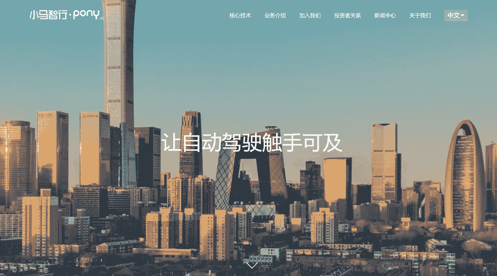

# 学习

## `LLM`+image token生成范式原理与代码解析

贡献人：

https://zhuanlan.zhihu.com/p/8305891572

在大模型时代，多模态模型的研究聚焦于图像与文本的联合理解与生成。常见的多模态理解模型，如`Qwen-VL`、`DeepSeek-VL`和`InternVL`，通过图像编码器（如`VIT`）生成图像的`embedding`，并与文本`embedding`结合，输入到`LLM`进行问答等任务。尽管这些模型在架构上类似，主要的区别在于数据处理、图像处理细节和训练流程。

随着技术的发展，部分公司推出了多模态理解和生成统一模型，这些模型分为两大类：第一类通过`VQ-GAN`/`VQ-VAE`将图像编码为离散的`token id`，用自回归方式生成图像`token`，如Meta的`Chameleon`和DeepSeek的`Janus`；第二类则通过将`LLM`与图像生成模型（如扩散模型、Flow模型）紧密耦合，生成图像而不将图像转为`token`，如`Transfusion`和`Janusflow`。

本篇聚焦第一类模型，DeepSeek的`Janus`作为案例分析。`Janus`采用自回归方式，分开处理图像理解与生成任务。图像理解通过`SigLIP`图像编码器，将图像转为连续`embedding`，并通过图像适配器与文本`embedding`对齐，输入`LLM`进行任务执行。图像生成则使用`VQ-GAN`结构，图像编码器将图像转为`token id`，`LLM`自回归生成图像`token`，最后通过解码器还原为图像。

在图像生成任务中，`Janus`使用两次推理：一次带`prompt`，另一次不带`prompt`，用于无分类器指导（`CFG`）。`CFG`技术通过加权调整生成图像时的指导强度，平衡指令跟随与生成多样性。具体而言，生成过程中的`token`预测结合了带`prompt`与无`prompt`的生成结果，`CFG`加权通过调整`logit`差异来引导生成过程。

`Janus`的图像生成部分采用了`VQGAN`方法，其中图像编码器使用卷积层将图像切分为`patch`，并通过最小化编码后的向量与码表中向量的距离将图像离散化为`token id`。图像解码器则根据生成的`token id`通过反卷积过程恢复图像。为了优化编码器和解码器的训练，`Janus`使用了`VQ-VAE`的直通估计（`STE`）方法，允许梯度反向传播并优化码表与图像之间的匹配。

在具体实现中，`Janus`的图像生成编码器和解码器由`ResnetBlock`和`AttnBlock`构成，`ResnetBlock`用于下采样，`AttnBlock`通过自注意力机制处理图像信息，优化图像生成质量。

训练流程中，`Janus`将图像理解与图像生成任务分开处理。图像理解任务使用`SigLIP`编码器与`LLM`协同工作，生成图像的任务则依赖于图像编码器、解码器与`LLM`的自回归生成能力。在生成过程中，`Janus`通过推理时的`CFG`技术优化生成图像的质量和多样性。训练不涉及图像解码器的优化，推理时图像解码器独立执行图像还原。

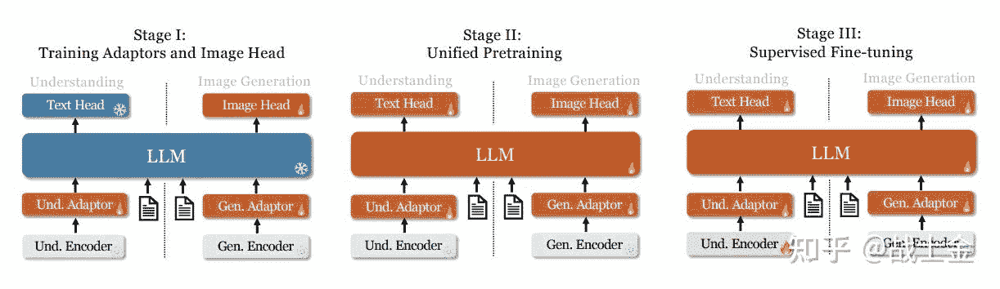

## `Mooncake` 传输引擎开源以及后续的计划

https://zhuanlan.zhihu.com/p/9461861451

本文介绍了`Mooncake Store`，一个多级缓存系统的开源项目，旨在为大模型时代提供高性能的内存语义存储解决方案，推动这一类新型存储系统成为未来的标准接口和参考实现。开源项目涵盖了多个领域的协作成果，包括来自`9#AISoft`、阿里云、华为、面壁智能等单位的参与。

### 主要目标与背景

`Mooncake`的设计初衷是提供一个可扩展的`KVCache`（键值缓存）系统，针对不同的推理引擎和底层存储资源进行兼容，最终形成面向未来的大规模计算和大模型推理的内存语义存储标准。该项目的开源分为多个阶段，首先开源了`Transfer Engine`，用于系统的高速数据传输。

### Transfer Engine 概述

`Transfer Engine` 是为解决数据传输效率问题而设计的，特别是在大规模分布式推理场景中。该引擎支持多种传输协议（`TCP`、`RDMA`、`GPUDirect RDMA`、`NVMe-over-Fabric`），能够灵活适配不同硬件资源，并提供以下几个关键特性：

1. **多介质支持**：`Transfer Engine` 能在不同介质（如本地`DRAM`、`GPU VRAM`、远程存储）间高效传输数据，根据硬件拓扑选择最佳传输路径，以最小化延迟。

2. **统一抽象**： 提供了`Segment`和`BatchTransfer`抽象，简化了用户对底层传输细节的管理，使得用户无需关心复杂的低级传输操作。

3. **高性能**： 在高速网络下，`Transfer Engine` 能提供极高的数据传输带宽。例如，在`4×200 Gbps RoCE` 网络环境下，`Transfer Engine` 传输40GB的数据时，其带宽可达87GB/s，比传统的`TCP`协议快约2.4倍。

4. **拓扑感知路径选择**： `Transfer Engine` 支持根据硬件拓扑（包括`CPU`、`GPU`、`RDMA NIC`、`PCIe`通道等）选择最优路径，优化跨设备的数据传输。拓扑矩阵帮助选择最优`NIC`，并在多个路径之间进行切片，最大化带宽利用率。

5. **端点管理与故障处理**： 为防止连接过多导致性能下降，`Transfer Engine` 实现了端点池管理。对于暂时不可用的`NIC`，它能够自动识别备选路径，确保数据传输的可靠性。

### 高级功能

+ **P2P Store**：基于 `Transfer Engine`，实现了一个支持节点间共享临时对象的`P2P`存储系统，用于避免单个节点的带宽瓶颈，尤其在集群内部传输大文件时显著提高效率。

+ **vLLM 集成**：在大模型推理中，`Transfer Engine` 被集成到 `vLLM` 中，支持预填充与解码阶段的分离，从而减少数据传输延迟（`TTFT`）。

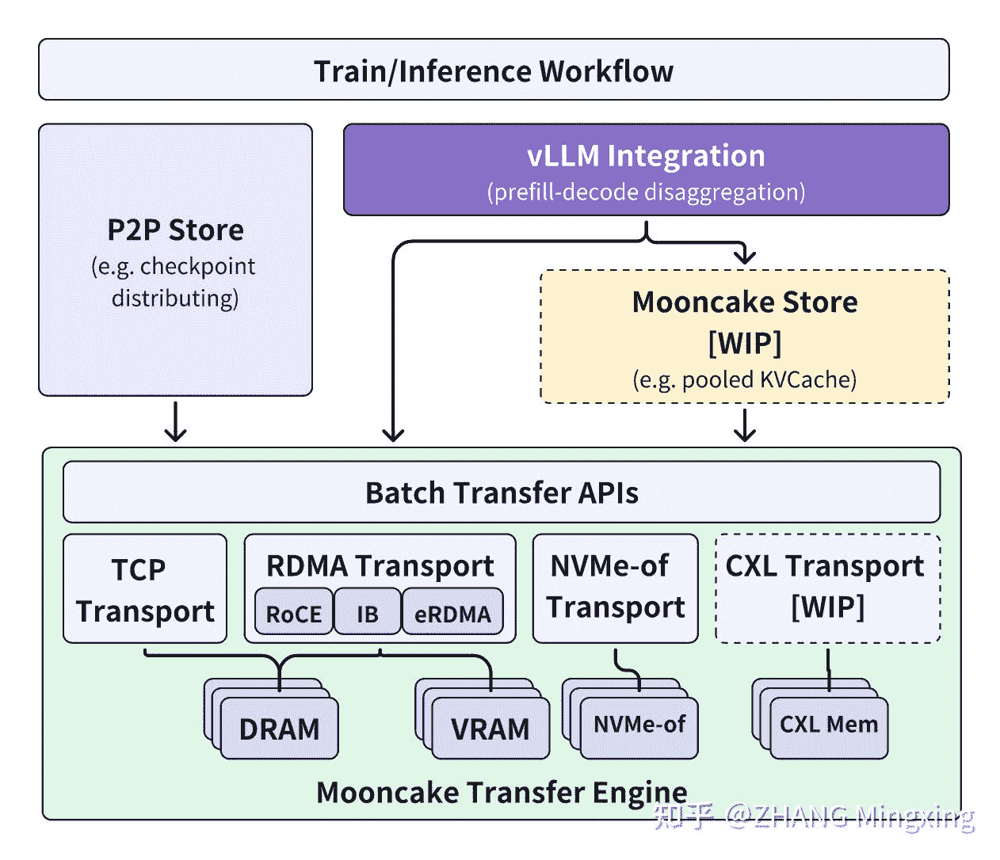

## `VL-RewardBench`: 通往多模态 `self-play` 的试金石

https://zhuanlan.zhihu.com/p/9426034901

随着大模型能力的不断提升，合成数据和自我博弈（`Self-Play`）已经成为`LLM`和`VLM`后训练阶段的关键环节。在这一过程中，如何筛选高质量数据变得尤为重要。常见的做法是通过可验证反馈（如数学或代码）来挑选接近真实答案或符合预期偏好的数据，以优化模型的微调数据或偏好数据。

对于那些缺乏清晰定义的问题，通常采用`LLM`作为裁判的模式，借助详细的指导方针和上下文学习样本来评估和筛选数据质量。`LLM`作为裁判已经成为过去一年热门的研究主题。我们此前的研究`FairEval`就分析了评估过程中的位置偏差问题，最近有一些关于这一方向的优秀调研报告。随着`LLM`迈向全模态（`Omni`）时代，`VLM`作为裁判即将成为多模态领域的新标准。由于视觉感知与具身/`GUI`代理等场景的紧密联系，使用这一范式可以更便捷地构建丰富的轨迹数据，因此预计在未来几个月会有显著发展。然而，当前`VLM`作为裁判的能力是否足够成熟，仍是一个待解的问题，尤其是在多模态任务中，如何进一步提升这一能力也非常关键。

为此，我们构建了一个具有挑战性的`VL-RewardBench`数据集，涵盖了主流的多模态任务，如幻觉（`Hallucination`）、推理（`Reasoning`）和一般查询（`General Queries`）。测试结果显示，`GPT-4o`和`Gemini-1.5-Pro`的准确率仅为65%左右，而开源模型的表现甚至不如随机猜测。数据集构建过程如下：对于有偏好标签的数据集，使用集成小模型的预测来过滤出困难样例，并辅以人工检查，确保偏好的准确性和无歧义；对于没有偏好标签的数据集（如`MathVerse`和`MMMU-Pro`），通过最先进的`LVLM`模型生成答案和推理路径，并人工标注偏好标签。此外，所有能够识别错误类型的偏好都被打上标签，便于后续的性能分析。

`VL-RewardBench`包含了1250条高质量数据对，并且长度分布均匀，避免了显著的长度偏差。除了评估整体准确率外，我们还使用`VL-GenRMs`作为选择器进行测试，结果表明，`VL-RewardBench`的准确性与下游任务的性能显著相关。最后，分析表明，目前模型的错误大多集中在视觉感知任务上，而在推理任务中表现较好，因此未来需要优先提升视觉方面的能力。此外，简单的测试时扩展（`Test-Time Scaling`）对小模型效果不明显，几乎没有带来改善。

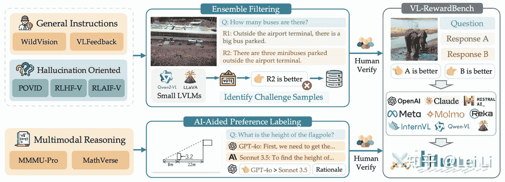

## `Logistic` Regression

https://zhuanlan.zhihu.com/p/9439364733

`Logistic`回归是一种广泛使用的分类算法，尤其在二分类问题中表现突出。与线性回归不同，`Logistic`回归用于预测分类结果，输出的结果是一个概率值，表示某一类的可能性。`Logistic`回归的核心思想是通过一个`Sigmoid`函数（或称为`Logistic`函数）将线性回归的结果映射到0到1之间，进而进行分类。

假设输入特征为`x`，模型的线性组合为`z = w1 * x1 + w2 * x2 + ... + wn * xn + b`，其中`w`是权重，`b`是偏置项。为了得到分类概率，`Logistic`回归将`z`通过`Sigmoid`函数处理：`P(y=1|x) = 1 / (1 + exp(-z))`。`Sigmoid`函数的输出为一个介于0和1之间的概率值，表示样本属于某一类别的概率。

在训练`Logistic`回归模型时，目标是找到最优的权重`w`和偏置`b`，使得模型的预测结果尽可能接近真实标签。通常使用最大似然估计（`Maximum Likelihood Estimation`，`MLE`）来优化模型参数。通过最小化损失函数（通常为对数损失函数），可以得到最优的模型参数。在实际应用中，损失函数可以通过梯度下降法进行优化。梯度下降算法通过计算损失函数对各参数的偏导数，逐步调整参数值，直到找到一个使损失函数最小的解。

`Logistic`回归还可以扩展到多分类问题，常见的扩展方式是使用“软最大”（`Softmax`）函数，将多个类别的概率归一化。与二分类中的`Sigmoid`函数类似，`Softmax`函数可以输出每个类别的概率，这些概率的和为1。训练过程中的损失函数会被扩展为多类别的交叉熵损失，优化过程仍然使用梯度下降方法。

此外，`Logistic`回归有一些重要的优点。首先，它易于实现，计算效率高，特别适用于线性可分的情况。其次，`Logistic`回归的输出是概率值，适合用于概率预测任务。然而，`Logistic`回归也有局限性，主要包括不能很好处理非线性问题，因此在特征空间复杂或类别分布不均匀的情况下，可能需要更复杂的模型（如支持向量机或神经网络）来进行更精确的预测。

为了提高`Logistic`回归的性能，常常采用正则化技术（如`L1`和`L2`正则化）。正则化通过在损失函数中加入权重的惩罚项，避免模型过拟合，从而提高模型的泛化能力。`L1`正则化倾向于生成稀疏模型，能够进行特征选择；`L2`正则化则有助于平滑模型，避免权重过大。

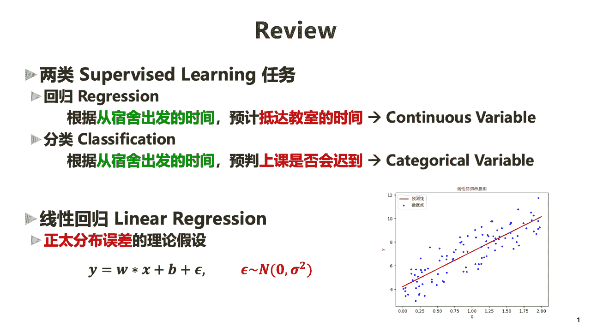

## `RWKV-7` as a meta-in-context learner：从第一性原理真正理解

https://zhuanlan.zhihu.com/p/9397296254

`RWKV-7` 是基于第一性原理构造的模型，其核心理念是模型的内部世界必须持续拟合外部世界。这一原则直接决定了 `RWKV-7` 的设计方式，模型的更新和推理过程都围绕着这一点展开。

具体来说，`RWKV-7` 在其架构中采用了一种不同于传统 `QKV-softmax-attention` 的方法。传统的 `QKV-attention`机制会为每个查询`q`与键`k`计算注意力值，然后将对应的值`v`进行加权求和得到输出。而 `RWKV-7` 则通过动态学习每一组 `{k0, v0}`, `{k1, v1}`, ... 的键值对之间的映射关系，并将这种映射关系直接用于输入查询`r`（在`RWKV`中表示`q`）。该方法的核心在于动态学习如何从`k`到`v`的变换关系，而不仅仅是通过固定的注意力机制进行加权求和。

通过这种方式，`RWKV-7` 保证了与传统方法相似的输出性质：如果查询`q`等于某个特定的键`ki`，那么输出会接近对应的值`vi`；如果查询`q`是两个键`ka`和`kb`的平均值，那么输出会接近两个值`va`和`vb`的平均值。这种设计灵感来源于人类大脑的工作原理，即我们的大脑在不断地动态拟合和更新对外部世界的理解。

RWKV-7 的方法通过这种动态学习键值对之间的映射，使得模型在处理序列数据时，能够更好地捕捉和利用历史信息，进行更加灵活和精确的推理。这种设计有助于提升模型在自然语言处理任务中的表现，尤其是在长文本生成和理解的场景中。

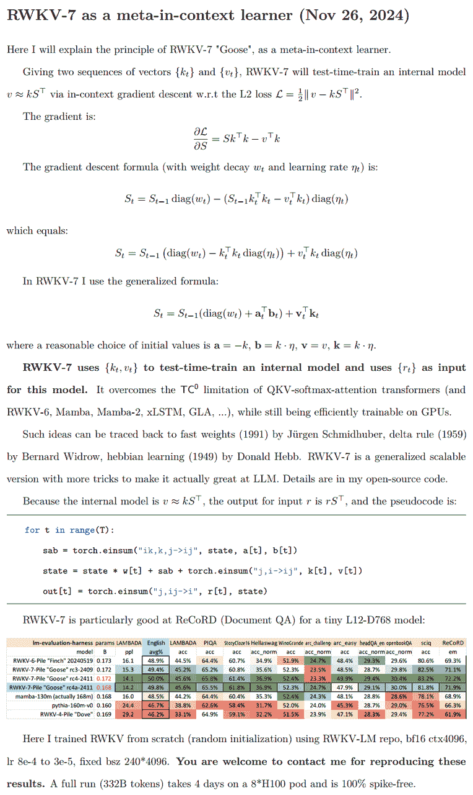

## LLM的并行训练 ：一张GPU不够？那就多张

https://zhuanlan.zhihu.com/p/8438992015

+ 当模型规模达到一定程度后，单个GPU计算效率低，就有了并行化的需求

+ 最直接的思路就是数据并行，和大数据领域的MapReduce是异曲同工的，比较直观，实现也相对简单，但比较浪费内存

+ 微软的Deepspeed提出的ZeRO技术是针对数据并行的内存进行优化的方法，核心思路是用少量通信带宽损耗换取大量内存节省

+ 2023年微软继续提出了优化方案ZeRO++，核心的优化思路有两条：量化和利用节点内带宽，减少跨节点带宽

+ 当模型规模大到无法在一张GPU上保存整个模型时，仅仅依靠数据并行是不够的，必须进行模型并行了，模型并行又有两种常见的种类：流水线并行和张量并行

+ 3D并行：数据并行、流水线并行、张量并行各有优劣，3D并行就是把它们融合起来，取长补短

+ 微软的DeepSpeed和英伟达的Megatron-LM是两个用于训练大型模型的开源框架，DeepSpeed强在数据并行，也支持模型并行，Megatron强在模型并行，适合训练超大规模的模型，它们也可以配合使用

# 招聘公告

---

**奇绩创坛由陆奇博士**于2019年创立，使命是在源头最大化驱动创新。奇绩研究组将研究模型理论、到投研战略分析、市场策划等不同背景的同学聚在一起，搭建GenAI时代独特的跨界人才社群。

## 🚀F24实习岗位

### [行研-学术科研人才交流组实习生](https://miracleplus.feishu.cn/docx/Yn6rdf2iOoY2Rcx8yVNcUBYRnch#part-QkMcdeJmuob9uvxvV3qcLSzHn8g)

### 行研-GenAI研究岗位-战略分析（偏产品）

### Web / AI 全栈开发工程师实习生

## **火热开放中🚀**

### 行研-GenAI研究岗位-前沿学术探索

### 行研-GenAI研究岗位-战略分析（偏咨询）

### 创新活动产品运营 （大模型系列活动产品运营）

> **点击**相关岗位可查看对应**岗位需求【JD】**；**相关岗位投递请扫描二维码**

> 欢迎**推荐/自荐**

> 期待在**奇绩创坛**遇见更好的你

---

# 声明

本文档仅供学习交流使用，版权归原作者所有，若涉侵权，请联系Jack Jin 15101136166

（欢迎在下方反馈您宝贵的意见！整理不易，觉得有用给AI日报小组点个赞👍吧！）

ChatGPT；Angela；Zijia Liu；Alex；Zeqi Tan；Tiezhen（HuggingFace）；Naixu；Lizhi；Peter；Suoman；Jack

学术分析报告：ResearchFlow -- 奇绩F23校友的开发的深度研究产品，PC端进入RFlow的分析报告，可直接点击节点右侧的小数字展开节点，登录后可在节点上直接“询问AI”，进一步探索深度信息

如果你有大模型相关的创业想法，欢迎来找我们聊聊～🛰️：15101136166

> 快邀请你的小伙伴们一起来读大模型日报吧！

> **【日报知识库】**这里是近期日报内容的汇总,欢迎大家查阅

> [大模型日报知识库(分享版)](https://miracleplus.feishu.cn/wiki/KapVwXfkriOBiskB0B2cUHxjnTh)

>

> 欢迎大家多多帮我们分享,转发

> 如果大家有任何的建议或者吐槽,欢迎随时找我聊天~

