# 奇绩大模型日报（11月 27日）

> 来源：[https://miracleplus.feishu.cn/docx/YxOPdXQPQo3VqUxHTBacgXFunmh](https://miracleplus.feishu.cn/docx/YxOPdXQPQo3VqUxHTBacgXFunmh)

## 资讯

### AI2 发布新一代语言模型 OLMo 2，挑战 Meta 的 LLaMA

https://techcrunch.com/2024/11/26/ai2-releases-new-language-models-competitive-with-metas-llama/

AI2（由已故保罗·艾伦创办的非营利性人工智能研究组织）近日发布了其最新的语言模型家族——OLMo 2，作为 OLmo 系列的第二代模型。这些模型符合开放源代码的定义，所有开发过程中使用的数据、工具和训练代码均可公开获取。与 Meta 的 LLaMA 等模型相比，OLMo 2 具有一定的竞争力，并且在公开模型中表现突出。

OLMo 2 包括两个版本：7B 和 13B，分别具有 70 亿和 130 亿个参数，参数越多，模型的表现通常越好。Ai2 使用了包含 5 万亿个标记的训练数据集，数据来源包括经过筛选的高质量网站、学术论文、问答讨论板以及数学工作簿（包括合成和人工生成的数据）。训练数据的公开透明，确保了模型的可复现性和创新性。

根据 Ai2 的说法，OLMo 2 在各项任务的表现上都明显优于之前的版本，尤其是 OLMo 2 7B 在某些任务中超越了 Meta 的 LLaMA 3.1 8B。Ai2 还表示，OLMo 2 是目前最优秀的完全开源的语言模型，所有模型和组件均可以在其官网上免费下载，并可在 Apache 2.0 许可下商业使用。

虽然开源模型的安全性和潜在滥用问题曾引发讨论（例如 LLaMA 模型被中国研究人员用于开发防御工具），Ai2 方面认为，开源的好处大于潜在风险。AI2 的工程师 Dirk Groeneveld 认为，开源不仅有助于技术进步和模型验证，还有助于实现更为公平的技术访问，避免权力过度集中。

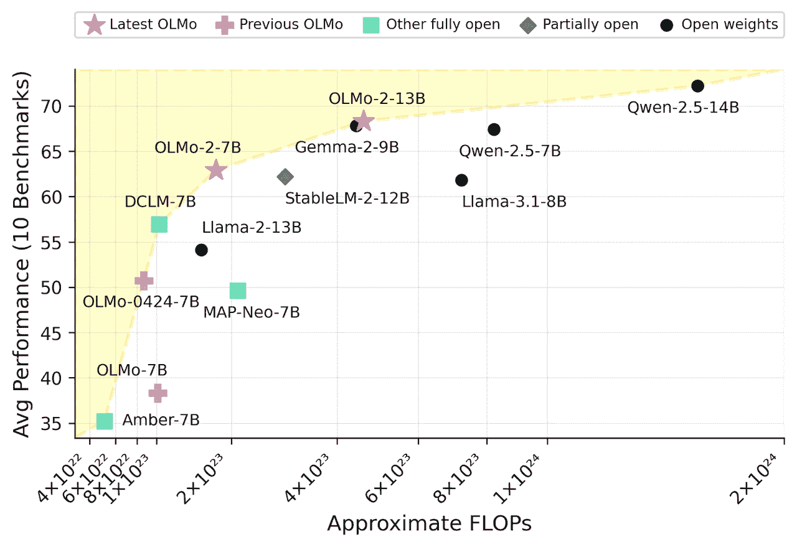

### 艺术家似乎泄露了 OpenAI 的 Sora 视频生成器

https://techcrunch.com/2024/11/26/artists-appears-to-have-leaked-access-to-openais-sora/

近日，一群艺术家通过开发一个前端界面，似乎泄露了 OpenAI 尚未公开发布的视频生成器 Sora的访问权限。该项目发布于 Hugging Face 平台，使用了通过早期访问系统获得的身份验证令牌。通过这个前端，用户可以通过输入简短的文本描述，生成最多 10 秒、1080p 分辨率的视频。尽管该系统在 TechCrunch 尝试时排队很长，但已有部分 X 平台用户上传了样本视频，其中大多数带有 OpenAI 独特的水印。

该泄露事件背后，一群名为“Sora PR Puppets”的艺术家表示，他们的举动是为了抗议 OpenAI 在 Sora 项目中所表现出的虚伪和“艺术洗涤”行为。该群体指控 OpenAI 强迫早期测试者，特别是包括红队和创意合作伙伴在内的参与者，制造关于 Sora 的正面宣传，而没有为他们的工作提供公平的报酬。艺术家们指出，成千上万的艺术家通过测试、反馈和实验为一个估值 1500 亿美元的公司提供了无偿劳动，而 OpenAI 将这一早期访问项目视为公关和广告的工具，而非真正的创意表达。

除了对 OpenAI 没有公平补偿的指控，艺术家们还批评该公司对 Sora 的能力存在误导性宣传。所有使用 Sora 生成的视频都需要 OpenAI 的批准才能公开分享，而且只有少数创作者会被选中展示他们的作品。对此，OpenAI 发表声明称，Sora 目前处于“研究预览”阶段，公司正在努力平衡创意性与安全性，并表示，参与者自愿参与该计划，且不强制要求提供反馈或使用工具。

尽管 Sora 在技术上面临挑战，例如生成速度较慢、风格一致性差等问题，OpenAI 已表示将继续优化模型，尤其是在视频生成质量方面。此外，OpenAI 最近也失去了与视频生成领域竞争对手的一些合作机会，比如与 Lionsgate 电影公司签订合作协议的 Runway。

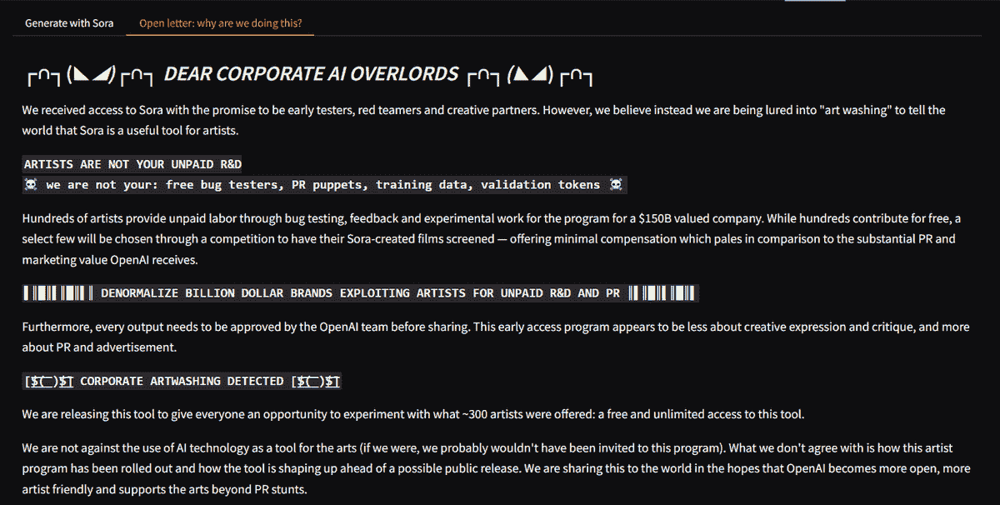

### Meta开源大礼包！全面覆盖图像分割、语音、文本、表征、材料发现、密码安全性等

https://mp.weixin.qq.com/s/-J6fvBVJhx56RrcYo2G_sw

**Segment Anything** Model 2.1 (SAM 2.1)

SAM 2.1继承并强化了SAM 2的优势，特别是在图像和视频的物体分割上取得了显著进展。通过引入数据增强技术来提高视觉相似物体和小物体的处理能力，并在长序列帧上进行训练，SAM 2.1在遮挡处理能力上有所提升。此外，SAM 2的开发者套件开源，使得开发者能够更加便捷地在自己的数据上进行微调，推动了图像分割领域的应用发展。

Spirit LM: 语音与文本的多模态语言模型

Spirit LM是Meta的第一个多模态语言模型，能够在语音和文本之间自由切换，并生成富有表现力的语音。通过逐词交错训练，Spirit LM在文本到语音（TTS）和语音到文本（ASR）的生成中取得了突破，尤其在处理情感语调方面（如兴奋、愤怒等）表现优异，推动了语音生成的自然度和表达能力。

Layer Skip: 模型生成加速

为了解决大型语言模型在高计算和内存消耗方面的问题，Meta提出了层跳过（Layer Skip）技术。这一方法通过跳过部分模型层来加速生成过程，优化了运行时性能，特别是在低资源环境中对模型的运行效率有显著提升。开源的推理代码和训练检查点也为研究人员提供了有价值的工具，提升了模型的运行速度和准确性。

**Salsa: 后量子密码学研究**

在密码学领域，Meta开源了Salsa工具，它能够对NIST标准中的密码系统进行安全性测试，尤其是在抗人工智能攻击方面表现突出。Salsa为密码学研究提供了新的视角，帮助学术界在新型攻击手段面前保持领先。

Meta Lingua: 高效模型训练平台

Meta Lingua是一个用于大规模语言模型训练的轻量级平台，致力于简化AI研究中的实验设置。它提供了模块化和自包含的代码库，支持高效的模型训练，并且可以快速测试和实现研究者的想法，极大地加速了AI研究的迭代过程。

Meta Open Materials 2024: 加速材料发现

Meta还开源了Open Materials 2024数据集和模型，旨在通过AI加速无机材料的发现。这个数据集和模型基于超过1亿个训练样本，能够为材料科学领域的研究者提供强有力的支持，推动材料发现领域的突破。

Mexma: 改进的跨语言句子表征模型

Mexma通过结合token级和句子级的目标训练，提升了跨语言句子编码器的性能，使得在处理多语言文本时更加精确。该模型支持80种语言，并在多个下游任务中表现优异。

Self-Taught Evaluator: 生成奖励模型

Self-Taught Evaluator通过生成合成数据训练奖励模型，避免了人工标注的依赖。通过迭代优化，该模型在多个评估任务中表现超越了现有的基准模型，提升了训练效率和准确性。

### 华为车 BU 前首席科学家陈亦伦创业，做具身智能

https://mp.weixin.qq.com/s/YhcjgaQEoDeRafV49L1N1w

陈亦伦，曾是华为智能驾驶团队的核心人物，主导了第一代智能驾驶系统 ADS 1.0 的研发，并在华为车 BU 任职自动驾驶系统 CTO。2022 年他离开华为后，转向学术界，担任清华大学智能产业研究院的智能机器人方向首席专家，致力于将人工智能与机器人结合，推动技术创新。今年，他与前同事丁文超共同创办了智能创业公司“它石智航”，专注于具身智能。陈亦伦认为，智能机器人将成为AI在硬件上的重要表现，未来将深刻影响生产和生活。该公司目前正在进行首轮融资，团队成员主要来自清华和复旦。清华 AIR 对科技成果的产业转化有明确要求，而陈亦伦的创业正是这一目标的体现。

## 推特

### Watney Robotics分享远程操控机器人叠衣服：距离超过7000英里

贡献人：

https://x.com/watneyrobotics/status/1861170411788226948

折叠！折叠！折叠！

这是我们远程操控的实时部署之一的夜间延时视频，距离超过7000英里。我们的机器人全年无休，全天候运行，无需人工干预，轻松应对长尾边缘案例且零停机时间。

[sLlF9tfyreiiETtr.mp4](https://internal-api-drive-stream.feishu.cn/space/api/box/stream/download/all/O60ebVqk9ooNepxf4PTcYFZxnzc)

### 自定义Claude的回复方式推出：选择简洁、详尽或正式

贡献人：

https://x.com/AnthropicAI/status/1861474224151445927

通过风格设置，您现在可以自定义Claude的回复方式。

选择新的预设选项：简洁、详尽或正式。

[zvAWsXTu5K5R0A6N.mp4](https://internal-api-drive-stream.feishu.cn/space/api/box/stream/download/all/ZaHCbSlLBo5qdgxetZCcHoDdnDb)

### OpenAI Jason Wei预测：在未来一年内，人工智能的关注重点将从一般用户的普及转向加速科学与工程的能力

贡献人：

https://x.com/_jasonwei/status/1861496796314493376

预测：在未来一年内，人工智能的关注重点将从一般用户的普及转向加速科学与工程的能力。

过去两年里，重点在于用户群体的扩大和公众的广泛采用。这是非常自然的，因为用户增长是任何商业模式的关键部分。但到目前为止，我认为大型语言模型（LLM）的普及已经非常广泛：对于地球上大多数人的普通查询，许多LLM都能给出相当不错的回答。

在接下来的五年里，我认为焦点将转向AI加速工程和科学研究的能力，因为这是技术进步的引擎。在任何领域的创新前沿，必然存在许多未解之谜和巨大的改进空间，而更好的AI可以发挥关键作用。赌注会非常高，因为进步是复合累积的，同时AI加速AI研究本身也是一个强大的正反馈循环。

换句话说，用于改进普通用户查询的空间相对有限，但在改进1%的查询（这些查询可以加速技术进步）方面有着巨大的潜力，此外还有一些用户目前想问但因模型不够智能而放弃的问题。AI研究通常会在改进空间大的地方取得突破，而在科学创新方面，这种潜力非常可观。

### 生成式Omnimatte：将视频分解为完整图层的方法，包括对象及其相关效果

贡献人：

https://x.com/jbhuang0604/status/1861490177912471965

介绍生成式Omnimatte：

一种将视频分解为完整图层的方法，包括对象及其相关效果（例如阴影、反射）。

它支持许多酷炫的应用，例如视频风格化、合成、时刻重定时和对象移除。

[VGXNUhPL_XnexOd7.mp4](https://internal-api-drive-stream.feishu.cn/space/api/box/stream/download/all/Em8AbTOhQoKB9IxGiWMcPe2TnXZ)

### SmolVLM：一款全新的2B小型视觉语言模型，可在消费者级GPU上进行微调

贡献人：

https://x.com/mervenoyann/status/1861437851327426942

小而强大！💫

我们发布了SmolVLM：一款全新的2B小型视觉语言模型，专为设备端使用设计，可在消费者级GPU上进行微调，且极其高效地利用内存🤠

## 信号

### IKEA Manuals at Work: 4D Grounding of Assembly Instructions on Internet Videos

https://arxiv.org/abs/2411.11409

形状组装是日常生活中普遍存在的任务，对于构建宜家家具等复杂的 3D 结构至关重要。虽然在开发用于形状组装的自主代理方面取得了重大进展，但现有数据集尚未解决视频中组装说明的 4D 基础问题，这对于全面了解 3D 空间中的组装随时间的变化至关重要。我们介绍了宜家视频手册，这是一个数据集，其中包含家具零件的 3D 模型、说明手册、来自互联网的组装视频，最重要的是，这些数据模式之间密集的时空对齐的注释。为了展示宜家视频手册的实用性，我们介绍了形状组装所必需的五个应用：组装计划生成、零件条件分割、零件条件姿势估计、视频对象分割和基于说明视频手册的家具组装。对于每个应用，我们都提供了评估指标和基线方法。通过对我们注释的数据进行实验，我们强调了在视频中基础组装说明以改进形状组装的许多挑战，包括处理遮挡、变化的视点和扩展的组装序列。

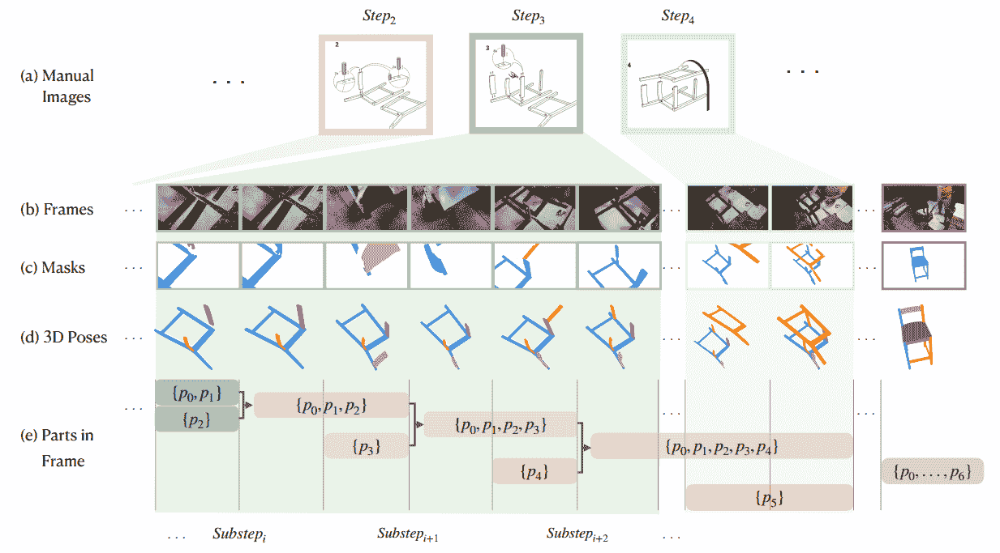

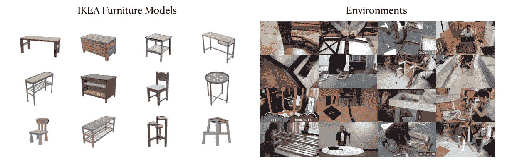

### Enhancing LLM Reasoning via Critique Models with Test-Time and Training-Time Supervision

https://arxiv.org/abs/2411.16579

训练大型语言模型 (LLM) 以在回答之前花更多时间思考和反思对于有效解决科学、编码和数学等领域的复杂推理任务至关重要。然而，自我反思和自我纠正等机制的有效性取决于模型准确评估自身表现的能力，而这可能受到初始准确性、问题难度和缺乏外部反馈等因素的限制。在本文中，我们深入研究了一种双人范式，将推理和批评模型的角色分开，其中批评模型提供步骤级反馈，以在测试时间和训练时间监督推理（参与者）模型。我们首先提出了 AutoMathCritique，这是一个用于收集批评数据的自动化和可扩展框架，从而产生了一个数据集76,321响应与步骤级反馈配对。使用此数据集对语言模型进行微调使它们能够为数学推理生成自然语言反馈。我们证明，批评模型在测试时持续提高参与者在困难查询上的表现，特别是在扩大推理时间计算时。受这些发现的启发，我们将基于批评的监督引入到参与者的自我训练过程，并提出了一种循环内批评的自我改进方法。实验表明，该方法提高了参与者的探索效率和解决方案的多样性，特别是在具有挑战性的查询上，从而产生了更强大的推理模型。最后，我们迈出初步步伐，探索通过批评监督训练自言自语推理模型并展示其潜力。

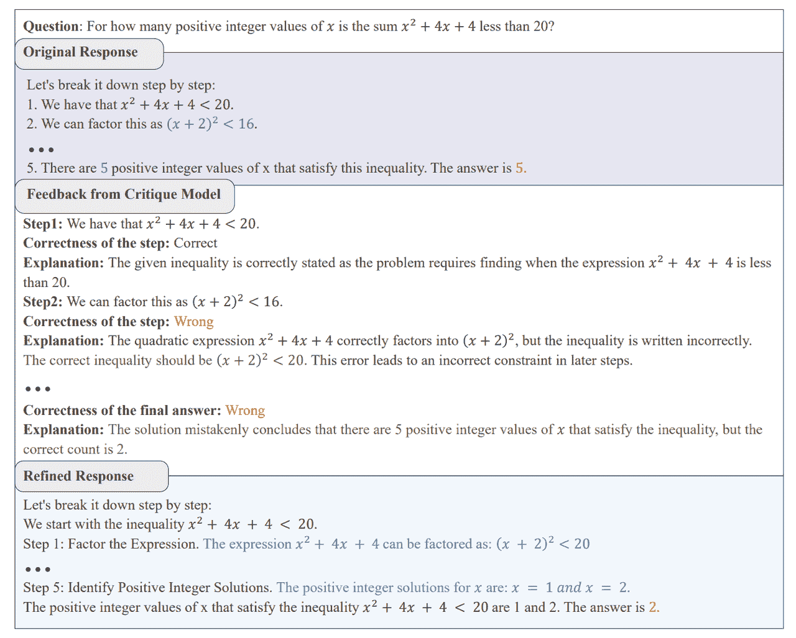

## 产品

### Nfig

贡献人：

https://nfig.ai

Nfig AI 是由 Arjun Menon 和 Maneesh Shaji 共同创办的下一代平台，希望通过自然语言简化 AI 代理与动态网页的交互。该平台提供了一个开发者友好的 API，使得网页自动化变得无缝、可靠且可扩展。Nfig 提供两种自动化模式：Lite Mode（快速、受控的自动化）和 Advanced Mode（目标导向的自动化），支持多种用例，包括视频回答、市场研究和客户培训等。用户可以通过 SDK、API 或 UI 玩具进行操作，享受灵活的部署和数据导出功能。

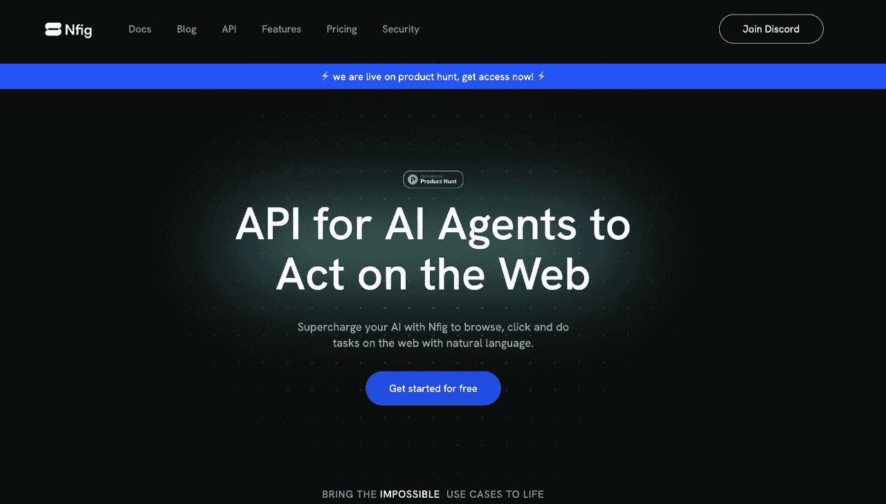

### Agentplace

贡献人：

https://agentplace.io/

Agentplace 是一个平台，允许用户仅通过文本指令创建互动的 AI 驱动网站和应用。创始人 Vlad Yan 认为，网站不仅应展示信息，还应实时适应和与用户互动。该平台的主要特点包括：无需复杂编码即可创建自适应网站，实时内容和界面根据用户输入进行调整，以及直观的语音和文本交互。

## HuggingFace&Github

### Ant Design X

贡献人：

https://github.com/ant-design/x

Ant Design X 是一个基于最佳实践的企业级 AI 产品的交互界面构建工具。它提供了丰富的组件、模型集成能力、高效对话数据流管理以及完整的 TypeScript 支持，帮助开发者快速构建个性化的 AI 交互界面

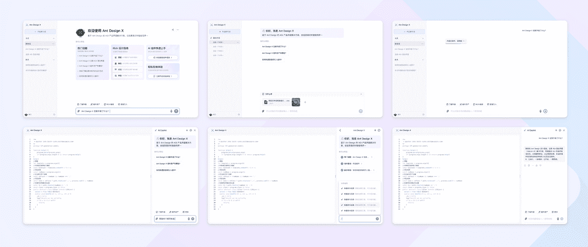

## 投融资

### Meesho 利用 AI 技术将客户电话成本降低 75%

https://techcrunch.com/2024/11/26/ai-helps-indias-meesho-cut-customer-call-costs-by-75/

印度电子商务平台 Meesho，获得软银等投资的支持，推出了一款 AI 驱动的语音机器人，旨在大幅降低客户电话成本，达到了 75% 的成本削减。这一举措是公司整体战略的一部分，旨在通过优化客户支持操作，提升用户体验。这款生成型 AI（GenAI）系统每天处理约 60,000 个英语和印地语的客户电话，结合了大语言模型（LLM）与定制组件，能够理解本地语言的细微差别。该机器人实现了全天候支持，并且具有 95% 的查询解决率，只有 5% 的电话需要人工干预。

Meesho 拥有超过 1.6 亿用户，其中 80% 位于印度的较小城市和乡村。因此，提升客户服务一直是公司重点关注的领域。通过自动化客户互动，Meesho 将电话处理时间减少了 50%，同时客户满意度提高了 10%。目前，公司市值为 49 亿美元，计划扩大语音机器人的语言支持，未来将增加更多印度地方语言的支持。

Meesho 的这一 AI 创新是印度科技公司如何通过生成型 AI 提高运营效率的一个典型例子。尽管 Meesho 并未自行开发大型语言模型，但其采用现成的 LLM 的方法显示了 AI 在新兴市场电子商务和客户支持中的日益重要性。

**投融资亮点**：Meesho 获得了包括软银、Elevation Capital 和 Prosus 等投资者的支持。平台已实现正向现金流，并通过 AI 驱动的效率提升，继续扩大其运营规模，随着用户基础的增长，其盈利能力有望进一步增强。

公司官网：`https://www.meesho.com/`

# 学习

## GPT-2 推理加速计算

贡献人：`https://www.njkumar.com/calculating-gpt2s-inference-speedups/`

本文讨论了如何优化和计算 `GPT-2` 模型推理的加速。在计算机器学习模型推理速度时，尤其是像 `GPT-2` 这样的语言生成模型，作者强调了硬件加速、并行化技术和实现细节。主要关注以下几个方面：

### 硬件与框架优化

- **硬件加速**：文章指出，使用更强的硬件（如最新的 GPU）是提升推理速度的主要因素之一。通过更高效的硬件，模型可以更快地执行计算任务，减少推理时间。

- `CUDA` 优化：作者解释了如何利用 NVIDIA `CUDA` 库来优化 GPU 上的计算效率。通过这种优化，模型能在 GPU 上实现更高的吞吐量。

### 并行计算

- **数据并行性**：使用多线程和数据并行化可以显著提高推理速度，尤其是在处理大规模文本时。通过在多个计算单元之间分配计算任务，可以充分利用每个计算单元的处理能力。

- **模型并行性**：`GPT-2` 是一个非常大的模型，单个 GPU 很难一次性加载所有数据。通过将模型分割到多个设备中运行，减少了每个设备的负担，提升了整体速度。

### 优化策略

- **混合精度计算**：作者介绍了如何使用混合精度计算（如 `FP16`），这不仅减少了内存占用，还提高了计算速度。通过降低计算精度，可以在保持推理准确度的前提下大幅提高速度。

- `Batching` 技术：批处理技术通过同时处理多个请求，使得推理过程中的 I/O 操作更高效，从而减少了总的处理时间。

### 推理速度评估

- 文章详细分析了在不同优化方案下 `GPT-2` 模型的推理速度提升。例如，通过启用高效的硬件和优化计算框架，推理速度可以提升至原来的数倍。

- 通过对比不同配置下的性能数据，明确了 GPU 型号、批量大小、精度等因素如何影响推理速度。

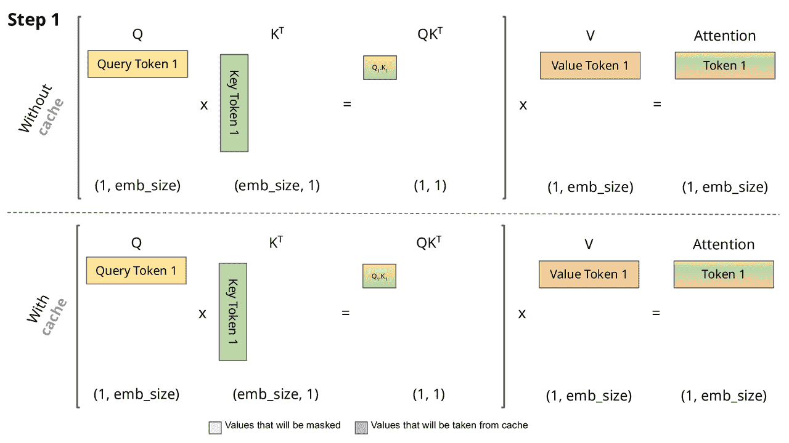

## 本周阅读的计算机视觉领域论文

`https://www.artfintel.com/p/papers-ive-read-this-week-vision`

这篇文章列举了作者本周阅读的几篇计算机视觉领域的论文，主要关注深度学习、图像生成与优化方法。以下是技术细节的总结：

### `RCAN`: Image Super-Resolution Using Very Deep Residual Channel Attention Networks

该论文提出了一种基于残差网络的图像超分辨率方法，使用通道注意力机制来提高图像重建质量。通过引入残差学习，网络能够在深层网络结构中避免梯度消失，增强了信息传递效果。

### `BOW`: Learning Representations by Predicting Bags of Visual Words

这篇论文提出了一种新的自监督学习方法，通过预测视觉单词包（`BOW`）来训练图像特征。该方法不仅增强了特征学习的能力，还提升了模型的泛化性能，适用于无标签数据。

### `Self-Supervised Learning for Medical Image Analysis: A Review`

本文回顾了自监督学习在医学影像分析中的应用，强调了自监督学习在数据稀缺领域的优势。该方法能够在不依赖人工标注的情况下，通过未标注的影像数据提取出有价值的特征。

### `Exploring the Relationship Between Network Depth and Accuracy in Convolutional Neural Networks`

这篇论文研究了卷积神经网络中网络深度与模型准确性之间的关系。研究表明，过深的网络可能导致信息过度拟合或梯度消失，提出了一些优化技巧来平衡深度和计算复杂度。

### `GANs`: Generative Adversarial Networks for Image-to-Image Translation

本文探讨了生成对抗网络（`GANs`）在图像到图像翻译任务中的应用，特别是在图像增强、风格转换等领域的成功。作者提出了改进的 `GAN` 架构，使得生成的图像更加真实，且训练过程稳定。

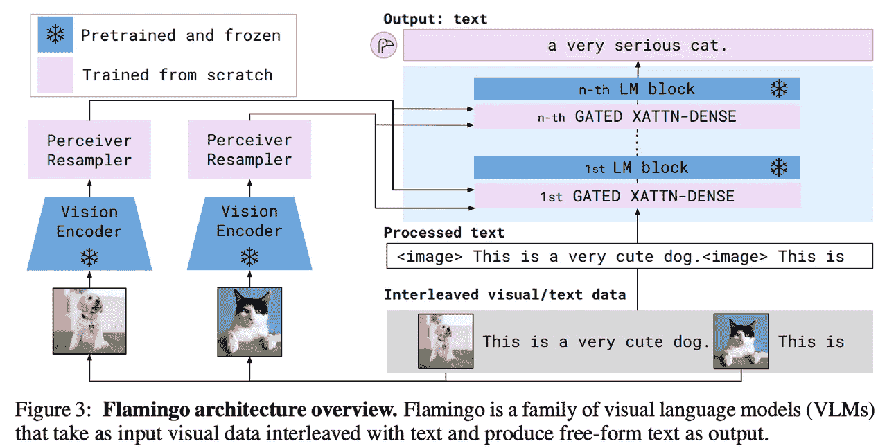

## 强化学习基础

`https://sites.google.com/view/rlfoundations/home`

《强化学习：基础》是一本提供强化学习系统化介绍的书籍，旨在为高年级本科生提供深入而自包含的学习材料。该书基于特拉维夫大学和以色列理工学院的教学经验，涵盖了强化学习的核心理论和实践内容。书中的内容精确而完整，适合用于高级本科课程的教学。作者包括 Shie Mannor、Yishay Mansour 和 Aviv Tamar。

### 书籍内容亮点

- **强化学习概述**：本书对强化学习进行了详细的分析，从基础概念到进阶算法都有涵盖。

- **课程与实践结合**：内容源自多年来在大学的教学实践，并且通过大量的习题和实例帮助学生更好地理解理论知识。

- **书籍引用**：提供了学术引用格式，方便读者进行学术研究时引用该书。

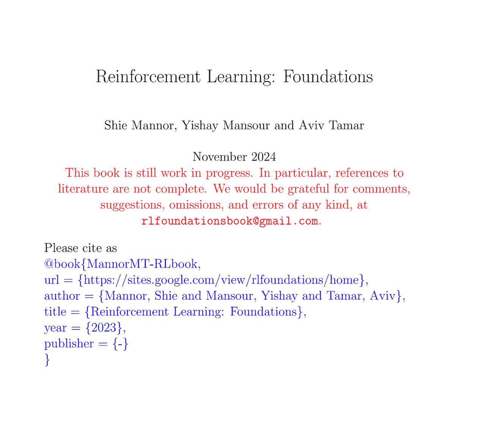

## O1复现之旅-part 2 通过简单蒸馏是超越 `O1-preview` 的巨大进步还是苦涩教训？

`https://zhuanlan.zhihu.com/p/9229809205`

本文批判性地审视了当前复制 OpenAI `O1` 模型能力的方法，尤其聚焦于未公开的知识蒸馏技术。通过 `O1` API 蒸馏与监督微调结合，研究在复杂的数学推理任务中取得了优异表现，超越了 `O1` 预览版，且技术复杂度低。实验表明，在数万个蒸馏样本基础上微调的基础模型，在全美邀请数学考试（`AIME`）中表现优异，且展现出强大的泛化能力，包括在开放域问答、幻觉及安全性任务中的表现。尽管模型仅在数学问题上训练，但其问答任务中的泛化能力也令人印象深刻。此外，研究揭示了依赖蒸馏方法的局限性，尤其是对基础模型的依赖，限制了模型的创新能力。

本文的贡献包括：（1）对蒸馏过程及其有效性的详细技术阐述；（2）建立了一个框架用于评估 `O1` 复制技术的透明度和可重复性；（3）批判性讨论了蒸馏方法的局限性。我们强调，尽管提升 AI 性能至关重要，但培养具备第一性原理思维的研究人员同样重要，这对 AI 的未来发展具有深远影响。

在 `O1` 复现工作中，我们提出了“旅程学习”方法，利用树形搜索算法生成推理路径，结合大语言模型（`LLM`）对结果进行反思与纠错。此外，我们还探索了几种替代方法，如标注完整人类思维过程、多智能体方法和高级模型蒸馏，发现蒸馏方法是获取高质量数据的经济有效方式。

在数据准备方面，我们精选了奥运级别难度的数学问题，并进行了重格式化，确保模型能够生成详尽的推理过程。微调阶段包括初步监督微调（`SFT`）和蒸馏数据的进一步微调，确保模型的推理能力和输出一致性。基准测试采用了 `MATH`、`AIME` 和 `CNHS` 等挑战性数据集，并提出了推理时间缩放的评估指标，确保评估的公正性和可扩展性。

与 `O1` 模型的比较显示，在相似的推理计算成本下，蒸馏模型在 `AIME2024` 上表现超越 `O1` 预览版，虽然与 `O1-mini` 在数学推理方面仍有差距。研究表明，尽管蒸馏方法能带来显著的性能提升，但过度依赖现有强大模型可能会导致技术停滞，阻碍真正的创新。

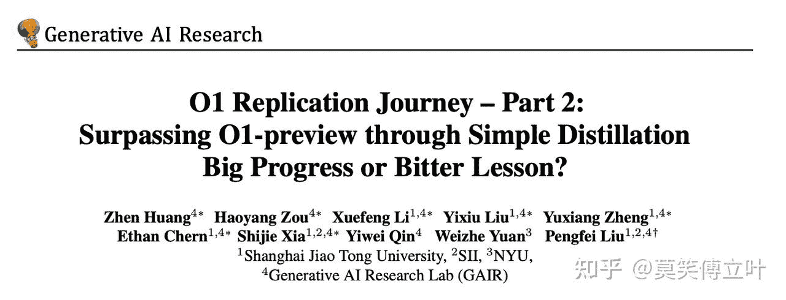

## prefix 场景 `Attention` 优化

`https://zhuanlan.zhihu.com/p/718256070`

`RelayAttention` 主要优化了在解码阶段的 `attention` 计算，特别是针对系统提示（system prompt）中多个请求共享相同前缀（prefix）部分的场景。传统的 `attention` 算子（如 `PageAttention`、`FlashAttention`）在处理一个 batch 中的多个请求时，往往需要多次从显存中加载相同的 system prompt 的 `kvcache`，这样不仅增加了内存访问的复杂度，还降低了计算效率，因为每个请求都要单独执行矩阵-向量（`GEMV`）运算。

`RelayAttention` 的优化方式在于：

1. 将 system prompt 的 `kvcache` 一次性加载到 GPU 的 shared memory 中，避免了每次解码时都从显存读取相同的数据，从而将内存访问复杂度从 O(N) 降低到 O(1)，大幅提升了访存效率。

2. 将 `attention` 计算分为两部分：共享前缀部分和独有后缀部分。对于共享前缀部分，多个请求的 query 可以共享相同的 key 和 value，从而将原本的 `GEMV` 矩阵-向量操作合并为一个 `GEMM` 矩阵-矩阵操作，这样能够充分利用 CUDA 的 tensor core 进行高效计算。而对于每个请求独有的后缀部分，仍然需要按照传统方式进行计算。

3. 最后，将共享前缀部分和独有后缀部分的 `attention` 计算结果进行合并，类似于 `FlashAttention` 的分块思想。

这样，`RelayAttention` 通过减少不必要的内存访问，提升了计算效率，尤其是在处理长文本和多个请求时，显著优化了内存利用率和计算速度。

在处理大量共享前缀的推理任务时，`Cascade Inference` 进一步优化了内存和计算的效率。许多 `LLM` 推理任务需要基于相同的系统提示生成多个独立的文本，例如自一致性（self-consistency）或思维树（tree of thought）任务。共享前缀会导致内存占用和计算耗时增大，特别是当共享前缀非常长时。当前一些方法（如 `vLLM`）通过只保存共享前缀的一个副本来减小内存占用，但这些方法在访问 `kvcache` 时依然没有充分优化，因此效率不高。

`Cascade Inference` 通过将共享前缀的 `attention` 计算与独有后缀的 `attention` 计算解耦，并将共享前缀的 `kvcache` 存储在 GPU 的 shared memory 中，提升了访存效率。这一优化相比 `vLLM` 的 `PageAttention` 实现提高了 31 倍，相比没有使用 cascade 功能的 `FlashInfer` 的 batch 解码算子提升了 26 倍。

对于多查询（`MQA`）和单查询（`SQA`）核函数的实现，`MQA` 适合多个 query 共享相同的 `kvcache`，而 `SQA` 适合每个 query 有独立的 `kvcache`。由于共享前缀的 batch 解码无法完全适用这两种方式，`RelayAttention` 结合了两者的优势：`MQA` 处理共享前缀部分的 `attention` 计算，`SQA` 处理每个请求独有后缀部分的 `attention` 计算，从而在保证高效内存访问的同时，也能处理独立请求的计算需求。

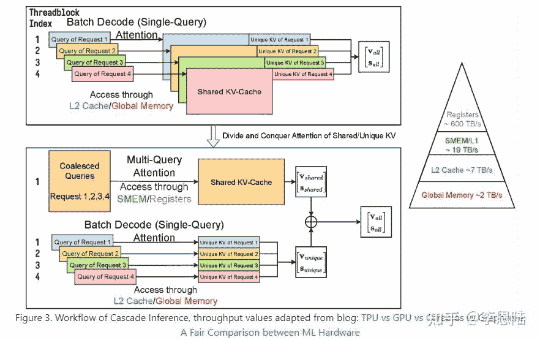

## SANA：高分辨率文生图的线性扩散模型

`https://zhuanlan.zhihu.com/p/1265668585`

`Sana` 模型是一种新型的高分辨率文生图生成模型，基于扩散模型，通过高效的训练与推理，能够快速生成 1K（1024×1024）和 4K（4096×4096）分辨率的图像，且部署在较小的设备上如笔记本 GPU 上。`Sana` 模型的关键创新包括高效的 32 倍压缩率 `AutoEncoder`、线性注意力的 `Linear DiT`、以及采用 `Decoder-only` 的大型语言模型（`LLM`）作为文本编码器。

首先，`Sana` 通过使用 32 倍压缩率的 `AutoEncoder`（`AE-F32`）显著减少了潜在 token 的数量，这对高分辨率图像的生成至关重要。传统的 `AutoEncoder` 通常压缩比例为 8 倍，而 `Sana` 的创新使得训练和生成过程变得更加高效。其次，`Sana` 引入了线性注意力（`Linear DiT`）来替代传统的自注意力（`Self-Attention`），大幅提升高分辨率生成时的计算效率。在此基础上，`Mix-FFN` 模块通过 3×3 的深度卷积增强了局部信息聚合能力，同时移除了位置编码（`NoPE`），实现了在不损失性能的前提下简化模型。

另外，`Sana` 还采用了基于 `Gemma-2` 的小型 `Decoder-only` `LLM` 作为文本编码器，相较于传统的 `T5` 编码器，`Gemma-2` 展现了更高效的推理速度和较好的文本理解能力，能够更有效地跟踪和理解复杂的人类指令。最终，`Sana` 通过高效的训练策略和采样方法，如 `Flow-DPM-Solver` 和基于 `ClipScore` 的自动标记系统，进一步提高了图像与文本的对齐度和训练的收敛性。

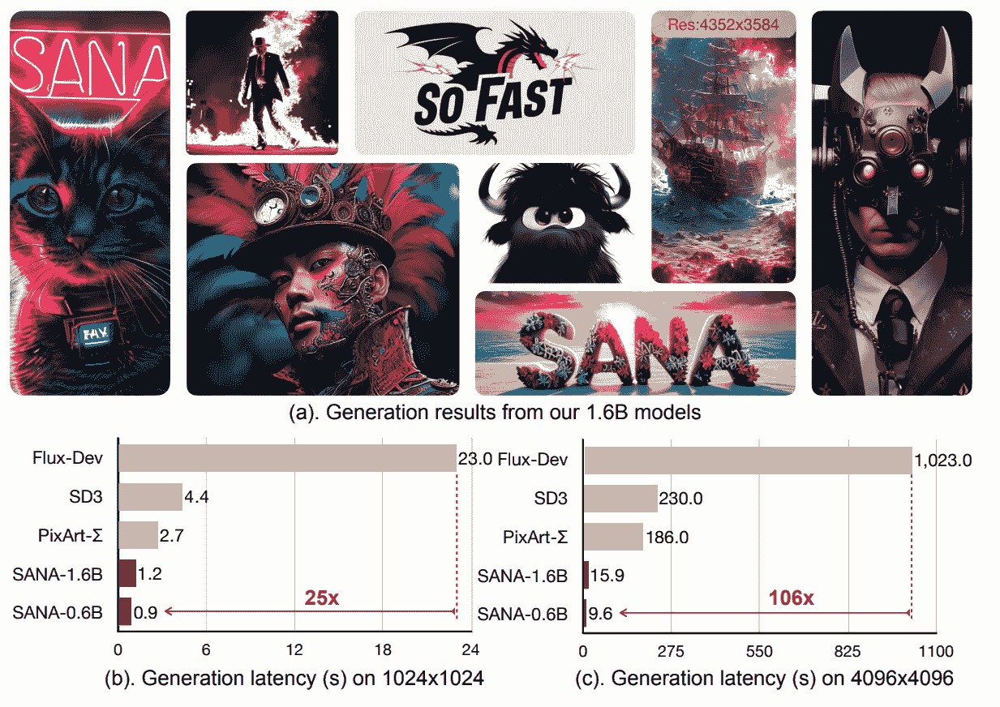

# 招聘公告

---

奇绩创坛由陆奇博士于 2019 年创立，使命是在源头最大化驱动创新。奇绩研究组将研究模型理论、到投研战略分析、市场策划等不同背景的同学聚在一起，搭建 GenAI 时代独特的跨界人才社群。

## 🚀 F24 实习岗位

### [行研-学术科研人才交流组实习生](https://miracleplus.feishu.cn/docx/Yn6rdf2iOoY2Rcx8yVNcUBYRnch#part-QkMcdeJmuob9uvxvV3qcLSzHn8g)

### 行研-GenAI 研究岗位-战略分析（偏产品）

### Web / AI 全栈开发工程师实习生

## 🚀 火热开放中

### 行研-GenAI 研究岗位-前沿学术探索

### 行研-GenAI 研究岗位-战略分析（偏咨询）

### 创新活动产品运营（大模型系列活动产品运营）

> 点击相关岗位可查看对应岗位需求【JD】；相关岗位投递请扫描二维码

> 欢迎推荐/自荐

> 期待在奇绩创坛遇见更好的你

---

# 声明

本文档仅供学习交流使用，版权归原作者所有，若涉侵权，请联系 Jack Jin 15101136166

（欢迎在下方反馈您宝贵的意见！整理不易，觉得有用给 AI 日报小组点个赞👍吧！）

ChatGPT；Angela；Zijia Liu；Alex；Zeqi Tan；Tiezhen（HuggingFace）；Naixu；Lizhi；Peter；Suoman；Jack

学术分析报告：`ResearchFlow` -- 奇绩 F23 校友的开发的深度研究产品，PC 端进入 `RFlow` 的分析报告，可直接点击节点右侧的小数字展开节点，登录后可在节点上直接“询问 AI”，进一步探索深度信息

如果你有大模型相关的创业想法，欢迎来找我们聊聊～🛰️：15101136166

> 快邀请你的小伙伴们一起来读大模型日报吧！

> 【日报知识库】这里是近期日报内容的汇总，欢迎大家查阅

> [`大模型日报知识库(分享版)`](https://miracleplus.feishu.cn/wiki/KapVwXfkriOBiskB0B2cUHxjnTh)

>

> 欢迎大家多多帮我们分享,转发~~

> 如果大家有任何的建议或者吐槽,欢迎随时找我聊天~

