# 奇绩大模型日报（11月 26日）

> 来源：[https://miracleplus.feishu.cn/docx/MO0ddXsS9o4xsvxgejNcZcrVnnb](https://miracleplus.feishu.cn/docx/MO0ddXsS9o4xsvxgejNcZcrVnnb)

# 推特

### Anthropic推出模型上下文协议：旨在解决将LLM应用与数据连接的难题

贡献人：

https://x.com/alexalbert__/status/1861079762506252723

介绍模型上下文协议（MCP）

这是我们在Anthropic开发的一项开放标准，旨在解决LLM应用中的一个核心难题——如何将它们与您的数据连接。

无需为每个数据源构建自定义集成，MCP提供了一个统一的协议来连接所有数据源：

### 吴恩达分享aisuite：让开发者轻松使用来自多个供应商的大语言模型，只需更改一个字符串选择不同模型

贡献人：

https://x.com/AndrewYNg/status/1861085482526105842

**宣布全新开源 **Python 包：aisuite！

这**款工具让开发者**轻松使用来自多个供应商的大语言模型。在构建应用时，我发现与多个供应商的集成非常麻烦。而 aisuite 只需更改一个字符串即可选择“供应商:模型”，例如 openai:gpt-4o、anthropic:claude-3-5-sonnet-20241022、ollama:llama3.1:8b 等。

安装命令：

pip install aisuite

开源代码与使用说明：

[https://github.c](https://github.com/andrewyng/aisuite)om/andrewyng/aisuite

特别感谢 Rohit Prsad、Kevin Solorio、@standsleeping、Jeff Tang 和 @Johnsanterre 协助完成这个项目！

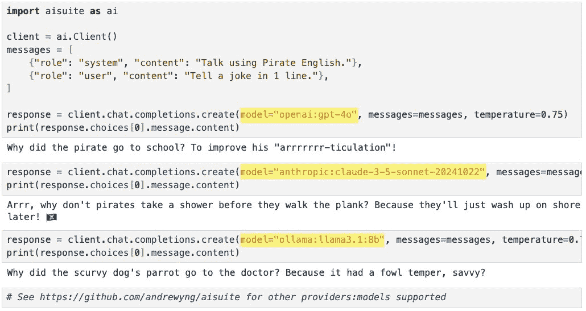

### 钢琴旋律变为人声歌唱？英伟达推出 Fugatto：根据文本和音频输入生成音乐、语音和声音

贡献人：

https://x.com/AndrewCurran_/status/1861075050717389224

### CrewAI分享Awesome CrewAI 仓库：精选开源项目集合

贡献人：

https://x.com/crewAIInc/status/1861096008752734471

我们发布了 **Awesome CrewAI** 仓库——一个由我们精彩社区打造的精选开源项目集合 🌐✨

欢迎贡献、探索，或获取灵感！

👉 h[ttps://github.com/crewA](https://github.com/crewAIInc/awesome-crewai)IInc/awesome-crewai

#开源

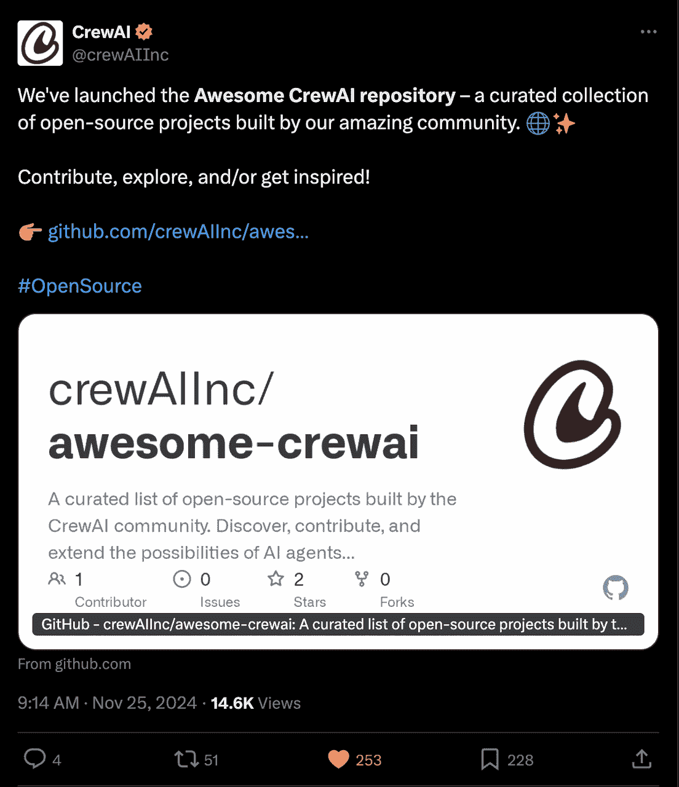

# 资讯

### 大模型创业太累大牛逃回大厂

https://mp.weixin.qq.com/s/aVo_JmBDI5174t1eHqWQrA

Yi Tay，曾是Reka AI的联合创始人，也参与了谷歌大模型PaLM、UL2、Flan-2和Bard的研发，近日宣布回归谷歌，重新担任DeepMind高级研究员。这是他离开谷歌创业一年半后的决定。回顾这一段创业经历，他表示学到了许多在谷歌无法学到的东西，尤其是在基础设施和从零开始训练大模型方面。然而，创业过程中也充满挑战，尽管Reka AI筹集了一亿多美元，但对于一个不到15人的小团队来说，资金和算力依然捉襟见肘。Yi Tay透露，团队甚至一度考虑卖身自救。今年5月，Reka AI被曝与Snowflake洽谈超过10亿美元的收购事宜，但目前收购未成。

Yi Tay个人也经历了艰难的时光，创业初期，妻子怀孕，工作压力大，导致身体健康严重受损，体重增加了15公斤。尽管创业让他获得了不少技术经验，但过度劳累和不健康的生活方式使他决定重新回到谷歌，恢复研究人员的身份。

在Reka AI期间，Yi Tay和团队成功开发了旗舰模型Reka Core，并在Lmsys排行榜中跻身前十，超越了GPT-4的早期版本。然而，公司资源有限，面对竞争日益激烈的环境，他决定回归谷歌，在更为稳定的研究环境中继续他的AI研究。Yi Tay将继续向Quoc Le汇报，并专注于大模型的相关研究。

Yi Tay的回归并非个例。今年8月，谷歌以25亿美元收购了Character.AI的核心技术团队，包括Transformer的主要贡献者Noam Shazeer和Daniel De Freitas。这表明，随着大模型技术的不断发展，越来越多的顶尖技术人才选择回归大厂，利用其充足的资金和算力，专注于高水平的科研工作。

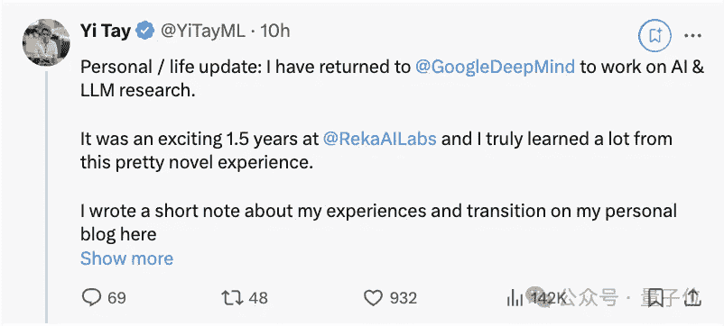

### 陈天奇团队LLM结构化生成新引擎XGrammar

https://mp.weixin.qq.com/s/SvLrhl2pO-iPQdcCJCtmyg

为了有效生成结构化数据（如JSON、SQL等），大模型需要采用特定的格式进行输出，通常通过约束解码来实现。然而，使用上下文无关语法（CFG）进行约束解码在效率上存在问题。针对这一挑战，陈天奇团队提出了XGrammar，一个高效、灵活且可移植的结构化生成引擎，旨在解决使用CFG时的性能瓶颈。XGrammar采用字节级下推自动机（PDA）进行CFG的解释，通过优化结构和预处理策略，大幅提高了生成效率。

传统的约束解码方法需要每个解码步骤都检查词表中的每个token，并且在运行时递归地处理语法结构，效率较低。尤其是在Llama 3.1等大规模模型中，CFG的处理需要大量计算资源，这使得实时生成变得困难。XGrammar通过预计算和缓存大部分上下文无关的token掩码，并将运行时的mask生成与LLM推理过程重叠，从而显著提高了生成速度。

实验结果表明，XGrammar相较于传统方法能够加速每个token的生成，提升端到端推理性能，尤其是在使用JSON格式时，性能提升可达80倍。XGrammar还优化了PDA结构，减少了计算开销，并在多个平台上成功部署，包括WebAssembly，证明其跨平台兼容性。

此外，XGrammar支持在LLM推理框架中无缝集成，能够有效减少约束解码带来的额外开销，实现低延迟、高效能的结构化生成。这使得XGrammar在实际应用中，尤其是结构化生成任务中，表现出极大的潜力，为开发者提供了一种更加高效的解决方案。

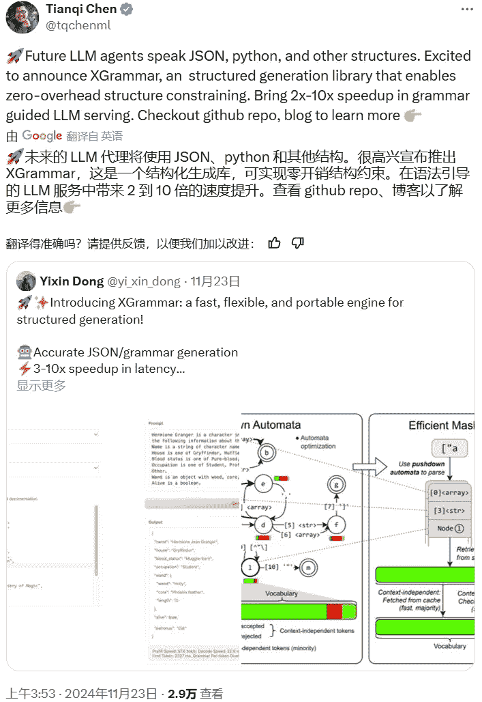

### AI视频两巨头开战！Runway秒生现实大片，Luma动嘴创作电影

[https://mp.weixin.qq.com/s/Zr](https://mp.weixin.qq.com/s/Zr6OQpxvVI7Du8LOXoODeQ)6OQpxvVI7Du8LOXoODeQ

近期，AI视频领域迎来两大重磅更新，分别来自Runway和Luma。Runway推出了Frames，一个基于图像生成的基础模型，使AI生图在风格控制和视觉真实度方面有了显著提升，用户可以创造出具有独特风格且一致的图像变体，轻松设计出各种视觉效果。Frames的应用不再局限于单一风格，它可以为用户提供丰富的创意探索选项，逐步开放中。与此同时，Luma推出了DreamMachine，一个更加自然流畅的创意工具，它打破了传统的提示工程，通过简单的自然语言交互，用户即可将任何创意转化为现实。例如，DreamMachine可以根据用户的要求生成特定场景，如在沙漠中降雨或在玻璃容器中栽种花卉。DreamMachine基于Luma Photon模型，具有极高的效率与速度，并支持图像和视频创作，能够通过角色一致性和视频模型使作品更加生动。Luma的Brainstorm功能也帮助创作者发掘新的创意方向，进一步推动了AI创作的进步。

### Ai2打造科研效率神器OpenScholar

https://mp.weixin.qq.com/s/OIxQt1cK5SZWpYeREkXTZQ

LLM（大语言模型）集成到搜索引擎的应用是当前AI技术发展的热点。多个搜索平台，如Perplexity、谷歌的Gemini、OpenAI的SearchGPT，纷纷推出基于LLM的搜索功能。最近，OpenAI迎来了搜索引擎领域的资深专家Darin Fisher加入，进一步推动了LLM在搜索引擎中的应用，预示着OpenAI可能会发展出一个以LLM为基础的搜索引擎，挑战谷歌的市场主导地位。

然而，尽管LLM在一般知识问答中表现出色，但在学术文献搜索领域仍存在不少问题。学术研究人员更倾向于使用谷歌学术等传统工具，而LLM在文献搜索和引用准确性上仍存在缺陷。为了填补这一空白，华盛顿大学NLP实验室、Ai2和Meta等机构联合开发了OpenScholar，这是一款专门为科研人员设计的学术搜索工具。OpenScholar集成了检索增强技术，通过访问一个包含4500万篇论文的数据库，旨在提高学术搜索和文献综述的准确性，甚至能够媲美人类专家。

OpenScholar通过结合最新的检索增强生成（RAG）技术，采用了三步推理过程：首先从数据库中检索相关文献段落，然后根据这些段落生成初步的响应，再通过反馈机制进行迭代改进。与传统的检索生成模型不同，OpenScholar在此过程中加入了自反馈检索增强推理（elf-feedback），以提升生成结果的准确性和可靠性。此外，OpenScholar的评估基准——ScholarQABench，涵盖了计算机科学、生物学、物理学等多个学科，专门用于评估模型在学术问答中的表现。基准包含了2967个文献综合问题，并提供了由专家撰写的208个长篇回答，确保评估的准确性和可重复性。

OpenScholar的表现经过多方面评估，结果显示，OpenScholar不仅在单篇文献任务中超越了传统模型（如GPT-4o和Llama），在多篇文献任务中的表现也相当出色，且其定制化训练和检索流程使其在多个领域的任务上具有明显优势。尤其是在学术综述和引用准确性方面，OpenScholar的性能远超没有检索增强的GPT-4o，解决了传统LLM在科研任务中面临的幻觉和引用失误问题。

不过，OpenScholar也存在一些局限性。尽管其在多个任务上达到了最先进的性能，但其检索准确性仍不完全稳定，且在基于8B模型的版本中，仍存在知识覆盖和指令遵循的局限。此外，ScholarQABench的规模较小，且主要集中在计算机科学和生物医学领域，未来可能需要扩展到其他学科，并解决评估过程中可能的统计偏差问题。

总体来看，OpenScholar为学术领域带来了革命性的改进，提升了科研文献的检索和综合能力，但仍需在模型训练、数据集扩展等方面进一步优化，才能真正实现全面的学术搜索工具。

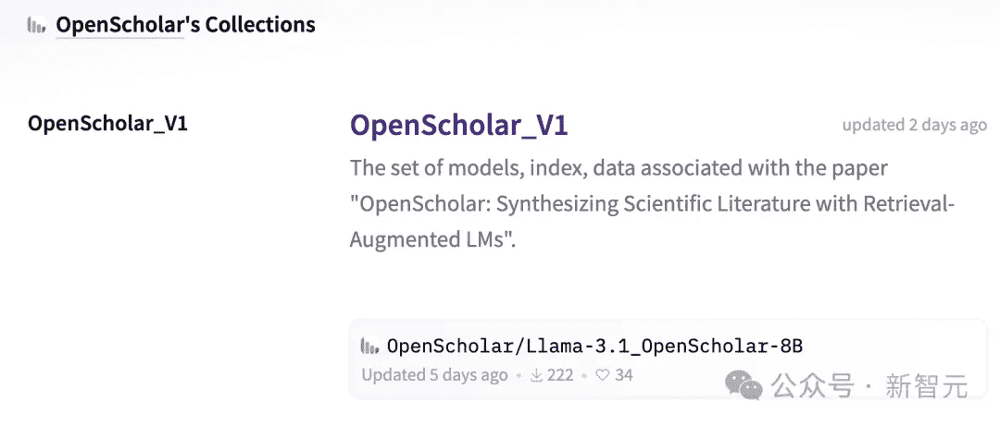

# 信号

### WildLMa: Long Horizon Loco-Manipulation in the Wild

贡献人：

原文链接：https://arxiv.org/abs/2411.15131

学术分析报告：

这篇文章提出了WildLMa，一个旨在实现"自然环境"移动操作的机器人系统，用于在多样化的现实环境中执行复杂操作。WildLMa包括三个组件：（1）通过VR支持全身远程操作和可穿越性适应的低层控制器；（2）WildLMa-Skill，一个通过模仿学习或启发式方法获得的可泛化视觉运动技能库；（3）WildLMa-Planner，一个利用LLM规划器协调技能执行长时间任务的接口。WildLMa通过高质量训练数据，实现了较高的抓取成功率，并利用CLIP进行语言条件的模仿学习，展示了对未见物体的泛化能力。实验展示了WildLMa在清理大学走廊、操作关节物体和书架整理等现实任务中的应用潜力。

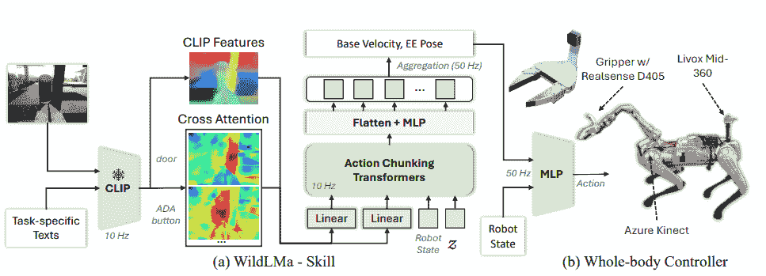

### SemiKong: Curating, Training, and Evaluating A Semiconductor Industry-Specific Large Language Model

贡献人：

原文链接：https://arxiv.org/abs/2411.13802

学术分析报告：

这篇文章介绍了SemiKong 1.0，这是首个面向半导体行业的行业专用大语言模型。文章的主要贡献包括：（a）创建了全面的半导体相关文本语料库，（b）开发了具备深入半导体知识的基础模型，以及（c）提出了整合专家知识的框架，以推动领域特定AI模型的评估。通过对预训练LLM进行微调，SemiKong在半导体制造和设计任务中表现优于通用大模型，展示了开发领域特定LLM的重要性，并为公司或工具特定的专有模型奠定了基础。

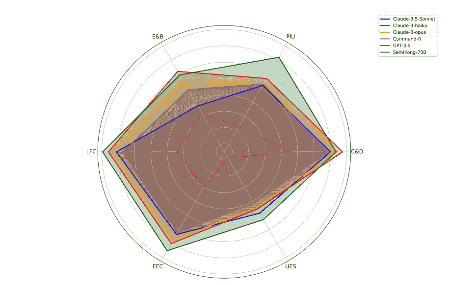

# 产品

### Sparkbase

贡献人：

https://sparkbase.ai/

Sparkbase 是一个全方位的外部销售平台，利用 AI 销售代理 Cara 预定高意向销售电话，强调通过识别购买意图信号来实现精准营销，避免传统的“喷洒式”个性化方法。Cara 能够分析潜在客户的需求，提供量身定制的解决方案，帮助不同领域的企业提升销售效率。

### Twinmind

贡献人：

https://twinmind.ai/?

TwinMind 是一款 AI 驱动的侧边栏工具，希望提高用户在 Chrome 和其他浏览器上的工作效率。它能够转录会议、捕捉多个浏览器标签的上下文信息，并提供准确的搜索答案，帮助用户快速撰写内容。TwinMind 提供了多个实用功能，包括在会议中主动建议、自动撰写文本、个性化记忆和隐私保护。

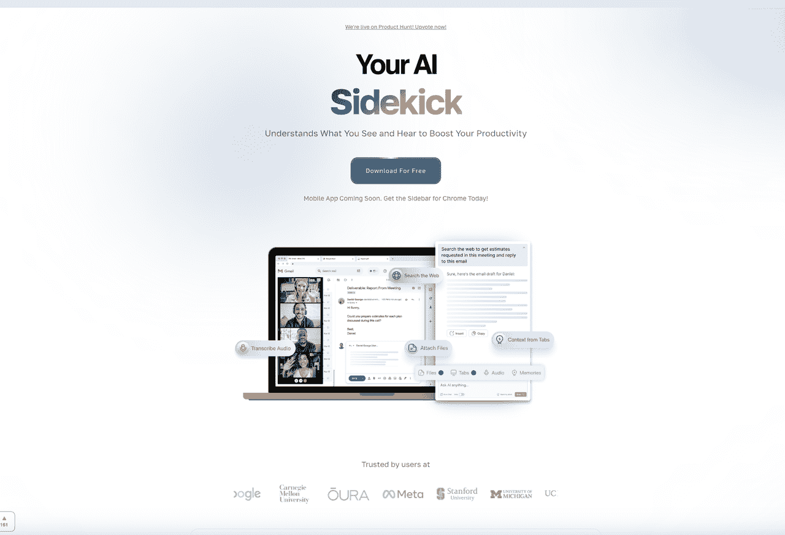

# HuggingFace&Github

### Marco-o1

贡献人：

**Marco-o1** 是一款大型语言模型，用来解决开放性问题，超越传统的标准答案领域。它结合了链式思维（CoT）微调、蒙特卡洛树搜索（MCTS）和创新的推理策略，以提高其在复杂真实世界任务中的表现。该模型在多语言应用和翻译任务中展现出色，特别是在处理俚语和复杂句子时。尽管目前仍受限于 o1 模型的特性，团队致力于持续优化和改进。

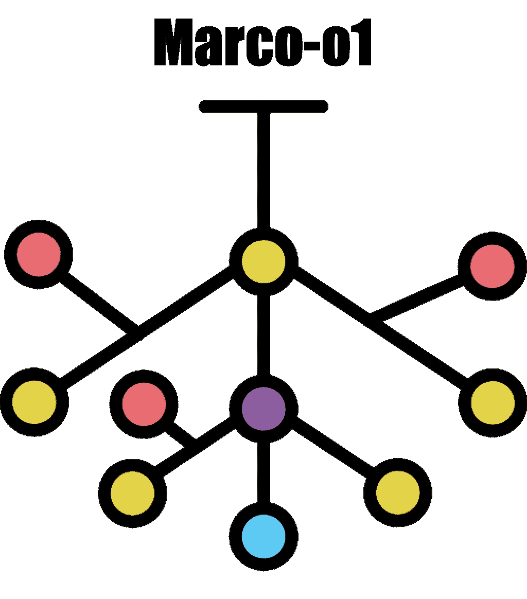

### LTX-Video

贡献人：

https://huggingface.co/Lightricks/LTX-Video

**LTX-Video** 是由 Lightricks 开发的首个基于 DiT 的视频生成模型，能够实时生成高质量视频，支持 24 FPS 和 768x512 的分辨率。该模型经过大规模多样化视频数据集的训练，具备文本到视频和图像加文本到视频的生成能力。用户可以通过详细的提示语获得更好的生成效果，但模型可能无法完美匹配所有提示。

# 投融资

### Cradle通过7300万美元融资扩展蛋白质设计AI平台及实验室

https://techcrunch.com/2024/11/26/cradle-builds-out-its-protein-design-ai-platform-and-wet-lab-with-73m-in-new-funding/

Cradle是一家专注于蛋白质设计的初创公司，近日宣布完成了7300万美元的融资。此次融资由IVP领投，Index Ventures和Kindred Capital参与，资金将用于扩展其实验室和团队建设。Cradle的目标是通过加速生物分子（如蛋白质）的测试和优化，帮助生物技术和制药公司提高研发效率。

Cradle的创始人兼CEO Stef van Grieken表示，公司通过AI模型来寻找和推荐优化蛋白质功能的氨基酸序列。例如，如果一种蛋白质的耐热性不足，AI可以分析该蛋白质在高温下易分解的序列，提供替代的、更具耐热性的序列。这种方法可以显著减少实验次数，从而节省大量的研发成本和时间。

Cradle自2023年获得2400万美元A轮融资以来，已开始为多个生物技术和制药公司提供服务，尤其在加速蛋白质开发、提高效率方面取得了显著成效。Van Grieken指出，使用AI技术可以显著减少传统实验所需的高额成本，并减少试验中的不可预测性。

+   **融资金额**：7300万美元

+   **投资方**：IVP（领投）、Index Ventures、Kindred Capital（参投）

+   **资金用途**：扩大AI平台、建设实验室、扩充团队

+   **商业模式**：通过简单的SaaS模式提供软件服务，避免涉及专利、收入分成等复杂问题

https://www.cradle.bio/

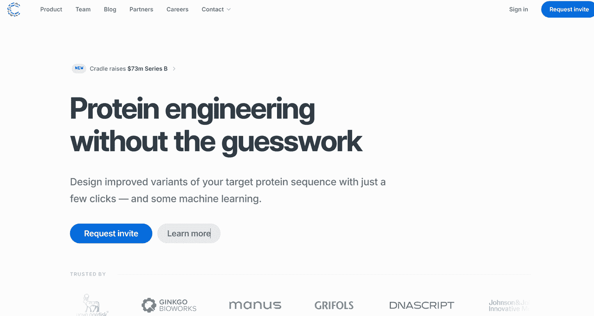

### IMAX利用AI拓展原创内容全球覆盖

https://techcrunch.com/2024/11/25/imax-embraces-ai-to-expand-original-content-reach/

随着全球对非英语内容需求的快速增长，IMAX宣布与总部位于迪拜的创业公司Camb.ai合作，利用AI技术为其原创内容提供翻译和本地化服务。IMAX计划通过此举节省翻译成本并扩大其内容受众范围。

Camb.ai的核心技术包括Boli语音翻译模型和Mars语音模拟模型，能够支持140种语言，包括许多低资源语言。IMAX将逐步引入这些技术，首先针对高资源语言进行部署。

Camb.ai由前苹果工程师阿克沙特·普拉卡什和其父亲共同创立，自成立以来，该公司通过学术授权数据训练其模型，并在今年2月完成了由Courtside Ventures领投的400万美元种子轮融资。公司现正在筹备更大规模的Pre-A轮融资，以进一步扩展业务和团队。

IMAX全球总裁Mark Welton表示，此次合作仍处于初期阶段，但期待AI技术在未来为公司发展提供更多可能性。

https://www.camb.ai/

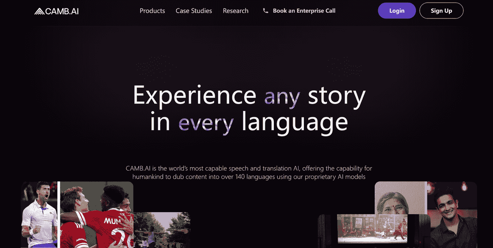

### PlayAI：语音克隆平台完成2100万美元种子轮融资

https://techcrunch.com/2024/11/25/playai-clones-voices-on-command/

PlayAI（前身为PlayHT）是一家创新的语音克隆平台，近日宣布完成了由500 Startups和Kindred Ventures共同领投的2100万美元种子轮融资。此次融资的参与方还包括Race Capital、500 Global和Soma Capital。PlayAI的技术能够帮助个人和企业通过API轻松地生成高度仿真的语音内容，支持语音克隆和自动语音生成，广泛应用于语音导航、播客、自动客服等领域。

PlayAI提供了包括语音克隆、语音自动化、和音频生成等一系列功能，尤其以其PlayDialog和PlayNote等创新工具而著名。PlayNote能够将PDF、视频、图片等转化为播客风格的内容，极大拓展了应用场景。此外，PlayAI的语音克隆技术也能够生成自然流畅的对话，虽然目前该平台面临一些关于安全性和伦理的争议，但其技术仍然在市场中占据一席之地。

本轮融资将主要用于推动PlayAI的生成式AI语音模型和语音代理平台的研发，并扩展其40人的团队。随着语音克隆技术的逐步成熟，PlayAI计划进一步提升企业构建人类质量语音体验的速度和效率。

https://play.ai/

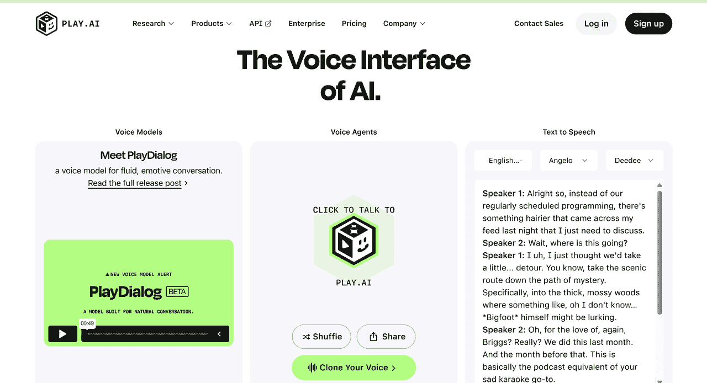

# 学习

### 决胜AIMO背后的故事：对话NuminaMath-7B主创团队

https://zhuanlan.zhihu.com/p/8918513613

在2023年7月举行的首届AI数学奥林匹克竞赛（AIMO）中，NuminaMath-7B模型凭借解决29道高中难度的国际数学奥林匹克竞赛题，成功从众多数学模型中脱颖而出，成为数学推理领域最顶尖的7B模型。Numina团队的创始人李嘉分享了团队在模型训练过程中的经验与心得，重点探讨了数据采集、合成方法、模型优化等方面的技术细节。

Numina模型涵盖的数学问题包括数学竞赛题和高考题。高考题主要增强模型的基础计算能力，尤其是二次函数等知识点，而数学竞赛题则更注重推理和复杂问题解决能力。Numina团队发现，不同难度的题目对模型的性能提升有重要作用，结合复杂难题和基础题目数据集是提升模型泛化能力的关键。此外，团队在数据采集上采用了合成数据和真实数据相结合的方法，通过自动化的Workflow生成高质量数据，涵盖了多个难度级别的题目。特别是高考题和数学竞赛预赛题，帮助模型提升了推理和解题能力。

合成数据在Numina团队的训练中发挥了显著作用，特别是在增强模型的数学解题能力上。团队参考了Deepseek Math等成熟方案，通过生成类似题目的方式，成功扩展了训练数据集。合成数据数量大约为二三十万条，通过这些数据训练后，模型在数学任务中的性能提升了约15%。合成数据的使用有效弥补了训练数据的不足，带来了显著的性能提升。

在确保数据质量方面，团队采用了自我修正机制（Self-Refine）来进行纠错，虽然当前尚未有特别鲁棒的Verifier工具，但通过平衡和取舍，能够有效提高生成数据的质量。团队还通过KTO（Knowledge Transfer Optimization）方法对模型进行了优化，这种方法在最高难度的数学题目上帮助提升了模型的准确率。

模型微调方面，Numina团队通过与小模型的消融试验，验证哪些数据能有效提升性能，并筛选出最适合的训练数据。对于模型响应过程的监督，团队利用人工标注和多轮采样的方法，确保生成结果的质量，并避免错误答案的传播。

在模型架构和计算工具上，Numina团队使用Python进行计算，但也考虑未来将Lean作为验证工具的可能性。Lean和Python的结合可能会在数学模型的解题和验证过程中起到互补作用，特别是在处理更复杂的数学问题时。

Numina团队还关注如何通过生成Proof（证明）来进一步提高模型的推理能力。尽管目前缺少有效的验证机制，但团队认为在未来，通过引入形式化的验证工具，模型的准确性和可靠性将得到显著提升。

在与整数智能的合作中，Numina团队获得了高效的数据整理支持，整数智能提供了及时的反馈和建设性建议，帮助团队优化数据采集和模型训练的各个环节。李嘉表示，整数智能团队的支持使得他们可以更专注于科研，而无需过多担心数据管理和人员协调等问题，期待未来与整数智能在更多前沿领域的深度合作。

总的来说，Numina团队通过高质量的数据采集和合成，结合先进的模型优化技术，在数学推理领域取得了重要突破，并将在形式化推理和Proof生成等方向继续深化研究。

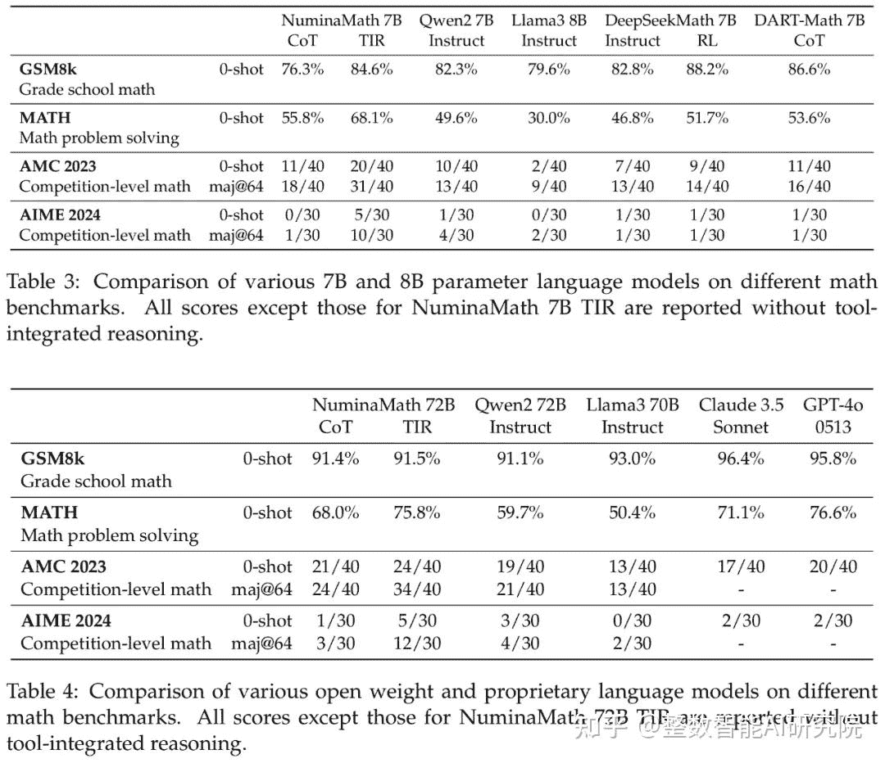

### 多模态视觉token压缩方法

https://zhuanlan.zhihu.com/p/8776092026

提升MLLM对图像和视频的理解能力的关键在于增加视觉token的数量，但这也会导致训练和推理时间的增加，因此视觉token的压缩变得尤为重要。常见的技术方案包括线性映射、下采样、Pixel-Shuffle、Q-Former、模型动态压缩、注意力机制改造等。

Pixel-Shuffle方案通过通道换空间的方式压缩视觉token，其基本思想是减少空间维度并增加通道数，数据维度从[N, W, H, C]变为[N, Ws, Hs, C//(s^2)]，实现视觉token的上采样或下采样。在InternVL1.1中，采用该方法将视觉token从1024压缩至256，显著减少了计算量和内存占用。

Q-Former方案通过引入可学习的query（embedding）来实现视觉token的压缩。Flamingo中的Perceiver Resampler和BLIP2中的Q-Former，分别利用视觉token与学习的query进行注意力计算，减少了视觉token的数量，在保持性能的同时优化了计算效率。

模型动态压缩方法通过让模型在端到端训练中自适应选择最重要的token，从而动态压缩视觉token。FocusLLaVA提出了vision-guided sampler，通过多尺度降采样和MoE思想，选择与全局特征最相关的token，实现了视觉token的压缩和高效计算。MustDrop则在推理时采用多阶段视觉token丢弃策略，分别在visual-encode、prefill和decode阶段进行token的压缩，优化了推理时的计算资源使用。

此外，注意力机制的改造也可以提升推理速度，而不直接压缩token。mPlug-Owl3通过HyperAttnTransformer改造了注意力机制，视觉和文本共享查询矩阵(q)，但各自保留键值矩阵(k,v)，降低了模型的参数量，提高了推理速度。

最后，VLoRA方案通过类似LoRA的方式，将视觉token作为参数权重引入LLM，进一步提升了多模态理解能力，同时减少了直接处理视觉token带来的计算负担。

这些技术方案通过不同的方式压缩和优化视觉token，提升了模型在处理大规模图像和视频数据时的效率和速度，同时减少了内存占用和计算负担。

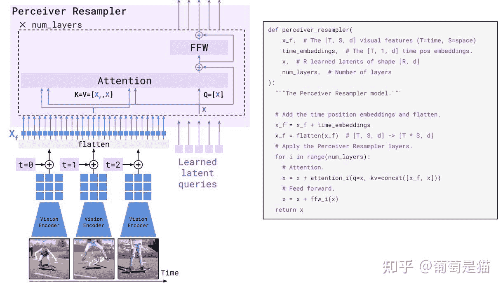

### vLLM：如何高效管理LLM推理时的内存？

https://zhuanlan.zhihu.com/p/8918860229

LM推理中，内存瓶颈主要由KV缓存的显存开销和内存管理方式的限制所致。模型在自回归生成过程中，缓存了所有已生成token的键值（KV）向量，导致显存消耗巨大，限制了吞吐量。为了加速推理，现有的内存管理方式采用了连续内存分配，这造成了内存碎片化、浪费和效率低下。为解决这些问题，PagedAttention引入了分页机制，将KV缓存分成小块（KV块），类似操作系统的分页思想，从而避免了内存碎片，支持动态分配、内存共享和写时复制（Copy-On-Write），提高了内存利用率。

vLLM系统基于PagedAttention，通过创新的内存管理和内存分页技术，优化了GPU的内存利用，显著提升了吞吐量和系统效率。vLLM通过集中式调度器协调多个GPU工作，灵活地分配KV块和管理内存，在生成过程中按需分配内存，支持复杂的解码算法（如并行采样和束搜索），避免了重复计算KV缓存。此外，系统在请求量过大时，还通过FIFO调度和内存预emption机制优化资源分配，确保高效运行。

PagedAttention的核心创新在于动态分配和共享KV缓存，通过非连续的内存存储和按需分配，解决了内存碎片化和浪费问题。这使得系统能够在内存限制下处理更多请求，提高了GPU内存的利用率，尤其在复杂解码算法中，减少了内存和计算开销。

实验表明，vLLM在多个模型和工作负载下提高了吞吐量，内存利用率接近100%，在并行采样、束搜索等场景下表现出更显著的优势。通过这种优化，vLLM能够在不依赖显著增加硬件资源的情况下，显著提高LLM推理的效率和吞吐能力。

### 从0到1训练一个多模态大模型（超越llava1.5）

https://zhuanlan.zhihu.com/p/6272043744

本项目从0开始训练了一个MMMU分数超过llava-1.5的qllava模型，和llava相比差别在于LLM变成了qwen2。虽然xtuner和一些其他的框架可以很轻易的实现更换VLM中的某个组件后训练，但是我个人更喜欢Llama-factory的整体架构和社区的活跃度，并且自己从0开始构建模型相比更改config来替换结构更能加深对模型的理解，以及对transformers库的理解吧，本项目同时也可以看作 “如何在transformers库中添加自己的模型”以及“如何在Llama-Factory中添加自己的模型”的教程。

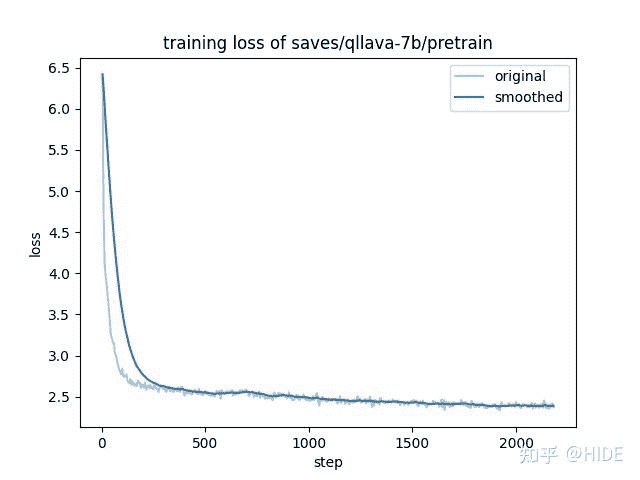

### DP3+iDP3：如何利用3D输入提升Diffusion Policy的泛化性

https://mp.weixin.qq.com/s/zYFA-czxqoghNV8z1Yxn3A

在过去半年，越来越多创业公司开始尝试Diffusion Policy，并且一些访谈记录也被认为对理解这一前沿技术有所帮助。最近，3D Diffusion Policy（DP3）作为Diffusion Policy的一个扩展，引起了广泛关注。与传统的2D视觉输入不同，DP3采用3D视觉信息，以提升机器人在多个任务中的泛化性能。DP3采用简单的点云输入，简化了网络结构，成功提升了任务的感知能力，尤其是在空间理解方面。当使用3D数据时，机器人能够更准确地感知空间，并且在更广泛的目标点上表现更好，避免了2D图像在平面上的局限。DP3的核心优势在于其通用性，能够适应多种任务而不容易过拟合。

与DP3相比，iDP3（改进版3D Diffusion Policy）进一步提升了机器人操作的泛化能力。iDP3采用了以机器人为中心的坐标系，减少了环境变化对系统的影响。此外，iDP3并未依赖仿真，而是完全在真实环境中进行训练和测试，强调了现实世界对算法验证的重要性。通过使用更高质量的3D数据和针对特定任务设计的简化模型，iDP3在多个实际场景中表现出色，尤其是在物体、视角和场景的泛化能力上。研究表明，3D数据相较于2D数据在空间感知、数据采集效率及训练效率上具有显著优势，尽管获取高质量3D数据仍面临成本和技术挑战。

此外，DP3和iDP3的进一步研究还探讨了如何在大规模数据中应用互联网资源，利用自监督预训练优化视觉编码器，并提高机器人策略的性能。最终，许华哲教授提出，随着技术发展，3D数据的获取和处理将逐渐从2D数据中推导出来，为未来机器人智能的提升提供了新的可能性。

# 招聘公告

---

**奇绩创坛****由陆奇博士**于2019年创立，使命是在源头最大化驱动创新。奇绩研究组将研究模型理论、到投研战略分析、市场策划等不同背景的同学聚在一起，搭建GenAI时代独特的跨界人才社群。

## 🚀F**24实习岗位**

##### [行研-学术科研人才交流组实习生](https://miracleplus.feishu.cn/docx/Yn6rdf2iOoY2Rcx8yVNcUBYRnch#part-QkMcdeJmuob9uvxvV3qcLSzHn8g)

##### 行研-GenAI研究岗位-战略分析（偏产品）

##### Web / AI 全栈开发工程师实习生

## **火热开放中🚀**

##### 行研-GenAI研究岗位-前沿学术探索

##### 行研-GenAI研究岗位-战略分析（偏咨询）

##### 创新活动产品运营 （大模型系列活动产品运营）

> **点击**相关岗位可查看对应**岗位需求【JD】；**相关岗位投递请**扫描二维码**

> 欢迎**推荐/自荐**

> 期待在**奇绩创坛**遇见更好的你

---

# 声明

本文档仅供学习交流使用，版权归原作者所有，若涉侵权，请联系Jack Jin 15101136166

##

（欢迎在下方反馈您宝贵的意见！整理不易，觉得有用给AI日报小组点个赞👍吧！）

ChatGPT；Angela；Zijia Liu；Alex；Zeqi Tan；Tiezhen（HuggingFace）；Naixu；Lizhi；Peter；Suoman；Jack

学术分析报告：ResearchFlow -- 奇绩F23校友的开发的深度研究产品，PC端进入RFlow的分析报告，可直接点击节点右侧的小数字展开节点，登录后可在节点上直接“询问AI”，进一步探索深度信息

如果你有大模型相关的创业想法，欢迎来找我们聊聊～🛰️：15101136166

> 快邀请你的小伙伴们一起来读大模型日报吧！

> **【日报****知识库****】**这里是近期日报内容的汇总,欢迎大家查阅

> [大模型日报知识库(分享版)](https://miracleplus.feishu.cn/wiki/KapVwXfkriOBiskB0B2cUHxjnTh)

>

> 欢迎大家多多帮我们分享,转发~~

> 如果大家有任何的建议或者吐槽,欢迎随时找我聊天~

