# 奇绩大模型日报（11月 25日）

> 来源：[https://miracleplus.feishu.cn/docx/V7KXd2CQ2oLxJjxqwgicxHVMnac](https://miracleplus.feishu.cn/docx/V7KXd2CQ2oLxJjxqwgicxHVMnac)

## 资讯

### 硅谷孵化器YC圆桌讨论：为什么说垂直行业AI代理价值十倍于SaaS？

https://mp.weixin.qq.com/s/LdEBajKzS5BEWLrLzvY4Tg

**垂直AI代理的巨大市场：** 嘉宾预测垂直AI代理领域将诞生超过3000亿美元市值的公司，其潜力远未被充分认识。 这主要基于SaaS行业的成功经验。

**与SaaS的类比：** 垂直AI代理的兴起类似于SaaS的兴起，XML HTTP请求是SaaS热潮的催化剂，而大型语言模型(LLM)则是垂直AI代理的催化剂。 两者都经历了早期应用糟糕，但随着技术进步而快速发展壮大的过程。

三种SaaS发展路径及垂直AI的启示： SaaS的发展路径分为三类：显而易见的大众消费产品（被巨头垄断）、非显而易见的大众消费产品（初创公司胜出）、B2B SaaS（大量初创公司成功）。垂直AI代理将主要沿着B2B SaaS的路径发展，因为没有一家公司能垄断所有垂直领域。

现有巨头难以进入垂直AI领域的原因： 现有企业由于组织结构、风险规避、缺乏领域专业知识等原因，难以快速进入和发展垂直AI代理领域，这为初创公司提供了巨大的机会。

**垂直AI代理对企业的影响：** 垂直AI代理不仅可以取代现有的SaaS软件，更重要的是可以大幅减少人力成本，因为它们可以自动化许多枯燥、重复的任务，例如：QA测试、客户支持、招聘、债务催收等。这将导致企业运营模式的重大改变，并降低对大量员工的需求。

**垂直AI代理的发展阶段：** 目前垂直AI代理领域还处于早期阶段，企业对所需代理类型尚不明确。 早期可能以通用工具为主，之后会涌现出更多专门的垂直代理。

寻找垂直AI代理创业机会的方法： 寻找枯燥、重复的行政任务是发现垂直AI代理创业机会的关键。 创始人应利用自身经验和人脉资源，寻找合适的垂直领域。 选择那些能直接取代现有团队和流程的领域，更容易获得成功。

**垂直AI代理对管理模式的影响：** 垂直AI代理将极大地提升管理者的效率，扩大其可以管理的团队规模，这将改变传统的组织结构和管理模式。

### 文本、图像、点云任意模态输入，AI能够一键生成高质量CAD模型

https://mp.weixin.qq.com/s/J85KpI6qcz5QsIzAcchzIA

本文介绍了全球首个支持文本、图像和点云等多模态输入的计算机辅助设计（CAD）生成大模型——CAD-MLLM，由忆生科技、香港大学和上海科技大学联合完成。CAD技术在工业设计和制造中广泛应用，但现有的CAD软件对非专业用户不够友好，且缺乏高效的交互工具，限制了其在更广泛用户群体中的应用。为解决这一问题，研究团队提出了CAD-MLLM，旨在通过多模态输入和生成高质量的CAD模型，降低用户的操作门槛，并提升建模效率。

CAD-MLLM的核心技术创新在于其支持文本、图像和点云三种输入模态，并能够处理这些模态的组合。图像和点云数据首先通过一个冻结的编码器提取特征，随后通过投影层将特征对齐到大语言模型的特征空间中。模型利用低秩适应（LoRA）对大语言模型进行微调，从而实现精确的CAD模型生成。此外，研究团队还构建了一个包含45万条数据的多模态CAD数据集——Omni-CAD，涵盖了CAD模型构造命令序列、文本描述、8个不同视角的图像和点云数据，为模型训练提供了丰富的数据支持。

在评估方面，传统的CAD生成研究主要关注重建质量和结构保真度，而CAD-MLLM提出了四种创新的评估指标，分别用于衡量CAD模型的拓扑质量和空间封闭性。这些指标包括Segment Error（SegE，检测节点连接的准确性）、Dangling Edge Length（DangEL，评估悬边比例）、Self-Intersection Ratio（SIR，检测自相交面问题）和Flux Enclosure Error（FluxEE，通过高斯散度原理计算空间封闭性）。

性能评估方面，CAD-MLLM在基于点云的CAD模型生成中展示了优异的重建精度，生成的模型大多数保持了严格的流形结构，避免了悬空边缘。相较于基准模型，CAD-MLLM在拓扑完整性上表现更好，且在鲁棒性测评中也表现出色，尤其在受噪声干扰和部分点缺失的点云数据下，CAD-MLLM仍能生成高质量的CAD模型。此外，通过对多模态数据训练的必要性进行测试，研究表明，结合文本描述和不同模态输入能够有效弥补单一模态的缺陷，提高生成模型的精度和完整性。

总体来说，CAD-MLLM不仅在技术上突破了传统CAD建模的局限，还通过多模态输入和创新的评估方法为CAD领域带来了新的研究和应用可能。

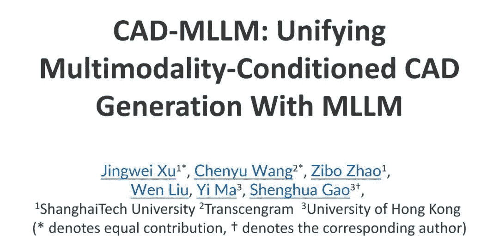

### 世界模型挑战赛，单项奖金10000美元！

https://mp.weixin.qq.com/s/zVekQiEuPJzcLl7HXisjfg

1X，挪威的一家人形机器人公司，在OpenAI的投资下提出了“世界模型”（World Model）概念，作为解决通用仿真和评估问题的有效途径。世界模型能够模拟机器人行为在不同环境中的演变，尤其是在机器人任务中，能处理复杂的物理交互，例如物体的抓取、移动等。1X还发布了一个高分辨率的机器人数据集，并启动了一个三阶段的挑战赛，探索如何通过减少训练损失、生成连贯的视频序列来提升机器人训练模型的准确性和效率。

世界模型的核心是利用机器人视频和动作数据进行训练，从而预测不同动作下的结果。例如，给定相同的初始图像序列，世界模型能生成不同抓取动作下的物体移动效果。该模型能处理多种现实世界任务，包括长视距视频生成（如T恤折叠），在模拟刚体对象时难以实现的场景。这种模拟器的优势在于能够从原始传感器数据中直接学习，并有效地吸收现实世界的复杂性，而无需手动创建模型。

与此同时，1X还与英伟达合作，使用其新发布的Cosmos视频分词器对机器人视频数据进行处理。Cosmos分词器通过高效的编码器-解码器架构，能够将冗余的视觉信息映射到紧凑的语义token中，这极大提高了视频和图像数据的处理效率。相比于传统的分词器，Cosmos在重建质量和压缩率方面提供了显著的提升，能够在有限的计算资源下进行高效的推理，显著降低了训练和推理时间。

此外，1X的挑战赛涵盖了两个重要问题：一是如何通过优化训练损失来提升模型的理解能力，二是通过前一帧序列预测下一帧，从而生成连贯的场景。参赛者可以尝试使用生成对抗网络（GAN）、扩散模型等技术来实现未来帧的预测。这些挑战将推动世界模型技术的发展，尤其是在智能机器人和自动驾驶等领域的应用。

### OpenAI否认Scaling撞墙论！o1已产生推理直觉潜力巨大

https://mp.weixin.qq.com/s/zy0l-dFXsXOLV5s_XNE6yw

最近，OpenAI的高级研究副总裁Mark Chen在炉边谈话中否认了「Scaling Law撞墙论」，表示OpenAI并没有遭遇Scaling Law的瓶颈，反而在其o系列和GPT系列中展现了持续的进展。Chen指出，OpenAI已经掌握了所需解决的技术挑战，特别是在推理能力的提升上，o1不仅提升了模型能力，也在安全性上进行了重大改进。o1的推理机制使得模型能够反思复杂问题，避免被对抗性攻击轻易触发。这种反思能力增强了模型在面临潜在风险时的稳健性，符合OpenAI最初对安全性的预期。

OpenAI的研究框架中，AGI的不同级别从基础推理者到完全自主的系统，推理能力和稳健性是关键驱动因素。尽管当前许多智能体系统仍需要人类监督，OpenAI相信，推理能力将推动AI从第一阶段向更智能的系统过渡。虽然推理模型在发展过程中面临挑战，OpenAI对这一领域的投资仍表现出极大的信心。

此外，合成数据的力量被OpenAI用于训练模型，特别是在数据稀缺或质量较低的情况下，通过生成合成数据来提高模型的训练效率。OpenAI通过合成数据训练图像生成模型，解决了互联网上图像和标题之间的低关联性问题，进而提升了模型的准确性和实用性。

对于Scaling Law的争议，Mark Chen表示，尽管预训练存在瓶颈，但OpenAI已通过推理范式的测试取得了进展，表明这种方法在模型扩展上并未遇到障碍。他指出，推理模型的成熟度不断提高，且与GPT-4相比，o1在多领域的应用，特别是在医学和法律推理中，已展示出其强大的泛化能力。

OpenAI在安全性和研究的平衡上也展现了独特的策略。Chen强调，OpenAI通过高度集中的研究项目，聚焦于有信心的探索性项目，而非进行无目标的研究，充分利用其较小规模的优势来推动重大突破。

最后，OpenAI认为，现在是AI创业的最佳时机。基础模型虽然专注于通用性，但在特定领域定制模型的潜力巨大。通过构建在OpenAI基础上的应用，初创企业能够发挥独特的技术优势，推动技术和商业的飞跃。

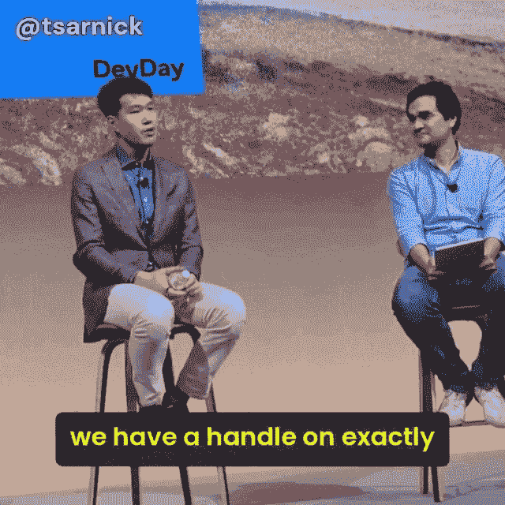

## 推特

### Cursor正在推出Agent：现在可以自行选择上下文、使用终端并完成整项任务

贡献人：

`https://x.com/ai_for_success/status/1860660696121295079`

0.43 - Agent（正在推出）

Cursor 现在可以自行选择上下文、使用终端并完成整项任务。要体验这一功能，请在 `composer` 中选择“`agent`”。

此外，本次更新还包括：

• 即将推出的错误查找功能的抢先体验

• 更简单、更简洁的 `composer` UI，带有内联差异对比

• 在 `chat/composer` 中的文件 `pill` 推荐

• 在 `chat/composer` 中语义搜索上下文的能力

• 更友好的图像拖放体验

• 多项性能提升

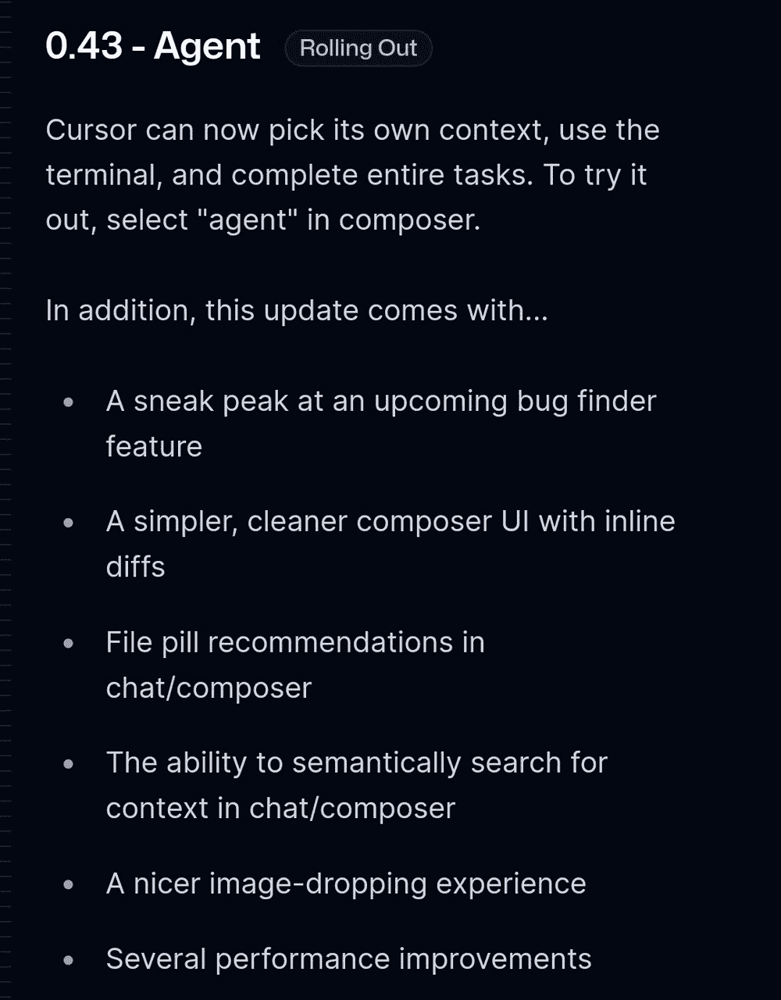

### Victor分享 AI 视频创作工具：通过拖放素材，使用自然语言轻松制作视频

贡献人：

`https://x.com/i/status/1860744979884163417`

介绍：AI 视频创作工具 🔥

通过拖放素材（图片/视频/音频），使用自然语言轻松制作任何你想要的视频！

100% 开源，并由 `Qwen2.5-Coder-32B` 提供支持（这家伙真的很强大）

[链接](https://huggingface.co/spaces/huggingface-projects/ai-video-composer)

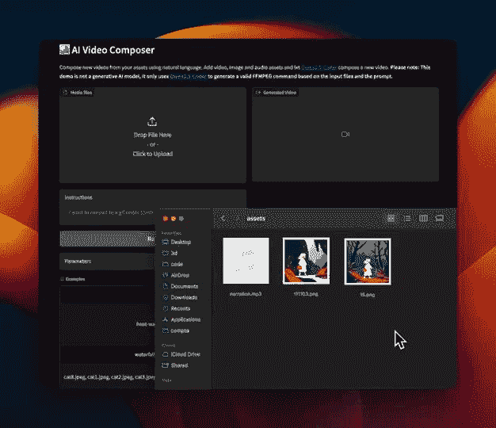

[Yz4qSrxOdOfcxfc4.mp4](https://internal-api-drive-stream.feishu.cn/space/api/box/stream/download/all/ZtI7bhquloWjDmxVq9ucGVjonee)

### Reddit热帖分享：“生产力监控”员工监控软件与 AI 结合，Karpathy评价不要在公司电脑上登录或混合任何个人信息

贡献人：

`https://x.com/karpathy/status/1860386689551880266`

员工监控软件与 AI 结合，已经失控了

今天早上体验了一场有关“生产力监控”软件套件的销售演示，这款应用程序的基本功能如下：

• 全面记录键盘和鼠标操作（这种功能已经存在很久了）

• 每隔一定时间（10 秒到 5 分钟之间）截取一次桌面屏幕截图（也属于每个远程监控管理工具的常见功能）

• 跟踪你打开的程序及其使用频率（也很常见）

• 实时记录点击位置的热图（几乎所有网站也都有这样的功能）

**接下来的内容更有趣：**

• 它允许你的经理将你与同事分组到一个“工作类别”中。

• 然后它使用 AI 根据鼠标移动数据（点击位置、打字速度、回退键使用频率、访问的网站、打开的程序、发送的邮件数量等）创建一张“生产力图”，并将这些数据与你“工作类别”中的同事进行比较。

• 如果你的表现低于某个门槛（比如打字速度比同事慢，或者填写表单/完成任务的时间更长，甚至因为在写邮件时接了电话），你会收到一个“红色警告”，相关报告会被发送给你的经理以及他们选择的其他人。

• 你可能会被要求在他们的网络门户中“解释”生产力差距的原因。

• 如果你的桌面超过 30-60 秒无任何“有意义”的鼠标或键盘活动，你会收到红色警告。

• 如果你从周一到周四的工作流很一致，但周五的综合数据低于设定的标准，你会收到红色警告。

• 它甚至声称可以利用这些数据实现“工作效率自动化”（例如，取代你）。销售这种软件的公司同时也销售 AI 自动化服务，既然他们已经收集了所有员工的工作流数据，为什么不顺便赚更多钱呢？

虽然这些对这里的很多人来说可能是老新闻了，但我个人已经迫不及待地等待整个互联网系统自己崩溃，这样我们终于可以摆脱这种无尽的“内卷”了。

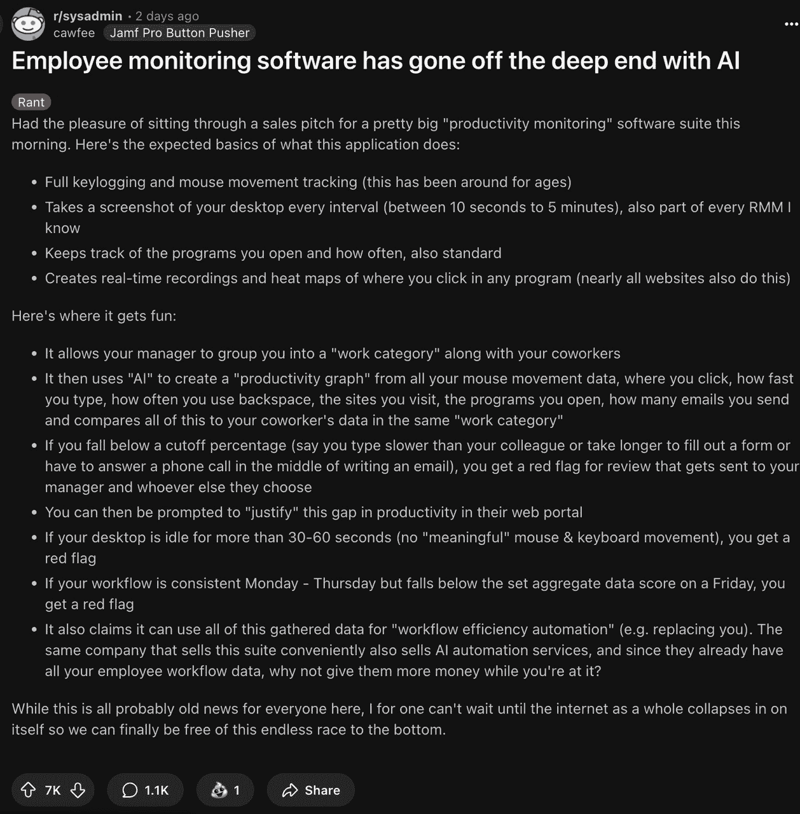

### V0表情包制作工具推出类似 Figma 的拖动、调整大小和旋转控件功能

贡献人：

`https://x.com/rauchg/status/1860911196238733790`

为我的 @v0 表情包制作工具实现了类似 Figma 的拖动、调整大小和旋转控件功能。

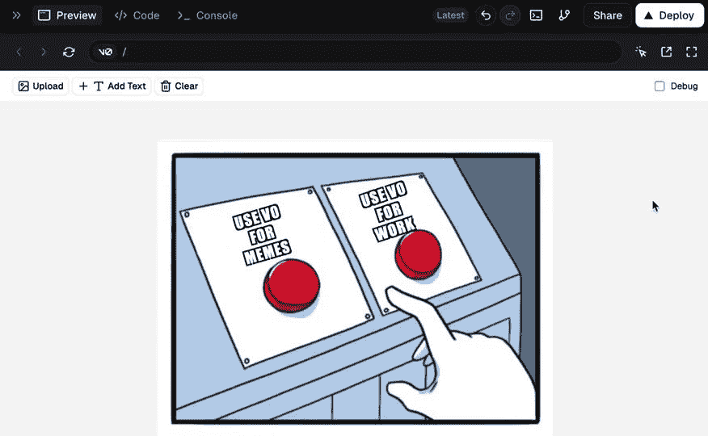

[0Dhl1m6a2mq2KSl0.mp4](https://internal-api-drive-stream.feishu.cn/space/api/box/stream/download/all/E9flbTCMfoSlwCxkadncobhWn5e)

### Cali：一个用于构建 React Native 应用的 AI 助手

贡献人：

`https://x.com/grabbou/status/1860778718559400382`

🪄 介绍 `Cali`：一个用于构建 `React Native` 应用的 AI 助手！

`Cali` 可以帮助你构建项目、管理设备和模拟器、查找并安装库以及更多功能……

今天就试试 `Cali` 吧！`npx cali`

由 `@vercel` 的 AI SDK 提供支持，由我和 `@o_kwasniewski` 黑客开发 💜

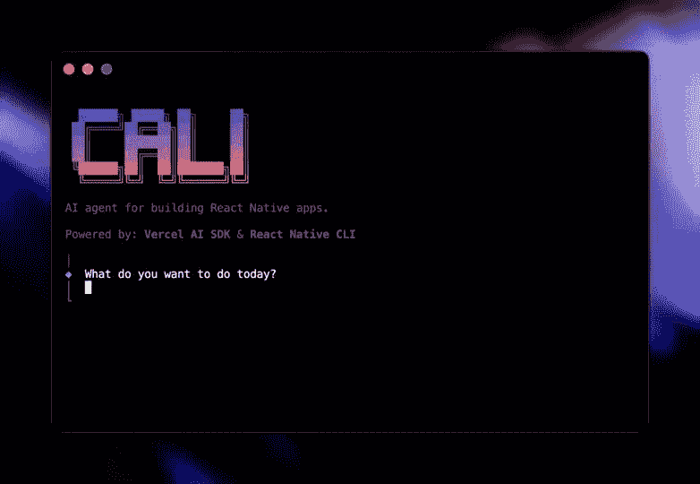

[BlgYiexwvWX7pBKJ.mp4](https://internal-api-drive-stream.feishu.cn/space/api/box/stream/download/all/OW1jbvW3pocGm7xgS8fcfvCRnMf)

## 信号

### Design and Control of a Bio-inspired Wheeled Bipedal Robot

贡献人：

原文链接：`https://arxiv.org/abs/2308.13205`

学术分析报告：`https://rflow.ai/flow/ee518846-560f-43bd-ba6c-f92121608787`

这篇文章讨论了如何将双足机器人的设计和控制应用于娱乐领域，以吸引人类观众。文章提出了一个新设计的双足机器人，专注于角色驱动的机械特性，并介绍了一个基于强化学习的控制架构，该架构能够根据命令信号稳健地执行艺术性动作。在运行时，这些命令信号由动画引擎生成，该引擎可以组合和混合多个动画源。此外，文章还提到了一个直观的操作界面，使得机器人能够进行实时的表演。整个系统使得机器人角色更加逼真，并为娱乐机器人学以及其他领域的增强人机交互铺平了道路。

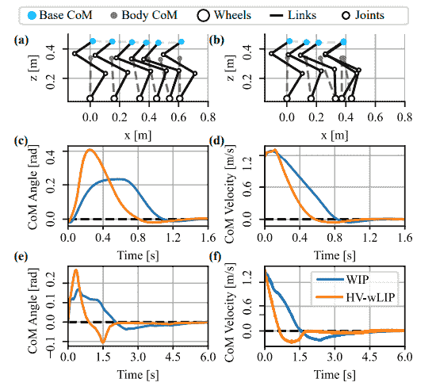

### FastRAG: Retrieval Augmented Generation for Semi-structured Data

贡献人：

原文链接：`https://www.arxiv.org/abs/2411.13773`

学术分析报告：`https://rflow.ai/flow/fdbd8008-7092-4c85-9749-3bc69d60ed96`

这篇文章介绍了`FastRAG`，这是一种新型的`Retrieval-Augmented Generation`（`RAG`）方法，专为半结构化数据设计。`FastRAG`通过模式学习和脚本学习提取和结构化数据，无需将整个数据源提交给大型语言模型（`LLM`）。它结合了文本搜索和知识图谱（`KG`）查询，以提高检索上下文丰富信息的准确性。评估结果显示，`FastRAG`在提供准确问答的同时，相比`GraphRAG`在时间上提高了90%，在成本上减少了85%。

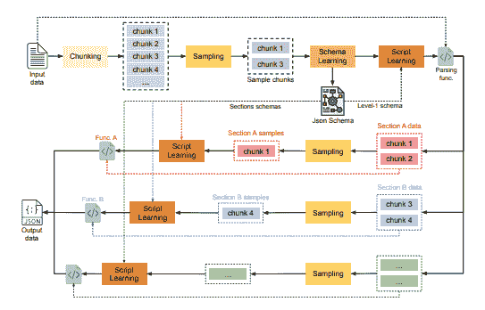

### Insight-V: Exploring Long-Chain Visual Reasoning with Multimodal Large Language Models

贡献人：

原文链接：`https://arxiv.org/abs/2411.14432`

学术分析报告：`https://rflow.ai/flow/79cfcfde-0414-48fd-8bd9-8ecf5ae102a5`

这篇文章介绍了Insight-V，这是一个旨在提升多模态大型语言模型（MLLMs）推理能力的系统。Insight-V通过两个主要贡献来实现这一目标：1）可扩展地为复杂多模态任务生成长且健壮的推理数据；2）一个有效的训练流程，以增强MLLMs的推理能力。具体来说，Insight-V设计了一个两步流程，无需人工劳动就能生成足够长和多样化的推理路径，并采用多粒度评估方法确保数据质量。文章还指出，直接用这些长且复杂的推理数据来监督MLLMs并不会产生理想的推理能力。为了解决这个问题，Insight-V设计了一个包含推理代理和摘要代理的多代理系统，推理代理负责执行长链推理，摘要代理则负责评估和总结推理结果。此外，Insight-V还结合了迭代DPO算法来增强推理代理的生成稳定性和质量。基于流行的LLaVA-NeXT模型和更强的基础MLLM，Insight-V在需要视觉推理的挑战性多模态基准测试中展示了显著的性能提升，并且得益于多代理系统，Insight-V也能轻松维持或提升在以感知为重点的多模态任务上的性能。

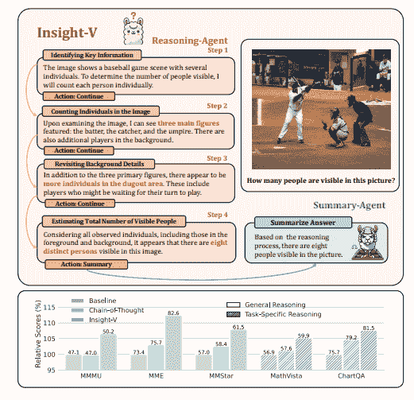

# 产品

## Pine

贡献人：

`https://www.19pine.ai/`

Pine AI 是一款个人 AI 助手，专注于处理客户支持电话，可以减轻用户在与客户服务互动时的压力。它提供全程便利、主动解决问题、战略性谈判和强大的谈判能力，尤其在有线电视、互联网和电话账单的谈判中表现出色，未来计划扩展更多应用场景。

## Secret Recipes

贡献人：

`https://www.secret-recipes.com/`

Secret Recipes 是一个食谱变现社交平台，允许食谱创作者通过两种方式获利：直接销售独特食谱（购买前步骤和视频保密）以及利用 AI 自动生成 SEO 优化的博客文章，基于用户现有的 YouTube 食谱视频。平台分享广告收入，帮助创作者增加收入、提升 YouTube 视频观看量，并减少技术工作负担。

# HuggingFace&Github

## llama3_interpretability_sae

贡献人：

`https://github.com/PaulPauls/llama3_interpretability_sae`

该项目是一个用于解释 Llama 3.2 大型语言模型的端到端管道，利用稀疏自编码器（SAE）进行模型解释。它涵盖了从激活捕获到 SAE 训练、特征解释和验证的完整流程，采用纯 PyTorch 实现，依赖性最小。主要功能包括捕获 Llama 3.2-3B 模型的残差激活、支持分布式高效训练、全面的日志记录与可视化、特征解释工具以及文本和聊天完成任务验证。

## Automated-AI-Web-Researcher-Ollama

贡献人：

`https://github.com/TheBlewish/Automated-AI-Web-Researcher-Ollama`

这是一个基于 Ollama 的自动化 AI 网络研究助手，能够根据用户查询自动生成相关研究领域，并通过多个搜索引擎进行系统搜索和内容分析，最终生成详细的研究报告并提供问答功能。主要功能包括自动生成并排序研究重点领域、使用多个搜索引擎进行网络搜索、分析结果并保存相关网页内容、生成包含所有信息的研究报告，以及提供研究总结和问答功能。

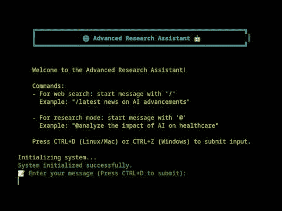

# 投融资

## Nebius：一只在资本市场中“重生”的AI基础设施初创公司

`https://techcrunch.com/2024/11/24/the-curious-case-of-nebius-the-publicly-traded-ai-infrastructure-startup/`

Nebius，这家新兴的AI云基础设施公司，最近重返纳斯达克交易所，但它的故事远不止是一个简单的IPO。这家公司曾在2011年以俄罗斯互联网巨头Yandex的名义上市，后因俄乌战争及相关制裁被暂停交易，并于2023年更名为Nebius AI，重新进入资本市场。

### 投融资与市场表现

Nebius的市场回归充满波动，尽管公司此前的市值高达180亿美元，但自恢复交易以来，其市值波动在35亿到47.5亿美元之间，显现出市场的不确定性。公司通过公开市场融资的方式，希望在AI基础设施这一资本密集型领域获得资金支持，尽管这个过程充满挑战，尤其是在如此特殊的历史背景下。

### 竞争与扩展

Nebius的主要业务是向企业提供GPU算力，即“算力即服务”，这一业务模式帮助公司进入了AI技术的核心市场。公司正在积极扩展，计划在2025年初在美国堪萨斯市启用新的GPU集群，并在旧金山和达拉斯等地开设客户中心。此外，Nebius还在欧洲建立了自己的数据中心，并计划进一步扩张。

### 额外业务：多元化战略

除了云计算业务，Nebius集团还拥有三大子公司，分别是专注于自动驾驶的Avride，专注于AI数据标注的Toloka，以及提供在线编程训练的TripleTen。虽然云基础设施仍是其收入的主要来源，但公司正在努力整合这些多元化业务，以拓展收入来源和提升市场竞争力。

公司官网：`https://group.nebius.com/`

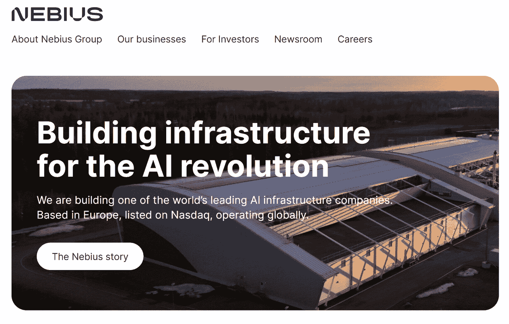

# 学习

## 阿里Marco-o1- 复刻OpenAI O1的推理新秀 - CoT与MCTS的融合

贡献人：

`https://zhuanlan.zhihu.com/p/8863091236`

Marco-o1模型是一个旨在提升大型语言模型（LLM）推理能力的创新方案，特别聚焦于开放式问题和复杂任务的解决。其核心技术包括思维链（CoT）微调、蒙特卡罗树搜索（MCTS）和创新的推理动作策略。Marco-o1通过三种数据集组合进行CoT微调，以增强结构化推理和复杂问题解决能力。CoT微调使模型在推理过程中更加清晰且有逻辑，而MCTS的引入则通过扩展解决方案空间来提升推理效果。

MCTS在Marco-o1中的应用非常创新，模型输出作为推理动作，置信度分数作为奖励信号引导搜索。通过`softmax`函数计算每个推理步骤的置信度，Marco-o1能够更好地探索多种推理路径，找到最优解。同时，Marco-o1还引入了多粒度动作选择策略，使得模型可以根据任务复杂性灵活调整推理粒度。研究发现，细粒度的`mini-step`策略在复杂问题中表现尤为出色。另一项创新是“思考后的反思”机制，允许模型在推理后反思并纠正错误，这大大提升了模型的准确性和推理深度。

在实验中，Marco-o1在多语言数学推理任务（MGSM）上表现出色，英语和中文数据集的准确率分别提升了6.17%和5.60%。MCTS策略显著改善了解决方案质量，尤其是mini-step粒度的策略在中文数据集上尤其有效。此外，Marco-o1还在翻译任务中表现突出，特别是在处理俚语和口语表达时，通过CoT微调和MCTS，成功捕捉了语言的上下文和文化背景。

Marco-o1模型的创新点为LLM在复杂推理任务中的应用开辟了新路径，其成功结合了推理策略、优化搜索过程和提升模型适应性，展示了极大的潜力。然而，研究也指出了MCTS奖励机制的随机性和未来可能的优化空间，提出了探索强化学习和跨领域应用的方向。

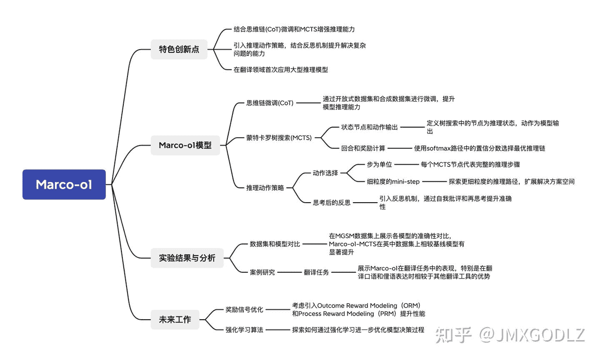

## 机器人技术中的 3D 高斯splatting：综述

`https://zhuanlan.zhihu.com/p/4309431179`

2024年10月，上海交通大学发表的论文《3D Gaussian Splatting in Robotics: A Survey》全面探讨了3D高斯splatting (3DGS) 在机器人领域的应用与技术进展。3DGS通过显式的3D高斯基元表示场景，结合可微分渲染与自适应密度控制，提供了一种高效、灵活的实时渲染方式，相比于神经辐射场（NeRF）展现了更强的性能，特别在机器人任务中具有显著优势。

论文将相关工作分为应用与技术进步两大部分。在应用方面，讨论了3DGS如何在场景理解、交互、重建、SLAM、操控和导航等机器人任务中提供支持。具体而言，3DGS通过多视图图像生成点云并构建初始3D高斯，随后通过优化渲染图像与真值图像之间的差异，逐步调整3D高斯表示。该过程依赖于可微分的tile光栅化器加速渲染，并通过密度控制调整高斯的数量，确保场景的高效表示。3DGS特别适合用于场景重建、分割与编辑，并且能够在动态场景中进行有效的建模。对于静态场景，混合高斯模型能更精确地重建环境外观与几何信息。

论文还介绍了3DGS在动态建模中的进展，现有方法通过融合多种先验信息，分别重建动态与静态部分，但在大规模自动驾驶场景中，计算负担逐渐增加，需要进一步优化。对于场景分割，3DGS方法在语义建模方面表现出色，通过高效的语义标签与特征嵌入实现快速的3D语义分割。语义编辑和目标插入、移除等任务也得到了有效支持。

在SLAM方面，3DGS基于视觉的系统仍然面临精度问题，尤其是在缺乏精确深度信息的情况下。通过多传感器融合（如激光雷达与图像深度估计），有望提升系统在不同环境下的表现。场景交互和操控方面，3DGS通过支持语言引导的任务和环境互动，增强了机器人在动态环境中的操作能力。

此外，论文还讨论了3DGS的适配性、效率与大规模处理的挑战。在运动模糊去除方面，物理建模与隐式建模两种方法被提出以优化渲染效果。对于大规模环境的处理，现有方法采用场景划分和分层分辨率模型来提高效率。在内存效率方面，技术如修剪、矢量量化与低维压缩被用于减少存储需求，此外，少样本学习技术也被探索，以解决数据稀缺下的建模问题。

最后，论文总结了当前3DGS方法面临的挑战和局限性，并展望了未来的发展方向，特别是在提高动态建模精度、减少先验依赖、提升计算效率和扩展到更大规模场景重建等方面的潜力。

## 深度学习推理系统

`https://zhuanlan.zhihu.com/p/5409735169`

推理系统在生产环境中需要具备高可靠性和可扩展性，确保能够24小时不中断地为用户提供服务。系统设计时要考虑到处理数据不一致、软件故障、用户配置问题和底层执行环境问题的弹性。可靠性要求能够快速恢复服务，并满足服务等级协议，扩展性则要求在流量增加时能够灵活应对。

Kubernetes通过支持多副本部署，使得推理系统能够在负载增加时自动扩展，从而提升吞吐量和可靠性。通过`ReplicaSet`配置，用户可以方便地部署多个推理服务副本，并通过前端负载均衡进行流量分配，从而实现高可用和高扩展性。

在部署过程中，推理系统需支持多种深度学习框架和不同版本的模型。由于大多数深度学习框架优化了训练过程，有些框架可能不适合在线推理，因此需要通过标准化协议（如ONNX）进行跨框架模型转换。此外，推理系统还需要支持与不同语言和应用的交互，并能通过微服务架构进行模型组合和数据处理。

为了提高系统的灵活性，可以使用镜像和容器技术来解决不同版本和资源隔离的问题。通过ONNX和MMdnn等工具，推理系统能够实现框架间的模型转换，减少开发和维护的代价。ONNX提供了一种通用的模型格式，支持跨框架模型的转换和优化，MMdnn则通过模型中间表示（IR）简化了模型的迁移和部署。

在移动端和边缘设备的部署中，推理系统面临功耗、模型尺寸和硬件限制的挑战。为了应对这些限制，模型通常需要进行压缩、量化或裁剪，并利用特定的硬件加速，如Google Edge TPU或NVIDIA Jetson等。此外，边缘设备的推理服务可能通过将部分计算卸载到云端或通过多设备协作进行计算，从而优化资源利用率和降低延迟。

为了提升推理系统的吞吐量，常用策略包括并行计算、动态批处理和多模型并发执行。加速器的低效使用问题可以通过并发执行多个模型任务来解决，进一步提升GPU利用率。动态批处理能够根据负载自动调整批次大小，从而提高吞吐量并确保延迟控制。

多模型装箱策略可通过将多个小模型合并在同一加速器上运行，进一步提升资源利用率和吞吐量。这种方法在数据中心资源调度中具有重要应用，可以有效解决加速器资源浪费问题。

总体而言，推理系统的设计需考虑高可靠性、可扩展性、灵活的部署支持以及高效的计算资源利用，以适应日益增长的请求和不断变化的生产环境需求。

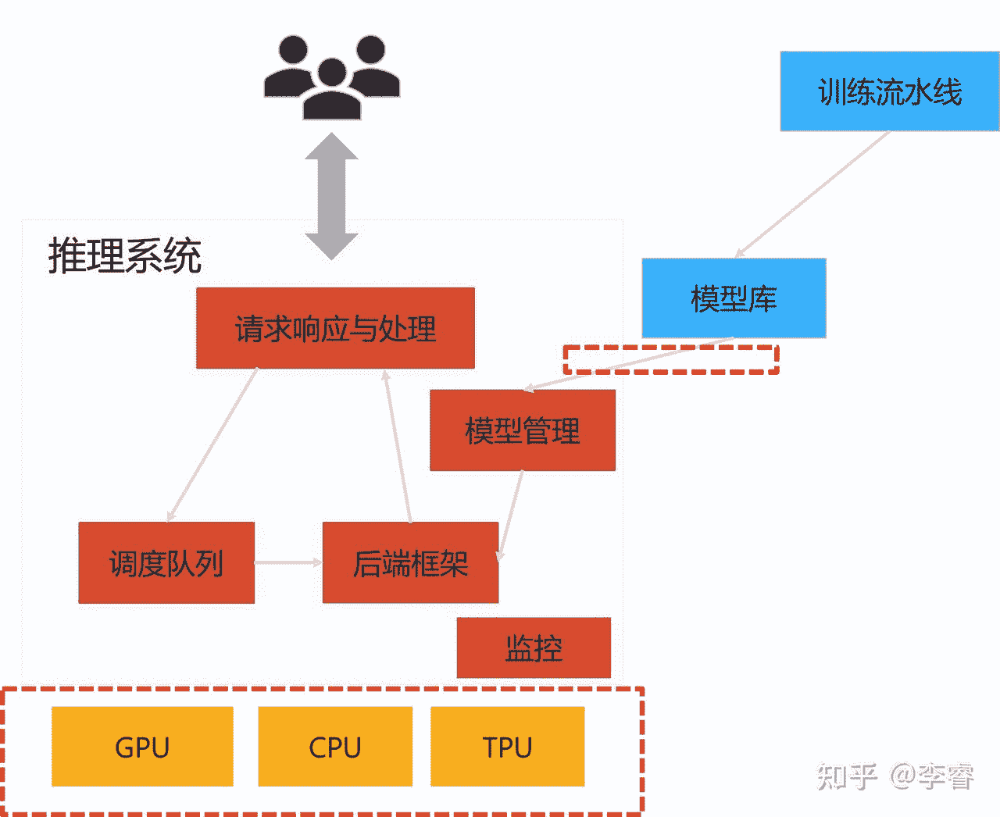

## [LLM量化系列] FlatQuant和DuQuant

`https://zhuanlan.zhihu.com/p/6652357695`

在LLM量化领域，处理激活值中的离群值已成为标准方法。目前流行的几种处理方式包括AWQ中的`scale`方法、LLM.int8的混合精度方法、QuaRot的`rotation`方法等，而最新的优化方法如DuQuant和FlatQuant则在这些基础上进行了进一步的改进和优化。

DuQuant通过识别并处理“massive outliers”这一特殊类型的离群值，取得了显著的量化效果提升。与传统的AWQ和QuaRot方法不同，DuQuant处理的离群值不仅仅是出现在所有token的常规离群值，还有一些极端的离群值，其绝对值大但仅在特定token上出现，传统方法无法有效应对。DuQuant的解决方案是通过多轮transformations将这些离群值分散到不同的`channel`中，以便于量化。具体过程包括三步：首先，针对最大的离群值进行rotation，并用贪心算法选择最优的rotation矩阵；其次，通过分块加速rotation矩阵生成，采用`zigzag`排列组合的方式平衡块与块之间的离群值分布；最后，再次进行rotation平滑离群值。整体处理流程通过`scale`、`rotation`和`permutation`等变换，确保了离群值的均匀分布，从而减少量化误差。

FlatQuant则侧重于通过平坦化激活值和权重的分布来减少量化误差。该方法通过设计一组仿射变换，使得权重和激活值的分布更加平坦，进而降低量化时的误差。为减少仿射变换带来的计算和存储负担，FlatQuant采用了Kronecker分解，将大的仿射变换矩阵分解为两个较小的矩阵，并在线计算。除此之外，FlatQuant还结合了`smoothquant scaling`和`learnable clipping`等技术，进一步优化了量化效果。仿射变换矩阵通过训练获得，能够在推理时动态调整，从而优化每一层的量化精度。

在效果对比上，使用Llama3-8B模型在RTX4090 GPU上进行的实验表明，FlatQuant在W4A4精度下的PPL结果优于DuQuant，这表明FlatQuant能够更好地适应不同的量化需求，尤其是在有训练数据进行校准的情况下。然而，这也意味着FlatQuant的计算和存储成本较高，因为它需要更多的训练来优化仿射变换矩阵，而DuQuant则相对较为高效。

总的来说，DuQuant和FlatQuant都在量化过程中采取了创新的方法，前者通过多轮变换分散离群值，后者通过仿射变换平坦化激活值和权重的分布，二者在量化误差的控制和计算效率上各有优势，具体选择取决于应用场景对计算资源和精度的需求。

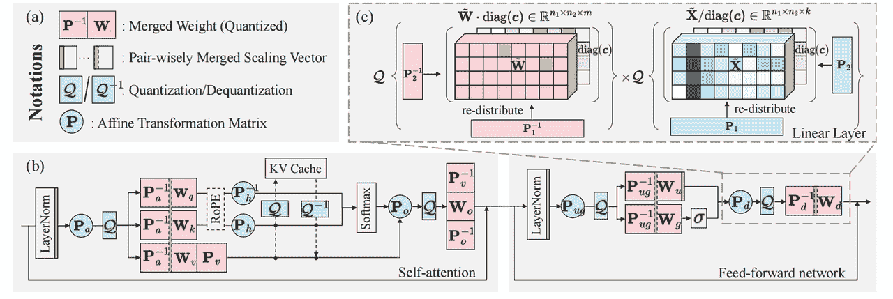

## 从MoonCake看大模型推理的PD分离

`https://zhuanlan.zhihu.com/p/8056351077`

PD分离（Prefill-Decode分离）技术是2024年大模型推理领域的重要话题之一，尤其在软硬件架构和商业模式方面引发了广泛讨论。方佳瑞提出，PD分离在理论上带来了更高的灵活性和扩展性，但现实中的收益场景却相对有限，且带来了额外的复杂性和性能成本。与数据库领域的计算存储分离、大数据的Shuffle分离以及微服务架构类似，PD分离本质上是解耦操作，使得预填充（P）和解码（D）过程可以独立优化。但在具体实践中，这种分离的实施路径和效果依然存在争议。

PD分离的关键在于`P`和`D`分别处理不同类型的计算：`P`是计算密集型，适合批量处理；`D`是访存密集型，逐token解码。在技术架构上，PD分离有多个层次。Level -1是P和D结合在同一设备上运行，Level 0则是分别计算但仍在同一设备上调度。Level 1和Level 2是将P和D分别放在同构设备上，利用高速互联优化数据传输；Level 3则是将P和D放在异构设备上，要求大规模集群改造和更高的网络带宽支持。

历史上类似的分离架构并未都成功。例如，Mach微内核操作系统和分布式共享内存系统（DSM）都因性能瓶颈或语义问题未能得到广泛应用。尽管如此，PD分离在大模型推理中并不像过去的失败案例那样面临无法克服的难题，因为分离带来的复杂性和开销大部分可以隐藏在框架内部，避免对用户接口造成影响。

关于网络成本，现代数据中心的网络带宽已经非常高，100Gb至200Gb的网络设施普遍存在，支持大规模并发请求并不成问题。考虑到这一点，分离架构的网络成本并不像某些人预想的那样高昂。网络基础设施的进步使得分离架构具有较高的成本效益，尤其是在扩展性和灵活性上。

在商业模式上，PD分离有可能推动大模型服务的创新。传统收费模式主要基于输入token的数量，但这种方式会限制用户简洁表达。分离架构能够将预填充与解码过程分开，为每个过程提供独立的收费标准。这种转变不仅能优化用户体验，还能使大模型公司的收入模式更加清晰和可持续。

技术变革带来的组织管理挑战也是不可忽视的，分离架构要求更精细的资源调度和存储管理，但这种复杂度并不意味着阻碍。相反，它为不同团队提供了优化和创新的机会，使得技术和商业价值能够形成正向循环。对于技术领导者而言，PD分离是不可避免的趋势，应主动应对这项变革，以确保未来的竞争力。

从历史经验来看，大模型推理领域的PD分离技术正处于类似数据库领域存储过程演变的阶段。随着技术的发展，分离架构将逐渐成为大企业的标配，而中小企业则可能采取更渐进的实施策略。未来，标准化的解决方案有可能出现，进一步推动行业的成熟和发展。

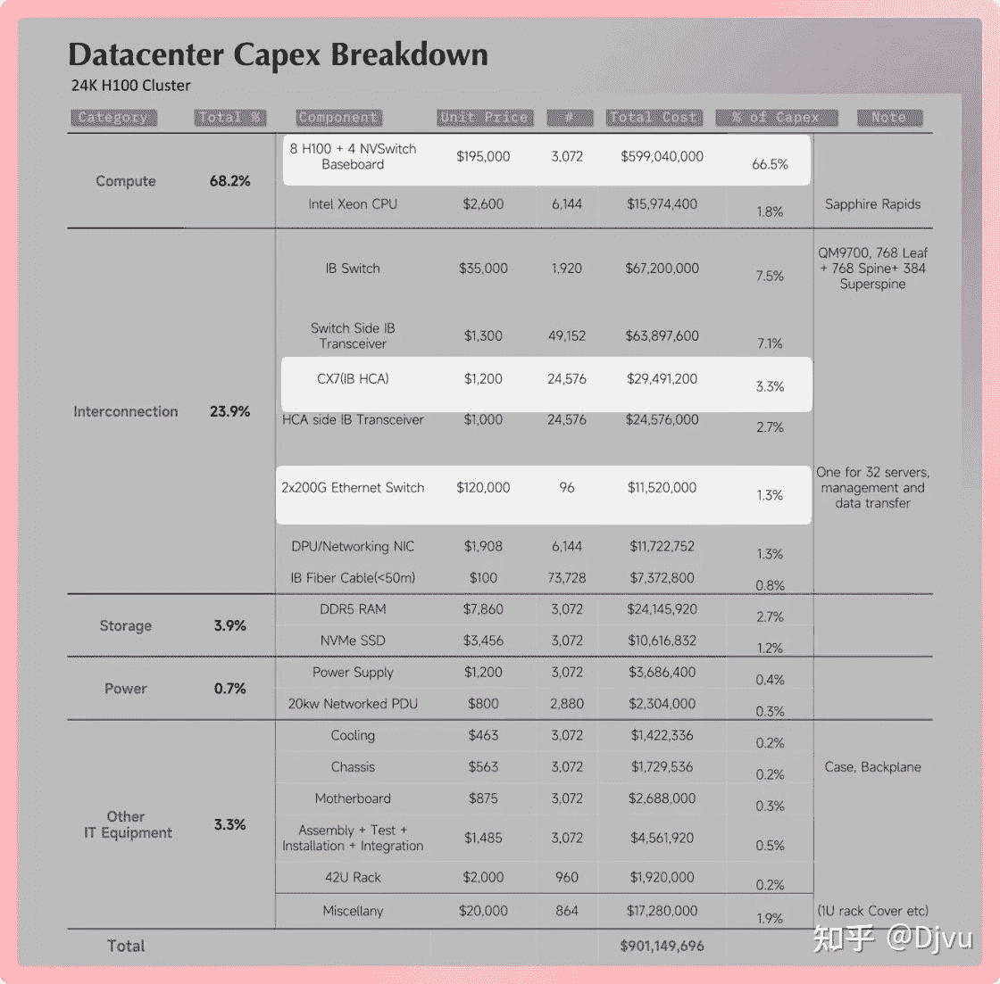

## 生成+理解一体多模态大模型的思考💡

`https://zhuanlan.zhihu.com/p/8196185285`

# 多模态大模型方案

现在的（支持生成+理解一体）多模态大模型，主要分成那些方案？

## 1️⃣ 以语言模型为核心

- Emu3（支持 video、img、text 任务，纯自回归（AR）损失）
- Chameleon（img、text 任务，纯 AR loss）
- Show-o（图像部分双向 attention，类似于 MaskGit，文字部分 AR loss）
- Janus（用两种视觉编码器，ViT 类用于理解性任务，VAE 类用于生成任务，text 和 img 都是纯 AR loss）

## 2️⃣ 语言模型 + 扩散模型

- TransFusion（文字部分 ar loss，图像部分 ddpm loss）
- JanusFlow（文字部分 ar loss，图像部分 rf loss）

### 不同方案有什么共性的结论？

- 以 LLM 为核心的架构在 train 和 inference 阶段更容易 scale（得益于语言模型的发展），但是目前的工作并没有 scale 特别大，效果也没有特别顶的。
- 在模型尺寸大致 comparable 的情况下，加上 diffusion 还是比纯 LLM 架构的视觉生成效果好些【是 LLM 适配生成任务需要提升，还是 scale 不够？】。
- 视觉部分用两种编码器（ViT 类用于理解性任务，VAE 类用于生成任务），对于多模态理解和生成任务都有帮助。说明现在视觉编码器的发展主要其实还是分为理解、生成两类，每一类编码器只可以在自己的任务上发光发热，在另外的领域 fintune 后效果也一般。

## 大规模多模态模型训练细节

- Chameleon 是 from scratch 训练，主要针对如何稳定大规模的训练，trick 和干货很多，包括监控输出范数来作为 stability 的 indicator，`QK-Norm` 来 mitigate `softmax` 的 logit shift 问题，Normalization 换位来提升稳定等。
- Emu3 也是 from scratch 训练，主要分享了下 pretrain、post train、DPO 的一些 detiails。
- Janus 系列文章分享了自己的训练框架、时长，以及使用了 sequence packing 来提高训练效率。不过 1.3B 的模型的结论和经验在 scale 后是否能 maintain 需要之后的工作去验证。

## 未来方向？

- unify 生成+理解一体的视觉编码器到底如何设计，目前有一些工作例如 titok 已经做了一些相关贡献，但是到现在还没有把他放在大 scale 多模态大模型上真正 work 的方案？
- 在 visual encoder，visual foundation model 层面，视觉生成、理解任务到底如何统一？代理任务或者 loss 到底如何设计？甚至视觉生成、理解任务能否用一个 visual foundation model 就可以统一，还是短期来看就是要分开？
- LLM 的 ar 架构现在被证明是一种不错的表征、压缩方案，但是其会出现误差累计问题，不太适用于视觉生成任务。Diffusion 是一种适用于连续信号的生成方案，可以修复一些误差累计问题，当 LLM 输出的多模态特征信息含量足够，甚至可以非常小的 Diffusion 来作为轻量化的视觉生成 task-specific head。所以中长期来看，`LLM+Diffusion` 的方案是否值得持续投入？

# 招聘公告

---

奇绩创坛由陆奇博士于 2019 年创立，使命是在源头最大化驱动创新。奇绩研究组将研究模型理论、到投研战略分析、市场策划等不同背景的同学聚在一起，搭建 GenAI 时代独特的跨界人才社群。

## 🚀F24 实习岗位

- [行研-学术科研人才交流组实习生](https://miracleplus.feishu.cn/docx/Yn6rdf2iOoY2Rcx8yVNcUBYRnch#part-QkMcdeJmuob9uvxvV3qcLSzHn8g)
- 行研-GenAI 研究岗位-战略分析（偏产品）
- Web / AI 全栈开发工程师实习生

## 火热开放中🚀

- 行研-GenAI 研究岗位-前沿学术探索
- 行研-GenAI 研究岗位-战略分析（偏咨询）
- 创新活动产品运营（大模型系列活动产品运营）

> 点击相关岗位可查看对应岗位需求【JD】；相关岗位投递请扫描二维码

> 欢迎推荐/自荐

> 期待在奇绩创坛遇见更好的你

---

# 声明

本文档仅供学习交流使用，版权归原作者所有，若涉侵权，请联系 Jack Jin 15101136166

欢迎在下方反馈您宝贵的意见！整理不易，觉得有用给 AI 日报小组点个赞👍 吧！

ChatGPT；Angela；Zijia Liu；Alex；Zeqi Tan；Tiezhen（HuggingFace）；Naixu；Lizhi；Peter；Suoman；Jack

学术分析报告：ResearchFlow -- 奇绩 F23 校友的开发的深度研究产品，PC 端进入 `RFlow` 的分析报告，可直接点击节点右侧的小数字展开节点，登录后可在节点上直接“询问 AI”，进一步探索深度信息

如果你有大模型相关的创业想法，欢迎来找我们聊聊～🛰️：15101136166

> 快邀请你的小伙伴们一起来读大模型日报吧！

> 【日报知识库】这里是近期日报内容的汇总，欢迎大家查阅

> [大模型日报知识库(分享版)](https://miracleplus.feishu.cn/wiki/KapVwXfkriOBiskB0B2cUHxjnTh)

> 欢迎大家多多帮我们分享，转发

> 如果大家有任何的建议或者吐槽，欢迎随时找我聊天～

