# 奇绩大模型日报（11月 23-24日）

> 来源：[https://miracleplus.feishu.cn/docx/IKo0dxYiAofzosxgIIackpB6nSe](https://miracleplus.feishu.cn/docx/IKo0dxYiAofzosxgIIackpB6nSe)

## 推特

### Runwayml新功能扩展视频：通过生成输入视频周围的新区域，将视频转换为全新的纵横比

贡献人：

https://x.com/runwayml/status/1860074950167818617

介绍全新功能：扩展视频（Expand Video）。

这一新功能可以通过生成输入视频周围的新区域，将视频转换为全新的纵横比。扩展视频功能现已开始逐步推出，很快将向所有用户开放。

请查看下方示例及效果展示。

[uleEs1wGVsZ1wLQO.mp4](https://internal-api-drive-stream.feishu.cn/space/api/box/stream/download/all/RSiBbUMYIokMw1xiPojcv3rtn7e)

### Nexgen Computer Use Agents 黑客松见闻：开源构建计算机使用、高质量代理、自然语言编写UI等

贡献人：

https://x.com/AlexReibman/status/1860128131073606013

OpenAI 的最大竞争对手刚刚赋予了 AI 控制电脑的能力

我们给了 250 多位黑客 24 小时，看看它能做到什么

以下是我们在 Nexgen Computer Use Agents 黑客松上的见闻：

1. LLM (Love Language Model)

通过 iPhone 模拟器控制器在 Hinge 上自动寻找匹配的代理。

2. **Task Bridge**

一个计算机使用代理，可阅读 Slack 消息，识别任务并将其自动提交到 Asana，实现零成本任务管理。

3. **Tool Use Team**

多代理“官僚系统”，用于指导计算机使用代理更高效地完成任务，相比单一代理效果更好。

4. **开源计算机使用** 🥉 第**三名**

从零开始使用开源工具构建的计算机使用系统，通过截图转网格、`pyautogui`、元素定位、图像到文本转换等实现任务自动化。

5. **Phaedrus**🥈 第**二名**

质量保证代理，通过用户体验（UX）流程任务清单测试功能，并自动创建 Jira 工单以处理发现的问题。

6. **Tests AI**🥇 第**一名**

用自然语言编写的 UI 测试，执行计算机使用代理以测试前端功能。

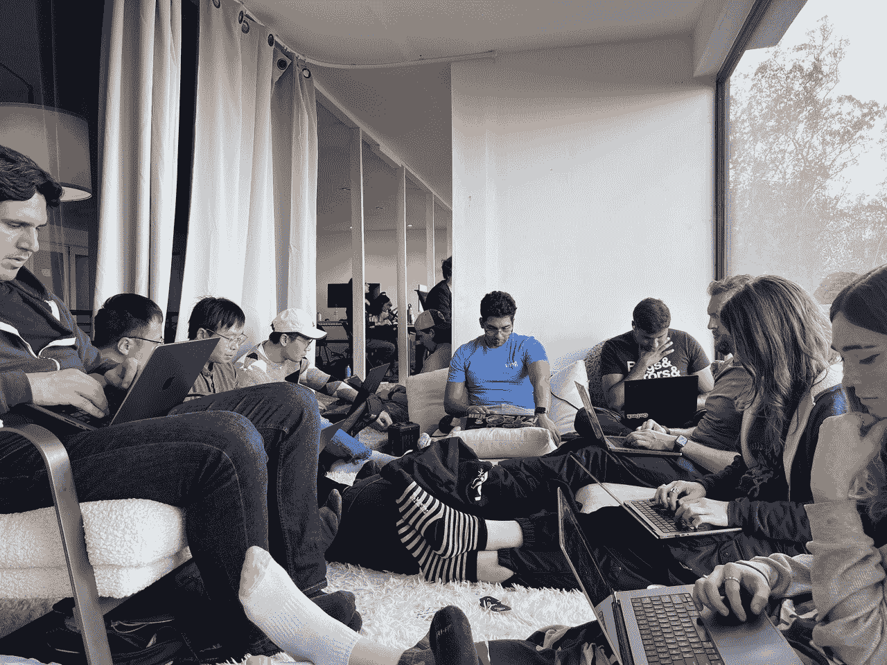

### LTX Video开源视频生成模型：支持图像转视频和文本转视频功能，可将输入转化为流畅生动的视频效果

贡献人：

https://x.com/LTXStudio/status/1859964100203430280

**LTX Video** 是 Lightricks 推出的全新开源、社区驱动的视频生成模型，支持图像转视频和文本转视频功能，可将输入转化为流畅生动的视频效果。该模型能够在消费者级 GPU（如 RTX 4090）上运行，以低成本实现高质量视频生成，无需专业设备，同时减少闪烁和伪影，确保每一帧都锐利、生动且自然。通过开发者反馈和真实场景优化，LTX Video 具备高级定制能力，支持与多种外部工具无缝集成，加速工作流程。此外，模型支持动态镜头移动和跨帧视觉一致性，生成超越实时的视频，满足实际工作需求。目前可在 GitHub、Hugging Face 和 fal.ai 上访问预览版，完整版本发布后将免费用于个人和商业用途，并计划整合到 LTX Studio 中。了解更多请访问：https://ltx-studio.visitlink.me/Cj82lu。

[68AooFBwnlONSEYH.mp4](https://internal-api-drive-stream.feishu.cn/space/api/box/stream/download/all/RGRkbHhxhojqmFxWIu7cNPVonFd)

### Anthropic与AWS深化合作：亚马逊追加40亿美元投资

贡献人：

https://x.com/AnthropicAI/status/1859964653486612585

我们正在扩大与 AWS 的合作。

此次合作包括亚马逊新的 40 亿美元投资，并确立 AWS 为我们的主要云服务和训练合作伙伴。

今天，我们宣布扩大与亚马逊云服务（AWS）的合作，进一步深化双方在开发和部署先进 AI 系统方面的合作关系。这项扩展合作包含亚马逊新的 40 亿美元投资，并确立 AWS 为我们的主要云服务和训练合作伙伴。这使得亚马逊对 Anthropic 的总投资达到 80 亿美元，同时仍保持少数股东的身份。

### SAMURAI：完全开源“Segment Anything Model”适配版本，用于零样本视觉跟踪

贡献人：

https://x.com/akshay_pachaar/status/1859937514691371031

SAMURAI vs. MetaAI 的 SAM 2！

传统视觉目标跟踪在拥挤、快速移动或自遮挡的场景中表现不佳，SAM2 也面临同样的问题。

现在介绍 SAMURAI：一个完全开源的“Segment Anything Model”适配版本，用于零样本视觉跟踪！

以下是它颠覆行业的原因：

🚫 无需重新训练或微调

🎯 提高成功率和精度

🤖 支持运动感知的记忆选择

💪 在多样化数据集上的零样本表现

不仅如此：

🔬 优化掩码选择

🔮 高效预测目标运动

📈 性能提升：LaSOT 数据集上 AUC 提升 7.1%，GOT-10k 数据集上 AO 提升 3.5%

🏆 无需额外训练即可与全监督方法竞争

https://github.com/yangchris11/samurai

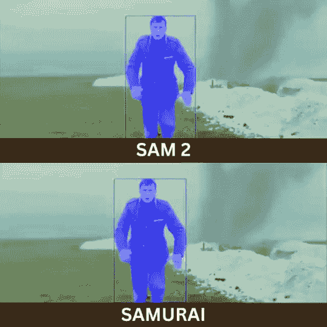

[nF8g5FHU_F3gpsO1.mp4](https://internal-api-drive-stream.feishu.cn/space/api/box/stream/download/all/Igg4bVVw4orJHIx3HXdcm3ccnm2)

## 资讯

### 黄仁勋最新万字对话：英伟达十年将计算边际成本降低100万倍

https://mp.weixin.qq.com/s/xapv7ENglJfVBxXx6tdErA

11月23日，香港科技大学授予英伟达创始人兼CEO黄仁勋工程学荣誉博士学位。在随后的对话中，黄仁勋与校董会主席沈向洋深入探讨技术、人工智能（AI）与领导力的未来。

**技术突破与AI发展**

黄仁勋强调，生成式AI已让信息在多模态之间自由转化，如文本到图像、蛋白质序列到文本等，这大幅拓展了AI的应用边界。他指出，AI推动了计算机科学的根本性变革，从传统代码开发转向机器学习及神经网络的GPU加速处理。这种变化带来了认知自动化和解决问题的自动化，从自动驾驶到医疗影像分析等多个领域均已实现应用。

黄仁勋进一步提出，未来AI发展的关键是“规模定律”，即神经网络规模和数据量的增加显著提升AI智能表现。此外，他特别提到AI产业的崛起与数字智能的生成模式，认为这一新兴产业将重塑经济格局，并带来能源高效利用的潜力。

**计算与研究创新**

针对计算需求激增，黄仁勋指出过去10年英伟达通过GPU技术提升了百万倍计算性能，同时降低边际成本。他强调，未来大学需要建立共享高性能计算基础设施，以加速AI研究，并促进交叉学科融合，如数字生物学和气候科学的研究突破。

**物理智能与机器人**

黄仁勋展望物理智能与机器人技术的前景，认为生成式AI技术的演进将推动人形机器人、无人机和自动驾驶汽车的大规模部署。他提到，大湾区因其独特的机电与AI技术生态具备全球竞争优势，应抓住这一机遇。

**领导力与建议**

谈及个人领导理念，黄仁勋分享了对学习与创新的坚持。他认为，领导者需在不确定性中找到动力，以目标为导向促进团队成长。同时，他鼓励学生和教职工在技术与学术结合中探索创业机会，并强调从零开始构建跨学科机构的重要性。

### Nature：谷歌学术正在被AI工具颠覆

https://mp.weixin.qq.com/s/mcGU_sAodn3pyQdb1LvNAg

随着AI技术的发展，谷歌学术这一曾经不可或缺的学术搜索工具正面临挑战。近年来，Semantic Scholar、OpenAlex、Consensus、Emergent Mind等新型AI学术工具迅速崛起，不仅实现了传统文献搜索的功能，还通过大语言模型（LLM）和向量搜索技术，提供了更精准、交互性更强的服务。

**AI学术工具的技术优势**

这些工具在技术层面的突破使其更具吸引力。例如，Semantic Scholar整合了超过2亿篇文献，并提供相关论文推荐和AI问答功能；OpenAlex结合4500万篇科学论文数据库与LLM，优化了事实性与引用准确性；Consensus通过提取核心内容和交互式问答，提升科研效率。Emergent Mind则专注于计算机科学领域，能够提供专业的文献总结和跨平台评论追踪。而Cambrian专注于机器学习，整合了自2017年以来的24万篇论文，为用户提供全面的研究综述。

**功能创新与用户体验**

相比谷歌学术，AI工具在用户体验上有显著提升。功能包括论文全篇交互、一键提问、关键洞察总结、以及学术网络整合（如作者论文统计和社交媒体评论汇总）。这些改进使得用户不仅可以高效检索文献，还能在科研过程中实现知识的深度探索。

**谷歌学术的现状与挑战**

尽管谷歌学术以其广泛的资源覆盖、免费访问和高级搜索功能仍拥有大量用户，其技术更新却显得滞后。AI工具的崛起不仅弥补了谷歌学术的功能短板，还在学术交互和定制化服务方面超越了传统模式。

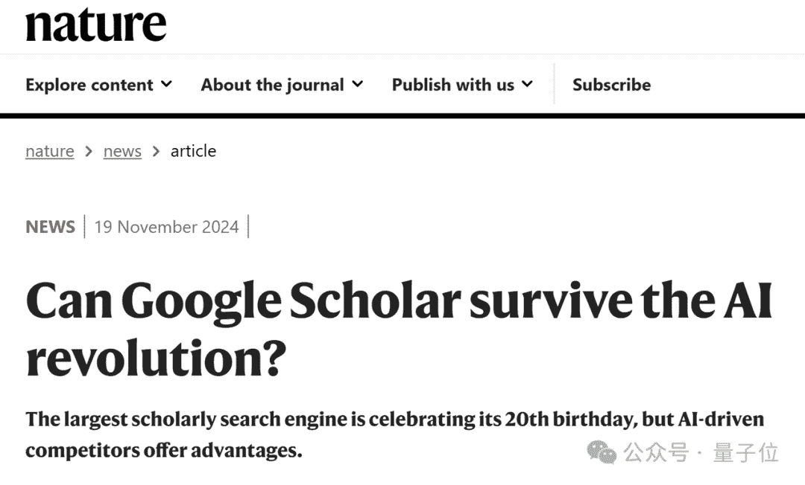

### 经典卡尔曼滤波器改进视频版「分割一切」

https://mp.weixin.qq.com/s/1iaVrCFV_IKshwmqXInQsg

Meta的 Segment Anything Model 2（SAM 2）在全华人团队的改进下迎来重要升级，推出了增强版SAMURAI。通过采用经典的卡尔曼滤波器（Kalman Filter）和运动感知记忆选择技术，SAMURAI显著提升了在快速运动和遮挡场景下的目标跟踪能力，同时无需重新训练即可实时运行。

---

**技术细节：**

1. 运动建模（Motion Modeling）

SAMURAI通过引入卡尔曼滤波器，解决了SAM 2在快速移动目标跟踪中的性能瓶颈：

+ **状态向量设计**：包括目标中心位置（`x`, `y`）、边界框尺寸（`w`, `h`）及其速度。

+ **预测-更新循环**：利用卡尔曼滤波器预测目标在下一帧的位置，并根据实际观测进行校正：

+ 预测阶段：计算下一帧目标位置。

+ 更新阶段：结合候选掩膜的交并比（IoU）校正预测值。

+ 运动分数（Motion Score）：通过卡尔曼预测边界框与候选掩膜的IoU生成，用于评估候选掩膜的运动匹配度。

最终掩膜选择基于运动分数与掩膜亲和分数的加权和，确保更高的跟踪准确性。

---

2. 运动感知记忆选择（Motion-Aware Memory Selection）

为解决SAM 2中固定窗口记忆机制引入的低质量特征问题，SAMURAI采用动态选择机制：

+ **混合评分系统**：

+ **掩膜分数（`smask`）**：衡量掩膜准确性。

+ **目标出现分数（`sobj`）**：评估目标是否在帧中存在。

+ **运动分数（`skf`）**：预测目标位置的准确性。

+ **动态记忆更新规则**：仅保留满足一定质量评分的帧，跳过遮挡期间的低质量特征，防止误差传播。

---

**实验结果：**

SAMURAI在多项基准（LaSOT、LaSOText、GOT-10k）上超越SAM 2，并在部分测试中与有监督方法（如LoRAT和ODTrack）表现相当，且无需重新训练。

---

**应用场景：**

+ **复杂场景跟踪**：例如《黑神话：悟空》中的高速打斗场景，SAMURAI精准捕捉目标细节。

+ **多主体动态监控**：如橄榄球比赛中多人重叠遮挡，SAMURAI依然能保持稳定跟踪。

+ **实时互动分析**：支持视频游戏、运动分析等复杂动态场景。

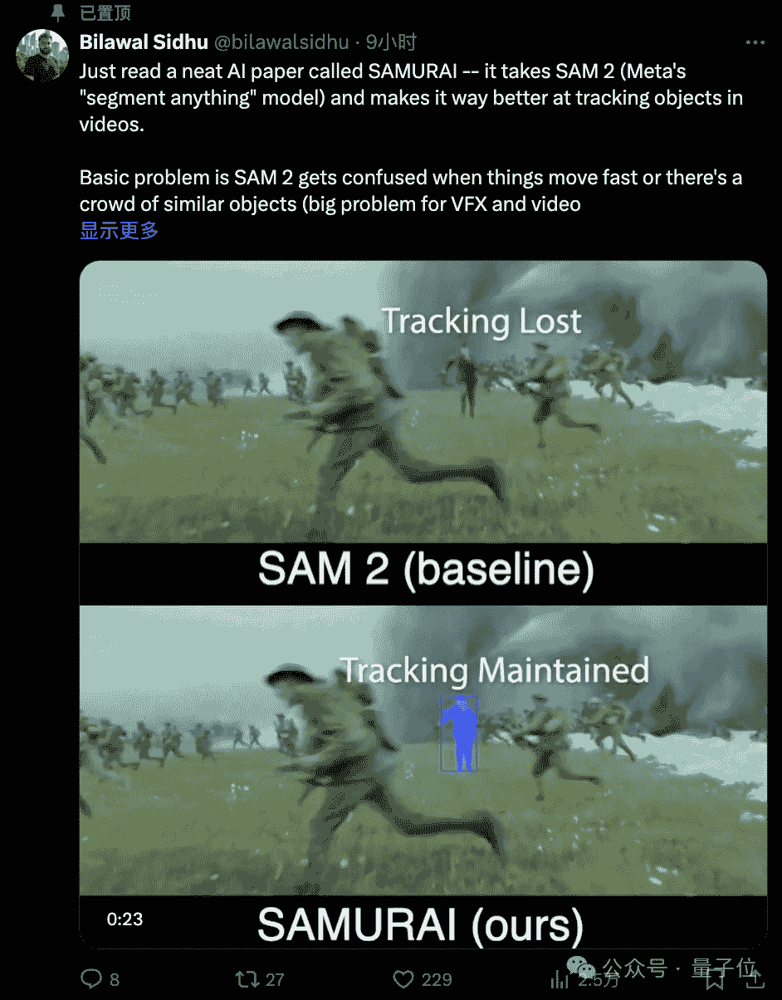

### RTX 4090可跑、完全开源，最快视频生成模型问世，实测一言难尽

https://mp.weixin.qq.com/s/zoU3O8cqS4x7VZc-CKeehA

Lightricks推出了全新的视频生成模型LTX-Video，这一模型被誉为目前最快的视频生成工具，基于DiT（Diffusion Transformer）架构，能够以实时速度生成高质量视频。LTX-Video可以在单块Nvidia H100 GPU上，仅用4秒时间生成5秒长、分辨率为768x512、帧率24FPS的视频，其生成速度甚至超越观看速度。此外，该模型支持消费级GPU（如RTX 4090）运行，无需专用设备，为用户提供低成本的高效生成方案。

LTX-Video的核心技术在于优化架构以提高生成效率，同时确保输出质量。模型以DiT为基础，针对实际应用场景进行了高级定制，尤其在跨帧一致性上实现了显著突破，能够在角色与环境之间保持连贯的视觉效果，有效减少帧间闪烁和伪影。生成的视频画面清晰锐利，动态效果逼真，每一帧都体现出精细的细节处理。

该模型完全开源，包括代码库和模型权重，用户可在GitHub和Hugging Face平台上试用。生成任务涵盖文本描述到动态视频，以及图像到视频的动态补全，适用于多种场景。LTX-Video还具备轻量化设计，能够无缝集成外部工具，适配各种工作流，满足个人和商业用户的多样化需求。

实际测试显示，LTX-Video在动态场景和复杂场景下表现出色。例如，生成“一只狗追逐滑板男孩”的视频时，细节捕捉精准；在生成“女孩撑伞站在桥上，男子迎面走来”的视频时，场景连贯性和动态效果令人印象深刻。模型的快速生成特性和高质量输出标志着文本到视频生成领域的重大突破，未来Lightricks计划发布技术报告并进一步优化模型性能，为用户提供更强大的创作工具。

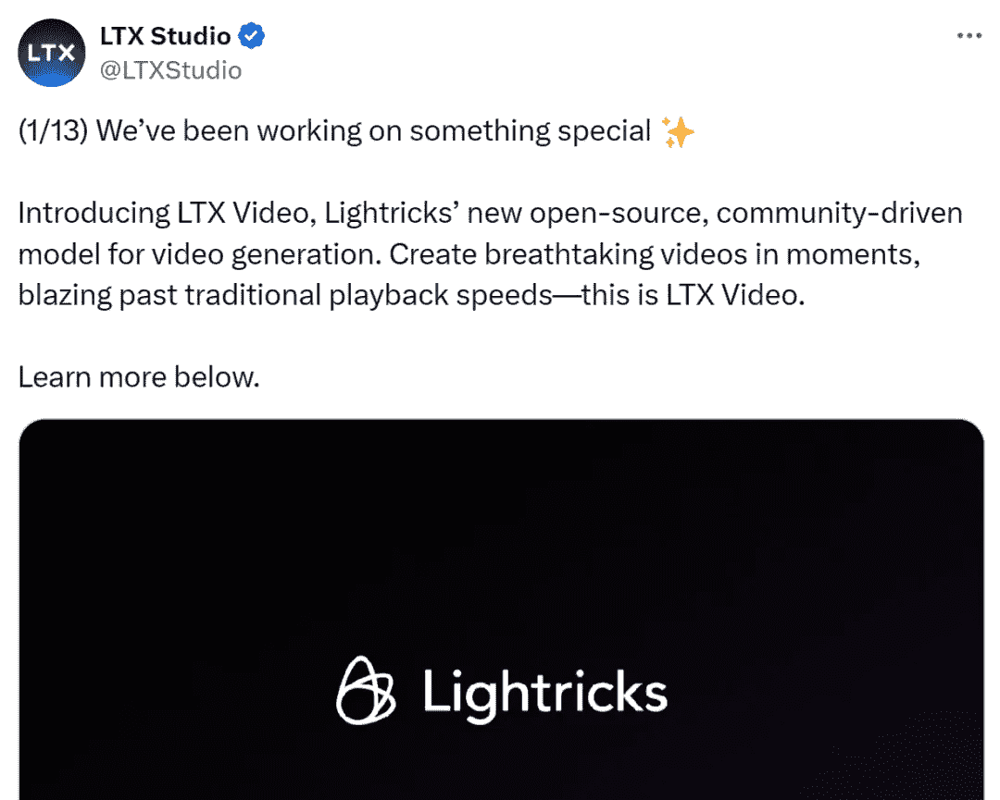

## 信号

### VideoAutoArena: An Automated Arena for Evaluating Large Multimodal Models in Video Analysis through User Simulation

贡献人：

原文链接：https://arxiv.org/abs/2411.13281

学术分析报告：https://rflow.ai/flow/c0f52510-737a-4f32-b4e5-42ae6fd0b744

VideoAutoArena 利用用户模拟来生成开放式、自适应的问题，严格评估模型在视频理解方面的表现。该基准具有自动化、可扩展的评估框架，结合了经过修改的 ELO 评分系统，可在多个 LMM 之间进行公平和连续的比较。为了验证我们的自动评判系统，我们使用精心策划的人工注释子集构建了一个“黄金标准”，证明我们的竞技场与人类判断高度一致，同时保持了可扩展性。此外，我们引入了故障驱动的进化策略，逐步增加问题的复杂性，以推动模型处理更具挑战性的视频分析场景。

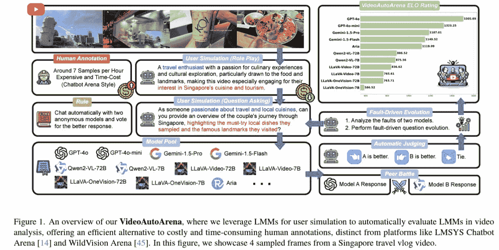

### Marco-o1: Towards Open Reasoning Models for Open-Ended Solutions

贡献人：

原文链接：https://arxiv.org/abs/2411.14405

学术分析报告：https://rflow.ai/flow/a1d91039-cb98-401f-be0f-afd61a4ebe94

Marco-o1 不仅专注于具有标准答案的学科，例如数学、物理和编码（这些学科非常适合强化学习 (RL)），而且还更加重视开放式解决方案。我们旨在回答以下问题：“o1 模型能否有效地推广到更广泛的领域，而这些领域缺乏明确的标准，并且奖励难以量化。” Marco-o1 由思想链 (CoT) 微调、蒙特卡洛树搜索 (MCTS)、反射机制和创新推理策略提供支持，针对复杂的现实世界问题解决任务进行了优化。

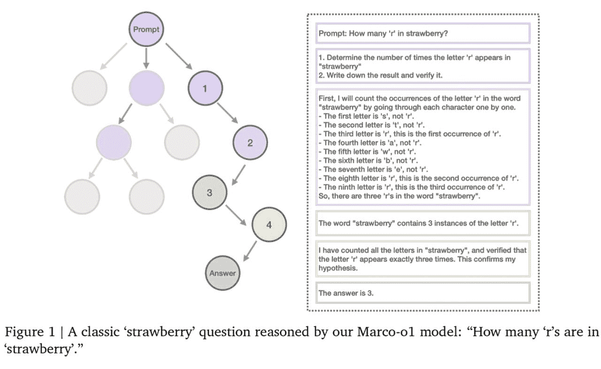

### Hymba: A Hybrid-head Architecture for Small Language Models

贡献人：

原文链接：https://arxiv.org/abs/2411.13676

学术分析报告：https://rflow.ai/flow/bbb40212-6433-4659-a35a-e331fd3a1872

Hymba是具有混合头并行架构的一系列小型语言模型，将 Transformer 注意力机制与状态空间模型 (SSM) 集成在一起，以提高效率。注意力头提供高分辨率召回，而 SSM 头实现高效的上下文摘要。此外，我们引入了可学习的元标记，这些标记被添加到提示前面，存储关键信息并减轻与注意力机制相关的“强制注意”负担。通过结合跨层键值 (KV) 共享和部分滑动窗口注意力，该模型得到进一步优化，从而实现了紧凑的缓存大小。

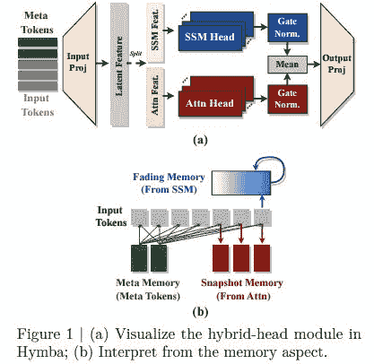

# Re-Invoke: Tool invocation rewriting for zero-shot tool retrieval

贡献人：

`https://arxiv.org/abs/2408.01875`

学术分析报告：`https://rflow.ai/flow/7a8addc3-c409-4221-813b-69f8df57e11a`

我们引入了 `Re-Invoke`，这是一种无监督的工具检索方法，旨在有效地扩展到大型工具集而无需训练。具体来说，我们首先在工具索引阶段生成一组多样化的合成查询，这些查询全面涵盖与每个工具文档相关的查询空间的不同方面。其次，我们利用 LLM 的查询理解功能在推理阶段从用户查询中提取关键的工具相关上下文和潜在意图。最后，我们采用一种基于意图的新型多视图相似性排名策略来精确定位每个查询的最相关工具。

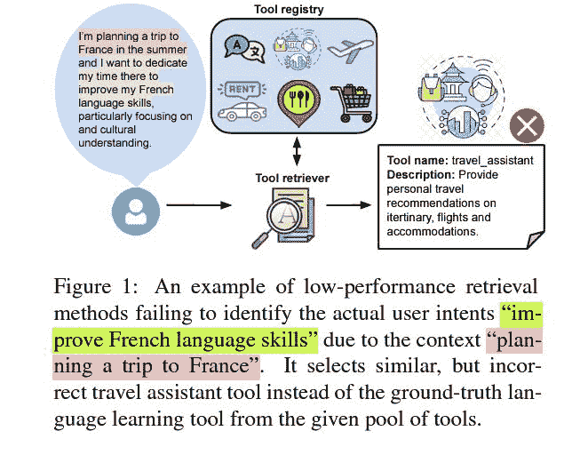

# 产品

## Spur.fit

贡献人：

`https://www.spur.fit/`

Spur.fit 是一个 AI 优先的健身管理平台，可以帮助健身教练和健身房老板高效管理业务。通过智能代理生成个性化的锻炼和饮食计划，整合沟通与支付功能，并提供品牌建设工具，Spur.fit 助力教练专注于客户转变，提升健身行业的效率与智能化。

## Autoflow

贡献人：

`https://autoflow.tools/`

AutoFlow Studio 是一款简化端到端测试流程的工具，通过 AI 辅助测试创建和维护，帮助开发团队更高效地进行软件测试。它提供了可视化的测试覆盖视图，用户无需编码即可管理测试用例，同时具备可扩展的基础设施，支持高达 48 个并行测试。

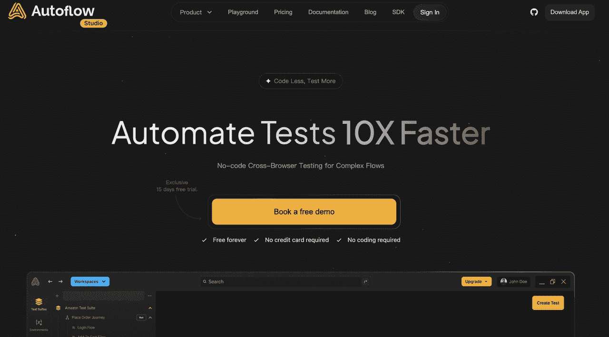

## Gan.AI

贡献人：

`https://gan.ai/studio`

Gan.AI 提供了一种创新的 AI 视频个性化工具，允许用户通过录制一次视频来为每位观众生成个性化的感谢视频。用户可以轻松编辑视频中的特定词汇，如客户的姓名和公司名称，AI 会自动替换并合成自然的语音。该平台适用于销售、市场营销、招聘等多种场景，支持 200 个个性化视频每月生成，包含自定义缩略图、动态背景和实时通知等功能。

# HuggingFace&Github

## MindWork AI Studio

贡献人：

`https://github.com/MindWorkAI/AI-Studio`

MindWork AI Studio 是一款免费的桌面应用程序，提供了一个统一的聊天界面，可以使用各种大型语言模型（LLM）。用户可以自行提供相应的 API 密钥来使用这些模型。该应用程序独立于任何单一提供商，用户可以根据需求选择最合适的提供商。它提供了无限制的使用，并且成本效益较好。

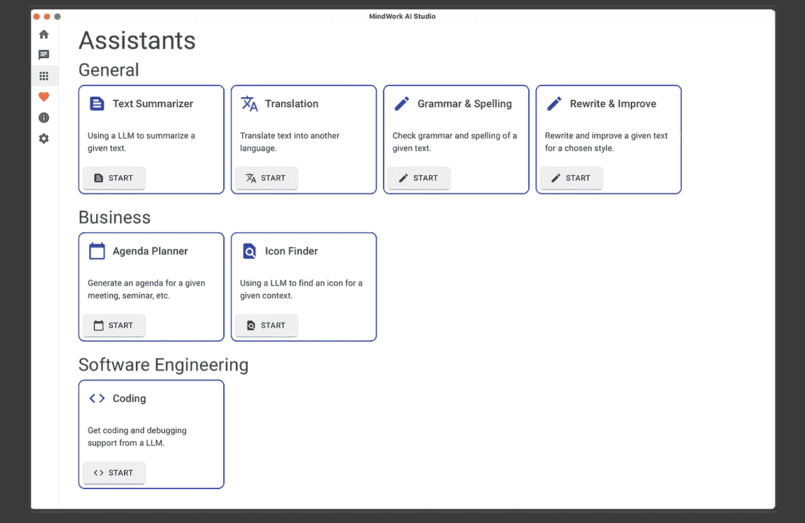

## Llama-3.2V-11B-cot

贡献人：

`https://huggingface.co/Xkev/Llama-3.2V-11B-cot`

`Llama-3.2V-11B-cot` 是首个版本的 `LLaVA-o1` 视觉语言模型，具备自发和系统化推理能力。该模型基于 `meta-llama/Llama-3.2-11B-Vision-Instruct` 进行微调，其在多个基准测试中表现出色，平均得分为 63.5。模型使用 `LLaVA-o1-100k` 数据集训练，采用特定参数设置以确保结果可复现。尽管该模型在某些方面的表现仍然不及行业领先模型，但它的设计意在提供更好的指令跟随能力。

# 投融资

## Anthropic获得亚马逊追加40亿美元投资并合作AWS

`https://techcrunch.com/2024/11/22/anthropic-raises-an-additional-4b-from-amazon-makes-aws-its-primary-cloud-partner/`

近日，人工智能公司Anthropic从亚马逊获得了追加的40亿美元投资，并宣布将亚马逊云服务（AWS）作为其主要的模型训练合作伙伴。此次投资使亚马逊对Anthropic的总投资达到80亿美元，同时保持少数股东身份。截至目前，Anthropic已通过风险投资筹集了137亿美元。

投资亮点：

1. 投资背景：继去年亚马逊分两批完成40亿美元的投资后，新的资金再次以类似方式注入，但附带条件是Anthropic使用AWS的自研芯片（如Trainium和Inferentia）进行AI模型训练和部署。

1. 技术合作：Anthropic将与AWS的芯片部门Annapurna Labs合作开发下一代AI训练加速器，进一步提升计算效率。这种合作被视为AWS进一步扩展其生成式AI能力的重要举措。

1. 市场竞争：Anthropic正与OpenAI、谷歌等公司在AI领域展开竞争。谷歌去年曾以20亿美元投资Anthropic，持有10%的股份。

资金使用和市场战略：

+ Anthropic计划利用新资金加速其Claude模型家族的发展和部署，同时通过AWS的Amazon Bedrock平台为更多客户提供服务。

+ 公司估计2024年的运营支出将超过27亿美元，因此融资对其扩展和保持市场竞争力至关重要。

+ 为增强收入，公司还推出新工具、订阅服务及移动应用。

## AI芯片初创公司MatX完成A轮融资，估值超3亿美元

`https://techcrunch.com/2024/11/22/ai-chip-startup-matx-founded-by-google-alums-raises-series-a-at-300m-valuation-sources-say/`

AI芯片设计初创公司MatX近日完成了约8000万美元的A轮融资，公司估值在融资后超过3亿美元。这家成立仅两年的公司由两名曾在谷歌参与TPU（Tensor Processing Unit）研发的核心团队成员迈克·冈特和雷纳·波普创立，旨在缓解AI计算芯片短缺问题。

投融资亮点：

1. 融资规模与投资方：本轮融资由Spark Capital领投，估值达到融资前2亿多美元，融资后估值突破3亿美元。上一轮种子融资于不到一年前完成，金额为2500万美元。

1. 种子投资背景：种子轮由多位知名AI天使投资人领投，包括前GitHub CEO Nat Friedman和曾负责苹果搜索与AI业务的Daniel Gross。这些投资人为MatX的发展奠定了基础。

1. 市场定位：MatX专注于设计高效、经济的AI芯片，目标是比目前市场领先的英伟达GPU在训练大模型和任务执行上性能提高10倍。

技术与战略优势：

+ MatX的芯片设计适合处理7亿至20亿以上参数的大型AI工作负载，并在多节点扩展方面表现优异。

+ 创始团队强调，通过优化芯片间的通信技术，MatX能够实现大规模集群运行的高效性能。

公司官网：`https://matx.com/`

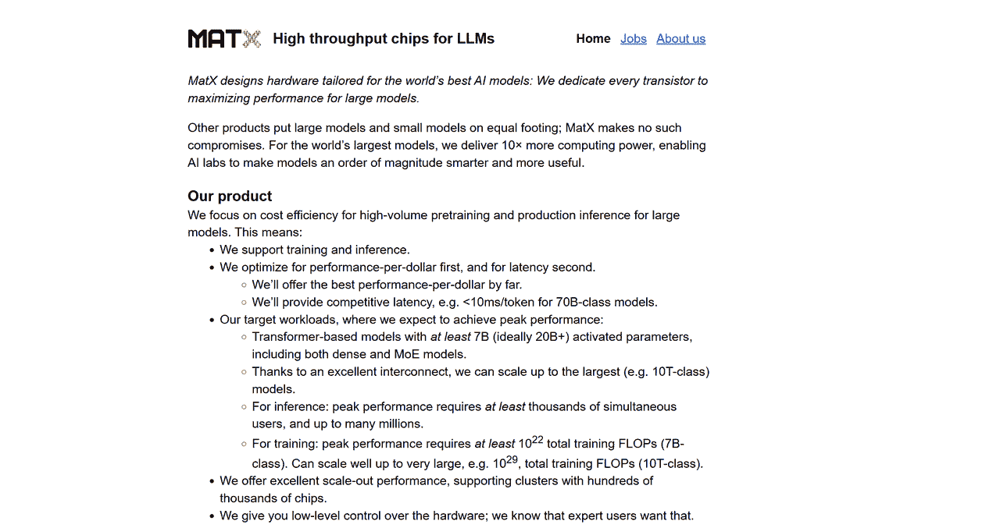

## Fondo完成700万美元种子轮融资，估值6600万美元

`https://techcrunch.com/2024/11/22/yc-backed-fondo-raises-funding-for-its-ai-powered-bookkeeping-and-taxes-platform/`

AI驱动的财务和税务管理平台Fondo近日宣布完成700万美元种子轮融资，本轮由日本金融科技公司Money Forward领投，其他投资方包括Y Combinator、Motley Fool Ventures、Next Coast Ventures等知名机构。此次融资后，Fondo的估值达到6600万美元。

投融资亮点：

1. 融资规模与投资方：

+ 本轮融资为超额认购，金额达到700万美元。

+ 投资方包括多家顶级风险投资机构和天使基金，为公司未来增长提供了强大支持。

1. 市场表现：

+ 成立四年的Fondo已积累1200家客户，年经常性收入（ARR）达到600万美元并实现盈利。

+ 平台帮助客户节省了7500万美元的税费，并协助其获得超过1600万美元的税务返还。

1. 市场定位与差异化：

+ Fondo专注于为初创公司及中小企业提供“一站式”解决方案，与市场上其他会计服务提供商形成差异化。

+ 公司通过结合AI技术与传统会计专业知识，简化客户的财务和税务流程，降低操作错误风险。

融资用途与未来规划：

+ Fondo计划将融资资金用于产品开发和自动化技术投资，包括为内部团队和客户打造AI代理，以提升财务分析和洞察能力。

+ 公司还将扩展分析和报告功能，增强与其他创业工具的整合，提供更多税收优惠服务，并支持企业在国际扩张中的合规需求。

公司官网：`https://www.tryfondo.com/`

# 学习

## LLM推理优化 - PagedAttention

贡献人：

`https://zhuanlan.zhihu.com/p/8281442791`

大模型的推理过程分为`Prefill`和`Decoding`阶段。`Prefill`阶段通过计算`prompt`的`KV`值并存储到`KV Cache`中，为后续生成提供加速。`Decoding`阶段逐步生成响应`token`，同时将每个`token`的`KV`值加入缓存。传统`KV Cache`分配采用固定大小的连续显存区域，显存利用率较低。

为优化显存利用率，`vLLM`引入`PagedAttention`技术，借鉴操作系统虚拟内存分页的理念，动态分配`KV Cache`存储。`Prompt`被划分为逻辑块，每个逻辑块存储固定数量的`token`的`KV`值，这些逻辑块通过`block table`映射到物理块，实际存储`KV`值。推理引擎通过逻辑块连续操作`token`数据，而物理存储位置动态调整，显著提升存储效率。

在`Prefill`阶段，`vLLM`根据块大小划分逻辑块并映射到物理块，`block table`记录逻辑块与物理块的关系，包括映射位置和已填满槽位。`Decoding`阶段每生成一个新`token`，系统更新逻辑块和物理块的状态，必要时分配新的逻辑块和物理块，同时保持`block table`同步更新，确保存储资源灵活分配。

在显存资源紧张的情况下，`vLLM`通过调度和抢占策略优先服务先到请求，暂停最新请求并释放其`KV Cache`空间，待资源充足时恢复执行。分布式场景下，中央调度器管理`KV Cache`的映射关系并将其分发到各显卡，各显卡的缓存引擎依据映射表高效管理`KV`块，实现分布式计算的灵活调度和高效资源利用。

`PagedAttention`通过动态显存管理提高了推理效率，使大模型在多任务和高负载场景中表现更优，同时支持显存资源的灵活调度，满足复杂计算需求。

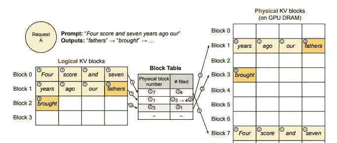

## LLM之数据的重要性

`https://zhuanlan.zhihu.com/p/5636206724`

合成数据在模型训练中的重要性逐渐显现，尤其是相比于含有错别字、字符错乱、脏话等噪声问题的爬取数据，合成数据具备更高的质量和一致性，能够显著改善模型训练效果。合成数据生成方式包括基于角色、主题、摘要及对话场景的生成，其中数据多样性和质量的提升尤为关键。

`DiaSynth`框架通过加入角色信息和个性化提示，采用大五人格模型及`CoT`推理，提高了对话生成的真实性。`Multi-Document Grounded`生成框架通过基于`RAG`的多文档检索生成`query`和`answer`，提升了知识类模型的微调质量和准确性。同样，`A New Pipeline`框架使用`RAG`结合自我微调生成高质量`QA`数据，验证了基于特定领域文档的合成数据对微调的有效性。

数据多样性优于数据质量是普遍共识。《`Scaling Synthetic Data Creation with 1,000,000,000 Personas`》证明了通过LLM生成多样化角色数据比简单调整`temperature`更有效。而基于小模型生成数据的实验表明，小模型由于生成更多样数据，在固定预算下往往比大模型生成效果更好。研究还发现，随机选择数据在大规模数据集上的效果甚至优于复杂的选择算法，进一步突出了多样性的重要性。

为提升数据质量，研究中常结合基于`logprob`、交叉熵、信息熵等指标的质量筛选方法，例如`SelectIT`通过模型不确定性评估和`DiverseEvol`利用嵌入空间差异选择高质量数据。`Skywork-Reward`通过清洗公开偏好数据并结合优化的`Bradley-Terry`损失函数，为奖励建模提供了稳健性支持。

合成数据质量和多样性对任务效果的影响贯穿整个模型开发过程。在初期阶段，数量和多样性是关键；在后期`SFT`和奖励建模阶段，数据质量的重要性则逐渐上升。未来的数据生成和筛选研究应更加关注任务相关性和多样性优化，从而充分释放模型潜力。

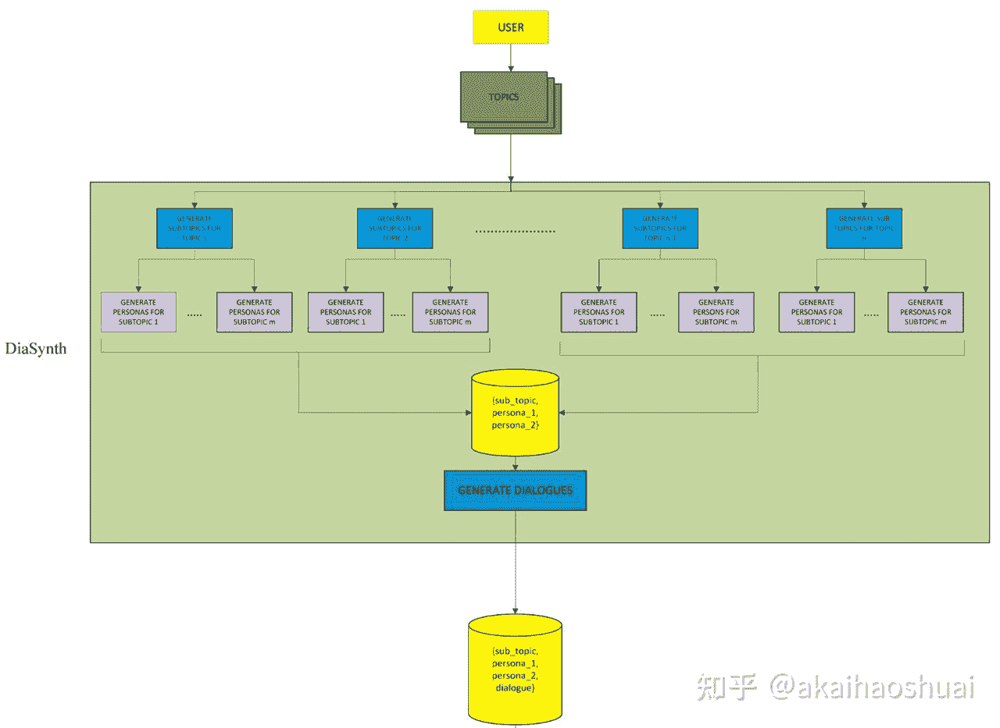

## 造数据（`MiPS`、`Math-Shepherd`、`OmegaPRM`）

`https://zhuanlan.zhihu.com/p/1807986811`

`PRM`（Process Reward Model）的训练数据获取是其性能提升的关键，针对这一问题，三篇文章在数学领域提出了创新的数据生成方法：`Math-Shepherd`、`MiPS`、`OmegaPRM`。数学领域被选择为研究场景，主要因为其问题有标准答案，中间过程的正确性可量化评估。

`Math-Shepherd`框架通过定义中间步骤质量为其推导出正确答案的潜力，利用`completer`模型生成`N`个后续推理过程，并通过硬估计（`HE`）和软估计（`SE`）对每个推理步骤进行质量标注。`HE`将能生成正确答案的步骤标记为“好”，`SE`通过统计生成正确答案的频率进行标注。生成的高质量中间步骤被用于训练`PRM`，通过交叉熵损失分配逐步奖励。

`MiPS`框架使用两个模型协作生成和评估中间步骤质量。第一个模型生成完整解决方案，第二个模型从中间步骤开始生成多个完成尝试并计算正确率，定义为完成正确解的概率。每个中间解决方案的正确率被用来训练过程监督验证器（`PSV`），`PSV`通过聚合函数生成最终分数以筛选最优解决方案。

`OmegaPRM`基于蒙特卡洛树搜索（`MCTS`）构建推理路径。其流程包括三部分：树构建阶段生成推理状态和步骤；二分搜索精确定位第一个错误步骤；更新树统计信息以优化路径选择。每棵`MCT`包含多个样本，通过记录错误步骤和接近正确的负样本优化`PRM`训练。

这些方法的共同点在于通过高效自动化的标注生成过程监督数据，解决了人工标注的成本和一致性问题。其中，`Math-Shepherd`和`MiPS`关注对中间步骤的评估与标注，而`OmegaPRM`通过`MCTS`的探索性方法生成更丰富的推理路径样本。这些框架为提升复杂推理任务中LLM的性能提供了新的思路。

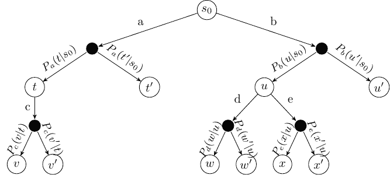

## Generative PRM 与 Q Learning

`https://zhuanlan.zhihu.com/p/6098058880`

过程监督奖励（`PRM`）被广泛应用于复杂推理任务中，通过为每一步推理分配奖励来指导大型语言模型（LLM）的训练。相比于仅对最终结果进行奖励的结果监督奖励（`ORM`），`PRM`更适合多步推理任务，表现明显优于`ORM`。然而，由于逐步标注成本高昂，自动化过程监督数据生成成为关键。

`Math-Shepherd`是一种用于生成`PRM`训练数据的方法。该方法从数学问题的中间步骤出发，使用LLM生成多条路径，并以得到正确答案的比例作为中间步骤的奖励估计。这种奖励值通过硬估计（`HE`）转化为二值标签，用于训练`PRM`模型。在训练过程中，移除LLM的最后一层，接入线性头部预测奖励值，将奖励标记构造成多轮对话任务，并复用`SFT`训练框架进行优化。

生成式`PRM`训练（`Generative PRM`）将每条推理轨迹转化为多轮对话，将`assistant`生成的每一步的正确性作为监督信号。通过LLM在推理时生成的`“+”`概率计算逐步奖励，实现对过程监督的高效建模。在测试中，通过在`GSM8K`和`MATH`数据集上使用`“best-of-n”`策略验证模型准确性。

实验结果表明，使用`PRM`训练的模型在复杂数学任务上的表现显著提升，尤其是在逐步优化推理路径的过程中表现出更强的能力。相关代码、数据及超参数均已开源，进一步支持了`PRM`在多步推理任务中的广泛应用。

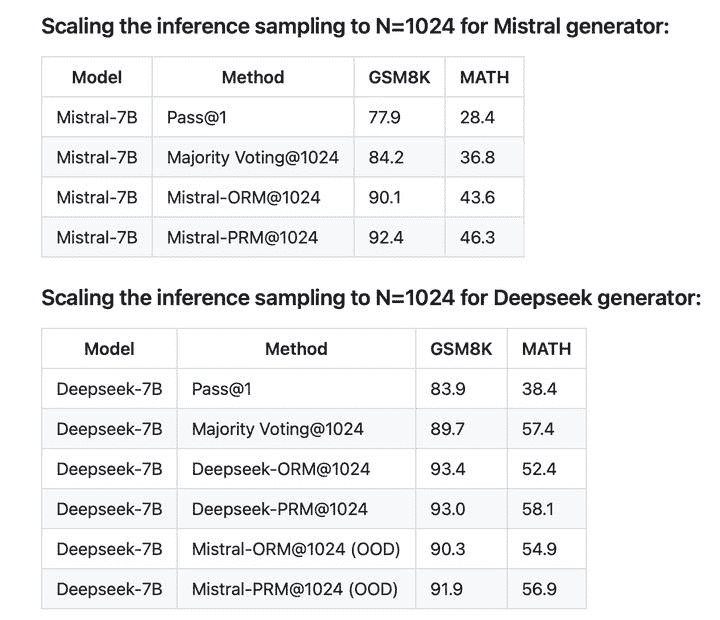

# 招聘公告

---

奇绩创坛由陆奇博士于2019年创立，使命是在源头最大化驱动创新。奇绩研究组将研究模型理论、到投研战略分析、市场策划等不同背景的同学聚在一起，搭建GenAI时代独特的跨界人才社群。

## 🚀F24实习岗位

### 行研-学术科研人才交流组实习生

`https://miracleplus.feishu.cn/docx/Yn6rdf2iOoY2Rcx8yVNcUBYRnch#part-QkMcdeJmuob9uvxvV3qcLSzHn8g`

### 行研-GenAI研究岗位-战略分析（偏产品）

### Web / AI 全栈开发工程师实习生

## 🚀火热开放中

### 行研-GenAI研究岗位-前沿学术探索

### 行研-GenAI研究岗位-战略分析（偏咨询）

### 创新活动产品运营（大模型系列活动产品运营）

> 点击相关岗位可查看对应岗位需求【JD】；相关岗位投递请扫描二维码

> 欢迎推荐/自荐

> 期待在奇绩创坛遇见更好的你

---

# 声明

本文档仅供学习交流使用，版权归原作者所有，若涉侵权，请联系Jack Jin 15101136166

（欢迎在下方反馈您宝贵的意见！整理不易，觉得有用给AI日报小组点个赞👍吧！）

ChatGPT；Angela；Zijia Liu；Alex；Zeqi Tan；Tiezhen（HuggingFace）；Naixu；Lizhi；Peter；Suoman；Jack

学术分析报告：ResearchFlow -- 奇绩F23校友的开发的深度研究产品，PC端进入RFlow的分析报告，可直接点击节点右侧的小数字展开节点，登录后可在节点上直接“询问AI”，进一步探索深度信息

如果你有大模型相关的创业想法，欢迎来找我们聊聊～🛰️：15101136166

> 快邀请你的小伙伴们一起来读大模型日报吧！

> 【日报知识库】这里是近期日报内容的汇总,欢迎大家查阅

> [大模型日报知识库(分享版)](https://miracleplus.feishu.cn/wiki/KapVwXfkriOBiskB0B2cUHxjnTh)

> 欢迎大家多多帮我们分享,转发

> 如果大家有任何的建议或者吐槽,欢迎随时找我聊天~

