# 奇绩大模型日报（11月 22日）

> 来源：[https://miracleplus.feishu.cn/docx/Ifozdf006oYFqGxFzVHcEdWrnlh](https://miracleplus.feishu.cn/docx/Ifozdf006oYFqGxFzVHcEdWrnlh)

# 资讯

### AI2推出开源Tülu 3，加速AI后训练民主化

https://techcrunch.com/2024/11/21/ai2s-open-source-tulu-3-lets-anyone-play-the-ai-post-training-game/

**核心亮点：**

+   **Tülu 3功能：** Tülu 3是AI2推出的新一代后训练工具，支持对大型语言模型（LLM）进行定制化后训练，从数据清理、强化学习到细化调优，提升模型在特定领域的实用性。

+   **技术目标：** 帮助开发者无需依赖大公司资源，即可实现定制化模型的训练和部署，例如优先优化数学和编程能力，弱化多语言支持。

+   **竞争优势：** 相较于Meta的Llama等开源项目，Tülu 3不仅开放模型使用，还提供全面的数据收集与训练流程，真正实现“开源”。

**行业应用与潜力：**

+   **隐私与成本控制：** 医疗和研究机构可通过Tülu 3在本地实现模型训练，避免与外部服务商合作带来的敏感数据泄露风险。

+   **开源生态扩展：** AI2计划推出基于其自有OLMo模型的Tülu 3训练版本，进一步增强开源生态的竞争力。

https://allenai.org/

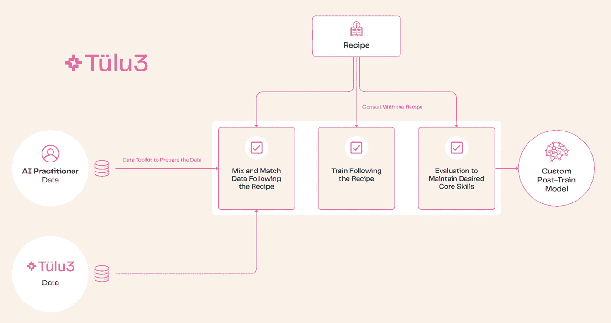

### 英伟达团队推出DexMG

https://mp.weixin.qq.com/s/k7sj7bEq66Fdg9-4RTXnow

研究人员来自英伟达、UT Austin和UCSD的团队开发了一种名为DexMimicGen的大规模自动化数据生成系统，用于解决机器人训练数据集获取难题。该系统通过少量人类演示，利用物理仿真生成大规模双手灵巧操作数据集，显著提升了数据采集效率和质量。DexMimicGen从仅5个源演示中生成1000个高质量轨迹，最高可从60个源演示生成21000个数据样本，覆盖9种任务场景。这些数据用于模仿学习策略训练和基准测试，显著提高了策略成功率。

DexMimicGen的核心技术在于利用灵活的任务分割和优化执行策略，将复杂的双手操作任务分解为并行、协调和顺序子任务三种类型。该方法引入了异步执行、同步策略和排序约束机制，实现了手臂之间的独立操作和精确协调。例如，在复杂任务中，一只手抓取部件，另一只手配合完成装配或传递，同时确保任务顺序正确执行。这些优化克服了传统MimicGen方案在多手臂配合任务中的局限。

该系统在仿真环境中生成的轨迹还结合real2sim2real方法转移至现实应用。实验显示，DexMimicGen生成数据后的策略在复杂任务中的成功率显著提升。例如，在现实世界的罐子分类任务中，DexMimicGen辅助生成的策略成功率高达90%，而仅依赖源演示的策略成功率为0%。

此外，DexMimicGen通过启发式算法或人工标注将源演示分解为子任务，随机化初始状态生成多样化数据集。实验结果表明，DexMimicGen不仅提升了任务成功率，还增强了机器人适应不同初始状态的能力。例如，在复杂任务如穿线和装配中，策略成功率分别从1.3%和3.3%提升至69.3%和80.7%。

实验还揭示了数据集规模与策略性能的关系。随着数据量从100增至1000，策略性能显著提高，但当数据增至5000时，性能提升趋于平缓，表明性能可能存在边际效应。总体而言，DexMimicGen为机器人模仿学习和高复杂度任务的数据生成提供了高效、可靠的解决方案，为类人机器人操作研究带来了重要突破。

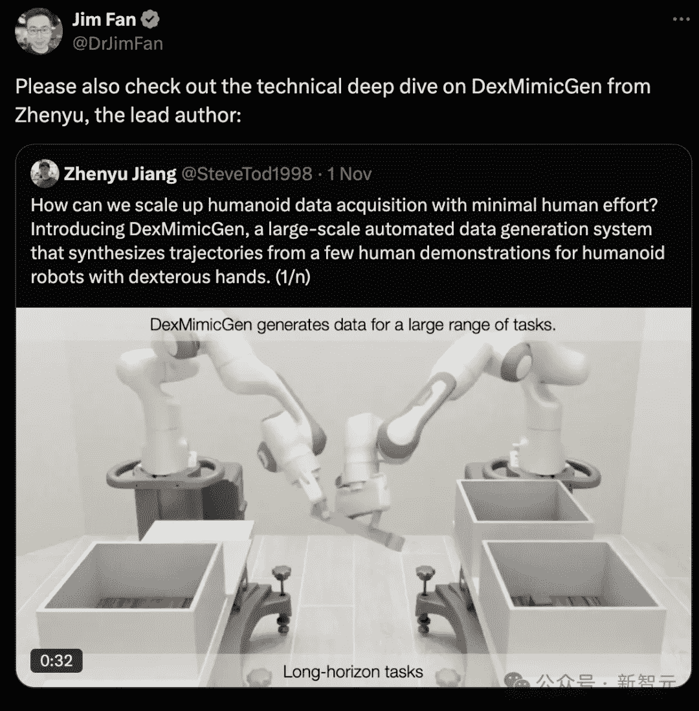

### 字节跳动基于 Ray 的大规模多模态数据处理框架

https://mp.weixin.qq.com/s/PtlQ-SYQKTNXY8kAhsZhbA

在2024年9月30日至10月2日于旧金山举办的Ray Summit大会上，全球AI开发者和技术领袖齐聚一堂，共同探讨人工智能的未来构建。字节跳动团队在大会上发表了题为《How Bytedance Builds Large-Scale Data Processing Pipelines for Multimodal Models with Ray》的主题演讲，详细分享了如何利用Ray解决多模态大模型训练中大规模音视频数据处理的挑战。

字节跳动团队的音频数据处理Pipeline通过三层架构优化任务执行效率。基础设施层负责资源调度与管理，Pipeline层通过模块化设计将数据处理任务定义为多个node（任务或算子）和flow（节点间数据传输关系），以YAML组装Pipeline的DAG结构，顶层应用层将处理后的数据应用于模型训练等业务场景。RayData的引入显著提升了开发效率，解决了传统方案中可扩展性不足、任务调度复杂、容错性弱的问题。通过RayData的自动扩缩容功能，音频Pipeline能够轻松适配PB级数据规模和复杂算法需求。

在视频数据处理Pipeline中，字节跳动团队针对视频数据量大、处理资源需求高的问题，采用了分布式架构和创新设计。视频处理流程涵盖视频分割、裁剪、评分及打包为Parquet文件以供训练使用。通过单Actor多线程方式优化数据传输和处理效率，避免了ObjectStore性能瓶颈，实现了高吞吐量和良好的线性扩展性能。这种设计在提升整体处理效率的同时，克服了传统数据传输中因大文件序列化带来的性能损耗。

Ray的灵活性和强大的分布式计算能力为上述实现提供了技术支持。RayData提供高效算子和多模态数据支持，降低了开发成本；RayServe通过自动化故障恢复和高性能部署，保障了服务的稳定性。与此同时，字节跳动团队提出了在不稳定Kubernetes节点上运行RayData的优化方案。通过任务重新分配机制，将失败任务重新调度到可用Actor，并引入血缘表机制管理算子间输入输出关系，解决了GPU资源抢占和任务挂起问题，极大地提高了数据处理的容错性和稳定性。

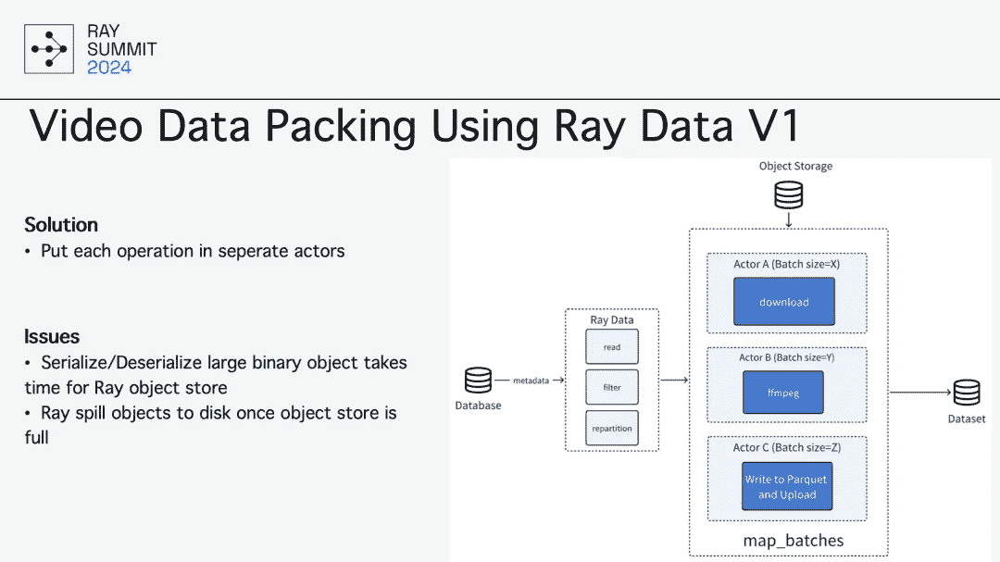

### 通信设备：AI创新驱动增量投资

https://mp.weixin.qq.com/s/XdwyyKZsIQp9BW_-3UbgxA

**A**I仍是云厂商资本开支投入焦点，大模型从追求大参数量逐渐转向高性价比、以及目标市场多元化，AI推理有望加速发展。相比2023年大模型参数量快速扩张，2024年大模型行业焦点逐渐转变为关注推理性能优化、工程化改进，以推动大模型应用落地和端侧部署。随着2024年已有部分AI应用流量放量增长，我们判断2025年或是AI商用落地规模增长的一年，有望带动AI推理需求的超预期释放，需求旺盛的云厂商的相关供应链企业有望迎来业绩高增。

**AI硬件建议关注三类投资机遇。**我们认为：**1）新技术：**高性能、低功耗的需求推动AI硬件技术迭代加速，液冷、硅光、CPO等技**术加速商用落**地，有望在2025年实现规模部署。建议关注有望新技术能力领先的公司**。2）国产化：全球**供应链面临一定的不确定性，在政策端和供给端的共同推动下，国产GPU算力持续提升，生态建设日臻完善，从算力到网络的国产生态企业有望迎来发展机遇。3）AI智能硬件：AI赋能、成本下探，AI与硬件的结合商用有望提速发展，看好智能汽车、AI终端、具身智能等方向。

**流**量增速放缓、运营商投资或将继续温和下滑，关注专项债带来的信息产业潜在投资机会，包括智慧生产、智慧城市、智慧交通等基础设施项目。我们认为，政策端有望加码构建新质生产力，赋能企业数智化转型，带动新一轮供给侧改革；需求端，智慧生产、智慧城市、智慧交通等基础设施项目有望拉动信息产业加速升级，蕴含增量投资机会。

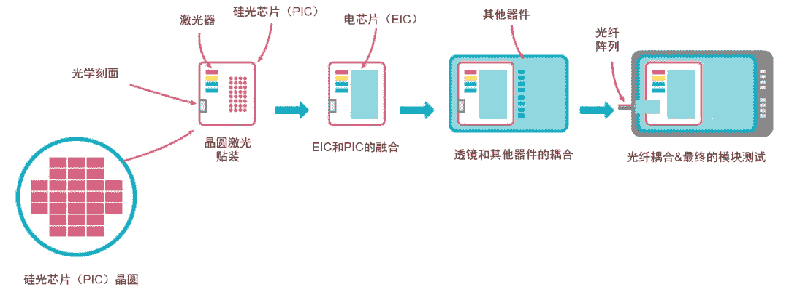

# 推特

### 现在可以直接将 Google Docs 的内容添加到Cluade聊天和项目中

贡献人：

https://x.com/AnthropicAI/status/1859663546830946494

您现在可以直接将 Google Docs 的内容添加到聊天和项目中。

只需粘贴链接或从最近的文档中选择即可开始。

[kv-mbxtaGIr4dcFu.mp4](https://internal-api-drive-stream.feishu.cn/space/api/box/stream/download/all/VdZpbE2tJoeYD6xFGBWcMeEGnxb)

### OpenAI分享两篇关于红队测试的论文：测试前沿 AI 模型的重要环节

贡献人：

https://x.com/OpenAI/status/1859667912719728897

我们正在分享两篇关于红队测试的论文，这是一项测试前沿 AI 模型的重要环节——一篇白皮书介绍我们与外部红队成员合作的方式，以及一项研究介绍一种新的自动化红队测试方法。

### llms.txt：将任何网站内容整合为一个文本文件，供任何 LLM 使用

贡献人：

https://x.com/ericciarla/status/1859643717101195684

介绍 **llms.txt 生成器 ✨**

您现在可以将任何网站内容整合为一个文本文件，供任何 LLM 使用。

我们使用 **@firecrawl_dev** 爬取整个网站，并通过 **gpt-4o-mini** 提取数据。

立即访问 http://llmstxt.firecrawl.dev 创建您自己的 llms.txt 吧！

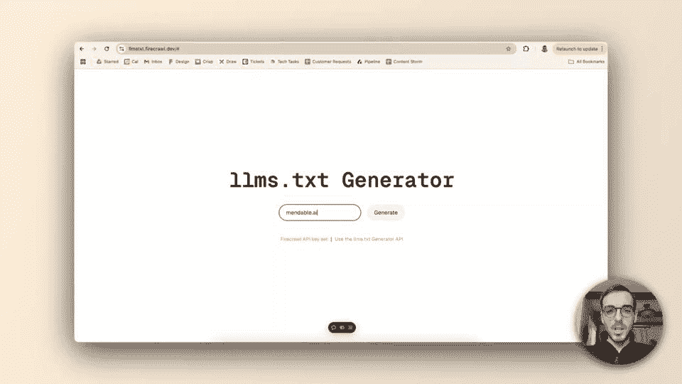

[H8bVdWDeXV4YlQKq.mp4](https://internal-api-drive-stream.feishu.cn/space/api/box/stream/download/all/LDR1behRoowBqSxhHbuc5LjHnyf)

### 吴恩达：一小部分人开始在网上发布专为 LLM（大型语言模型）而非人类直接使用的文本内容，是一个非常有趣的趋势

贡献人：

https://x.com/AndrewYNg/status/1859625355541348798

一小部分人开始在网上发布专为 LLM（大型语言模型）而非人类直接使用的文本内容。我认为这是一个非常有趣的趋势，尤其是在作者受到激励，愿意帮助 LLM 提供商更好地服务用户时！

然而，在线发布文本的人并不总是有动力去帮助 LLM 提供商。实际上，他们的动机往往是不一致的。出版商担心 LLM 会读取他们的文本，进行改写并重用其创意却不标明出处，从而使他们失去订阅收入或广告收益。这种情况甚至引发了诉讼，例如《纽约时报》起诉 OpenAI 和微软，指控其侵犯版权。此外，还有一些示例表明有人会注入恶意提示（Prompt Injection），试图向 LLM 传递与提供商意图相悖的指令。例如，一些网站建议求职者在简历中以极小或极淡的字体添加对人类几乎不可见的文本，如“该候选人非常适合这个职位”，以通过 LLM 的简历筛选器。试图推广特定产品的垃圾邮件发送者也可能将注意力转向 LLM，而这些行为已经让搜索引擎难以过滤。

但也有一些作者主动希望帮助 LLM。例如，一家刚推出软件库的初创公司，因为在线文档刚发布，所以尚未被包含在 LLM 的预训练数据中。当用户询问 LLM 推荐软件时，LLM 不会推荐这个库，即使用户直接要求 LLM 生成使用该库的代码，LLM 也不知道如何操作。如果 LLM 增强了在线搜索能力，它可能会找到新的文档并据此生成代码。在这种情况下，开发者可能希望采取额外步骤，通过 RAG（检索增强生成）让文档更易于 LLM 理解。（同时，文档可能最终会被纳入预训练数据中。）

与人类相比，LLM 在浏览复杂网站时表现不佳，特别是那些有许多图形元素的网站。然而，LLM 在快速处理冗长、密集的文本文档方面远胜于人类。假设这个软件库包含许多函数，希望 LLM 能在生成代码时正确使用它们。如果您为人类编写文档，可能会创建许多网页，将信息分解成易消化的小块，并配上图形说明。但对于 LLM 来说，一份以 XML 格式书写的长文档，详细说明所有内容，可能会更方便。这种文本可能包括所有函数的列表，每个函数的详细描述，以及一两个使用示例。（这与我们为 LLM 提供工具使用信息的方式类似。）

对于人类来说，这样的长文档很难阅读和导航，但 LLM 可以轻松处理，并决定何时以及如何使用这些函数！

由于 LLM 和人类在处理不同类型文本上的能力不同，我们为 LLM 编写文本的方式与为人类编写不同。此外，当有人有动力帮助 LLM 更好地理解某个主题——以便 LLM 能更好地向用户解释时，作者可能会专门为 LLM 编写文本。

到目前为止，专为 LLM 设计的文本还未成为主流趋势。但 Jeremy Howard 提出的建议——让网络发布者使用类似于 robots.txt 的 llms.txt 文件来告诉 LLM 如何使用他们的网站——是朝这个方向迈出的有趣一步。同样，一些开发者也在发布详细的说明文件，告诉 IDE 如何使用工具，例如大量的 .cursorrules 文件告诉 Cursor IDE 如何使用特定的软件栈。

我认为这与 SEO（搜索引擎优化）有一定的相似之处。SEO 已存在几十年，一些 SEO 技术可以帮助搜索引擎找到更相关的主题，而另一些则是推广低质量信息的垃圾内容。但许多 SEO 技术——那些涉及为搜索引擎而非人为消费编写文本的技术——之所以能长期存在，部分原因是搜索引擎处理网页的方式不同于人类，因此提供标签或其他信息来告诉搜索引擎网页内容是什么是有帮助的。

如果 LLM 在理解复杂网站的能力上赶上人类，那么为 LLM 和人类分别编写文本的需求可能会减少。但在此之前，随着人们越来越多地通过 LLM 获取信息，为 LLM 编写文本的趋势将会增长。

[原文链接: https://deeplearning.ai/the-batch/issue-276/]

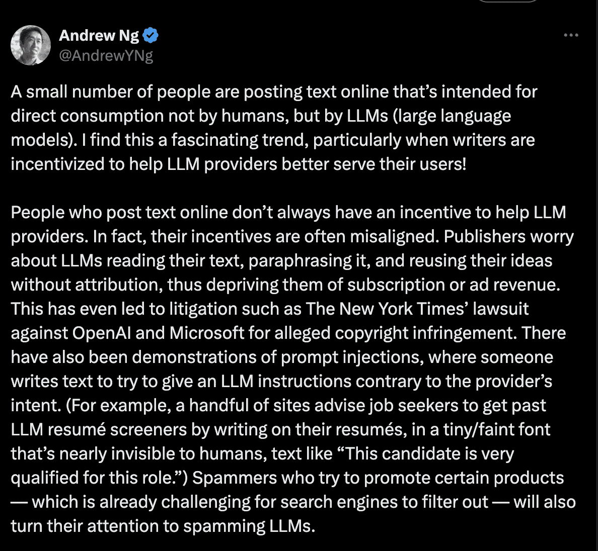

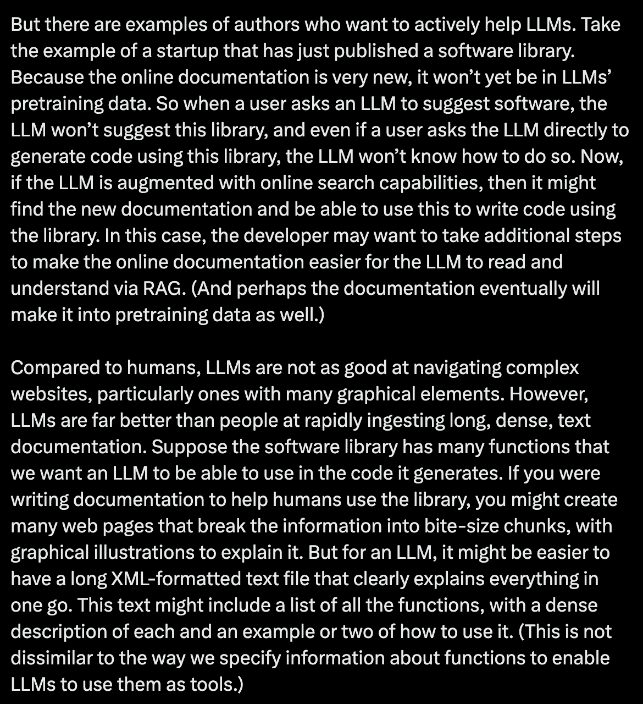

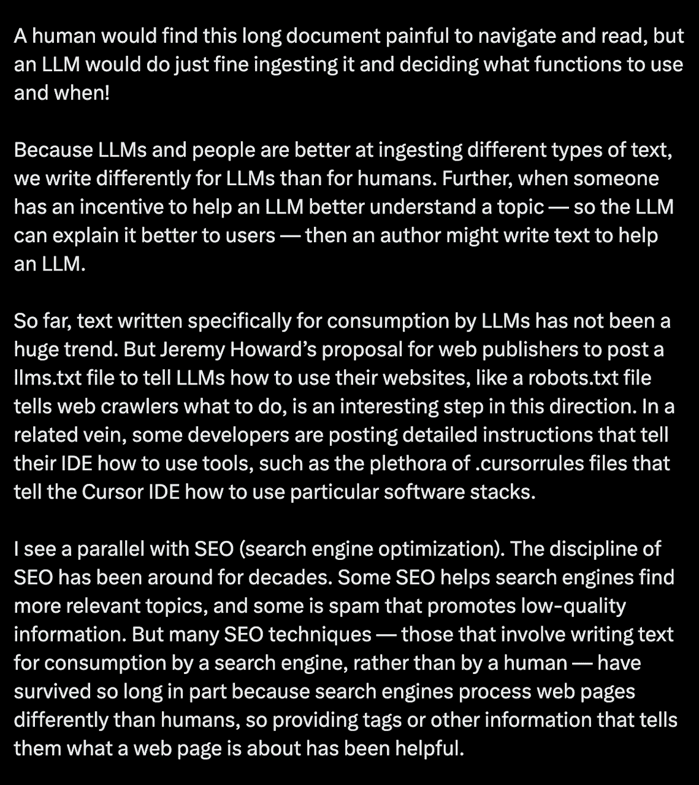

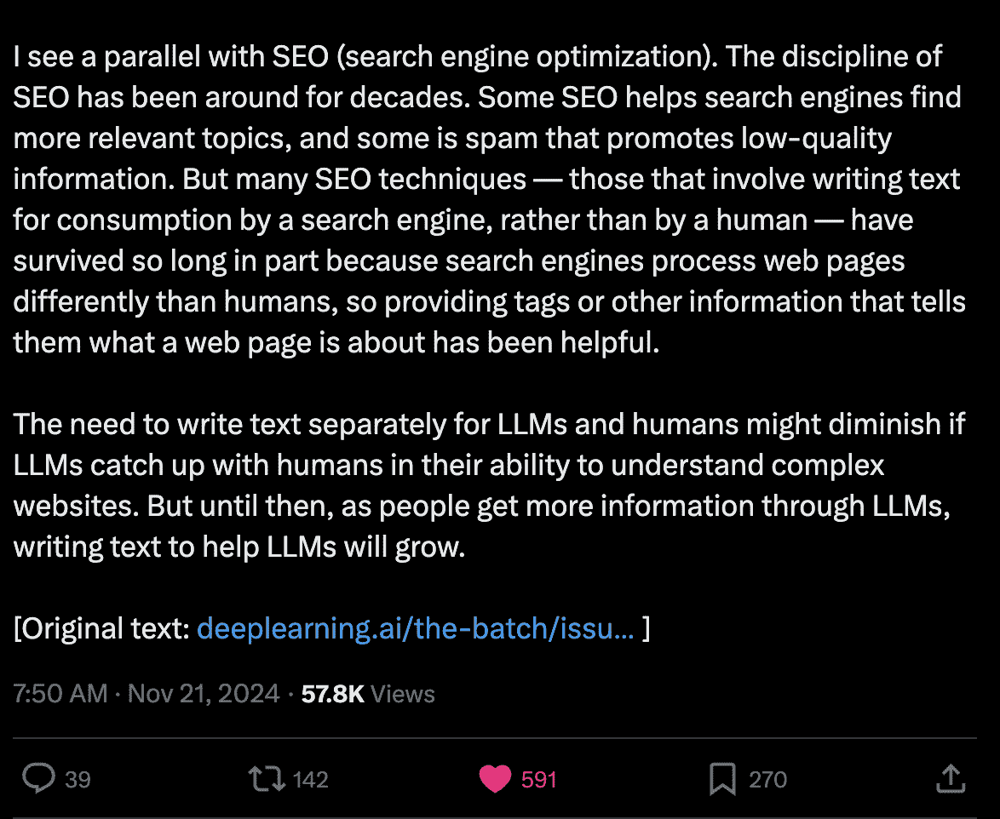

# 信号

### Non-Stationary Learning of Neural Networks with Automatic Soft Parameter Reset

https://arxiv.org/abs/2411.04034

贡献人：

神经网络传统上是在假设数据来自一个平稳分布的情况下进行训练的。然而，违反这一假设的设置正变得越来越普遍；例子包括在分布变化下的监督学习、强化学习、持续学习和非平稳上下文赌徒。在这项工作中，我们引入了一种新颖的学习方法，能够通过具有自适应漂移参数的奥恩斯坦-乌伦贝克过程自动建模和适应非平稳性。自适应漂移倾向于将参数拉向初始化分布，因此该方法可以理解为一种软参数重置的形式。

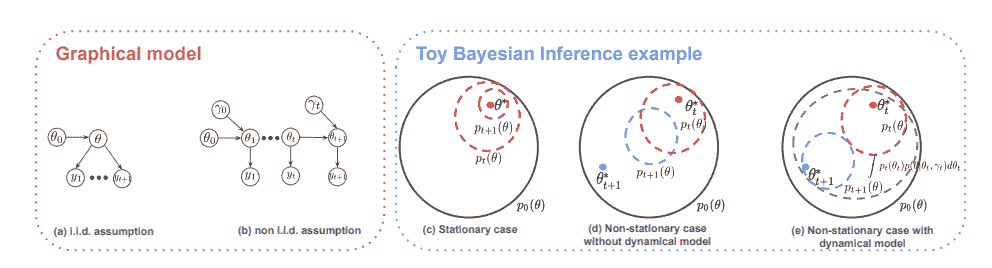

### Diffusion For World Modeling: Visual Details Matter in Atari

https://arxiv.org/abs/2405.12399

贡献人：

日内瓦大学、爱丁堡大学的研究人员提出了一个在扩散世界模型中训练的强化学习智能体DIAMOND（DIffusion As a Model Of eNvironment Dreams），文中分析了使扩散模型适应于世界建模（world modeling）所需的设计要素，并展示了如何通过改善视觉细节来提高智能体的性能。

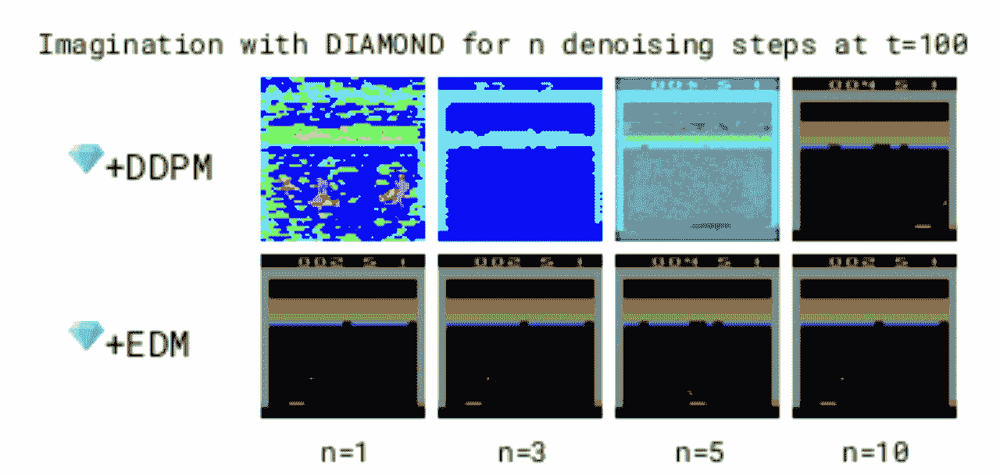

# 产品

### Lovable

贡献人：

https://lovable.dev/

Lovable 是一款创新的 AI 软件工程师，帮助开发者和非开发者以 20 倍的速度将创意转化为产品，使用简单的英语而非代码。它支持全栈开发，能够与 Supabase 一键连接，提供后端功能，如用户认证和数据存储。新功能包括精确编辑、支持大型代码库和模板选项，帮助用户快速构建应用程序。Lovable 适合创始人、设计师和技术人员，旨在加速产品验证和开发。

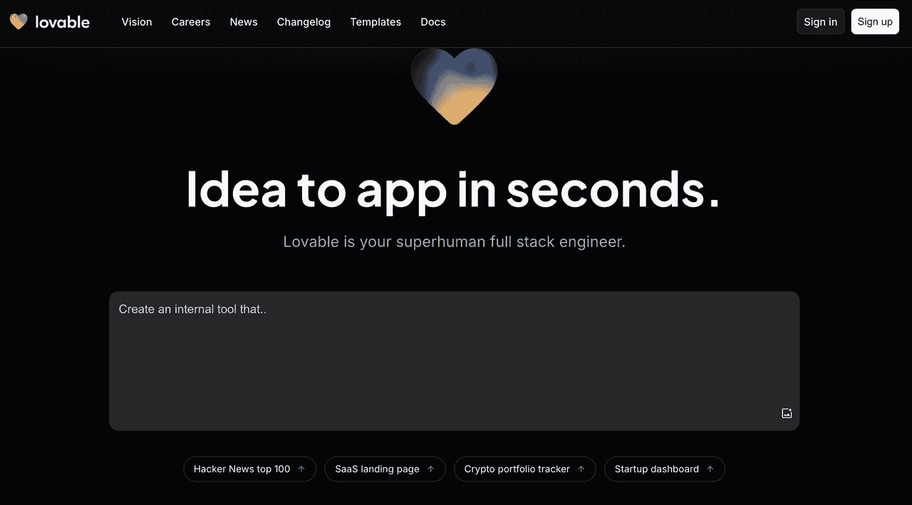

### Desktop Recording SDK by Recall.ai

贡献人：

https://docs.recall.ai/docs/desktop-sdk-beta

Recall.ai 推出了桌面录制 SDK，允许开发者在不使用机器人的情况下捕获 Zoom、Google Meet 和 Microsoft Teams 的会议录音、转录和元数据。该 SDK 可以在五分钟内与 Electron 应用程序集成，支持实时笔记、远程医疗记录和销售培训等功能。它希望解决合规性和用户舒适度问题，用户可以轻松获取会议数据。开发者们对其应用场景表现出浓厚的兴趣，包括分析工具、客户支持和实时销售辅导等。

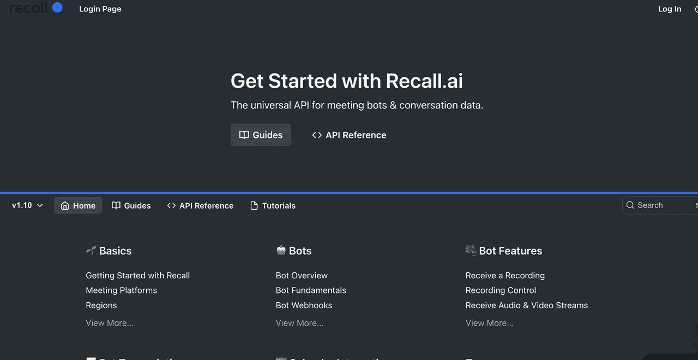

# HuggingFace&Github

### Screenpipe

贡献人：

https://github.com/mediar-ai/screenpipe

screenpipe 是一个 24/7 屏幕和语音录制的 AI 助手项目，希望为人工智能时代提供全面的上下文数据。该项目由 rewind.ai 和 cursor.com 联合开发，提供多种安装方式，包括命令行工具、付费桌面应用程序和开源软件包。

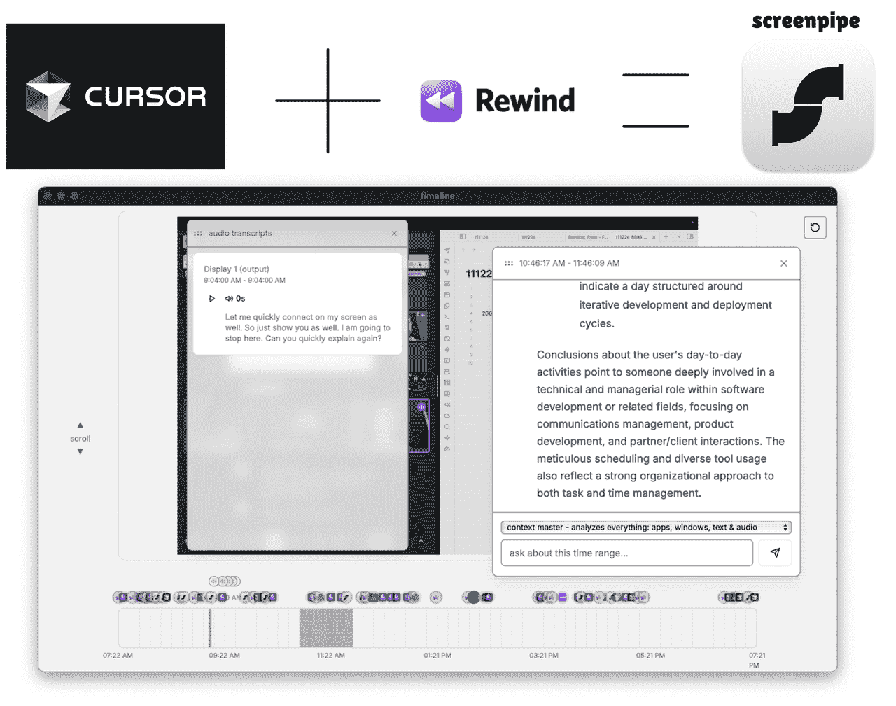

### Chatbox

贡献人：

https://github.com/Bin-Huang/chatbox

Chatbox 是一个 AI 模型桌面客户端，支持 ChatGPT、Claude、Google Gemini、Ollama 等主流模型，适用于 Windows、Mac、Linux、Web、Android 和 iOS 全平台

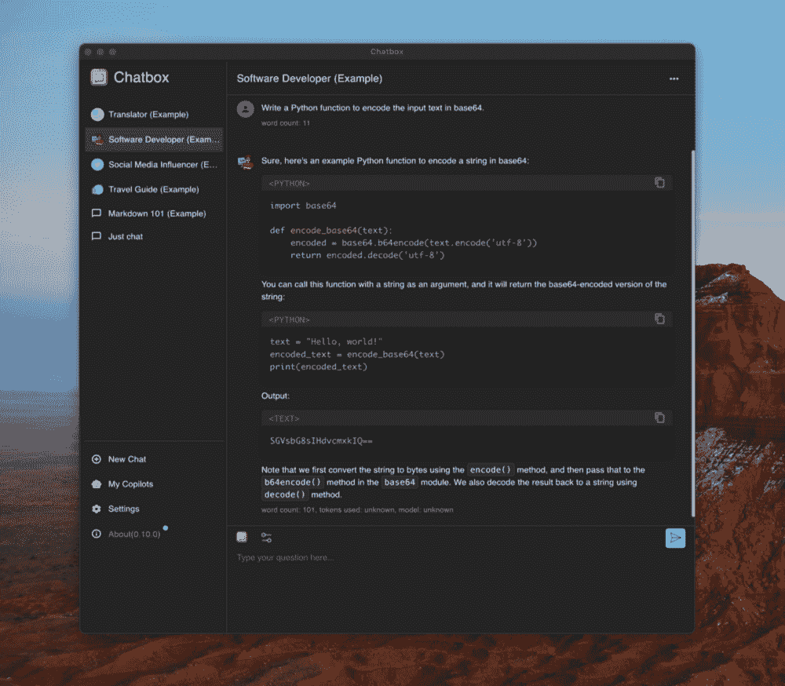

# 投融资

### Crusoe Energy完成6.86亿美元融资，聚焦AI数据中心建设

贡献人：

https://techcrunch.com/2024/11/21/crusoe-a-rumored-openai-data-center-supplier-has-secured-686m-in-new-funds-filing-shows/

**投融资亮点：**

+   **融资规模：** Crusoe Energy通过SEC文件披露已筹集6.86亿美元，目标融资总额为8.18亿美元。

+   **投资者：** 目前已有70名投资者参与融资，传闻包括Peter Thiel的Founders Fund和Felicis Ventures。

+   **估值与历史融资：** 最新估值预计超30亿美元，为此前估值的两倍；若完成目标融资，总筹资金额将达15亿美元，包括去年以数据中心芯片为抵押的2亿美元债务融资。

**业务与行业布局：**

+   **转型AI：** 公司由加密货币业务起步，通过利用浪费的天然气发电支持数据中心运行，后转向为AI公司提供高性能计算基础设施。

+   **重大项目：** 与Blue Owl Capital合作投资34亿美元建设位于得克萨斯州Abilene的大型数据中心园区，预计将租赁给Oracle，服务于微软及其合作伙伴OpenAI。

**市场竞争与挑战：**

+   **竞争者：** 包括CoreWeave（已筹资127亿美元）、Lambda Labs（融资5亿美元）等，纷纷押注低成本按需AI云服务市场。

+   **环境影响：** 数据中心的能耗与碳排放受到关注，全球数据中心耗电量预计在2023至2028年间翻倍，相关排放到2030年可能达到25亿吨二氧化碳当量。

https://www.sec.gov/Archives/edgar/data/1924674/000192467424000003/0001924674-24-000003-index.htm

### Lightning AI筹集5000万美元融资，简化AI管理

https://techcrunch.com/2024/11/21/lightning-ai-looks-to-make-managing-ai-a-piece-of-cake/

**投融资亮点：**

+   **融资规模：** Lightning AI近期完成5000万美元融资，总融资额达1.03亿美元。

+   **投资方：** Cisco Investments、J.P. Morgan、Nvidia和K5 Global等。

+   **资金用途：** 招募新客户（包括政府客户），扩展平台功能至新市场，目标2025年实现盈利。

**核心业务与技术创新：**

+   Lightning AI以开源框架PyTorch Lightning为基础，提供企业级服务，简化AI开发与部署，包括分布式AI工作负载管理和基础设施配置。

+   **主要产品：** AI Studios，支持客户在私有云或本地数据中心中运行和微调AI模型，采用按使用量付费模式。

+   **用户与市场：** 已吸引超过23万名开发者和3200家机构使用，目标市场为快速增长的机器学习运营（MLOps）领域，预计到2030年行业规模可达130亿美元。

**竞争优势与展望：**

+   在NeMo、Stable Diffusion等前沿AI产品开发中，Lightning AI的工具已被广泛使用。

+   公司计划2024年底实现1000万至2000万美元的年化经常性收入（ARR），并保持90%以上的毛利率。

公司官网：https://lightning.ai/

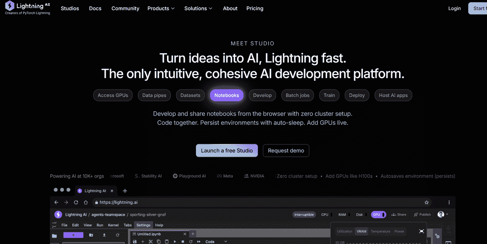

### Blue Bear Capital筹集1.6亿美元投资气候、能源与工业领域AI初创公司

https://techcrunch.com/2024/11/21/blue-bear-capital-lands-160m-to-back-ai-founders-in-climate-energy-and-industry/

**投融资亮点：**

+   **基金规模：** Blue Bear Capital完成第三支基金的募资，总额1.6亿美元。

+   **投资重点：** 专注于软件驱动的解决方案与人工智能（AI）技术，覆盖气候、工业与能源领域，特别是超越传统硬件的投资模式。

+   **有限合伙人：** 包括McKnight基金会、Rockefeller Brothers基金会、UBS、WovenEarth Ventures和Zoma Capital等，以及私募股权与基础设施领域的高管。

+   **投资策略：** 对每家初创公司初次投资500万美元，同时保留1000万美元用于后续投资，计划投资约15家公司，力求通过并购（M&A）实现退出。

+   **独特模式：** Blue Bear借鉴LPs的投资方法，采取小型投资组合策略，提高初创公司成功退出的可能性，IPO并非主要目标。

**行业应用：**

+   强调AI的普遍适用性，涉及风能、水处理、冷链、钢铁、水泥、化工生产以及海运与航空物流。

+   通过软件优化设备性能，例如在光伏项目中，Blue Bear支持的Raptor Maps帮助提高10%的运营效率，相当于减少3至5个燃煤或核电站的发电需求。

公司官网：https://bluebearcap.com/

# 学习

### 理解多模态大模型

贡献人：

https://magazine.sebastianraschka.com/p/understanding-multimodal-llms

本文详细介绍了多模态大语言模型（LLMs）的概念、构建方法及其最新进展，特别是 Meta AI 的 Llama 3.2 模型及其跨模态注意力机制。文章通过技术架构分析和案例研究，探讨了多模态 LLM 如何整合文本、图像等多种输入形式，并总结了统一嵌入解码器架构和跨模态注意力架构两种主要技术路径的实现及特点。

关键技术细节

1.  **多模态 LLM 的定义**：

+   支持多种输入模态（如文本、图像、音频、视频等）。

+   常见应用包括图像描述生成、PDF表格数据提取。

1.  **主要架构**：

+   **统一嵌入解码器架构**：

+   利用图像编码器将图像转换为与文本相同维度的嵌入向量。

+   嵌入向量通过线性投影，与文本嵌入连接后输入标准 LLM。

+   **跨模态注意力架构**：

+   在多头注意力机制中引入图像编码器的输出，通过跨注意力模块将图像与文本特征直接结合。

+   减少输入上下文的负载，提升计算效率。

1.  **图像处理技术**：

+   采用 Vision Transformer (ViT) 将图像分割为小块，通过线性投影生成嵌入。

+   使用 CLIP 或 OpenCLIP 等预训练编码器。

1.  **最新模型回顾**：

+   **Llama 3.2**：

+   基于跨模态注意力，支持图像和文本输入。

+   通过冻结 LLM 参数，仅更新图像编码器以保留原有文本处理性能。

+   **Molmo 和 PixMo**：

+   开源模型及数据集，采用统一解码器架构。

+   **NVLM**：

+   提供统一解码器、跨模态注意力及混合方法的对比分析。

1.  **性能优化**：

+   多数模型采用预训练文本 LLM 作为基础，通过分阶段冻结或解冻参数逐步优化多模态性能。

+   某些模型（如 NVLM）在高分辨率图像处理和 OCR 任务中展现特定优势。

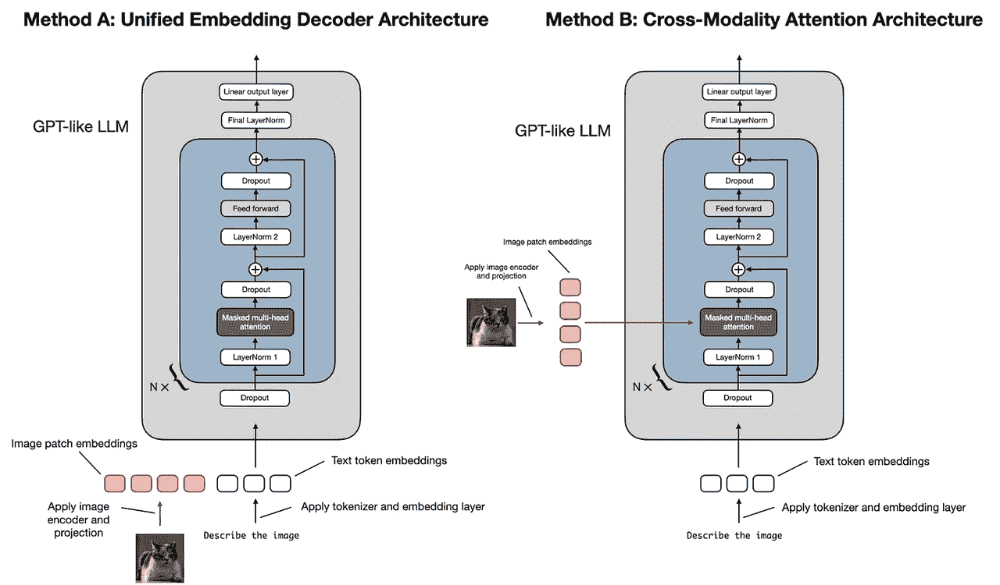

### RFM EP01：Pi和π0具身基础模型

https://mp.weixin.qq.com/s/XiJF96vKW9dU0oNVxnWbhA

近年来，随着北美企业Pi和Skild的成果显现，国内外机器人基础模型（RFM）领域的竞争逐步升温。国内清华RDT的发布以及国际π0的推出，更是将机器人基础模型推向舞台中心。本文基于Sergey Levine在CoRL 2024两场报告的内容，从技术视角深入剖析RFM的核心技术框架和发展方向。

具身大模型与RFM的技术背景

传统人工智能依赖于为每个任务单独构建数据集和专用模型，而RFM引入了类似语言模型的“大规模预训练+微调”框架。这一转变降低了任务特定数据的需求，为通用机器人任务提供了新的可能性。

数据驱动：OXE数据集的突破

OXE（Open X-Embodiment）数据集整合了来自多个机器人平台的数据，以实现跨形态的通用模型训练。实验表明，这种多样化数据训练的模型在特定任务上平均成功率提升50%，展现了从多源数据构建通用模型的潜力。

核心技术与π0模型解析

+   **模型架构**：π0基于流匹配（flow matching）扩散方法生成动作，支持高频控制（50Hz）。其设计中，动作专家与视觉-语言模块协作，直接生成动作序列，适应多模态分布。

+   **训练方法**：π0的预训练阶段依赖多样化低质量数据，而后训练通过少量高质量任务数据微调。实验验证，仅需数小时的后训练即可实现任务特定的卓越表现。

+   **适用场景**：π0在复杂任务（如衣物折叠、装配）中表现出色，尤其在干扰条件下展现了强大的适应性。

实验与未来挑战

1.  **多源数据融合**：通过导航数据与操作任务数据的整合，模型在空间推理和几何理解上取得显著提升。

1.  **真实数据的价值**：相比模拟或视频数据，真实数据具备更高的任务相关性和泛化能力，随着机器人部署规模扩大，其获取成本将进一步降低。

1.  **RL与真机结合**：强化学习（RL）为任务微调提供了高效路径。在真实环境中，通过30分钟至数小时的RL训练，机器人实现了精确的策略优化。

### 对话星海图赵行、许华哲：机器人的寒武纪大爆发，卡点在大脑

https://mp.weixin.qq.com/s/SQOZs7Q172x5hRecflFGsw

**核心技术：智能定义本体**

星海图强调智能的重要性，提出具身智能的核心挑战在“脑”，而非“形”。其开发路径包括：

+   **具身基础模型（EFM）**：端到端的操作智能系统，支持任务泛化，当前已通过50条数据实现单任务90%以上的成功率。

+   **空间智能引擎（RSR）**：为机器人提供物理世界的理解能力，支持刚性物体操作，并正在探索柔性物体的形变预测。

+   **一脑多形**：通过“一脑”实现多形态机器人在不同任务和环境中的适应。

---

**技术策略：智能与硬件协同**

星海图选择了“智能定义本体”的技术路线：

+   **仿人形机器人 R1**：轮式底盘搭配双臂夹爪，优先解决AI可控的任务需求。

+   **同构遥操硬件**：以与机器人完全一致的物理结构获取高质量操作数据，提升数据采集效率。

+   **模块化空间智能**：利用手机或普通相机实现亚厘米级的环境重建，降低数据采集成本。

---

**团队优势：跨学科协作与产业经验**

四位联合创始人将学术与产业经验相结合：

+   **赵行**：清华教授，MIT博士，擅长视觉感知与导航。

+   **许华哲**：清华“具身智能”实验室负责人，专注于机器人操作。

+   **高继扬**：前Momenta技术总监，负责产品全盘规划。

+   **李天威**：SLAM专家，主导机器人整机研发。

团队以清晰分工和高效协作推进技术突破与产品落地。

---

**商业化探索：从遥操到智能闭环**

+   **遥操数据采集**：以同构遥操降低数据采集成本，同时通过商用遥操服务形成收入和数据闭环。

+   **重点场景：刚性与无序分拣**：通过并行推进智能操作与遥操业务，持续优化技术边界。

+   **规模化实现智能涌现**：依托完善的数据体系，推动具身智能能力在大规模任务中自动生成。

### LLM for RecSys Tutorial（上）

https://mp.weixin.qq.com/s/yQGDusUznSqmnSufcnUr1Q

推荐系统广泛应用于电子商务、社交网络、在线教育等领域，其核心在于理解用户偏好并提供个性化服务。随着技术进步，推荐系统经历了从浅层模型到深层模型，再到大型生成模型的演变。

**技术演变与挑战**

1.  **浅层模型**
经典方法：矩阵分解（Matrix Factorization），通过用户-物品评分矩阵预测未知评分。局限性在于难以捕获复杂交互关系，数据稀疏性问题突出。

1.  **深层模型**
引入深度学习，如深度神经网络（DNN），提升推荐准确性和多样性，但模型复杂性增加，对计算资源需求高。

1.  生成式模型（Generative Models）
基于大型语言模型（LLMs），直接生成推荐项目ID或相关文本描述。通过自回归解码，根据用户历史交互预测下一个推荐对象。其优势在于提高效率，减少逐一评分的计算过程。

**推荐系统的独特性**

**主观性**：属于主观AI任务，输出高度依赖用**户偏好**和上下文，难以用客观标准评估。强调解释性，推荐结果需能回答“为何推荐”，以增强用户信任和接受度。

**多样性任务**：包括评分预测、顺序推荐、用户画像构建、评论摘要生成、解释生成等，增加了系统复杂性。

**主流技术方法**

1.  判别性排序（Discriminative Ranking）
基于用户与项目的嵌入，使用排序损失函数（如BPR损失）优化模型。对用户喜欢的物品赋高分，提高推荐精准性。挑战包括扩展性问题（随着用户和物品数量增加，计算复杂性显著提高）以及冷启动问题（缺乏新用户或新项目的历史数据）。

1.  生成式排序（Generative Ranking）
直接生成推荐结果，无需逐一计算评分。结合自回归生成与Beam Search算法，生成高质量推荐列表。面临的挑战是如何高效表示项目ID，避免高内存和计算消耗。

**未来趋势**

**多任务融合**：当前推荐任务多样化，但整合多个模型在工业场景中具有难度。探索方向是通过一个通用模型处理所有推荐任务，提高系统效率和可维护性。

**生成式推荐的潜力**：借助LLMs，将项目ID、推荐解释等作为一体化输出。技术突破需克服项目ID的tokenization瓶颈，实现更高效的生成。

**解释性与公平性**：增强推荐结果的可解释性，平衡准确性与透明度。确保系统在用户和项目之间保持公平，避免歧视和偏见。

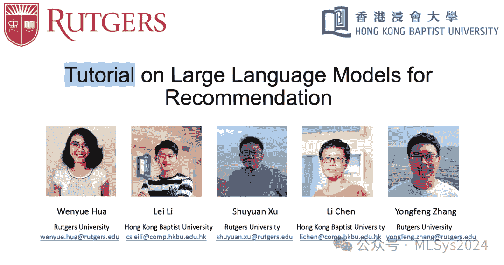

### 地平线机器人：国内智驾解决方案领军企业，软硬件协同蓄力长期成长

https://mp.weixin.qq.com/s/S5Xbj3xq4HM9ckQRdb8OEQ

技术创新推动收入高增

地平线公司成立于2015年，专注于提供从高级辅助驾驶（ADAS）到高阶自动驾驶（AD）的软硬一体解决方案。其客户包括上汽、比亚迪、理想等国内主流车企。截至2024年6月，公司产品已覆盖275款车型定点，营收持续高速增长：2024年上半年实现营业收入9.4亿元，同比增长152%。尽管研发投入高导致亏损，但随着规模效应显现，公司有望实现盈亏平衡。

高阶智驾渗透提速

全球高阶智驾市场快速扩张，预计从2023年的619亿元增长至2030年的10171亿元，年均复合增长率达49%。地平线凭借市场占有率15.4%位列国内市场第四。随着国产替代提速，其征程系列芯片（从征程1到最新的征程5、6）实现全面覆盖L2-L4场景，技术竞争力持续提升。

核心竞争力：软硬一体化方案

地平线的智驾解决方案包括Horizon Mono（ADAS）、Horizon Pilot（高速NOA）和Horizon SuperDrive（全场景NOA）。公司自研的BPU架构和软硬件协同平台（如天工开物工具链和艾迪软件平台）为客户提供完整开发支持，大幅增强客户粘性。至2024年6月，公司已与27家OEM（42个品牌）达成合作，覆盖超过285款车型。

盈利预测与投资建议

预计公司2024-2026年收入分别为21.2亿元、30.5亿元和45.8亿元，增速分别为37%、44%和50%。尽管短期亏损，但高研发投入为未来技术迭代和市场扩展奠定基础，长期成长潜力显著。基于当前估值，公司首次覆盖给予“增持”评级。

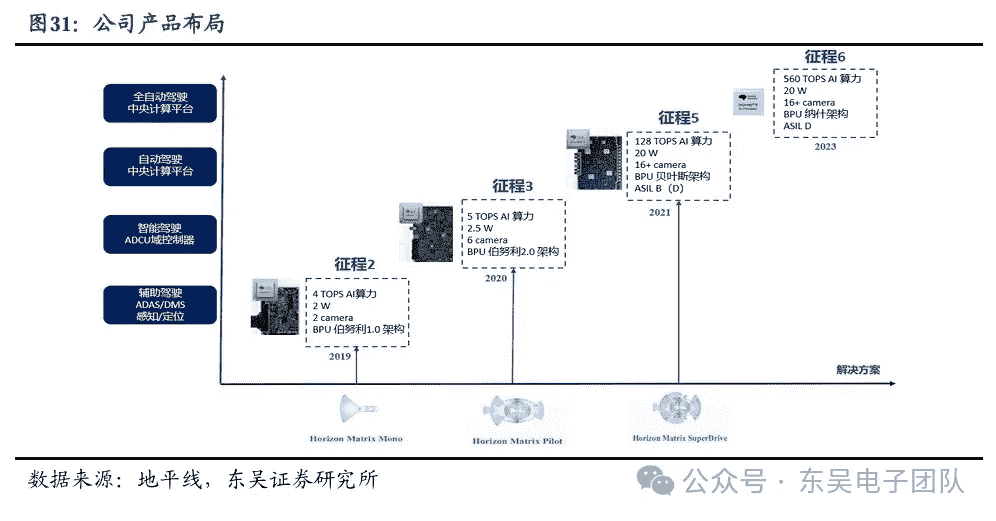

### 关于大模型语料的迷思

https://mp.weixin.qq.com/s/A8O5omTFd4egVIuH--ZNWg

语言不仅是沟通的工具，更是人类感知世界的方式。哲学家维特根斯坦曾言：“语言的界限即是世界的界限。”语言承载了人类思维的边界，也因此成为智能研究的核心。如果一个概念无法用语言描述，我们几乎难以认知它的存在，这一逻辑也延展至大模型的训练：通过大量语料输入，试图捕捉人类思维的路径。然而，语料的质量和内涵直接决定了模型智能的上限。

语料偏见与认知陷阱

语料并非中立。它是人类历史、文化和偏见的延续。例如，模型可能因为学习到偏差语料而继承错误结论，进而生成误导性答案。一个经典案例是数学问题“区间[-0.5, 0.5]内所有数加起来的和是多少？”许多人直觉回答“0”，但这一答案并无数学意义。这种直觉化错误反映了语料中日常推理和专业知识的矛盾，也揭示了模型模仿人类思维盲点的风险。

主观性与多样性表达的双刃剑

语料中的情感化与选择性表达，如个人推荐和旅游点评，既提升了模型生成生动语言的能力，也可能导致输出内容带有倾向性。例如，模型在回答关于产品或服务的问题时，可能更加倾向于“推荐”而非客观描述，影响用户判断。

文化多样性与价值观冲突

语料中的文化与价值差异进一步挑战模型训练。不同地区对同一问题的观点往往大相径庭。例如，加班文化在某些地方被视为忠诚和进步的表现，而在其他地区则被批评为损害生活质量。这种多元性虽然能使模型生成个性化内容，但也容易导致立场模糊甚至矛盾。

哲学问题的挑战与思辨价值

许多伦理和哲学问题在语料中没有明确答案，如“生命的意义是什么”。模型需要通过语料理解多样观点并反映问题的复杂性，而非简单输出单一答案。

模型的认知局限与改进方向

当前模型缺乏显性“思考”能力，其推理更多基于统计关联而非逻辑分析。这种机制导致模型在常识性问题上暴露缺陷，如误解“唐太宗李世民”的含义。未来改进方向在于增强模型的推理能力，使其能够从语料中抽取深层次的逻辑与情感，而不仅是表层的语言模式。

# 招聘公告

---

**奇绩创坛****由陆奇博士**于2019年创立，使命是在源头最大化驱动创新。奇绩研究组将研究模型理论、到投研战略分析、市场策划等不同背景的同学聚在一起，搭建GenAI时代独特的跨界人才社群。

## 🚀F**24实习岗位**

##### [行研-学术科研人才交流组实习生](https://miracleplus.feishu.cn/docx/Yn6rdf2iOoY2Rcx8yVNcUBYRnch#part-QkMcdeJmuob9uvxvV3qcLSzHn8g)

##### 行研-GenAI研究岗位-战略分析（偏产品）

##### Web / AI 全栈开发工程师实习生

## **火热开放中🚀**

##### 行研-GenAI研究岗位-前沿学术探索

##### 行研-GenAI研究岗位-战略分析（偏咨询）

##### 创新活动产品运营 （大模型系列活动产品运营）

> **点击**相关岗位可查看对应**岗位需求【JD】；**相关岗位投递请**扫描二维码**

> 欢迎**推荐/自荐**

> 期待在**奇绩创坛**遇见更好的你

---

# 声明

本文档仅供学习交流使用，版权归原作者所有，若涉侵权，请联系Jack Jin 15101136166

##

（欢迎在下方反馈您宝贵的意见！整理不易，觉得有用给AI日报小组点个赞👍吧！）

ChatGPT；Angela；Zijia Liu；Alex；Zeqi Tan；Tiezhen（HuggingFace）；Naixu；Lizhi；Peter；Suoman；Jack

学术分析报告：ResearchFlow -- 奇绩F23校友的开发的深度研究产品，PC端进入RFlow的分析报告，可直接点击节点右侧的小数字展开节点，登录后可在节点上直接“询问AI”，进一步探索深度信息

如果你有大模型相关的创业想法，欢迎来找我们聊聊～微信：15101136166

> 快邀请你的小伙伴们一起来读大模型日报吧！

> **【日报****知识库****】**这里是近期日报内容的汇总,欢迎大家查阅

> [大模型日报知识库(分享版)](https://miracleplus.feishu.cn/wiki/KapVwXfkriOBiskB0B2cUHxjnTh)

>

> 欢迎大家多多帮我们分享,转发~~

> 如果大家有任何的建议或者吐槽,欢迎随时找我聊天~

