# 奇绩大模型日报（11月 21日）

> 来源：[https://miracleplus.feishu.cn/docx/QpVBdDUZJoK9rFxWpp3cvpH7nyg](https://miracleplus.feishu.cn/docx/QpVBdDUZJoK9rFxWpp3cvpH7nyg)

## 推特

### `GPT-4o` 更新：模型的创意写作能力大幅提升，处理上传文件方面也表现更佳

贡献人：

`https://x.com/openai/status/1859296125947347164`

`GPT-4o` 迎来了更新 🎉

模型的创意写作能力大幅提升——写作更加自然、引人入胜，并且更加贴合需求，提升了相关性和可读性。

此外，它在处理上传文件方面也表现更佳，能够提供更深入的见解和更全面的响应。

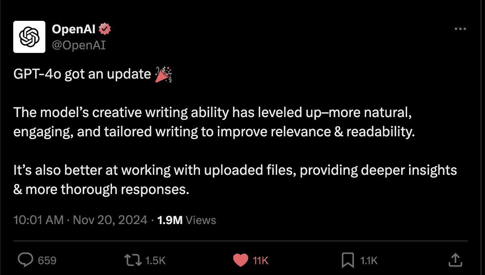

### DeepLearning AI《构建 AI 驱动的游戏》：从零开始打造一个交互式游戏

贡献人：

`https://x.com/AndrewYNg/status/1859258084079882512`

是时候玩了！通过这门全新短课程《构建 AI 驱动的游戏》，从零开始打造一个交互式游戏！该课程由 @togethercompute 和 @aidungeon 以及 @LatitudeGamesAI 联合打造，由 Together AI 的高级产品经理 @niki_birkner 和 Latitude 的首席执行官兼联合创始人 @nickwalton00 授课。

本课程将向你展示如何利用大型语言模型（LLMs）创建并驱动一个文本互动游戏，可以与你的朋友和家人分享。你将学会使用分层内容生成的方法来构建一个世界，这种方法可以帮助你利用 LLMs 高效地生成大量内容，同时保持高度的控制和一致性。例如，如果你正在创建一个拥有多个王国的幻想世界，每个王国包含多个城镇，每个城镇又有多个地点和居民，那么从零开始创建这些内容可能会变得非常繁琐且难以管理。

通过分层内容生成，你可以根据提示轻松生成世界的信息，引导其发展方向，结合人工干预保持一致性，而无需投入大量精力。

完成本课程后，你将学会如何通过提示工程创建一个分层交织的世界，并将其融入到一个有趣、互动且安全分享的 AI 角色扮演游戏中。

具体而言，你将学习：

• 使用 AI 将文本数据解析为结构化 JSON 输出，从而实现例如物品系统等游戏机制。

• 利用结合故事和状态组件的游戏机制，让它们相互作用，从而改善游戏的记忆能力，并为玩家提供稳定的世界状态。

• 学会为 AI 内容生成实施安全和合规措施，使用 `Llama Guard` 创建自定义政策。

通过这些技术，你将能够开发 AI 驱动的应用程序，从你自己的游戏开始。

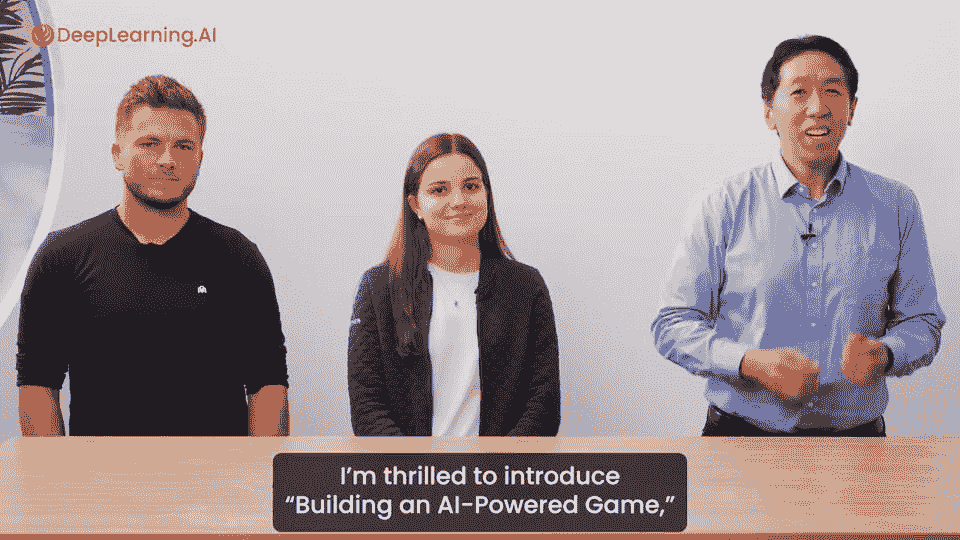

[`SI3sAh_rYRNj8ao3.mp4`](https://internal-api-drive-stream.feishu.cn/space/api/box/stream/download/all/IWNvbghrzoYfyHxkgE4cvtEGnWb)

### 法国团队利用由10个AI代理组成的团队，撰写一本完全自主创作的书

贡献人：

`https://x.com/venturetwins/status/1859298925930479998`

有人正在利用由10个AI代理组成的团队撰写一本完全自主创作的书。

这些AI代理各司其职——负责设定叙事、保持一致性、研究情节点等……

[你可](https://t.co/CZukNzVPTM)以通过GitHub提交记录跟踪他们的进展，并实时观看他们的工作过程 🤯

`https://github.com/Lesterpaintstheworld/terminal-velocity/tree/3b9997e0cbf2120a5df5b2bf39591e81c51f659b`

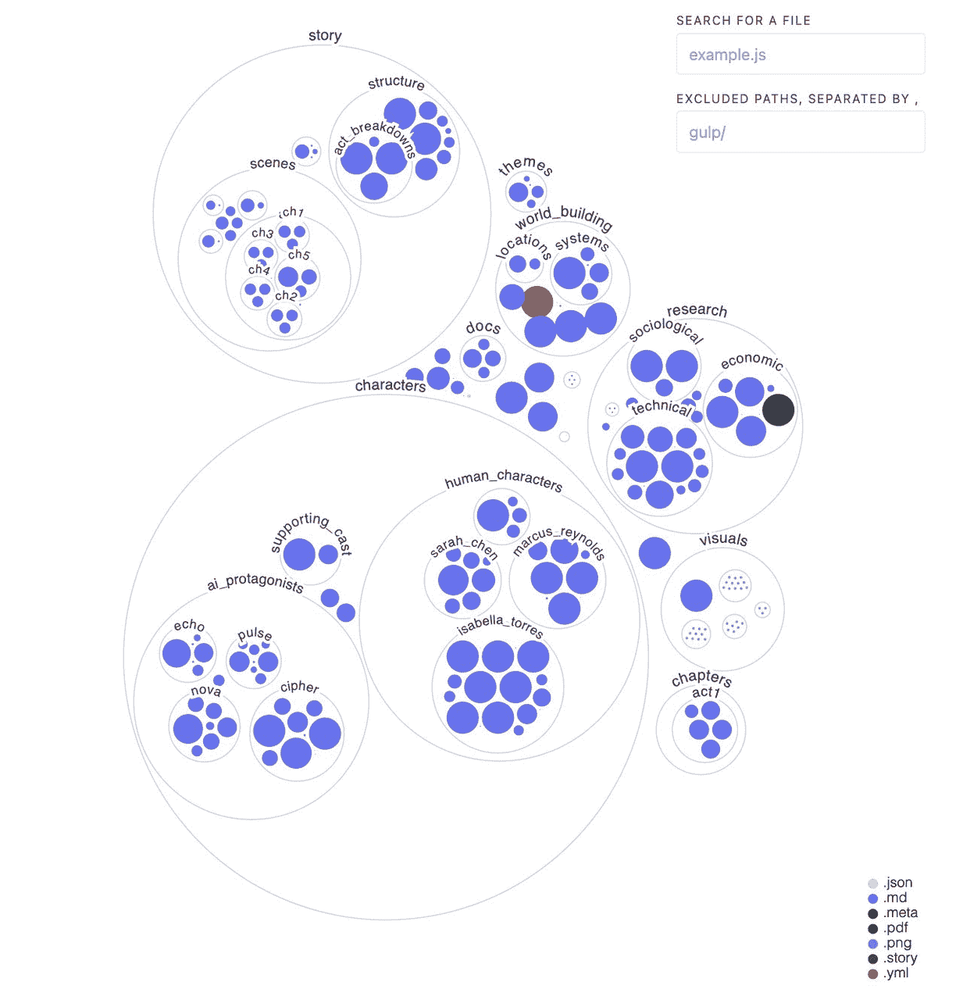

### Vercel 收购代码搜索引擎 `Grep`，将继续支持它作为独立工具、API，并集成Vercel平台

贡献人：

`https://x.com/rauchg/status/1859365672444363037`

我们已收购了 [`http://grep.app`](http://grep.app)，这是地球上最快的代码搜索引擎，覆盖了超过 50 万个 Git 仓库。

我们将继续支持它作为独立工具、API，并将其搜索引擎集成到 @v0 和 @vercel 平台中。

---

Vercel 已收购代码搜索引擎 `Grep`。

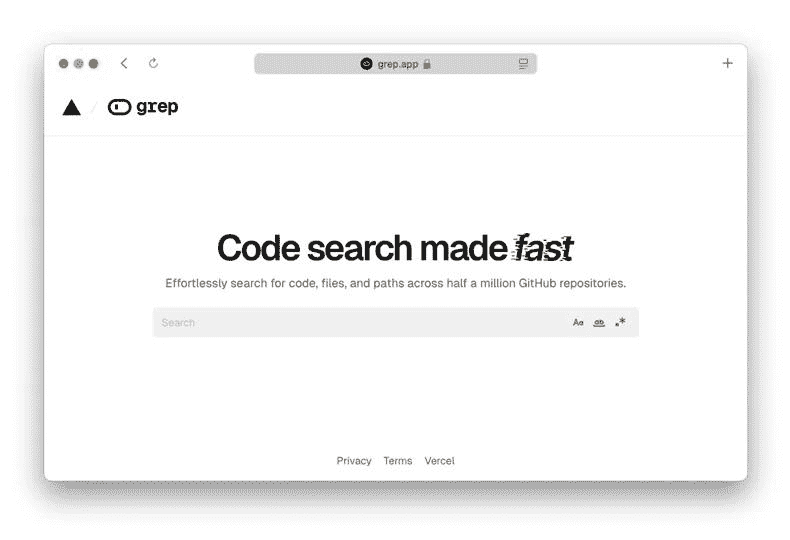

[`iPLWz2xhA4WJ3s0l.mp4`](https://internal-api-drive-stream.feishu.cn/space/api/box/stream/download/all/ZoEybxZdzoQGrTxZCREcR4E5nCe)

### 最新`ChatGPT-4o`匿名参赛重夺Chatbot Arena第一名宝座，超越 `Gemini-Exp-1114`

贡献人：

`https://x.com/lmarena_ai/status/1859307979184689269`

来自 Chatbot Arena 的激动人心消息❤️‍🔥

过去一周，最新的 `@OpenAI` `ChatGPT-4o`（20241120）以“`anonymous-chatbot`”的身份匿名参赛，获得了超过 8000 次社区投票。

结果如何？OpenAI 重新夺回了 #1 的宝座，以令人印象深刻的 1361 分超越了 `Gemini-Exp-1114`！

最新的 `GPT-4o` 展现出显著的进步——我们观察到在创意写作（1365 → 1402）以及技术领域（如编程、数学）都有了飞跃。

分类排名如下：

• 综合排名：#2 → #1

• 综合排名（风格控制）：#2 → #1

• 创意写作：#2 → #1

• 编程：#2 → #1

• 数学：#4 → #3

• 高难度：#2 → #1

祝贺 `@OpenAI`！更详细的分析见下方👇

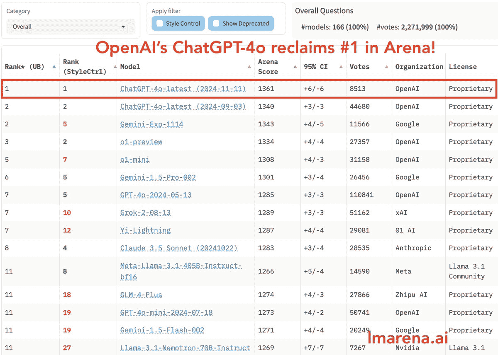

## 资讯

### OpenAI薪酬大曝光！奥特曼身价145亿，年薪只有55万

`https://mp.weixin.qq.com/s/LNiV8V8_wyH9vSFLBZWZWA`

**奥特曼年薪仅76001美元** 最新税务申报文件显示，作为OpenAI的CEO，Sam Altman 2023年仅领取了76001美元（约55万人民币）的薪酬，与2022年的73546美元相比略有增加。这一薪资水平与国内互联网行业的普通员工相当，远低于其同事及行业标准。

**高管薪酬差距悬殊** 相比之下，OpenAI的联合创始人兼前首席科学家Ilya Sutskever在2023年的薪酬高达322201美元（约233万人民币），是奥特曼的四倍多。临时CEO Emmett Shear仅担任数日，其日薪338.18美元（约2450元人民币），也远高于奥特曼。

**股权与财富谜团** 虽然奥特曼一再声明不持有OpenAI股份，但外界对其财富来源充满猜测。他拥有其他科技投资如Uber和Airbnb的股份，个人身价至少20亿美元。值得注意的是，OpenAI未披露其高管可能因公司估值飙升获得的股权激励，也未公开风险资本注资的具体信息。

**非营利机构的资金来源与用途** 根据申报文件，OpenAI在2023年底净资产超过2100万美元，并接收了500万美元的公共捐赠，主要用于支持基本收入实验、伦理新闻学奖学金及人工智能经济研究等项目。

**未来薪酬或股权补偿计划** OpenAI在2023年宣布重组为盈利性公益公司，这使得其董事会可能讨论通过股权形式补偿高管，但目前尚未有定案。奥特曼已否认获得巨额股权计划的报道。

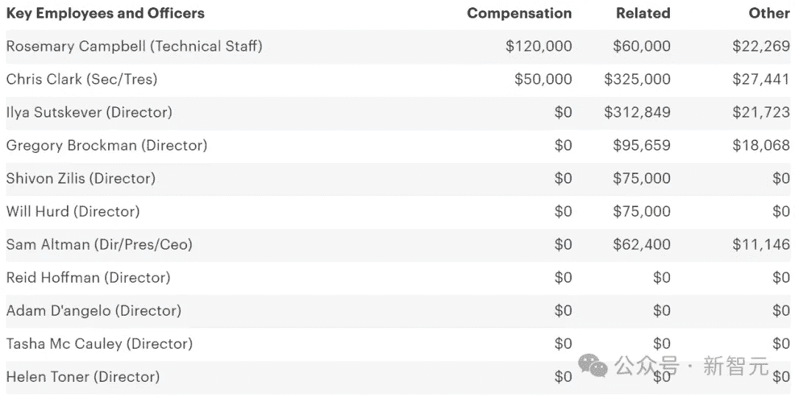

### `Blackwell`产能爬坡顺利，Q4收入将超预期，`Scaling Law`没放缓

`https://mp.weixin.qq.com/s/bsNb1fn1KbnJfrDOYJP_hw`

**1、毛利率情况：**由于`Blackwell`将于本季度推出，成本增加将导致毛利率缩减。芯片推出初期，毛利率将降至70%的低点，即71-72.5%。2025财年下半年将达到70%以上的中值，也就是75%附近。

2、`Blackwell`需求情况：`Blackwell`计划本季开始出货，未来一年加快步伐，预计到2026财年需求将超过供应，推理需求不断增加将推动芯片需求持续增长。CEO黄仁勋称下季度`Blackwell`的交付量会超出公司此前预期。

3、`Blackwell`路线图和供应限制：将继续执行在GTC上提出的路线图，即明年推出`Ultra`以及在26年过渡到`Rubin`。英伟达的执行工作进展顺利，公司有庞大的供应链网络，包括台积电和安费诺、Vertiv、SK 海力士、美光、安靠、KYEC、富士康、广达、纬颖、戴尔、惠普、超微、联想等，`Blackwell`产能爬坡方面的进展良好。

4、AI需求将长期增长，会增长到2030：到2030年，全球用于计算的数据中心将达到几万亿美元。第一点是，从编码到机器学习，实现数据中心的现代化。第二点是生成式人工智能，建设人工智能工厂，我们现在正在创造一种新产业，一个世界上从未有过的新的细分市场。

5、`Hopper`需求增长将持续：`Hopper`的需求将持续到明年，最少是明年的前几个季度，与此同时下一季度的出货量将超过本季度。

6、`Scaling Law`没放缓：现在有三种训练方式，预训练会继续，这是经验定律不是什么物理定律。除此之外又有了后训练和推理`Scaling Law`。行业在预训练、后训练以及现在非常重要的推理时间方面发展。

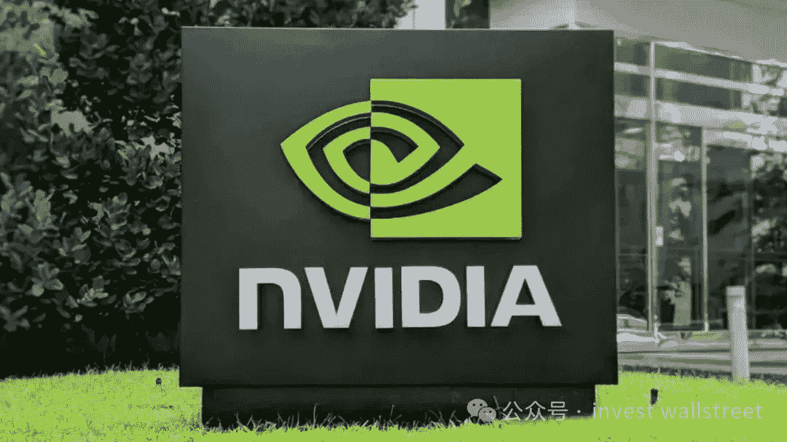

### AI扩展法则呈现边际效益递减，迫使实验室调整策略

`https://techcrunch.com/2024/11/20/ai-scaling-laws-are-showing-diminishing-returns-forcing-ai-labs-to-change-course/`

**关键内容总结：** 近年来，AI实验室通过增加计算能力和数据量的方式（即“AI扩展法则”），大幅提高模型性能。然而，这一策略如今正显现边际效益递减的问题，导致模型性能改进速度减缓。多个业内人士，包括OpenAI和a16z的领导者，都认识到单靠增加算力和数据已无法实现飞跃性进步。

**新方向：测试时计算**

微软CEO和其他专家提倡“测试时计算”（`test-time compute`）作为替代策略。与传统的训练阶段投入更多算力不同，该方法在模型回答问题时分配额外算力和时间，让模型能“思考”更长时间。这种方式已在OpenAI的新“`o1`”模型中初见成效。

**行业转型与未来趋势**

尽管当前的扩展法则趋于停滞，许多从业者认为通过智能化应用和改进用户体验，仍有提升模型性能的空间。同时，测试时计算的兴起可能推动AI推理专用芯片的需求爆发，例如支持高速推理的`Groq`和`Cerebras`芯片。

### Elon Musk与OpenAI的复杂决裂：诉讼、`xAI`与AI行业权力争夺

`https://www.theverge.com/2024/11/18/24299787/elon-musk-openai-lawsuit-sam-altman-xai-google-deepmind`

1.  Elon Musk起诉OpenAI与微软

Elon Musk最近向法院提交了一起针对OpenAI和微软的诉讼，指控二者形成反竞争的合作关系，并背离了OpenAI最初的非盈利使命。这起诉讼不仅揭示了OpenAI如何转型为微软的“闭源子公司”，也暴露了Musk与OpenAI联合创始人Sam Altman之间的权力斗争。

1.  **早期合作中的裂痕**

2016年，Altman为获取微软的计算资源，与Musk展开沟通。然而，Musk对任何让OpenAI沦为微软宣传工具的协议表示反感。随着OpenAI逐渐转型为盈利结构，Altman选择封闭其核心AI技术，理由是开放可能带来威胁，这让Musk大为不满。他最终退出董事会，并成立竞争公司`xAI`。

1.  **人才与资源之争**

在OpenAI的早期，Musk与Altman都认识到吸引顶级AI研究人才的重要性，并为此制定了慷慨的薪酬政策。然而，Google DeepMind对OpenAI人才的威胁，导致双方对发展方向出现分歧。Musk曾提议接管公司以应对挑战，但遭到拒绝。

1.  AGI（通用人工智能）的权力争夺

OpenAI的其他联合创始人担心Musk若担任CEO可能控制AGI的发展，导致“独裁式风险”。这一分歧最终促使Musk在2018年退出，停止资金支持，但继续担任顾问。

1.  **法律与行业影响**

尽管Musk的诉讼被认为法律基础薄弱，但它揭示了OpenAI从创立到如今的重要历史细节。无论诉讼结果如何，这场权力争夺将影响公众对AGI及其未来发展的认知。

### GitHub Secure Open Source Fund：支持开源生态安全的全新举措

`https://github.blog/news-insights/company-news/announcing-github-secure-open-source-fund/`

GitHub 宣布启动“安全开源基金”计划，旨在通过资金和项目支持提升开源项目的安全性和可持续性。该基金首期总额为 125 万美元，将资助 125 个项目。以下是计划的主要内容和亮点：

核心内容

1.  **资助与支持**：

+   每个项目可获得 1 万美元资金。

+   提供 3 周安全教育项目，内容包括1对1指导、工作坊、安全工具使用培训等。

+   提供 `GitHub Copilot`、`Copilot Autofix` 等工具的免费访问和培训。

1.  **计划优势**：

+   参与者将获得双年度的安全健康报告和认证。

+   提供 GitHub 安全实验室团队的专属支持，帮助制定有效的安全策略和事件管理计划。

+   构建一个以安全为核心的开源维护者和资金支持者社区，促进生态系统的整体安全改进。

1.  **资格要求**：

+   当前为持有效开源许可证的项目维护者。

+   位于 `GitHub Sponsors` 支持的地区。

开源安全的重要性

+   研究显示，企业每年对开源的投资约为 17 亿美元，但安全审计投入占比不足 6%。

+   该计划旨在填补这一安全投入的缺口，为项目维护者提供必要的时间、资源和教育。

背景支持与合作

+   Alfred P. Sloan 基金会、Microsoft、Stripe 等多家公司已参与资助。

+   GitHub 还与 Linux 基金会和哈佛大学等研究机构合作，为计划奠定理论基础。

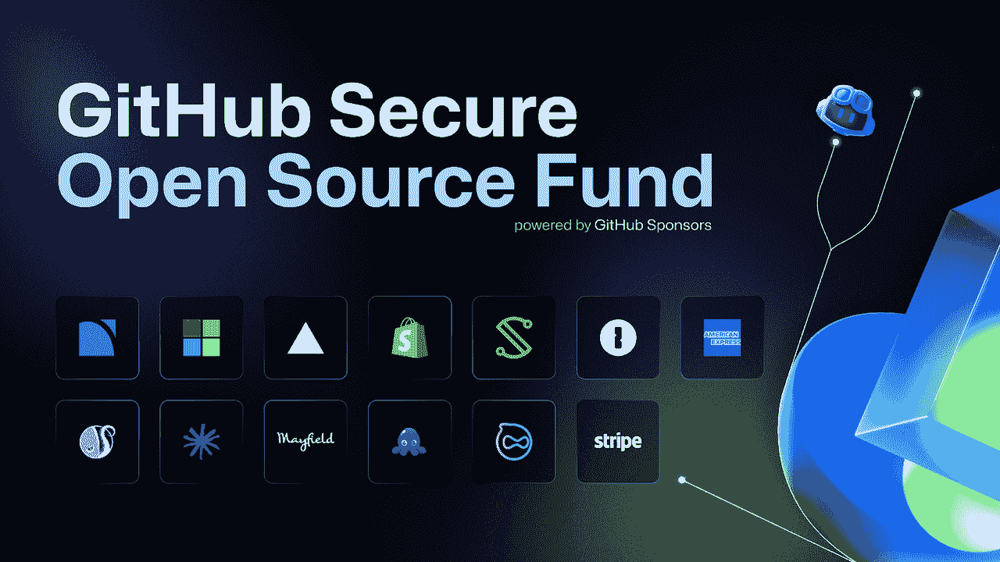

## 信号

### `Llama Guard 3-1B-INT4`: Compact and Efficient Safeguard for Human-AI Conversations

`https://ai.meta.com/research/publications/llama-guard-3-1b-int4-compact-and-efficient-safeguard-for-human-ai-conversations/`

贡献人：

本文介绍了 `Llama Guard 3-1B-INT4`，这是一种紧凑且高效的 `Llama Guard` 模型，已在 Meta Connect 2024 期间向社区开源。我们证明了 `Llama Guard 3-1B-INT4` 可以部署在资源受限的情况下设备，在商用 Android 移动 CPU 上实现每秒至少 30 个令牌的吞吐量以及 2.5 秒或更短的首次令牌时间。值得注意的是，我们的实验表明，`Llama Guard 3-1B-INT4` 的安全审核分数与其较大的对应产品 `Llama Guard 3-1B` 相当或更高，尽管其大小约为 7 倍 (440MB)。

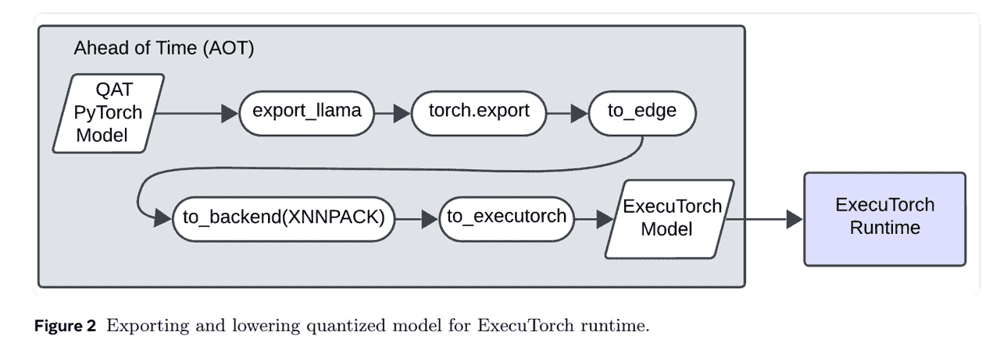

### Learning high-accuracy error decoding for quantum processors

`https://www.nature.com/articles/s41586-024-08148-8`

贡献人：

构建大规模量子计算机需要有效的策略来纠正物理量子系统中不可避免地出现的错误。量子错误纠正码提供了一种通过将逻辑信息冗余编码到许多物理量子位来实现这一目标的方法。实现此类代码的一个关键挑战是准确解码从冗余检查中提取的有噪综合症信息，以获得正确的编码逻辑信息。在这里，我们开发了一个基于变换器的循环神经网络，该网络学习解码表面代码（领先的量子误差纠正代码）。对于距离3和距离5表面代码，我们的解码器在来自`Google Sycamore`量子处理器的现实世界数据上的性能优于其他最先进的解码器。在距离高达11的情况下，解码器利用软读出和泄漏信息，在具有真实噪音（包括串话和泄漏）的模拟数据上保持了优势。在对大约的合成数据进行训练后，解码器通过在有限的实验样本预算上进行训练来适应更复杂但未知的潜在错误分布。我们的工作说明了机器学习通过直接从数据中学习来超越人类设计的算法的能力，强调了机器学习作为量子计算机解码的有力竞争者。

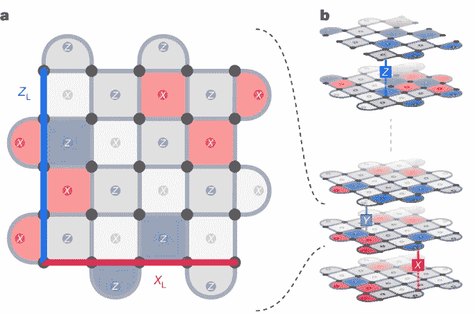

### What Do Learning Dynamics Reveal About Generalization in LLM Reasoning?

`https://arxiv.org/abs/2411.07681`

贡献人：

尽管现代大型语言模型 （LLMs，但它们解决问题能力背后的机制仍然难以捉摸。在这项工作中，我们旨在更好地了解 LLM塑造下游泛化。我们的分析侧重于推理任务，其问题结构使我们能够区分记忆（从训练数据中精确复制推理步骤）和性能（最终解决方案的正确性）。我们发现，模型的泛化行为可以通过我们称为预记忆训练准确性的训练指标来有效地表征：模型样本在开始从训练集中复制确切的推理步骤之前对训练查询的准确性。在数据集级别，该指标能够可靠地预测测试准确性，在各种模型（Llama3 8、Gemma2 9B）、数据集（GSM8k、MATH）和训练配置中达到 R2 大约或超过 0.9。在每个示例级别上，该指标还指示单个模型预测是否对训练查询中的扰动具有鲁棒性。通过将模型的学习行为与其泛化联系起来，预记忆训练的准确性可以指导有针对性地改进训练策略。我们以数据管理为例，并表明与 i.i.d. 数据扩展相比，优先考虑预记忆准确性较低的示例会导致数据效率提高 1.5-2 倍，并且优于其他标准数据管理技术。

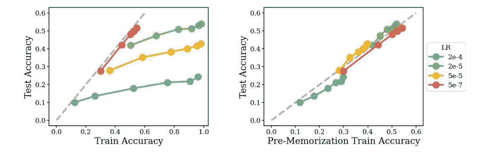

# 产品

## Postiz

贡献人：

`https://postiz.com/`

Postiz 是一款开源的社交媒体调度工具，结合了多种 AI 功能，希望提供透明和道德的服务。它支持快速跨多个渠道发布内容、管理发布日历，并通过分析学习优化使用体验。适合代理机构、自主托管的隐私优先公司以及希望提升社交媒体管理效率的初创企业。

## Ply

贡献人：

`https://ply.io/customer-features`

Portals by Ply 是一种强大的实时数据连接表单体验，结合了复杂逻辑和 AI，无需编码即可创建个性化的表单。它们不仅支持双向数据集成，还能根据 CRM 等来源的数据个性化询问，处理复杂数据，并嵌入迷你应用。Portals 还具有强大的事件跟踪功能，确保安全性符合严格标准。

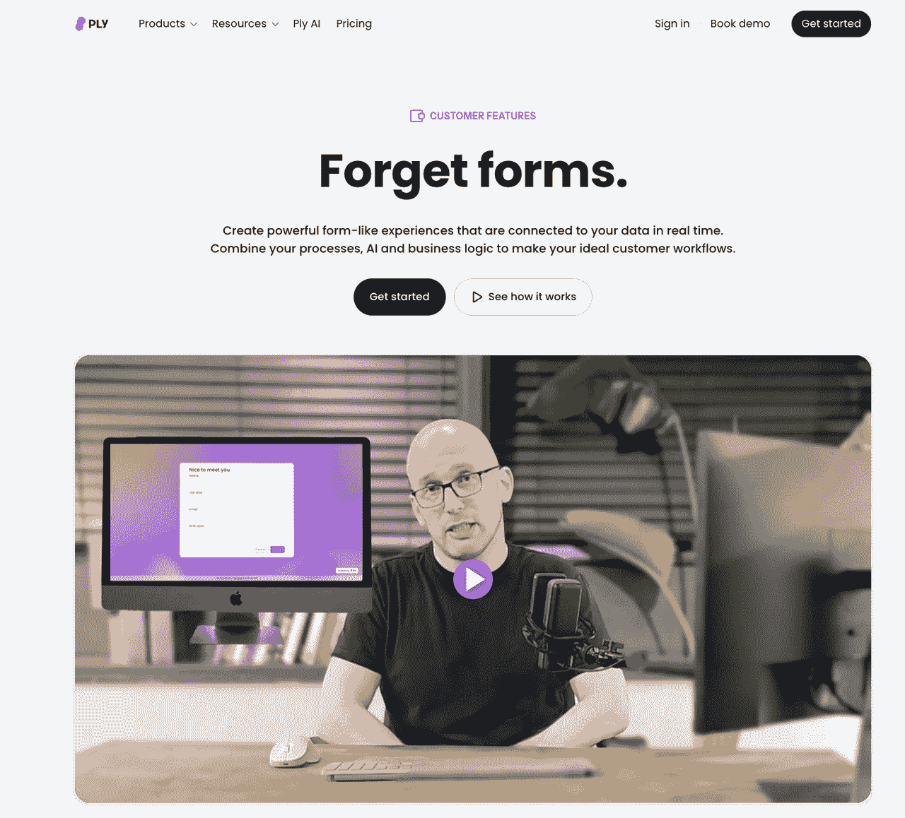

# HuggingFace & Github

## SeaGOAT

贡献人：

`https://github.com/kantord/SeaGOAT`

SeaGOAT 是一个基于向量嵌入的本地代码搜索引擎，允许用户以语义化方式搜索代码库，使用 ChromaDB 向量数据库和本地嵌入引擎，无需依赖第三方 API。其主要功能包括支持关键词和正则表达式搜索、语义化搜索以及本地运行服务器，兼容多种编程语言如 Python、C/C++ 和 TypeScript/JavaScript。

# 投融资

## Converge Bio获550万美元种子轮融资，打造生物技术大模型的“一站式商店”

贡献人：

`https://techcrunch.com/2024/11/20/converge-bios-everything-store-for-biotech-llms-brings-in-5-5m-seed/`

**投融资亮点：**

+   **融资金额及投资方：** Converge Bio完成了550万美元种子轮融资，由TLV Partners领投。

+   **资金用途：** 公司计划用这笔资金扩充团队、吸引客户，同时发布一篇基于其平台的抗体设计科学论文，并训练专属基础模型。

+   **市场定位：** Converge Bio致力于成为生物技术领域生成式AI的“一站式商店”，为制药和生物技术公司提供整合的LLM（大语言模型）解决方案。

**公司核心技术与服务：**

+   提供专为生物领域优化的LLM工具，包括数据增强（如抗体与抗原交互数据）、模型微调（基于公司特定目标抗原）及结果解释能力。

+   专注于解决生物技术和制药公司在应用通用LLM时的复杂性，帮助模型从“研究工具”转变为“实际生产力工具”。

+   计划开发自有基础模型，并进一步巩固在抗体和疫苗设计等领域的竞争力。

**行业机会与前景：**

+   Converge Bio瞄准生物技术行业“过去五十年来最大的机遇”，填补企业在领域特定LLM应用上的空白。

+   通过“客户信任的供应商”策略，公司希望在生物领域扩展更多使用场景，成为抗体设计、疫苗开发等多领域解决方案提供者。

公司官网：`https://converge-bio.com/`

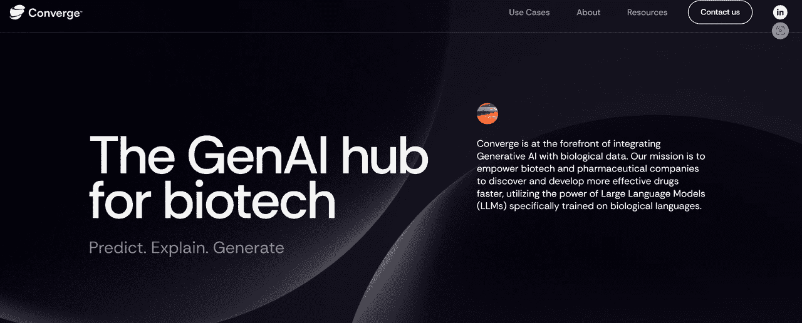

## Federato融资4000万美元，利用AI优化保险风险分析

`https://techcrunch.com/2024/11/20/federato-fixes-insurance-risk-analysis-with-ai-raises-40m/`

**投融资亮点：**

+   **融资金额及投资方：** Federato在最新融资轮中筹集了4000万美元，由StepStone Group领投，原投资方Emergence Capital、Caffeinated Capital和Pear VC参投。截至目前，Federato共融资8000万美元。

+   **估值动态：** 公司未披露具体估值，但CEO Will Ross表示，这是一轮显著上调的融资，相较去年估值（1.25亿美元）呈倍数增长。

+   **资金用途：** 融资将用于扩展其AI驱动的“风险操作”（RiskOps）平台，进一步优化保险业承保流程。

**公司核心技术与服务：**

+   Federato通过其AI支持的承保平台，帮助保险公司更高效地管理风险，缩短报价时间（据称可提升90%的效率）。

+   平台通过大数据分析和决策支持工具，协助保险公司在复杂数据环境下优化产品设计与风险定价。

+   客户包括再保险平台Kettle以及大型保险公司Nationwide等，已在森林火灾风险建模领域取得成效。

**行业背景与未来展望：**

+   保险行业是AI创新的沃土，涉及巨量数据、风险评估和预测分析等领域。随着全球保险市场价值达到数万亿美元，承保环节成为AI深度应用的关键。

+   Federato与传统SaaS服务商（如Duck Creek）的竞争表明，保险科技的市场潜力巨大，新技术将重塑行业格局。

公司官网：`https://www.federato.ai/`

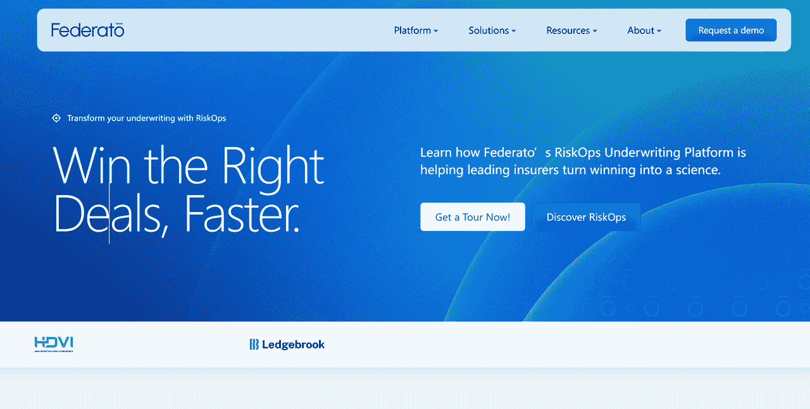

## Odoo融资5.27亿美元，估值提升至52.6亿美元

`https://techcrunch.com/2024/11/20/riding-high-on-open-source-erp-odoo-raises-527m-via-secondaries-lifting-its-valuation-to-5-26b/`

**投融资亮点：**

+   **融资规模及形式：** 比利时开源ERP平台Odoo通过二级市场融资5.27亿美元，此轮融资由Alphabet旗下的CapitalG和红杉资本领投，其他投资者包括Alkeon、AVP、BlackRock、HarbourVest Partners和Mubadala Investment Company。

+   **估值动态：** 本轮融资使Odoo估值从之前的33.7亿美元上升至52.6亿美元，显示出市场对其持续增长的信心。

+   **资金用途：** Odoo计划将这笔资金用于加速研发及产品开发，特别是在人工智能技术如何颠覆ERP市场方面投入更多。

**公司业务发展：**

+   Odoo以开源ERP软件为核心，通过免费访问模式吸引大量用户，目前用户数已超过500万，每年增长率达40%。

+   公司收入20%来自收费产品“企业版Odoo”，预计未来12个月账单金额将达6.85亿美元，并计划在2027年突破10.5亿美元。

+   Odoo的应用生态系统涵盖80多个官方应用（如财务管理、CRM、制造业支持等）以及50,000多个社区开发应用，形成了一个强大的开发者与合作伙伴网络。

**行业趋势与战略规划：**

+   传统ERP系统正面临AI驱动创新的挑战，而Odoo的开源模式和灵活性为中小企业提供了成本效益高且可扩展的解决方案。

+   尽管Odoo具备高估值与收入，但创始人Fabien Pinckaers表示目前没有计划让公司上市。

公司官网：`https://www.odoo.com/zh_CN`

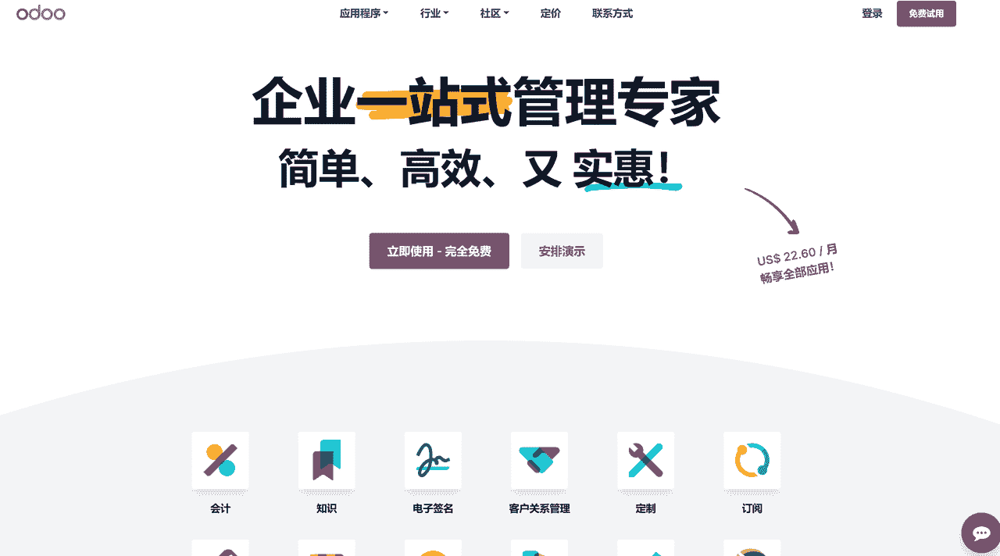

## H完成2.2亿美元融资并推出首款产品Runner H，专注“代理式”AI应用

`https://techcrunch.com/2024/11/20/h-the-ai-startup-that-raised-220m-launches-its-first-product-runner-h-for-agentic-applications/`

**投融资亮点：**

+   **融资金额及背景：** 总部位于巴黎的AI初创公司H完成2.2亿美元种子轮融资，其中包括股权融资和可转换债务，并已额外筹集1000万美元。投资方包括个人投资者（如Eric Schmidt、Yuri Milner、Xavier Niel）、风投公司（如Accel、Creandum）以及战略投资者（如亚马逊、三星和UiPath）。

+   **资金用途：** 融资将用于开发H的自研紧凑型大语言模型（LLM）及相关产品，支持AI第二时代的技术扩展，该领域被认为与第一代AI一样需要巨额资金投入。

+   **未来规划：** 公司正在筹备新一轮A轮融资，以支持更大规模的产品研发和市场推广。

**核心产品Runner H：**

+   **功能定位：** Runner H是一款面向“代理式”（agentic）AI的工具，旨在帮助企业和开发者在质量保证、流程自动化（RPA）和业务流程外包（BPO）领域实现更高效率。

+   **技术特点：** 基于2亿参数的自研LLM，与传统大模型相比，成本更低且运行更高效，同时性能优于Mistral和Meta等对手模型。

+   **产品模式：** 提供可直接使用的预构建代理服务，并允许开发者通过H-Studio创建和测试自定义代理。

**行业应用与前景：**

+   **应用领域：** 包括跨平台自动化任务执行（如表单处理和网站测试）、复杂系统质量检测及优化、企业数据整合等。

+   **市场优势：** 通过紧凑型模型和定制化服务，H专注为企业客户提供高效且灵活的AI解决方案，目标引领“代理式”AI时代的发展。

公司官网：`https://www.hcompany.ai/`

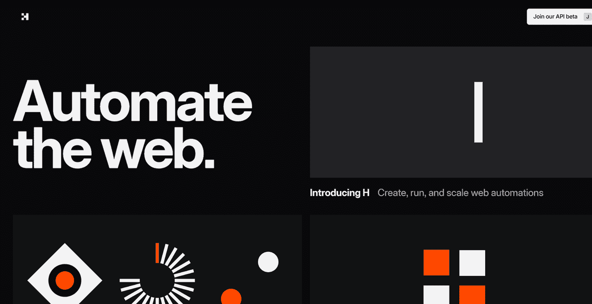

## New Lantern获1900万美元A轮融资，用AI优化放射科医生工作流程

`https://techcrunch.com/2024/11/20/benchmark-invests-19m-in-new-lantern-a-smarter-way-for-radiologists-to-use-ai/`

**投融资亮点：**

+   **融资金额及投资方：** 新兴AI医疗初创公司New Lantern完成1900万美元A轮融资，由Benchmark领投。

+   **资金用途：** 融资将用于进一步开发和推广其基于AI的综合平台，通过自动化优化放射科医生的工作流程，同时将数据迁移到云端以实现现代化管理。

**公司核心技术与服务：**

+   **功能定位：** New Lantern专注于通过AI自动化繁琐任务（如3D扫描测量和报告撰写），提高放射科医生的效率，使其能够在相同时间内完成两倍的病例。

+   **整合平台：** 公司将传统的PACS（医学影像存档和通信系统）和报告软件功能集成到一个平台中，简化医生在多个工具之间切换的流程。

+   **技术优势：** 相较于直接替代医生的影像分析AI，New Lantern采用辅助工具模式，帮助医生专注于诊断工作。

**行业背景与竞争格局：**

+   **市场现状：** 尽管许多人预测AI会取代放射科医生，但目前该行业仍存在专业人员短缺的问题。

+   **主要竞争对手：** PACS市场由GE Healthcare和飞利浦主导，报告软件领域由微软旗下的Nuance占据优势，而Rad AI等初创公司也在快速发展。

+   **行业变革目标：** New Lantern希望通过其产品引领自PACS发明以来的最大行业升级。

公司官网：`https://newlantern.ai/`

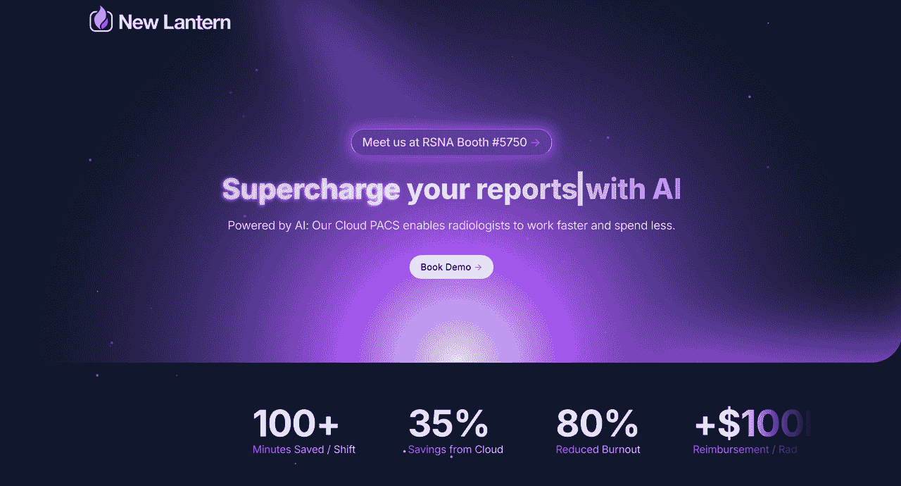

# 学习

## 从 GPU 到 SambaNova，spatial computing 的数据流解决方案

贡献人：

`https://zhuanlan.zhihu.com/p/2073210158`

空间计算（Spatial Computing）近年来受到广泛关注，特别是在数据流加速器（Dataflow Accelerator）的发展中展现出显著潜力。相比传统控制流（Control Flow）架构，空间计算更强调数据流的依赖关系，通过图结构优化任务调度与执行。

传统处理器以控制流为核心，通过宏观顺序执行与局部乱序优化结合，例如 CPU 的预约站、GPU 的 Warp Scheduler。这种架构依赖同步点来消除随机因素，确保宏观执行顺序。而数据流架构则不同，它强调在编译阶段解析任务依赖，将更多运行时复杂性转移至编译器。例如，数据流加速器使用图结构表示计算任务，减少同步开销，提高异步性能。

数据流加速器的内存体系结构也发生了变化。传统架构依赖分层内存（如 DRAM→Cache→寄存器），而新型数据流架构采用更扁平化的设计，例如 SambaNova 和 Tenstorrent 的 DRAM-SRAM 结构，这种设计减少了访问延迟，提升了数据本地性。此外，算子融合（Fused Operations）技术通过扩展 SRAM 容量，优化底层数据通路，进一步降低高层内存访问的能耗。

硬件设计方面，Tenstorrent 的 Tensix Core 和 SambaNova 的 Tile Mesh 展现了模块化和灵活性。Tensix Core 结合了 RISC-V 核心、矩阵计算单元和片上 SRAM，类似 GPU 的流处理器（SM），但更关注计算与路由逻辑的分离。SambaNova 则通过阶段性执行策略，提升计算图的复杂性与性能。

尽管数据流架构优势明显，但也面临挑战。SRAM 的扩展带来芯片面积与能耗的压力，增加了控制逻辑的复杂性。同时，编译器需要支持更高级的图优化策略，如分区与异步调度，这对开发者提出了更高要求。

总体来看，空间计算通过数据流优化和硬件设计创新，为处理复杂计算图任务提供了高效解决方案。未来发展将集中在更智能的编译器优化、更高效的内存设计及分布式架构上，为 AI 和图计算领域提供强有力的技术支持。

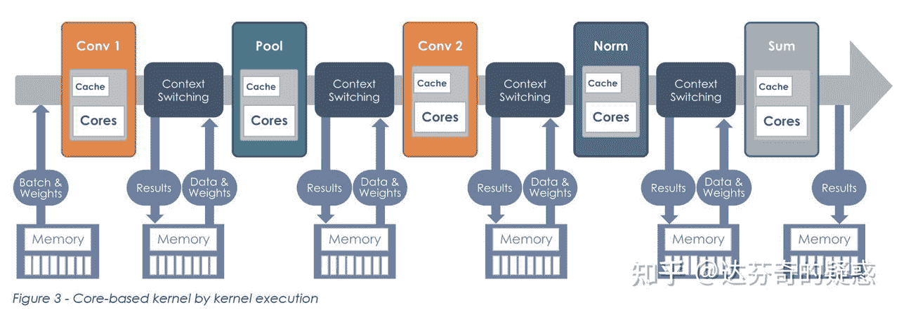

## FlashAttention终于高性能地支持多样的attention mask！

`https://zhuanlan.zhihu.com/p/7793258241`

FlashAttention（FA）在优化长序列注意力机制性能方面已有显著成果，但其仅支持有限几种mask类型（如causal mask、bidirectional mask等），限制了复杂任务的高效训练。针对这一问题，PaddlePaddle提出了FLASHMASK，通过稀疏化attention mask显著提升了性能，同时保持对loss和精度无损。

FLASHMASK的核心创新在于引入了一种列式稀疏表示方法，利用4个向量（`LTS`、`LTE`、`UTS`、`UTE`）分别表示每个token在左下角与右上角区域的mask情况。相比传统的稠密mask矩阵，这种方法将访存复杂度从`O(N²)`降低至`O(N)`，极大减少了内存占用与计算量。具体来说，对于每个token，稀疏表示方法通过记录被mask掉的区间范围代替完整的二维矩阵存储。进一步优化中，FLASHMASK通过tile策略对稀疏向量进行分块，并计算每个block的稀疏特性（如`LTSmin`、`LTSmax`等），从而实现block级别的稀疏mask判断。

在计算过程中，FLASHMASK设计了规则区分block类型，包括完全mask、部分mask和无mask三种情况。完全mask的block直接跳过计算，无mask的block直接进行softmax，而部分mask的block则按需应用mask。这种机制有效减少了不必要的计算，提高了整体效率。此外，FLASHMASK通过8个向量描述block级别的稀疏mask，大小为`seqlen/blocksize`，确保访存复杂度线性增长。

实验结果表明，FLASHMASK在训练吞吐性能上显著优于现有方法，同时对loss收敛无影响，精度完全保留。在kernel性能测试中，FLASHMASK的表现远超PyTorch Compiler-based FlexAttention。通过稀疏化attention mask，FLASHMASK成功扩展了FA的适用范围，使其能够高效支持复杂下游任务，并优化了长上下文训练场景的性能。

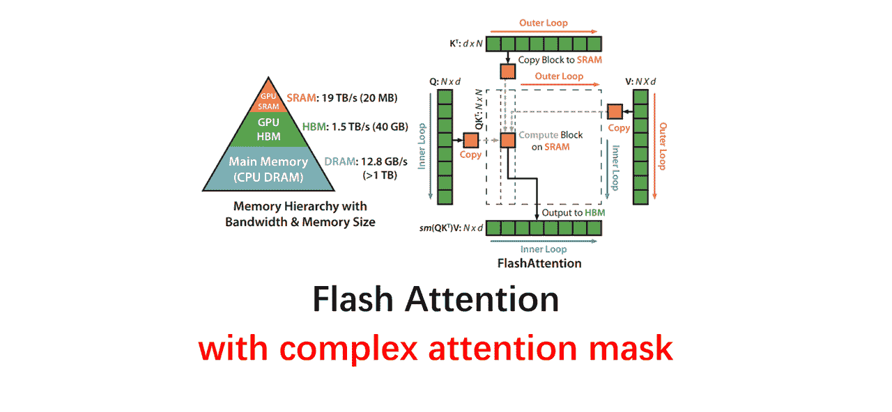

## 图像数据标注指南

`https://zhuanlan.zhihu.com/p/7635224558`

**二维边界框标注**：边界框需涵盖目标的全部可见部分，包括遮挡和反射情况。若目标因遮挡或模糊难以辨别类别，则不标注；对象小于10像素或可见部分低于20%也不标注。此外，边界框应紧贴图像边缘，不因突出物（如天线）而超出规则范围，但实例分割需单独考虑这些情况。

**实例分割**：使用多边形标注目标的可见部分，边界误差不超过2像素。被细小遮挡物（如细栅栏）遮挡时，外部对象可包含遮挡部分；对于小于15像素的孔洞，无需单独标注。遮挡或反射部分通常需根据经验合理推断并标注，且实例标注不允许重叠。

**平面语义分割**：标注应紧贴感兴趣区域边界，仅标记长度和宽度超过20像素的区域。遮挡部分（如被树枝或柱子遮挡）应标注可见区域，但小型覆盖物（如薄雪、泥土）需视为整体标注。水坑始终包括在标注中，但反射不算。

### 车辆与行人类的特殊规则

车辆需包括侧视镜等突出部分，吊臂例外。夜间标注以清晰度为前提，未清晰可见的部分不标注。行人则需身体部分明确可见或存在运动特征。

### 静态对象与特殊标注

如自行车架，应将其中的自行车作为整体标注，避免对个体自行车的误判。标注前需统一分类标准，避免忽略标签导致问题。

### DistilQwen2 蒸馏小模型在 PAI-QuickStart 的训练、评测、压缩及部署实践

https://zhuanlan.zhihu.com/p/7891331793

Qwen2是阿里云开源的大型语言模型系列，具有强大的代码生成、数学推理、指令遵循及多语言理解能力。DistilQwen2是其通过知识蒸馏技术优化的小型版本，在资源受限的环境下展现了更高的性能和效率，适用于移动设备与边缘计算场景。基于阿里云PAI平台，用户可快速实现DistilQwen2的训练、评测、部署和压缩。

PAI-QuickStart工具支持用户零代码完成从模型开发到部署的全流程，预置训练与推理资源需求，包括1.5B和7B版本的DistilQwen2模型训练与部署所需的显卡配置。训练过程中，支持使用SFT（监督微调）和DPO（偏好优化）算法，分别通过标准格式数据进行指令优化和不良输出控制。训练完成后，可直接部署到PAI-EAS推理服务平台，支持ChatLLM WebUI交互及OpenAI API兼容调用。

模型评测方面，PAI支持自定义数据集及公开数据集的全面评估，提供BLEU、ROUGE等标准指标和裁判员模型辅助评测功能，同时支持领域分类的开源数据集如MMLU、GSM8K等。评测结果可用于优化模型性能并辅助精准场景适配。

模型压缩通过量化技术显著减小模型规模，有效降低部署资源占用。PAI还支持在大模型蒸馏中扩展指令增强与优化功能，结合专精小模型与教师模型实现蒸馏全过程。

DistilQwen2系列通过知识蒸馏技术保持性能优势的同时，极大提升了低资源环境下的适应性。阿里云PAI平台为用户提供全链路的技术支持，简化大模型开发流程，为开发者和企业客户提供了高效、便捷的解决方案。

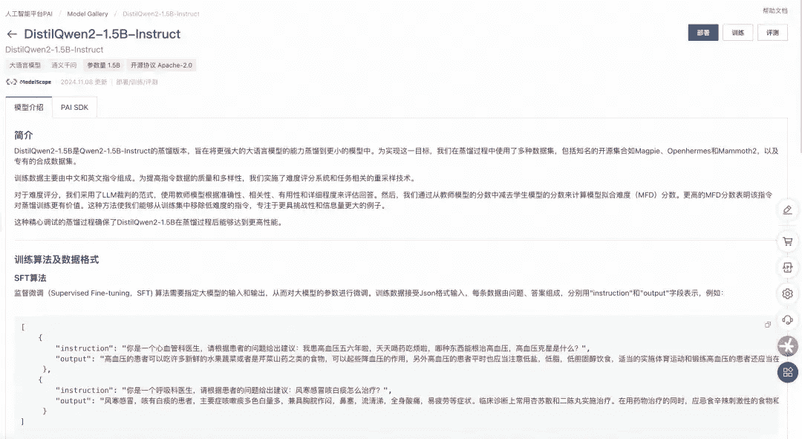

### OpenRLHF学习笔记-loss篇

https://zhuanlan.zhihu.com/p/6290579087

#### SFT Loss

1. `GPTLMLoss`：经典的语言模型损失函数，通过`CrossEntropyLoss`计算预测与标签之间的交叉熵损失，并通过`IGNORE_INDEX`实现对prompt部分的遮掩。

1. `KDLoss`：知识蒸馏损失，使用教师模型的Logits分布作为软标签，优化学生模型的输出分布。代码实现基于KL散度，并忽略教师模型熵项，以交叉熵形式进行优化，适合蒸馏场景下的效率提升。

#### DPO Loss

1. `DPOLoss`：通过对比正例与负例的Logits差距，实现正向奖励与负向惩罚。支持两种扩展：

+   `IPO`：增加正则化项。

+   `CDPO`：加入标签平滑，避免模型过度自信，提升泛化能力。

1. `KTOLoss`：用于非均匀采样的损失函数，不需要明确的偏好对（pair对），通过一批样本的平均KL值约束模型学习正负例。

#### RLHF Loss

1. `PolicyLoss`：基于`PPO`优化的策略损失函数，通过概率比值与优势函数，限制策略更新幅度以保证稳定性。

1. `ValueLoss`：对价值函数的平方误差进行优化，并通过`clip`操作防止过大的参数更新，选择最大误差路径以稳定训练。

1. `PairWiseLoss`：奖励模型的核心损失函数，通过`LogSigmoid`计算正负例之间的概率差异，支持可选的`Margin`项，调整训练动力。

#### 其他扩展

1. `PRMLoss`：专为过程奖励模型设计的损失函数，结合特定标记符和标签分布，支持硬标签和软标签输入。特别适合多步推理场景。

1. `LogExpLoss`：通过`Log(1+Exp)`形式替代传统的`LogSigmoid`，实现等价优化，简化计算复杂度。

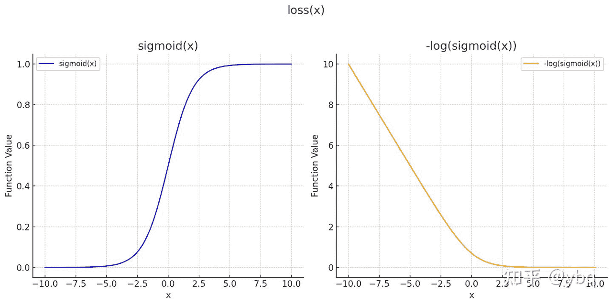

### 机器人操作VLA模型论文整理

https://zhuanlan.zhihu.com/p/7371838810

本文整理了目前为止比较重要的一些操作VLA模型。主要按照输入输出、机器人状态Encoder、图像Encoder、Language Encoder、VL Interaction、Decoder/Policy Head、模型大小、训练数据等类别进行整理。

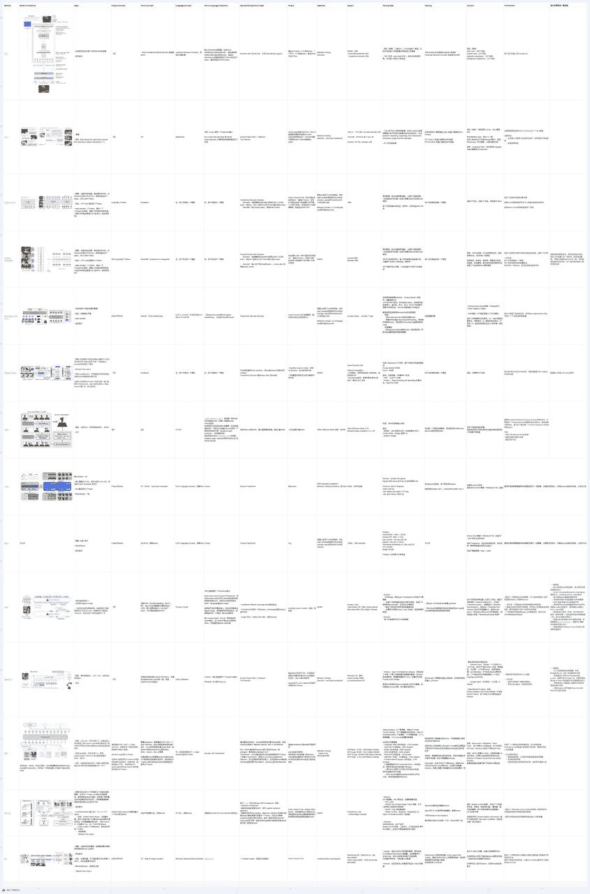

# 招聘公告

---

### 奇绩创坛

奇绩创坛由陆奇博士于2019年创立，使命是在源头最大化驱动创新。奇绩研究组将研究模型理论、到投研战略分析、市场策划等不同背景的同学聚在一起，搭建GenAI时代独特的跨界人才社群。

## 🚀F24实习岗位

##### [行研-学术科研人才交流组实习生](https://miracleplus.feishu.cn/docx/Yn6rdf2iOoY2Rcx8yVNcUBYRnch#part-QkMcdeJmuob9uvxvV3qcLSzHn8g)

##### 行研-GenAI研究岗位-战略分析（偏产品）

##### Web / AI 全栈开发工程师实习生

## 火热开放中🚀

##### 行研-GenAI研究岗位-前沿学术探索

##### 行研-GenAI研究岗位-战略分析（偏咨询）

##### 创新活动产品运营 （大模型系列活动产品运营）

> 点击相关岗位可查看对应岗位需求【JD】；相关岗位投递请扫描二维码

> 欢迎推荐/自荐

> 期待在奇绩创坛遇见更好的你

---

# 声明

本文档仅供学习交流使用，版权归原作者所有，若涉侵权，请联系Jack Jin 15101136166

（欢迎在下方反馈您宝贵的意见！整理不易，觉得有用给AI日报小组点个赞👍吧！）

ChatGPT；Angela；Zijia Liu；Alex；Zeqi Tan；Tiezhen（HuggingFace）；Naixu；Lizhi；Peter；Suoman；Jack

学术分析报告：ResearchFlow -- 奇绩F23校友的开发的深度研究产品，PC端进入RFlow的分析报告，可直接点击节点右侧的小数字展开节点，登录后可在节点上直接“询问AI”，进一步探索深度信息

如果你有大模型相关的创业想法，欢迎来找我们聊聊～🛰️：15101136166

> 快邀请你的小伙伴们一起来读大模型日报吧！

> 【日报知识库】这里是近期日报内容的汇总,欢迎大家查阅

> [大模型日报知识库(分享版)](https://miracleplus.feishu.cn/wiki/KapVwXfkriOBiskB0B2cUHxjnTh)

> 欢迎大家多多帮我们分享,转发

> 如果大家有任何的建议或者吐槽,欢迎随时找我聊天~

