# 奇绩大模型日报（11月 20日）

> 来源：[https://miracleplus.feishu.cn/docx/Vb0Gd2TAooab08xVL7TcWFuwnCb](https://miracleplus.feishu.cn/docx/Vb0Gd2TAooab08xVL7TcWFuwnCb)

# 推特

### ChatGPT高级语音更新：轻松学习如何表达你正在做的整个演讲内容

贡献人：

https://x.com/OpenAI/status/1858948388005572987

另一个高级语音更新来了——现在已在 http://chatgpt.com 上向所有付费用户的桌面端推出。

这样你就可以轻松学习如何表达你正在做的整个演讲内容。

[gkuoiC7XYziprfZX.mp4](https://internal-api-drive-stream.feishu.cn/space/api/box/stream/download/all/AHSBbjIJQopEVQxT8lMcmZLZn8e)

### Github CEO Dohmke：Copilot Workspace已经发布，很快会正式上线！第一个具备智能代理功能的 IDE

贡献人：

https://x.com/ashtom/status/1858891662807728437

在 Ignite 大会，@satyanadella 刚刚发布了我们为 Copilot Workspace 打造的全面新型智能代理未来。Workspace 是目前最先进、也是第一个具备智能代理功能的 IDE。直接内置于 GitHub Issue 中，Workspace 部署了五个代理，助你从头到尾完成拉取请求：头脑风暴、规格定义、规划、实施、构建/修复。

Workspace 即将结束技术预览阶段，很快就会正式成为产品现实。这是 IDE 和软件开发的未来。立即注册尝试：https://githubnext.com/projects/copilot-workspace

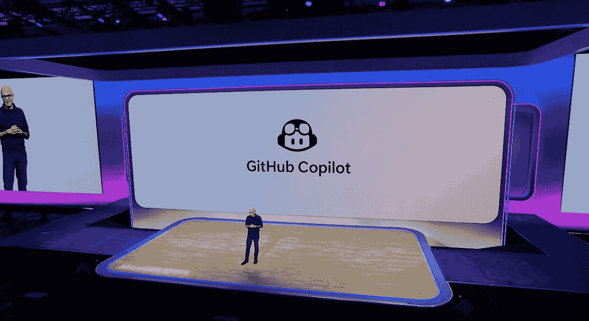

### Anthropic 最新研究：为评估添加误差范围

贡献人：

https://x.com/AnthropicAI/status/1858976458330505639

Anthropic 最新研究：为评估添加误差范围。

AI 模型评估通常不包含统计数据或不确定性信息。我们认为这应该改变。

---

一种用于模型评估的统计方法

假设某个 AI 模型在一个相关基准测试中优于另一个模型，例如测试其通用知识或解决计算机编码问题的能力。这种能力差异是真实存在的，还是仅仅因为该模型在基准测试中碰巧遇到了有利的问题而表现得更好？

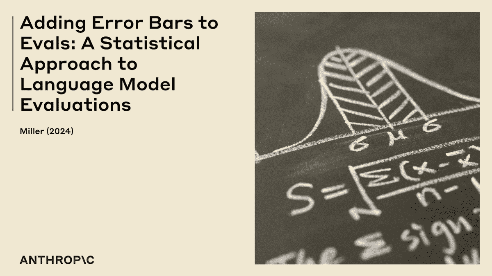

### Vespa：基于ColPali与BM25融合的高效生产级Vision RAG应用

贡献人：

https://x.com/jobergum/status/1858858710065369262

🚀 Vision RAG 的崛起！

推出一款完整的 RAG 应用，几分钟内即可部署到生产环境！

• ColPali 与 BM25 的混合融合，搭载@vespaengine

• Gemini 1.5 Flash-8B

• FastHTML 前端

• 运行于 Huggingface Spaces

带有片段 + 补丁高亮的可解释 SERP！

使用 ColPali 的 RAG 不再需要拖沓缓慢。

[1mBg3dWq-Z_KLxJD.mp4](https://internal-api-drive-stream.feishu.cn/space/api/box/stream/download/all/UJDvbH0nfoIHOaxOiRUcGSzmnde)

### Suno v4上线：提供更优质的音频、更出色的歌词，以及更具动态性的歌曲结构

贡献人：

https://x.com/i/status/1858918710008049866

v4来了！🔥 我们非常兴奋地向大家介绍 v4，它让你可以创作任何你能想[象的歌曲，提供更优质的音频、更](http://suno.com)出色的歌词，以及更具动态性的歌曲结构。立即访问 http://suno.com 尝试吧！

v4 驱动的新功能：

✨ **重制 (Remaster)**：升级你的音乐，享受 v4 的高品质音效

📝 歌**词 (Lyrics)：**为你的创作提供更具创意、更高质量的歌词

🎨 封面艺术 (Cover Art)：全新设计，为你的音乐增添氛围感

[pXa5Pt0AjeZBc7o3.mp4](https://internal-api-drive-stream.feishu.cn/space/api/box/stream/download/all/G5BEb3ot9oJatkxgYCBcxSwQnuF)

# 资讯

### CMU研究人员开发低光环境下的机器人感知系统，拓展探索新领域

https://www.ri.cmu.edu/cmu-researchers-illuminate-new-horizons-in-low-light-robotic-exploration/

卡内基梅隆大学机器人研究所的研究团队开发了一套创新框架，帮助机器人在低光环境下构建高精度的场景表示模型。这一研究为深海测绘、地下探索和搜救任务等关键应用场景提供了突破性进展。

研究背景与挑战

在低光环境中，机器人因光源移动导致的“光照不一致”问题严重影响了场景建模的准确性。不同位置的光照变化使得同一区域在图像中的表现大不相同，增加了场景重建的难度。

核心贡献

研究团队提出三大创新：

1.  **光照处理管道**：包括光源建模、相机-光源校准、3D高斯建模和重光照技术。

1.  **神经光模拟器（NeLiS）**：基于数据驱动的光源建模与校准工具，能够适应任意复杂的光照模式。

1.  **暗高斯溅射（DarkGS）**：改良的3D高斯溅射模型，通过校准的光源生成低光环境下的真实感场景表示。

研究成就

团队利用DarkGS结合光源校准技术，在实际应用中成功生成具有光照一致性的真实感图像，并提升了机器人在复杂光照条件下的性能。这项技术允许机器人在移动时重建场景光照，使用户如同亲临环境中漫步。

应用前景

该系统展示了在深海探索、地下采矿和灾难搜救等高危任务中的巨大潜力。研究成果与方法已公开，方便进一步研究与应用。

该研究不仅解决了低光场景建模的技术瓶颈，还为机器人探索复杂环境开辟了新的可能性。

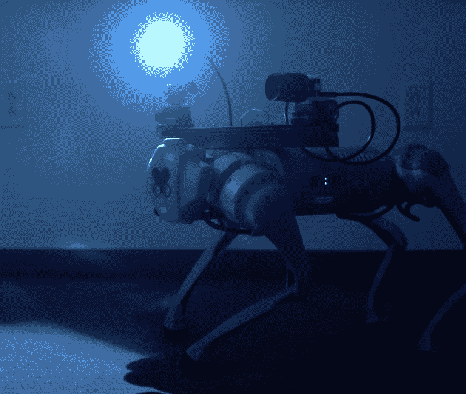

### Meta任命Clara Shih领导新商业AI团队，推动AI工具普及

https://techcrunch.com/2024/11/19/meta-hires-salesforces-ceo-of-ai-clara-shih-to-lead-new-business-ai-group/

Meta正式任命前Salesforce AI部门负责人Clara Shih为新组建的商业AI团队负责人，该团队将专注于为使用Meta应用（如Instagram、Facebook和WhatsApp）的企业开发AI工具。Shih在LinkedIn上宣布这一消息，并表示团队目标是让尖端AI技术更易于企业访问，帮助其在AI时代取得成功。

Meta计划利用其Llama大型语言模型，向广告商和内容创作者提供AI驱动的工具，可能包括AI生成广告等解决方案。这些工具可能会以免费或收费形式提供，以进一步推动广告支出增长，这是Meta的主要收入来源。

Meta的这一新方向标志着其社交平台从以人为主的内容逐渐转向整合AI生成内容，如Facebook上的AI生成图片以及Instagram上模仿内容创作者的AI聊天机器人。

Meta副总裁兼商业化负责人John Hegeman表示，这些AI进展为企业提供了巨大机遇，可以提升效率并改善客户体验。Shih的领导将帮助Meta实现这一愿景。

在加入Meta之前，Shih曾负责Salesforce的AI业务，但由于AI策略的迟缓推进，Salesforce在2023年面临股价下跌和增长放缓的问题。如今，Shih将在Meta重新开始，带领团队开发创新的AI解决方案，以服务数百万企业用户。

### AI 将推动科学突破，NVIDIA CEO 黄仁勋在 SC24 发表演讲

https://mp.weixin.qq.com/s/S7lLCOgf_RjAkU5UUvCoIg

在SC24大会上，NVIDIA推出了一系列AI和超级计算工具，展示了其在推动科学突破和行业变革中的深厚积累。这些创新涵盖了生物制药、气候科学等关键领域，突显了NVIDIA在加速计算领域的领导地位。

黄仁勋在演讲中回顾了NVIDIA自CUDA发布以来的技术进步，强调加速计算不仅降低了计算成本，更像显微镜、望远镜和时间机器，拓展了科学边界。NVIDIA发布的工具包括用于药物发现的BioNeMo框架和DiffDock 2.0、实时气候预测的Earth-2 NIM微服务、以及基于量子模拟的CUDA-Q等。通过增强生成式AI能力，这些工具显著提升了从分子筛选到气候建模的速度和精度。例如，DiffDock 2.0速度提升6.2倍，Earth-2的气候模拟提速500倍。

Omniverse Blueprint的发布标志着数字孪生技术的新突破，它通过1200倍的模拟速度提升为航空航天、能源等行业带来了实时交互的可能性。同时，基于NVIDIA Hopper架构的新产品H200 NVL和GB200 NVL4超级芯片实现了多达2倍的性能提升，支持科学计算和大语言模型的高效推理。

在硬件扩展方面，NVIDIA携手Foxconn扩大产能，满足市场对AI系统的需求。通过这些创新，NVIDIA展示了如何以技术驱动科学突破，加速应对全球挑战，涵盖药物开发、气候变化和量子计算等领域。

### 从 GPT-2 开始玩 AI 的博士生，把论文做成了上线 Steam 的独立游戏

https://mp.weixin.qq.com/s/8GbnTYfmUunZMSH_ajHWHA

独立工作室 Ada Eden 开发的叙事游戏《1001 夜》为玩家提供了一个与 AI 对话并展开博弈的全新体验。游戏基于经典的“一千零一夜”故事改编，但核心玩法从感化国王转变为用故事引导国王说出武器关键词，集齐四种武器击败他。AI 由智谱 GLM 模型驱动，实时生成国王的反应、场景和台词，使每个故事都独一无二，探索了 AI 作为游戏玩法核心的新可能性。

玩家在游戏中扮演山鲁佐德，用故事与性格傲慢、崇尚武力的国王周旋。国王会根据提示词对玩家故事进行续写，但若故事内容脱离逻辑或过于现代化，国王的耐心会迅速消耗，导致山鲁佐德被处死。通过引导国王讲述自己的故事，玩家也能反客为主，找到击败他的线索。游戏中实时生成的武器卡牌与场景，结合 AI 的动态响应，让玩家体验到了极高的创作自由度。

主创起司从 GPT-2 开始关注 AI 对话游戏的潜力，她认为设计聊天机器人和游戏角色相似，只需展现出“人性”。从 2020 年开发《1001 夜》的早期版本，到 2023 年创立工作室 Ada Eden，她和团队不断借助 AI 技术的飞跃改进游戏。游戏实现了固定剧情与动态生成的结合，利用内部专属风格模型保证图像美术的原创性和一致性，同时避免侵权争议，体现了对技术与艺术的深度平衡。

《1001 夜》作为 AI 原生游戏，探索了 AI 在写作、叙事游戏中的独特可能性。玩家不仅与 AI 互动，更通过自己的创作推动游戏进程，打破了传统游戏中“固定叙事”的桎梏。这款游戏展现了 AI 技术在艺术与娱乐领域的更多潜力，同时也通过独特的玩法回应了关于 AI 使用的争议。起司希望，玩家能通过游戏发现 AI 的趣味性与价值，让人类与技术共同创造更加多样的叙事体验

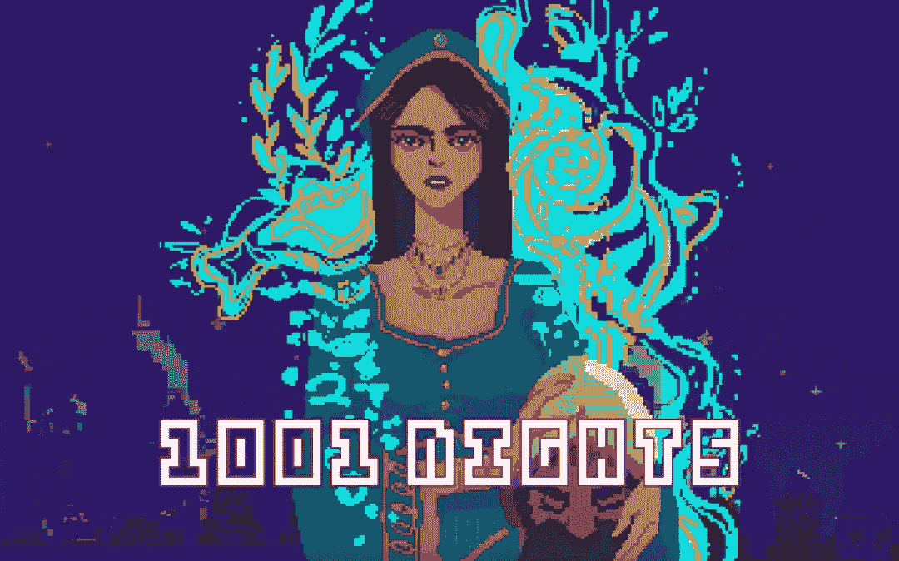

### 大模型六小龙第一起分拆：零一万物计划独立 AI 游戏公司

https://mp.weixin.qq.com/s/0pZLHwIA_mQV3buCvzYCgw

进入2024年下半年，大模型行业的焦点逐渐转变，零一万物的战略调整尤为典型。面对放缓的技术进展和投资人态度转冷，零一万物明确了“模型与算力输出”的核心方向，同时拆分应用业务，探索更灵活的商业模式。

零一万物计划将部分应用业务独立出来，成立名为“绿洲”的子公司，以零一万物的大模型为基础，聚焦游戏等AI应用方向。绿洲将由联合创始人、副总裁马杰担任董事长，预计年底完成分拆，零一万物仍是其最大股东。马杰此前在百度负责云游戏和元宇宙业务，在安全技术和创业领域经验丰富，具备整合产品与商业化的能力。

拆分后，绿洲专注AI应用开发并独立融资，而零一万物则专注于核心技术与算力输出。零一万物的To B业务明确了“基础设施+大模型+应用”的三位一体服务模式，重点覆盖政府企业合作、电商直播与营销等场景。与此同时，AI搜索被确立为To C业务的核心方向，已有两款相关产品上线。

这种拆分策略被认为是双赢。一方面，零一万物通过分拆减轻负担，聚焦模型研发；另一方面，绿洲作为轻量化新公司，既能高效利用母公司的技术资源，又能更灵活地适应市场融资需求。

与上一批AI“四小龙”如依图的业务拆分相比，零一万物的动作更加迅速，成立不足两年就开始调整业务布局。这与创始团队的商业认知、市场敏锐度以及对资本市场的预判息息相关。正如李开复所言，大模型公司需注重高质量收入和增长潜力，提前应对资本市场的挑战。零一万物当前的战略显示出其对ROI和财务健康的高度重视，力图在行业洗牌中保持领先。

### IKEA发布4D视频手册数据集

贡献人:

IKEA 视频手册数据集是第一个为互联网视频上的组装说明提供 4D 基础的数据集，提供组装说明、3D 模型和真实世界互联网视频之间的高质量时空对齐。

详情阅读 : https://yunongliu1.github.io/ikea-video-manual/

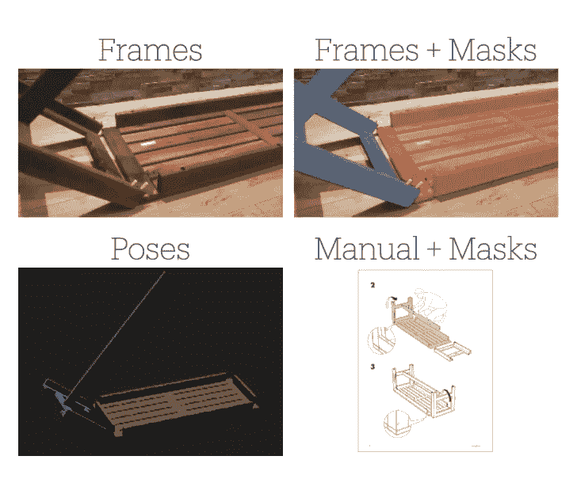

# 信号

### Bimanual Dexterity for Complex Tasks

相关链接:https://bidex-teleop.github.io/

贡献人 :

为了训练通用机器人策略，机器学习方法通常需要大量专家级的人类远程操作数据。对于人类来说，理想的数据收集机器人是能够密切模仿人类的机器人：双手手臂和灵巧的手。然而，创建这种具有超过 50 个自由度的双手远程操作系统是一项重大挑战。为了解决这个问题，我们推出了 Bidex，这是一种极其灵巧、低成本、低延迟且便携的双手灵巧远程操作系统，它依赖于动作捕捉手套和教师手臂。我们将 Bidex 与 Vision Pro 远程操作系统和 SteamVR 系统进行了比较，发现 Bidex 能够以更快的速度为更复杂的任务生成更高质量的数据。

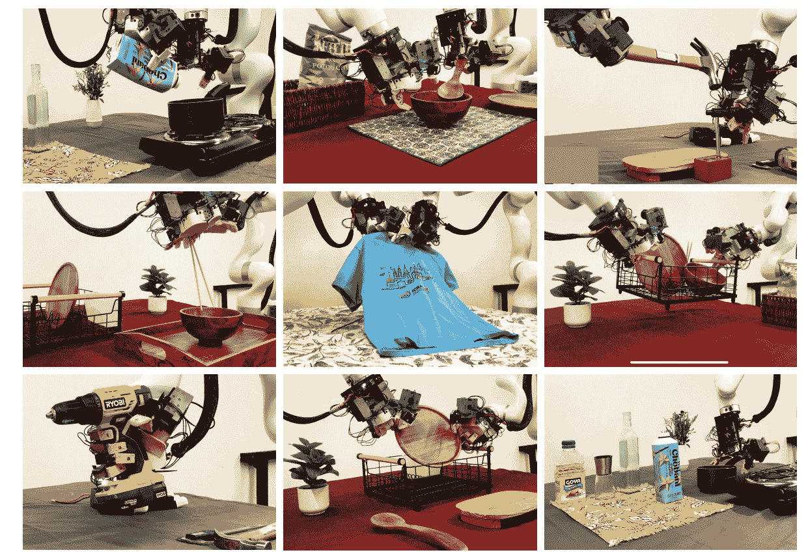

### Generative World Explorer

https://arxiv.org/abs/2411.11844

贡献人:

大多数先前的研究都通过开发能够物理探索其环境以更新其对世界状态的信念的代理来解决这一挑战。相比之下，人类可以想象通过精神探索，探索世界上看不见的地方，修订他们的信念与想象的观察相结合。这种更新的信念可以让他们做出更明智的决定，而不需要一直对世界进行物理探索。为了实现这种类似人类的能力，我们引入了生成世界探索者 (Genex)，一个以自我为中心的世界探索框架，允许代理在心理上探索大规模的 3D 世界（例如城市场景），并获得想象中的观察结果来更新其信念.

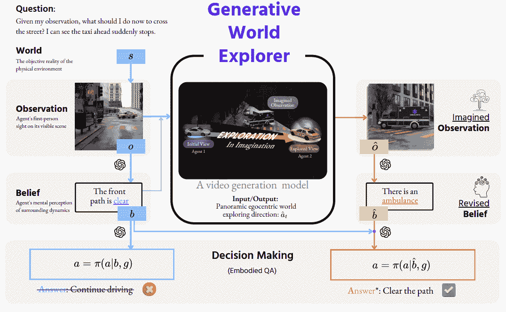

### AIGS: Generating Science from AI-Powered Automated Falsification

https://arxiv.org/abs/2411.11910

贡献人:

人工智能的快速发展极大地加速了科学发现的发展。深度神经网络通过大规模观测数据进行训练，以端到端的方式提取底层模式，并帮助人类研究人员在未见过的场景中进行高精度预测。最近兴起的大型语言模型 (LLM) 和赋能自主代理使科学家能够在研究的不同阶段通过交互获得帮助，包括但不限于文献综述、研究构思、想法实施和学术写作。

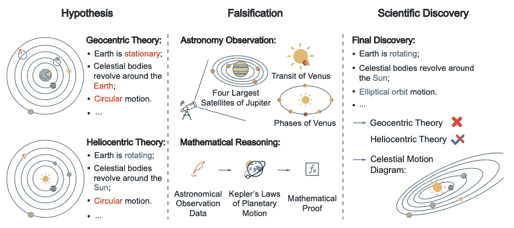

# 产品

### Superchat

贡献人：

https://www.superchat.com/

Superchat 是一款自动化商业消息传递工具，通过 AI 代理无缝处理 WhatsApp Business、Instagram、Facebook 等平台的客户咨询。它集成了多种渠道，提供统一的收件箱、智能自动化、团队协作、WhatsApp 新闻通讯等功能，帮助企业提高销售、优化客户支持和提升营销效果。

### BetterBug

贡献人：

https://www.betterbugs.io/

BetterBugs.io 是一款专为开发团队设计的 Chrome 扩展程序，通过捕获网络、控制台和浏览器详细信息，提供根本原因分析、可操作步骤和 AI 驱动的修复建议，从而简化 bug 报告和调试过程。它支持全/部分截图、视频录制、标记、评论和任务分配等功能，并集成 Jira 等工具，帮助 QA 和开发团队提高速度、精度和协作效率。

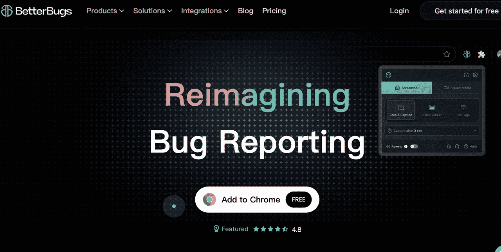

# HuggingFace&Github

### Garak

贡献人：

https://github.com/NVIDIA/garak

Garak 是一个开源的大型语言模型（LLM）漏洞扫描工具，可以检测 LLM 在幻觉、数据泄露、提示注入、错误信息、生成有毒内容、越狱等方面的弱点。它支持多种 LLM 接口，如 Hugging Face、OpenAI、Replicate 等，并提供静态、动态和自适应探针来评估模型的安全性。

### multi-agent-orchestrator

贡献人：

https://github.com/awslabs/multi-agent-orchestrator

Multi-Agent Orchestrator 是一个灵活且强大的框架，用于管理和协调多个 AI 代理，处理复杂的对话。它支持智能意图分类、双语言支持（Python 和 TypeScript）、灵活的代理响应（包括流式和非流式）、上下文管理、可扩展架构和通用部署。该框架提供了预构建的代理和分类器，适用于从简单的聊天机器人到复杂的 AI 系统，支持多种应用场景，如旅行预订、天气查询、数学计算、技术支持和健康咨询。

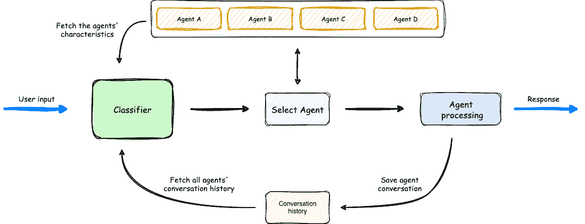

# 投融资

### CodeCrafters完成180万美元种子轮融资，为高级开发者提供挑战性项目

贡献人：

https://techcrunch.com/2024/11/19/codecrafters-wants-to-challenge-seasoned-developers-with-hard-to-build-projects/

CodeCrafters是一个针对高级开发者的平台，提供“构建自己的X”挑战项目，如开发Redis、Git、Docker和BitTorrent客户端等。该平台旨在通过实战项目，帮助开发者深入掌握编程语言及相关核心概念，如分布式系统性能和API设计。

公司由Sarup Banskota和Paul Kuruvilla于2022年创立，并获得Y Combinator的支持。在早期，公司通过调整产品以匹配市场需求，最终找到了一种为用户提供增值服务的方式。目前，CodeCrafters允许用户免费访问部分挑战，但需付费才能解锁更多内容及高级功能，如持续集成测试和AI辅助支持。

CodeCrafters近期完成了180万美元的种子轮融资，投资者包括Instagram联合创始人Mike Krieger、Dropbox联合创始人Arash Ferdowsi及Supabase CEO Paul Copplestone等。Krieger表示，他欣赏平台通过构建真实项目来深化开发者技能的方式，而不仅仅停留在语法学习上。

融资将用于扩展平台功能，例如为用户提供AI驱动的提示，帮助更好地完成挑战。未来，公司计划增加更多复杂项目，并进一步优化用户体验。

CodeCrafters的目标是成为为有经验的开发者提供实战项目的平台，与市场中为初学者设计的学习资源形成互补，满足不同层次开发者的学习需求。

公司官网：https://codecrafters.io/

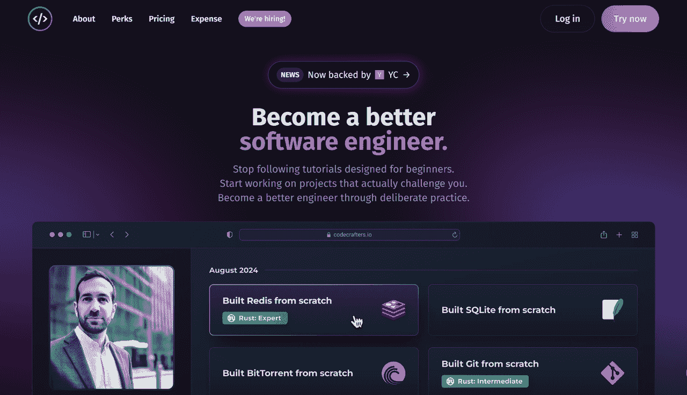

### BrightAI从隐形运营到融资1500万美元，推动“物理AI”革命

https://techcrunch.com/2024/11/19/physical-ai-startup-brightai-bootstraps-to-80m-in-revenue/

BrightAI是一家专注于“物理AI”的物联网（IoT）公司，由Alex Hawkinson于2019年联合创立。他曾是SmartThings的CEO，并在其被三星以2亿美元收购后，转向探索如何通过物联网技术改善关键基础设施。

BrightAI通过传感器和AI技术帮助企业实时监控物理资产，从数据中预测潜在问题并提供解决方案。例如，其客户Pelsis使用BrightAI的传感器远程监控食品和制药工厂中的设备，及时发现并处理新问题，提升效率。

公司于2023年以隐形模式推出平台，目前已部署超过25万个传感器，涵盖HVAC（供暖、通风和空调）、废物管理和电力等六个行业，服务7家大型企业客户。在未接受外部融资的情况下，BrightAI实现了8000万美元收入。

近日，BrightAI结束隐形模式，宣布获得1500万美元种子轮融资，由Upfront Ventures全资支持。融资将用于技术升级和扩展能力，包括利用传感器数据为现场工人提供精准维修建议。BrightAI计划进一步扩大市场覆盖，同时保持跨行业的广泛应用，而非局限于单一领域。

公司强调其技术不仅提高了生产力和资本效率，还减少了浪费，为关键服务创造了更大价值。随着物联网和AI的深度融合，BrightAI的创新模式有望在未来获得更大市场机遇。

公司官网：https://www.bright.ai/

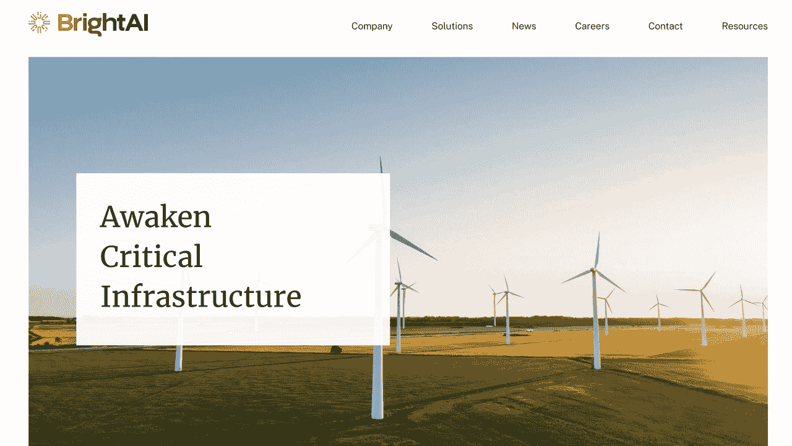

### Neo4j凭借AI能力加速增长，完成5000万美元新融资

https://techcrunch.com/2024/11/19/database-startup-neo4j-embraces-ai-to-supercharge-growth/

Neo4j是一家专注图数据库管理的软件公司，其产品能够帮助企业以图形式存储和查询数据，为AI项目提供基础设施支持。图数据库在管理快速变化和高度互联的数据方面优于传统数据库，对AI的应用有显著促进作用。Neo4j通过“知识图谱”为AI提供上下文数据支持，帮助改进AI输出的准确性和透明性。

近期，公司推出了支持AI的“GraphRAG”技术和矢量搜索功能，进一步增强了平台对AI的支持能力。这些努力推动公司收入超过2亿美元，是三年前的两倍，预计将在未来几个季度实现正现金流。

为加强财务状况并支持业务扩展，Neo4j从Noteus Partners筹集了5000万美元最新资金。截至目前，公司总融资额约为5.5亿美元，其估值达到22亿美元。公司计划在未来推出更多AI功能，并表示最终会公开上市，但目前的重点仍是业务增长。

Neo4j的客户包括IBM和沃尔玛在内的1700家公司，占据了图数据库市场44%的份额。此外，公司表示其技术在支持准确和可解释的AI生产部署方面具有独特优势，尤其是在审计和监管需求增加的背景下。

随着图技术市场预计到2030年达到158亿美元的规模，Neo4j处于这一领域的领先地位，将继续受益于行业的快速发展。

公司官网：https://neo4j.com/

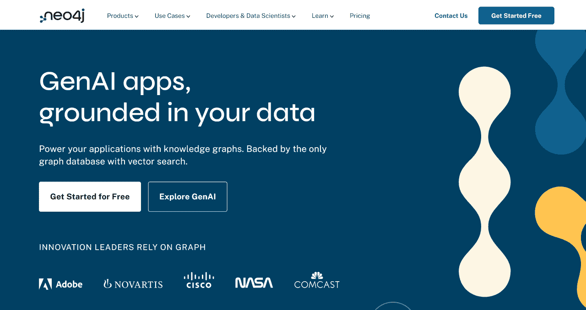

### Selector完成3300万美元B轮融资，扩大全球布局

https://techcrunch.com/2024/11/19/selector-automatically-spots-it-issues-and-recommends-fixes/

Selector是一家专注于AIOps（人工智能运维）领域的公司，由Juniper Networks的前高管Kannan Kothandaraman和Nitin Kumar于2019年创立。Selector通过AI技术帮助企业监控IT基础设施，识别问题并推荐修复方案，旨在应对企业运维复杂性和数据量激增的挑战。其平台通过AI驱动的自然语言交互界面，简化了问题查询和处理过程。

近期，Selector完成了由Ansa领投的3300万美元B轮融资，累计融资总额达到6600万美元。本轮融资的其他参与者包括Two Bear Capital、Atlantic Bridge、SineWave Ventures以及客户AT&T、Bell Canada和Singtel。据创始人透露，公司的估值自2021年10月以来增长了4倍。

Selector目前拥有包括AT&T、Bell Canada和Singtel在内的约40家客户，并计划利用新一轮融资在全球范围内扩展业务布局，包括美国、加拿大、欧洲、新加坡、印度和日本等市场。此外，公司计划将员工数量从115人增加到明年的150人。

尽管面临Keep、Senser等初创公司以及New Relic和ServiceNow等行业巨头的竞争，Selector受益于AIOps市场的快速增长。预计该行业规模将在2033年达到2136.6亿美元，远高于2023年的252.4亿美元。

此次融资将进一步推动Selector的业务扩展和技术创新，使其在日益增长的AIOps市场中占据更重要的地位。

公司官网：https://www.selector.ai/

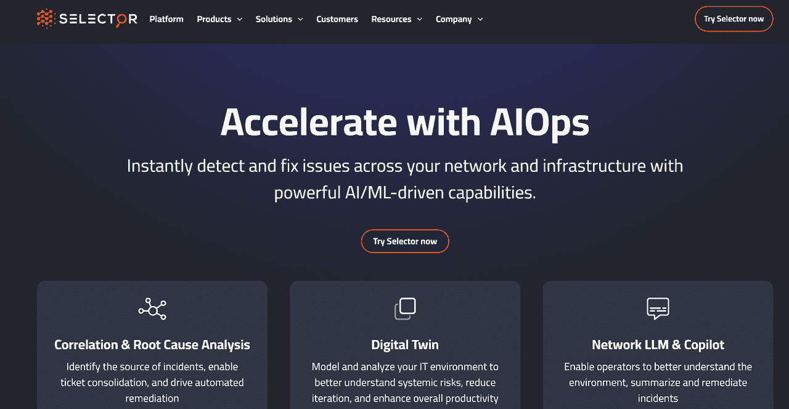

### Lightyear完成3100万美元B轮融资，推动网络采购数字化

https://techcrunch.com/2024/11/19/lightyear-is-on-a-mission-to-modernize-network-procurement/

Lightyear是一家致力于现代化网络采购的初创公司，由Dennis Thankachan于2019年创立，总部位于纽约。公司通过其数字化平台简化企业获取网络基础设施（如互联网和SD-WAN）的过程，使传统依赖手动操作和电子表格的流程实现数字化和自动化。

Lightyear的平台为企业提供供应商选择、成本比较、服务安装管理及合同续订功能，近期还新增了库存管理和账单支付服务，帮助企业统一管理网络相关开支。其客户包括Palo Alto Networks、Five Guys、Pandora Jewelry和Teladoc等知名企业。

在数字化采购需求不断增长的背景下（根据普华永道的报告，到2027年采购流程将有70%实现数字化），Lightyear本周宣布完成3100万美元B轮融资，由Altos Ventures领投，Ridge Ventures、Zigg Capital、Susa Ventures和Amplo跟投。截至目前，Lightyear总融资金额已达7960万美元。

本轮资金将主要用于产品开发以及客户体验和支持的深度提升。CEO Dennis Thankachan表示，公司将在未来实现现金流平衡，不再依赖外部融资支持增长。

Lightyear的成功得益于其创新的采购数字化解决方案，以及对企业网络管理痛点的精准把握，逐步成为现代企业网络采购领域的重要玩家。

公司官网：https://lightyear.ai/

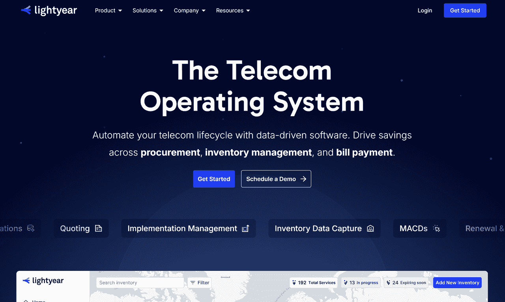

### AI出版社Spines完成1600万美元融资，加速出版行业变革

https://techcrunch.com/2024/11/19/itching-to-write-a-book-ai-publisher-spines-wants-to-make-a-deal/

Spines是一家由人工智能驱动的自出版平台，总部位于迈阿密，起源于以色列。该平台通过AI技术取代传统出版商角色，从编辑、设计到发行，全流程服务实现高效出版，承诺将传统6至18个月的出版周期缩短至2到3周。自2021年成立以来，Spines已发布1700多本书籍，收入增长率达到1000%。

在最新的融资消息中，Spines完成了由Zeev Ventures领投的1600万美元A轮融资，Aleph、M-Fund和LionTree等现有投资者也参与其中。此外，公司在2024年4月曾完成650万美元的种子轮融资，但目前估值尚未披露。

Spines创始人兼CEO Yehuda Niv在电气工程学学习期间萌生了进军出版行业的想法，后通过传统与AI相结合的方式创建了Spines。此次融资将用于扩展新产品线，包括有声书的制作与发布。

Zeev Ventures创始人Oren Zeev曾是有声书平台Audible（被亚马逊收购）的早期投资者，他表示：“Spines具有重塑出版行业的变革性力量，如同当初我看待有声书的潜力。”

目前，Spines的出版服务起价约为1200美元，最高可达5000美元，用户可根据需求选择不同服务项目。作品销售分成方面，作者可获70%版税，而Spines占30%。此外，Spines还提供月费19到49美元的分销会员服务，覆盖电子书及按需印刷的分发渠道。

在面对Amazon等数字出版巨头及其他AI出版平台竞争时，Spines凭借高性价比和快速高效的出版流程脱颖而出，成为行业焦点。

公司官网：https://spines.com/

# 学习

### 2024 年视觉语言模型（VLMs）

贡献人：

https://zhuanlan.zhihu.com/p/7827587018

**引言**

视觉语言模型（Vision Language Models, VLMs）是一类生成模型，能够从图像和文本中学习，并生成相应的输出。VLMs 展现了卓越的零样本学习能力和泛化性能，近年来研究的焦点逐渐转向前沿设计与应用趋势。

**多模态设计**

VLMs 的设计主要分为两种类型：

2.1 类型 A：多模态大语言模型（MLLM）

+   **架构**：视觉编码器 → 多模态投影器 → 大语言模型（LLM）

+   **优点**：借助预训练的视觉编码器和LLM，训练较为简单。

+   **局限性**：难以直接生成多模态输出。
2.2 类型 B：多模态标记化Transformer

+   **架构**：离散标记器 → 多模态Transformer → 解码器

+   **优点**：原生支持多模态输出。

+   **局限性****：需从零**开始训练，训练成本和难度较高。
研究趋势：大部分研究聚焦于类型A，同时尝试统一两种设计（如VILA-U和Libra）。

**架构**

3.1** 视觉编码**器

+   **挑战**：支持高分辨率图像及文本丰富内容。

+   **解决方案**：采用图**像划分、下采**样、像素填充等方法（如MiniCPM-V、LLaVa-OneVision）。
3.2 多模态投影器

+   **功能**：压缩视觉特征，为LLM提供输入。

+   **技术**：池化、**MLP网络、交叉注意力**重采样。
3.3 LLM / 文本解码器

+   **角色**：负责主**要的理解与**生成任务，性能受LLM规模决定。
3.4 视觉解码器

+   **新趋势**：通过整合视觉解码器和MLLM逐步统一类型A与B（如Janus、VILA-U）。

**预训练**

4.1** 数据需**求

+   图像-文**本对、交错**数据、仅文本数据，典型比例为5:1:4。
4.2 阶段化训练

+   第一阶段：冻结视觉编码器与LLM，仅训练投影器。

+   第二阶段**：解冻部**分组件，用高分辨率数据进一步提升性能。
4.3 训练目标

+   使用重构损失、对比损失等优化视觉与语言对齐。

**后训练**

5.1** 监督微调（SFT**）

+   数据多样**性与质量**至关重要，包括多语言数据、高分辨率图像等。
5.2 冻结策略

+   冻结LL**M以保护仅文**本任务性能，或解冻以提升多模态能力。
5.3 强化学习对齐

+   部分模型（如MiniCPM-V）引入基于RL的对齐方法，提高高风险场景下的可靠性。

**高效优化**

6.1** 推理优**化

+   通过量化**、注意力**机制优化（如Flash Attention）、批处理加速等提升效率。
6.2 训练优化

+   使用稀疏**训练、L**oRA、QLoRA等技术降低训练成本。
6.3 模型压缩

+   结合模型蒸馏、参数压缩技术（如Mamba），实现性能和体积的平衡。

**基准测试**

7.1** 扩展的基准测**试

+   新基准（**如Mat**hVista、MMBench）覆盖了更广泛的视觉理解类别。
7.2 领先模型

+   GPT-**4o、Cla**ude 3.5等模型在MMMU基准上表现领先，开源模型中InternVL2-Pro最佳。
7.3 图像生成评估

+   通过定性评估、FID分数、CLIPScore等方法分析生成图像质量。

**自动驾驶中的端到端VLM**

端到端VLM通过提示工程，将感知、规划任务统一。典型模型如Waymo的Emma、DriveVLM，表现出在感知与运动规划中的潜力。

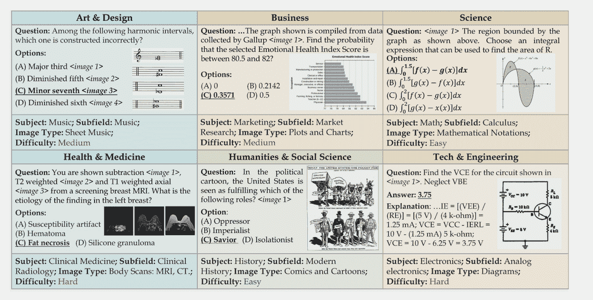

### 详解 CacheBlend：RAG 场景 KV 复用，打破前缀相同的限制

https://zhuanlan.zhihu.com/p/7781800255

KV Cache 复用在RAG（检索增强生成）场景中非常重要，但传统复用方法存在局限性：需要前缀完全一致，并且无法保留文本块之间的交叉注意力。为解决这一问题，CacheBlend提出了一种新的方案，在生成质量和计算效率之间取得了平衡。

在RAG场景中，LLM通过将检索到的文本块与用户输入拼接进行生成。由于长上下文的存在，这种方法会带来较大的计算和内存开销。现有KV Cache复用方案主要存在两个问题：位置编码错误和交叉注意力缺失。位置编码问题是因为相同的文本块在不同请求中的位置不同，导致KV Cache的计算偏移。交叉注意力问题是由于不同文本块之间缺乏联系，影响了生成的准确性。

现有的解决方案包括Full KV Re-compute、Prefix Caching和Full KV Reuse。Full KV Re-compute虽然生成质量高，但开销巨大。Prefix Caching通过缓存完全匹配的前缀保证了生成质量，但复用条件苛刻，无法充分利用缓存。Full KV Reuse直接拼接KV Cache，复用率高，但忽视了交叉注意力，生成质量下降。相比之下，CacheBlend通过选择性地重新计算注意力，在复用率和生成质量之间实现了优化。

CacheBlend通过拼接不同文本块的KV Cache，利用RoPE（Rotary Position Embedding）技术修正位置编码问题，使预计算的KV Cache可以直接复用。在交叉注意力恢复方面，CacheBlend利用注意力的稀疏性，只重新计算对生成结果影响较大的token。其核心思想是逐层选择KV偏差大的token进行重新计算，逐步恢复文本块之间的交叉注意力。这种渐进过滤的方案在保证生成质量的同时，大幅减少了计算开销。

为了进一步优化效率，CacheBlend设计了KV加载与选择性重计算的流水线处理模式。通过并行执行这两个步骤，隐藏了部分计算开销，显著提升了性能。

实验表明，CacheBlend在生成质量和效率方面实现了平衡。相比Prefix Caching，其KV复用率更高，生成延迟更低；相比Full KV Reuse，交叉注意力的恢复保证了更高的生成质量。CacheBlend构建了一个多级存储系统，动态加载和计算缓存，为RAG场景提供了高效的解决方案

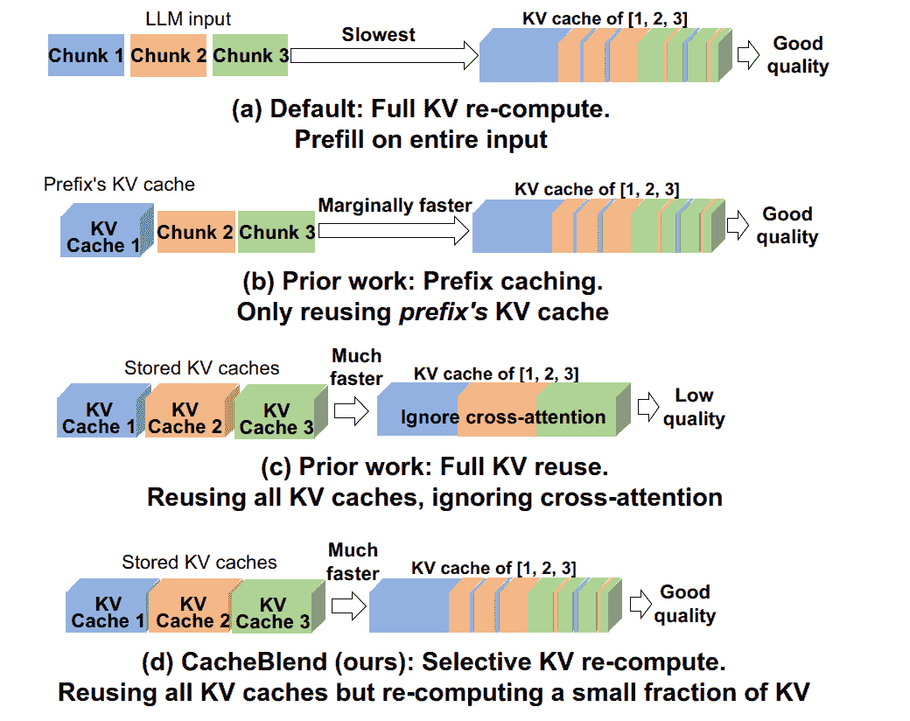

### LLM评测Takeaway

https://zhuanlan.zhihu.com/p/7713134123

为了解决现有评测框架在融入自定义代码流程中的复杂性和拓展性问题，作者设计了一种针对不同Benchmark的独立评测流程。其核心在于为每个Benchmark单独建立文件夹，内含主函数和工具函数，通过灵活的参数配置、标准化的数据加载、定制化的生成后处理实现高效评测。以下为关键技术细节总结：

首先，为每个Benchmark创建独立文件夹，并设计包含argparse参数配置的主函数。主要参数包括模型路径（checkpoint path）、数据加载参数（如num_workers和batch_size）、生成配置（如temperature、topk、topp等）、以及其他模型独立参数。模型和分词器通过from_pretrained方法从指定路径加载，数据集根据Benchmark原始数据格式组织到getitem中，并通过自定义的Dataloader打包。

生成阶段中，generation_config设置了核心参数如max_new_tokens、eos_token_id等。对输入样本进行会话格式化时，可利用模型兼容的Conversation Class或apply_chat_format方法，根据模型需求配置role信息、分隔符和系统提示。生成结果通过generate函数推理，需注意eos_token_id的正确性，否则可能生成无关内容。

后处理对生成结果进一步解析。利用batch_decode将模型预测的id转为自然语言后，可根据具体Benchmark的要求执行正则匹配。例如，Math类任务可通过识别"final answer"句子后处理Latex语法或单位信息；Code类任务则需更复杂的解析逻辑。作者指出，对于zero-shot任务，可通过设计instruction引导模型用特定标记（如\box{}）输出答案，便于正则化抽取。

分布式场景下，作者通过自定义InferenceSampler和collate_fn实现多卡加速。InferenceSampler根据进程数划分数据范围，确保分布式数据分配的一致性；collate_fn则定义如何将每条数据组装成批次。Dataloader实例化时结合了自定义的Sampler和collate函数，支持高效的数据加载。

误差来源主要包括generation_config的设置、输入提示格式、预测后处理等。其中，后处理对于Math、Code等任务影响尤为显著，可能因正则逻辑不当导致测试精度上下浮动达15%。作者通过案例分析展示了后处理失败的典型场景，例如模型不同总结用词（如final answer vs therefore）导致对答案提取的偏差，highlight了针对不同模型的后处理逻辑适配的重要性。

作者总结了从lm_eval、opencampass等开源项目中获得的启发，并分享了相关代码库链接，表明开源资源在搭建和优化评测流程中的价值。

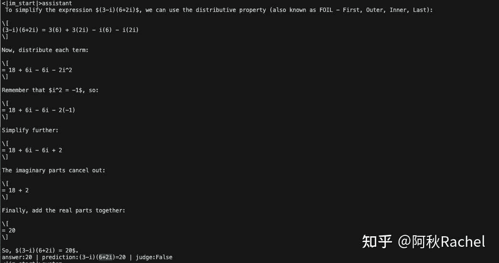

### Implementing a fast Tensor Core matmul on the Ada Architecture

https://www.spatters.ca/mma-matmul

在Ada架构上实现高效的Tensor Core矩阵乘法

概述

本文详细描述了如何在NVIDIA Ada架构GPU上开发高效的Tensor Core矩阵乘法（matmul）内核，从最初的朴素实现到性能接近cuBLAS的优化版本。通过引入如CUTLASS库的技术、异步数据传输以及高效的共享内存布局，最终达到了高达RTX 4090峰值性能的93%。

技术细节

1.  **问题定义**：

+   矩阵规格为 M=N=K=4096M=N=K=4096M=N=K=4096，采用fp16输入与fp32累加。

+   单次计算涉及超过3300万次 m16n8k16m16n8k16m16n8k16 指令。

1.  **性能优化过程**：

+   **Kernel 1.0**: 基础实现，采用直接加载数据的方式，性能仅为cuBLAS的19%。

+   **Kernel 2.0**: 引入CUTLASS共享内存排列，减少银行冲突，将性能提升至82.9%。

+   **Kernel 3.0**: 利用cp.async指令实现多阶段异步流水线，进一步减少全局内存读取延迟。

1.  **异步流水线**：

+   通过将数据预加载到共享内存并利用循环缓冲实现流水线处理，显著减少了内存访问开销。

+   采用warp级别的指令（如ldmatrix和mma.sync），优化线程块计算效率。

1.  **最终结果**：

+   **Kernel 3.1**: 增加每个warp的计算量，通过4倍平铺技术（tiling），将性能提升至153.6 TFLOP/s，与cuBLAS持平。

工具与技术亮点

+   使用低级PTX指令如mma和ldmatrix直接操作Tensor Core。

+   共享内存的排列避免了银行冲突，并配合向量化加载优化全局内存访问。

+   通过CUDA工具（如nsight-compute）精确分析性能瓶颈，如Tensor Core等待和同步开销。

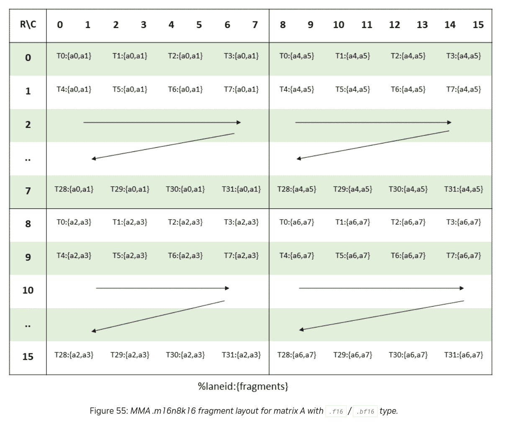

### Neurips 2024 Tutorial: Beyond Decoding: Meta-Generation Algorithms for Large Language Models

https://cmu-l3.github.io/neurips2024-inference-tutorial/

本教程将于 **2024年12月10日** 在温哥华的 NeurIPS 上举行，主题聚焦于大型语言模型（LLMs）推理阶段的生成算法，从传统解码技术到复杂的元生成算法，旨在提升生成质量、增加多样性，并实现资源有限环境下的高效生成。

核心内容

1.  **生成算法演进**：介绍从贪婪解码到复杂元生成算法的历程，探讨如何通过优化推理阶段的计算资源来提升输出质量。

1.  **跨学科视角**：结合自然语言处理、现代LLMs和机器学习系统三大研究领域的视角，提出高效生成的解决方案。

1.  **资源高效化**：重点讲解如何在降低生成成本和提高生成速度的同时，维持甚至提升生成质量。

1.  **元生成算法应用**：展示如何利用LLMs在更复杂任务（如多步骤推理、知识检索与生成）中优化表现。

融合理论与实践

教程将包括多位研究人员的讲解，从基本概念到高级技术逐步展开。附带的阅读材料和代码资源为参会者提供进一步探索的途径。

重要信息

+   **时间**：2024年12月10日，下午1:30 - 4:00（温哥华时间）。

+   **地点**：West Exhibition Hall C, NeurIPS。

+   **主讲人**：由来自卡耐基梅隆大学、南加州大学、Anthropic、Meta AI等机构的研究人员组成。

+   **阅读材料**：涵盖元生成算法最新研究和高效生成技术。

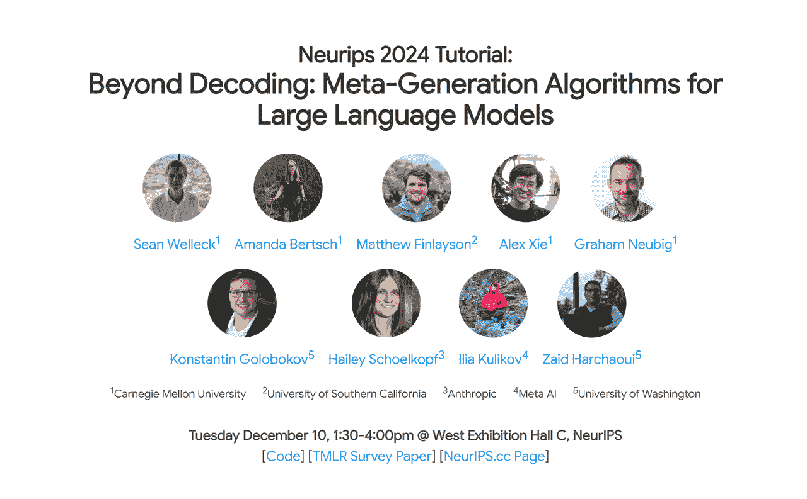

### 统计方法在语言模型评估中的应用

https://www.anthropic.com/research/statistical-approach-to-model-evals

Anthropic近期发布了一篇关于语言模型评估（Evals）的研究论文，提出了一系列基于统计学的改进建议，以提升AI模型评估的科学性和准确性。文章从如何量化模型性能差异的真实性入手，提出了五项核心建议：

核心建议

1.  **利用中心极限定理**：

+   评估分数通常是大量问题得分的平均值，但研究强调应关注“问题宇宙”中的理论平均值，而非仅仅依赖观察值。

+   使用中心极限定理可以更稳健地估算标准误差（SEM），并计算置信区间，从而更准确地量化模型能力差异。

1.  **聚类标准误差**：

+   对非独立问题（如基于相同文本段的多个问题），建议采用聚类标准误差方法，以避免低估误差，确保结论的可靠性。

1.  **减少问题内部方差**：

+   通过多次生成和评分答案，或者使用语言模型的下一词概率作为评分标准，减少随机误差，从而提高评估精度。

1.  **分析配对差异**：

+   通过配对差异测试（paired-difference test）消除问题难度的影响，仅关注模型之间的响应差异。这种方法可以显著减少误差，并提供更清晰的比较结果。

1.  **运用功效分析**：

+   利用统计功效分析，计算评估所需的最少问题数量，以确保对模型能力差异的检测足够敏感。研究建议开发者在设计新评估时参考此方法。

研究意义

+   本文通过引入统计学理论和实验设计方法，明确了语言模型评估中数据分析和解释的标准化路径。

+   提出的改进方法将有助于研究人员更科学地设计评估、解释结果，并在对比不同模型性能时减少随机性和偏差的影响。

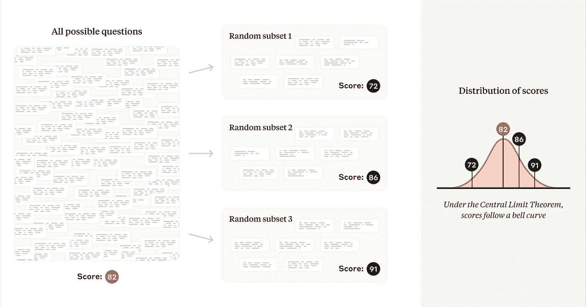

# 招聘公告

---

**奇绩创坛****由陆奇博士**于2019年创立，使命是在源头最大化驱动创新。奇绩研究组将研究模型理论、到投研战略分析、市场策划等不同背景的同学聚在一起，搭建GenAI时代独特的跨界人才社群。

## 🚀F**24实习岗位**

##### [行研-学术科研人才交流组实习生](https://miracleplus.feishu.cn/docx/Yn6rdf2iOoY2Rcx8yVNcUBYRnch#part-QkMcdeJmuob9uvxvV3qcLSzHn8g)

##### 行研-GenAI研究岗位-战略分析（偏产品）

##### Web / AI 全栈开发工程师实习生

## **火热开放中🚀**

##### 行研-GenAI研究岗位-前沿学术探索

##### 行研-GenAI研究岗位-战略分析（偏咨询）

##### 创新活动产品运营 （大模型系列活动产品运营）

> **点击**相关岗位可查看对应**岗位需求【JD】；**相关岗位投递请**扫描二维码**

> 欢迎**推荐/自荐**

> 期待在**奇绩创坛**遇见更好的你

---

# 声明

本文档仅供学习交流使用，版权归原作者所有，若涉侵权，请联系Jack Jin 15101136166

##

（欢迎在下方反馈您宝贵的意见！整理不易，觉得有用给AI日报小组点个赞👍吧！）

ChatGPT；Angela；Zijia Liu；Alex；Zeqi Tan；Tiezhen（HuggingFace）；Naixu；Lizhi；Peter；Suoman；Jack；Wenyu；Chenyang；Zhiyuan；Millian；Xudong；Yichen；Shangze；Mingyue；Ollie；Jiaqi；Weibo

学术分析报告：ResearchFlow -- 奇绩F23校友的开发的深度研究产品，PC端进入RFlow的分析报告，可直接点击节点右侧的小数字展开节点，登录后可在节点上直接“询问AI”，进一步探索深度信息

如果你有大模型相关的创业想法，欢迎来找我们聊聊～🛰️：15101136166

> 快邀请你的小伙伴们一起来读大模型日报吧！

> **【日报****知识库****】**这里是近期日报内容的汇总,欢迎大家查阅

> [大模型日报知识库(分享版)](https://miracleplus.feishu.cn/wiki/KapVwXfkriOBiskB0B2cUHxjnTh)

>

> 欢迎大家多多帮我们分享,转发~~

> 如果大家有任何的建议或者吐槽,欢迎随时找我聊天~

