# 奇绩大模型日报（11月 19日）

> 来源：[https://miracleplus.feishu.cn/docx/CnFcd3RTvon2jbxhS8lcydMcnNZ](https://miracleplus.feishu.cn/docx/CnFcd3RTvon2jbxhS8lcydMcnNZ)

# 资讯

### Cerebras 推出超快推理能力，Llama 3.1 405B模型性能创纪录

https://cerebras.ai/blog/llama-405b-inference

**重点信息**

Cerebras在其Inference平台上运行Meta的Llama 3.1 405B模型，创下推理速度新纪录，达每秒969个输出Token，比当前最快的GPU解决方案快12倍，比AWS快75倍。该模型支持128K上下文长度，并将首个Token的响应时间缩短至240毫秒，为实时交互应用（如语音与视频AI）带来显著提升。

**关键性能亮点**

1.  **极高推理速度**：每秒969个Token输出，远超当前行业基准。

1.  **快速响应**：首个Token延迟仅240毫秒，比传统GPU平台快75%。

1.  **长上下文支持**：能够处理128K上下文长度任务，在高复杂度推理场景中展现强大性能。

**市场与应用**

Cerebras通过与Meta的开源Llama模型合作，为语音、视频和推理应用提供支持，特别适合需要极低延迟和高推理步数的场景。该平台的成本也更低，每百万输入Token收费6美元，输出Token收费12美元，比主流云服务便宜20%。

**发布与未来**

目前，Cerebras Inference平台已向客户开放试用，预计将在2025年第一季度全面上市。这项技术为高效、快速的AI推理奠定了基础，并将继续推动开源AI生态的发展。

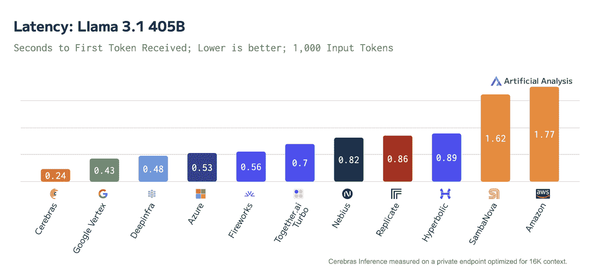

### Together AI与Hypertec合作构建全球领先GPU集群，推动AI计算性能提升

https://www.together.ai/blog/nvidia-gb200-together-gpu-cluster-36k

**重点信息**

Together AI宣布与Hypertec Cloud合作，共同打造全球领先的GPU集群，包含36,000块NVIDIA GB200 NVL72 GPU。这一高性能集群旨在加速大规模生成式AI模型的训练、微调和推理，同时显著降低运行成本并提高资源利用率。项目预计于2025年第一季度启动。

**核心特点与技术优势**

1.  **硬件创新**：集群使用NVIDIA Blackwell GPU、Grace CPU、NVLink和InfiniBand等最新技术，支持大规模模型的高效训练与推理。

1.  Together Kernel Collection (TKC)：独家优化套件，可提升训练速度达24%，推理性能提升75%，显著缩短GPU使用时间并降低运营成本。

1.  **强大性能**：GB200提供比前代架构快30倍的实时推理能力，并将训练速度提升4倍，支持更高效的数值表示与存储。

**市场与客户价值**

该集群为企业和AI创新者提供了可靠、高效的计算基础设施。它适用于从初创企业到大型企业的多种需求，支持从文本生成到图像处理等多种复杂AI任务。高带宽的GPU通信与优化的存储解决方案可满足大规模数据处理需求。

**未来规划**

Together AI计划利用这一基础设施推动下一代AI创新，通过Hypertec的数据中心能力扩大集群规模，进一步满足日益增长的计算需求。这一合作不仅优化了AI计算性能，还通过支持可持续的冷却和高效硬件设计减少对环境的影响。

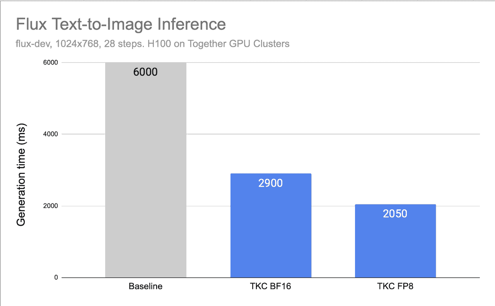

### Google.org 向AI科学研究项目承诺2000万美元资助

https://techcrunch.com/2024/11/18/google-org-commits-20m-to-researchers-using-ai-for-scientific-breakthroughs/

**重点信息**

Google的慈善部门Google.org宣布启动一项新的资助计划，为利用人工智能（AI）推动科学突破的研究人员和机构提供2000万美元现金资助，以及200万美元的云计算资源支持。此举旨在推动AI技术在解决复杂科学问题中的应用，并加速跨学科研究的突破。

**计划背景与目标**

这项资助计划由Google DeepMind联合创始人兼CEO Demis Hassabis在伦敦的AI科学论坛上宣布。目标领域包括罕见病和被忽视疾病研究、实验生物学、材料科学和可持续发展等需要AI技术支持的复杂学科。Google计划资助大约15个组织，资助金额足够支撑重大科学突破，并将在2026年前完成受资助者的遴选与资金发放。

**行业趋势与影响**

这一资助计划标志着Google在推动AI与科学研究结合方面的进一步努力，同时与亚马逊等科技巨头在AI研究生态系统的竞争中占据更有利位置。Google期望通过这一计划，推动私营和公共部门的合作，为科学研究注入新的活力，并吸引更多资源投入AI与科学的交叉领域。

**重要意义**

此次资助计划的推出正值Google DeepMind在AI领域取得诸多成就之际，例如AlphaFold对药物研发和疾病诊断的革命性贡献。Hassabis表示，希望通过这一基金激励更多人参与这一重要工作，推动AI技术助力科学的伟大突破。

### Mistral对标ChatGPT全面升级le Chat，祭出超大杯多模态模型

https://mp.weixin.qq.com/s/sABAaxKNGM-odULaM0-_Zg

**Mistral AI 发布**了**新一代多模态大**模型 Pixtral Large，其强大的图像理解和文本处理能力使其成为当前技术最先进的开源模型之一。与此同时，Mistral AI 升级了免费聊天机器人 le Chat，新增图像生成、实时网络搜索和互动式画布功能，全面对标 ChatGPT。

---

Pixtral Large 模型亮点

1.  **技术参数**：

+   包含 1240 亿参数，支持 128K 上下文窗口，能够处理多达 30 张高分辨率图像或 300 页文本。

+   配备 1230 亿参数解码器和 10 亿参数视觉编码器，在文本和视觉处理方面表现优异。

1.  **性能表现**：

+   在多个基准测试（如 MathVista、DocVQA、VQAv2）上超越 GPT-4 和 Gemini-1.5 Pro，成为图表解释、文档分析和图像理解任务的最佳选择。

+   MathVista 基准测试中准确率达到 69.4%，远高于其他模型。

1.  **适用场景**：

+   适合处理账单计算、复杂图表分析和文件提取等任务。

+   在生成式 AI 应用中展现优异性能。

---

**le Chat 全面升级**

1.  **新增功能**：

+   **实时网络搜索**：提升生产力，满足学生和专业人士的学习和研究需求。

+   **互动式画布（Canvas）**：支持文档、代码和设计的就地修改和版本控制。

+   **高质量图像生成**：与 Black Forest Labs 合作，提升图像生成能力。

1.  **应用展示**：

+   能够高效处理复杂 PDF 文档，提取内容、分析数据并生成语义理解结果。

+   通过可视化界面协助产品开发团队创建仪表板和模型。

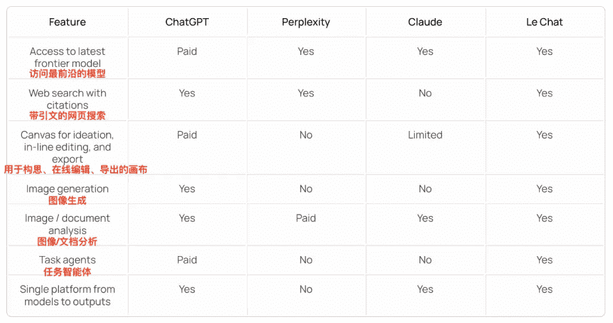

### 腾讯AI大牛，被曝投身视频生成创业

https://mp.weixin.qq.com/s/Ob_QxzyM1T8XM5CxHqE0rA

刘威，这位腾讯杰出科学家、腾讯混元大模型技术负责人之一，近期从腾讯离职，创立了AI视频生成公司Video Rebirth。该公司首轮估值已达1.3亿美元（约9.28亿人民币），成为国产AI视频赛道中的明星企业，吸引了创投市场的高度关注。

**AI视频生成领域概况**

AI视频生成是今年AI赛道竞争最激烈的领域之一。随着OpenAI的Sora引领扩散模型与语言模型相结合的新趋势，这一技术正向更高画质、更强可控性、更长视频时长和更灵活内容方向发展。国内市场中，快手可灵、爱诗科技、生数科技等公司已成为第一梯队的代表，但算力需求高、数据要求复杂以及算法难度大仍是创业公司面临的主要挑战。

**刘威的背景与贡献**

刘威毕业于浙江大学，并获得哥伦比亚大学计算机科学与电气工程博士学位。他在ML、CV和模式识别领域有深厚研究积累，其学术论文被引数超过4.5万，h-index达103。职业生涯中，他曾供职于IBM，从事大规模机器学习和图像搜索项目；2016年加入腾讯，成为AI Lab计算机视觉中心总监，并主导多模态生成模型研究，包括视频生成、图像生成和文本生成模型。

2022年，他因对大规模机器学习的贡献当选IEEE Fellow，是业内顶尖的AI科学家之一。

**未来展望**

作为AI技术“电力时代”的领军人物，刘威创立的Video Rebirth将致力于推动国产AI视频生成技术的进一步发展。随着市场需求和技术进步的加速，这家公司不仅有望在AI视频领域树立标杆，还可能推动整个行业迈向新的高度。

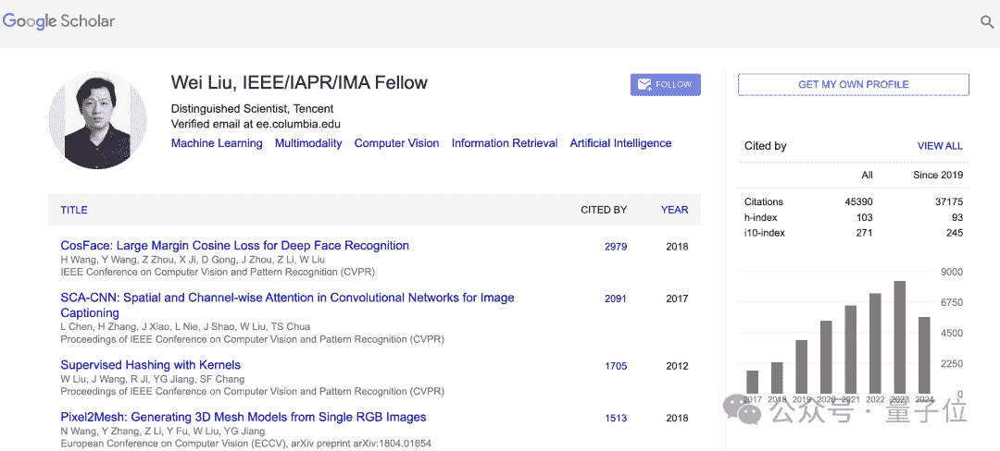

# 推特

### Grok现支持保存并共享与 Grok 聊天记录，甚至可以继续互动

贡献人：

https://x.com/512x512/status/1858446542832906624

现在您可以保存共享的 Grok 响应，或通过发送后续消息与其互动。

在网页版试试吧：[h](https://x.com/i/grok/share/RM7Hy08lAxoyI6PkQpkaRcSGq)ttps://x.com/i/grok/share/RM7Hy08lAxoyI6PkQpkaRcSGq

（适用于今晚最近的 Grok 分享，从明天起将支持所有 Grok 分享）

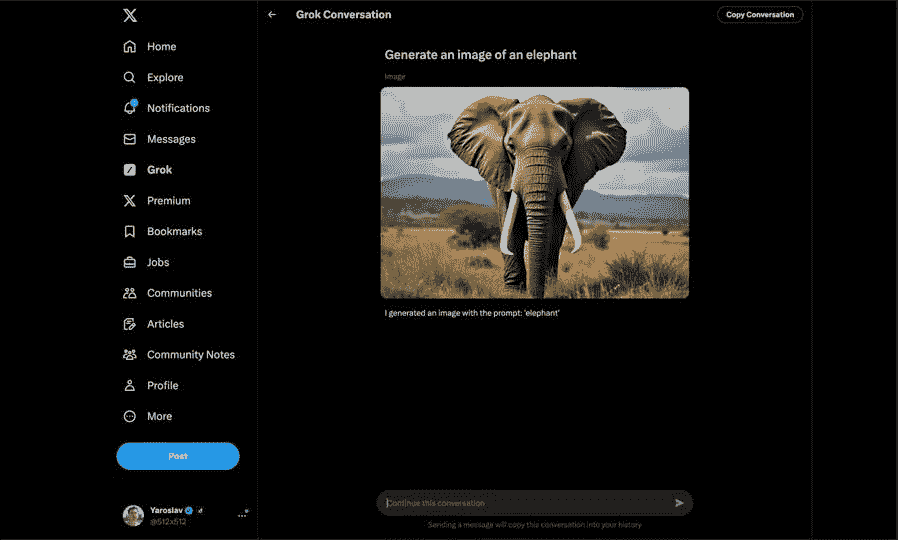

[aU-iKKRLPSPeQVAa.mp4](https://internal-api-drive-stream.feishu.cn/space/api/box/stream/download/all/HN8NbGibioHxKXxNzJkcgymWnDf)

### Fireworks f1：第一个在开放模型中，在高难度编程、聊天和数学基准测试中击败 GPT-4o 和 Claude 3.5 Sonnet 的推理系统

贡献人：

https://x.com/lqiao/status/1858532081518682142

🔥 引入 Fireworks f1 🔥

f1 是第一个在开放模型中，在高难度编程、聊天和数学基准测试中击败 GPT-4o 和 Claude 3.5 Sonnet 的推理系统。

💥 目前提供两种预览版本：f1 和 f1-mini

💥 在 Fireworks AI Playground 上免费体验预览

💥 加入等待名单，抢先免费获取 f1 API 的早期访问权限

详情阅读：https://lnkd.in/ep9zzWJ9

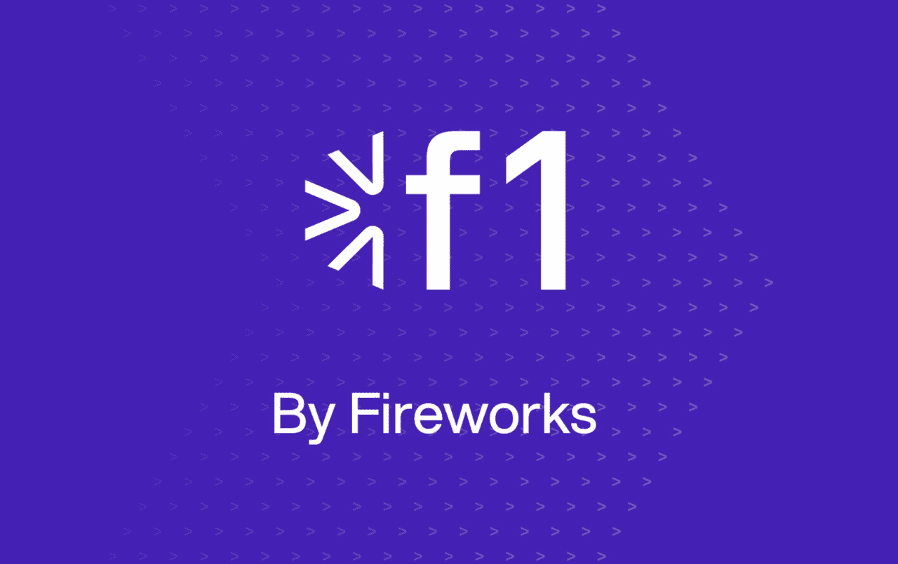

### Qwen2.5-Turbo推出：更长上下文支持，更快的推理速度，更低成本

贡献人：

https://x.com/Alibaba_Qwen/status/1858469845958074541

在发布 Qwen2.5 之后，我们听到了社区对处理更长上下文需求的呼声。

https://qwenlm.github.io/blog/qwen2.5-turbo/

今天，我们自豪地推出全新版本 **Qwen2.5-Turbo**，它具备以下特点：

📚 更**长上下文支持：**

我们将模型的上下文长度从 128k 扩展到 1M，相当于约 100 万个英文单词或 150 万个中文字符，相当于 10 本完整小说、150 小时的语音转录或 30,000 行代码。

🚀 更**快的推理速度：**

通过稀疏注意力机制，我们成功将处理 1M 上下文令牌的首个输出时间从 4.9 分钟缩短至 68 秒，实现了 4.3 倍的加速。

🛢 更**低成本：**

价格仍为 ¥0.3 / 1M 令牌。在相同成本下，Qwen2.5-Turbo 可以处理的令牌数量是 GPT-4o-mini 的 3.6 倍。

现在，您可以通过以下方式使用：

👉🏻 阿里云[模型](https://help.aliyun.com/zh/model-studio/getting-started/what-is-model-studio)工作室 API 服务（中文）： 链接

👉🏻 Hug[gi](https://huggingface.co/spaces/Qwen/Qwen2.5-Turbo-1M-Demo)ngFace Demo： 链接

👉🏻 Mod[el](https://modelscope.cn/studios/Qwen/Qwen2.5-Turbo-1M-Demo)Scope Demo： 链接

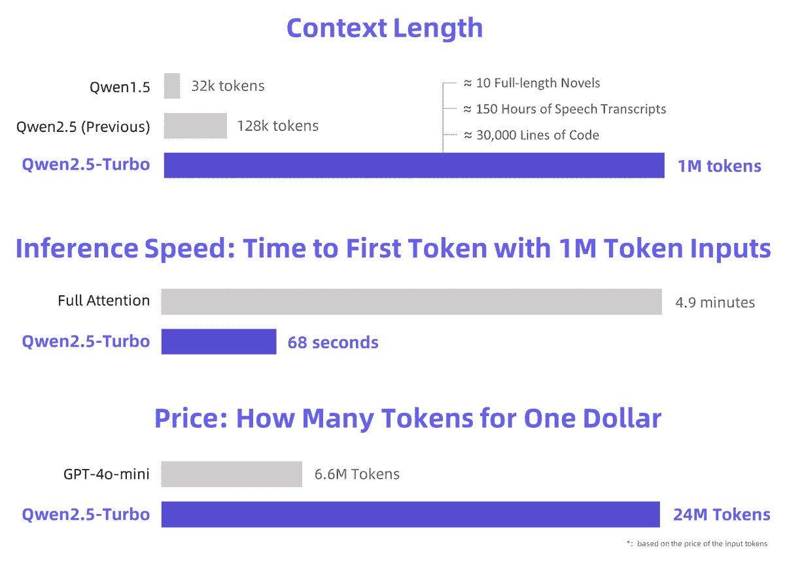

### 流式传输现已支持 OpenAI 的 o1-preview 和 o1-mini 模型

贡献人：

https://x.com/OpenAIDevs/status/1858609150999359559

流式传输现已支持 OpenAI 的 o1-preview 和 o1-mini 模型 🌊

[h](https://platform.openai.com/docs/api-reference/streaming)ttps://platform.openai.com/docs/api-reference/streaming

此外，我们已向所有付费使用等级的开发者开放这些模型的访问权限。

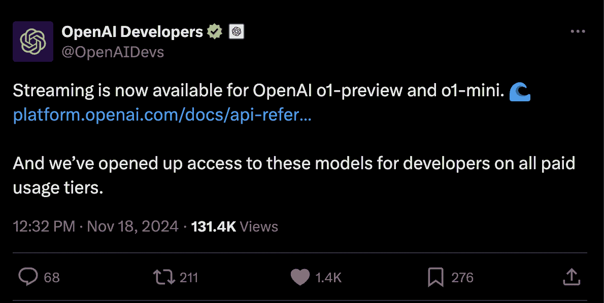

### 开源AI造就一切！本地运行 Qwen2.5，驱动家庭机器人

贡献人：

https://x.com/chris_j_paxton/status/1858606946070524330

开源 AI 驱动的家庭机器人，支持语音聊天。只需告诉它要做什么，它会尝试为你整理房间。

这是在我的桌面上本地运行的 Qwen2.5，无需将家庭信息上传到云端。

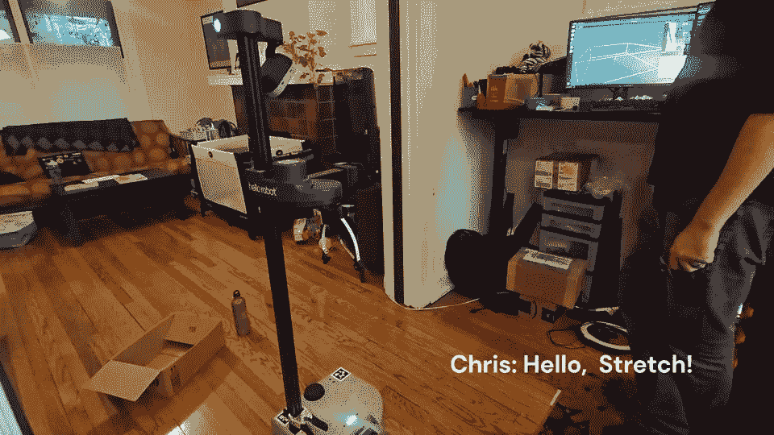

[H4haebnViO8kBj6y.mp4](https://internal-api-drive-stream.feishu.cn/space/api/box/stream/download/all/VvBAbYptxoeVoyxi5lTcNVuRnCh)

# 信号

### Transfer Q Star: Principled Decoding for LLM Alignment

贡献人：

原文链接：[h](https://x.com/rm_rafailov/status/1858621174982602855)ttps://x.com/rm_rafailov/status/1858621174982602855

学术分析报告：https://rflow.ai/flow/512174d5-0c28-4fbe-ae47-993909fe69ee

**本文提出了一种轻量化****的**对齐方法 Transfer Q*，通过基于基线模型的隐式估计优化目标价值函数，实现无需更新模型参数的解码对齐。该方法针对传统对齐方法中对最优 Q 函数依赖过高的问题，提供了理论上的最优性分析，减少了次优性差距，并在多个数据集上表现出更高的连贯性、多样性和质量，展现了解码对齐的潜力和适应性。

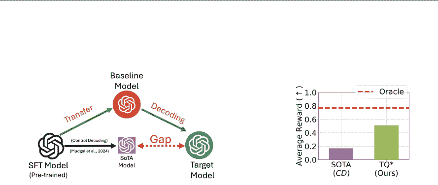

### The Dawn of GUI Agent: A Preliminary Case Study with Claude 3.5 Computer Use

贡献人：

原文链接：https://arxiv.org/abs/2411.10323

学术分析报告：https://rflow.ai/flow/b02e05b9-af39-4414-8b7a-8b68770c530b

这篇文章介绍了 Claude 3.5 Computer Use 模型，这是首个公开测试的图形用户界面（GUI）代理，能够将语言指令转化为桌面操作。文章通过精心设计的任务案例展示了该模型在多个领域和软件中的应用能力。作者提供了一个开箱即用的代理框架，旨在展示Claude 3.5在端到端语言到桌面动作的执行能力及其潜在局限性。研究还提出了关于任务规划、执行和反馈的重要问题，呼吁未来进一步研究GUI代理技术。

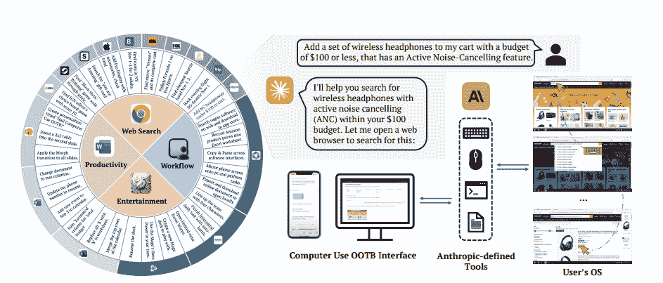

### Mixture of Parrots: Experts improve memorization more than reasoning

贡献人：

原文链接：https://arxiv.org/abs/2410.19034

学术分析报告：https://rflow.ai/flow/31baf2ac-c9e1-41c5-9ba8-5d699d66ce84

这篇文章主要探讨了 Mixture-of-Experts (MoE) 架构的性能特点，特别是在记忆和推理任务上的表现。MoE架构通过增加专家数量，在计算开销最小的情况下显著提高模型参数数量。文章分析了MoE在推理任务中的理论限制，证明某些图形问题无法通过特定宽度的专家解决，但可以通过稍微增大的密集模型轻松解决。此外，MoE在记忆密集型任务中表现出色，能够通过少量的活动参数和大量专家来有效地记忆数据。文章通过一系列的预训练实验和常见基准测试进行验证，表明增加专家数量有助于解决知识密集型任务，但在推理任务中效果有限。

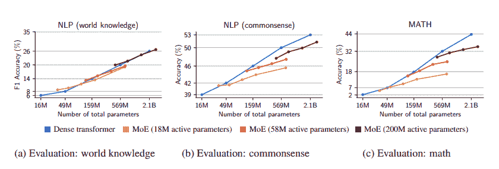

# 产品

### Layer

贡献人：

https://layer.cafe/

Layer 是一个基于“第二大脑”概念的下一代任务和项目管理系统，希望通过视觉和直观的组织方式帮助用户更快地实现目标并全面管理生活。该平台提供视觉思维导图、脑启发式视觉连接、目标聚焦、专注模式和轻松委派等关键功能，并计划引入 AI 驱动的规划、游戏化元素和 Web3 代币经济等创新。

### Bharat Diffusion

贡献人：

https://www.bharatdiffusion.ai/

BharatDiffusion.ai 是一个利用人工智能技术为印度多元文化群体提供区域特定视觉内容的平台。该平台支持印地语和英语，帮助品牌、电商和创作者大规模生成与当地文化相关的视觉内容，以提升用户参与度和信任度。主要应用场景包括本地化营销活动、动态创意适应、电商产品展示、社交媒体内容创作和个性化视觉定制。

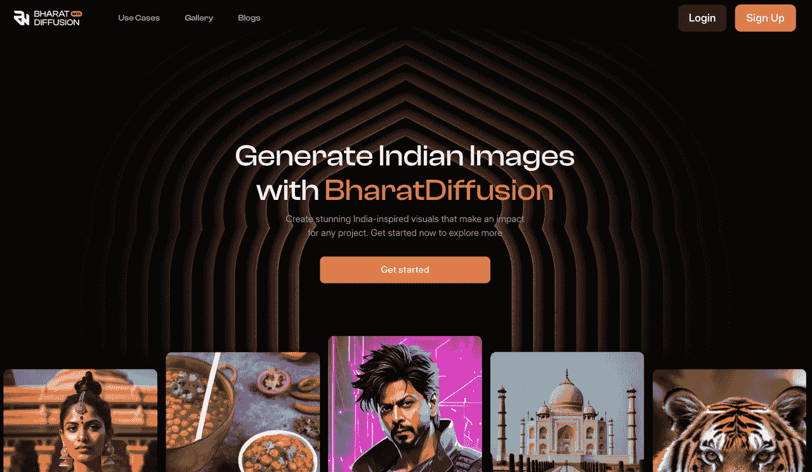

# HuggingFace&Github

### claude-coder

贡献人：

https://github.com/kodu-ai/claude-coder

Claude Coder 是一个AI驱动的VS Code扩展，通过自动化任务和生成代码，帮助开发者将创意快速转化为现实。无论是初学者还是经验丰富的开发者，Claude Coder 都能提供从概念到实现的全程支持，包括设计转换、调试、学习提升和项目发布等功能。

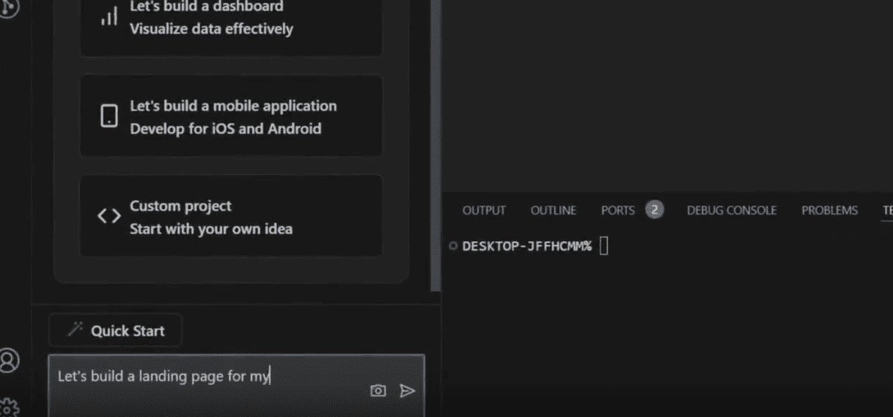

### Podman AI Lab

贡献人：

https://github.com/containers/podman-desktop-extension-ai-lab

Podman AI Lab 是一个开源的Podman桌面扩展，通过本地环境中的大型语言模型（LLMs）进行AI应用开发。该扩展提供了模型服务、实验性游乐场和AI应用支持，帮助用户快速启动和测试AI模型，确保数据隐私和安全。用户可以通过Podman桌面直接安装该扩展，并利用其提供的模型目录和示例应用进行学习和开发。

# 投融资

### Sagence 专注开发用于AI的模拟芯片，完成5800万美元融资

贡献人：

https://techcrunch.com/2024/11/18/sagence-is-building-analog-chips-to-run-ai/

**融资信息**

Sagence（前身为Analog Inference）是一家致力于开发AI专用模拟芯片的初创公司，自成立以来已累计融资5800万美元。主要投资者包括Vinod Khosla、TDK Ventures、Cambium Capital、Blue Ivy Ventures、Aramco Ventures和New Science Ventures。公司目前计划新一轮融资以扩大其75人的团队并推进芯片量产。

**公司背景与技术创新**

Sagence由资深模拟和存储电路设计师Vishal Sarin创立，致力于解决传统GPU在能耗和效率上的瓶颈问题。模拟芯片相比数字芯片，具有更高的数据密度和更快的计算能力，尤其是在AI应用中可显著降低能耗和延迟。Sagence的芯片采用“内存计算”架构，避免了数据在处理器和内存之间的频繁传输，显著提高效率。

**市场定位与优势**

Sagence的芯片定位为数字芯片的补充，而非替代品，主要应用于服务器和移动设备中的专业化AI任务。其技术特别适合那些需要高效、低功耗的AI计算场景，例如在边缘设备或云端运行的AI模型。

**未来计划**

公司计划在2025年将其芯片推向市场，目前正在与多个潜在客户进行合作，以确保其产品能够顺利集成到现有的基础设施中。与此同时，Sagence计划通过新一轮融资支持团队扩展和芯片制造规模化。

**市场挑战**

尽管模拟芯片技术具有显著潜力，但其实现高精度制造和适应广泛场景仍面临挑战。此外，Sagence需要证明其芯片在性能和能效方面的优势，才能与Nvidia等市场巨头竞争，并在资金密集型的芯片行业中站稳脚跟。

Sagence的目标是通过创新的芯片架构推动AI计算的发展，同时显著降低能耗，为可持续计算提供支持。

公司官网：https://www.sagence-ai.com/

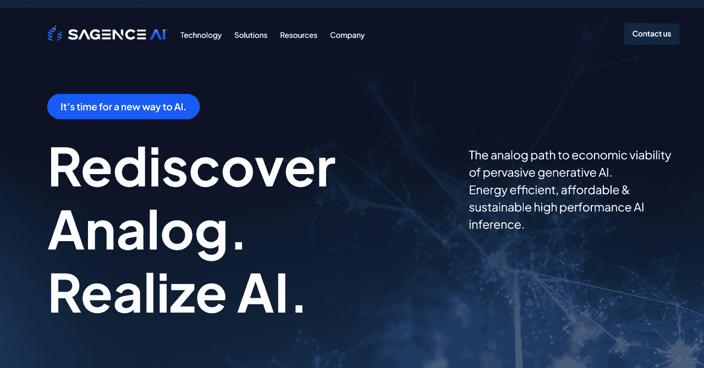

### Socium 专注于法语非洲市场，完成500万美元种子轮融资

https://techcrunch.com/2024/11/18/socium-raises-5m-seed-led-by-breega/

**融资信息**

塞内加尔的HR科技公司Socium完成了500万美元的种子轮融资，本轮由Breega领投，Partech、Orange Ventures、Chui Ventures、Sonatel等多家投资机构参与。此外，Raisers Partners担任此次融资的财务顾问。这笔资金将用于扩展其HR技术平台和客户基础，进一步巩固其在法语非洲市场的领先地位。

**公司背景与市场定位**

Socium由Samba Lo和Serigne Seye于2021年创立，专注于为法语非洲地区的企业提供人力资源管理解决方案。其业务覆盖21个国家，包括招聘、薪资管理、绩效管理等功能。Lo表示，法语非洲市场具有统一的货币体系和相似的法规环境，为HR科技解决方案提供了巨大的市场潜力。

**产品特色与技术能力**

Socium的平台帮助企业简化日常HR任务，自动化薪资计算、时间管理和招聘流程等。平台的AI功能可以快速匹配简历与职位需求，并生成精准的职位描述。此外，Socium正在开发与税务机构集成的功能，以自动完成企业的税务和合规申报任务。

其产品优势包括：

+   专为法语非洲市场定制的薪资计算引擎，能够快速适应不同国家的法规和需求。

+   人才管理工具，帮助HR专注于团队发展与支持。

+   快速扩展能力，可在两周内进入新市场。

**发展与未来规划**

目前，Socium已经服务超过100家客户，涵盖10个行业和15个国家。未来，公司计划深化其法语非洲市场布局，同时扩大产品功能，包括与更多税务机构的集成，以进一步减轻企业的合规压力。

Socium的目标是通过创新的人力资源管理工具帮助企业提升效率，同时专注于对员工的支持和发展，从而推动企业整体绩效的提升。此次融资为其在这一高增长市场中的扩展提供了有力支持。

公司官网：https://socium.link/

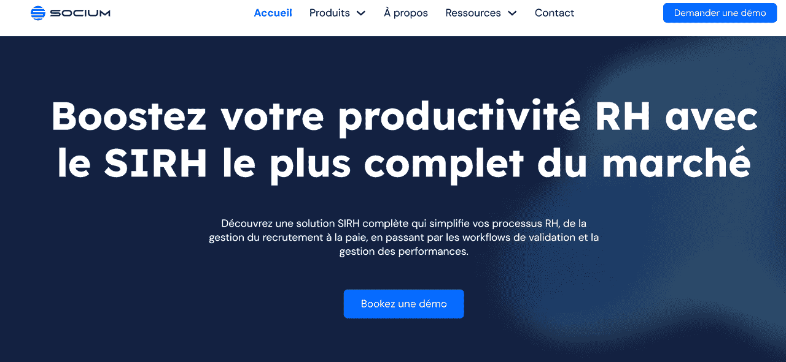

### SuperAnnotate 提升AI数据管理能力，完成3600万美元B轮融资

https://techcrunch.com/2024/11/18/superannotate-helps-companies-manage-their-ai-data-sets/

**融资信息**

SuperAnnotate是一家专注于AI数据管理的平台公司，近期完成了3600万美元的B轮融资。本轮融资由Socium Ventures领投，Nvidia、Databricks Ventures和Play Time Ventures参与。这使得公司总融资额达到5300万美元。此次融资将用于扩大团队规模、产品研发以及拓展客户基础，目前SuperAnnotate拥有约100家企业客户。

**公司背景与产品定位**

SuperAnnotate由兄弟Vahan Petrosyan和Tigran Petrosyan创立，专注于帮助企业创建和管理高质量的AI训练数据集。其平台不仅提供数据标注工具，还支持数据的微调、迭代和评估，帮助企业更高效地管理AI模型训练过程。此外，公司还提供数据标注任务的众包市场，为模型训练提供高质量的标签数据。

**核心技术与竞争优势**

SuperAnnotate的平台通过连接本地和云端数据源，允许用户创建数据项目并进行团队协作。用户可以通过仪表盘比较不同数据集训练模型的表现，并在模型准备就绪后部署至多种环境。此外，公司支持高度定制化的功能，适应企业不断变化的数据需求。

**行业挑战与改进**

尽管SuperAnnotate在数据管理领域表现突出，但也面临数据标注人员待遇和沟通方面的争议。公司回应称，已针对快速扩张过程中出现的问题进行了优化，改善了与标注人员的互动流程和沟通机制。

**未来规划**

SuperAnnotate计划利用新一轮融资进一步强化其平台能力，为企业提供全面的数据管理解决方案。创始人表示，公司目标是打造一个可以完全适应企业需求的平台，通过数据微调和定制化服务帮助企业实现更高的AI性能。

SuperAnnotate在竞争激烈的AI数据管理领域中，凭借优质客户资源和资金支持，正不断拓展其市场地位，为企业AI开发提供更高效和可靠的支持工具。

公司官网：https://www.superannotate.com/

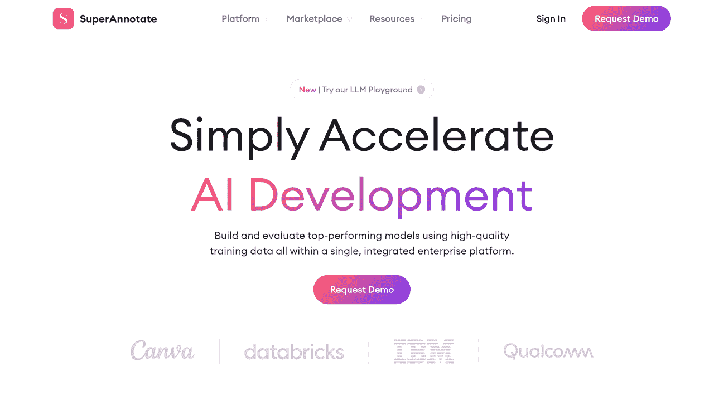

### Moonvalley 致力于打造更具伦理性的生成式视频模型，获7000万美元种子轮融资

https://techcrunch.com/2024/11/18/moonvalley-wants-to-build-more-ethical-video-models/

**融资信息**

总部位于洛杉矶的生成式视频初创公司Moonvalley近期完成了7000万美元的种子轮融资，由General Catalyst和Khosla Ventures共同领投，Bessemer Ventures参投。这笔资金将用于研发新一代生成式视频模型，并扩充团队，目前团队由约30名员工组成，多数拥有DeepMind、Meta、微软和TikTok等知名公司的工作背景。

**公司使命与核心技术**

Moonvalley由Naeem Talukdar联合DeepMind前科学家Mateusz Malinowski和Mikolaj Binkowski创立，致力于以更透明和合乎伦理的方式开发生成式视频工具。公司强调使用经过许可的数据集，并与内容创作者合作，确保视频素材合法、版权受保护。此外，Moonvalley承诺为用户提供删除数据的选项，并通过强大的内容审核功能避免生成不适当的或侵权的视频。

**市场定位与竞争策略**

Moonvalley瞄准了艺术家、内容创作者及媒体品牌，提供更具法律保障的生成式视频工具。其核心差异化在于高质量的许可数据集和深度优化的创作工具，与市面上未经授权使用公共数据的生成式视频模型形成鲜明对比。然而，市场竞争激烈，谷歌、Meta和Adobe等大厂已凭借各自的资源和数据优势占据一席之地。例如，Adobe通过其Firefly平台与内容创作者共享收入，而Runway已与Lionsgate达成合作，定制电影模型。

**未来发展计划**

Moonvalley计划于年内推出首款视频生成模型，同时致力于为创作者提供更强大的创作工具，支持更广泛、更具沉浸感的内容制作。尽管面临诸多挑战，包括市场竞争和创作者对AI工具的潜在抵触情绪，Moonvalley创始团队表示，其最终目标是通过技术赋能创作者，推动内容制作的变革。

通过合法、透明的方式整合数据资源，Moonvalley希望在快速发展的生成式AI领域脱颖而出，为内容创作者和品牌提供可信赖的技术支持，同时缓解围绕版权和隐私问题的争议。

公司官网：https://www.moonvalley.com/

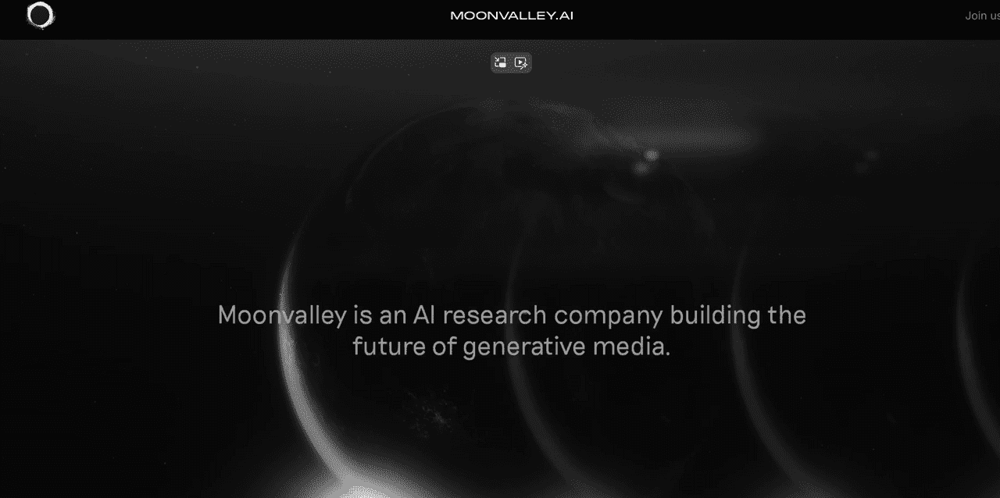

### Juna.ai 利用AI优化工业能效，获750万美元种子轮融资

https://techcrunch.com/2024/11/18/juna-ai-wants-to-use-ai-agents-to-make-factories-more-energy-efficient/

**融资信息**

总部位于德国柏林的初创公司Juna.ai通过自动化复杂工业流程，帮助工厂提高生产效率、降低能源消耗和减少碳排放。该公司近日完成了750万美元的种子轮融资，由硅谷风投公司Kleiner Perkins领投，瑞典的Norrsken VC和Kleiner Perkins董事长John Doerr参与投资。这笔资金将用于扩展团队规模，目前公司有6名员工，计划增加技术人员以支持业务增长。

**公司背景与技术亮点**

Juna.ai成立于2023年，由Matthias Auf der Mauer和Christian Hardenberg创立。Auf der Mauer曾创立并出售预测性机器维护公司AiSight，而Hardenberg是欧洲食品配送巨头Delivery Hero的前首席技术官。

公司专注于重工业领域，如钢铁、水泥、化工等高能耗行业。其AI代理通过与制造商的生产工具集成，利用机器传感器的历史数据和实时数据，为操作人员提供优化建议，帮助调整设备以实现最佳性能。

**商业模式与技术应用**

Juna.ai的AI代理目前以“副驾”模式运行，向操作人员提供调整建议，但未来计划推出可自主运行的解决方案。通过强化学习，系统能够不断优化控制流程。创始人表示，该技术不仅关注减少劳动力，而是着力于通过优化能源使用，帮助企业显著降低运营成本。例如，化工厂可通过Juna.ai的技术减少能源浪费，每年节省数百万美元的能源开支。

**市场与发展计划**

目前，Juna.ai已在德国拥有少数客户，尽管未公开具体名单。这些客户均在重工业领域，计划通过扩展现有客户关系进入国际市场。未来，公司计划开发预训练的AI代理，减少新客户的数据训练需求，加速产品落地。融资将主要用于加强数据安全和技术开发，支持公司成为智能工厂的“核心大脑”。

Juna.ai的愿景是推动重工业的智能化转型，通过数据和AI技术解锁生产潜力，同时为全球的可持续发展做出贡献。

公司官网：https://www.juna.ai/

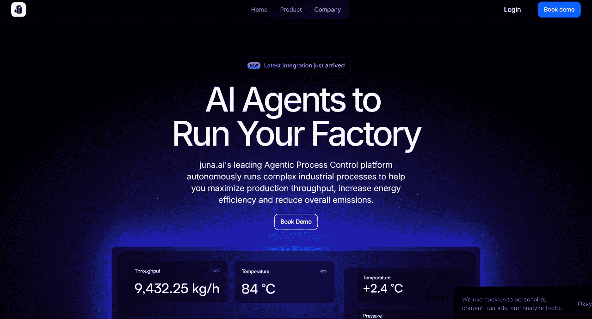

# 学习

### 多模态大模型视觉缺陷--视觉编码器优化篇

贡献人：

https://zhuanlan.zhihu.com/p/714414757

视觉编码器的优化可以通过替换编码器或引入新的训练策略来提升性能。这些改进集中于多模态任务中的图像理解与推理问题，重点解决当前视觉语言模型（VLM）在分布外样本处理和推理任务上的性能瓶颈。

研究表明，仅仅扩大数据规模和模型规模对性能提升有限，甚至可能导致下降。例如，针对LAION 400M训练的CLIP ViT-B/32模型，结果显示其对推理任务提升效果微弱，对关系理解任务的改进也相对有限。相比之下，数据质量优于数据规模。通过CLIP score过滤后的高质量2B数据集所训练的模型明显优于更大规模的12.8B数据集。同时，训练目标的设计对性能有直接影响，例如采用NegCLIP目标能显著提升关系理解任务表现。在视觉编码器的选择上，Eva-2 ViT-E/14等参数量更大的编码器在大规模数据集上具有明显优势。

DEEM研究通过引入Diffusion模型优化视觉编码器，重新对齐图像的语义信息并补充细节。Diffusion模型无需依赖下游任务的监督信号，更适合分布外图像处理，并能为VLM增加生成能力。具体方法包括在多模态对齐阶段训练视觉编码器和投影器，并结合图像去噪损失、语义正则化和文本生成损失来优化模型。后续通过多阶段训练进一步提升模型能力，例如构造<mask, image, text>数据对以支持细粒度的指令学习。优化后的模型在推理任务上表现优于传统方法（如DreamLLM），但图像生成质量稍逊一筹。

Diffusion Feedback研究从多模态理解任务出发，利用Diffusion模型对CLIP视觉编码器进行自监督优化。方法是以图像patch token为条件，通过去噪任务评估视觉特征的语义完整性并反向更新CLIP参数。实验发现，局部采样10%-15%的视觉token作为条件能显著提高训练效率，避免全局语义信息对细节的忽视。经过优化后，CLIP及其基于的VLM在多任务上均表现出性能提升，尽管不同任务的增益效果有所差异。

总结来看，数据质量和目标设计是多模态模型性能提升的关键。通过Diffusion模型优化视觉编码器，可显著增强对分布外样本的感知能力。结合分阶段的训练策略和自监督信号，不仅能提升推理任务的性能，还能在理解与生成任务间实现更好的平衡，为多模态模型的全面发展提供了有效的解决方案。

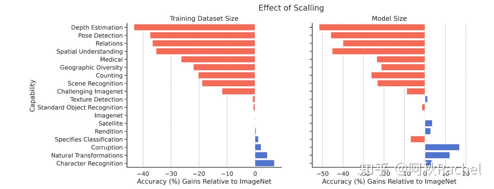

### 【AI系统】训练后量化与部署

https://zhuanlan.zhihu.com/p/7579434614

训练后量化技术分为动态量化和静态量化两种方式，通过将权重和激活从浮点数（FP32）转换为整数（INT8或INT16），实现模型大小的减小和推理速度的提升。

动态量化中，权重在离线阶段转换为整数类型，而激活在推理时动态量化。其动态缩放因子根据输入数据实时计算，因此性能较差。动态量化的算法流程包括两种推理方式：反量化推理和量化推理，具体操作基于权重量化和输入量化的信息进行推理计算。权重量化为INT16时模型精度无损，但仅减少50%大小；权重量化为INT8时模型大小可降至1/4，但精度可能受损。

静态量化利用少量无标签校准数据进行离线校准，通过计算量化比例因子将模型转换为INT8，快速生成量化模型。方法包括对称量化和非对称量化，常用的校准技术有MinMax、KL散度、MSE等。KL散度校准中，通过直方图生成量化分布，并选择KL散度最小的阈值作为最终的量化范围，确保量化后的激活分布与FP32分布的差异最小。

量化粒度对性能和精度平衡影响显著。逐张量（per-tensor）量化适用于激活类算子，降低异常值对量化范围的影响，而逐通道（per-channel）量化适用于权重量化，能够捕捉每个通道的动态范围，从而提高模型性能但增加计算复杂度。在硬件不支持逐通道量化的情况下，逐张量是更常用的选择。

KL散度校准方法的伪代码具体实现如下：通过收集FP32直方图的分布数据，选取不同阈值生成量化分布，计算每种阈值下的KL散度，并找到使散度最小的阈值作为最终量化范围。使用该校准方法时，需准备500~1000张校准图片，结合逐步调整量化阈值的方法优化激活分布。

在推理部署中，量化主要包括三个过程：量化（Quantize）、反量化（Dequantize）和重量化（Requantize）。量化将FP32数据映射为INT8，反量化和重量化则用于在不同算子之间切换数据类型。通过这些流程，INT8模型可以有效地减少存储和计算需求，同时在精度和性能之间取得较好的平衡。

量化过程中的优化技巧包括：对权重使用逐通道量化以降低通道差异对精度的影响；分离量化残差连接以支持硬件融合优化；针对敏感层进行分析并跳过其量化，避免对模型整体精度造成过大影响。对于特定任务中的瓶颈层和高精度需求层，如边界框回归操作，跳过量化能显著减少性能损失。这些技术共同构成了训练后量化优化的完整体系，使模型在实际应用中更高效、更灵活。

### CoRL’24 会议简记

https://zhuanlan.zhihu.com/p/7649884788

CoRL’24会议在慕尼黑工业大学召开，持续四天（11月6日至9日），最后一天为workshop。由于申请较晚，第一天仅能注册到workshop票，上午错过部分报告。在中午获得注册机会后，赶上下午的首个keynote。来自达姆施塔特工业大学的Geogia Chalvatzaki教授分享了机器人具身智能在空间关系中的应用，随后MIT教授回顾机器人学习历史，提出两条核心路径：一是通过巨量数据学习策略，二是结合物理世界结构和认知科学等领域的方法。他强调模块化、规划和组合抽象是实现模型泛化的关键。

第一天Banquet因欧冠比赛交通拥堵颇具戏剧性，导致原计划40分钟的地铁行程被延迟了一个半小时。第二天上午未能赶上Meta的Diamond Sponsor Talk，下午听取了乔治亚理工大学Danfei Xu教授的报告。他提出用egocentric video实现机器人对人类行为的直接学习，通过“what”和“how”具身化提升机器人能力。INRIA的Cordelia Schmid教授随后报告多模态模型在视觉引导机器人操作中的应用，涵盖video QA与3D策略生成。

第三天的Google DeepMind报告由Jie Tian主讲，他聚焦泛化问题，并提到学术与产业之间对研究方向的常见疑问。伯克利教授Jitendra Malik则讨论了数据在机器人操作学习中的瓶颈问题，并首次认可LLM在具身认知中的潜力。下午，CMU兼职教授Vikash Kumar分享了其在机器人仿真器MuJoCo和Action Chunking Transformer（ACT）上的研究成果。

大会颁发了最佳论文奖，两篇获奖作品分别是AI2提出的PoliFormer（基于视觉-语言编码器和Transformer架构的室内导航agent模型）和TRI与RPI合作开发的车辆漂移控制模型（条件扩散模型）。最后一天的workshop吸引了大量学术和产业关注，其中伯克利教授Sergey Levine强调采集真实机器人数据的重要性，Ken Goldberg则主张结合传统工程方法（GOEF）。其他亮点包括德州大学Yuke Zhu教授关于数据分级的讨论，斯坦福大学Jiajun Wu教授对数据库构建的探索，以及Shuran Song教授关于UMI和Diffusion Policy的贡献。

大会期间，poster交流环节安排了每人一分钟的快速展示，提升了沟通效率。在demo站台，哥伦比亚大学教授Yunzhu Li亲自介绍其团队工作，与会者交流活跃，为未来研究合作提供了契机。

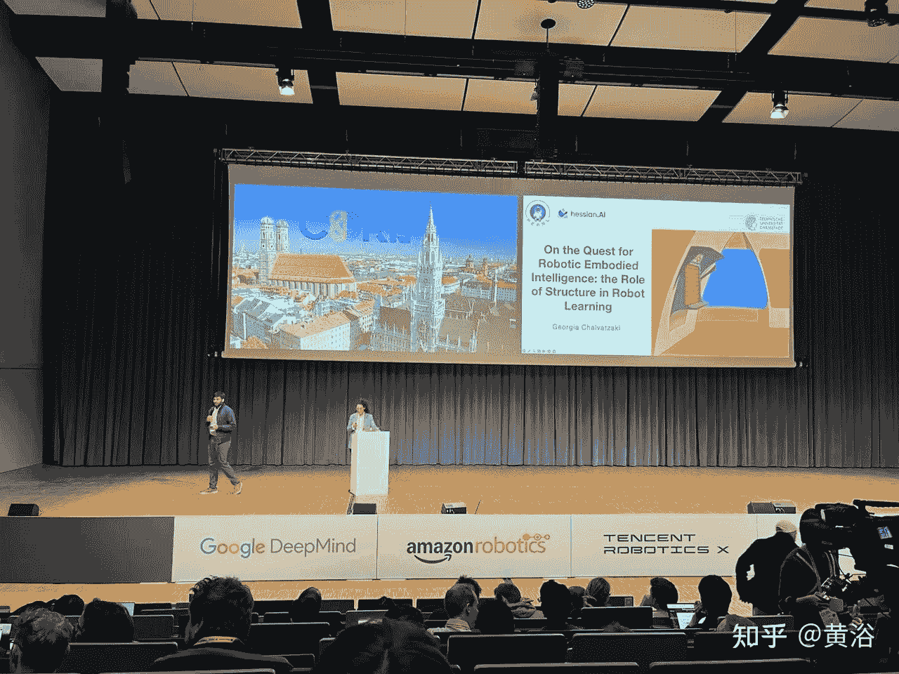

### Ovis1.6-9B视觉大模型环境搭建&推理

https://zhuanlan.zhihu.com/p/767833330

阿里国际AI团队于2024年9月19日发布了Ovis1.6多模态大模型，该版本在OpenCompass基准中表现突出，成为参数量300亿以下的开源模型中综合性能最优者。Ovis1.6-Gemma2-9B在推理任务中的表现甚至可媲美70B参数模型，同时在文本生成质量、错误率和幻觉现象上优于同级别模型。模型的核心创新点在于结构上的视觉和文本嵌入对齐，通过视觉Tokenizer和视觉嵌入表与大语言模型深度融合，克服了以往使用多层感知机连接器方法的嵌入策略不统一问题。

模型下载地址为 [Hugging Face](https://huggingface.co/AIDC-AI/Ovis1.6-Gemma2-9B/tree/main)，运行环境基于PyTorch 2.2.2，支持CUDA 12.1。安装步骤包括从GitHub克隆代码库、安装依赖，以及加载模型至推理环境。

推理代码展示了Ovis模型的初始化、输入预处理（包括文本和图像数据的格式化处理）、以及模型生成输出的完整流程。关键细节包括：

1.  使用PyTorch的CUDA加速支持，通过FP16精度进行推理以节省显存；

1.  文本和图像输入的统一预处理，确保嵌入对齐；

1.  生成输出时，灵活的生成配置（如max_new_tokens和temperature参数）。

Ovis1.6在推理任务中利用视觉Tokenizer和视觉嵌入模块处理图像信息，并结合文本生成能力，实现复杂的多模态任务。尽管模型推理效果卓越，但显存占用较高，在测试过程中可能会遇到资源不足的问题，需要调整显存配置或采用分布式推理方案。

这次发布标志着阿里团队在多模态模型领域的进一步突破，其创新设计为未来多模态任务的研究和应用提供了新思路。

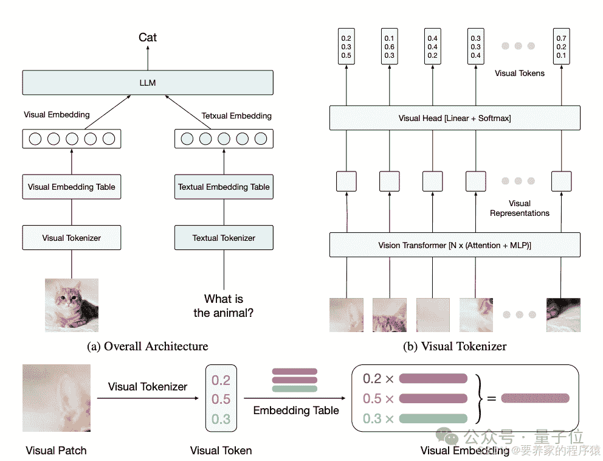

### 证明拟牛顿法搜索方向是椭圆范数意义下单位球面上的最速下降方向

https://zhuanlan.zhihu.com/p/4748093061

这篇随笔讨论了深度学习中数学最优化方法的核心思想，特别是拟牛顿法在椭球范数下的最速下降特性，并给出了严格的数学证明。文章从经典的Cauchy-Schwartz不等式出发，通过一系列引理和定理的推导，证明了拟牛顿法在特定约束下可以看作是一种最速下降方法。

首先，经典的Cauchy-Schwartz不等式被推广到椭球范数的范畴，通过定义矩阵正定的椭球范数，证明了当两个向量在线性相关时，等号成立。这一结论依赖矩阵合同变换的性质，以及矩阵奇异值分解的细节。

接着，文章提出了广义Cauchy-Schwartz不等式，证明了在椭球范数下，拟牛顿法的方向实际上是单位球面约束下的最快下降方向。通过引入决策变量的约束，将问题简化为一个关于单位球面的最优化问题，并利用广义Cauchy-Schwartz不等式直接求解出最优解方向。数学推导表明，这一方向是拟牛顿法的下降方向，与椭球范数下的约束完全一致。

此外，文章详细比较了经典最速下降法和拟牛顿法的收敛性差异。最速下降法容易受到目标函数几何形状的影响，接近最优解时可能抖动而导致收敛速度减慢；而拟牛顿法通过更新近似Hessian矩阵的逆，实现了更平滑和高效的下降路径。

理论推导的核心在于使用椭球范数约束下的最速下降方向公式，通过单位化处理得到了最终的最优下降方向表达式。这一结论不仅验证了拟牛顿法的理论基础，还为实际应用中的算法设计提供了严格的数学依据。

文章最后引用了袁亚湘院士在非线性规划领域的重要著作，进一步巩固了上述结论的权威性。整体来看，这篇讨论结合了深度学习优化问题的实际需求与数学理论的严谨性，为理解最优化方法在深度学习中的作用提供了系统性视角。

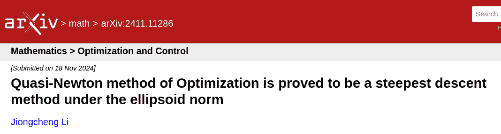

### 浅谈大模型高效推理

https://zhuanlan.zhihu.com/p/7586836392

推理系统优化围绕显存占用和推理延时两大核心挑战展开。

显存占用主要由模型参数、激活变量和kv cache组成。针对模型参数优化，知识蒸馏、稀疏剪枝和量化技术是主要方法。知识蒸馏通过将大模型能力转移至小模型实现性能提升，但成本高；剪枝提高稀疏性，但对精度影响难以控制；量化通过低精度替代高精度参数，是推理部署的常用技术，其中PTQ因实现简单而广泛应用。模型并行策略（如数据并行、张量并行和流水线并行）能够有效降低单卡显存负担，但需要权衡通信和计算开销。CPU Offloading通过主机内存分担显存压力，以通信时间换取显存空间。

激活变量优化包括算子融合（如Flash Attention优化访存延迟）、状态空间模型替代Transformer等。此外，kv cache优化方法如paged kv cache通过显存映射提升利用率，slide window attention限制长文本kv cache的增长，kv cache量化用低精度保存上下文信息而减少空间占用。模型设计上，GQA共享kv cache以减少冗余，而MLA通过低秩投影优化存储。

推理延时由TTFT和TPOT构成，涉及排队、计算、通信和访存时间。为降低排队时长，动态批处理和持续批处理等调度策略应对请求负载波动；分离式推理解耦prefill和decode过程以优化配置。计算时长的优化包括剪枝、量化、小模型替代和混合专家推理（MOE）。通信延迟主要影响跨节点推理，卡间高速nvlink和节点间infiniband连接通过通信与计算并行隐藏延时。访存优化如FlashInfer通过共享cache或分治策略减少kv cache访存时间。

# 声明

本文档仅供学习交流使用，版权归原作者所有，若涉侵权，请联系Jack Jin 15101136166

##

（欢迎在下方反馈您宝贵的意见！整理不易，觉得有用给AI日报小组点个赞👍吧！）

ChatGPT；Angela；Zijia Liu；Alex；Zeqi Tan；Tiezhen（HuggingFace）；Naixu；Lizhi；Peter；Suoman；Jack

学术分析报告：ResearchFlow -- 奇绩F23校友的开发的深度研究产品，PC端进入RFlow的分析报告，可直接点击节点右侧的小数字展开节点，登录后可在节点上直接“询问AI”，进一步探索深度信息

如果你有大模型相关的创业想法，欢迎来找我们聊聊～🛰️：15101136166

> 快邀请你的小伙伴们一起来读大模型日报吧！

> **【日报****知识库****】**这里是近期日报内容的汇总,欢迎大家查阅

> [大模型日报知识库(分享版)](https://miracleplus.feishu.cn/wiki/KapVwXfkriOBiskB0B2cUHxjnTh)

>

> 欢迎大家多多帮我们分享,转发~~

> 如果大家有任何的建议或者吐槽,欢迎随时找我聊天~

